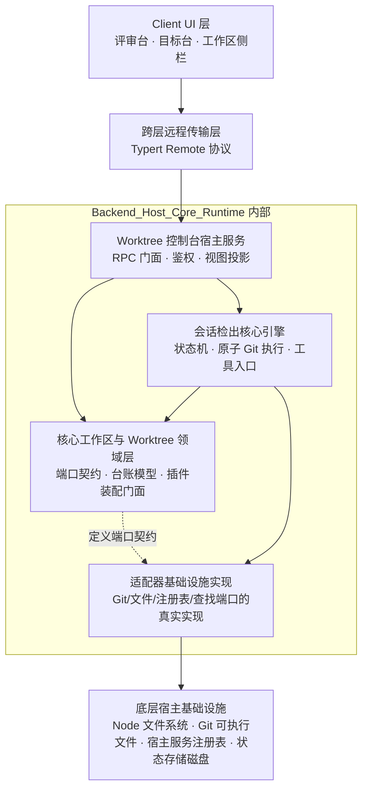

# 后端宿主核心运行时（Backend_Host_Core_Runtime）总览

## 模块定位
Backend_Host_Core_Runtime 是 dsh-git-worktree 插件的服务端核心运行时，承载托管 Git Worktree 全生命周期的业务能力，位于客户端 UI 层与 DSH 宿主底层基础设施之间，是整个托管工作树能力的服务端承载层。

本模块的核心价值目标：
1.  **安全隔离的工作边界**：为 AI 模型 Agent 提供完全独立的托管工作树环境，所有任务变更在隔离 worktree 中完成，全程不干扰用户本地工作区的未提交改动，避免开发过程中的状态污染
2.  **事务化可靠状态管理**：建立崩溃可恢复、并发安全的持久化台账机制，所有写操作前置 journal 记录，跨进程并发下通过原子文件锁保证读-改-写的一致性，任意步骤中断后可通过启动期对账流程收敛到正确状态，不留孤立残留
3.  **收敛式安全硬化**：将所有与 Git、文件系统、宿主服务交互的安全规则统一收拢：包括 Git 命令环境净化、超时控制、原子文件写入、目录身份校验、用户引用零碰撞的内部命名空间、符号链接访问防护，从底层杜绝仓库劫持、误删文件、命令注入等安全风险
4.  **统一服务化接口**：对外提供经过鉴权与视图投影的 RPC 服务接口，将内部域操作转化为客户端可安全消费的结构化视图，支撑客户端目标控制台、评审面板、工作区侧栏等交互功能

## 模块架构
本模块整体遵循六边形（端口-适配器）架构原则，领域逻辑完全不依赖具体底层实现，所有宿主相关的硬件细节都被隔离在适配器层，核心状态机可在无真实文件系统或 Git 环境的测试中完整运行。各分层的交互关系如下图所示：

依赖方向上：领域层位于架构中心，定义所有对外依赖的端口接口；适配器层实现这些端口，对接真实底层基础设施；执行引擎依赖领域层的契约与类型，通过适配器层的能力完成事务性操作；控制台服务层通过领域层暴露的统一门面，将操作投影为远程可消费的安全视图，经传输层提供给客户端。

## 核心组件文档索引
本模块按职责拆分为四个独立的子模块，各模块的详细设计、接口定义与实现细节可参考对应文档：

| 子模块 | 核心职责 |
| --- | --- |
| [核心工作区与 Worktree 领域层](Backend_Host_Core_Runtime/Core_Workspace___Worktree_Domain_Layer.md) | 维护宿主无关的领域契约：包括四类六边形端口接口、持久化台账记录模型、八态交付状态机、插件总装门面 `SessionCheckoutModule`，以及跨宿主版本兼容探测、官方 Workspace 服务接管、官方 worktree 纳管等公共领域逻辑 |
| [会话检出核心引擎](Backend_Host_Core_Runtime/Core_Session_Checkout_Engine.md) | 实现会话检出全流程的执行内核：包含无副作用的跨平台路径候选解析、事务化项目绑定、排他锁队列内的原子 Git 操作（应用变更、预览回滚、检查点、分支提交）、面向模型的工具入口与会话工作目录（cwd）的迁入/迁出生命周期管理 |
| [适配器基础设施实现](Backend_Host_Core_Runtime/Adapter_Infrastructure_Implementations.md) | 落地所有领域端口的真实宿主实现：包括经过安全硬化的 Git 子进程执行、崩溃安全的原子 JSON 注册表、带目录身份校验的文件操作、宿主服务查找与会话工作目录管理、项目 Skill 快照携带与挂载；所有安全防护逻辑（超时、环境净化、跨进程锁、符号链接拦截）均统一收敛在此层 |
| [Worktree 控制台宿主服务](Backend_Host_Core_Runtime/Worktree_Console_Host_Service.md) | 构建面向客户端的 RPC 服务层：处理请求鉴权与路径归属校验、业务端点分发、控制台视图投影、统一结果信封封装、沙箱化的评审 diff 取证，为客户端 UI 提供低开销、高安全的远程接口 |