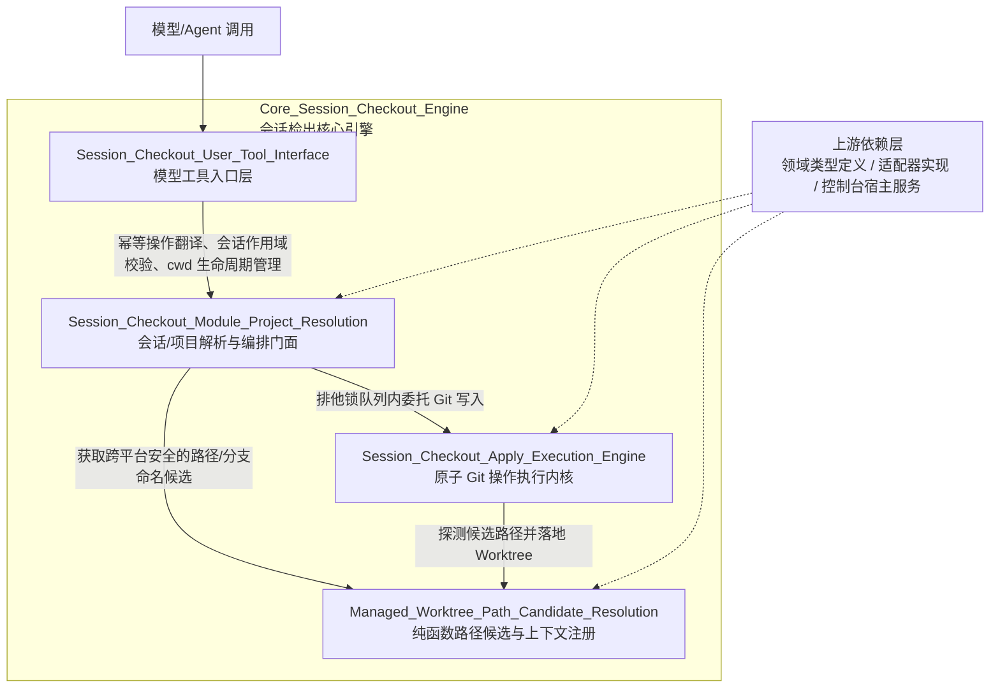

# 会话检出核心引擎（Core_Session_Checkout_Engine）

## 模块定位与目标
Core_Session_Checkout_Engine 是部署于后端核心运行时（Backend_Host_Core_Runtime）内部的核心业务模块，承载托管 Git Worktree 会话检出体系的全流程能力。它的核心目标是在用户本地工作仓库与隔离托管 Worktree 之间建立安全、可恢复、并发安全的协作边界：让模型 Agent 可以在独立的工作树中完成任务开发，所有变更通过严格的原子操作流程回写或提交，全程避免污染用户的本地未提交改动，同时保证任意步骤崩溃后都能通过台账日志恢复到一致状态。

模块整体遵循分层解耦设计：纯计算层无副作用、编排层负责事务与状态、执行层负责原子操作、接口层负责安全校验，各层职责严格分离，避免逻辑跨层耦合。

## 模块架构
模块内部由四个职责清晰的核心子组件构成，交互关系如下图所示：

## 核心组件文档
引擎内部各子组件的详细实现、接口设计与操作流程可参考对应文档：

| 子组件 | 核心职责 |
| --- | --- |
| [托管 Worktree 路径候选解析](Core_Session_Checkout_Engine/Managed_Worktree_Path_Candidate_Resolution.md) | 完全无副作用的纯函数命名层，生成跨平台兼容的目录路径、Git 分支候选，注册会话目标系统提示上下文，全程不执行文件系统 I/O 或 Git 命令 |
| [会话检出模块项目解析](Core_Session_Checkout_Engine/Session_Checkout_Module_Project_Resolution.md) | 引擎门面与编排层，完成会话到项目的绑定解析，通过排他锁队列序列化变更操作，对接持久化台账实现状态管理与启动期崩溃收敛 |
| [会话检出应用执行引擎](Core_Session_Checkout_Engine/Session_Checkout_Apply_Execution_Engine.md) | 无状态 Git 执行内核，通过快照指纹 CAS 校验、临时对象隔离、index 原子锁机制，安全完成变更应用、预览回滚、检查点、分支提交等原子操作 |
| [会话签出用户工具接口](Core_Session_Checkout_Engine/Session_Checkout_User_Tool_Interface.md) | 面向模型的唯一工具入口，注册全部工作树操作工具，强制会话作用域校验，管理会话工作目录（cwd）的迁入/迁出生命周期，实现交付门禁控制 |

## 核心设计保障
整套引擎在长期运行中统一遵循以下不变量，保证功能稳定可靠：
1.  **分层无副作用**：路径候选层为纯函数无 I/O，执行引擎无状态业务逻辑，编排层不直接拼接路径或执行 Git 子进程，各层职责严格收口
2.  **崩溃可恢复**：所有写入操作前置 journal 记录，任意步骤中断后都可以通过启动期 `reconcile` 流程收敛到确定状态，不会留下孤立的 Git 对象或损坏的索引
3.  **并发安全**：所有变更操作通过同一把排他锁序列化，避免台账读-改-写交错导致的状态不一致
4.  **跨平台兼容**：路径命名清洗、Git 执行参数全链路适配 Windows 保留名、长路径、hook 禁用等环境约束，保证在不同操作系统上行为一致