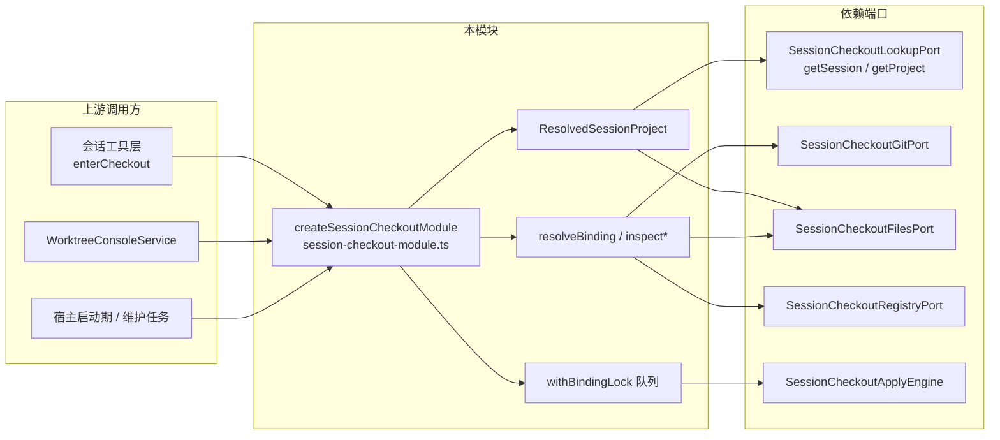
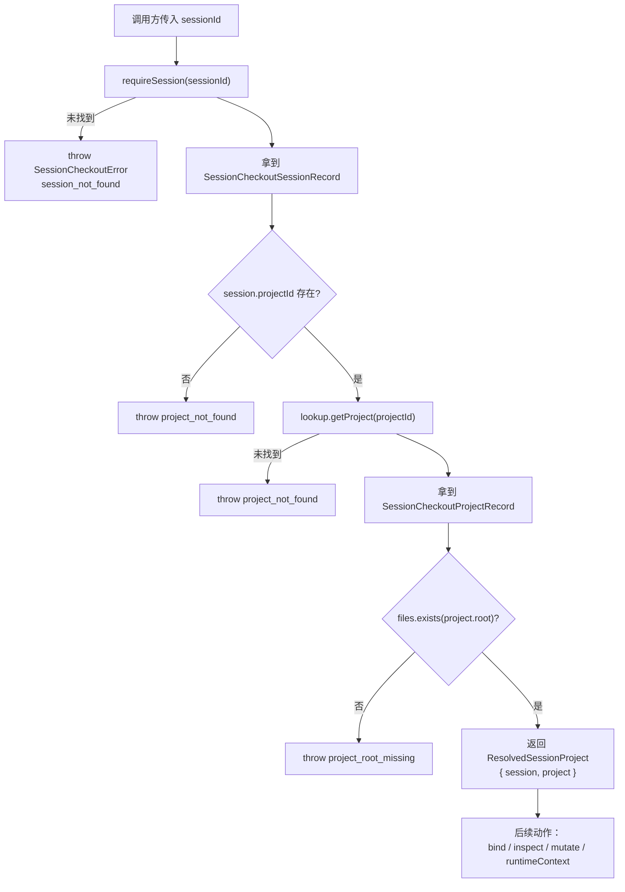
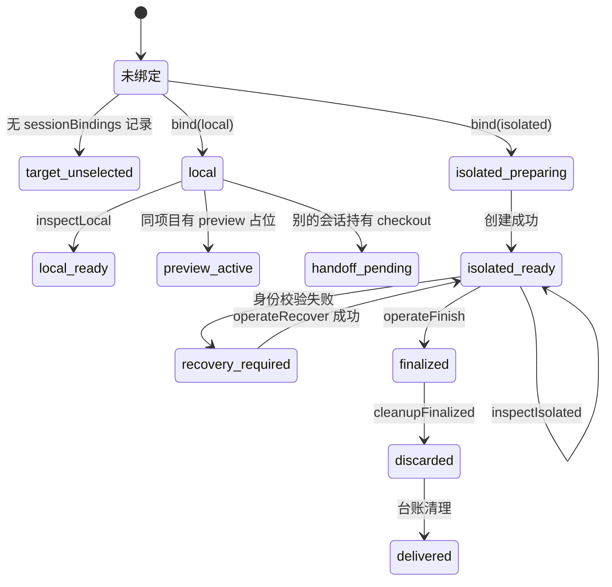
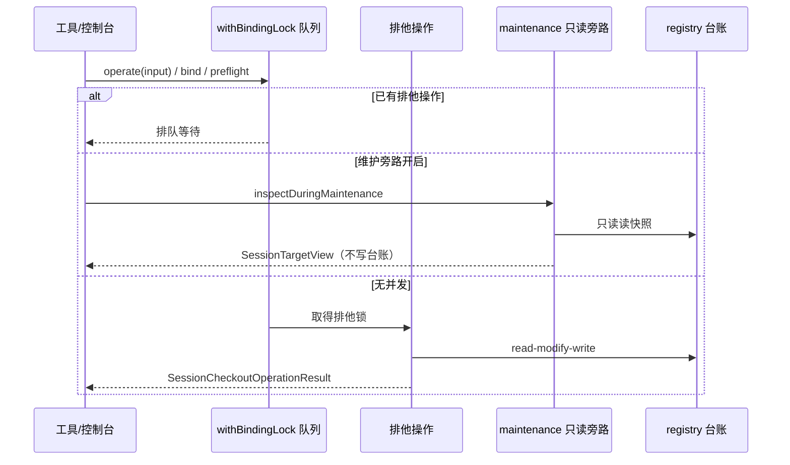
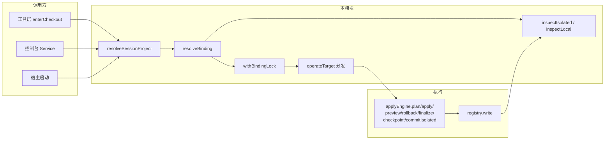

# 会话检出模块 · 项目解析（Session_Checkout_Module_Project_Resolution）

## 简介

本模块是 `dsh-git-worktree` 会话检出状态机的**门面与项目解析层**，落地于 `src/session-checkout-module.ts`。它对外导出工厂函数 `createSessionCheckoutModule(dependencies)`，返回完整的 `SessionCheckoutModule` 实现；其代表类型为 `ResolvedSessionProject`，把「一个 Agent 会话」解析成「会话记录 + 所属项目记录」的二元组，作为一切后续检出/交付动作的权威入口。

该层承担三类职责：

1. **会话 → 项目解析**：通过 `SessionCheckoutLookupPort` 取回 `SessionCheckoutSessionRecord` 与 `SessionCheckoutProjectRecord`，校验项目根目录存在性，产出 `ResolvedSessionProject`。
2. **会话绑定（binding）解析与目标投影**：把 `sessionId` 解析为 `SessionBindingRecord`（local / isolated 两种目标），再经身份校验（realpath / commonDir / inode）产出稳定的 `SessionTargetView`。
3. **编排（orchestration）**：把工具接口发起的 mutate 操作（apply / preview / finish / checkpoint / discard / recover / cleanup…）序列化到同一把排他锁下，委托给 [Session_Checkout_Apply_Execution_Engine](Session_Checkout_Apply_Execution_Engine.md) 执行真正的 Git/索引写入，再把回写结果投影回 registry 台账。

> 说明：`session-checkout-module.ts` 是整个会话检出模块的单体文件实现，但本页聚焦于其中「项目解析 / 绑定解析 / 目标投影 / 编排入口」这一面；真正的 Git apply、preview receipt、checkpoint 写入等执行细节见 apply 引擎页。

---

## 核心组件

### `ResolvedSessionProject`

```ts
interface ResolvedSessionProject {
  session: SessionCheckoutSessionRecord
  project: SessionCheckoutProjectRecord
}
```

它是「会话解析为项目」的最小值对象，由 `resolveSessionProject(sessionId)` 产出：

| 步骤 | 行为 | 失败错误码 |
| --- | --- | --- |
| 1 | `dependencies.lookup.getSession(sessionId)` | `session_not_found` |
| 2 | 校验 `session.projectId` 非空 | `project_not_found` |
| 3 | `dependencies.lookup.getProject(session.projectId)` | `project_not_found` |
| 4 | `dependencies.files.exists(project.root)` | `project_root_missing` |

任何一步失败都抛出 `SessionCheckoutError`，由调用方（`bind` / `inspect` / `runtimeContext` / 各 mutate 入口）统一翻译成操作错误。

### 工厂函数 `createSessionCheckoutModule`

接收 `SessionCheckoutDependencies`（lookup / git / files / registry / applyEngine / 配置项），闭包内组装出全部内部函数并返回 `SessionCheckoutModule` 接口。关键内部能力：

- `requireSession` / `resolveSessionProject`：会话与项目解析。
- `resolveBinding`：从 registry 的 `sessionBindings` 读出该会话的 `SessionBindingRecord`，处理 projectId 漂移（`project_mismatch`）与「未选目标」（`target_unselected`）。
- `inspectLocal` / `inspectIsolated`：把 binding 投影成 `SessionTargetView`；isolated 路径会调用 `validateManagedCheckoutDetailed` 做四重 realpath + commonDir 身份校验。
- `withBindingLock`：排他 / 维护（maintenance）双模式队列，保证 inspect 与 mutate 不并发写 registry。
- `reconcile`：启动期扫描台账，按 journal 步骤把中断的 mutating 记录回退到 ready / recovery_required / recovered。
- `bindTarget` / `beginNextIterationTarget`：创建 / 复用 / 下一代迭代的完整工作树生命周期入口。
- 官方建树后的插件补充能力：官方只做 `git worktree add`，本模块在登记台账前先用 `git.inspect` 读取本地项目根快照，把 `.worktreeinclude` 列出的 gitignored 文件拷入新 Worktree（`copyWorktreeincludeFiles`）；仅当新 Worktree 基点（`baseCommit`）恰等于本地 HEAD 且 `inheritLocalChanges` 未显式关闭时，才把本地未提交修改一并携带进 Worktree（`carryLocalWorkInProgress`）——补丁以本地 HEAD 为基准，基点为其他分支 tip 时不适用。

---

## 架构与依赖关系



**依赖说明**：

- `lookup` / `git` / `files` / `registry` / `applyEngine` 全部来自 [`SessionCheckoutDependencies`](../Adapter_Infrastructure_Implementations.md)，本模块不直接依赖 Node git 实现，而是通过端口反转。
- 路径候选生成委托给 [Managed_Worktree_Path_Candidate_Resolution](Managed_Worktree_Path_Candidate_Resolution.md)（`createManagedWorktreePathCandidates` / `createSessionBranchCandidates` 等）。
- 真正的 `plan` / `apply` / `preview` / `rollback` / `finalize` / `checkpoint` / `commitIsolated` 调用落到 [Session_Checkout_Apply_Execution_Engine](Session_Checkout_Apply_Execution_Engine.md)。
- 工具层（`enterCheckout`）仅做参数解析与错误翻译，见 [Session_Checkout_User_Tool_Interface](Session_Checkout_User_Tool_Interface.md)。

---

## 项目解析流程



---

## 绑定解析与目标投影

`resolveBinding(sessionId)` 是所有读路径的统一入口：



身份校验（`validateManagedCheckoutDetailed`）会并行做四件事：

1. `files.canonicalize` managedRoot / managedGitRoot / localRoot / projectRoot；
2. 比较 `localSnapshot.commonDir === record.gitCommonDir` 与 `managedSnapshot.commonDir === record.gitCommonDir`；
3. 校验 `resolvedPathsEqual`（防止 Junction / symlink 冒充原目录）；
4. 在非创建路径下跑 `checkpointHeadInvariantHolds`，证明每个 checkpoint OID 仍是可达祖先。

瞬时 I/O 故障（git spawn 超时、杀软占用）返回 `{ status: 'unavailable' }`，**不会**污染健康 Worktree；只有确定的身份/路径不匹配才持久落入 `recovery_required`。

---

## 并发与编排模型



`withBindingLock` 维护三种模式：

- `exclusive`：所有 mutate / bind / reconcile 写入；
- `maintenance`：`reconcile` / `cleanupExpiredRetained` / `enforceWorktreeKeepCount`，允许只读 inspect 旁路；
- `maintenance_draining`：维护结束时关闭新旁路，等已启动 inspect 排空后再放 mutate。

这保证了启动期扫描不会被一个卡死的 cleanup 阻塞所有会话，也避免了读-改-写在 registry 上交错丢更新。

---

## 关键数据流



---

## 配置与运行时

工厂接受若干「本地适配」配置（均支持 `LiveValue` 实时读取）：

| 配置 | 默认 | 作用 |
| --- | --- | --- |
| `autoPush` | `true` | finish 后尽力 push 会话分支；失败降级为结果备注 |
| `autoDeliver` | `true` | 切换 working 态指引到 `worktree_deliver` |
| `worktreesRoot` | — | 托管 Worktree 落在此根下（带 topic/日期命名） |
| `inheritLocalChanges` | `true` | 新建 Worktree 时把本地未提交改动带进 Worktree；仅当新 Worktree 基点恰为本地 HEAD 时生效（基点为其他分支 tip 时补丁不适用）；另始终（与该开关无关）拷贝 `.worktreeinclude` 列出的 gitignored 文件 |
| `worktreeKeepCount` | `15` | 已交付 Worktree 的 LRU 配额，逐出走完整 discard 安全链 |

启动期 `reconcile` 会被宿主调用，按 journal 步骤收敛中断状态；单个卡死的 cleanup 受 `CHECKOUT_CLEANUP_TIMEOUT_MS = 120_000` 收敛超时保护，且同一 checkout 的在跑清理通过 `cleanupInFlight` Map 复用 promise，避免读-改-写交错。

---

## 与其他模块的关系

- 上级容器：[Core_Session_Checkout_Engine](../Core_Session_Checkout_Engine.md)
- 路径候选：[Managed_Worktree_Path_Candidate_Resolution](Managed_Worktree_Path_Candidate_Resolution.md)
- 执行引擎：[Session_Checkout_Apply_Execution_Engine](Session_Checkout_Apply_Execution_Engine.md)
- 工具接口：[Session_Checkout_User_Tool_Interface](Session_Checkout_User_Tool_Interface.md)
- 端口与适配器：[Adapter_Infrastructure_Implementations](../Adapter_Infrastructure_Implementations.md)
- 领域类型（`SessionTargetView` / `ManagedCheckoutRecord` / `SessionBindingRecord` 等）：[Core_Workspace___Worktree_Domain_Layer](../Core_Workspace___Worktree_Domain_Layer.md)
- 控制台宿主服务（消费 `SessionCheckoutModule`）：[Worktree_Console_Host_Service](../Worktree_Console_Host_Service.md)