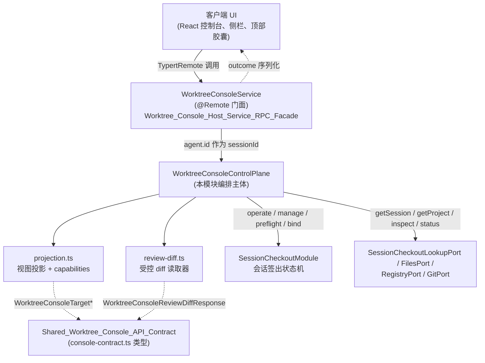
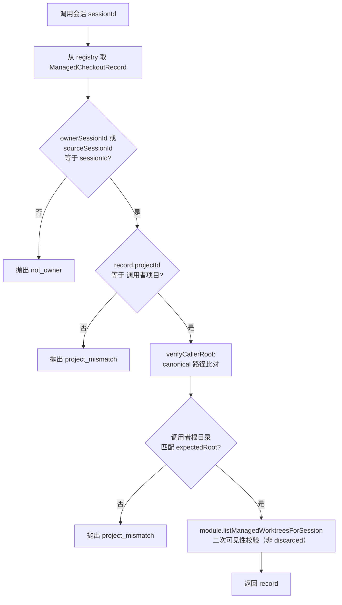
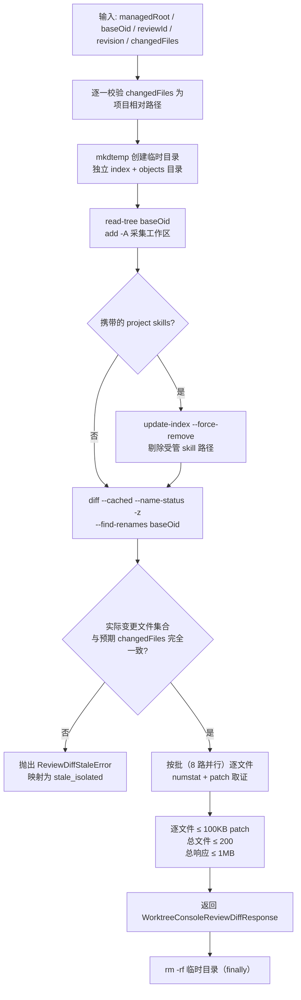
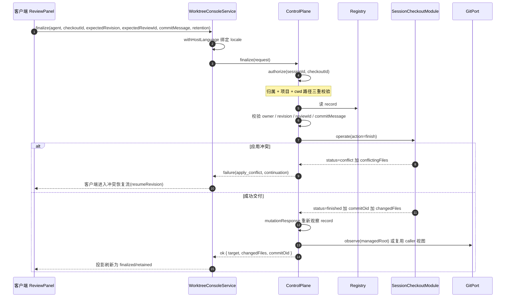
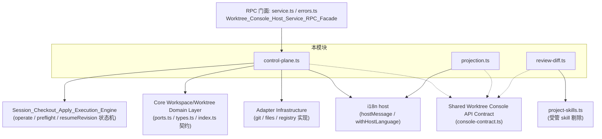

# Worktree Console Host Service 控制面

## 简介

`Worktree_Console_Host_Service_Control_Plane` 是 Worktree 控制台 Host 侧的**业务控制层**，位于 RPC 传输门面与会话签出状态机之间。它承接来自客户端的所有控制台调用，负责：

1. **身份与路径授权**：校验调用会话是否有权访问目标 `checkout`，并通过项目根目录的 canonical 路径比对防止跨会话越权；
2. **状态机编排**：把控制台语义操作（预览、验收、丢弃、回滚、保留等）翻译为 [Core_Session_Checkout_Engine](../Core_Session_Checkout_Engine.md) 状态机的 `operate` / `manage` 调用，并在 CAS（revision / reviewId）冲突时返回 `stale_target` 类错误；
3. **域记录到控制台视图的投影**：把持久化的 `ManagedCheckoutRecord` 投影为客户端可渲染的 `WorktreeConsoleTargetSummary` / `WorktreeConsoleTargetDetails`，并按调用者身份裁剪可用 `capabilities`；
4. **只读取证**：独立实现 Git 分支图、标签、概览以及验收 diff 的受控读取，附带文件数 / 字节数 / 路径安全上限。

本模块本身**不直接绑定 RPC 协议**——它是纯业务逻辑，由 [Worktree_Console_Host_Service_RPC_Facade](Worktree_Console_Host_Service_RPC_Facade.md)（`WorktreeConsoleService` 类）以 `@Remote` 方法包装后对外暴露。上层整体定位参见 [Worktree_Console_Host_Service](../Worktree_Console_Host_Service.md) 与 [Backend_Host_Core_Runtime](../../Backend_Host_Core_Runtime.md)。

## 组成文件

| 文件 | 核心导出 | 职责 |
| --- | --- | --- |
| `src/console-host/control-plane.ts` | `createWorktreeConsoleControlPlane`、`WorktreeConsoleControlPlane`、`WorktreeConsoleControlPlaneOptions` | 34 个控制台方法的编排主体：授权、观察、投影、状态机分发 |
| `src/console-host/projection.ts` | `capabilities`、`projectRecord`、`projectDetails`、`projectLocal`、`sourceBranchFromRef` | 域记录 → 控制台契约视图的纯函数投影 |
| `src/console-host/review-diff.ts` | `createGitWorktreeReviewDiffReader`、`WorktreeReviewDiffReader`、`ReviewDiffStaleError`、`ChangedEntry`、`GitOutput`、`ReviewDiffReadInput` | 基于临时 index 的验收 diff 取证读取器 |

## 架构定位



## 依赖注入：`WorktreeConsoleControlPlaneOptions`

`createWorktreeConsoleControlPlane(options)` 是唯一入口，options 形状：

| 字段 | 类型 | 作用 |
| --- | --- | --- |
| `module` | `SessionCheckoutModule` | 会话签出状态机（inspect / operate / manageManagedWorktreeForSession / preflight / bind / observeManagedCheckout(s) 等），来自 [Core_Session_Checkout_Engine](../Core_Session_Checkout_Engine.md) 与 [Core_Workspace___Worktree_Domain_Layer](../Core_Workspace___Worktree_Domain_Layer.md) |
| `lookup` | `SessionCheckoutLookupPort` | 会话 / 项目 / 侧栏目录成员查询（`getSession`、`getProject`、`getSessionCwd`、`getSidebarMemberships`） |
| `files` | `SessionCheckoutFilesPort` | 文件存在性与 `canonicalize` 路径规范化 |
| `registry` | `SessionCheckoutRegistryPort` | 原子 JSON 注册表读取（`managedCheckouts`、`sessionBindings`） |
| `git` | `SessionCheckoutGitPort` | 只读 Git 端口：`inspect`、`status`、`branchOverview`、`graphLog`、分支与标签增删推 |
| `reviewDiff` | `WorktreeReviewDiffReader` | 由 `createGitWorktreeReviewDiffReader` 构造的 diff 读取器实例 |
| `createTargetSessionId?` | `() => string` | 为 preview-recovery handoff 生成新目标会话 ID，默认 `randomUUID` |

底层端口的具体实现位于 [Adapter_Infrastructure_Implementations](../Adapter_Infrastructure_Implementations.md)（`AtomicJsonCheckoutRegistry`、Node 文件端口、Git 端口等）。

## 接口表面：`WorktreeConsoleControlPlane`

控制平面接口被 RPC 门面一一映射为 `@Remote` 方法，按职责分为六组：

```mermaid
flowchart LR
    subgraph 读取与列表
        A1["sidebarTopology()"]
        A2["current(sessionId)"]
        A3["list(request)"]
        A4["inspect(sessionId, checkoutId)"]
        A5["listAbandoned / restoreAbandoned"]
    end
    subgraph 验收与预览生命周期
        B1["reviewDiff(request)"]
        B2["preflight / previewRecoveryPreflight"]
        B3["preview / checkpoint / resumeRevision"]
        B4["rollbackPreview / discard"]
        B5["finalize / finalizePreview"]
    end
    subgraph 恢复与续作
        C1["preparePreviewRecoveryAnalysis"]
        C2["createPreviewRecoveryHandoff"]
        C3["prepareReviewRegeneration"]
        C4["beginNextIteration / returnToLocal"]
    end
    subgraph 保留与清理
        D1["setRetention / setPermanent"]
        D2["retryCleanup / clearSidebarBadge"]
    end
    subgraph Git 表面（项目根,非worktree）
        E1["gitOverview / gitGraph"]
        E2["gitCreateBranch / gitSwitchBranch"]
        E3["gitPruneMergedBranches"]
        E4["gitListTags / gitCreateTag / gitDeleteTag / gitPushTag"]
    end
    subgraph 项目初始化
        F1["initProject(sourceSessionId)"]
    end
```

所有方法均返回 `Promise<WorktreeConsoleOutcome<T>>`（即 `{ ok: true, value } | { ok: false, error }`），由 `outcome()` 包装器把抛出的域错误自动转换为失败结果，详见下文「错误处理」。

## 安全授权模型

授权是本模块最核心的不变量，分为三层，逐层收紧：

### 1. 归属校验（`authorize`）



- 所有者会话对 `managedRoot` 授权；来源（Local）会话对 `localRoot` 授权；
- 已交付（`discarded` / `finalized` / `retained` 且 `worktreeReachedDelivery`）的终结态记录通过 **Local 边界豁免**：所有者会话的实时 cwd 已回到 Local，此时以 `project.root == record.localRoot` 作为授权边界，而不是要求 cwd 仍落在已清理的冻结目录里；
- 路径 canonical 结果通过 `canonicalCache` 记忆化，避免一次授权重复最多四次 realpath 系统调用。

### 2. 关联读通道（`linkedReadAccess`）

允许**非归属会话**（例如正持有验收位的 isolated 会话的验收对象）以只读方式访问同组记录：

- 要求同一 `projectId`、同一来源会话、同一 `localRoot`，或恰好是当前验收位持有者的目标记录；
- 校验通过后打 `linkedRead: true` 标记，投影层据此**隐藏 `deliveryProof`**（跨会话不交付交付证明）并收紧 `open` 能力；
- 读取时会二次比对 registry 快照，若验收位持有者在读取途中发生变化，则抛出 `not_owner`（文案「验收位持有者已变更，请重试」）。

### 3. 所有者专属写操作

`requireOwner` 单独把关 `setRetention` / `setPermanent` / `retryCleanup`：这些操作直接删除磁盘上的冻结目录，绝不允许已脱离 owner 的 Local 会话代行。同样，`finalize` / `preview` / `checkpoint` / `resumeRevision` 等验收写操作一律要求 `ownerSessionId === sessionId`。

### 输入安全净化

- `safeRecoveryRequestId`：恢复类 requestId 长度 ≤ 500 且不含 NUL / CR / LF；
- `safeConflictFile`：冲突文件路径拒绝绝对路径、盘符路径、控制字符、`..` 段，且总数 ≤ 500；
- `isValidCommitMessage`（定义于 [commit-message.ts](../Core_Workspace___Worktree_Domain_Layer.md)）：非空且不含 NUL；
- diff 路径在 `review-diff.ts` 的 `projectPath` 中再次校验为项目相对路径。

## 观察缓存与性能优化

顶部胶囊每 5 秒轮询一次 `current`，因此模块内置两层去重：

1. **`observeFromCaller`**：若本次请求已经通过 `module.inspect(sessionId)` 得到了一个 `ready` 阶段、`owner` 归属、同 `revision` 的 `SessionTargetView`，则直接复用其中的 branch / HEAD / dirty，不再对同一记录重复执行 `git inspect` + `git status` 三连 spawn（Windows 上每次约 30–50ms）；
2. **`list` 的批量观察**：优先调用 `module.observeManagedCheckouts(ids)` 一次性批量验证全部记录；模块未提供或批量失败时逐条降级 `observe`，单条验证失败的记录以无观察投影渲染（不拖垮整个列表），后续写操作的 CAS 校验仍会兜底拒绝。

## 投影层（projection.ts）

`capabilities(record, callerSessionId, ownerSessionAvailable, linkedRead)` 是**客户端按钮可见性的唯一事实来源**，按域状态派生每个动作的可用性：

| 能力位 | 启用条件（摘要） |
| --- | --- |
| `preflight` / `preview` / `finalize` | 仅 owner 且 `ready + ready_for_review` |
| `checkpoint` | owner 且 `ready` 或 `preview_active` |
| `rollbackPreview` | owner 且 preview_active / preview_detached / rollback 恢复中 |
| `discard` | owner（或 owner 缺席时的 source 预留）且活动中 |
| `setRetention` | owner 且 delivery.state = `retained` |
| `retryCleanup` | owner 且 `finalized` / `retained` |
| `beginNextIteration` | owner 且 `discarded + delivered`（已交付并清理） |
| `returnToLocal` | owner 且已达交付态 |
| `open` | 读授权且记录活动中（linkedRead 还要求 owner 会话仍存在） |

`projectRecord` / `projectDetails` 则把 `ManagedCheckoutRecord` 拍平为契约类型，关键规则：

- **侧栏任务状态**由 `sidebarTaskState` 推导：交付优先于 phase（`discarded + delivered` 读作 `finalized` 而非 `discarded`），避免已完成任务被误报为废弃；
- **`reviewSlot`**：同一 `localRoot` 上存在另一个 preview 中的记录时，把当前 `ready_for_review` 记录的验收位标记为 `waiting` 并禁用其 preview / finalize / checkpoint 能力；
- **已交付分支标签**：`settledLocalBranch` 在交付终结态读取 Local 侧当前分支，让顶部胶囊显示用户真正站立的分支（如 `master`），而不是冻结任务分支；
- **checkpoint 代次** `checkpointGenerationForRecord`（定义于 [checkpoint.ts](../Core_Workspace___Worktree_Domain_Layer.md)）对当前 review + checkpoint 链做 SHA-256 规范化 JSON 摘要，作为客户端乐观锁的 CAS 令牌。

## Review Diff 读取器（review-diff.ts）

`createGitWorktreeReviewDiffReader(projectSkills?)` 实现 `WorktreeReviewDiffReader`，用于「查看验收 diff」这一高成本、高安全敏感度的读取：



安全与预算常量：

| 常量 | 值 | 含义 |
| --- | --- | --- |
| `REVIEW_DIFF_MAX_FILES` | 200 | 最多返回的文件条目数 |
| `REVIEW_DIFF_MAX_PATCH_BYTES` | 100 KiB | 单文件 patch 上限（按 UTF-8 前缀截断，不切断多字节字符） |
| `REVIEW_DIFF_MAX_PAYLOAD_BYTES` | 1 MiB | 整个 JSON 响应上限，超限即折叠 patch 并置 `truncated` |
| 批大小 | 8 | 并行取证批大小，避免逐文件串行 spawn 顶爆 SLOW 超时 |

外层 `control-plane.reviewDiff` 在调用读取器**前后**各跑一次 `module.preflight`，并比对 registry 中的 reviewId / isolatedHeadOid / fingerprint 与期望 revision——只有前后两次预检全部通过才返回 diff 字节，否则返回 `stale_isolated` 并丢弃 diff。

## 典型流程时序：验收交付（finalize）



类似的模式贯穿 preview / checkpoint / rollbackPreview / discard：**授权 → CAS 校验 → 状态机操作 → 按返回状态分支（error / conflict / 意外状态 / 预期状态）→ 重新观察并投影**。

## 错误处理与 Outcome 模型

本模块不直接抛出异常给 RPC 层，而是统一转换为 `WorktreeConsoleOutcome`：

- `domainError(code, message, continuation?)`（定义于 [errors.ts](Worktree_Console_Host_Service_RPC_Facade.md)，与 RPC 门面共享）构造带 `code` 的域错误；
- `outcome(async () => { ... })` 包装器捕获异常并交给 `consoleFailure`：已知 `SESSION_CHECKOUT_ERROR_CODES` 逐码透传（可携带 `continuation`，如 apply-conflict 恢复句柄），未识别异常归一为 `git_error`；
- `reviewDiff` / `finalize` / `finalizePreview` 三个方法显式 try/catch 并把 `ReviewDiffStaleError` 映射为 `stale_isolated` 失败，而非崩溃。

错误码与契约字段（`WorktreeConsoleError`、`WorktreeConsoleOutcome`）的完整定义见 [Shared_Worktree_Console_API_Contract](../../Shared_Worktree_Console_API_Contract.md)。

## 与其他模块的关系



- **上游消费**：[Worktree_Console_Host_Service_RPC_Facade](Worktree_Console_Host_Service_RPC_Facade.md) 逐方法委托到本模块，并负责 `@Remote` 装饰、`withHostLanguage` 语言绑定与 ndjson 诊断日志；
- **下游执行**：所有写操作最终落在 [Core_Session_Checkout_Engine](../Core_Session_Checkout_Engine.md) 的 apply 执行引擎；类型与端口契约定义于 [Core_Workspace___Worktree_Domain_Layer](../Core_Workspace___Worktree_Domain_Layer.md)；
- **跨层契约**：请求 / 响应 / 错误形状全部来自 [Shared_Worktree_Console_API_Contract](../../Shared_Worktree_Console_API_Contract.md)，本模块不自行发明字段；
- **客户端投影消费者**：顶部胶囊（`current`）、侧栏（`sidebarTopology`）、Worktree 管理弹窗（`list`）、Review 面板（`reviewDiff` / `preflight` / `preview` / `finalize`）、分支图与标签弹窗（`gitGraph` / `gitListTags` 等）——对应客户端侧的 [Client_Target_Console_Feature](../../Client_UI_Application_Layer/Client_Target_Console_Feature.md)、[Client_Review_Console_Feature](../../Client_UI_Application_Layer/Client_Review_Console_Feature.md) 与 [Client_Workspace_Sidebar_Feature](../../Client_UI_Application_Layer/Client_Workspace_Sidebar_Feature.md)。
