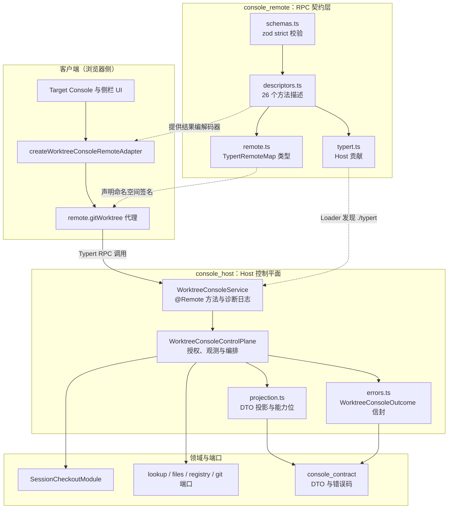
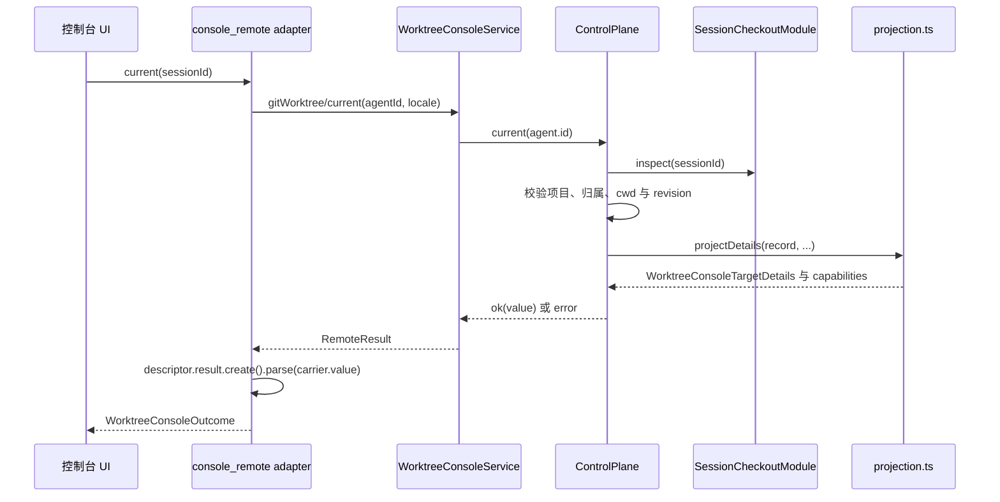

# Console_API_and_Host_Integration：控制台 API 与 Host 集成

`Console_API_and_Host_Integration` 是插件在 **Host 侧控制平面** 与 **Host/Client 远程契约层** 之间的集成模块。它把 `SessionCheckoutModule` 的领域状态机、端口实现与 `console_contract` 中定义的 JSON DTO 连接起来，向浏览器客户端暴露一组以 `gitWorktree` 为命名空间的 Typert Remote 调用。

本模块不实现 Git 操作、不负责持久化、也不渲染 UI。它解决的是三个问题：

- **谁可以做什么**：每次调用都从 `agentId` 解析真实 Session，重新校验项目、owner/source 归属、Session 当前 cwd 与记录 revision，不信任客户端传入的身份。
- **现在是什么状态**：把内部 `ManagedCheckoutRecord` 投影成面向 UI 的、**不含路径**的目标摘要与详情，并计算能力位，让客户端只显示真正可用的动作。
- **变更如何编排**：把 UI 语义翻译成领域模块的 `operate`、`manageManagedWorktreeForSession`、`bind` 等调用，并统一包装为 `WorktreeConsoleOutcome<T>`。

## 模块构成

| 子模块 | 代码位置 | 职责 |
| --- | --- | --- |
| [console_host](Console_API_and_Host_Integration/console_host.md) | `src/console-host/` | Host 侧控制平面、DTO 投影、Typert Remote 服务与诊断日志 |
| [console_remote](Console_API_and_Host_Integration/console_remote.md) | `src/console-remote/` | zod 严格 schema、方法 descriptor、Host Typert 贡献与 Client 类型声明 |

`console_host` 内部又分为三个协作面：

- [console_host_control_plane](Console_API_and_Host_Integration/console_host/console_host_control_plane.md)：25 个控制平面方法，负责授权门、观测复用、评审位仲裁、变更编排与 Git 面代理。
- [console_host_projection](Console_API_and_Host_Integration/console_host/console_host_projection.md)：记录到契约 DTO 的投影、`capabilities` 能力位计算与 `WorktreeConsoleOutcome` 归一化。
- [console_host_rpc_service](Console_API_and_Host_Integration/console_host/console_host_rpc_service.md)：`WorktreeConsoleService` 的 `@Remote` 方法、locale 包装与诊断日志轮转。

`console_remote` 则提供 26 个远端方法的 descriptor、zod schema、Host 侧 `TYPERT` 贡献以及 Client 侧 `remote.gitWorktree` 类型增强。两侧共享同一份 schema 实例，避免编码/解码契约漂移。

## 架构

在装配层面，`WorktreeConsoleService` 与 `createWorktreeConsoleControlPlane(...)` 只在插件入口 `src/index.ts` 的 `apply()` 中实例化一次。控制平面接收 `module`、`lookup`、`files`、`registry`、`git` 以及注入的 `createWorktree` 与 `adoptionFailure`。建树被刻意注入而不是内建，因为创建官方工作树需要 `feat/sess-*` 命名、`.worktreeinclude` 与本地未提交修改继承，并依赖 live `Agent`。

一次 `current` 调用的典型路径如下：

`current` 是唯一会把“调用方观测”透传给后续投影的入口，因此可以复用同一轮询周期内的 `git status` 与 `git rev-parse` 结果；变更类方法则故意不复用观测，一律在事务前重新 inspect。

## 关键设计约束

- **授权先于投影**：记录存在性、owner/source 归属、`projectId` 匹配、`verifyCallerRoot` 与记录可见性按固定顺序校验。已交付终态读走 Local 边界，`requireOwner()` 则更严格地限制删除磁盘目录类操作。
- **列表不泄漏路径**：`targetSummarySchema` 不含路径字段，`managedRoot`、`sourceRoot` 等只出现在 `inspect`/`current` 的详情响应中。
- **能力位由 Host 计算**：`capabilities(record, callerSessionId, ownerSessionAvailable, linkedRead)` 决定客户端可见动作；当项目内已有其他记录持有 Local 预览/验收位时，相关能力降为不可用并附带 `reviewSlotHolder`。
- **统一错误信封**：所有方法返回 `WorktreeConsoleOutcome<T> = { ok: true, value } | { ok: false, error }`。`errors.ts` 提供 `domainError`、`outcome`、`consoleFailure`、`failure` 四种构造/归一化方式；只有 `apply_conflict` 允许携带 `continuation` 恢复凭据。
- **契约宽进严出**：`console_remote` 使用 zod `.strict()` 对象与输入净化，同时通过 `z.boolean().default(false)`、`z.string().nullable().default(null)` 等默认值兼容新旧 Host/Client 独立部署。纯增量能力位不能因为旧 Host 不认识而否决整个响应。
- **诊断尽力而为**：`WorktreeConsoleService` 将 `current` 耗时、失败码、侧栏拓扑与客户端启动自检写入 `<stateDir>/sidebar-diag.ndjson`，写盘异常会被吞掉，不影响 RPC 面。

## 核心组件文档

| 文档 | 内容 |
| --- | --- |
| [console_host](Console_API_and_Host_Integration/console_host.md) | Host 控制平面总览、RPC 调用生命周期、授权模型、观测与性能取舍、错误信封、诊断与构建面 |
| [console_host_control_plane](Console_API_and_Host_Integration/console_host/console_host_control_plane.md) | 25 个控制平面方法的签名、权限判据、CAS 与变更编排细节 |
| [console_host_projection](Console_API_and_Host_Integration/console_host/console_host_projection.md) | 记录到 DTO 的投影规则、能力位计算、`WorktreeConsoleOutcome` 归一化 |
| [console_host_rpc_service](Console_API_and_Host_Integration/console_host/console_host_rpc_service.md) | `WorktreeConsoleService` 的 `@Remote` 方法、locale 包装、诊断日志轮转 |
| [console_remote](Console_API_and_Host_Integration/console_remote.md) | zod schema、descriptor 方法表、Typert Host/Client 贡献、版本兼容与扩展指南 |
| [console_contract](console_contract.md) | 全部请求/响应 DTO、`consoleStateFromDomain`、`worktreeReachedDelivery` 与错误码集合 |
| [Worktree_and_Session_Checkout_Domain](Worktree_and_Session_Checkout_Domain.md) | `SessionCheckoutModule` 的 `inspect`、`operate`、`bind`、`manageManagedWorktreeForSession` 等领域能力 |
| [Ports,_Adapters,_and_Infrastructure](Ports,_Adapters,_and_Infrastructure.md) | `lookup`、`files`、`registry`、`git` 四个端口的真实实现与 `ManagedCheckoutRecord` 类型来源 |
| [Client_Presentation_and_Interaction](Client_Presentation_and_Interaction.md) | 客户端轮询、`TargetConsoleContextLike`、侧栏拓扑消费方与 `$mount` 封装 |