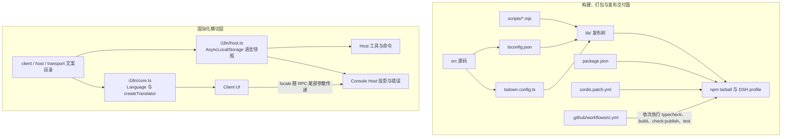

# 横切基础与公共交付面模块总览

`Cross-Cutting_Foundation_and_Public_Surface` 不是业务领域模块，而是 `dsh-git-worktree` 的**横切基础层**。它由两个相互独立、但都被其他模块依赖的能力组成：

- **构建、打包与发布部署配置**：决定源码如何编译为 `lib/` 发布树、如何声明 npm 包形态、如何被 DSH Host 挂载，以及哪些质量门禁必须在发布前通过。
- **国际化基础设施**：为 Client UI、Console Remote、Host 工具与命令提供统一的文案目录、语言解析与调用级语言作用域，使插件自有文案跟随 DSH 的语言选择。

该模块不实现 Worktree 状态机、Session Checkout 或 Console RPC 本身；它提供的是这些模块在**交付时**与**面向用户表达时**所依赖的公共基础。

## 模块定位

| 关注点 | 作用 | 典型载体 |
| --- | --- | --- |
| 编译与打包 | 将 Host 侧 TypeScript 与浏览器 Client bundle 产出到 `lib/` | `tsconfig.json`、`tsdown.config.ts`、`scripts/clean-lib.mjs` |
| 包形态与公共表面 | 声明 `exports` 子路径、`files` 白名单、`dsh` 元数据与依赖分层 | `package.json` |
| Host 挂载 | 让插件安装后被 DSH Loader 实际加载 | `cordis.patch.yml` |
| 发布门禁 | 在 CI 与发布前对产物、导出、挂载和依赖做 fail-closed 校验 | `.github/workflows/ci.yml`、`scripts/check-publish.mjs` |
| 文案与语言 | 提供中英双语文案、语言归一化、Host 调用级语言快照 | `src/i18n/core.ts`、`src/i18n/host.ts`、三个 message catalog |

## 架构总览

构建链路的核心顺序是 `clean-lib` → `tsc` → `tsdown`：先清空 `lib/`，避免已删除模块的陈旧产物被打包；再由 `tsc` 生成 Host 侧 ESM 与 `.d.ts`；最后由 `tsdown` 生成浏览器端 `lib/client.js`，并以 ModuleLoader 包装和虚拟 Workspace Client 模块完成 Client bundle 装配。`package.json` 的 `exports`、`files` 与 `dsh` 元数据共同定义发布物形态，`cordis.patch.yml` 则负责安装后的 Host 挂载。

国际化链路以 `core.ts` 为无环境依赖的翻译核心，三个目录文件只声明双语数据；Host 侧通过 `AsyncLocalStorage` 在每次调用开始时快照语言，使并发请求、工具执行与 Console 投影不会互相串味。Client 侧则通过 Client locale runtime 解析语言，并在 RPC 调用尾部传递可选 `locale` 参数。

## 核心组件文档

| 文档 | 覆盖范围 |
| --- | --- |
| [build_deployment_configuration](Cross-Cutting_Foundation_and_Public_Surface/build_deployment_configuration.md) | 构建流水线、`package.json` 包形态、`cordis.patch.yml` 挂载契约、CI 与发布门禁、`dev:dsh` 本地部署、依赖解析策略 |
| [i18n](Cross-Cutting_Foundation_and_Public_Surface/i18n.md) | 翻译核心、双语目录、Host 语言快照、Client 语言桥接、持久化清理文案白名单、错误码与文案分离 |

## 关键设计约束

- **交付门禁 fail-closed**：发布检查不仅检查源码意图，还实际执行 `lib/client.js`、校验导出目标存在性、Host 单例依赖分层与挂载补丁形态；任一项不满足即阻断发布。
- **包形态与挂载元数据必须一致**：`exports`、`files`、`dsh.bundle.patch`、`dsh.client.inject` 与 `cordis.patch.yml` 共同决定包是否可安装、可加载、可在浏览器注册。
- **文案翻译，数据不翻译**：路径、分支名、Session/Git 标识、用户标题、错误码与第三方错误文本保持原样；只有插件自有文案在产生处本地化。
- **语言按调用快照**：Host 侧使用 `AsyncLocalStorage` 保存单次调用的语言，避免并发请求共享可变语言状态；无法识别语言时回退中文源语言。
- **公共表面由独立文档描述**：包导出的运行时符号与共享 JSON 契约分别属于 `public_api` 与 `console_contract` 文档范围，本模块只负责其构建、发布与文案基础。