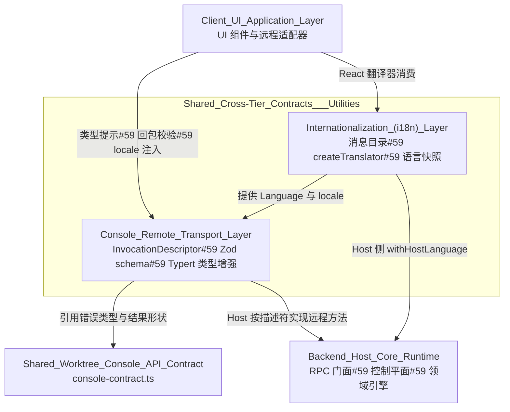

# 共享跨层契约与工具模块（Shared_Cross-Tier_Contracts___Utilities）

## 模块定位

本模块位于 `Client_UI_Application_Layer` 与 `Backend_Host_Core_Runtime` 之间，是两端共享的纯契约与工具层。它不承载业务编排或 UI 实现，而是为 Client 与 Host 提供稳定的跨进程调用形状、运行时校验规则和本地化文案契约，降低两侧独立部署时类型不一致、协议畸形或语言不一致的风险。

主要职责包括：

- 定义 Web 端 Console 与 Node 端 Host 之间的类型化 RPC 契约，覆盖 `gitWorktree` 命名空间下的远程方法描述符、TypeScript 签名与 Zod 校验规则。
- 提供中英双语文案目录、类型安全的占位符翻译器，以及浏览器侧与 Node Host 侧的双通道语言解析机制。
- 作为远程调用结果形状、错误码、`Language` 类型与 locale 透传约定的单一事实来源。

本模块本身不自带协议实现，RPC 能力依赖 `@deepseek-ai/dsh-typert-protocol`、`@deepseek-ai/dsh-typert-registry` 与 `zod` 等共享依赖。

## 架构视图

架构关系要点：

1. `Console_Remote_Transport_Layer` 同时服务 Client 与 Host：Host 侧通过描述符注册可调用方法，Client 侧通过同一套描述符获得类型提示并对回包做二次校验。
2. `Internationalization_(i18n)_Layer` 为 RPC 调用提供 `locale?: Language` 参数约定，并保证 Host 端错误消息、业务文案与当前 UI 语言一致。
3. `Shared_Worktree_Console_API_Contract` 提供 `WorktreeConsoleOutcome`、请求响应类型与稳定错误码，文案内容不参与契约判别。

## 核心组件文档

- [Console_Remote_Transport_Layer](Shared_Cross-Tier_Contracts___Utilities/Console_Remote_Transport_Layer.md)：类型化 RPC 契约与传输层，包含远程方法描述符、Zod 校验 schema、Typert 类型增强和 Host 贡献清单。
- [Internationalization_(i18n)_Layer](Shared_Cross-Tier_Contracts___Utilities/Internationalization_(i18n)_Layer.md)：国际化共享层，包含 Client/Host/传输三类文案目录、类型安全翻译器、语言归一化与 `AsyncLocalStorage` 语言快照。
- [Shared_Worktree_Console_API_Contract](Shared_Worktree_Console_API_Contract.md)：共享 API 契约，定义跨层使用的 TypeScript 类型、`WorktreeConsoleOutcome` 形状与错误码枚举。