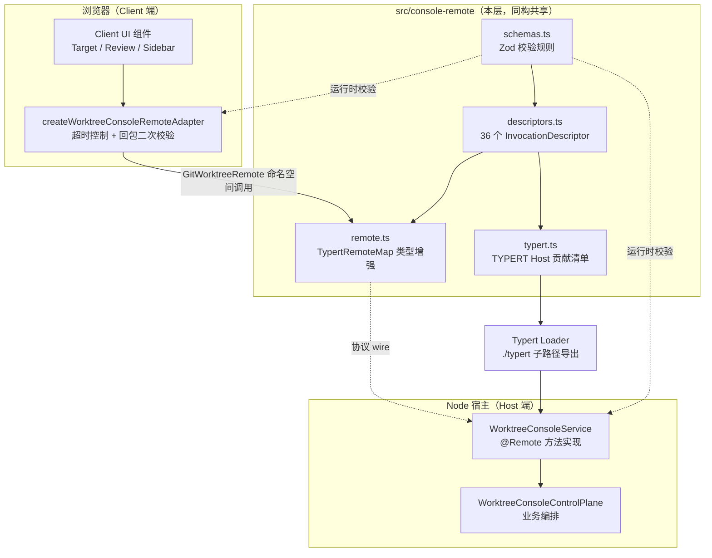
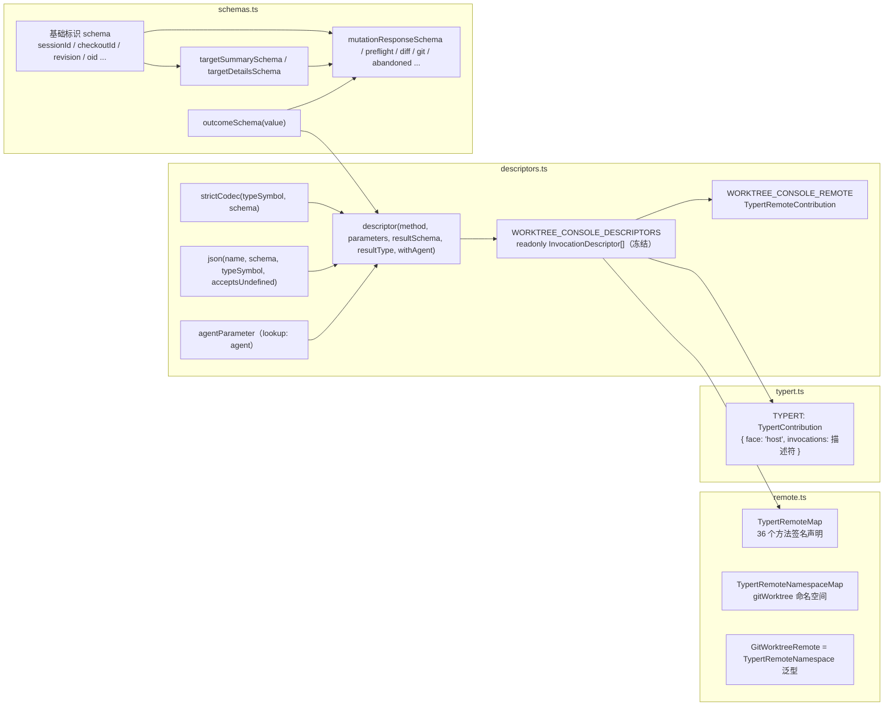
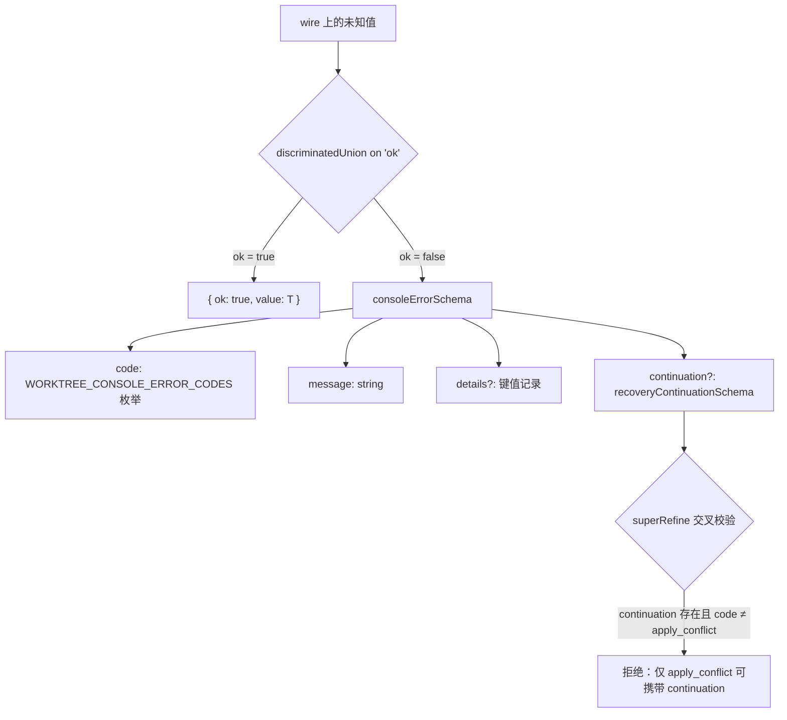
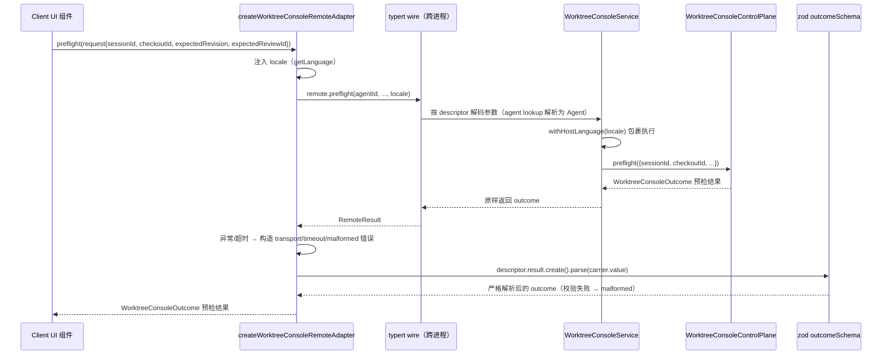
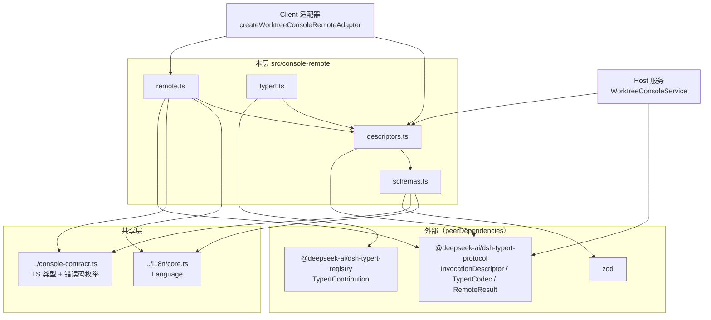

# Console Remote 传输层（Console_Remote_Transport_Layer）

## 简介

`Console_Remote_Transport_Layer` 是 Web 端 Console 与 Node 端 Host 之间的 **类型化 RPC 契约与传输层**，位于 `src/console-remote/` 目录。它基于 DSH 官方的 `@deepseek-ai/dsh-typert-protocol` 协议栈，把 `gitWorktree` 命名空间下的 **36 个远程方法** 统一描述为可被协议运行时消费的 `InvocationDescriptor`，并用 Zod schema 对每一次跨进程调用的入参与回包做严格校验。

本层是整个 Worktree Console 前后端链路的「单一事实来源」：

- **描述符（descriptors.ts）** 声明方法的 wire 格式、参数来源与结果编码，Host 侧的 `@Remote` 服务方法按这些描述符逐一实现；
- **远程命名空间类型（remote.ts）** 通过模块增强（module augmentation）把 36 个方法的 TypeScript 签名注册进 `TypertRemoteMap`，让 Client 端获得完整的类型提示；
- **Zod schema（schemas.ts）** 定义所有响应体的运行时校验规则，并以 `outcomeSchema` 统一「成功 / 失败」的判别联合（discriminated union）形状；
- **Typert 贡献清单（typert.ts）** 通过 `package.json` 的 `./typert` 子路径导出，被官方 Typert Loader 在 Host 端发现并注册。

与本层紧密协作的上下游模块：

- 类型定义与错误码常量来自 [Shared_Worktree_Console_API_Contract.md](../Shared_Worktree_Console_API_Contract.md)（`src/console-contract.ts`）；
- `Language` 枚举与 locale 语言处理来自 [Internationalization_(i18n)_Layer.md](Internationalization_(i18n)_Layer.md)；
- Host 侧服务实现见 [Worktree_Console_Host_Service.md](../Backend_Host_Core_Runtime/Worktree_Console_Host_Service.md)；
- Client 侧装配见 [Client_Core_Infrastructure.md](../Client_UI_Application_Layer/Client_Core_Infrastructure.md) 中的 `createWorktreeConsoleRemoteAdapter`。

---

## 体系结构与分层位置



要点：

1. `descriptors.ts` 同时服务两侧——Host 端 Loader 用它注册可调用的远程方法，Client 端 Adapter 用它按描述符对回包做二次解析；
2. `remote.ts` 是纯类型模块（`declare module '@deepseek-ai/dsh-typert-protocol'`），不产生运行时代码，仅让 `remote.gitWorktree.current(...)` 这类调用在编译期完整可推导；
3. 协议包 `@deepseek-ai/dsh-typert-protocol` 与 `@deepseek-ai/dsh-typert-registry` 均为 `peerDependencies`（见 `package.json`），意味着本层不自带协议实现，而是寄生在宿主已安装的 DSH 运行时上。

---

## 模块内部组件



### descriptors.ts — 远程方法描述符工厂

核心导出：

| 导出 | 说明 |
| --- | --- |
| `descriptor()` | 为单个方法构造 `InvocationDescriptor` 的工厂函数 |
| `WORKTREE_CONSOLE_DESCRIPTORS` | 36 个方法的冻结描述符数组 |
| `WORKTREE_CONSOLE_REMOTE` | `{ package: 'dsh-git-worktree', descriptors }`，供协议运行时发现 |

每个描述符的固定骨架：

- 标识符：`id = 'dsh-git-worktree#gitWorktree/<method>'`，`service / namespace = 'gitWorktree'`，`invocation.kind = 'direct'`；
- **自动注入参数**：所有需要会话上下文的方法自动前置 `agent`（`source: 'lookup'`，wire 名为 `agentId`，编码为 `@deepseek-ai/dsh-session/types#SessionId`）与 `locale`（`source: 'json'`，可选语言，`acceptsUndefined: true`）。`sidebarTopology` 与 `clientBootReport` 通过 `withAgent = false` 省略 `agent`；
- **结果编码**：统一包成 `strictCodec('dsh-git-worktree/console-contract#<ResultType>', outcomeSchema(...))`，即在 wire 上永远先经过 `outcomeSchema` 判别联合再解包业务 payload。

`strictCodec` 同时保留两种形态：DSH 0.2 消费惰性的 `create()` 工厂（保证「每个描述符只持有一个 schema 实例」，使客户端校验与生成的 Typert 元数据一致），并保留 legacy `schema` 字段兼容旧版 Client 适配器。

### schemas.ts — Zod 校验规则

核心导出 `outcomeSchema<T>(value)`：



其他值得注意的 schema 设计：

- **注入式安全校验**：`checkoutIdSchema` 拒绝 `..`、路径分隔符与控制字符；`branchNameSchema` 拒绝 Git ref 不安全字符（`\ ~^:?*[]`、前导 `-`、尾缀 `.lock` 等）；文件路径类字段（`changedFiles`、`conflictingFiles`）拒绝绝对路径与 `.`/`..` 路径段；
- **前向兼容能力位**：`capabilitiesSchema` 中的新能力（如 `returnToLocal`）使用 `z.boolean().default(false)` 而非 `optional()`。源码注释明确给出理由：Client 与 Host 是两份独立部署的产物，旧 Host 不认识新键时，一个纯增量的能力位没有资格否决整个 `current` 响应；
- **体积上限**：数组类字段普遍带 `.max(N)`（如 `changedFiles` ≤ 500、`commits` ≤ 1000、`branches` ≤ 2000），防止异常 payload 把 UI 压垮；
- **恢复证明族**：`recoveryContinuationSchema`、`reviewRegenerationProofSchema`、`previewRecoveryAnalysisProofSchema`、`previewRecoveryHandoffProofSchema` 以 `kind` 为判别键组成 discriminated union，是「冲突恢复 / 预览恢复」跨轮次续作的凭证载体。

### remote.ts — 类型面

- 通过 `declare module '@deepseek-ai/dsh-typert-protocol'` 把 `'gitWorktree/<method>'` 的函数签名逐一声明进 `TypertRemoteMap`，把 `gitWorktree` 命名空间声明进 `TypertRemoteNamespaceMap`；
- 签名约定：除了 `sidebarTopology` / `clientBootReport` 外，第一个参数恒为 `agentId: string`，最后一个参数恒为可选 `locale?: Language`，返回 `Promise<RemoteResult<WorktreeConsoleOutcome<T>>>`；
- 导出 `GitWorktreeRemote` 类型（`TypertRemoteNamespace<'gitWorktree'>`）并原样再导出描述符数组，供 Client Adapter 消费。

### typert.ts — Host 贡献清单

```typescript
TYPERT = {
  package: 'dsh-git-worktree',
  face: 'host',
  schemas: [], model: { services: [], events: [], objects: [] },
  invocations: WORKTREE_CONSOLE_DESCRIPTORS,
}
```

`package.json` 通过 `"./typert"` 子路径导出（`lib/console-remote/typert.js`），官方 Typert Loader 据此发现本插件的 Host 端调用面。注释称其为 **Manual strict Host contribution**——即不依赖装饰器反射，而是手工喂入描述符，保证 strict 编码格式。

---

## 远程方法分类（36 个描述符）

| 分类 | 方法 | 说明 |
| --- | --- | --- |
| 侧栏与启动 | `sidebarTopology`、`clientBootReport` | 工作区侧栏拓扑投影；Client 启动诊断上报（不查 agent） |
| 读模型投影 | `current`、`list`、`initProject`、`inspect` | 当前目标详情、托管 worktree 列表、项目初始化、单目标检视 |
| 评审与 Diff | `reviewDiff`、`preflight` | 评审 diff 读取；交付前预检（含冲突/阻塞裁决） |
| 预览恢复 | `previewRecoveryPreflight`、`preparePreviewRecoveryAnalysis`、`createPreviewRecoveryHandoff` | 预览 detached 后的安全评估、分析准备、交接凭证创建 |
| 生命周期变更 | `preview`、`checkpoint`、`resumeRevision`、`prepareReviewRegeneration`、`rollbackPreview`、`discard`、`finalize`、`finalizePreview`、`setRetention`、`setPermanent`、`retryCleanup`、`beginNextIteration`、`returnToLocal`、`clearSidebarBadge` | 预览、检查点、冲突续作、回滚、丢弃、交付、保留策略等写操作 |
| Git 操作 | `gitOverview`、`gitGraph`、`gitCreateBranch`、`gitSwitchBranch`、`gitPruneMergedBranches`、`gitListTags`、`gitCreateTag`、`gitDeleteTag`、`gitPushTag` | 分支图、标签管理、合并分支清理 |
| 遗弃快照 | `listAbandoned`、`restoreAbandoned` | 已遗弃 worktree 快照列表与恢复 |

写操作普遍携带乐观锁参数：`checkoutId + expectedRevision`，评审相关操作再加 `expectedReviewId`，预览恢复族再加 `expectedPreviewId` 与 `recoveryProof`。

---

## 一次 RPC 调用的完整数据流

以 `preflight`（交付预检）为例：



关键设计：

1. **双侧重校验**：Host 返回的 `outcome` 在 Client Adapter 内还要过一遍描述符绑定的 strict schema，防止 wire 另一侧（或旧版本 Host）吐出畸形数据直接进入 UI 状态；
2. **错误归一化**：协议层异常、Codec 拒绝、超时都会被 Adapter 翻译成 `WorktreeConsoleOutcome` 的错误侧（`malformed` / `transport` / `timeout`），UI 永远只面对判别联合一种形状；
3. **locale 透传**：Client 的 `getLanguage()` 在调用尾部附上，Host 端每个 `@Remote` 方法第一时间用 `withHostLanguage` 切换 Host 进程的语言环境，保证错误消息与当前 UI 语言一致（语言细节见 [Internationalization_(i18n)_Layer.md](Internationalization_(i18n)_Layer.md)）。

---

## 依赖关系总览



---

## 设计要点与维护须知

1. **新增方法的三件套**：在 `schemas.ts` 补响应 schema → 在 `descriptors.ts` 加一行 `descriptor(...)` → 在 `remote.ts` 的 `TypertRemoteMap` 加签名。Host 侧 `WorktreeConsoleService` 的 `@Remote` 方法签名必须与 `remote.ts` 逐参对齐（包括可选参数位置与 `locale` 尾参）。
2. **能力位的前向兼容**：给 `capabilitiesSchema` 增加新布尔能力时，沿用 `z.boolean().default(false)` 模式，不要写成必填字段——否则旧 Host 部署会导致整条 `current` 校验失败。
3. **schema 实例唯一性**：`strictCodec` 注释要求每个描述符持有同一个 schema 实例；修改时注意不要在描述符工厂内反复 `create()` 新对象。
4. **`continuation` 只允许伴随 `apply_conflict`**：`consoleErrorSchema` 的 `superRefine` 会拒绝其他错误码携带续作凭证，新增错误码时不要破坏这条不变量。
5. **发布出口**：本层的 `./typert` 与 `./remote` 是独立子路径导出（见 `package.json` 的 `exports`），构建产物经 `tsc && tsdown` 落入 `lib/console-remote/`；发布与脚本约定见 [Build,_CI___Project_Configuration.md](../Build,_CI___Project_Configuration.md)。

---

## 相关模块索引

- [Shared_Cross-Tier_Contracts___Utilities.md](../Shared_Cross-Tier_Contracts___Utilities.md) — 本层所在的共享契约/工具父模块
- [Internationalization_(i18n)_Layer.md](Internationalization_(i18n)_Layer.md) — locale 参数与 `Language` 的来源
- [Shared_Worktree_Console_API_Contract.md](../Shared_Worktree_Console_API_Contract.md) — `WorktreeConsoleOutcome`、请求/响应类型与错误码定义
- [Worktree_Console_Host_Service.md](../Backend_Host_Core_Runtime/Worktree_Console_Host_Service.md) — 36 个 `@Remote` 方法的 Host 端实现
- [Client_Core_Infrastructure.md](../Client_UI_Application_Layer/Client_Core_Infrastructure.md) — `GitWorktreeRemote` 在 Client 侧的装配与适配器
