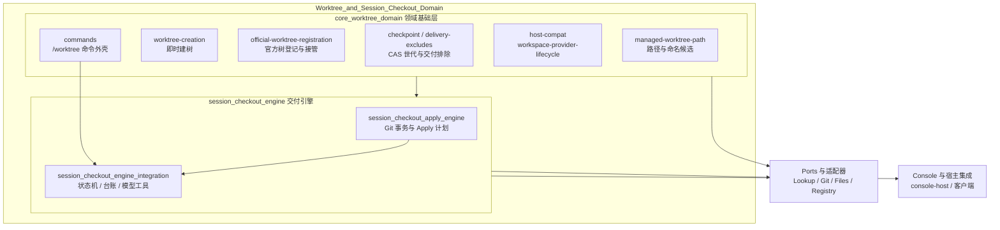
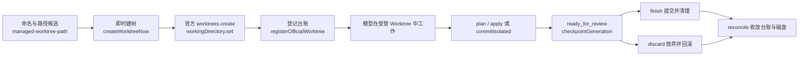

# Worktree 与会话检出领域（Worktree_and_Session_Checkout_Domain）

`Worktree_and_Session_Checkout_Domain` 是插件中负责「受管 Worktree 生命周期」的领域层。它把「会话、项目与受管 Worktree」之间的绑定关系，实现为一套可持久化、可并发、可崩溃恢复的隔离交付机制：模型在受管 Worktree 中写代码，结果再以可复核、可回滚、可恢复的 Git 事务形式整合回目标分支，而不直接污染用户本地仓库（Local）。

本模块不处理界面渲染，也不直接调用 Git 或读取台账文件，它通过端口（Ports）注入所有 I/O 能力；因此本层可以在没有真实仓库的环境中完整驱动与测试。面向用户的命令外壳、宿主侧 Workspace 选举、客户端 ToolView 等消费方，分别在 Console 集成层与客户端层，本模块只对外暴露确定性的领域结果。

## 模块目的

- **确定性基础**：受管 Worktree 放在哪里、目录与分支叫什么、何时即时建树、官方建出的树如何被纳管，全部由无副作用的纯函数与显式入口决定。
- **权威绑定**：维护会话与项目及受管 Worktree 的唯一事实来源，所有状态变更经版本化台账（`ManagedCheckoutsRegistry`）与 `revision` 乐观锁落盘。
- **隔离交付**：以「先计划、后执行」的一次性 Apply 计划、指纹 CAS 与 Git 原生锁构成三层并发控制，保证交付内容等于评审内容。
- **受控暴露**：通过 `worktree_*` 模型工具、`/worktree` 命令与 `systemPrompt` 动态上下文暴露生命周期，同时把破坏性动作保留在用户侧。
- **崩溃收敛**：以 checkpoint 恢复与台账对账（reconcile）让中断后的系统回到可判定状态。

## 架构总览

模块采用「领域基础层 + 交付引擎」的两段式划分。最关键的架构决策是：**纯 Git 事务引擎与宿主集成状态机彻底分离**；引擎不依赖 Cordis、不读写台账，集成层才持有状态机、journal、receipt 持久化与授权判断。

两条依赖规则贯穿全模块：

1. **只依赖端口接口**。基础层与引擎层都通过 `SessionCheckoutDependencies`（Lookup / Git / Files / Registry）获取能力，从不直接 `spawn` Git 或写台账文件。
2. **单记录更新必须走 `registry.update()`**。读-改-写在同锁内完成，避免跨进程后写者抹掉前写者；`revision` 不匹配时返回 `stale_target`，不做盲目重试。

## 三条安全边界

| 边界 | 含义 | 约束 |
| --- | --- | --- |
| Local 边界 | 用户本地仓库 `record.localRoot` | 交付流程永不写入；存在会话分支时拒绝遗留的 apply/preview 路径 |
| 受管边界 | 受管 Worktree `record.managedRoot` / `record.managedGitRoot` | 会话的权威 cwd，也是唯一允许写任务代码的地方 |
| 台账边界 | `ManagedCheckoutsRegistry` | 唯一事实来源，含 `revision`、`sessionBindings`、`managedCheckouts` |

围绕这三条边界，模块还维护若干「不可让步」的契约：`canonicalJson` 的键序与 `undefined` 处理是 CAS 世代的地基；`deliveryExcludePathspecs` 只排除插件确知由宿主写出的运行期产物，绝不猜测业务目录；命令层任何可能删除 checkout 的动词都必须先 `leave`，失败则中止删除，删除后再 `enter` 回退。

## 一次完整生命周期

其中两处设计值得注意：

- **官方树接管是并行入口**。任何路径（官方 `create_worktree` 工具、forge 面板）在 `.agents/worktrees/` 下建出的树，都会在会话 cwd 落入时被 `adoptWorktreeForSession` 接管；因此台账覆盖宿主能产出的**所有** Worktree，而不只是本插件建的。
- **状态机负责并发与恢复，引擎负责 Git 正确性**。集成层校验 `expectedRevision` 与状态迁移合法性，把具体事务委托给引擎；引擎以「计划即一次性能力令牌」的方式执行，执行前逐字段比对、执行后立即删除，宿主重启后必须重新 `plan`。

## 核心组件文档

| 组件 | 定位 | 文档 |
| --- | --- | --- |
| 核心工作树领域 | 领域基础层：路径与命名候选、即时建树、官方树登记与接管、检查点 CAS 世代、交付排除、提交信息校验、宿主兼容与 `uiWorkspace` 选举、`/worktree` 命令外壳 | [core_worktree_domain](Worktree_and_Session_Checkout_Domain/core_worktree_domain.md) |
| 会话检出引擎 | 交付引擎总览：纯 Git 事务引擎与宿主集成状态机的职责切分、关键设计约束与文档索引 | [session_checkout_engine](Worktree_and_Session_Checkout_Domain/session_checkout_engine.md) |

`sessions_checkout_engine` 内部进一步分为两层，详见其子文档：

- **`session_checkout_apply_engine`** —— 采集 checkout 快照与指纹、选择有效基点、三方合并计算、生成并校验 Apply 计划、preview / rollback / finalize、checkpoint 与崩溃恢复、会话分支交付提交。只依赖 Git 子进程与临时目录，不读写台账。
- **`session_checkout_engine_integration`** —— `SessionCheckoutModule` 状态机与台账门面、`revision` CAS 与全局互斥、崩溃收敛、交付与清理生命周期、`runtimeContext` 上下文注入、官方 Worktree 自动接管，以及 `worktree_*` 模型工具的注册与门禁。

上层消费方（`console_host` 的 `WorktreeConsoleService`、客户端胶囊与 ToolView）以及端口与适配器契约（`core_ports_and_types`、`adapters_infrastructure`）由相邻模块文档描述；本模块只以接口和判别联合结果与之交互，不反向依赖它们的实现。