# adapters 模块：DSH 宿主适配层

`src/adapters/` 是 `dsh-git-worktree` 插件的**宿主适配层**：它把 [core_domain](core_domain.md) 中定义的抽象端口（`SessionCheckoutGitPort`、`SessionCheckoutFilesPort`、`SessionCheckoutRegistryPort`、`SessionCheckoutLookupPort` 等，见 [core_domain 端口定义](core_domain/core_domain_ports.md)）落到真实的 DSH 运行时能力上——`ctx.subprocess` 执行 git、`node:fs` 读写磁盘、`workspaceRegistry` / `sessions` / `workingDirectory` 投影会话与项目、`skills` 服务承载项目级 Skill。

领域层（状态机、apply 引擎、视图类型）**不感知**这些实现；`src/index.ts` 的 `apply()` 是唯一的组装点，它构造本模块的各个适配器并以端口接口注入 `createSessionCheckoutModule`。因此替换宿主、或在测试中替换实现，都不需要改动领域逻辑。

## 设计目标

| 目标 | 落地方式 |
| --- | --- |
| 领域层零宿主依赖 | 适配器只实现 `src/ports.ts` 的接口，类型上单向依赖领域 |
| 失败必须可解释 | 统一抛 `SessionCheckoutError`（稳定错误码 + 已本地化文案），见 `src/index.ts` |
| 崩溃安全 | 注册表写入走唯一临时文件 + 原子 rename + `.bak` 回退（见第 3 节） |
| 不误删用户字节 | 删除前校验目录身份（dev/inode/birthtime）、符号链接绝不跟随、身份不符一律保留现场（见第 2 节） |
| 跨平台 | Windows 上 `core.longpaths`、rename 重试、`EBUSY/EPERM` 容忍、路径大小写折叠比较 |
| 配置热更新 | 超时等易变配置通过 `LiveValue` 每次读取，设置页改动无需重挂插件（见第 1.1 节） |

## 架构总览

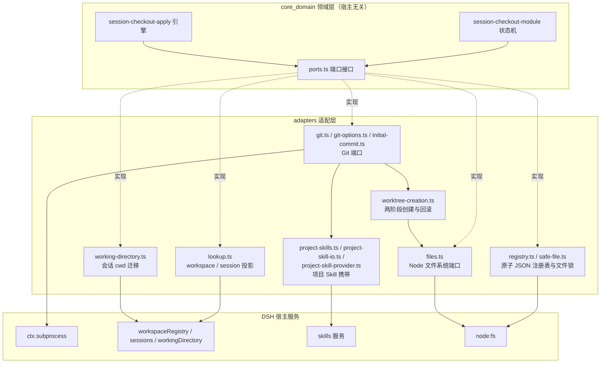

### 组装顺序

`src/index.ts::apply` 按固定顺序构造适配器，顺序本身承载语义（状态目录必须先就绪，因为 git 端口需要 `hooksPath`，注册表与 Skill provenance 都落在同一目录下）：

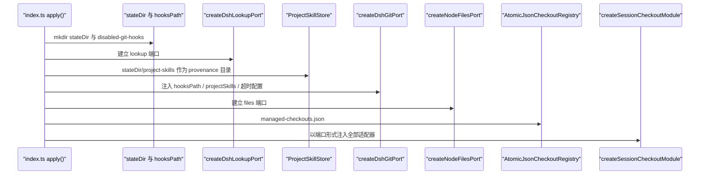

### 一次托管创建的跨适配器协作

下面的时序展示创建与清理时各适配器的分工（领域状态机为调用方，中间件全部来自本模块）：

```mermaid
sequenceDiagram
  participant Mod as "领域状态机"
  participant Look as "lookup.ts"
  participant Reg as "registry.ts"
  participant Git as "git.ts"
  participant Create as "worktree-creation.ts"
  participant Files as "files.ts"
  participant Skills as "project-skills.ts"

  Mod->>Look: getSession 与 getSessionCwd 取得授权证据
  Mod->>Git: inspect localRoot
  Mod->>Reg: update 写入 journal creating_worktree
  Mod->>Git: createDetachedWorktree
  Git->>Skills: snapshot localRoot
  Git->>Create: createWorktree 带 deadline 与 saveEvidence
  Create->>Files: inspectDirectoryIdentity 与 mkdir
  Create->>Git: worktree add 与 read-tree 与 checkout-index
  Create->>Reg: saveEvidence 逐阶段落盘
  Git->>Skills: carry snapshot 到 managedRoot
  Mod->>Reg: update 记录 phase ready
  Note over Mod,Skills: 交付后清理时
  Mod->>Skills: assertRemovable managedRoot 与 tracked 集合
  Mod->>Git: removeWorktree
  Git->>Skills: forget managedRoot
  Mod->>Files: removeDirectoryTree 或 quarantineDirectoryTree
```

## 适配器清单

| 文件 | 实现的端口 / 契约 | 宿主依赖 |
| --- | --- | --- |
| `git.ts` | `SessionCheckoutGitPort`（末尾附加 `initialCommitActions`） | `ctx.subprocess` |
| `git-options.ts` | `GitTimeoutOptions`（超时策略，非端口） | 无（纯计算 + `LiveValue`） |
| `initial-commit.ts` | `preflightInitialCommit` / `initializeEmptyRepository` / `initializeProject` | 由 `git.ts` 注入的 run 函数 |
| `worktree-creation.ts` | `createWorktree`（创建事务 + 回滚） | git run 回调 + `files.ts` |
| `files.ts` | `SessionCheckoutFilesPort` | `node:fs`、`node:fs/promises` |
| `registry.ts` | `SessionCheckoutRegistryPort` | `safe-file.ts` + `node:fs` |
| `safe-file.ts` | 原子 JSON 读写、跨进程文件锁 | `node:fs` |
| `lookup.ts` | `SessionCheckoutLookupPort` | `workspaceRegistry`、`sessions`、`workingDirectory`、`sessionQuery` |
| `working-directory.ts` | `SessionWorkingDirectoryPort` | `workingDirectory` |
| `project-skills.ts` | 项目 Skill 快照 / 携带 / 复核（供 apply 引擎与 git 端口使用） | `project-skill-io.ts` + provenance 目录 |
| `project-skill-io.ts` | Skill 字节读写（防链接、限大小） | `node:fs/promises` |
| `project-skill-provider.ts` | 额外 `SkillProvider` 注册 | `skills`、`@deepseek-ai/dsh-skill-filesystem` |

### 关键类型速查

| 类型 | 所在文件 | 作用 |
| --- | --- | --- |
| `GitPortOptions` | `git.ts` | `createDshGitPort` 的入参：`GitTimeoutOptions` + `hooksPath` + 可选 `projectSkills` |
| `GitCommandResult` | `git.ts` | 单次 git 调用的结果：`code` / `stdout` / `stderr` / `quiescent?` / `truncated?` |
| `GitTimeoutOptions` | `git-options.ts` | `gitTimeoutMs` 与 `worktreeAddTimeoutMs`，均支持 `LiveValue` |
| `GitCommitProtocol` | `initial-commit.ts` | `{ prepare, beforeCommit() }`，把「锁内复核」注入 `update-ref --stdin` 事务 |
| `Result` | `worktree-creation.ts` | 创建流程内部使用的 git 结果形状（`code` / `stdout` / `stderr` / `quiescent?`） |
| `WorkspaceLike` / `WorkspaceRegistryLike` | `lookup.ts` | 宿主 `workspaceRegistry` 的最小结构视图 |
| `SessionStoreLike` / `LiveSessionLike` | `lookup.ts` | 宿主 `sessions` 的最小结构视图（只读 `header.id` / `createdAt` / `cwd`） |
| `WorkingDirectoryLike` | `lookup.ts` | 只读 `get(session)` 的最小视图（用于授权证据） |
| `WorkingDirectoryServiceLike` / `SessionWorkingDirectoryPort` | `working-directory.ts` | 可写视图（`get` / `ensure?` / `set`）与工具层端口（`current` / `enter` / `leave`） |
| `SkillRead` / `SkillBytes` | `project-skill-io.ts` | Skill 读写的最小数据契约（路径 + 上限 / 内容 + 权限位） |
| `Entry` / `Manifest` / `SkillSnapshot` / `CarriedSkillState` | `project-skills.ts` | provenance 清单、内存快照与复核结果 |
| `Locator` | `project-skill-provider.ts` | candidate 的 `{ root, candidate }` 定位信息（跨 DSH 0.1 / 0.2） |
| `FileLockOptions` / `FileLockPayload` | `safe-file.ts` | 文件锁超时与陈旧阈值；锁文件内容 `{ pid, createdAt, token }` |
| `AtomicJsonCheckoutRegistry` | `registry.ts` | 实现 `SessionCheckoutRegistryPort` 的类（`read` / `write` / `update`） |

---

## 1. Git 适配层（`git.ts` / `git-options.ts` / `initial-commit.ts`）

### 1.1 超时策略：`git-options.ts`

`GitTimeoutOptions` 的两个字段都接受 `number | LiveValue<number | undefined>`——这是「设置页可改、无需重挂插件」的实现基础。

| 常量 / 函数 | 值 / 行为 |
| --- | --- |
| `DEFAULT_GIT_TIMEOUT_MS` | 120 000 ms |
| `DEFAULT_WORKTREE_ADD_TIMEOUT_MS` | 300 000 ms（5 分钟） |
| `MAX_GIT_TIMEOUT_MS` | 3 600 000 ms（1 小时） |
| `validateGitTimeouts(options)` | 两个字段必须是 `[1000, MAX]` 区间内的安全整数，否则抛 `RangeError` |
| `gitTimeoutMs(args, options)` | `worktree add` → `worktreeAddTimeoutMs`；`worktree remove` → 固定 5 分钟；其余 → `gitTimeoutMs` |

`gitTimeoutMs` 每次调用都重新读取 `liveConfigValue`，因此用户改超时后**下一条命令**即生效；这与 `src/index.ts` 中 `volatile(z.number()...)` 的配置声明配套。

### 1.2 命令执行内核：`runGit`

`runGit(ctx, cwd, args, options, input?, creation?, collectBytes?)` 是所有 git 调用的唯一入口，返回 `GitCommandResult`（`code` / `stdout` / `stderr` / `quiescent` / `truncated`）。**非零退出不是异常**，由调用方决定语义；只有 `SessionCheckoutError` 会穿透。

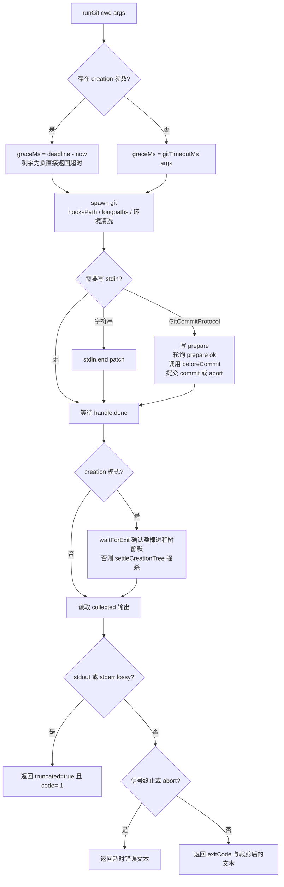

关键实现细节：

- **环境清洗**：构造 `env` 时把 `GIT_DIR`、`GIT_WORK_TREE`、`GIT_COMMON_DIR`、`GIT_INDEX_FILE`、`GIT_OBJECT_DIRECTORY`、`GIT_ALTERNATE_OBJECT_DIRECTORIES`、`GIT_NAMESPACE`、`GIT_CEILING_DIRECTORIES`、`GIT_DISCOVERY_ACROSS_FILESYSTEM`、`GIT_CONFIG_*` 全部置为 `undefined`，强制仓库路由只来自被授权的 `cwd`；用户身份配置保留。同时固定 `GIT_OPTIONAL_LOCKS=0`、`GIT_TERMINAL_PROMPT=0`、`LC_ALL=C`、`LANG=C`。
- **固定前缀参数**：`--no-pager`、`--no-optional-locks`、`-c core.quotePath=false`、`-c core.fsmonitor=false`、`-c core.hooksPath=<空目录>`；Windows 追加 `-c core.longpaths=true`（Worktree 前缀很容易超过 `MAX_PATH`，即使源 checkout 没有超）。
- **输出上限**：普通命令 1 MiB（`GIT_COLLECT_BYTES`）；WIP 补丁 16 MiB（base85 膨胀）；`status` 16 MiB（`--untracked-files=all` 的记录量由仓库决定，一个未 ignore 的依赖树就能产生数 MB）。超限时返回 `truncated: true` 而非直接失败，让调用方换更窄的读法。
- **终止宽限**：`graceMs: 1000` 与命令 deadline 分离。
- **创建模式的静默确认**：`creation` 参数存在时，`runGit` 必须在返回前证明整棵进程树已静默（`waitForExit`；失败则 `settleCreationTree` 在 10 秒内 `terminate` 并等待）。**无法证明静默 = 不可删除授权**，此时返回 `quiescent: false`。
- **提交协议**：`input` 为 `GitCommitProtocol` 时，先写 `prepare`，每 5 ms 轮询输出是否含 `prepare: ok`，再执行 `beforeCommit()`；成功写 `commit`，失败写 `abort` 并把异常抛给调用方。这保证「锁内复核」发生在 git 真正发布 ref 之前。

`runGitChecked` 是薄包装：非零退出立即抛 `git_operation_failed`（文案携带命令与 stderr）。

### 1.3 内部 ref 命名空间

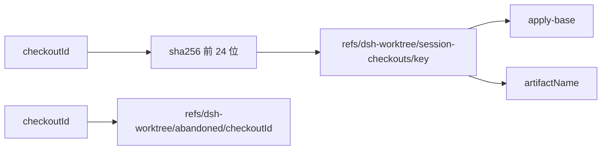

- `assertArtifactName` 只允许 `[A-Za-z0-9][A-Za-z0-9._-]*` 的段，防止把路径注入到 ref 名。
- 放弃快照刻意**不在** `checkoutRefRoot` 之下：discard 流程会释放整个 per-checkout 产物命名空间，不能顺手删掉刚写好的安全快照。

### 1.4 端口方法一览

`createDshGitPort(ctx, options)` 返回 `SessionCheckoutGitPort`，并在末尾用 `Object.assign(port, initialCommitActions(port.inspect, runSessionGit))` 把首次提交能力挂到同一端口上。

| 方法 | 语义要点 |
| --- | --- |
| `inspect(root)` | 一次 `rev-parse --show-toplevel --path-format=absolute --git-common-dir --absolute-git-dir HEAD^{commit}` 取全部位置事实，`symbolic-ref` 并行取分支；`unborn` 仅在「symbolic HEAD 合法 + 无任何 ref」时成立，否则报错；所有路径经 `realpath` 归一 |
| `findContainingWorktreeRoot(root)` | 返回容器 worktree 根；非 git 目录返回 `null`（用 `hasGitMetadata` 向上探测 `.git`，区分「不是仓库」与「仓库损坏」） |
| `status(root)` | `runStatus` 先 `--untracked-files=all`，溢出则退 `normal`；结果交给 `hasDeliverableStatus` 忽略携带的 Skill 辅助文件 |
| `createDetachedWorktree` | 先拒绝本地受跟踪 Skill 的未提交改动，再以 deadline 调用 `createWorktree(...)`，最后 `projectSkills.carry` |
| `removeWorktree` | 若存在 provenance，先用 `ls-files --stage` + `ls-tree HEAD` 求受跟踪集合并 `assertRemovable`，再 `worktree remove --force`，最后 `forget` |
| `pruneWorktrees` | `worktree prune --expire now` |
| `listWorktrees` | 解析 `--porcelain` 块；OID 必须匹配 `[0-9a-f]{40,64}`，不可解析项跳过（adoption 会写持久记录，不允许猜） |
| `retainApplyBase` / `releaseApplyBase` | `update-ref` 写 / 删 `apply-base` |
| `retainInternalArtifact` / `readInternalArtifact` / `releaseInternalArtifacts` | 释放时先 `for-each-ref` 枚举，再用**单次** `update-ref --stdin` 事务批量删除（原为 1+N 次串行 spawn） |
| `isAncestor` | `merge-base --is-ancestor`；`code 1` = 否，其他非零 = 无法证明（抛错） |
| `attachWorktreeBranch` | 只改 ref 与 HEAD，不碰工作区；`update-ref` 带旧值做 CAS（`expectedOldOid` 为 `null` 时用全零旧值实现「仅当不存在时创建」） |
| `pushBranch` | 必须有本地分支与 upstream；失败只报告，绝不 force |
| `repairWorktreeLinks` | `worktree repair`，仓库在磁盘上被移动后的自愈路径 |
| `listWorktreeincludeFiles` | 两个 `ls-files --others --ignored` 的交集（`--exclude-standard` ∩ `--exclude-from=<file>`），即「被 include 规则命中且被 gitignore」；额外自动带入被 ignore 的 `AGENTS.override.md` |
| `branchOverview` | 一次 `for-each-ref` + `runStatus`；`dirtyCount` 在 status 读不到时为 `-1`（未知，而不是谎报 0） |
| `defaultBranch` | `origin/HEAD` → `init.defaultBranch` → `null` |
| `branchTipTimes` | `for-each-ref %(committerdate:unix)` 转毫秒 |
| `deleteLocalBranch` | 只用 `git branch -d`（安全删除），返回 `{ deleted, reason }` |
| `graphLog` | `log --branches --tags --remotes --topo-order --parents`；记录用 `%x1e`、字段用 `\0` 分隔，`limit` 夹在 `[1,1000]`；`%D` 装饰解析保留 `tag:` 标记、丢弃 `HEAD -> ` 前缀 |
| `createLocalBranch` / `switchLocalBranch` | 先 `check-ref-format --branch`；`switch` 失败时识别 `already used by / checked out at worktree` 并翻译为专用文案 |
| `listTags` / `createTag` / `deleteLocalTag` / `pushTag` / `deleteRemoteTag` | annotated tag 通过 `*objectname`/`*objecttype` 剥离到 commit；lightweight tag 不保留 message；`pushed` 由 `ls-remote --tags origin` 决定，离线时为 `null`（未知）而非 `false` |
| `mergeLocalBranch` | 先判 `up_to_date`；`dryRun` 在 `tmpdir` 建临时 detached worktree 试合并后 `--force` 回收；正式合并**不 abort 冲突**，冲突详情受 `CONFLICT_DETAIL_FILE_LIMIT` / `CONFLICT_DETAIL_DIFF_LIMIT` 限制 |
| `captureLocalWip` | `diff --binary --full-index HEAD` 覆盖已暂存 + 未暂存 tracked 改动；空输出返回 `null` |
| `applyWorktreePatch` | `git apply --binary --whitespace=nowarn -`（原子：整包成功或整体失败） |
| `listUntrackedFiles` | 非 ignore 的 untracked（ignored 由 `.worktreeinclude` 通道负责） |
| `snapshotAbandonedWorktree` | `add -A` → `write-tree` → 以显式身份（`dsh-git-worktree <dsh-git-worktree@localhost>`）`commit-tree` → `update-ref` 到 abandoned 命名空间，不依赖用户 git 身份配置 |
| `restoreAbandonedSnapshot` | 建 `worktree-restore-<oid 前 8 位>` 分支并删除快照 ref |

### 1.5 首次提交协议：`initial-commit.ts`

`initialCommitActions(inspect, run)` 返回三个方法，只在**用户在 Console 显式确认**后才被调用；普通 git 巡检始终是只读的。

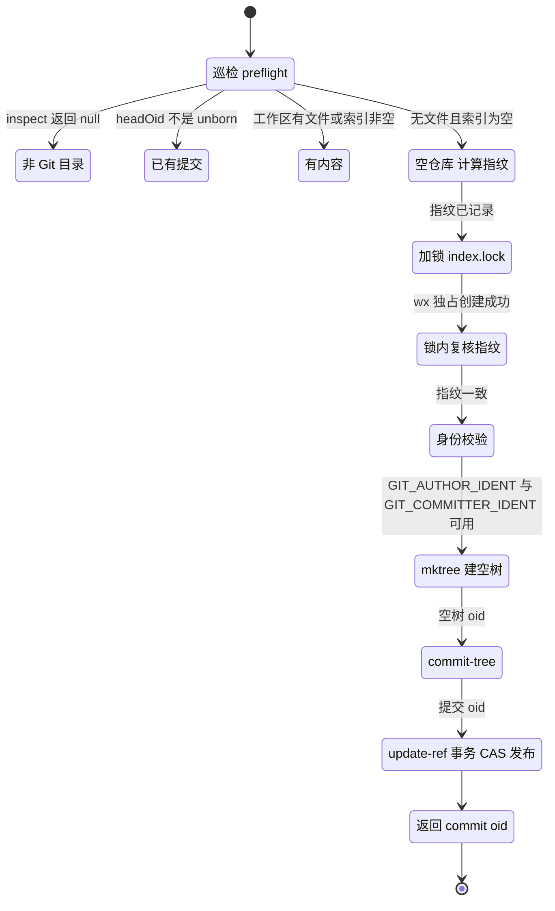

- **指纹（fingerprint）** 覆盖：`inspect` 快照、root 与 canonical root 身份（含 mtime/ctime）、`gitDir` 与 `commonDir` 身份、`HEAD` 字节与身份、`index` 字节（base64）、排序后的文件列表。任何一项变化都视为 `stale_local`。
- **锁**：只创建并清理自己创建的 `index.lock`（`open(path,'wx')`）；`EEXIST` → `operation_not_allowed`（「初始仓库正忙」）。
- **发布**：`update-ref --stdin` 的 `prepare` 阶段由 git 锁住 HEAD 与解析出的分支，`beforeCommit()` 在锁内再次复核指纹与授权回调，之后才 `commit`。旧值使用全零 OID，实现「只允许从 unborn 前进」的 CAS。
- **`initializeProject(root)`**（本地适配）：已有提交的仓库直接拒绝；非 git 目录执行 `git init -b main`（不写 config）；`add -A` 遵循 `.gitignore`；提交失败（例如全部被忽略、身份未配置）原样报错，不回滚任何字节。

---

## 2. Worktree 创建与文件系统端口（`worktree-creation.ts` / `files.ts`）

### 2.1 创建事务

`createWorktree(localRoot, target, baseOid, run, saveEvidence)` 把一次 `git worktree add` 拆成可审计的阶段，每个阶段结束后把 `WorktreeCreationEvidence` 交给 `saveEvidence`（落到注册表 journal），使进程崩溃后仍能判断「哪些字节是我创建的」。

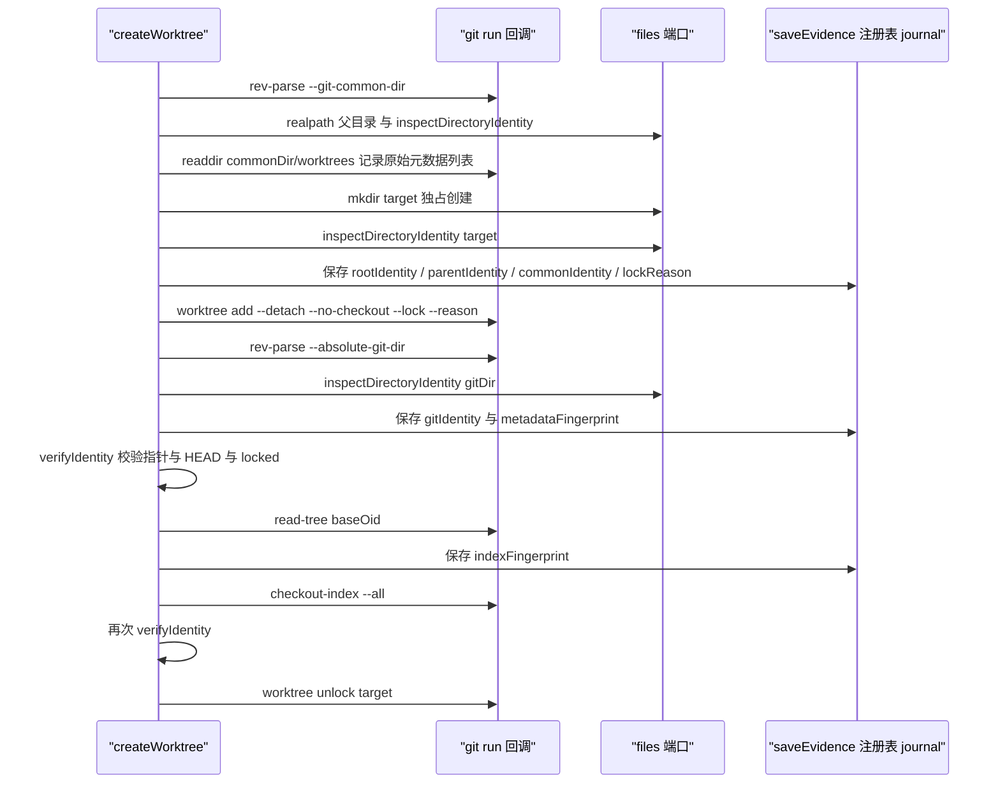

要点：

- **独占占用**：`mkdir(target)` 不带 `recursive`，已存在的目录（哪怕空目录）都不属于本次尝试，直接失败。
- **`--no-checkout` 两段式**：先只登记 worktree 并加锁，等身份证据落盘后，才用 `read-tree` 发布完整索引，再用 `checkout-index --all`（不带 `-f`，因此不会覆盖别的写者提供的文件）落地内容。
- **sparse 兼容**：`core.sparseCheckout` 为真时改用 `reset --hard --no-recurse-submodules`（与原生 `worktree add` 语义一致），并明确失败可能残留 index 锁、因此不能自动清理。
- **`verifyIdentity`** 校验：`.git` 指针文件、`gitdir` 反向指针、`commondir`、`HEAD == baseOid`、`locked == lockReason`、`gitDir` 必须是 `commonDir/worktrees` 的直接子目录，且 `gitDir` 内**不允许存在任何 `*.lock`**。
- **`metadataFingerprint`** 只允许已知元数据条目（`HEAD`、`commondir`、`locked`、`config.worktree`、`refs/`、`logs/`、`info/` 等），任何未知对象或符号链接都会让指纹计算失败——这是「不认识的字节就不删」的直接体现。

### 2.2 失败处理的三条路径

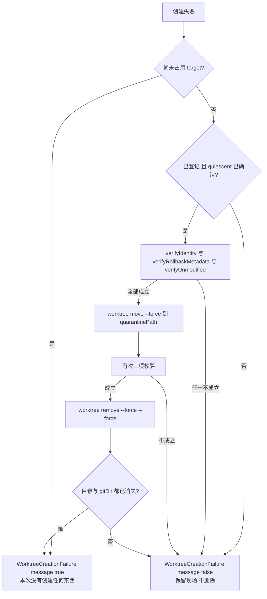

- 未登记阶段还可以走「就地回滚」：`worktree list` 未包含 target、`commonDir/worktrees` 元数据列表与原始一致、三个目录身份未变、target 仍为空目录，才 `rmdir`。
- `verifyUnmodified(root, baseOid, run)` 是删除授权的核心：索引必须完全等于授权基点、不允许子模块条目（`160000`）、不允许未知文件/目录、不允许 `filter` / `working-tree-encoding` 属性（语义比较无法授权删除）、每个 blob 的哈希必须与索引一致、`ls-files -v` 全部为 `H `（无 skip-worktree / assume-unchanged）、不允许任何 untracked（含 ignored）、`diff-index` 只允许删除。

### 2.3 文件系统端口：`createNodeFilesPort()`

| 方法 | 行为 |
| --- | --- |
| `exists` | `existsSync` |
| `canonicalize` | `realpath(resolve(path))` |
| `inspectDirectoryIdentity` | `lstat({ bigint: true })` 取 `device` / `inode` / `birthtimeNs` 字符串；非目录或符号链接返回 `null` |
| `ensureDirectory` | `mkdirSync(recursive)` |
| `removeEmptyDirectoryTree` | 同步递归删除空树；遇到符号链接只 `unlink` 链接本身（junction 目标原样保留）；遇到非目录返回 `false` |
| `quarantineDirectoryTree` | 要求隔离路径与源**同父目录**（Windows 大小写折叠比较）、隔离路径不存在；`rename` 后复核身份，不符则尝试 rename 回来并抛 `checkout_mismatch`（身份不符的对象永不删除） |
| `removeDirectoryTree` | 非目录 / 符号链接直接抛错；`rm(recursive, force)`，Windows 重试 6 次、其他平台 2 次，间隔 150 ms |
| `measureDirectoryBytes` | 递归统计；符号链接计 0 字节 |
| `readTextFile` | 存在则读 UTF-8，否则 `null` |
| `copyFile` | 自动建父目录、先删目标再复制 |
| `isSymbolicLink` | `lstatSync` 失败按 `false` 处理 |

---

## 3. 持久化：注册表与崩溃安全文件（`registry.ts` / `safe-file.ts`）

### 3.1 `AtomicJsonCheckoutRegistry`

注册表是插件唯一的持久状态（`stateDir/managed-checkouts.json`），版本 2 结构为 `{ version, revision, sessionBindings, managedCheckouts }`。

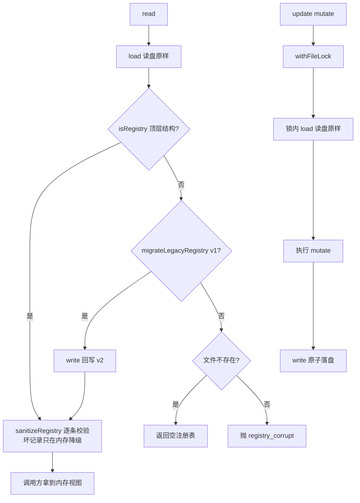

- **校验分层**：`isRegistry` 只校验顶层；`sanitizeRegistry` 逐条应用 `isSessionBinding` / `isManagedCheckout`，坏记录被丢弃并 `console.warn`，其余记录保持可访问。降级**只作用于内存视图**，磁盘文件原样保留。
- **`update` 必须持锁读-改-写**：跨进程并发时，锁内读到的表才是 `mutate` 的输入；否则两个进程各自 read 全表再 write 全表，后写者会抹掉先写者的记录。`mutate` 拿到的是**盘上原样**（含未通过校验的记录），这些记录原样写回，因此被降级的记录不会被一次写入悄悄抹掉。
- **v1 迁移**：`ready` / `discarded` 保持原相，其他阶段一律保守降级为 `recovery_required` 并递增 `revision`，同时补上 `delivery: { state: 'working', iteration: 1 }` 与 `journal: null`。
- **校验粒度**：`isManagedCheckout` 校验 checkpoint 序列连续性（`sequence === index + 1`）、`checkpointId` / `reviewId` / `requestId` 唯一性、`delivery` 状态机形状（`working` / `ready_for_review` / `preview_active` / `preview_detached` / `finalized` / `retained` / `delivered`）、`journal` 的操作与步骤组合；`isJournal` 的 `create` 分支允许缺失 `creation`（旧 journal 不因新字段获得删除授权）。
- 所有文本字段走 `isBoundedText` / `isSafeRelativePath` / `safeConflictFile` 等白名单校验，拒绝绝对路径、`..` 段、控制字符。

### 3.2 `safe-file.ts`：原子写入与文件锁

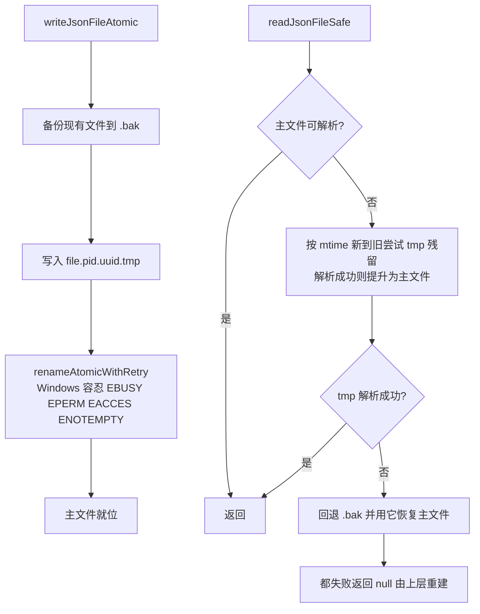

- **唯一临时文件名**：固定 `<file>.tmp` 会让并发写者互相截断，半写状态还会被读取端误提升为主文件。
- **`withFileLock(targetPath, operation, options)`**：锁文件为 `<target>.lock`，内容 `{ pid, createdAt, token }`（`FileLockPayload`）。`wx` 独占创建；陈旧判定为「持有者进程已退出（`process.kill(pid, 0)`，`EPERM` 视为存活）或持有时间超过 `staleAfterMs`（默认 30 000 ms）」；不可解析的锁文件按 mtime 判龄。默认超时 10 000 ms、重试间隔 25 ms，超时抛 `ELOCKTIMEOUT`。
- **重入**：同进程已持有的锁记在 `heldLocks` 中，内层直接复用——`read()` 的 legacy 迁移会回调 `write()`，不能再抢一次锁。
- **只删自己持有的锁**：释放前比对 `token`，不符仅告警；Windows 删除失败时改名为 `.stale` 再删。
- **`FileLockOptions`** 暴露 `timeoutMs` 与 `staleAfterMs`，供测试与高延迟文件系统调节。

---

## 4. 宿主投影（`lookup.ts` / `working-directory.ts`）

### 4.1 `createDshLookupPort(ctx)`

所有宿主服务都通过 `ctx.get(...)` **动态**获取（发布包版本落后于运行时），并用结构守卫（`isWorkspaceRegistryLike`、`isSessionStoreLike`、`isWorkingDirectoryLike`）确认形状；服务缺失一律降级为 `undefined` / 空数组，由状态机当作「恢复 / 孤儿事实」而非故障。

| 方法 | 数据来源 | 语义 |
| --- | --- | --- |
| `getSidebarMemberships(managedRoots)` | `workspaceRegistry.list()` + `sessionQuery.listSessions()` | 返回每个 managedRoot 对应的 workspaceIds 与 sessionIds；路径比较在 Windows 上大小写折叠；缺失目录不抹掉历史导航身份 |
| `listLiveSessions()` | `sessions.list()` | 只暴露 `{ id, createdAt?, cwd? }`；结构未知时返回空列表（宁可静默也不猜） |
| `getSession(sessionId)` | workspace 的 `sessionIds` 扫描 | 未命中时用「不可变 header cwd」恢复：只有当**恰好一个** workspace 的路径与之相同才认定映射 |
| `getSessionCwd(sessionId)` | `workingDirectory.get(session)` → 回退 `header.cwd` | **授权证据必须是会话此刻所在的目录**；`header.cwd` 在创建时冻结，被 `set` 搬走后的会话仍会报告 Local 根 |
| `getProject(projectId)` / `listProjects()` | `workspaceRegistry.get` / `list` | 映射为 `{ id, name: title, root: path }` |

`getSessionCwd` 的双通道设计直接修复了一个真实缺陷：托管 Worktree 在既有会话中打开时会 `workingDirectory.set`，若只读 `header.cwd`，分支胶囊会对每个 Worktree 报 `project_mismatch`。

### 4.2 `createSessionWorkingDirectoryPort(ctx)`

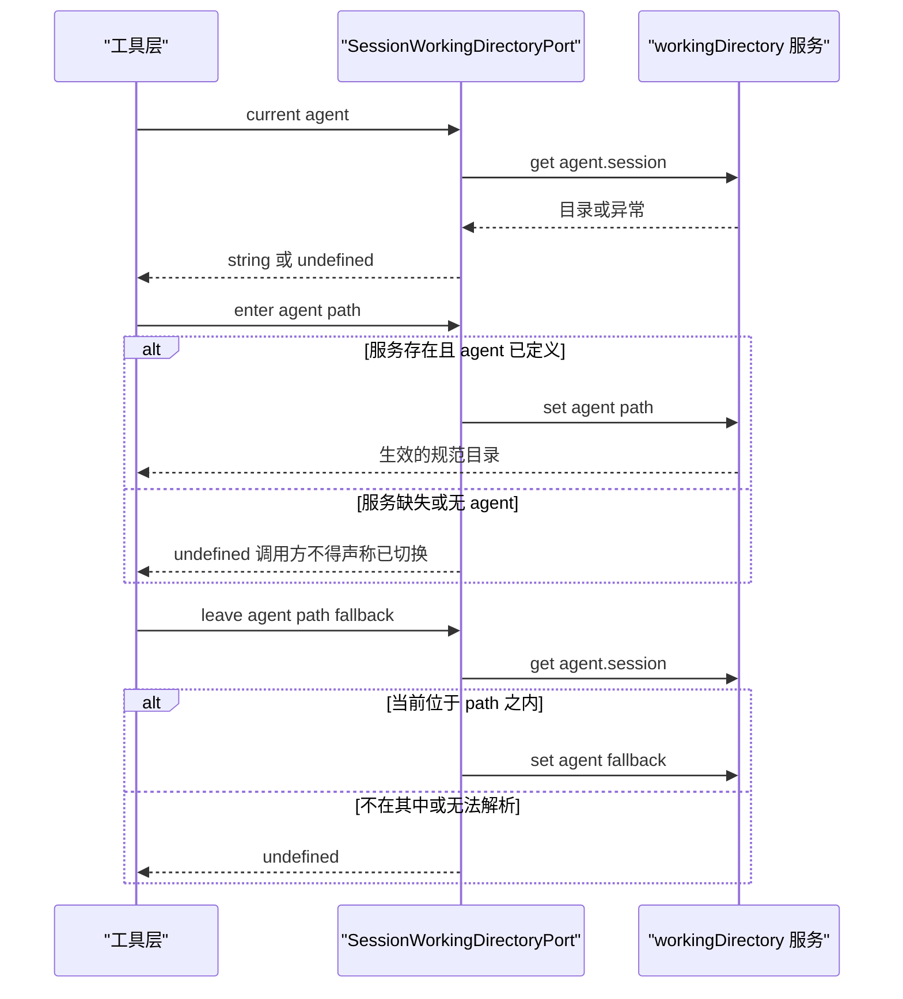

- `isWithin` 使用 `resolve` + 反斜杠归一 + 末尾斜杠剥离，Windows 上大小写折叠。
- 宿主未挂载 `workingDirectory` 时，`enter` 解析请求路径但**不移动会话**，插件退回「只给指导」的旧行为；`enter` 返回 `undefined` 是对调用方的硬约束：不能在没真正切换时报出一个 cwd。

---

## 5. 项目 Skill 携带（`project-skills.ts` / `project-skill-io.ts` / `project-skill-provider.ts`）

### 5.1 为什么需要

托管 Worktree 是仓库**之外**的新 checkout。`.dsh/skills`、`.agents/skills`、`.claude/skills`（`PROJECT_SKILL_ROOTS`）通常被 gitignore，因此不会随 `git worktree add` 出现。若不带过去，模型在 Worktree 内会「忘记」项目技能；若直接复制，又会在清理时误删用户后续编辑。于是用**宿主私有 provenance 清单**记录「哪些 Skill 字节是我搬过来的」。

### 5.2 `ProjectSkillStore` 的数据模型

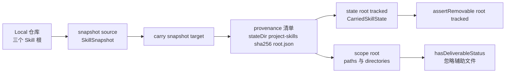

- `Manifest`（version 1）字段：`root`（realpath）、`identity`（`dev:ino:birthtimeNs`）、`phase: 'copying' | 'ready'`、`files: { path, hash, mode }[]`、可选 `directories`。
- `SkillSnapshot` 是内存快照（含 `content: Buffer`），`CarriedSkillState` 是复核结果（`paths` / `fingerprint` / `modified`）。
- 上限：`MAX_FILES = 5000`、`MAX_BYTES = 64 MiB`、目录深度 64、条目数 10000。
- `carry` 的顺序刻意如此：先做**完整冲突预检**（不创建任何辅助文件）→ 以 `wx` 独占写入 `phase: 'copying'` 清单 → 建目录 → 建文件 → 回读校验哈希 → 复核 checkout 身份 → 写 `phase: 'ready'` 临时文件并 rename 覆盖。中途失败留下的是 `copying` 清单，`load` 会拒绝它，因此不会被误当作完整副本。
- `state()` 对比清单与现状，任何哈希 / 模式 / 存在性差异都置 `modified = true`；清单外新增的 Skill 资源也会被计入并标记修改。
- `assertRemovable()` 在 `modified` 或存在清单外资源时抛错，文案指向「保留该 Worktree 以保全 Skill」——删除前的最后一道闸门。
- `trackedSkillPaths(indexEntries, headPaths)` 把 `ls-files --stage` 与 `ls-tree` 输出合并成受跟踪集合；`hasDeliverableStatus` 只在 `?? ` 记录属于辅助集合时才认为「干净」，tracked 修改、重命名、删除永远可见。

### 5.3 防链接的底层 IO：`project-skill-io.ts`

`SkillRead` / `SkillBytes` 是最小数据契约。`checkPath` 逐段校验（`lstat` + 拒绝符号链接与非普通文件），只允许 `.dsh` / `.agents` / `.claude` 下的 `skills` 前缀，并拒绝 `\`、`:`、控制字符。读写统一带 `O_NOFOLLOW`；`createSkillFiles` 用 `O_CREAT | O_EXCL` + `chmod` + `sync`；`readSkillFiles` 校验 inode / dev 未变且总预算 64 MiB。源码注释明确其边界：这些检查服务于「可信本地创建」，而不是对抗在两次系统调用之间替换祖先目录的恶意进程。

### 5.4 额外 Skill 源：`ClaudeProjectSkillProvider`

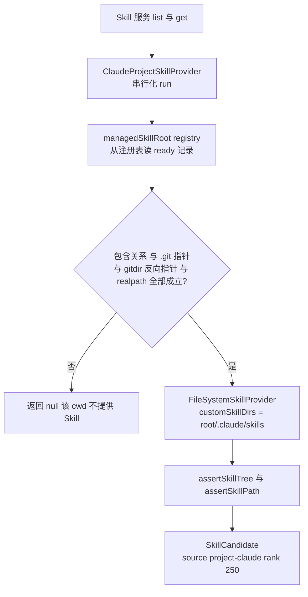

- **根目录只来自宿主拥有的记录**：`managedSkillRoot` 遍历注册表中 `phase === 'ready'` 的 checkout，要求 cwd 在其之下、root 不是符号链接、`.git` 指针与 `gitDir` 双向匹配（含 `.git` 文件与 `gitdir` 反指的大小上限 65536 字节），绝不采信 Skill 文件自己声明的根。
- 兼容 DSH 0.1（`candidate.path`）与 0.2（`candidate.locator.path`）两种 locator 形状（`Locator` 接口 + `candidatePath`）。
- 所有操作经 `run()` 串行化；最多缓存 32 个 `FileSystemSkillProvider`，超出按插入顺序逐出并 dispose。
- `mountProjectSkillProvider(ctx, registry)` 通过 `ctx.inject(['skills'])` 注册 provider，订阅 `fs/observed` 把宿主文件变更转发给内部 provider，并用 `ctx.effect` 保证 dispose。

---

## 6. 配置与生命周期接线

适配器本身不读配置，全部由 `src/index.ts::apply` 在挂载时注入；但有几个字段是**易变（volatile）**的，会以 `LiveValue` 形式穿透到适配器内部，从而在设置页改动后立即生效：

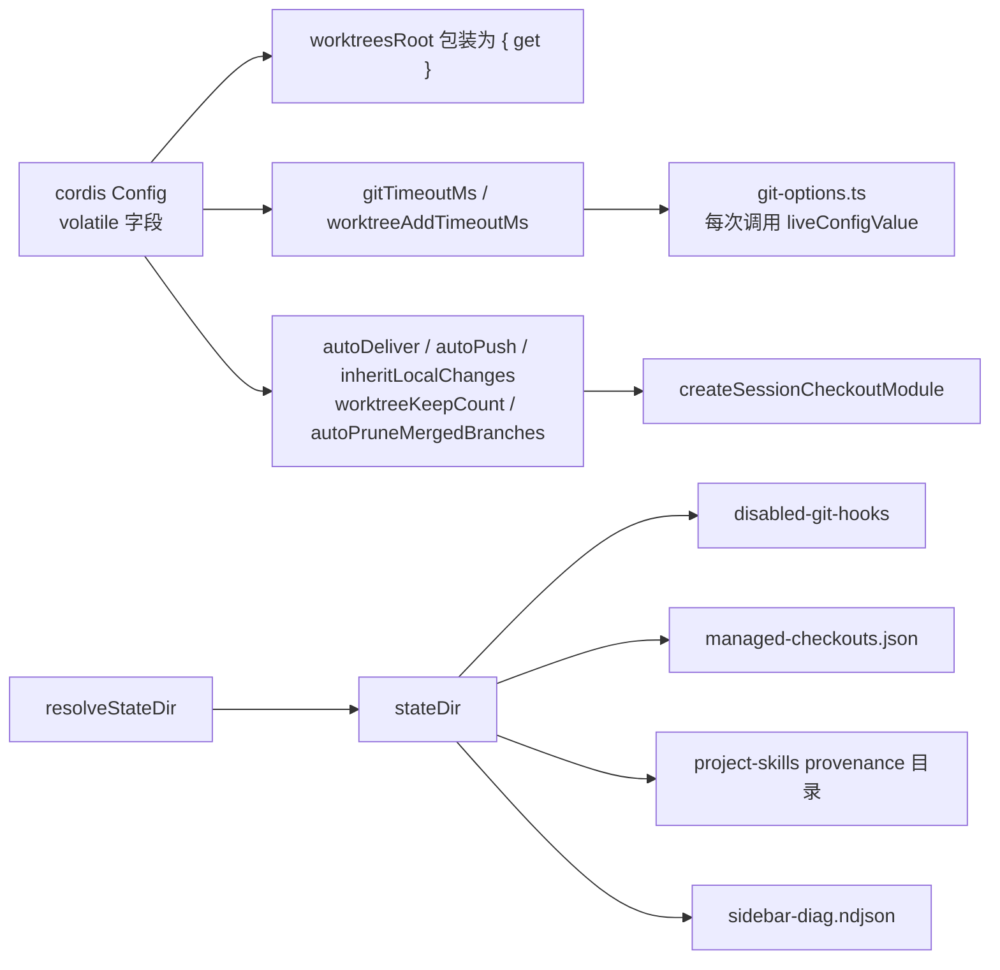

| 配置项 | 落到哪个适配器 | 生效方式 |
| --- | --- | --- |
| `stateDir` | `createDshGitPort`（`hooksPath`）、`AtomicJsonCheckoutRegistry`、`ProjectSkillStore` | 挂载时解析；缺省为 `$DSH_HOME/plugins/dsh-git-worktree` |
| `gitTimeoutMs` / `worktreeAddTimeoutMs` | `GitTimeoutOptions` | 每次命令读取（volatile） |
| `worktreesRoot` | 领域模块（经 `{ get }` 包装） | 每次读取时 `resolve` 并 trim（volatile） |
| `autoDeliver` / `autoPush` / `inheritLocalChanges` / `worktreeKeepCount` / `autoPruneMergedBranches` | 领域模块 | 传引用，运行期读取（volatile） |
| `enableWorkspaceProvider` | `mountWorkspaceProviderLifecycle` | 非 volatile：只在挂载时决定是否接管官方 UI |

`package.json` 的 `dsh.bundle.patch` 指向 `cordis.patch.yml`，其中只插入一条 `dsh-git-worktree` 条目；也就是说适配层的所有行为差异都通过 `Config` 暴露，而不是靠多个 bundle 变体。

## 7. 测试与验证要点

适配层的每个工厂都以接口为返回值，因此单元测试可以整体替换宿主：

- **可替换点**：`createDshGitPort` 接受 `GitPortOptions`（可注入内存版 `ProjectSkillStore`）；`createNodeFilesPort` 无参数、可用假实现替代；`AtomicJsonCheckoutRegistry` 只需一个临时文件路径；`createDshLookupPort` / `createSessionWorkingDirectoryPort` 依赖 `ctx.get`，用桩 Context 即可覆盖「服务缺失」降级路径。
- **`withFileLock` 可调阈值**：`FileLockOptions.timeoutMs` / `staleAfterMs` 让锁竞争与陈旧回收能被确定性测试，不必等 30 秒。
- **Windows 特定行为**：`vitest.config.ts` 在 Windows 上关闭 `fileParallelism`（重 Git fixture 会争抢进程与文件句柄，导致超时后锁住临时目录），`testTimeout` / `hookTimeout` 均为 60 秒。
- **CI 流程**（`.github/workflows/ci.yml`）：`pnpm install --frozen-lockfile` → `typecheck` → `build` → `check:publish:release` → `test`。注意 CI 使用 Node 22，而 `package.json` 的 `engines.node` 声明为 `>=24.9.0`；本地开发应按 engines 执行，避免 `lstat({ bigint: true })` 等 API 行为差异。

## 8. 横切约定

- **错误语义**：适配器只抛两类东西——`SessionCheckoutError`（带稳定错误码，工具层原样呈现）或普通 `Error`（被上层归一为 `git_operation_failed` 等）。git 命令的「非零退出」本身不是异常，`runGit` 返回结果对象由调用方判定。
- **文案本地化**：所有面向用户的字符串都经 `hostMessage()`（见 [i18n](i18n.md)）取得，适配器不内联英文文案。
- **进程边界**：git 只能看到被清洗过的环境（清空 `GIT_DIR`/`GIT_WORK_TREE`/`GIT_INDEX_FILE` 等路由变量，保留用户身份配置），并固定 `GIT_TERMINAL_PROMPT=0`、`LC_ALL=C`、`core.hooksPath` 指向空目录。
- **内部 ref 命名空间**：插件产物一律写入 `refs/dsh-worktree/...`，与用户 ref 永不冲突；放弃快照刻意放在 `refs/dsh-worktree/abandoned/<checkoutId>`，以免随 checkout 命名空间一起释放。
- **平台差异**：`process.platform === 'win32'` 分支集中在少数位置（长路径、rename 重试、路径大小写比较、junction 处理），其余逻辑保持平台无关。
- **构建与打包**：适配层随主包一起由 `tsc` + `tsdown` 产出到 `lib/`（见 [build_and_config](build_and_config.md) 与 `package.json` 的 `build` 脚本），运行时要求 Node `>=24.9.0`（`package.json` 的 `engines`），因为大量使用 `lstat({ bigint: true })`、`fs/promises` 与 `Atomics.wait`。

## 相关模块

| 模块 | 与本模块的关系 |
| --- | --- |
| [core_domain](core_domain.md) | 定义本模块实现的所有端口接口与错误类型 |
| [core_domain_ports](core_domain/core_domain_ports.md) | `SessionCheckoutGitPort` / `FilesPort` / `RegistryPort` / `LookupPort` 的逐字段契约 |
| [core_domain_session_checkout](core_domain/core_domain_session_checkout.md) | 唯一的状态机调用方，决定何时调用哪个适配器方法 |
| [session_checkout_apply_engine](core_domain/core_domain_session_checkout/session_checkout_apply_engine.md) | 消费 git / files 端口完成 apply、preview、checkpoint 等写操作 |
| [core_domain_workspace_lifecycle](core_domain/core_domain_workspace_lifecycle.md) | 与本模块的 `lookup.ts` 共同支撑 Workspace provider 生命周期 |
| [console_host](console_host.md) | 控制面服务，同样消费 lookup / files / registry / git 端口 |
| [console_contract](console_contract.md) | 适配器输出经控制面投影为 `WorktreeConsole*` 协议类型 |
| [client_ui](client_ui.md) | 客户端消费上述协议，不直接接触适配器 |
| [i18n](i18n.md) | `hostMessage()` 提供适配器抛出的全部本地化文案 |
| [build_and_config](build_and_config.md) | 构建产物（`lib/`）、Node 版本要求与 `cordis.patch.yml` 挂载方式 |
