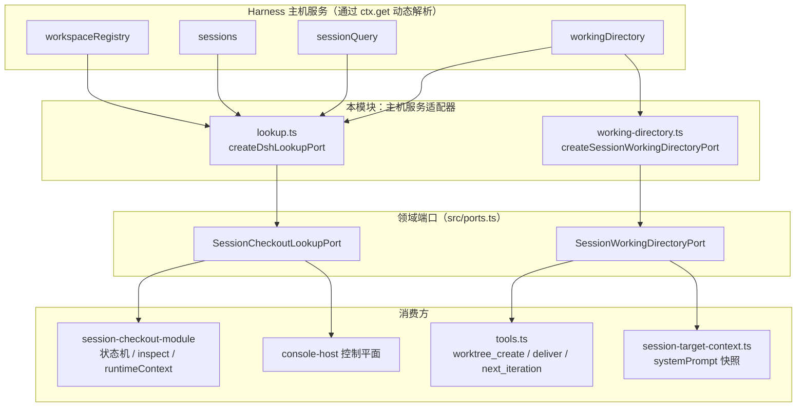
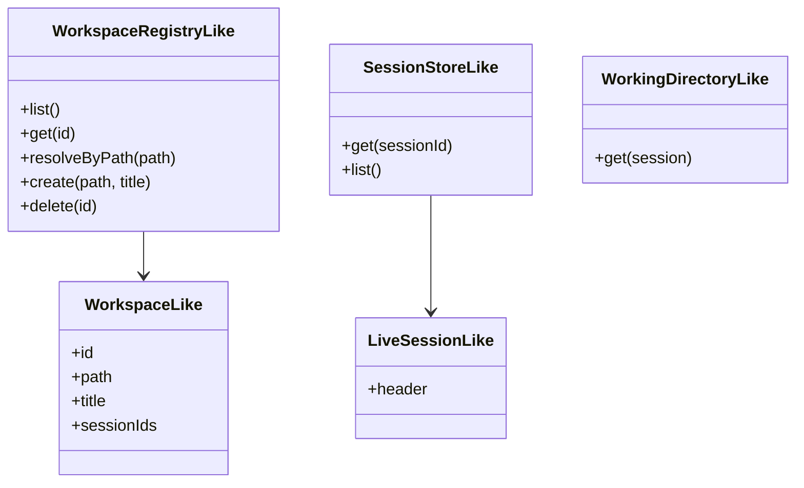
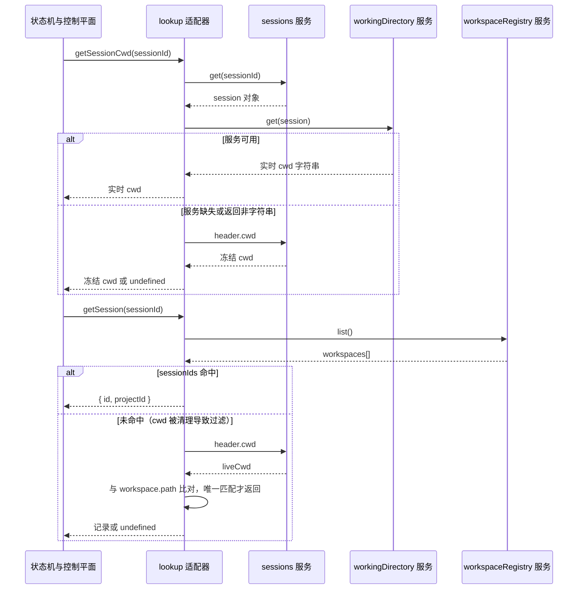
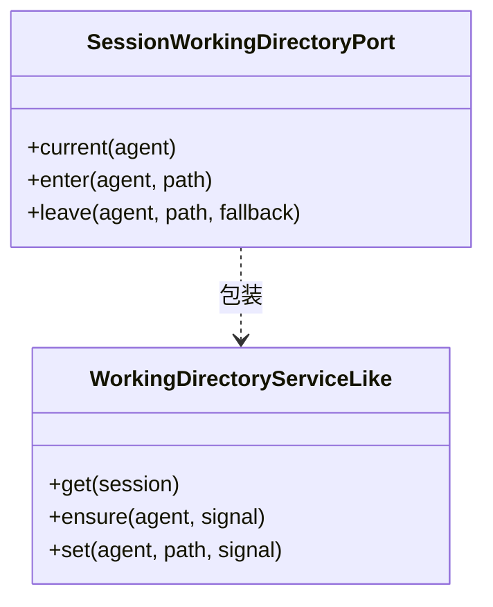
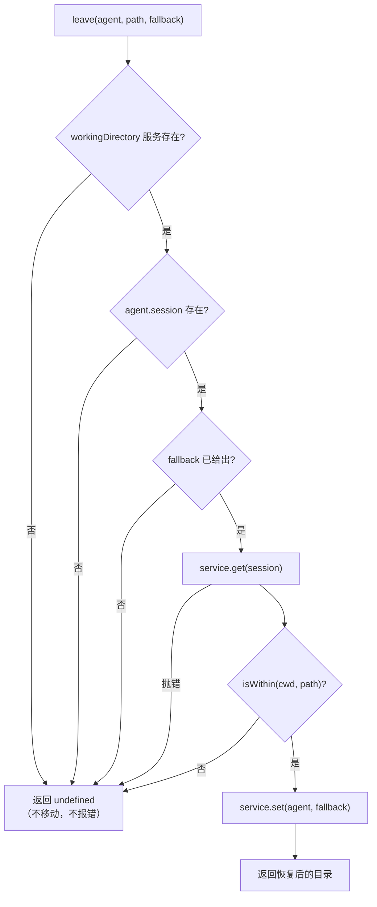
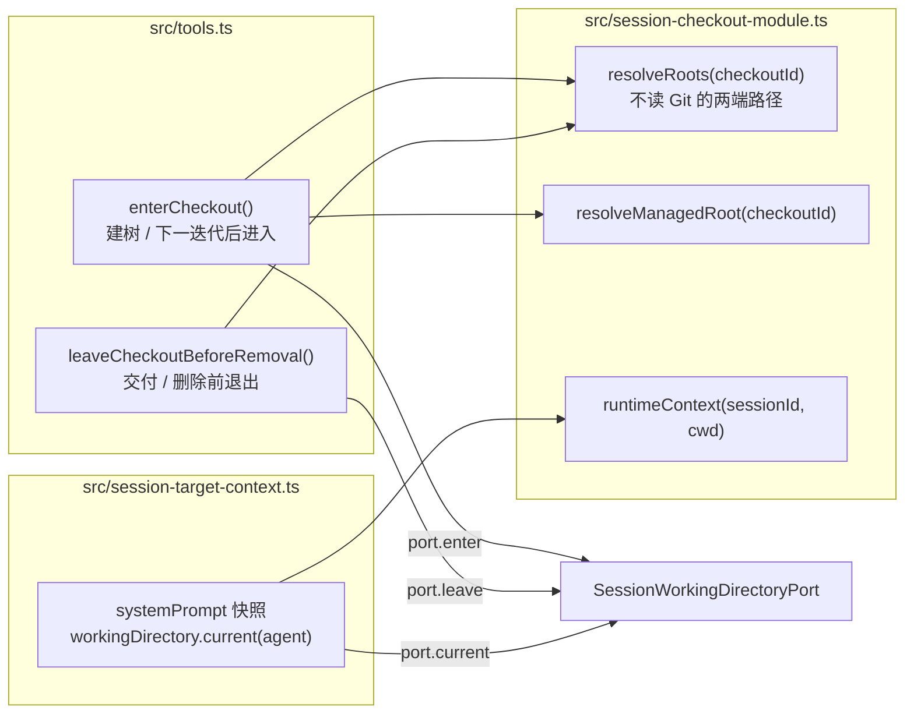
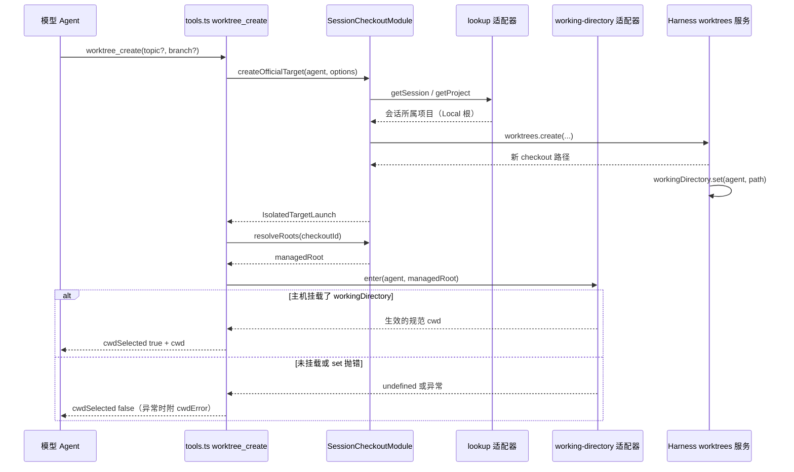
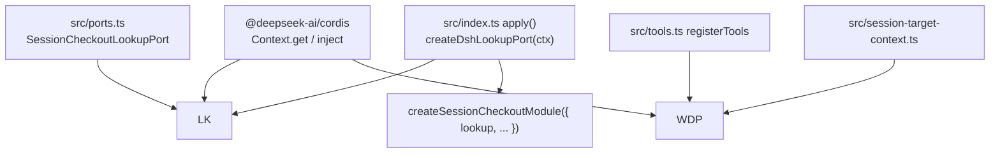

# 主机服务适配器（Host Services Adapters）

本模块包含两个把 **Harness 主机服务**投影为 **领域端口** 的适配器：`src/adapters/lookup.ts` 与 `src/adapters/working-directory.ts`。前者回答「这个会话属于哪个项目、它现在站在哪个目录」，后者负责「把会话真正搬进 / 搬出一棵受管 Worktree」。两者都是**纯结构性、动态解析**的适配层：主机没有挂载对应服务时一律降级为 `undefined`，绝不抛出，从而让上层的状态机把缺失当作「恢复 / 孤儿事实」而不是失败。

---

## 1. 模块定位

`Worktree_and_Session_Checkout_Domain` 中的状态机与 apply 引擎是 host-agnostic 的，只依赖 `src/ports.ts` 里的接口。本模块就是这些接口在 DSH（DeepSeek Harness）运行时上的实现，且**只覆盖与主机会话 / 工作目录相关的两个端口**；文件系统持久化、Git 子进程、项目技能分别由同级页面描述（见 [文件系统与持久化适配器](adapters_infrastructure_filesystem_and_persistence.md)、[Git 子进程适配器](adapters_infrastructure_git_process.md)、[项目技能适配器](adapters_infrastructure_project_skills.md)）。

| 文件 | 导出 | 实现的端口 | 依赖的主机服务 |
| --- | --- | --- | --- |
| `src/adapters/lookup.ts` | `createDshLookupPort`、`WorkspaceLike`、`WorkspaceRegistryLike` | `SessionCheckoutLookupPort` | `workspaceRegistry`、`sessions`、`sessionQuery`、`workingDirectory`（只读） |
| `src/adapters/working-directory.ts` | `createSessionWorkingDirectoryPort`、`WorkingDirectoryServiceLike`、`SessionWorkingDirectoryPort` | 自定义端口（供工具层与提示层使用） | `workingDirectory`（读 + 写） |

端口接口本身定义在 [核心端口与类型](core_ports_and_types.md)（`src/ports.ts`）中，本文不重复其字段定义。

### 架构位置

---

## 2. `adapters/lookup.ts`：会话 / 项目查找适配器

### 2.1 设计要点

- **动态解析，不静态注入**：插件 `apply` 的 `inject` 列表只声明 `tools`、`commands`、`subprocess`、`loader`（见 `src/index.ts`），`workspaceRegistry` / `sessions` / `sessionQuery` / `workingDirectory` 全部通过 `ctx.get('<service>')` 在**调用时**取用。原因是发布包版本落后于运行时（rc.6），静态注入会在缺少服务的宿主上直接让插件挂载失败。
- **结构性鸭子类型**：不 import 主机包的类型，而是声明最小结构视图，再用 `isWorkspaceRegistryLike` / `isSessionStoreLike` / `isWorkingDirectoryLike` 三个守卫判断「服务是否真的可用」。守卫只检查最关键的 `list` / `get` 方法，因此主机新增方法不会破坏适配器。
- **缺失即 `undefined`**：任何服务或记录缺失都返回 `undefined` / 空数组，由状态机解释为「恢复 / 孤儿」事实。

### 2.2 结构视图

> 注：`WorkspaceRegistryLike` 声明了 `resolveByPath` / `create` / `delete` 以完整描述宿主服务，但本适配器只调用 `list()` 与 `get()`；`LiveSessionLike`、`WorkingDirectoryLike`、`SessionStoreLike` 是文件内的**非导出**接口。

### 2.3 端口方法

| 方法 | 数据来源 | 语义与失败降级 |
| --- | --- | --- |
| `getSession(sessionId)` | 遍历 `workspaceRegistry.list()` 的 `sessionIds` | 命中即返回 `{ id, projectId }`；未命中时走**恢复分支**：用 `sessions.get(id).header.cwd` 与 workspace `path` 做路径比较，**唯一匹配**才返回，否则 `undefined` |
| `getProject(projectId)` | `workspaceRegistry.get(projectId)` | 映射为 `{ id, name: title, root: path }`；workspace 不存在则 `undefined` |
| `getSessionCwd(sessionId)` | `workingDirectory.get(session)` 优先，`header.cwd` 兜底 | **授权证据**：必须是会话「此刻」所在的目录；两个来源都取不到则 `undefined` |
| `listLiveSessions()` | `sessions.list()` | 只投影 `id` / `createdAt` / `cwd`；`list` 不存在或抛错时返回 `[]`（分支竞态守卫保持沉默） |
| `getSidebarMemberships(managedRoots)` | `workspaceRegistry.list()` + `sessionQuery.listSessions()` 的 header | 按 `managedRoot` 归集 `workspaceIds` 与 `sessionIds`；入参为空直接返回 `[]` |

### 2.4 双 cwd 语义（本适配器最容易误用的部分）

主机上有**两个**「会话目录」，语义完全不同：

| 来源 | 是否冻结 | 用途 | 本适配器的读取点 |
| --- | --- | --- | --- |
| `sessions.get(id).header.cwd` | **创建时冻结**，`workingDirectory.set` 不会改写 | 导航身份（`listLiveSessions`、`getSession` 恢复分支）、无 `workingDirectory` 服务时的兜底 | `liveHeaderCwd()` |
| `workingDirectory.get(session)` | **实时**，随 `set` 变化 | 授权证据（`getSessionCwd`）、提示层判断「会话是否已在树内」 | `liveWorkingDirectory()` |

如果只用 `header.cwd`，一个被 `workingDirectory.set` 搬进 Worktree 的会话仍然报告 Local 根，于是每个在既有会话里打开的受管 Worktree 都会被判为 `project_mismatch` —— 这正是把两者拆成两个 helper、并让 `getSessionCwd` 优先实时值的直接原因。反之，`getProject().root` 永远是 Local checkout，**不能**用作授权证据。

### 2.5 路径比较规则

- `sameResolvedPath(left, right)`：先 `path.resolve`，Windows 上再 `toLowerCase()` 后比较（大小写不敏感），其他平台严格相等。
- 该规则同时用于 `getSidebarMemberships`、`getSession` 恢复分支，保证「同一个目录」在 Junction / 大小写差异下不会被当成两个项目。
- 注意本函数**不做 `realpath`**：它只回答「记录的路径字符串是否指向同一位置」。真正需要真实路径（符号链接穿透）的判定由文件系统端口与状态机侧的 `pathsEqual` / `resolvedPathsEqual` 负责，见 [文件系统与持久化适配器](adapters_infrastructure_filesystem_and_persistence.md)。

---

## 3. `adapters/working-directory.ts`：会话工作目录适配器

### 3.1 为什么需要它

官方实验性 worktree bundle 建树的最后一步就是 `ctx.workingDirectory.set(agent, path)`。没有这一步，受管 Worktree 只是「文件搬到了别处」，会话本身仍站在 Local 根：相对路径写入、文件工具、子进程全部落到原仓库。本适配器复刻该机制，使 `worktree_create` / `worktree_begin_next_iteration` 能真正把会话搬进 checkout。

### 3.2 端口定义

| 方法 | 行为 | 返回值约定 |
| --- | --- | --- |
| `current(agent)` | `service.get(agent.session)`，同步只读 | 无服务 / 无 session / `get` 抛错 → `undefined` |
| `enter(agent, path)` | `service.set(agent, path)` | 无服务或 `agent === undefined` → `undefined`（**不假装已切换**）；否则返回生效的规范目录 |
| `leave(agent, path, fallback)` | 先判断会话是否在 `path` 内，是则 `set(agent, fallback)` | 不在树内 / 缺 `fallback` / 无服务 → `undefined`（表示「什么都没做」） |

**关键契约**：`enter` 返回 `undefined` 表示「没有发生移动」，调用方绝不能把它当成已选中 cwd 报告；工具层据此区分「优雅降级」与「真实失败」（后者走 `cwdError`）。

### 3.3 `leave` 的包含性判定

`isWithin(candidate, root)` 先 `resolve`，把反斜杠统一成 `/`，去掉尾部斜杠，Windows 下转小写，然后判断「等于 root」或「以 `root/` 开头」。这条规则与状态机侧的 `pathIsWithin` 刻意保持一致，避免「提示层认为在树内、实际切换认为不在」的自相矛盾。

### 3.4 调用点

- **进入**：`enterCheckout` 优先用 `module.resolveRoots()`（纯台账，不跑 Git 校验），只有在模块无法回答时才退到 `resolveManagedRoot()`。原因是一次完整 Git 校验要拿全局锁，恢复中的 checkout 或瞬时 git 故障会把会话卡在树外。
- **退出**：`leaveCheckoutBeforeRemoval` 在交付 / 删除**之前**把会话搬回 `localRoot`。搬不动就返回原因，调用方（`worktree_deliver`）据此**中止删除** —— 否则会话会站在一个即将消失的目录里。
- **提示层**：`registerSessionTargetContext` 把 `workingDirectory.current(agent)` 传给 `module.runtimeContext(sessionId, cwd)`，用来决定是否还要宣告「必须用绝对路径写入」这条规则（会话已在树内就不需要）。

---

## 4. 端到端数据流：`worktree_create`

---

## 5. 依赖与降级策略

| 主机服务缺失 / 异常 | 适配器表现 | 上层后果 |
| --- | --- | --- |
| `workspaceRegistry` 未挂载 | `getSession` / `getProject` 返回 `undefined` | 状态机报 `session_not_found` / `project_not_found`，视图降级为 `recovery_required` |
| `sessions` 未挂载 | `listLiveSessions()` → `[]`；`getSessionCwd` 无兜底 | 分支竞态守卫沉默；授权判定失败而非猜测 |
| `sessionQuery` 未挂载 | `getSidebarMemberships` 只按 workspace 归集 | 侧边栏丢失「历史 header cwd」这条导航证据 |
| `workingDirectory` 未挂载 | `current` / `enter` / `leave` 全返回 `undefined` | 保留「guidance-only」旧行为：树照样建，会话不移动，模型靠绝对路径提示工作 |
| `workingDirectory.set` 抛错 | `enter` 抛出，由 `enterCheckout` 捕获 | 工具返回 `cwdError`，**不会**谎报 cwd 已切换 |
| `ctx.get` 本身不存在（纯插件 Context / 测试） | 视为服务未挂载 | 同上，测试无需桩主机 |

---

## 6. 跨平台与并发注意事项

- **Windows 大小写**：`sameResolvedPath` 与 `isWithin` 都在 `win32` 上做小写化；其他平台保持大小写敏感。
- **不做 `realpath`**：`lookup` 只比较解析后的路径字符串；`working-directory.isWithin` 同理。真实身份校验（inode / birthtime、Junction 防冒充）由文件系统端口与状态机侧负责，见 [文件系统与持久化适配器](adapters_infrastructure_filesystem_and_persistence.md)。
- **`enter` / `leave` 是异步且不可取消**：`WorkingDirectoryServiceLike.set` 接受可选的 `AbortSignal`，但端口签名不转发信号；调用方必须把「未返回」当成「可能已移动」处理（`enterCheckout` 用 `try/catch` + `failure` 显式上报）。
- **动态解析在每次调用时发生**：`registry()` / `sessions()` / `workingDirectory()` 都是函数而非常量，因此宿主热插拔服务（Loader 重挂）后适配器会自动跟随。

---

## 7. 构建与测试上下文

- 本模块只依赖 `@deepseek-ai/cordis` 的 `Context` 类型与 Node 内置 `node:path`，无第三方运行时依赖；`@deepseek-ai/cordis` 在 `package.json` 中声明为 **peerDependency**（`^4.0.5`），保证与宿主共用同一份服务注册表。
- 由于所有主机服务都通过 `ctx.get` 动态解析，测试可以传入只实现 `get` 的最小 Context，或用 `{ get: () => undefined }` 验证全部降级路径；测试执行由 `vitest.config.ts` 配置、`pnpm test`（`vitest run`）驱动，类型检查为 `pnpm typecheck`（`tsc --noEmit`），见 `package.json`。
- 插件的加载元数据（`inject` / `apply` 命名导出）定义在 `src/index.ts`，`cordis.patch.yml` 只负责把 `dsh-git-worktree` 条目插入宿主 profile；`workingDirectory` 之所以不在 `inject` 中，正是本模块采用动态解析的直接原因。

---

## 8. 相关页面

- 端口接口与共享类型：[核心端口与类型](core_ports_and_types.md)
- 端口在本模块外的其他实现：[文件系统与持久化适配器](adapters_infrastructure_filesystem_and_persistence.md)、[Git 子进程适配器](adapters_infrastructure_git_process.md)、[项目技能适配器](adapters_infrastructure_project_skills.md)
- 适配器总览：[适配器与基础设施](adapters_infrastructure.md)
- 使用 lookup 结果驱动状态机的领域层：[Session Checkout 集成核心](session_checkout_engine.md)
- 使用 working-directory 端口的工具层：Session Checkout 工具
- Worktree 创建与官方登记：[核心 Worktree 领域](core_worktree_domain.md)
- 主机侧控制平面（同样消费 lookup）：[Console Host](console_host.md)
- 插件装配入口：[公共 API](public_api.md)