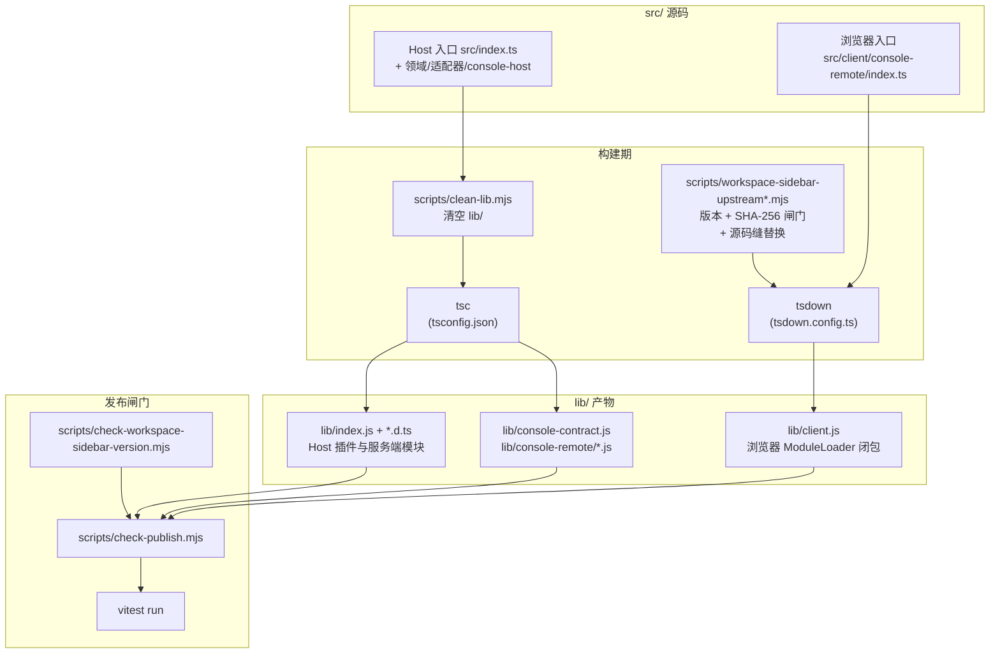
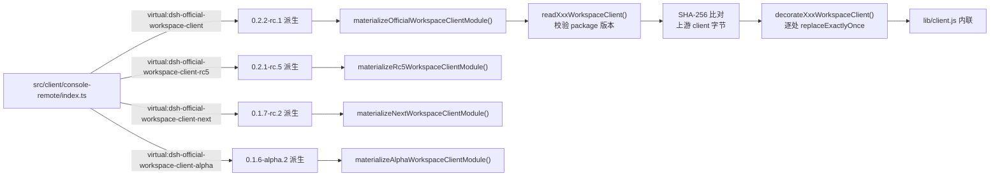
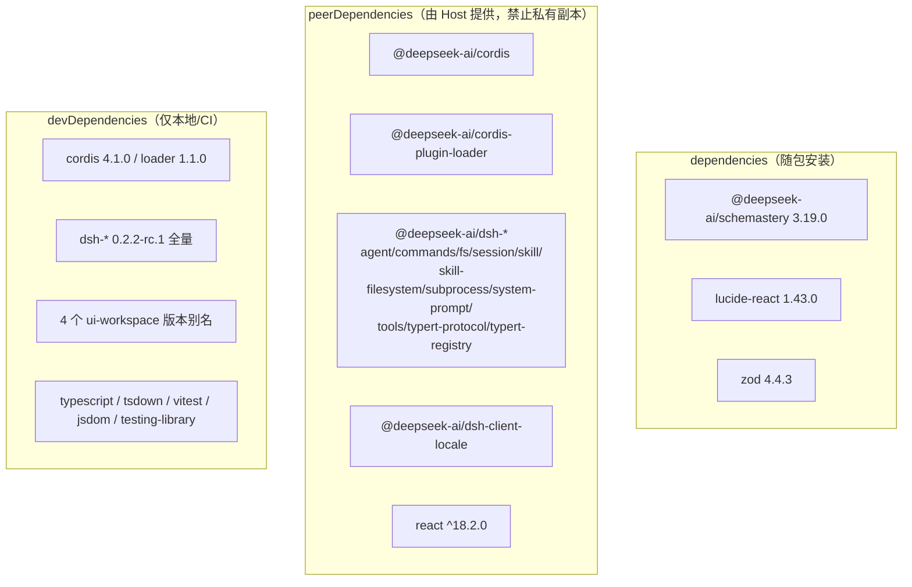
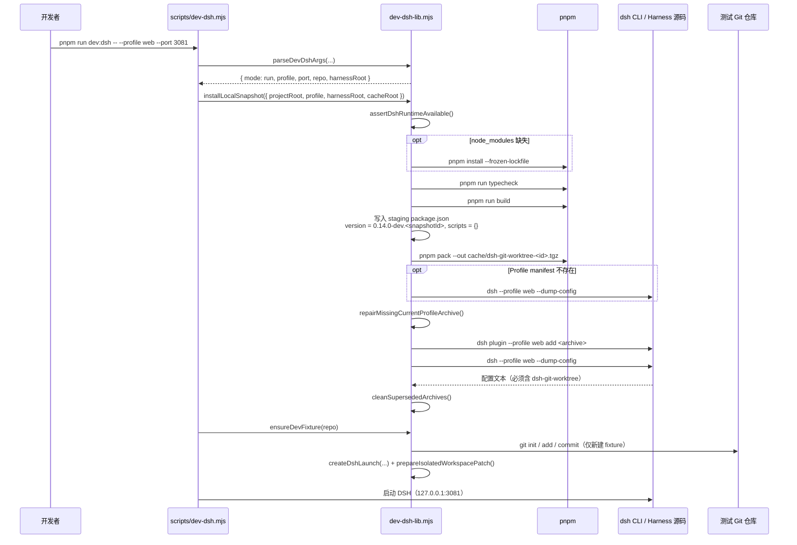
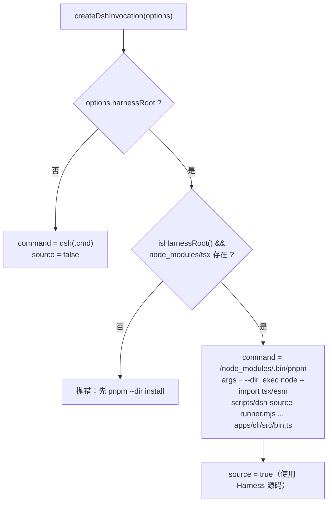
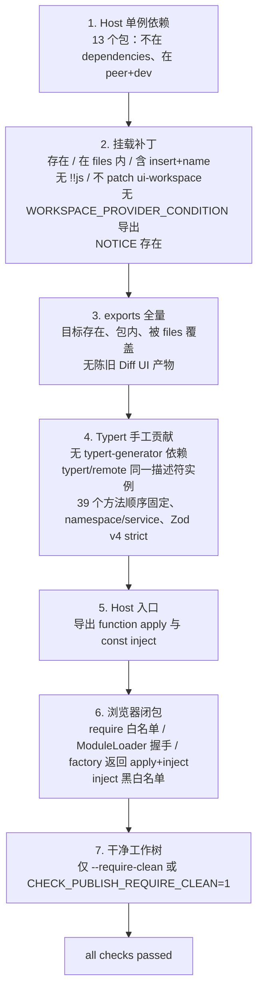

# build_and_config 构建与配置

本页说明 `dsh-git-worktree` 插件的**工程构建、打包、配置清单、质量闸门、测试与本地开发**体系。它不描述运行时业务逻辑（Worktree 状态机、Remote 契约等），而回答以下问题：

- 一次 `pnpm run build` 究竟产出哪些文件，Host 侧与浏览器侧各自如何被加载；
- `package.json` 的 `exports` / `files` / `dsh` 字段与 `cordis.patch.yml` 如何共同决定插件在 DeepSeek Harness 中的挂载方式；
- 发布前的 `check:publish` 闸门校验了哪些不变量，为什么这些不变量必须被机械校验；
- 本地如何在真实 Harness 上验证插件（`dev:dsh` 系列），以及 CI 如何复现同一套流程。

运行时模块请参阅 [core_domain](core_domain.md)、[console_host](console_host.md)、[console_remote](console_remote.md)、[console_contract](console_contract.md)、[client_ui](client_ui.md)、[adapters](adapters.md)、[i18n](i18n.md)。

---

## 1. 模块构成一览

| 文件 | 角色 | 关键内容 |
| --- | --- | --- |
| `package.json` | 包清单与脚本入口 | `exports` 子路径、`files` 白名单、`dsh.bundle.patch`、`dsh.client`、三档依赖、12 个脚本 |
| `tsconfig.json` | Host/服务端类型检查与声明产出 | `NodeNext`、`strict`、`noUncheckedIndexedAccess`、`rootDir: src` → `outDir: lib` |
| `tsdown.config.ts` | 浏览器闭包打包 | CJS + `window.__ModuleLoader__` 包装、4 个上游 ui-workspace 虚拟模块 |
| `vitest.config.ts` | 测试运行器 | 5 条路径别名（UI primitives + 4 个虚拟模块 mock）、Windows 串行化 |
| `cordis.patch.yml` | Host 挂载补丁 | 单条 `insert` 行，插入 `dsh-git-worktree` 插件条目 |
| `.github/workflows/ci.yml` | CI | `install → typecheck → build → check:publish:release → test` |
| `pnpm-workspace.yaml` | pnpm 策略 | `allowBuilds.esbuild`、`minimumReleaseAgeExclude` 放行清单 |
| `screenshots.json` | 文档资产索引 | 3 张 README/文档截图路径 |
| `scripts/*.mjs` | 构建/闸门/开发辅助脚本 | `clean-lib`、`check-publish`、`check-workspace-sidebar-version`、`dev-dsh`(+`dev-dsh-lib`)、`workspace-sidebar-upstream*` |



---

## 2. 构建流水线

`package.json` 中唯一真正的构建入口是：

```json
"build": "node scripts/clean-lib.mjs && tsc && tsdown"
```

三步串行，任何一步失败即中断：

### 2.1 清空 `lib/`（`scripts/clean-lib.mjs`）

```js
rmSync(fileURLToPath(new URL('../lib/', import.meta.url)), { recursive: true, force: true })
```

原因写在脚本注释里：**TypeScript 不会删除已移除源文件对应的旧产物**。若不先清空，被删除的 UI 模块会以陈旧 JS 的形式留在 `lib/`，最终进入 tarball。`check-publish.mjs` 第 3 步会反向校验这一点（见 §5.3 的 stale artifact 列表）。

### 2.2 `tsc`：Host 侧与服务端产物

`tsconfig.json` 的关键约束：

- `module` / `moduleResolution`: `NodeNext`（配合 `package.json` 的 `"type": "module"`，源码与产物均为 ESM）；
- `jsx`: `react-jsx`（客户端 `.tsx` 组件也参与类型检查）；
- `strict` + `noImplicitAny` + `noUncheckedIndexedAccess`（索引访问必须显式处理 `undefined`，这是本仓库大量使用 `?.`/判空的来源）；
- `declaration: true` + `sourceMap: true`：产出 `.d.ts` 供 `exports.types` 使用；
- `rootDir: src` → `outDir: lib`：`src/adapters/git.ts` 对应 `lib/adapters/git.js`，`src/index.ts` 对应 `lib/index.js`。

因此 `tsc` 同时承担**类型检查（`pnpm run typecheck` 用 `--noEmit` 复用同一份配置）**与**Host 侧 ESM 产物生成**。

### 2.3 `tsdown`：浏览器闭包

浏览器侧不能输出普通 ESM，必须符合 DSH Web 的 `ModuleLoader` 装载契约。`tsdown.config.ts` 的要点：

| 配置 | 值 | 作用 |
| --- | --- | --- |
| `entry` | `{ client: 'src/client/console-remote/index.ts' }` | 单一浏览器入口，输出 `lib/client.js` |
| `format` / `platform` / `target` | `cjs` / `neutral` / `es2022` | 闭包内部使用 `require`，但不得依赖 Node 平台 API |
| `external` | `react`、`react/jsx-runtime`、`@deepseek-ai/cordis`、`@deepseek-ai/dsh-client-store`、`@deepseek-ai/dsh-client-ui-primitives` | 这些由浏览器 ModuleLoader 表在运行时提供，必须保持 `require(...)` 原样 |
| `noExternal` | `zod`、`lucide-react` | 打包进闭包，避免浏览器表缺失依赖 |
| `dts` / `sourcemap` / `clean` | `false` / `false` / `false` | 声明文件由 `tsc` 产出；`lib/` 已由 clean-lib 处理 |
| `outExtensions` | `{ js: '.js' }` | 与 `exports["./client"].default` 一致 |

`outputOptions` 把整份 bundle 包进 ModuleLoader 握手：

```js
banner: `window.__ModuleLoader__.load({ id: "dsh-git-worktree", factory: (require) => {`
intro:  'var module = { exports: {} }; var exports = module.exports;'
footer: 'return module.exports; } });'
```

即浏览器执行该文件时，只会向 `window.__ModuleLoader__` 注册一个 `{ id, factory }`，`factory` 返回模块的 `apply` / `inject`。

### 2.4 上游 ui-workspace 虚拟模块

浏览器入口通过 4 个虚拟模块 ID 引入「官方 Workspace 客户端 + 本插件装饰」的派生代码：



- `tsdown` 的 `official-workspace-client-source` 插件在 `resolveId` 阶段把虚拟 ID 映射到 `\0` 前缀的已解析 ID，在 `load` 阶段调用对应 `materialize*` 函数生成源码；
- `materialize*` 内部先读取上游包的 `package.json` 与 `client` 入口，**版本必须精确匹配**（`WORKSPACE_UI_VERSION = '0.2.2-rc.1'` 等），再用 `WORKSPACE_CLIENT_SHA256` 校验字节摘要，最后以「必须命中且只命中一次」的源码缝（`replaceExactlyOnce`）注入 Worktree 装饰（托管守卫、locale 文案、受保护分组元数据等）；
- 任一环节失败即抛错中断构建——这是**编译期 fail-closed**，防止上游结构漂移后生成语义错误的派生客户端。

`devDependencies` 中的 4 个别名包正是为此准备：

```json
"@deepseek-ai/dsh-client-ui-workspace": "0.2.2-rc.1",
"@deepseek-ai/dsh-client-ui-workspace-rc5": "npm:@deepseek-ai/dsh-client-ui-workspace@0.2.1-rc.5",
"@deepseek-ai/dsh-client-ui-workspace-next": "npm:@deepseek-ai/dsh-client-ui-workspace@0.1.7-rc.2",
"@deepseek-ai/dsh-client-ui-workspace-alpha": "npm:@deepseek-ai/dsh-client-ui-workspace@0.1.6-alpha.2"
```

派生客户端与版本/哈希的兼容性闸门另由 `check:sidebar-version` 独立复验（§5.2）。

---

## 3. 包清单与加载契约

### 3.1 `exports` 映射

| 子路径 | 默认产物 | 类型产物 | 消费方 |
| --- | --- | --- | --- |
| `.` | `lib/index.js` | `lib/index.d.ts` | Cordis Host Loader（`apply` + `inject`） |
| `./client` | `lib/client.js` | `lib/client/console-remote/index.d.ts` | Web 浏览器 ModuleLoader |
| `./typert` | `lib/console-remote/typert.js` | `lib/console-remote/typert.d.ts` | Host 侧 Typert 贡献（`TYPERT`） |
| `./remote` | `lib/console-remote/remote.js` | `lib/console-remote/remote.d.ts` | 共享的 Remote 描述符数组 |
| `./console-contract` | `lib/console-contract.js` | `lib/console-contract.d.ts` | Host/Client 双方共享的线缆契约类型 |
| `./package.json` | `./package.json` | — | 元信息读取 |
| `./cordis.patch.yml` | `./cordis.patch.yml` | — | 补丁文件按需引用 |

`./typert` 与 `./remote` 必须导出**同一个描述符数组实例**，`check-publish` 会用 `hostContribution.invocations !== remoteContribution.descriptors` 严格比对（§5.4）。契约细节见 [console_contract](console_contract.md) 与 [console_remote](console_remote.md)。

### 3.2 `files` 白名单与发布内容

```json
"files": ["lib", "scripts", "CHANGELOG.md", "docs/i18n.md", "NOTICE", "cordis.patch.yml"]
```

`check-publish` 要求**每一个 `exports` 目标都必须被 `files` 覆盖**（含 `package.json` 特例）。`NOTICE` 是强制项：官方 Workspace 客户端派生属于第三方衍生作品，必须随包发布署名文件。`docs/i18n.md` 同样进入包内，供多语言说明使用（见 [i18n](i18n.md)）。

### 3.3 `dsh` 字段：Host 与 Client 双面声明

```json
"dsh": {
  "bundle": { "patch": "./cordis.patch.yml" },
  "client": { "platform": "web", "inject": [ ...8 个客户端包... ] }
}
```

- `dsh.bundle.patch` 让 `dsh plugin add` 不只是装一个普通依赖，而是把插件**挂载**到 Host 条目树。缺失它会被 `check-publish` 直接判失败（注释原文：否则会「install a plain dependency without mounting it」）；
- `dsh.client.platform = "web"` 声明浏览器侧产物；`inject` 列出浏览器运行时需要由 ModuleLoader 表提供的 8 个客户端包。

### 3.4 `cordis.patch.yml`：挂载补丁

```yaml
- insert:
    - id: dsh-git-worktree
      name: dsh-git-worktree
```

补丁只做一件事：向 Host 条目树插入本插件。文件头的大段注释记录了一段重要历史：**旧版本曾用客户端求值的 `!!js` 表达式来禁用官方 `ui-workspace` 条目**，同一表达式在 Host `apply` 期间（插件 fiber 仍 `LOADING`，strict service 读为 `undefined`）与 Web 渲染器审计时（插件已 `ACTIVE`，求值为 `true`）得到相反结果，导致 `uiWorkspace` 无提供者、17 个下游条目 pending、Web 启动崩溃（2026-10-17 两次崩溃）。现在「接管选举」完全由 Host 侧生命周期驱动（见 [core_domain_workspace_lifecycle](core_domain/core_domain_workspace_lifecycle.md) 的 `mountWorkspaceProviderLifecycle`），补丁中不再出现任何 `!!js` 表达式，也不再 patch 官方 `ui-workspace` 条目。

上述三条约束全部由 `check-publish` 机械校验（§5.2），防止回归。

### 3.5 依赖三分法



规则非常明确：**任何 Host 单例包出现在 `dependencies` 都会破坏 Host 服务标识（service identity）**——插件会带一份私有 `cordis` 或 `dsh-*`，导致 `ctx.get()` 拿到的不是 Host 的实例。`check-publish` 第 1 步对 13 个包同时要求「不在 dependencies、在 peerDependencies、在 devDependencies」，兼顾「不私有化」与「本地可测」。

`react` 也走 peer 路线（浏览器表提供），因此 `tsdown` 把它列入 `external`。

> 注意：`engines.node` 声明 `>=24.9.0`，而 CI 使用 Node 22（见 §7）。两者存在差异，实际发布要求以 `engines` 为准。

---

## 4. 本地开发工作流：`dev:dsh`

四个脚本共享同一实现 `scripts/dev-dsh.mjs`（薄 CLI）+ `scripts/dev-dsh-lib.mjs`（逻辑）：

| 脚本 | 模式 | 行为 |
| --- | --- | --- |
| `dev:dsh` | `run` | 安装本地快照 → 准备/校验测试仓库 → 启动 DSH Web |
| `dev:dsh:install` | `install` | 仅安装本地快照到指定 Profile |
| `dev:dsh:smoke` | `smoke` | `--dump-config` 校验 Profile 是否真的组合了本插件 |
| `dev:dsh:remove` | `remove` | 从 Profile 移除插件并清理本地归档 |

### 4.1 参数与环境变量

```
pnpm run dev:dsh -- [--profile web] [--repo <git-root>] [--port 3081] [--harness <path>]
```

- `--profile` 默认 `web`，校验 `/^[A-Za-z0-9][A-Za-z0-9._-]*$/`；
- `--port` 默认 `3081`，必须是 1–65535 的安全整数；
- `--repo` 显式指定时解析为绝对路径并标记 `repoExplicit`，否则使用标记保护的临时 fixture；
- `--harness` / `DSH_HARNESS_ROOT` 指定 Harness 源码检出；未指定时 `discoverHarnessRoot()` 会扫描项目父目录附近的 `deepseek-harness`；
- `DSH_HOME` 设置后进入**完全隔离**模式：Profile、归档缓存（`$DSH_HOME/dev-dsh-cache`）与默认 Workspace 都被约束到该目录；否则缓存落在 `os.tmpdir()/dsh-git-worktree-dev`。

### 4.2 一次 `dev:dsh run` 的完整流程



关键安全设计：

- **不发布**：全程 `pnpm pack` 到本地缓存目录，不 push、不 publish；脚本启动时会明确打印这一点；
- **Profile manifest 不由本插件创建**：`--dump-config` 让 DSH 用自身模板初始化 Profile，插件只读取；
- **归档引用修复**：pnpm 会先解析 Profile 里已有的 `file:` 依赖，若该缓存路径已被删掉，`repairMissingCurrentProfileArchive()` 只修复「位于受管缓存内且命名匹配」的路径，其它情况直接报错，避免误删/误覆盖；
- **旧归档清理保守**：`referencedProfileArchives()` 汇总 `$DSH_HOME/profiles/*/package.json` 中所有 `file:` 引用，只删除无人引用且命名匹配 `dsh-git-worktree-<n>.tgz` 的归档；
- **fixture 不可误伤**：默认仓库必须携带 `.dsh-git-worktree-fixture.json`（`{ owner: 'dsh-git-worktree', schemaVersion: 1 }`）；目录非空且无标记、标记身份不符、fixture 不干净或仍有 linked worktree 时一律报错，脚本「永远不会 reset 或删除」用户数据；符号链接路径直接拒绝。

### 4.3 两种 Harness 运行方式

`createDshInvocation()` 根据是否选定源码检出切换：



使用源码检出时，`runProcess()` 在 Windows 上会走 `cmd.exe /d /v:off /c`，并用 `assertWindowsCommandSafe()` 拒绝含 `\0 \r \n " & | < > ^ % !` 的参数，避免命令注入与转义歧义。

### 4.4 `DSH_HOME` 隔离补丁

当 `DSH_HOME` 存在时，`prepareIsolatedWorkspacePatch(cacheRoot)` 生成：

```yaml
- id: workspace-controller
  config:
    documentsDirectory: "<cacheRoot>/Documents"
```

并作为 `--patch` 传入（同时追加 `--no-open`）。这样 Host 首次使用时创建的「Documents 工作区」也被约束在隔离目录内，不会污染真实用户目录。

---

## 5. 质量闸门

### 5.1 脚本总览

| 脚本 | 实现 | 何时运行 |
| --- | --- | --- |
| `typecheck` | `tsc --noEmit` | CI、`installLocalSnapshot`、`prepublishOnly` |
| `build` | `clean-lib → tsc → tsdown` | CI、`prepare`、`installLocalSnapshot`、`prepublishOnly` |
| `test` | `vitest run` | CI、`prepublishOnly` |
| `check:sidebar-version` | `scripts/check-workspace-sidebar-version.mjs` | `prepublishOnly` |
| `check:publish` | `scripts/check-publish.mjs` | 手动 |
| `check:publish:release` | `check-publish.mjs --require-clean` | CI、`prepublishOnly` |
| `prepare` | `pnpm run build` | 安装依赖后（git 依赖安装） |
| `prepublishOnly` | `check:sidebar-version → build → check:publish:release → test` | `npm publish` 前 |

### 5.2 `check:sidebar-version`：上游兼容性闸门

```js
const locale = require('@deepseek-ai/dsh-client-locale/package.json').version
if (locale !== WORKSPACE_LOCALE_VERSION) throw new Error(...)
readOfficialWorkspaceClient(); readAlphaWorkspaceClient(); readNextWorkspaceClient(); readRc5WorkspaceClient()
```

四代 ui-workspace 客户端字节都必须与各自声明的 SHA-256 一致，且 `dsh-client-locale` 版本必须与 `WORKSPACE_LOCALE_VERSION` 对齐（locale 文案被直接注入派生客户端，版本错位会写出错误文案）。任一漂移即抛错。

### 5.3 `check-publish`：七段式完整性闸门

`scripts/check-publish.mjs` 的注释说明其定位：**校验每一个声明的导出、Host 挂载补丁与浏览器闭包，而不是只检查根入口**。



逐段要点：

1. **Host 单例（13 个包）**：`@deepseek-ai/cordis`、`cordis-plugin-loader`、`dsh-agent`、`dsh-commands`、`dsh-session`、`dsh-fs`、`dsh-skill`、`dsh-skill-filesystem`、`dsh-subprocess`、`dsh-system-prompt`、`dsh-tools`、`dsh-typert-protocol`、`dsh-typert-registry`。三者缺一即失败（不私有化 + 可本地测试）。
2. **挂载补丁**：`dsh.bundle.patch` 必须是字符串且文件存在、被 `files` 覆盖；内容必须含 `- insert:` 与 `name: dsh-git-worktree`；**禁止**任何 `!!js` 表达式、**禁止** patch 官方 `ui-workspace` 条目、**禁止** `dsh.client.inject` 请求官方 `ui-workspace` 客户端模块；`lib/workspace-provider-lifecycle.js` 不得再导出已退役的 `WORKSPACE_PROVIDER_CONDITION`；`NOTICE` 必须存在并发布。
3. **`exports` 全量**：逐条件展开（`default` / `types` 等），目标必须 `./` 开头、不逃逸包根、文件存在、被 `files` 覆盖；并显式检查两个已删除的验收 UI 产物（`lib/client/review-console/DiffViewer.js`、`useReviewDiff.js`）不得以陈旧形式残留。
4. **Typert 手工贡献**：不得依赖 `@deepseek-ai/dsh-typert-generator`（本包手工维护描述符）；`./typert` 与 `./remote` 必须同时导出；`TYPERT.package === dsh-git-worktree` 且 `face === 'host'`；`hostContribution.invocations` 与 `remoteContribution.descriptors` 必须是**同一个数组实例**；方法名序列必须与硬编码的 39 项清单**逐位相等**；每个描述符 `namespace`/`service` 为 `gitWorktree`；返回与每个参数编解码器都必须是 `mode: 'strict'` 的 Zod v4（`schema._zod`）编码器。
5. **Host 入口**：`lib/index.js` 必须同时 `export function apply` 与 `export const inject`（Cordis Loader 的装载前提）。
6. **浏览器闭包**：`dsh.client` 必须 `platform: 'web'` 且 `inject` 非空，且包含 5 个必需客户端包（`dsh-api-remote-access`、`dsh-api-session-controller`、`dsh-api-workspace-controller`、`dsh-client-ui-conversation`、`dsh-api-gateway`）；`lib/client.js` 中所有 `require(...)` 必须落在白名单（`react`、`react/jsx-runtime`、`dsh-client-ui-primitives`、`cordis`、`dsh-client-store`）；用 `node:vm` 在沙箱中执行该文件，要求 `window.__ModuleLoader__.load` 恰好被调用一次、`id` 等于包名、`factory` 是函数，且 `factory(browserRequire)` 返回含 `apply` 与 `inject` 的对象。随后校验 inject 黑名单/白名单：
   - 必须**不含** `remoteAccess`（0.2.0-rc.2 Host 无此服务，静态声明会让 Web 启动永久 pending）、`remote.directoryPicker`（其 provider 自身等待 `uiWorkspace`，静态注入会死锁）、`conversation`、`connection`（后两者必须留在延迟子 fiber 中）；
   - 必须**包含** `remote`（在 `$mount` 前注入官方 Remote 服务）；
   - 源码中必须出现字符串 `'remote.directoryPicker'`，证明它是在调用时通过托管上下文惰性解析的。
7. **工作树干净**：`--require-clean` 或 `CHECK_PUBLISH_REQUIRE_CLEAN=1` 时执行 `git status --porcelain --untracked-files=all`，非空即失败。默认推迟该检查，因为本地评审构建刻意在「脏」的托管 Worktree 中进行。

### 5.4 测试配置（`vitest.config.ts`）

```ts
resolve.alias = {
  '@deepseek-ai/dsh-client-ui-primitives': tests/support/ui-primitives.tsx,
  'virtual:dsh-official-workspace-client':        tests/official-workspace-client.mock.ts,
  'virtual:dsh-official-workspace-client-rc5':    tests/official-workspace-client-rc5.mock.ts,
  'virtual:dsh-official-workspace-client-alpha':  tests/official-workspace-client-alpha.mock.ts,
  'virtual:dsh-official-workspace-client-next':   tests/official-workspace-client-next.mock.ts,
}
```

- 测试中 4 个虚拟模块被替换为 mock，因此**测试不需要上游真实字节与哈希**，可与 `tsdown` 的构建期闸门解耦；
- `dsh-client-ui-primitives` 被替换为窄口径测试替身（`Menu`、`Modal` 等），避免在 jsdom 中加载真实 UI 库；
- `include: ['tests/**/*.test.{ts,tsx}']`；`testTimeout`/`hookTimeout` 均为 60s；
- `fileParallelism: process.platform !== 'win32'`——注释说明：重型 Git fixture 套件在 Windows 上并发会争用进程与文件句柄，导致超时后残留临时目录锁。

---

## 6. pnpm 策略与文档资产

### 6.1 `pnpm-workspace.yaml`

```yaml
allowBuilds:
  esbuild: true
minimumReleaseAgeExclude:
  - '@deepseek-ai/cordis@4.0.5'
  - '@deepseek-ai/dsh-*@0.1.2-rc.1' / '@0.2.1-rc.2..rc.5' / '@0.2.2-rc.1'
  ...
```

- `allowBuilds.esbuild`：显式允许 `esbuild` 运行安装期脚本（`tsdown`/`vitest` 依赖它）；
- `minimumReleaseAgeExclude`：pnpm 默认拒绝过新的发布，这份长清单逐条放行本插件锁定使用的 `@deepseek-ai/*` 预发布版本（`cordis`、`dsh-*` 全家族、`schemastery` 等），保证 `--frozen-lockfile` 能在预发布节奏下正常解析。清单按「包名@版本」精确列出，因此**升级任何 `@deepseek-ai/*` 版本时通常也要同步补充此清单**。

### 6.2 `screenshots.json`

```json
["docs/screenshots/00-project-sidebar.png", "docs/screenshots/01-create-worktree.png", "docs/screenshots/02-ready-for-review.png"]
```

文档截图清单，供 README/文档生成流程按序引用。它不参与构建，也不在 `files` 白名单内（截图不随 npm 包发布）。

---

## 7. CI 流水线

`.github/workflows/ci.yml`：单 job `check`，`ubuntu-latest`。

```mermaid
flowchart LR
  T["触发：push 到 master/main<br/>或任意 pull_request"] --> CO["actions/checkout@v4"]
  CO --> PS["pnpm/action-setup@v4<br/>version 10"]
  PS --> SN["actions/setup-node@v4<br/>node 22 + pnpm 缓存"]
  SN --> I["pnpm install --frozen-lockfile"]
  I --> TC["pnpm run typecheck"]
  TC --> B["pnpm run build"]
  B --> CP["pnpm run check:publish:release"]
  CP --> TS["pnpm run test"]
```



顺序不可交换：`check:publish` 会读取 `lib/` 产物，因此必须在 `build` 之后；`--require-clean` 在 CI 中同时校验「工作树与 HEAD 一致」，防止未提交的源码进入发布物。这与 `prepublishOnly` 的链条基本同构（后者额外前置 `check:sidebar-version`，并同样以 `check:publish:release` 收尾）。

> 若要在 CI 复现 `dev:dsh`，需要额外的 Harness 检出与 `DSH_HARNESS_ROOT`；当前 workflow 不包含该步骤，本地开发链路（§4）与 CI 保持相互独立。

---

## 8. 配置变更速查

| 想做的事 | 需要同步修改 |
| --- | --- |
| 新增/重命名 `src/` 顶层模块 | 无需配置改动（`tsc` 自动产出）；若成为公开子路径则更新 `exports` 并确认被 `files` 覆盖 |
| 新增公开子路径 | `package.json` `exports` + `files` + `check-publish` 第 3 段自动覆盖 |
| 新增 Remote 方法 | `src/console-remote/descriptors.ts`（Zod strict 编解码）+ `check-publish.mjs` 中 `expectedRemoteMethods` 清单 |
| 升级上游 ui-workspace | 4 个 `devDependencies` 别名 + `scripts/workspace-sidebar-upstream*.mjs` 中版本与 SHA-256 + `pnpm-workspace.yaml` 放行清单 |
| 调整 Host 单例依赖 | `peerDependencies` + `devDependencies` + `check-publish.mjs` 的 `hostSingletonPackages` |
| 修改浏览器依赖 | `tsdown.config.ts` 的 `external`/`noExternal` + `check-publish.mjs` 的 `allowedBrowserRequires` |
| 更换挂载方式 | `cordis.patch.yml`（只能 insert 本插件一行，不得含 `!!js`） |

---

## 9. 与其他模块的关系

- [core_domain](core_domain.md)：`lib/index.js` 的 Host `apply` 主体，构建产物中体量最大的部分；
- [core_domain_workspace_lifecycle](core_domain/core_domain_workspace_lifecycle.md)：Host 侧 ui-workspace 接管选举，是 `cordis.patch.yml` 去掉条件表达式的直接原因；
- [console_contract](console_contract.md)：`./console-contract` 子路径，Host/Client 共享的线缆契约；
- [console_remote](console_remote.md) 与 [console_host](console_host.md)：`./typert` + `./remote` 描述符与 Host 侧服务实现，受第 4 段闸门约束；
- [client_ui](client_ui.md)：`lib/client.js` 的内容来源，受第 6 段闸门（ModuleLoader 握手与 inject 黑白名单）约束；
- [i18n](i18n.md)：locale 版本与 `check:sidebar-version` 强绑定，`docs/i18n.md` 随包发布；
- [adapters](adapters.md)：`lib/adapters/*.js`，被 Host `apply` 装配，不参与浏览器闭包。
