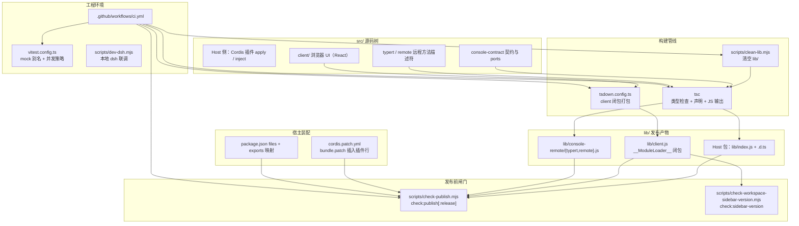
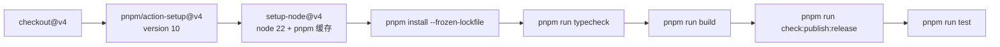
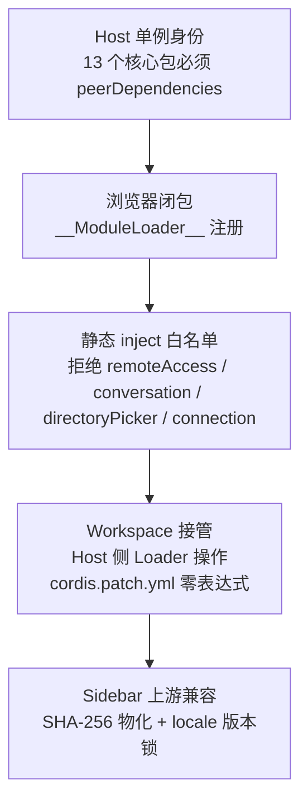

# 构建与配置（build_and_configuration）

## 模块定位

`build_and_configuration` 描述 `dsh-git-worktree` 插件从源码到可发布产物、再到本地开发与 CI 验证的完整工程管线。它本身不包含业务运行逻辑，而是定义四类工程资产：

1. **包清单与发布契约**：`package.json`（导出映射、平台声明、脚本、依赖拓扑）
2. **构建工具链**：`tsconfig.json`（类型检查与声明生成）、`tsdown.config.ts`（浏览器端闭包打包）、`scripts/` 下的辅助脚本
3. **宿主装配配置**：`cordis.patch.yml`（dsh Host 插件挂载补丁）、`screenshots.json`（插件市场元数据）
4. **工程环境**：`.github/workflows/ci.yml`（CI 流水线）、`pnpm-workspace.yaml`（pnpm 安全策略）、`vitest.config.ts`（测试环境与 mock 别名）

> 业务行为文档请参考其他模块：核心契约见 [shared_contracts_and_domain_ports.md](shared_contracts_and_domain_ports.md)，worktree 生命周期见 [worktree_lifecycle_management_core.md](worktree_lifecycle_management_core.md)，控制台控制面见 [console_control_plane_and_services.md](console_control_plane_and_services.md)，浏览器端 UI 见 [client.md](client.md)。

## 架构总览



## 构建与发布流程

### 双段式构建（`pnpm run build`）

`package.json` 中 `build` 脚本定义为 `node scripts/clean-lib.mjs && tsc && tsdown`，对应两个互补的构建阶段：

| 阶段 | 工具 | 输入 | 输出 | 目的 |
| --- | --- | --- | --- | --- |
| 1. 清理 + 类型编译 | `scripts/clean-lib.mjs` + `tsc` | `src/**` | `lib/**/*.js` + `*.d.ts` + sourcemap | 先删除整个 `lib/`，避免被删除源码的残留输出混入发布 tarball |
| 2. 浏览器闭包打包 | `tsdown`（配置见 `tsdown.config.ts`） | `src/client/console-remote/index.ts` | `lib/client.js`（CJS、无 dts） | 为浏览器 ModuleLoader 生成自执行闭包 |

`tsconfig.json` 关键配置：`target: ES2022`、`module: NodeNext`、`jsx: react-jsx`、开启 `strict` 与 `noUncheckedIndexedAccess`、`declaration` + `sourceMap` 输出到 `lib/`、`rootDir` 指向 `src/`。

### 浏览器端闭包的特殊性（`tsdown.config.ts`）

DSH 浏览器端没有原生 ESM 模块系统，所有 Client 插件以 `window.__ModuleLoader__.load({ id, factory })` 闭包注册。`tsdown.config.ts` 因此：

- 输出格式固定为 CJS、`platform: 'neutral'`、`target: es2022`
- `banner` / `footer` 包裹为 `__ModuleLoader__.load(...)` 闭包，并注入 `var module = { exports: {} }; var exports = module.exports;`
- `external` 仅保留 `react`、`react/jsx-runtime`、`@deepseek-ai/cordis`、`@deepseek-ai/dsh-client-store`、`@deepseek-ai/dsh-client-ui-primitives`（这些由浏览器 ModuleLoader 表提供）；`zod` 与 `lucide-react` 通过 `noExternal` 内联进 bundle
- 通过自定义 `resolveId` / `load` 插件把三个虚拟模块（`virtual:dsh-official-workspace-client` 及其 alpha / next 变体）物化为 `scripts/workspace-sidebar-upstream*.mjs` 导出的源码字符串——这是 Workspace Sidebar 上游派生的构建时注入点

### 发布前闸门（`prepublishOnly`）

`package.json` 的 `prepublishOnly` 串联四道闸门：

```
check:sidebar-version  →  build  →  check:publish:release  →  test
```

1. **`check:sidebar-version`**（`scripts/check-workspace-sidebar-version.mjs`）：校验安装的 `@deepseek-ai/dsh-client-locale` 版本与构建时固化的 `WORKSPACE_LOCALE_VERSION` 一致，并以 SHA-256 读取 official / alpha / next 三个 Workspace Client 源码快照；任何上游漂移都直接报错。
2. **`build`**：重新生成完整 `lib/`。
3. **`check:publish:release`**（`scripts/check-publish.mjs --require-clean`）：最严格的发布完整性校验，见下节。
4. **`test`**：`vitest run`。

### 发布完整性闸门（`scripts/check-publish.mjs`）

该脚本逐段验证"插件能否被 dsh Host 正确安装、挂载、启动"，是本模块最核心的运行时契约校验：

1. **Host 单例依赖**：13 个 `@deepseek-ai/*` 包（cordis、dsh-agent、dsh-session 等）必须是 `peerDependencies` 且出现在 `devDependencies`，禁止作为私有 `dependencies`——否则会破坏 Host 服务身份。
2. **宿主挂载补丁**：`package.json` 的 `dsh.bundle.patch` 必须指向存在且被 `files` 覆盖的 `cordis.patch.yml`；补丁必须插入一个以本包命名的插件行；**不得**携带任何 `!!js` 客户端求值表达式（2026-10-17 两次 web boot 崩溃的根因），也不得直接改写官方 `ui-workspace` 条目（选举由 Host 侧 `workspace-provider-lifecycle` 持有）。同时校验 `lib/workspace-provider-lifecycle.js` 不再导出已退役的 `WORKSPACE_PROVIDER_CONDITION` 常量。
3. **导出映射**：`exports` 中每个子路径的每个条件都必须指向包内真实存在、且被 `files` 覆盖的文件；并清理 `lib/client/review-console/` 下已删除 UI 的残留产物。
4. **Typert / Remote 一致性**：动态 import `./typert`（Host 侧 `TYPERT` 贡献）与 `./remote`（Client 侧默认导出），断言二者共享同一个描述符数组实例、方法集合精确等于 41 个手工维护的远程方法、命名空间固定为 `gitWorktree`、每个参数与返回值都使用 Zod v4 strict 编解码。
5. **Host 入口元数据**：`lib/index.js` 必须导出 `apply` 函数与 `inject` 常量（Cordis Loader 契约）。
6. **浏览器闭包可执行性**：在 `vm.runInNewContext` 沙箱中真实执行 `lib/client.js`，捕获 `__ModuleLoader__.load` 回调，用 mock 的 `require` 调用其 `factory`，断言返回 `apply + inject`；并硬性拒绝静态注入 `remoteAccess`、`remote.directoryPicker`、`conversation`、`connection`（这些会与 0.2.x Host 的服务拓扑形成循环等待）。
7. **工作区洁净**：`--require-clean`（CI 与 npm 发布路径）时要求 `git status --porcelain` 为空；本地联调构建允许 dirty。

## 宿主装配与运行配置

### `cordis.patch.yml`

DSH Host 通过"插件补丁"机制把第三方包挂载进 Cordis 插件树。本包的补丁极小：

```yaml
- insert:
    - id: dsh-git-worktree
      name: dsh-git-worktree
```

文件头部注释完整记录了 2026-10-17 的架构决策：早期版本曾用客户端表达式 `!!js` 条件禁用官方 `ui-workspace` 条目以实现接管，但同一表达式在 Host apply 阶段（fiber 仍 LOADING）与 renderer 审计阶段（fiber 已 ACTIVE）求值结果相反，导致 uiWorkspace 无人提供、17 个下游条目 pending、web boot 崩溃。修复后接管完全由 Host 侧生命周期驱动，补丁只负责插入插件行；历史 profile 中的旧表达式会被运行时识别并替换。

### `package.json` 的 dsh 专有字段

- `dsh.bundle.patch`：指向 `./cordis.patch.yml`，供 `dsh plugin add` 安装时执行宿主挂载。
- `dsh.client`：声明浏览器端模块的 `platform: "web"` 与 `inject` 列表（session-controller、workspace-controller、client-connection、client-locale、ui-conversation、ui-tool、api-gateway、api-remote-access）。
- `exports`：对外暴露 `.`（Host 入口）、`./client`（浏览器闭包）、`./typert`、`./remote`、`./console-contract`、`./package.json`、`./cordis.patch.yml` 七个子路径；`files` 限定 tarball 只含 `lib`、`scripts`、`CHANGELOG.md`、`docs/i18n.md`、`NOTICE`、`cordis.patch.yml`。
- `engines`：`node ^22.19.0 || >=24.0.0`。

### `screenshots.json`

插件市场展示素材清单（三张截图：项目侧栏、创建 worktree、就绪评审），供 dsh 插件目录渲染详情页。

## 工程环境

### CI 流水线（`.github/workflows/ci.yml`）

在 `push` 到 `master`/`main` 与所有 `pull_request` 时触发单个 `check` job（`ubuntu-latest`），步骤顺序固定：



即类型检查 → 构建 → 发布闸门（含 `--require-clean`）→ 单测，与本地 `prepublishOnly` 路径基本对齐，但额外强制 frozen lockfile。

### `pnpm-workspace.yaml`

该仓库并非多包 workspace，此文件用于两项 pnpm 安全策略：

- `allowBuilds.esbuild: true`：显式放行 tsdown 底层 esbuild 的构建脚本（pnpm 默认禁止依赖包的 postinstall）。
- `minimumReleaseAgeExclude`：逐一列出 `@deepseek-ai/*` 与 `schemastery` 的具体版本，豁免"新发布包冻结期"策略——因为这些 rc 版本发布时间很近，但团队已审过，避免每次安装被阻塞。

### 测试环境（`vitest.config.ts`）

- `resolve.alias`：把 `@deepseek-ai/dsh-client-ui-primitives` 指向 `tests/support/ui-primitives.tsx`，并把三个 `virtual:dsh-official-workspace-client(-alpha|-next)` 虚拟模块指向对应 mock 文件，与 `tsdown.config.ts` 的虚拟模块 id 一一对应。
- `test.include`：仅收集 `tests/**/*.test.{ts,tsx}`。
- 并发策略：`fileParallelism` 在 Windows 上关闭——重型 Git fixture 套件在 Windows 上会争用进程与文件句柄，并发运行会超时并锁住临时目录；超时统一放宽到 60s。

### 本地开发联调（`scripts/dev-dsh.mjs`）

四个脚本共用同一入口：

| 命令 | 模式 | 行为 |
| --- | --- | --- |
| `dev:dsh` | run | 安装本地快照 → 创建/复用 marker 保护的临时 Git 仓库 → 按 web profile 启动 dsh（默认端口 3081），支持 `DSH_HOME` 隔离与 `--harness` 指定邻近 Harness 源码检出 |
| `dev:dsh:install` | install | 仅把当前 `lib/` 打成本地归档装进指定 profile，保留归档以复现 |
| `dev:dsh:smoke` | smoke | 验证目标 profile 已能组合加载本插件 |
| `dev:dsh:remove` | remove | 从 profile 移除并清理本地归档 |

整个流程不发布 npm、不推送 Git，供插件在真实 dsh 桌面端做端到端联调。

## 关键设计约束



- **单例身份**：插件与 Host 共享 Cordis、dsh-* 服务实例，私有副本会导致服务查找失败。
- **闭包白名单**：浏览器端只能 `require` ModuleLoader 表中存在的模块，多余的 require 会在生产环境直接报错。
- **启动拓扑安全**：Client 根 fiber 的 `inject` 一旦等待 `conversation` / `connection` 等依赖 uiWorkspace 的服务，就会与本插件"恢复 uiWorkspace"的职责形成循环等待（0.2.x web boot 挂起事件）。
- **构建时物化**：Workspace Sidebar 的三个上游变体不是运行时依赖，而是构建期以源码字符串注入 bundle，配合 `check:sidebar-version` 的 SHA-256 校验保证可复现。
