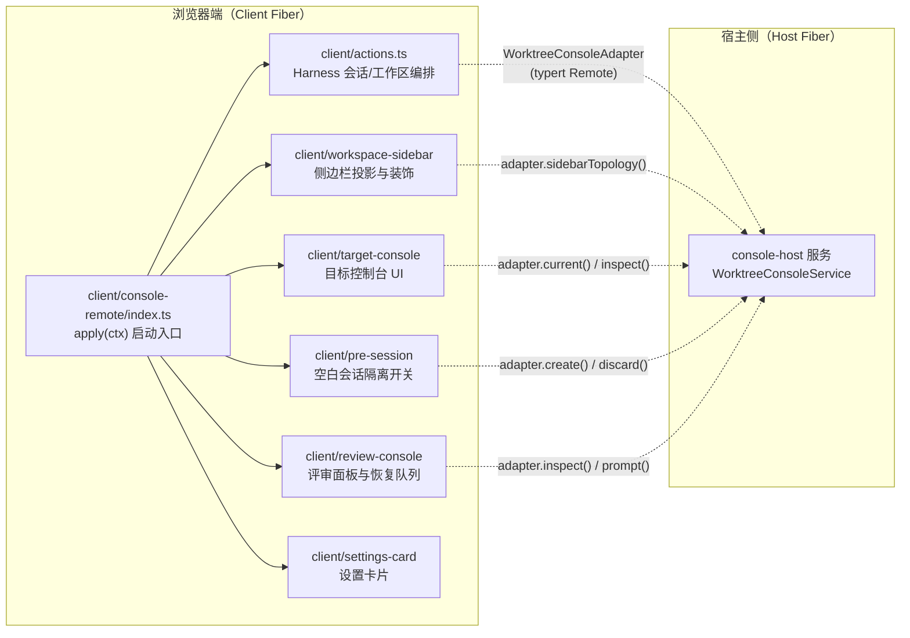
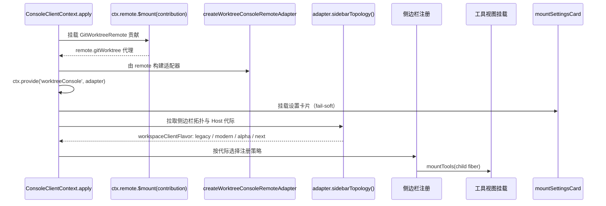
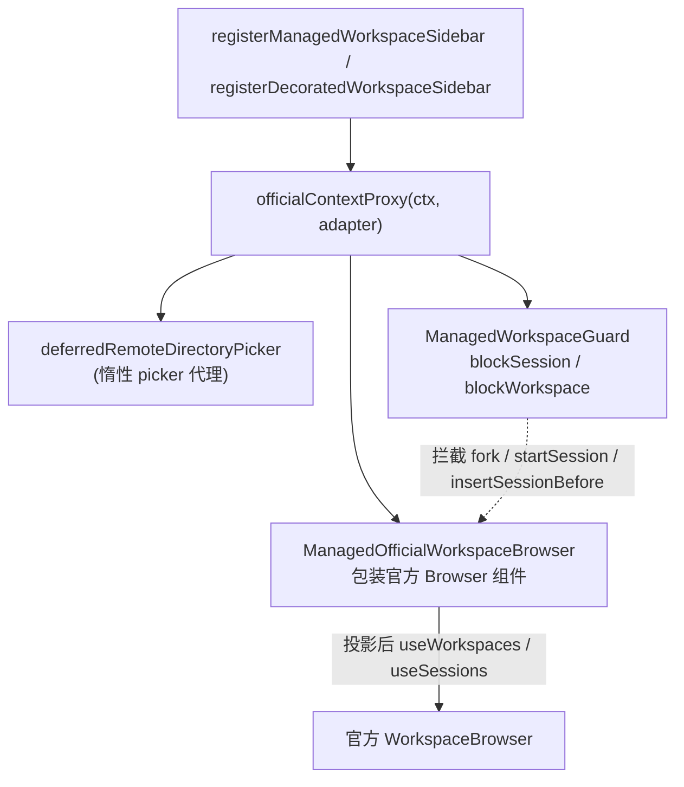
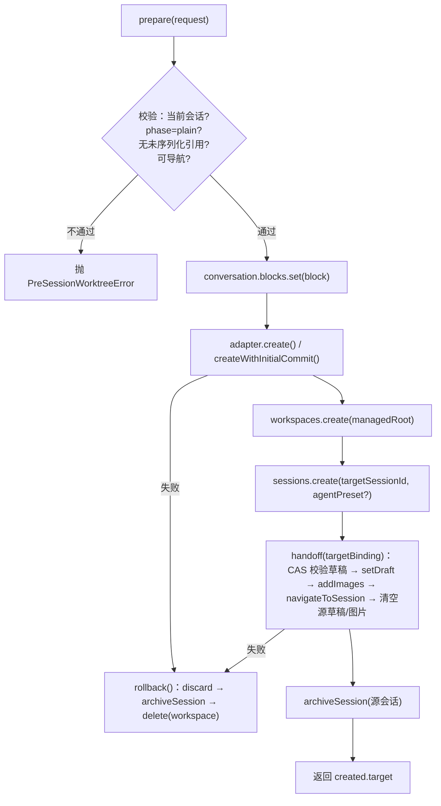
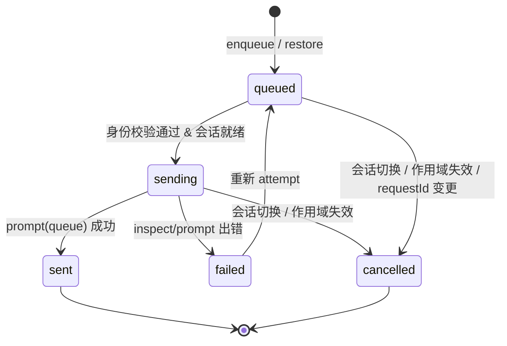
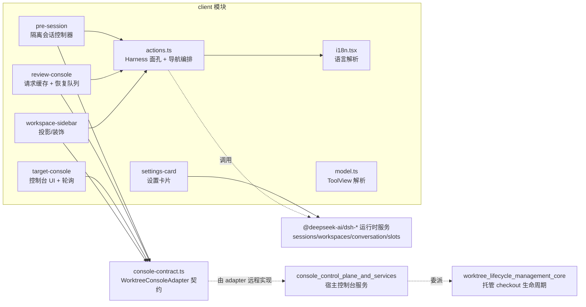

# Client 模块（浏览器端用户界面层）

`client` 模块是 `dsh-git-worktree` 插件运行在 DeepSeek Harness 浏览器端（web client）的完整 UI 与编排层。它本身不直接操作 Git 或文件系统，而是通过 `WorktreeConsoleAdapter` 远程契约把所有读/写/变更请求转发给宿主侧（host）控制台服务，再把结果投影成可交互的 React 界面：会话侧边栏、目标控制台、评审面板、空白会话的"在 Worktree 中开始"开关、以及插件设置卡片。

> 该模块在 `package.json` 中以子路径导出：`"./client"` 指向 `lib/client.js`，其类型入口为 `lib/client/console-remote/index.d.ts`；构建由 `tsc` + `tsdown` 完成（见 [build_and_configuration.md](build_and_configuration.md)）。

## 模块定位

客户端只面向两种"面孔"编程：
1. **Harness 运行时服务面孔**（`sessions` / `workspaces` / `conversation` / `uiWorkspace` / `locale` / `slots`）——来自 `@deepseek-ai/dsh-api-*` 与 `dsh-client-*` 包，在 `package.json` 的 `dsh.client.inject` 中声明注入。
2. **Worktree 控制台适配器面孔**（`WorktreeConsoleAdapter`）——由本模块的远程适配层创建并注入 Cordis `Context`，其契约由 [shared_contracts_and_domain_ports.md](shared_contracts_and_domain_ports.md) 中的 `console-contract.ts` 定义。

## 启动与装配：`console-remote/index.ts`

这是整个客户端的引导入口（`apply(ctx: ConsoleClientContext)`）。它按固定顺序完成以下工作：

关键设计要点（注释见源码）：

- **注入过滤**：根 `inject` 列表从官方 Workspace Client 注入集合中剔除 `remote.directoryPicker` 与 `remoteAccess`。原因是现代 Host（0.2.x）中 picker 提供者依赖 `uiWorkspace`，而本入口又要提供 `uiWorkspace`，静态声明会造成 web 启动死锁；0.2.1 才引入的 `remoteAccess` 若被 0.2.0-rc.2 Host 静态等待会导致永久挂起。两者改为在调用时通过 `officialContextProxy` 惰性解析。
- **代际分支**：`sidebarTopology()` 返回 `workspaceClientFlavor` 后，按 `legacy` / `modern` / `alpha` / `next` 分别走"直接注册托管侧边栏"或"装饰已运行的官方侧边栏"两条路径（见下文"侧边栏"）。
- **启动报告**：`reportBoot()` 通过 `remote.clientBootReport(...)` 把代际、是否注册、耗时（`elapsedMountMs` / `elapsedTopologyMs`）等诊断回传宿主，且全程 best-effort，绝不阻塞或中断启动路径。

## 服务抽象层：`actions.ts`

`actions.ts` 定义了客户端编排所依赖的全部 Harness 面孔（`WorktreeClientServices` / `PreSessionWorktreeServices` / `ClientSessions` / `ClientWorkspaces` / `ClientSessionBinding` / `SnapshotStore<T>`），并实现了一组纯编排函数：

| 函数 | 职责 |
| --- | --- |
| `navigateToSession(services, sessionId)` | 优先用 `uiWorkspace.openSession` 导航，回退 `sessions.open`，两者皆无则抛本地化错误 |
| `selectedSessionId(snapshot)` | 从旧版 `current` 与新版 `retainedBy.mainView` 双重契约中解析唯一可见主会话；多于一个则返回 `undefined`（拒绝猜测） |
| `openExistingSession(services, sessionId, expectedCwd)` | 只有当 Harness 列表同时证明会话身份与 cwd 时才导航 |
| `openIsolatedTarget(services, { managedRoot, targetSessionId })` | 幂等地注册托管根 Workspace、创建预分配会话、等待投影 cwd、再导航 |
| `openAuthorizedWorktreeTarget(adapter, services, callerSessionId, expected)` | 先用 `adapter.inspect()` 做无路径授权校验，核对 checkout/owner 身份后复用 `openIsolatedTarget` |
| `prefillSessionDraft(services, sessionId, text)` | 只预填草稿，绝不调用 send/followup |
| `finalizeCurrentSession(services, reviewId, revision, retention)` | 以显式用户命令 `/worktree finalize ...` 提交评审验收 |

这些函数是连接"宿主身份契约"与"Harness 导航契约"的桥梁，也是 `pre-session` 控制器与恢复队列复用的共享逻辑。

## 侧边栏：`workspace-sidebar/`

### 投影模型 `model.ts`

`projectManagedWorkspaceSidebar({ workspaces, sessions, topology, archivedSessionIds, currentSessionId })` 把宿主 `sidebarTopology()` 返回的托管任务投影合并进原始本地项目 Workspace，产出 `ManagedWorkspaceSidebarProjection`：

- `managedBySessionId`：每个 owner 会话对应的托管任务（含状态徽章）。
- `protectedSessionIds` / `protectedWorkspaceIds`：受托管所有权保护、禁止 fork/start/insert 的行。
- `relocatedSessionIds` / `suppressedSessionIds`：从源 Workspace 迁移或隐藏的会话。

`sidebarBadgeTasks()` 负责把拓扑任务按 owner 去重（同 owner 取迭代/修订最大者），并生成 `stateLabel`（仅状态词，用于徽章）与 `label`（状态 + 源分支，用于 tooltip/aria）。状态映射包括 `working`、`ready_for_review`、`preview_active`、`preview_detached`、`recovery_required`、`finalized`、`discarded`。

设计原则：**歧义时失败向开放**——无法证明安全归属时，保留官方行可见，绝不隐藏用户可能正在使用的会话。

### 注册与装饰 `index.tsx`

- `ManagedOfficialWorkspaceBrowser` 复用完整官方 Browser，仅替换其数据投影（`useWorkspaces` / `useSessions`）与对不安全变更（fork、start、reorder）的拦截，并给受保护行打上 `__dshGitWorktreeProtected` 标记、给托管 owner 行注入 `__dshGitWorktree` 装饰（状态、标签、原始标题）。
- `officialContextProxy` 在上下文层屏蔽两类问题：惰性解析 `remote.directoryPicker`、为 `remoteAccess` 提供空 stub，同时通过代理 `slots.register` 对非"owner-safe"会话菜单动作（fork 及未分类动作）套上 `Guard`，使 fork 等无法绕过托管所有权。
- 挂载时额外注册"清除徽章"菜单入口（`registerClearSidebarBadgeEntry`），用于终态行（discarded/finalized）手动清除侧边栏状态徽章；宿主在拓扑中会自动抑制已清除的徽章，因此无需重置路径。

## 目标控制台：`target-console/`

`registerTargetConsole(ctx, adapter, services)` 向 Harness 原生槽位注册三块贡献：

| 槽位 | 组件 | order | 作用 |
| --- | --- | --- | --- |
| `conversation.session.header.actions` | `TargetStatusAction` | 30 | 会话头部的 Worktree 目标状态动作 |
| `conversation.input.dock` | `WorktreeReviewStatus` | 10 | 输入坞的评审状态行 |
| `conversation.input.dock` | `WorktreeHeroChip` | 20 | 输入坞的 Worktree 英雄徽章 |

此外该目录还导出 `WorktreeConsoleView`（目标主视图）、`WorktreeManagerModal`（托管 Worktree 管理器）、`BranchGraphModal`（分支图谱）、`TagManagerModal`（标签管理）等模态/视图组件。

### 轮询：`current-polling.ts`

`subscribeCurrent(adapter, sessionId, language, listener)` 是一个隐藏式只读观察器，按"adapter 身份 + sessionId + 语言"做键缓存（`WeakMap<WorktreeConsoleAdapter, Map<string, Poll>>`）：

- 正常轮询间隔 `DELAY = 5_000ms`；当 `document.visibilityState === 'hidden'` 时降为 `HIDDEN_DELAY = 60_000ms`，避免后台 GUI 对 owner checkout 空跑 `git status` + 两次 `git rev-parse`。
- 监听 `WORKTREE_REVIEW_REFRESH_EVENT`（定向 `sessionId`）与 `visibilitychange` 触发失效重取。
- 注释明确：**该数据仅用于展示，绝不用于授权任何变更或 Git 清理**。

## 空白会话开关：`pre-session/`

### 控制器 `controller.ts`

`PreSessionWorktreeController` 在正常 Harness composer 发送之前，为一个全新空白会话准备隔离的 Worktree 会话。关键保证：**控制器自己从不发送 prompt**；打开目标后，常驻 composer 仍是唯一提交路径。

设计要点：

- **幂等去重**：`inflight` Map 按 `sessionId` 合并并发 prepare 调用。
- **源 CAS 校验**：在交接前用 `sourceStillMatches()` 比对确认时的草稿/图片/occurrences/`draftRev` 快照，确认源未被改动；从最终 CAS 校验、目标写入、导航到清空源全程**无 await**，避免目标已接收图片而源仍引用这些浏览器字节时的泄漏。
- **交接方式适配**：新版 Host 用 `sessions.using({ source: 'controllerOperation' }, ...)` 持有官方会话引用直到导航取得 mainView 所有权；旧版直接取 `binding()`。
- **失败回滚**：任何已创建 checkout 之后的失败都会走 `rollback()`（先 `discard`，再幂等归档目标会话、删除 Workspace）；若自动回滚也失败，则抛出 `recoveryRequired = true` 的错误交由用户处理。归档源会话的失败不回滚已安全完成的目标交接（源已不再持有草稿状态）。

### 槽位注册 `index.tsx`

`registerPreSessionWorktree(ctx, adapter, services)` 在 `conversation.input.left` 槽位（order 40）注册 `PreSessionWorktreeToggle`。`Entry` 用标准快照选择 hook（`useSession` / `useConversation` / `useInput`）推断会话相位：`active`（非空白/运行中）、`engaging`（promptAttempted）、`blank`（可作为隔离启动源）。

## 评审控制台与恢复队列：`review-console/`

### 请求缓存 `request-cache.ts`

`createRequestCache<TIdentity, TPreflight>()` 是所有"身份键控"控制台读取的统一缓存形状（注释自称 ponytail）：

- 条目按 **per-adapter WeakMap + 身份字符串** 存放，重挂载的客户端永远读不到另一 adapter 的数据。
- `read()` 单飞（single-flight）：并发调用共享同一 in-flight Promise；非 force 时复用上次 success/error，并在请求发出前先发布 `loading`。
- `invalidate()` 递增 `generation`，使失效后落地的响应不会回发陈旧快照或覆盖更新的 Promise。
- `useSnapshot()` 通过 `useSyncExternalStore` 把快照接到 React，并在 `enabled` 时自动发起读取。

### 恢复续作 `recovery-continuation.ts`

`enqueueWorktreeRecovery(...)` / `restoreWorktreeRecovery(...)` 管理两类只读恢复请求：`worktree_apply_conflict`（应用冲突续作）与 `worktree_review_regeneration`（评审快照过期重新生成）。状态机为 `queued → sending → sent` / `failed` / `cancelled`。

安全模型（注释反复强调）：**浏览器状态不可信，每次发送都重新校验 Host + Harness 身份**。

- `validRequest()` 在入队前对请求做严格白名单校验（键集合、字段长度、`revision` 为安全整数、冲突文件路径不含 `..`/绝对路径/控制字符、`localHeadOid` 为 40/64 位十六进制）。
- `targetMatchesRequest()` 在 `attempt()` 中两次 `adapter.inspect()` 之间重校验 checkoutId/ownerSessionId/revision/state 及 `recoveryContinuation` 证明体，身份不符即 `cancel`。
- `sessionReady()` 要求会话为当前选中、cwd 与 `managedRoot` 匹配、`openState === 'open'`、非运行中、未移除。
- **持久化**：仅 `queued`/`sending`/`failed` 状态写入 `localStorage`（前缀 `dsh-git-worktree:recovery:v1:`），作为"上下文"而非授权依据；`sent`/`cancelled` 立即清除。`restoreWorktreeRecovery()` 在运行时重建（adapter/services 变更）时中止进行中的发送并降级为 `failed`。

## 工具视图：`index.tsx` 与 `model.ts`

`apply(ctx, adapterOverride?)`（浏览器入口）负责：

1. 用 `Proxy` 包装 `ctx.slots.register`，把本插件注册的每个组件包进 `ClientI18nProvider`（仅隔离本插件注册，不影响其他 DSH Client 实例）。
2. 通过 `ctx.effect` 挂载自标记的 `<style>`（`data-plugin="dsh-git-worktree"`），避免被 Client 模块系统的 `claimStyles`/`removeOwnedStyles` 误认领或清除。
3. 在 `tool.call.toolview` 槽位注册两个可重放的 keyed 行：`worktree_create`（`WorktreeCreateRow`）与 `worktree_ready_for_review`（`WorktreeReviewRow`）。
4. 当 adapter 存在时，连带 `registerTargetConsole(...)` 与 `registerPreSessionWorktree(...)`。

`model.ts` 提供纯、可重放的 ToolView 解析器 `parseCreateTool` / `parseReviewTool`，仅从日志中的 call/result 切片派生 `ParsedTool<TPayload, TArgs>`：识别生命周期（`running`/`ok`/`error`/`stopped`）、JSON payload 校验（`worktree_target_created` / `worktree_ready_for_review`）与 `ReviewArgs`（summary、validationStatus、tests、suggestedCommitMessage），畸形结果回退为带本地化文案的 `error`。

## 设置卡片：`settings-card/`

- `mountSettingsCard(ctx)`：以 fail-soft 方式探测 `configForms` 与 `slots` 服务；Host 无设置栈时直接不渲染。通过 `configForms.whileServed([WORKTREE_SETTINGS_NS], ...)` 在命名空间被服务时，向 `plugins.bundle.config` 槽位（按 bundle 包名键控）注册 `WorktreeSettingsCard`。
- `WorktreeSettingsCardController` 基于 `SettingsFormModel`（`form-model.ts`） staged 表单模型，编辑 `dsh-git-worktree` 命名空间下的可挥发字段：`autoDeliver`、`autoPush`、`worktreesRoot`、`gitTimeoutMs`、`worktreeAddTimeoutMs`。
- 表单模型设计（见 `form-model.ts` 注释）：**先暂存后保存**——每次设置写入都是带 revision 围栏的持久文档变更，暂存文本保证"所见即所存"；字段以用户层 PRESENCE（而非值比较）标记是否被覆盖。

## 国际化：`i18n.tsx`

- `ClientLocaleSource` 抽象 Harness `locale` 面孔（`getSnapshot()`/`subscribe()`）；`readClientLanguage()` 解析偏好/浏览器回退为规范化 `Language`（默认 `zh`）。
- `ClientI18nProvider` + `useClientTranslator()` 提供 React 上下文驱动的翻译；`translatorForServices(services)` 供命令式服务在**调用时**（而非模块加载时）解析语言。

## 依赖关系总览

- **契约来源**：`WorktreeConsoleAdapter` 及其请求/响应类型（`WorktreeConsoleCreateRequest`、`WorktreeConsoleInspectRequest`、`WorktreeConsoleTargetDetails`、`WorktreeSidebarTopologyResponse`、`WorktreeClientBootReport` 等）全部定义在 `src/console-contract.ts`，详见 [shared_contracts_and_domain_ports.md](shared_contracts_and_domain_ports.md)。
- **宿主实现**：适配器背后的远程映射与控制台服务（`WorktreeConsoleService` / `WorktreeConsoleControlPlane` / `WorktreeReviewDiffReader`），详见 [console_control_plane_and_services.md](console_control_plane_and_services.md)。
- **生命周期内核**：`create()` / `discard()` / inspect 等操作最终落到的托管 checkout 应用引擎与并发防护，详见 [worktree_lifecycle_management_core.md](worktree_lifecycle_management_core.md)。
- **构建/导出/注入清单**：`package.json` 的 `dsh.client.inject`、`"./client"` 子路径导出及 `tsc`+`tsdown` 构建，详见 [build_and_configuration.md](build_and_configuration.md)。

## 子模块页面

本模块的进一步拆分文档（与模块树对应）：

- 工具视图模型与 ToolView 注册（`client/index.tsx`、`client/model.ts`）。
- 目标控制台（`client/target-console/`）。
- 空白会话隔离（`client/pre-session/`）。
- 侧边栏投影（`client/workspace-sidebar/`）。
- 评审与恢复队列（`client/review-console/`）。
- 设置卡片（`client/settings-card/`）。
