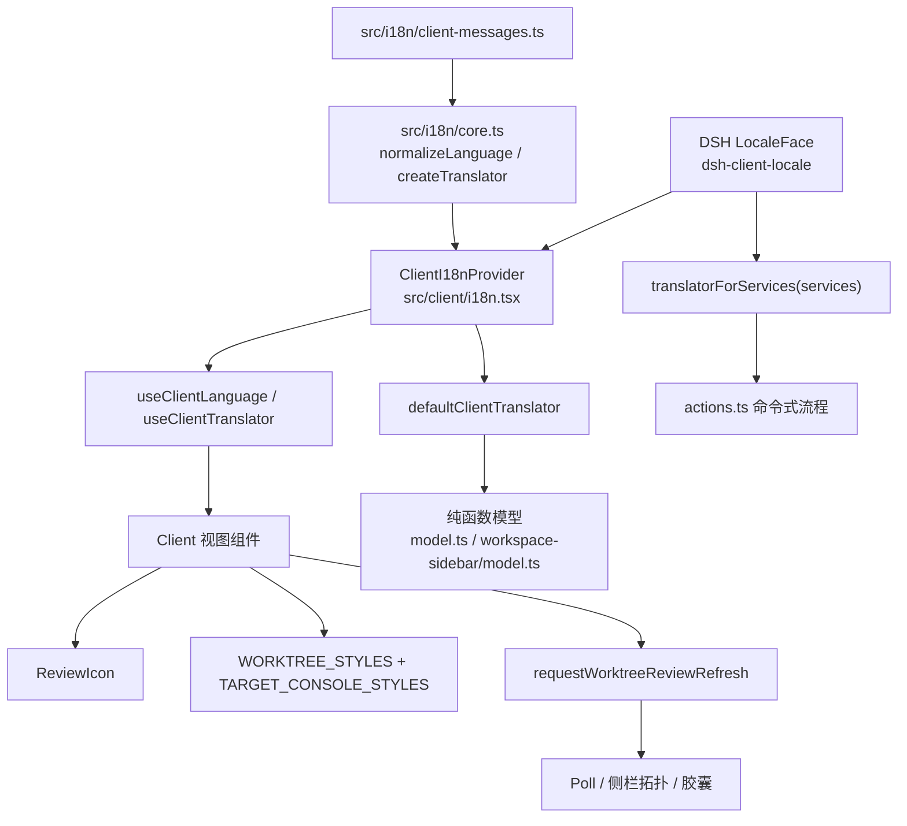
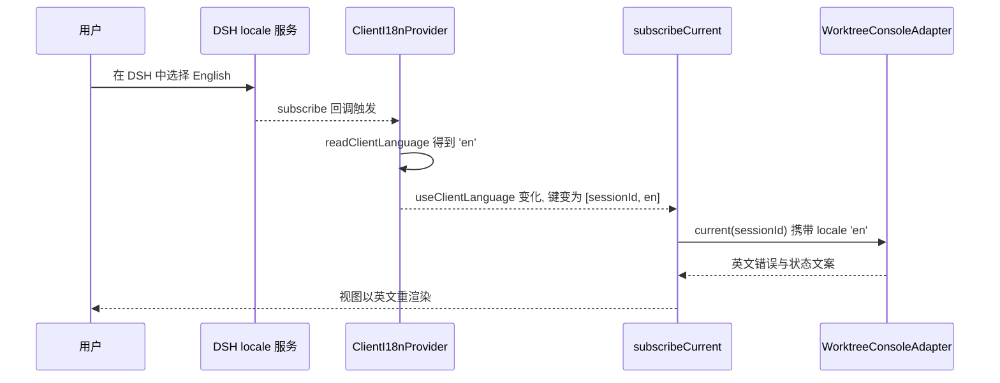
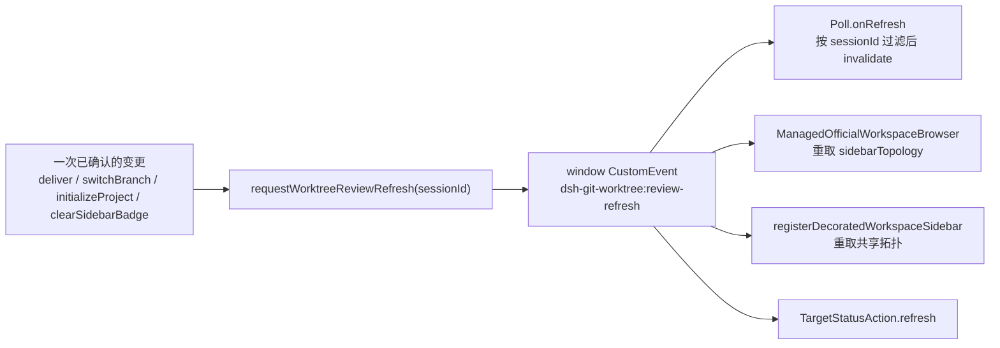
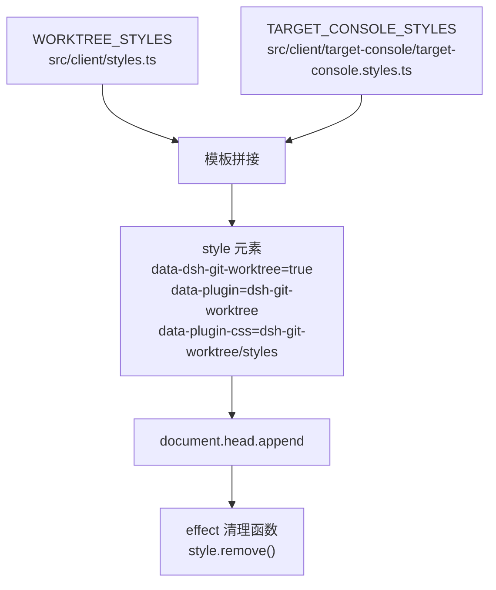
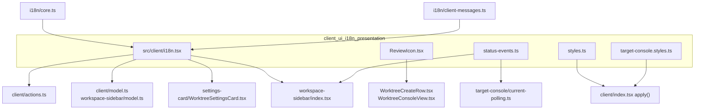

# client_ui_i18n_presentation：国际化桥接与呈现基础层

本页描述 `dsh-git-worktree` 浏览器侧（Client）的**呈现基础层**：把 DSH 官方 locale 服务解析成插件可用的语言，提供类型安全的翻译器，并承载所有插件自有视图共享的图标、刷新事件与样式表。它本身不渲染业务界面，而是被 [client_ui_target_console](client_ui_target_console.md)、[client_ui_workspace_sidebar](client_ui_workspace_sidebar.md)、[client_ui_settings_card](client_ui_settings_card.md)、[client_ui_tool_views_and_actions](client_ui_tool_views_and_actions.md) 与 [client_ui_git_views](client_ui_git_views.md) 共同依赖。

核心组件：

| 组件 | 文件 | 职责 |
| --- | --- | --- |
| `ClientLocaleSource` | `src/client/i18n.tsx` | 结构化桥接 DSH `locale` 服务，向 React 树与命令式代码提供当前语言与翻译器 |
| `ReviewIcon` | `src/client/review-console/ReviewIcon.tsx` | 语义图标名到 `lucide-react` 组件的稳定映射 |
| `requestWorktreeReviewRefresh` | `src/client/review-console/status-events.ts` | 广播"重新读取 Host 权威目标"的 `window` 事件 |
| `WORKTREE_STYLES` | `src/client/styles.ts` | 侧栏装饰与 ToolView 卡片的样式表文本 |
| `TARGET_CONSOLE_STYLES` | `src/client/target-console/target-console.styles.ts` | 目标胶囊、控制台、图表/标签弹窗的样式表文本 |

> 语言契约的完整规范（语言选择、Host 侧 `AsyncLocalStorage` 作用域、翻译边界、目录清单与验证边界）记录在仓库文件 `docs/i18n.md` 中，并由 [i18n](../i18n.md) 模块页描述。本页只说明 Client 呈现层如何消费它。

## 架构与组件关系



三条互相独立的"语言解析入口"必须保持一致，否则同一界面会出现中英混排：

1. **React 树**：`ClientI18nProvider` + `useClientTranslator()`，随 locale 变化自动重渲染。
2. **模块级默认翻译器**：`defaultClientTranslator`，供不接收 React context 的纯函数模型使用（回退语言为中文）。
3. **命令式服务调用**：`translatorForServices(services)`，在**调用时刻**解析语言，而非模块加载时刻。

## 语言解析与翻译桥接

`src/client/i18n.tsx` 不直接依赖 `@deepseek-ai/dsh-client-locale` 的类型，而是用结构化类型 `ClientLocaleSource` 描述它所需的最小面：

```ts
export interface ClientLocaleSource {
  getSnapshot(): { active?: unknown }
  subscribe(listener: () => void): () => void
}
```

内部的 `localeSource(locale)` 只在传入值是对象且 `getSnapshot` / `subscribe` 均为函数时才把它当作 locale 源，否则返回 `undefined`。因此 Host 版本缺失、服务尚未激活或形状不匹配时，插件会安静地退化为中文，而不会在渲染期抛错。

```mermaid
flowchart TD
    Start["readClientLanguage(locale)"] --> IsObj{"locale 是对象?"}
    IsObj -->|否| Zh["返回 'zh'"]
    IsObj -->|是| HasFns{"getSnapshot 与 subscribe<br/>都是函数?"}
    HasFns -->|否| Zh
    HasFns -->|是| Try["读取 getSnapshot().active"]
    Try -->|抛错| Zh
    Try -->|成功| Norm["normalizeLanguage(value)"]
    Norm -->|匹配 /^en(-|$)/i| En["返回 'en'"]
    Norm -->|其他| Zh
```

`normalizeLanguage` 定义在共享的 `src/i18n/core.ts` 中：只有以 `en` 开头（`en`、`en-US`、`en-GB` 等）的值映射为 `'en'`，其余一切（含 `zh-CN`、未知语言、`undefined`）都落到 `'zh'`。这保证"未知即中文"的确定性回退，插件不会根据用户文本、机器 locale 或上次浏览器请求去猜测语言。

### 导出面

| 导出 | 形态 | 说明 |
| --- | --- | --- |
| `ClientTranslator` | 类型 | `Translator<typeof clientMessages>`，键与必填插值参数都受类型检查 |
| `readClientLanguage(locale)` | 函数 | 快照式读取，永不抛错 |
| `clientTranslator(language?)` | 函数 | 默认 `'zh'`，构造一个翻译器 |
| `defaultClientTranslator` | 常量 | 模块加载时构造的中文翻译器，供纯函数默认参数使用 |
| `ClientI18nProvider` | React 组件 | 订阅 locale 并通过 context 下发语言 |
| `useClientLanguage()` | Hook | 读取 context 中的 `Language` |
| `useClientTranslator()` | Hook | 按语言 `useMemo` 的翻译器 |
| `translatorForServices(services)` | 函数 | 命令式解析：`clientTranslator(readClientLanguage(services.locale))` |

### Provider 的订阅实现

`ClientI18nProvider` 用 `useMemo` 构造一个 `{ subscribe, getSnapshot }` store，再交给 `useSyncExternalStore`：

- `subscribe` 委托给 `localeSource(locale)?.subscribe`；没有可用 locale 源时使用空函数，因此永远不会因为缺少服务而挂起。
- `getSnapshot` 优先返回显式传入的 `language` 属性（测试与受控场景），否则调用 `readClientLanguage(locale)`。
- `useSyncExternalStore` 的第三个参数（server snapshot）与 `getSnapshot` 相同，保证 SSR/首帧不会出现 `undefined`。

Provider 的装配点是 `src/client/index.tsx` 的 `apply()`：它用一个 `Proxy` 包裹 `ctx.slots`，把本插件注册的每个组件都套进 `ClientI18nProvider`，从而在同一个页面上为每个 DSH Client 实例保持语言隔离；`src/client/workspace-sidebar/index.tsx` 在包裹官方 Browser 组件时同样显式套一层 Provider。

### 翻译器语义

`createTranslator(catalog, language)` 返回 `(key, params?) => string`：

- 键空间由 `MessageCatalog` 类型约束，`zh` 与 `en` 两个文案都必须存在，缺一个就无法通过类型检查。
- 插值使用 `{name}` 占位符；替换只发生在 `params` 确实拥有该属性时，缺失的占位符保持字面量输出，便于在测试中发现漏传参数。
- 占位符类型由模板字面量类型推导：`Placeholders<S>` 决定 `params` 是必填还是可省略，因此"漏传参数"在编译期即可发现。

客户端消息目录 `src/i18n/client-messages.ts` 按用途分组：`manager.*` / `detail.*` 为验收卡片文案，其余大量点号连接的键是**由原始英文句子派生**的历史键名（例如 `the.cwd.of.new.harness.session.does.not`），它们承载的是错误说明与操作反馈。新增消息时遵循 `docs/i18n.md` 的分类规则：先判断它属于插件自有 UI、官方派生 UI、Host 用户消息、面向模型的指令，还是仅开发者可见的日志。

### 语言变化如何影响数据

语言不只是文案开关，它还会改变传输层请求与轮询身份：

- `src/client/console-remote/adapter.ts` 的 `createWorktreeConsoleRemoteAdapter(remote, getLanguage)` 在**每次调用**时读取语言，并把 `locale` 作为尾部可选参数传给每个 Remote 方法。
- `src/client/target-console/current-polling.ts` 的 `subscribeCurrent(adapter, sessionId, language, listener)` 以 `JSON.stringify([sessionId, language])` 作为轮询键，所以切换语言会新建一条轮询而不是复用旧结果的翻译。



## 图标层：ReviewIcon

`src/client/review-console/ReviewIcon.tsx` 把语义名映射到 `lucide-react` 图标，导出的 `ReviewIconName` 就是该映射的键集合：

| 语义名 | 图标 | 典型用途 |
| --- | --- | --- |
| `file` / `list` | `FileText` / `ListChecks` | 修改文件、验证记录 |
| `branch` / `manager` / `folder` | `GitBranch` / `FolderGit2` / `FolderOpen` | 分支、Worktree 管理器、工作目录 |
| `check` / `warning` / `minus` | `CircleCheck` / `TriangleAlert` / `CircleMinus` | 验证通过 / 需恢复 / 中性态 |
| `confirm` / `close` | `Check` / `X` | 确认与关闭 |
| `preview` / `rollback` / `discard` | `TvMinimalPlay` / `Undo2` / `Trash2` | 预览、撤回、放弃 |
| `edit` / `save` / `send` / `retain` | `Pencil` / `Save` / `Send` / `Archive` | 编辑、保存、交付、保留 |
| `local` / `down` / `chevron` / `refresh` | `Monitor` / `ChevronDown` / `ChevronRight` / `RefreshCw` | 状态与导航 |
| `create` / `search` / `shield` / `help` | `Plus` / `Search` / `ShieldCheck` / `CircleHelp` | 创建、筛选、安全、帮助 |
| `external` / `pin` / `pinOff` / `more` | `ExternalLink` / `Pin` / `PinOff` / `CircleEllipsis` | 外部打开、固定、更多操作 |

实现要点：

- 组件渲染 `<Icon className="dsh-wt-icon ${className}" size={18} strokeWidth={1.75} aria-hidden="true" focusable="false" />`。图标**永远不承担语义**——可访问名称由调用方通过 `aria-label`/`title` 从翻译目录提供，因此图标本身对读屏器隐藏。
- 所有图标共享 `dsh-wt-icon` 类，`src/client/styles.ts` 与 `src/client/target-console/target-console.styles.ts` 中的按钮规则通过 `.dsh-wt-icon` 统一尺寸（`16px`）与 flex 行为。
- `lucide-react` 在 `tsdown.config.ts` 中被列入 `noExternal`，因此图标随 Client bundle 一起打包，运行时不依赖宿主是否提供该包（它在 `package.json` 的 `dependencies` 中声明，版本锁定为 `1.43.0`）。

## 刷新事件总线：requestWorktreeReviewRefresh

`src/client/review-console/status-events.ts` 只导出一个常量与一个函数：

```ts
export const WORKTREE_REVIEW_REFRESH_EVENT = 'dsh-git-worktree:review-refresh'

export function requestWorktreeReviewRefresh(sessionId: string): void {
  window.dispatchEvent(new CustomEvent(WORKTREE_REVIEW_REFRESH_EVENT, { detail: { sessionId } }))
}
```

它是纯广播：没有返回值、没有 promise、不等待任何消费者。语义是"Host 权威目标可能已变化，请重新读取"，而不是"状态已经更新"——所有消费者都必须自己去问 Host，绝不能用事件当作状态来源。



消费者行为差异值得注意：

- `src/client/target-console/current-polling.ts` 中的 `Poll` 用 `detail.sessionId` 过滤，只有同一 Session 的事件才触发 `invalidate()`；`invalidate` 递增 generation 并立即重跑一次 `adapter.current`。同一 `Poll` 还会监听 `visibilitychange`，标签页重新可见时立刻失效重取。
- `src/client/workspace-sidebar/index.tsx` 把事件当作全量刷新信号，重新拉取 `sidebarTopology()` 并写入共享拓扑存储，供不在 Browser React 树内的 slot 菜单项读取。
- `src/client/target-console/TargetStatusAction.tsx` 用它作为 `refresh` 回调，并把它接到 `services.workspaces.openPath`、`initializeProject`、`deliver`、`switchBranch` 等操作之后。

由于事件是 `window` 级别，多个 Session 的多个视图会同时收到同一次广播；过滤责任在消费者一侧。

## 样式层：两张样式表与一次注入

插件不使用 CSS Modules 或运行时 CSS-in-JS，而是把两张样式表以 `String.raw` 模板字符串形式导出为常量，由 `src/client/index.tsx` 在 `ctx.effect` 中拼接成一个 `<style>` 元素注入 `document.head`：



自标记 `data-plugin` / `data-plugin-css` 不是装饰：DSH 的 client-module 系统会"认领"任何没有 `data-plugin` 的 `<style>`（`claimStyles`），并在该模块失效/裁剪时把它删除（`removeOwnedStyles`）。自行打标可以让样式表始终归属于本插件，避免被相邻模块错误回收。

### WORKTREE_STYLES

`src/client/styles.ts` 覆盖两类界面：

1. **侧栏装饰**（`.dsh-git-worktree-sidebar-icon`、`.dsh-git-worktree-sidebar-badge`）。通过 `[data-worktree-state]` 选择器为 `working`、`ready_for_review`、`preview_active`、`preview_detached`、`recovery_required`、`finalized`、`discarded` 分配强调色，颜色全部来自宿主 CSS 变量（`--dsw-alias-state-business-primary`、`--dsw-alias-state-warn-label`、`--dsw-alias-state-error-primary`、`--dsw-alias-state-success-primary`、`--dsw-alias-label-tertiary`），因此明暗主题自动跟随。徽标最大宽度 `168px` 并省略号截断，保证"状态 · 分支"可读而标题不被挤压。
2. **ToolView 卡片**（`.dsh-wt-card` 及其子元素）。以 `currentColor` 派生的 `--wt-ink` / `--wt-muted` / `--wt-line` / `--wt-panel` 令牌构成一套自洽配色，涵盖头部标记点（`.dsh-wt-mark`，`running` 时脉冲动画）、键值网格、按钮（含 `.dsh-wt-primary`）、错误块、验证徽章（`[data-validation="passed|failed|partial"]`）、文件芯片、提交信息块、可折叠详情与保留策略区。

无障碍与降级细节：`@media (prefers-reduced-motion: reduce)` 关闭脉冲动画；`focus-visible` 使用固定蓝色描边；`.dsh-wt-visually-hidden` 提供读屏器专用文本；`max-width: 560px` 时键值网格退化为单列。

### TARGET_CONSOLE_STYLES

`src/client/target-console/target-console.styles.ts` 覆盖目标胶囊与整个控制台：

- `.dsh-wtc-target-chip` 用 `--wtc-state` 单一变量驱动边框、背景与圆点，`[data-target-state]` 逐态赋值（`creating`/`cleanup_pending` 琥珀、`working` 蓝、`ready_for_review` 绿、`retained` 紫、`recovery_required`/`error` 红）。`not_git_repository` 刻意使用中性灰而非告警色——"不是 Git 仓库"是正常答案，不是故障；`delivered`/`discarded` 通过 `opacity: .66` 表示终态。
- `.dsh-wtc-console` 及其区块（当前目标、列表、行、状态、事实、按钮、错误/提示条、确认浮层）构成管理器界面，`@media (max-width: 620px)` 时行改为纵向堆叠。
- 提交图（`.dsh-wtc-graph*`）与标签管理器（`.dsh-wtc-tag*`）的样式与 `BranchGraphModal` / `TagManagerModal` 的类名一一对应，包括 `data-gitgraph-ref-current` / `data-gitgraph-ref-tag` 的徽章配色，以及悬停才显示的 `.dsh-wtc-graph-tag-action`。

两张样式表共享 `--wtc-*` / `--wt-*` 命名前缀，互不覆盖；唯一的交叉引用是控制台按钮复用 `.dsh-wt-icon` 的尺寸规则。

## 依赖与边界



- **不引入 Host 依赖**：`src/i18n/core.ts` 明确"never imports browser or Host-only modules"，`i18n.tsx` 只依赖 `react` 与该共享核心，因此同一份目录可以同时服务于浏览器与 Host 侧（Host 侧作用域见 [i18n](../i18n.md)）。
- **不持有业务状态**：本模块没有任何远程调用、缓存或台账；它只做语言解析、图标映射、事件广播与样式声明。
- **不翻译非 UI 数据**：路径、分支名、Session/Checkout/Git 标识、错误码、持久化结构、用户撰写的标题与摘要一律原样透出，翻译只发生在插件自有的消息源。

## 与其他模块的关系

| 相关页面 | 关系 |
| --- | --- |
| [client_ui](../client_ui.md) | 父模块；本层是 Client 侧的呈现基础设施 |
| [client_ui_bootstrap](client_ui_bootstrap.md) | 启动入口在 `apply()` 中装配 Provider 与样式注入，并把 `locale` 列为必需注入服务 |
| [client_ui_target_console](client_ui_target_console.md) | 主要消费者：`useClientTranslator`、`ReviewIcon`、`requestWorktreeReviewRefresh`、`TARGET_CONSOLE_STYLES` |
| [client_ui_workspace_sidebar](client_ui_workspace_sidebar.md) | 用 `defaultClientTranslator` 驱动投影文案，监听刷新事件重取拓扑 |
| [client_ui_tool_views_and_actions](client_ui_tool_views_and_actions.md) | `model.ts` 的纯函数以 `defaultClientTranslator` 为默认参数；`actions.ts` 用 `translatorForServices` |
| [client_ui_settings_card](client_ui_settings_card.md) | 设置卡片全部文案来自 `useClientTranslator` |
| [client_ui_git_views](client_ui_git_views.md) | 分支图/标签弹窗接收 `ClientTranslator` 作为属性 |
| [i18n](../i18n.md) | 目录、Host 侧语言作用域与传输诊断消息的权威说明 |
| [console_contract](../console_contract.md) | `WorktreeConsoleTargetState` 等状态枚举决定 `[data-target-state]` / `[data-worktree-state]` 的取值域 |
| [build_and_config](../build_and_config.md) | `tsdown.config.ts` 的 `noExternal` / `external` 决定 `lucide-react` 与 `react` 的打包方式 |

## 构建、测试与验证边界

- `pnpm run typecheck` 与 `pnpm run build`（`tsc && tsdown`）是翻译键与插值参数的编译期门禁：键写错或漏传必填占位符都无法通过。
- `pnpm run test`（Vitest，`jsdom` 环境，配置见 `vitest.config.ts`）覆盖语言归一化、中文回退、插值、Client 语言切换与 Host 异步隔离等行为。
- `.github/workflows/ci.yml` 在 push/PR 上依次执行 `pnpm install --frozen-lockfile`、`typecheck`、`build`、`check:publish:release`、`test`。
- `pnpm run check:sidebar-version` 与 `pnpm run check:publish:release` 属于发布完整性门禁；`prepublishOnly` 把它们与构建、测试串联。
- 组件级 DOM 测试**不构成**浏览器或部署证据；实际 Web/Docker 验证需在交付报告中单独声明（与 `docs/i18n.md` 的"Verification boundaries"一致）。

## 扩展指引

新增一条插件自有 UI 文案时：

1. 在 `src/i18n/client-messages.ts` 添加同时含 `zh` 与 `en` 的条目，保持既有中文语义，两侧使用同名的 `{placeholder}`。
2. 通过 `useClientTranslator()`（React 组件内）或 `translatorForServices()`（命令式流程）取翻译器，不要直接读 `locale` 或拼接字符串。
3. 纯函数模型如需默认文案，使用 `defaultClientTranslator` 作为参数默认值，让调用方仍可注入测试翻译器。
4. 动态值通过参数插入，绝不用动态值构造翻译键，也不翻译用户内容。

新增一个图标时，只需在 `src/client/review-console/ReviewIcon.tsx` 的 `icons` 映射里追加语义名，`ReviewIconName` 会自动扩展；新增样式时优先复用 `--wt-*` / `--wtc-*` 令牌与宿主 `--dsw-alias-*` 变量，避免硬编码颜色破坏主题一致性。
