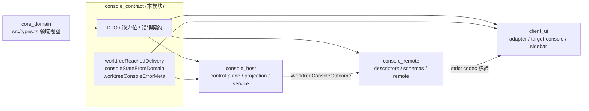
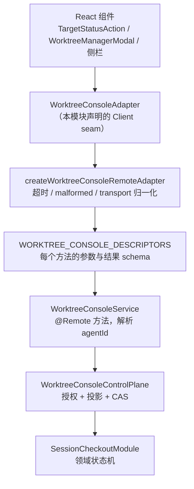
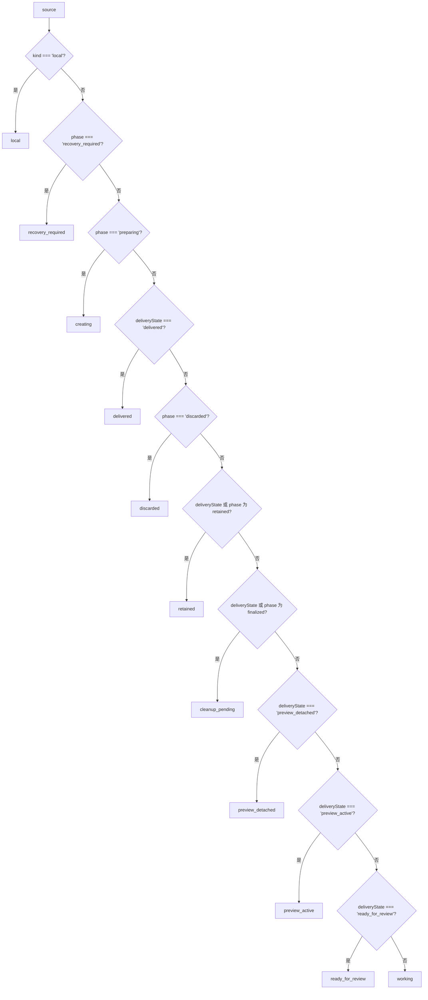
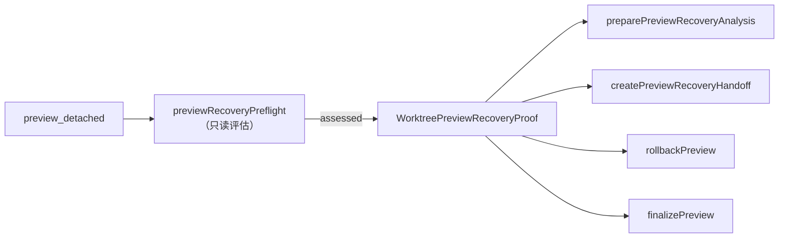
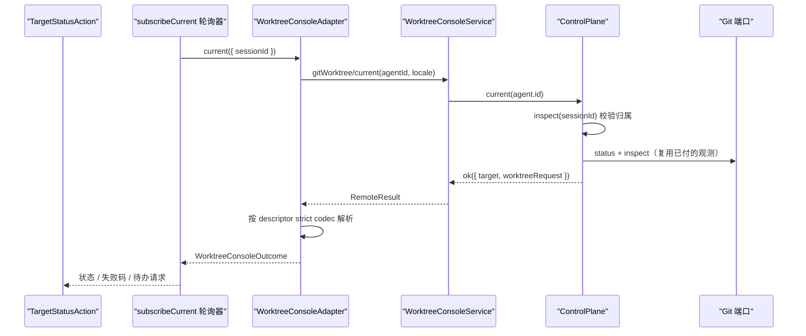
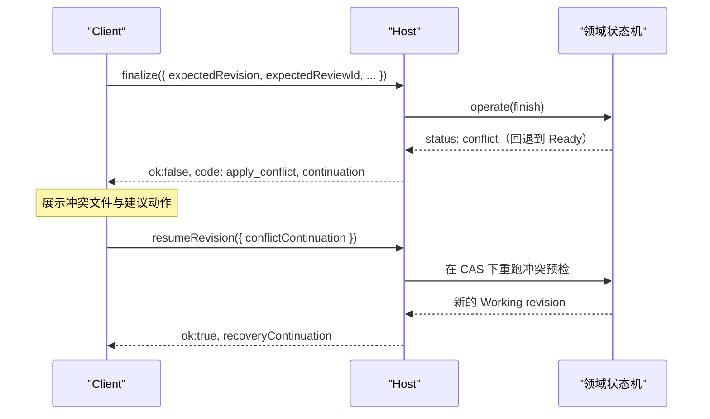
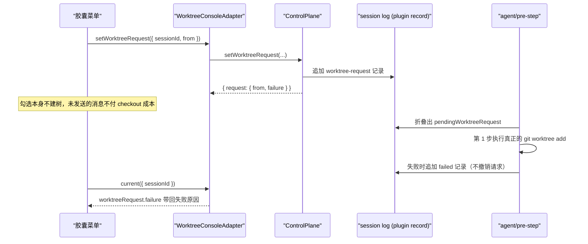

# console_contract：Worktree Console 共享契约层

`console_contract` 是 Worktree Console 的 **JSON-only 共享契约层**：它只声明 Host 与 Client 两侧共同遵守的 DTO、能力位、错误分类与适配器接口，并额外提供两个纯函数（`worktreeReachedDelivery`、`consoleStateFromDomain`）与一个错误元数据查表函数（`worktreeConsoleErrorMeta`）。模块文件 `src/console-contract.ts` 刻意不引入 Cordis、React、Remote 或文件系统实现，因此可以同时被浏览器端 bundle 与 Host 侧服务安全导入。

契约的核心权威规则写在模块头注释里：**每一个 Host 操作在执行时都必须重新解析出确切的调用方 Session，并重新校验 project / owner / cwd / revision / review 身份**。契约里出现的 `capabilities` 只是 UI 提示位，任何字段都不构成授权凭据。

---

## 1. 模块定位

| 维度 | 说明 |
| --- | --- |
| 类型 | 纯类型 + 少量纯函数（无副作用、无 IO） |
| 打包入口 | `package.json` 的 `exports["./console-contract"]` → `lib/console-contract.js` / `lib/console-contract.d.ts` |
| 上游依赖 | `src/types.ts` 中的领域视图（`SessionCheckoutPhase`、`WorktreeRetentionMode`、`WorktreeDeliveryProofView`、`WorktreeApplyPreflightView`、`WorktreePreviewRecoveryProof` 等）与 `SESSION_CHECKOUT_ERROR_CODES` |
| 下游消费者 | [console_host](console_host.md)（生产这些 DTO）、[console_remote](console_remote.md)（为每个 DTO 生成 strict codec）、[client_ui](client_ui.md)（渲染与调用） |
| 对应实现 | Host：`src/console-host/*`；Client 适配器：`src/client/console-remote/adapter.ts` |



---

## 2. 分层与传输路径

契约本身不知道传输方式，但它在链路上的位置是固定的：



- `WorktreeConsoleAdapter` 是**唯一的 Client seam**：Remote 传输细节被收敛在一个适配器后面，UI 只面向 `Promise<WorktreeConsoleOutcome<T>>` 编程。
- Host 侧的 `@Remote` 方法逐个镜像适配器方法，参数顺序一一对应（`agentId` 由 Gateway 从调用上下文解析，业务代码拿到的已经是 `Agent`）。详见 [console_host](console_host.md)。
- 传输层的 strict schema 与 Typert descriptor 由 [console_remote](console_remote.md) 依据本模块的类型参数化生成。

---

## 3. 目标状态模型

### 3.1 状态枚举

`WORKTREE_CONSOLE_TARGET_STATES` 是 UI 面向的 11 个稳定状态：

```
local · creating · working · ready_for_review · preview_active ·
preview_detached · retained · cleanup_pending · recovery_required ·
delivered · discarded
```

它与领域层 `SessionCheckoutPhase`（`preparing / ready / applying / mutating / recovery_required / finalized / retained / discarded`）**不是同构**：UI 状态由「phase + deliveryState」两个维度投影得出，`WorktreeConsoleDeliveryState`（`working / ready_for_review / preview_active / preview_detached / finalized / retained / delivered`）是第二个维度。

### 3.2 投影函数 `consoleStateFromDomain`

`consoleStateFromDomain(source)` 的判定顺序即优先级，用于保证「恢复态压过过期的交付标签」这类不变量：



两条刻意为之的顺序约束：

1. `delivered` 先于 `discarded` 判定：交付成功后清理会把 phase 推到 `discarded`，但任务已经完成，绝不能投影成「已放弃」。
2. `discarded` 先于 `retained`/`finalized` 判定：被放弃的记录会保留丢弃前的交付标签，只有 `delivered` 才表示改动真的落进了 Local。

### 3.3 交付判定 `worktreeReachedDelivery`

`worktreeReachedDelivery(phase, deliveryState)` 在以下任一条件成立时返回 `true`：`deliveryState ∈ {delivered, finalized, retained}` 或 `phase ∈ {finalized, retained}`。

该函数被契约与 Host 两侧共同使用（`src/console-host/projection.ts`、`src/console-host/control-plane.ts` 的 `returnToLocal` 能力位与「已交付 owner 走 Local 边界」授权分支），目的是让 UI 投影与 Host 授权门禁**共享同一份终态谓词，不会各自漂移**。详细授权语义见 [console_host](console_host.md)。

---

## 4. 核心 DTO 分组

### 4.1 目标摘要与详情

| 类型 | 用途 | 关键约束 |
| --- | --- | --- |
| `WorktreeConsoleTargetSummary` | 列表行 / 胶囊状态用的**无路径**摘要 | 不含任何文件系统路径，可安全进入项目列表与侧栏 |
| `WorktreeConsoleTargetDetails` | 仅当调用方被授权打开该目标时的详情 | 额外携带 `managedRoot`、`sourceRoot`、`sourceOid`、`currentBranch`、`recoveryContinuation` |
| `WorktreeConsoleProject` | `{ id, name }` | 项目身份，路径不在契约里 |
| `WorktreeConsoleProjectionSource` | 投影输入 | `{ kind, phase, deliveryState? }` |

摘要里的身份三元组（`sourceSessionId` / `ownerSessionId` / `targetSessionId`）区分了「发起会话」「树的所有者」与「当前占用者」，是后续所有权限判断的依据。

响应侧有两个通用壳：

- `WorktreeConsoleMutationResponse`：`{ target: WorktreeConsoleTargetSummary, changedFiles?, commitOid?, checkpoint?, recoveryContinuation? }`——几乎每个变更方法都回这一个形状，便于 Client 用同一段代码刷新胶囊。
- `WorktreeConsoleCreateResponse`：`{ target: WorktreeConsoleTargetDetails, targetSessionId, managedRoot }`——建树后必须带上新的 cwd 与目标会话身份，供 Client 完成导航。

分支语义有两层：

- `sourceBranch`：该目标交付到的分支（记录了自己的 session branch 时优先，否则回落到 fork 点 `sourceRef`）；Local 侧 detached 或未版本化时为 `null`。
- `currentBranch`（仅详情）：Git **此刻**报告的分支；已交付目标的 owner 已回到 Local 边界时，由 Host 解析成用户真正站着的分支（例如 merge 之后的 `master`），`null` 表示 Local 暂时不可观测。

### 4.2 能力位 `WorktreeConsoleCapabilities`

16 个布尔位覆盖全部入口（读取与变更）。它们的**语义**在契约中声明，**取值**由 Host 计算（`src/console-host/projection.ts::capabilities`）：

| 能力位 | 契约语义 | Host 侧典型前置条件 |
| --- | --- | --- |
| `create` | 能否创建隔离目标 | 仅 Local 且 HEAD 非 `unversioned` |
| `open` / `inspect` | 能否打开 / 检查 | 调用方为 owner、source 或 linked read |
| `discard` | 放弃 | owner（或 owner 缺席时的 source 预留）+ 非清理态 |
| `preflight` / `preview` / `finalize` / `resumeRevision` | Local 预览与交付链路 | owner + `ready_for_review` |
| `checkpoint` | 保存受评审快照并继续编辑 | owner + `ready_for_review` 或 `preview_active` |
| `rollbackPreview` | 回滚预览 | owner + `preview_active` / `preview_detached` / 预览恢复态 |
| `finalizePreview` | 从预览直接交付 | owner + `preview_active` / `preview_detached` |
| `setRetention` | 修改保留策略 | owner + 交付状态为 `retained` |
| `setPermanent` | 常驻标记（豁免自动清理） | owner + 非 `discarded` |
| `retryCleanup` | 重试清理 | owner + `finalized` / `retained` |
| `beginNextIteration` | 为 iteration + 1 重建不可变 cwd | owner + `delivered` |
| `returnToLocal` | 把已交付会话解绑回 Local | owner + `worktreeReachedDelivery` |

> `setRetention` / `setPermanent` / `retryCleanup` 会真正删除磁盘上的冻结目录，因此 Host 只把它们给 owner Session，从不提供给 Local source Session。

### 4.3 评审、检查点与投递证明

- `WorktreeConsoleReviewSummary`：`reviewId`、`revision`、`iteration`、`preparedAt`、`summary`、`validationStatus`、`validationSummary?`、`tests[]`、`changedFiles[]`、`suggestedCommitMessage`。
- `checkpoints?: WorktreeCheckpointView[]` + `checkpointGeneration?: string`：线性保存的未发布阶段，`checkpointGeneration` 是 CAS 用的 64 位十六进制摘要。
- `WorktreeConsoleDeliveryProof = WorktreeDeliveryProofView`：`localBranch`、`localHeadBefore/After`、`changedFiles`、`validation*`、`commitInLocalHistory`。
- `WorktreeConsoleReviewDiffRequest/Response` 与 `WorktreeConsoleDiffFile`：评审读操作被绑定到与 Finalize **相同的不可变身份**（`expectedRevision` + `expectedReviewId`），单文件 `patch` 可为 `null`（二进制），并带 `truncated`。

### 4.4 预览恢复



- `WorktreeConsolePreviewRecovery`：`previewId`、`detachedAt`、`reason ∈ {stale_local, preview_modified}`、`attemptedAction ∈ {rollback_preview, finalize_preview, discard}`。
- `WorktreeConsolePreviewRecoveryPreflightRequest/Response`：只读评估，返回 `WorktreePreviewRecoveryPreflightView`（`assessed` 带 proof，或 `blocked` 带原因）。
- `recoveryProof` 在契约里被明确注释为「**可重新校验的上下文，绝不是 bearer 权限**」：Host 在锁内重算并比对指纹。

### 4.5 恢复续作证明 `WorktreeRecoveryProof`

四个 discriminated union 成员，全部带稳定的 `requestId`（供 Client 单飞与重试）与 `checkoutId`：

| kind | 携带字段 | 生成时机 |
| --- | --- | --- |
| `worktree_apply_conflict` | `reviewId`、`revision`、`localHeadOid`、`conflictingFiles` | 实时写入 Local 冲突、记录退回 Ready 之后 |
| `worktree_review_regeneration` | `reviewId`、`revision` | 需要作废未同步的评审并续作同一 iteration |
| `worktree_preview_recovery_analysis` | `reviewId`、`previewId`、`revision`、`generation` | 预览恢复分析完成 |
| `worktree_preview_recovery_handoff` | `sourceCheckoutId`、`reviewId`、`previewId`、`revision`、`generation` | 从失效预览交接出新的可继续目标 |

`WorktreeConsoleContinuation = WorktreeApplyConflictContinuation` 是错误对象上唯一允许携带的续作载荷（schema 层用 `superRefine` 强制「只有 `apply_conflict` 可以带 `continuation`」）。

### 4.6 侧栏拓扑与客户端自检

- `WorktreeSidebarTask` / `WorktreeSidebarProject` / `WorktreeSidebarTopologyResponse`：**无路径、只读**的任务身份，仅用于聚合 Workspace 侧栏；`memberships` 是 Host 证明的目录归属（含已清理与旧 iteration），不含变更权限。
- `WorktreeSidebarTaskState` 是 `WORKTREE_CONSOLE_TARGET_STATES` 的**收窄版**（7 个值）：去掉 `local` / `creating` / `retained` / `cleanup_pending` / `delivered`，改用单一 `finalized` 表示「已交付或已收尾」。Host 侧判定顺序同样是「交付优先于 phase」：只要 `worktreeReachedDelivery` 成立就是 `finalized`，只有未交付的 `discarded` 才是 `discarded`。
- `workspaceClientFlavor` + `officialWorkspaceActive`：Host 钉住的 Workspace Client 代际与官方 provider 选举结果。**未知代际不得挂载猜测的 Client**。
- `WorktreeClientBootReport`：Client 侧面包屑，上报实际走的分支（`legacy / alpha / next / modern-rc5 / modern-rc1 / unsupported / topology-failed / boot-failed`）、是否注册成功，以及 `elapsedMountMs` / `elapsedTopologyMs` 两个耗时指标。

### 4.7 Git 只读与变更视图

| 类型 | 说明 |
| --- | --- |
| `WorktreeConsoleGitOverviewResponse` | `root`、`branch`、`headOid`、`branches[]`、`dirtyCount`。`dirtyCount === -1` 表示 `git status` 读不出来（未知），**不得**渲染成 0 |
| `WorktreeConsoleGitGraphResponse` / `WorktreeConsoleGitGraphCommit` | 一行一条 `git log`；lane 拓扑由 Client 计算 |
| `WorktreeConsoleGitBranch` | `name`、`oid`、`isCurrent`、`upstream` |
| `WorktreeConsoleGitPruneResponse` / `WorktreeConsoleGitPruneEntry` | 完全合并分支的安全 prune（`git branch -d` 语义），分 `pruned` / `skipped` |
| `WorktreeConsoleGitTag` / `...TagListResponse` | `pushed: boolean \| null`，`null` 表示远端不可查询（离线 / 无 `origin`），不得报告为「未推送」 |
| `WorktreeConsoleGitCreateTagRequest` / `...DeleteTagRequest` / `...PushTagRequest` / `...TagMutationResponse` | 打标签（可附注、可指定 target、可推送）、删标签（可带 `remote`，从不 force）、单独推送 |
| `WorktreeConsoleGitMutationResponse` | 新建 / 切换分支后确认的分支名 |

### 4.8 废弃快照

`WorktreeConsoleAbandonedSnapshot`（`checkoutId`、`projectName`、`snapshotOid`、`snapshotAt`、`revision`）配合 `listAbandoned` / `restoreAbandoned`：带未提交内容放弃时留下的可恢复快照。`discarded` 记录没有活 target，因此这两个方法是独立入口，且在适配器接口上是**可选的**。

---

## 5. `WorktreeConsoleAdapter` 接口

适配器是契约里唯一的「行为」声明，共 37 个方法（其中 3 个可选：`initializeProject`、`listAbandoned`、`restoreAbandoned`）。按用途分组：

### 5.1 读取与投影

| 方法 | 请求 → 响应 |
| --- | --- |
| `sidebarTopology()` | → `WorktreeSidebarTopologyResponse` |
| `current({ sessionId })` | → `WorktreeConsoleCurrentResponse`（`target` + 待办的 `worktreeRequest`） |
| `list({ sessionId, needsAttention?, includeDelivered? })` | → `WorktreeConsoleListResponse` |
| `inspect({ sessionId, checkoutId })` | → `WorktreeConsoleInspectResponse` |
| `reviewDiff({ sessionId, checkoutId, expectedRevision, expectedReviewId })` | → `WorktreeConsoleReviewDiffResponse` |
| `preflight(...)` | → `WorktreeConsolePreflightResponse`（`WorktreeApplyPreflightView`） |

### 5.2 预览与评审链路

| 方法 | 说明 |
| --- | --- |
| `checkpoint(...)` | 需要 `expectedGeneration` + `requestId` + `commitMessage`，保存快照后继续编辑 |
| `preview(...)` | 把评审落到 Local 预览 |
| `resumeRevision({ ..., conflictContinuation? })` | 作废未同步评审、续作同一 iteration；`conflictContinuation` 只在显式冲突恢复动作出现 |
| `prepareReviewRegeneration(...)` | 生成评审重生成证明 |
| `rollbackPreview({ ..., resumeRevision?, recoveryProof? })` | 回滚预览 |
| `finalize(...)` | Ready → Commit，跳过 Local 预览；强制 `expectedReviewId` |
| `finalizePreview(...)` | 从预览交付，可带 `recoveryProof` |
| `deliver(...)` | 从 `working` 直接交付，**不要求** `expectedReviewId`（胶囊菜单的「交付」走这条） |

### 5.3 清理、保留与生命周期

| 方法 | 说明 |
| --- | --- |
| `discard({ ..., confirmDirty, rollbackPreview? })` | 脏树需显式 `confirmDirty` |
| `setRetention({ ..., retention })` | `Exclude<WorktreeRetentionMode, 'cleanup'>` |
| `setPermanent({ ..., permanent })` | 常驻标记，豁免自动清理 |
| `retryCleanup({ ..., discardPostDeliveryChanges? })` | 带确认才越过 `modified_after_finalize` |
| `beginNextIteration(...)` | 为 iteration + 1 重建不可变 cwd |
| `returnToLocal({ sessionId, checkoutId })` | 已交付隔离会话解绑回 Local；**不带** `expectedRevision`，Host 保持幂等 |
| `clearSidebarBadge(...)` | 清除侧栏终态徽章 |

### 5.4 待办请求与 Git

| 方法 | 说明 |
| --- | --- |
| `setWorktreeRequest({ sessionId, from? })` | 记录 / 撤回「下一次 turn 在新树里开始」。`from` 省略即撤回，`null` 表示基于当前 HEAD；只写一条 session record，真正的 `git worktree add` 发生在 turn 第 1 步 |
| `gitOverview(sessionId)` / `gitGraph(sessionId, limit?)` | 只读仓库视图（作用于项目 Local root，与当前所在 worktree 无关） |
| `gitCreateBranch` / `gitSwitchBranch` | 分支变更 |
| `gitPruneMergedBranches(sessionId, dryRun)` | 安全 prune，先 dry-run 预览 |
| `gitListTags` / `gitCreateTag` / `gitDeleteTag` / `gitPushTag` | 标签管理 |
| `initializeProject?({ sourceSessionId })` | 可选：对非 Git 目录做 `git init` + 首次提交 |
| `listAbandoned?` / `restoreAbandoned?` | 可选：废弃快照列表与恢复 |

可选方法的存在是为了让**旧 Host 可以缺少新入口**：Client 侧在调用前会检查方法是否存在（例如 `TargetStatusAction` 对 `initializeProject` 做 `typeof adapter.initializeProject !== 'function'` 判断）。

### 5.5 刻意的不对称

Host 的 `@Remote` 服务比适配器多一个 `clientBootReport(report)`：它由 Client 启动流程直接通过 Remote 代理上报（`client/console-remote/index.ts` 的 `reportBoot`），不经过适配器，因为它的唯一用途是写 Host 侧诊断日志，返回 `boolean` 而不是 `WorktreeConsoleOutcome`。诊断文件按 8 MiB 上限滚动，只保留一段 `.1` 备份（`src/console-host/service.ts`）。

---

## 6. 结果与错误契约

### 6.1 统一信封

```ts
type WorktreeConsoleOutcome<T> =
  | { ok: true; value: T }
  | { ok: false; error: WorktreeConsoleError }
```

`WorktreeConsoleError` = `{ code, message, details?, continuation? }`，`details` 只允许 `string | number | boolean | null` 的扁平记录（便于序列化）。

**没有异常穿过 seam**：Host 的 `consoleFailure` / `outcome` 把领域错误归一化成 `ok: false`，Client 适配器再把传输异常归一化成 `transport_unavailable` / `malformed_response` / `timeout`。详见 [console_host](console_host.md) 与 [console_remote](console_remote.md)。

### 6.2 错误码集合

`WORKTREE_CONSOLE_ERROR_CODES = [...SESSION_CHECKOUT_ERROR_CODES, 'transport_unavailable', 'malformed_response', 'timeout']`，即 29 个领域码 + 3 个传输码。

`ERROR_META`（`satisfies Record<WorktreeConsoleErrorCode, WorktreeConsoleErrorMeta>`，编译期保证穷尽）为每个码给出 `category`、`recovery`、`retryable`：

| category | 错误码 | recovery 倾向 | retryable |
| --- | --- | --- | --- |
| `permission` | `project_mismatch`、`checkout_mismatch`、`not_owner` | `none` / `open_recovery` | 否 |
| `unavailable` | `session_not_found`、`project_not_found`、`project_root_missing`、`target_unselected`、`checkout_missing`、`transport_unavailable`、`timeout` | `refresh` / `retry` / `open_recovery` | 多为是 |
| `invalid` | `not_git_repository`、`target_already_bound`、`invalid_input`、`invalid_plan`、`checkout_limit_reached`、`operation_not_allowed`、`preview_not_active` | `none` / `refresh` | 部分 |
| `stale` | `stale_target`、`stale_local`、`stale_isolated`、`preview_modified` | `refresh` / `open_recovery` | 多为是 |
| `confirmation` | `dirty_confirmation_required` | `confirm_dirty` | 是（补确认后） |
| `conflict` | `apply_conflict`、`commit_isolation_conflict`、`project_acceptance_busy` | `open_recovery` / `retry` | 部分 |
| `recovery` | `recovery_required`、`registry_corrupt`、`recovery_unsafe` | `open_recovery` | 否 |
| `internal` | `git_operation_failed`、`apply_failed`、`git_error`、`malformed_response` | `retry` / `none` | 部分 |

这套元数据让 UI 可以**通用地**决定提示方式（刷新 / 二次确认 / 打开恢复面板 / 直接重试），而不需要为每个码写分支。

### 6.3 CAS 身份字段一览

| 请求类别 | 必须携带的身份 |
| --- | --- |
| 纯读取（`current`/`list`/`inspect`/`git*`/`sidebarTopology`） | `sessionId` |
| 评审读（`reviewDiff`/`preflight`） | `expectedRevision` + `expectedReviewId` |
| 预览恢复评估 | 上述 + `expectedPreviewId` |
| 检查点 | 上述 + `expectedGeneration` + `requestId` |
| 绝大多数变更（`preview`/`discard`/`finalize`/`deliver`/`retryCleanup` 等） | `expectedRevision` |
| 例外：`returnToLocal` | 无 `expectedRevision`，Host 保持幂等 |
| 例外：`setWorktreeRequest` | 只写一条 session record，无 checkout 身份 |

---

## 7. 典型流程

### 7.1 胶囊轮询 `current`

`TargetStatusAction` 通过 `subscribeCurrent` 每 5 秒（页面隐藏时降为 60 秒）调用一次 `current`：



失败时 UI 只显示「unavailable」，但会把 `code: message` 放进 tooltip，避免让人对着一个空状态猜原因。

### 7.2 冲突恢复续作



关键点：`continuation` 是**上下文而非凭据**，Host 在锁内重新校验 `requestId` / `checkoutId` / `reviewId` / `revision` / `localHeadOid` / 冲突文件路径安全后才执行。

### 7.3 「下一次 turn 在新树里开始」

`setWorktreeRequest` 与 `current().worktreeRequest` 是一对：前者写请求，后者回读待办。契约里 `from` 的三种取值各有含义（省略 = 撤回，`null` = 基于当前 HEAD，字符串 = 指定基点分支），语义完整地落在 `WorktreeConsoleWorktreeRequestRequest` 的字段注释上。



这条链路刻意不经过 Client：建树发生在 Host 的 pre-step，Client 看不到那条链路，因此 `failure` 必须经由 `current` 回传，否则用户只会看到「发了消息却没动静」。记录落在 session log 而非内存，刷新页面或重启 Host 后仍然有效。相关实现见 [core_domain_ports](core_domain/core_domain_ports.md)（`WorktreeRequest` / `RequestRecord`）。

---

## 8. 兼容性规则（Host 与 Client 独立部署）

契约的字段演进遵守三条硬规则，均由 [console_remote](console_remote.md) 的 strict schema 落地验证：

1. **新增字段必须可选或带默认值。** 例如 `capabilities.returnToLocal` 用 `z.boolean().default(false)`：旧 Host 根本不知道这个键，若写成必填会让整条 `current` payload 校验失败、胶囊塌成「不可用」。
2. **新增响应字段同理可选。** `current` 的 `worktreeRequest` 用 `nullable().default(null)`，`failure` 用 `nullable().default(null)`：新 Client 配旧 Host 时读作「没有待办 / 没失败过」。
3. **纯增量能力位没有资格否决整个响应。** 用 `default(false)` 而非 `optional()`，这样输入可缺省、输出仍是确定的 `boolean`，契约类型不必跟着变宽。

其他安全边界（同样在 schema 层强制）：

- `checkoutId` 拒绝 `..` 与路径分隔符；`branchNameSchema` 拒绝空白、`~^:?*[]`、前导 `-`/`/`、`..`、`.lock`；
- `conflict` / 检查点文件路径必须是不含 `..`、盘符、绝对路径的项目相对路径；
- `generation` / `fingerprint` 必须是 64 位小写十六进制；
- `commitMessage` 通过 `isValidCommitMessage` 有界校验；
- `oidSchema` 允许 `unversioned` / `unborn` 哨兵值，避免把「未版本化」伪装成哈希。

---

## 9. 与其他模块的关系

| 模块 | 关系 |
| --- | --- |
| [core_domain](core_domain.md) | 契约复用了它的领域视图类型（`WorktreeApplyPreflightView`、`WorktreePreviewRecoveryProof`、`WorktreeCheckpointView`、`WorktreeDeliveryProofView`、`SESSION_CHECKOUT_ERROR_CODES`）。详见 [core_domain_public_api](core_domain/core_domain_public_api.md) 与 [core_domain_ports](core_domain/core_domain_ports.md) |
| [console_host](console_host.md) | 生产全部 DTO：`projection.ts` 计算状态与能力位，`control-plane.ts` 做授权与 CAS，`service.ts` 暴露 `@Remote` 方法 |
| [console_remote](console_remote.md) | 为每个方法生成 Typert descriptor 与 strict zod schema，是契约的运行时守门人 |
| [client_ui](client_ui.md) | 实现 `WorktreeConsoleAdapter`（`client/console-remote/adapter.ts`）并消费全部 DTO；超时策略与 `malformed_response` 归一化在那里 |
| [i18n](i18n.md) | `transport_unavailable` / `malformed_response` / `timeout` 的文案来自 `transport-messages.ts`，Host 侧文案来自 `host-messages.ts` |
| [adapters](adapters.md) | 提供 Git / 文件 / 注册表等端口实现，契约本身不感知 |
| [build_and_config](build_and_config.md) | `package.json` 的 `exports["./console-contract"]` 与 `tsconfig.json` 的 `rootDir: "src"` / `declaration: true` 决定该契约如何被外部消费 |

---

## 10. 构建、类型与测试约束

- 打包：`package.json` 的 `exports["./console-contract"]` 指向 `lib/console-contract.js` 与 `lib/console-contract.d.ts`，因此任何跨包使用都必须经由 `import type { ... } from 'dsh-git-worktree/console-contract'` 这一公开路径，而不能深引用 `src/`。
- 类型：`tsconfig.json` 开启 `strict`、`noImplicitAny`、`noUncheckedIndexedAccess`，`ERROR_META` 的 `satisfies Record<WorktreeConsoleErrorCode, WorktreeConsoleErrorMeta>` 依赖这套严格模式才能保证错误码穷尽。
- 校验：`vitest.config.ts` 的 `include: ['tests/**/*.test.{ts,tsx}']` 覆盖契约相关测试；CI（`.github/workflows/ci.yml`）依次执行 `typecheck` → `build` → `check:publish:release` → `test`，即契约类型与 descriptor 的一致性在流水线上被强制。
- 无运行时依赖：本模块只做 `import type`，编译后仅剩 `WORKTREE_CONSOLE_TARGET_STATES`、`WORKTREE_CONSOLE_ERROR_CODES` 两个常量数组与三个函数，可在浏览器与 Node 两侧无差别加载。
