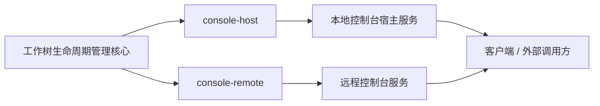

# console 控制平面与服务模块概览

## 模块目的

该模块承担控制台的控制平面职责，负责本地控制台宿主以及远程控制台能力的组织与服务。它位于工作树生命周期管理核心之上，将会话、并发与工作区提供方的生命周期能力暴露为可运行的控制台服务，并通过 `console-host` 与 `console-remote` 两个子模块分别承载本地控制台宿主与远程控制台的实现。

## 模块架构

## 核心组件文档

- [console_host](console_control_plane_and_services/console_host.md)：本地控制台宿主模块，负责在本机承载控制台的运行时环境与相关服务。
- `console_remote`：远程控制台模块，文档尚未生成。