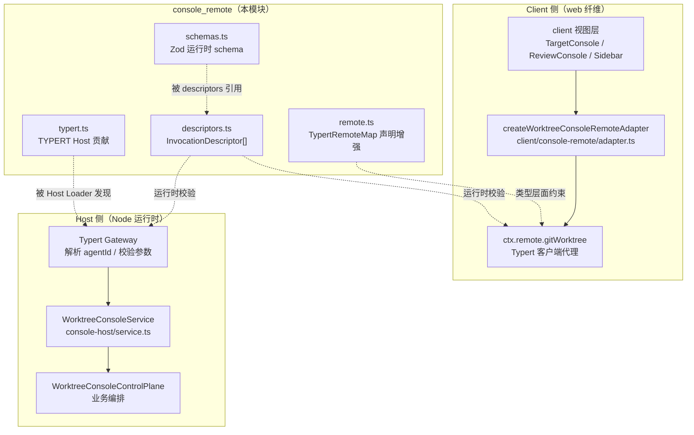
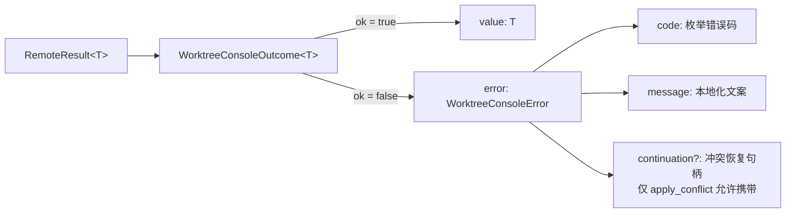
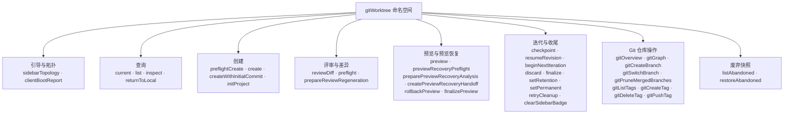
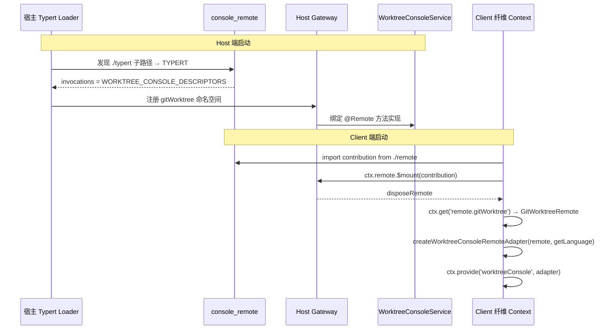

# console_remote：Typert Remote 服务契约层

## 简介

`console_remote` 模块是 `dsh-git-worktree` 插件与 DSH Typert 协议之间的**RPC 契约定义层**。它不包含任何业务逻辑，而是把 Host 侧 `WorktreeConsoleService` 暴露的全部方法，翻译成 Typert 框架可消费的三类制品：

1. **TypeScript 模块声明增强**（`remote.ts`）——在 `@deepseek-ai/dsh-typert-protocol` 的 `TypertRemoteMap` / `TypertRemoteNamespaceMap` 接口上声明 `gitWorktree` 命名空间下约 40 个方法的精确签名，使客户端代理获得完整的类型检查与自动补全。
2. **运行时调用描述符**（`descriptors.ts`）——为每个方法生成 `InvocationDescriptor`，包括参数位置（`agentId` 由网关注入、其余走 JSON body）、Zod 校验码与结果 schema，供 Typert Loader 在 Host 端注册、在 Client 端发起调用时做严格的入参/出参校验。
3. **Zod 校验 schema**（`schemas.ts`）——所有请求体与响应体的运行时形状约束，包括对 `checkoutId`、分支名、commit message、路径等字段的安全白名单（拒绝路径穿越、控制字符、非法分支字符）。

模块同时导出默认 contribution（`WORKTREE_CONSOLE_REMOTE`）与 `TYPERT` Host 贡献（`typert.ts`），通过 `package.json` 的 `./remote` 与 `./typert` 子路径导出，被宿主 Typert Loader 在两端各自发现。

一句话概括：**本模块定义"客户端如何调用服务端"的形状，业务实现留在 [console_host](console_host.md)，视图编排留在 [client](../client.md) 相关页面。**

---

## 模块内文件构成

| 文件 | 职责 |
| --- | --- |
| `src/console-remote/remote.ts` | 模块声明增强：`TypertRemoteMap`、`TypertRemoteNamespaceMap`、`GitWorktreeRemote` 类型；默认导出 contribution |
| `src/console-remote/descriptors.ts` | `WORKTREE_CONSOLE_DESCRIPTORS`（冻结的 `InvocationDescriptor[]`）与 `WORKTREE_CONSOLE_REMOTE` contribution 对象 |
| `src/console-remote/schemas.ts` | 全部 Zod schema：基础标识符、目标摘要、恢复证明、Git 分支/标签、Sidebar 拓扑、Boot 上报等 |
| `src/console-remote/typert.ts` | `TYPERT` Host 贡献对象，供官方 Typert Loader 以 `face: 'host'` 发现 |

`package.json` 中对应的子路径导出为：

- `"./remote"` → `lib/console-remote/remote.js`（客户端模块声明与 contribution）
- `"./typert"` → `lib/console-remote/typert.js`（Host 端 `TYPERT` 发现入口）

---

## 在整体架构中的位置

> 说明：`declaration` 只在编译期强化代理类型；`descriptors` + `schemas` 在两端的传输边界上做同样的严格校验，避免 Client 与 Host 两个独立部署产物因版本漂移而静默失真。

---

## 契约工作原理

### 1. 描述符如何生成

`descriptors.ts` 中的 `descriptor()` 工厂统一拼装每个方法的元数据：

- `id`：`dsh-git-worktree#gitWorktree/<method>`
- `service` / `namespace`：固定为 `gitWorktree`
- `invocation.kind`：`'direct'`（直连调用，不经事件总线）
- 参数列表：
  - `agent` 参数（`source: 'lookup'`，wire 名 `agentId`）由 Gateway 在调用业务代码**之前**解析注入，业务方法签名里因此看不到它；
  - 其余参数全部走 `source: 'json'`，逐个绑定 Zod schema；
  - 尾部统一追加可选 `locale` 参数（`'zh' | 'en'`），用于服务端按宿主语言格式化错误消息。
- `result`：统一用 `outcomeSchema(...)` 包装——即 `{ ok: true, value } | { ok: false, error }` 的判别联合。

`strictCodec()` 同时保留 legacy `schema` 字段与 DSH 0.2 的惰性 `create()` 字段，注释明确说明这是为兼容旧 Client 适配器而做的双写。

### 2. 响应的统一信封

几乎所有方法返回 `RemoteResult<WorktreeConsoleOutcome<T>>`：

`consoleErrorSchema` 上的 `superRefine` 强制约束：**只有 `apply_conflict` 错误码可以附带 `continuation`**，防止任意错误类型泄露恢复句柄。

### 3. 安全白名单

`schemas.ts` 对所有跨边界标识符做了严格过滤，例如：

| 字段 | 约束要点 |
| --- | --- |
| `sessionIdSchema` / `reviewIdSchema` / `requestIdSchema` | 拒绝 `\0 \r \n` 等控制字符 |
| `checkoutIdSchema` / `previewIdSchema` | 额外拒绝 `..`、路径分隔符，防目录穿越 |
| `branchNameSchema` | 拒绝空白、`~ ^ : ? * [ \`、前导 `-`、尾 `/`、`..`、`.lock` 后缀 |
| `commitMessageSchema` | 经 `isValidCommitMessage()` 业务校验 |
| `changedFiles` / `conflictingFiles` | 拒绝绝对路径（`C:\`、`/` 开头）与 `.` / `..` 路径段，数组上限 500 条 |
| `generationSchema` | 固定 64 位十六进制（SHA-256 指纹） |

---

## 方法分组

`gitWorktree` 命名空间下的 40 个方法按用途可分为以下几组（详见各方法的 TypeScript 签名，以 `remote.ts` 为唯一事实来源）：

### 方法命名与参数约定

- **乐观并发**：所有针对具体 checkout 的变更方法都要求携带 `expectedRevision`（部分还要求 `expectedReviewId` / `expectedPreviewId` / `expectedGeneration`），服务端据此检测脏写并返回 `stale_target` 类错误。这与 [worktree_lifecycle_management_core](../worktree_lifecycle_management_core.md) 中 `SessionCheckoutApplyEngine` 的乐观锁机制一一对应。
- **恢复证明**：涉及"预览脱离后安全回滚/定稿"的方法（`rollbackPreview`、`finalizePreview`、`preparePreviewRecoveryAnalysis`、`createPreviewRecoveryHandoff`）要求客户端回传 `recoveryProof`，其 schema 是四种 `kind` 的判别联合（`worktree_apply_conflict` / `worktree_review_regeneration` / `worktree_preview_recovery_analysis` / `worktree_preview_recovery_handoff`）。
- **locale**：每个方法尾部都有可选 `locale`，客户端代理按位置传参——即使为 `undefined` 也必须显式占位（`client/console-remote/index.ts` 中 `reportBoot` 的注释明确记录了这一约束）。

---

## 两端挂载流程

Client 侧 `apply()`（`src/client/console-remote/index.ts`）拿到代理后，会立即调用 `sidebarTopology()` 探测宿主 Workspace 的代际（`legacy` / `alpha` / `next` / `modern` / `unsupported`），并把耗时与结果通过 `clientBootReport` 回传 Host 做诊断——这两个方法因此成为整个客户端引导路径上最先被调用的契约方法。

---

## 版本兼容设计

- **能力位容忍**：`capabilitiesSchema` 中新增能力位一律使用 `.default(false)` 而非 `.optional()`。代码注释解释了原因：Client 与 Host 是两份独立部署的产物，宿主重启前跑的是旧 Host，它根本不知道新增键；若写成必填，整条 `current` 响应会因严格校验失败而让胶囊塌成"不可用"。输出仍保持确定的 `boolean`，契约类型不必变宽。
- **双写 codec**：`strictCodec` 同时提供 legacy `schema` 与新的 `create()`，使 DSH 0.2 前后的客户端适配器都能消费。
- **未知枚举宽容**：`workspaceClientFlavor` 等字段使用 `.optional()` 并允许 `'unsupported'`，为未来宿主代际预留前向兼容空间。

---

## 与其他模块的关系

| 方向 | 模块 | 关系 |
| --- | --- | --- |
| 被实现 | [console_host](console_host.md) | `WorktreeConsoleService` 用 `@Remote` 装饰器实现本模块声明的每个方法；`WorktreeConsoleControlPlane` 提供业务编排 |
| 被消费 | [client](../client.md)（尤其 `client/console-remote/index.ts`、`client/console-remote/adapter.ts`） | 客户端通过 `ctx.remote.gitWorktree` 代理调用，并包装为 `WorktreeConsoleAdapter` 注入 cordis Context |
| 类型来源 | [shared_contracts_and_domain_ports](../shared_contracts_and_domain_ports.md)（`console-contract.ts`、`types.ts`） | 所有请求/响应类型、`WorktreeConsoleOutcome`、`WorktreeRetentionMode` 等均从该模块导入 |
| 业务后端 | [worktree_lifecycle_management_core](../worktree_lifecycle_management_core.md) | 契约层的乐观锁、恢复证明语义由该模块的 apply engine 实际执行 |
| 构建打包 | [build_and_configuration](../build_and_configuration.md)（`package.json` 的 `./remote`、`./typert` 导出） | 本模块制品通过子路径导出被宿主 Loader 发现 |

---

## 扩展指南（新增一个 RPC 方法）

1. 在 `console-contract.ts` 中定义请求/响应类型（若涉及新视图）。
2. 在 `schemas.ts` 中添加对应 Zod schema，并做必要的安全白名单校验。
3. 在 `descriptors.ts` 中调用 `descriptor()` 工厂注册一条描述符，注意参数顺序与 `remote.ts` 中的 TS 签名保持一致。
4. 在 `remote.ts` 的 `TypertRemoteMap` 接口中添加同名方法签名，返回 `RemoteResult<WorktreeConsoleOutcome<T>>`，尾部保留可选 `locale`。
5. 在 `WorktreeConsoleService` 中添加 `@Remote` 装饰方法，委托给 `WorktreeConsoleControlPlane`。
6. 若该方法引入新的能力开关，务必在 `capabilitiesSchema` 中使用 `.default(false)`，避免旧 Host 让新 Client 校验失败。
