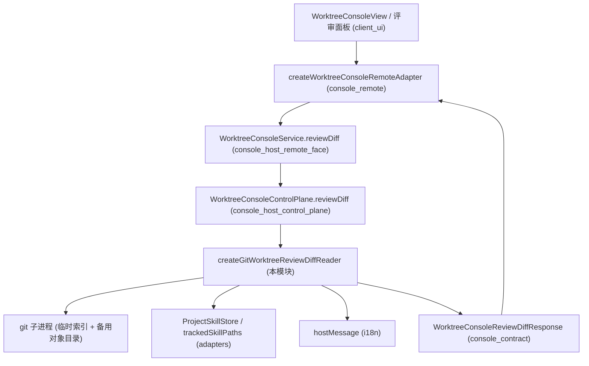
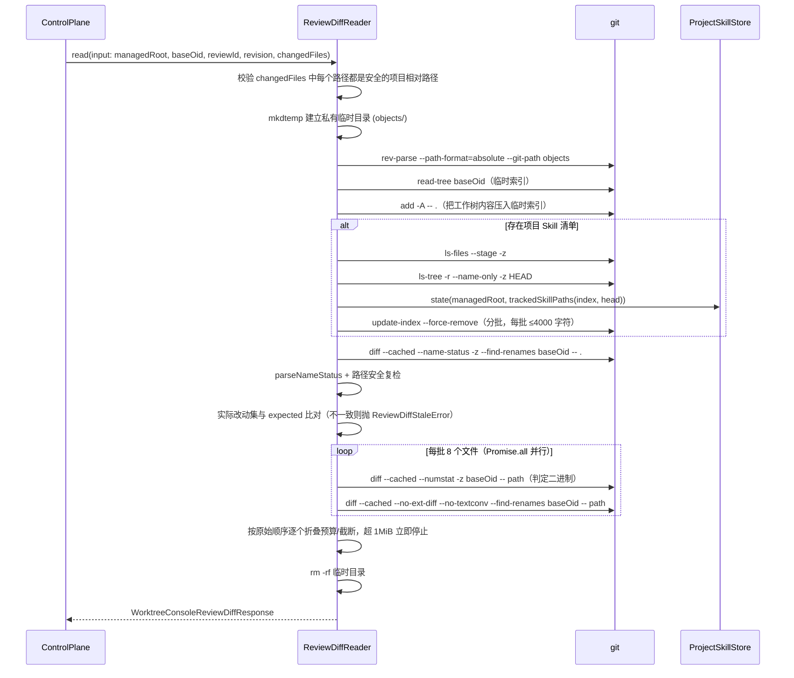
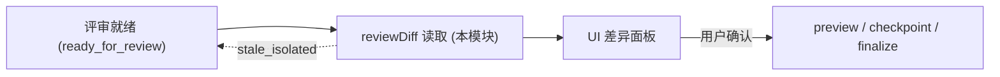

# console_host_review_diff：评审差异读取器

`console_host_review_diff` 是 Host 侧"评审（Ready for Review）差异"的唯一读取实现，位于 `src/console-host/review-diff.ts`。它把一次已冻结的隔离 Worktree 快照，转换成可以安全穿过 RPC 边界的 diff 负载（`WorktreeConsoleReviewDiffResponse`），并在转换过程中同时保证三件事：**路径安全**、**评审身份一致（新鲜度）**、**负载体积可控**。

它本身不持有任何会话、注册表或 Git 端口状态：调用方（[console_host_control_plane](console_host_control_plane.md)）先完成授权与新鲜度校验，再把"在哪个目录、基于哪个 OID、期望看到哪些文件"交给它，它只负责"读出来并打包"。契约类型定义在 [console_contract](../console_contract.md)，跨进程编解码在 [console_remote](../console_remote.md)，错误文案来自 [i18n](../i18n.md)。

---

## 1. 模块定位

| 维度 | 说明 |
| --- | --- |
| 源码 | `src/console-host/review-diff.ts` |
| 公开入口 | `createGitWorktreeReviewDiffReader(projectSkills?)` 返回 `WorktreeReviewDiffReader` |
| 消费方 | `WorktreeConsoleControlPlaneOptions.reviewDiff`（Host 组装时注入） |
| 上游 RPC | `gitWorktree/reviewDiff` → `WorktreeConsoleService.reviewDiff()` |
| 下游依赖 | `git` 可执行文件（`node:child_process.spawn`）、`ProjectSkillStore`、`hostMessage` |
| 副作用 | 仅在系统临时目录内创建/删除私有索引与对象目录，**不写工作树、不写 `.git`** |

一句话概括：**用一套一次性的临时 Git 索引重放"已评审快照"，把结果切片后交给 UI，全程不改动被评审的目录。**

---

## 2. 架构与组件关系

关键点：`WorktreeReviewDiffReader` 是一个**只有一个方法的端口**（`read(input)`），因此 control-plane 可以在测试中替换成纯内存实现，而本模块的 Git 语义则通过真实 Git fixture 验证（`vitest.config.ts` 中 `fileParallelism` 在 Windows 上关闭，正是为了这类重 Git 夹具）。

---

## 3. 核心类型

| 类型 | 角色 |
| --- | --- |
| `ReviewDiffReadInput` | 输入：`managedRoot`（隔离 Worktree 根目录）、`baseOid`（差异基线提交）、`reviewId`、`revision`、`changedFiles`（评审记录里冻结的文件清单） |
| `WorktreeReviewDiffReader` | 端口接口，`read(input): Promise<WorktreeConsoleReviewDiffResponse>` |
| `ReviewDiffStaleError` | 语义化失败：磁盘上的实际改动集已与冻结的 `changedFiles` 不一致 |
| `GitOutput` | 内部 Git 调用结果：`{ stdout: Buffer; truncated: boolean }` |
| `ChangedEntry` | 内部中间结构：`{ path, previousPath?, status }`，由 `parseNameStatus` 产出 |

三个预算常量是本模块的"防爆"边界：

| 常量 | 值 | 作用 |
| --- | --- | --- |
| `REVIEW_DIFF_MAX_FILES` | 200 | 最多回传的文件条目数 |
| `REVIEW_DIFF_MAX_PATCH_BYTES` | 100 KiB | 单文件 patch 的读取上限 |
| `REVIEW_DIFF_MAX_PAYLOAD_BYTES` | 1 MiB | 整个响应 JSON 序列化后的字节上限 |

---

## 4. 读取流程

### 4.1 为什么需要"临时索引重放"

被评审的隔离 Worktree 在评审期处于"冻结"语义：用户已确认的评审快照必须与磁盘内容一一对应。如果直接 `git diff baseOid` 读取工作树，那么工作树里任何未跟踪文件、`core.excludesfile`、`info/exclude` 都可能污染结果。本模块的做法是：

1. 在临时目录创建**全新的空对象目录** `objects/`；
2. 通过 `GIT_OBJECT_DIRECTORY` 指向它，并用 `GIT_ALTERNATE_OBJECT_DIRECTORIES` 指回仓库真实对象库（只读复用）；
3. `read-tree baseOid` 把临时索引初始化成基线树，再 `add -A -- .` 把当前工作树状态写入索引；
4. 之后所有 `diff --cached` 都在这个受控索引上进行。

同时设置 `GIT_INDEX_FILE`、`GIT_CONFIG_NOSYSTEM=1`、`GIT_TERMINAL_PROMPT=0`、`core.quotePath=false`（保证中文/非 ASCII 路径不被转义），Windows 下额外加 `core.longpaths=true`。这是一套"只读仓库 + 私有索引"的隔离读法，不会产生任何对仓库的持久修改。

### 4.2 Skill 目录的排除

项目级 Skill 是被"携带"进 Worktree 的辅助资源，不属于用户评审的代码改动。若存在 `ProjectSkillStore`：

- 用 `ls-files --stage -z` 与 `ls-tree -r --name-only -z HEAD` 求出"已被 Git 跟踪的路径集合"，交给 `trackedSkillPaths` 合并；
- 再取 `state(managedRoot, tracked)` 得到 Skill 清单里的全部路径；
- 分批调用 `update-index --force-remove` 把这些路径从临时索引中摘除，使它们不出现在评审 diff 里。

如果清单读取被截断（`truncated`），直接抛错而不是"猜一个子集"——宁可失败也不给出错误的评审面。

---

## 5. 安全与新鲜度约束

### 5.1 路径安全（`projectPath`）

`projectPath` 拒绝以下任何形态的路径：空串、含 `\0`、含反斜杠、绝对路径、以及 `posix.normalize` 后与原值不同的路径（含 `..`、`../`、以 `/` 开头）。该检查在三处执行：

1. 进入时对 `input.changedFiles` 全量校验（错误键：`reviewChangedFilesContainsAnUnsafeProjectRelativePath`）；
2. `parseNameStatus` 产出结果后对 `path` 与 `previousPath` 复检（错误键：`gitDiffReturnedAnUnsafeProjectRelativePath`）；
3. `changedPathSet` 汇总比对前，结果同样只由已校验条目构成。

### 5.2 新鲜度（`ReviewDiffStaleError`）

`changedPathSet(entries)` 把重命名条目展开为 `previousPath` + `path` 两者，排序去重后与 `sortedUnique(input.changedFiles)` **逐元素严格比较**（长度与顺序都要一致）。任何不一致都抛 `ReviewDiffStaleError`，其 message 为 `reviewChangedFilesNoLongerMatchesTheIsolatedSnapshot`。control-plane 捕获该异常后映射为 `stale_isolated` 失败，并丢弃已读取的字节（见下文第 7 节）。

### 5.3 体积预算

- **文件数**：`entries.length > REVIEW_DIFF_MAX_FILES` 时先置 `truncated = true`，只取前 200 条。
- **单文件**：patch 以 `REVIEW_DIFF_MAX_PATCH_BYTES` 为上限读取，超出则 `fileTruncated = true`。
- **整体负载**：每加入一个文件都做一次 `payloadBytes`（`JSON.stringify` 后的 UTF-8 字节数）。一旦超过 1 MiB，先尝试把当前文件的 patch 用 `utf8Prefix` 截短（保留完整 UTF-8 码点，不会切坏多字节字符），若截短后仍放不下，则丢弃该文件并立即 `stop`。

`truncated` 标志是"响应被裁剪过"的唯一信号：文件数超限、单文件 patch 超限、整体负载超限都会把它置为 `true`。

---

## 6. 并发与性能设计

早期实现对每个文件串行执行 2 次 `spawn`（`--numstat` 判二进制 + `--patch` 取内容），200 个文件就是 400 次进程启动，在 Windows 上会顶穿客户端 `SLOW_TIMEOUT_MS`（180 s）。当前实现：

- **按批并行**：`REVIEW_DIFF_BATCH_SIZE = 8`，用 `Promise.all` 并发取证；
- **折叠仍按原序**：批次结果回到主循环后，仍按原始文件顺序逐个做预算折叠，因此"截断发生在第几个文件"这一语义与串行版本完全一致，输出可复现；
- **预算失败即停**：一旦 `payloadBytes` 越界就 `stop`，不会为已经注定被丢弃的文件继续起进程。

---

## 7. 与 control-plane 的协作契约

`WorktreeConsoleControlPlane.reviewDiff` 在本模块之外完成了以下校验，本模块假定它们已经通过：

| 顺序 | 校验 | 失败码 |
| --- | --- | --- |
| 1 | 调用者是该 checkout 的 owner Session | `not_owner` |
| 2 | `record.revision === expectedRevision` | `stale_target` |
| 3 | `review.reviewId === expectedReviewId` | `stale_target` |
| 4 | `preflight` 未被阻塞，且 `reviewId` / `isolatedHeadOid` 与评审记录一致 | `stale_isolated` |
| 5 | 观察到的 `managedRoot` 存在 | — |
| 6 | 调用本模块 `read()` | 捕获 `ReviewDiffStaleError` → `stale_isolated` |
| 7 | 读后再次 `preflight`，并重读注册表，比对 `revision`、`delivery.state`、`reviewId`、`isolatedFingerprint` | `stale_isolated` |

也就是说本模块是**"读前校验 + 读后复检"之间的一次快照读取**：它自己只负责"我读到的和你要的是同一份"，而"读取期间世界是否变了"由第 7 步的读后复检兜底。`baseOid` 由 control-plane 传入 `record.applyBaseOid ?? record.baseOid`，因此"评审面"始终对齐的是真正将被应用到 Local 的那个基线。

其它错误一律交给 `consoleFailure`（见 [console_host_remote_face](console_host_remote_face.md)）转成 `git_error` 或已登记的会话 checkout 错误码。

---

## 8. 错误对照表

| 触发条件 | 抛出 | 文案键 |
| --- | --- | --- |
| `changedFiles` 含不安全路径 | `Error` | `reviewChangedFilesContainsAnUnsafeProjectRelativePath` |
| `git` 退出码非 0 | `Error` | `gitFailed`（含命令名、退出码、stderr） |
| 文件清单读取超预算 | `Error` | `reviewDiffPathInventoryExceedsTheSafeReadBudget` |
| Git 返回不安全路径 | `Error` | `gitDiffReturnedAnUnsafeProjectRelativePath` |
| Skill 清单读取超预算 | `Error` | 字面量 `Skill tracking inventory exceeds the safe read budget` |
| 实际改动集 ≠ 冻结清单 | `ReviewDiffStaleError` | `reviewChangedFilesNoLongerMatchesTheIsolatedSnapshot` |

所有文案经 `hostMessage` 解析，语言上下文由 `WorktreeConsoleService` 用 `withHostLanguage` 注入（默认 `zh`，见 [i18n](../i18n.md)）。这意味着同一份 diff 逻辑在不同 locale 下产出不同语言的错误 prose，而 `code` 保持稳定。

---

## 9. 在整体系统中的位置

- **上游**：评审记录由会话 checkout 模块在"准备评审"时冻结（`reviewId`、`changedFiles`、`isolatedHeadOid`、`isolatedFingerprint`），见 [core_domain_session_checkout](../core_domain/core_domain_session_checkout.md)。
- **下游**：UI 的差异面板消费 `WorktreeConsoleDiffFile[]`；`status` 只取 `added` / `deleted` / `modified` / `renamed` / `binary`（复制语义被折叠进 `renamed`，因为契约里没有 `copied`）。
- **旁路**：客户端 `requestWorktreeReviewRefresh` 通过窗口事件触发刷新，见 [client_ui](../client_ui.md)。

---

## 10. 设计取舍备忘

1. **二进制文件只给状态不给内容**：`--numstat` 以 `-\t-\t` 开头即判定为二进制，`patch` 置 `null`、`status` 置 `binary`，避免把不可读字节塞进 RPC。
2. **`--no-ext-diff` / `--no-textconv`**：禁用用户 `.gitattributes` 中的外部 diff 驱动与 textconv，防止任意命令执行，也保证 patch 文本可预测。
3. **重命名/复制折叠**：`name-status` 会同时报告 `R` 与 `C`，但控制台契约没有 `copied` 状态，二者都映射为 `renamed`——现有消费方不区分它们。
4. **UTF-8 安全截断**：`utf8Prefix` 在截断点回退到码点边界，避免出现半个字符导致的乱码或 JSON 序列化异常。
5. **临时目录必删**：整个读取体包在 `try/finally` 中，无论成功、抛错还是被中断，`mkdtemp` 出来的目录都会被 `rm -rf`。
6. **不缓存**：每次调用都重新 `rev-parse` 与 `read-tree`。评审 diff 是低频、强一致的操作，缓存带来的陈旧风险高于收益。

---

## 11. 相关文档

- [console_host](../console_host.md) — Host 侧控制台总览
- [console_host_control_plane](console_host_control_plane.md) — 授权、状态机与 `reviewDiff` 编排
- [console_host_remote_face](console_host_remote_face.md) — `@Remote` 服务与 `consoleFailure` 错误映射
- [console_host_projection](console_host_projection.md) — `capabilities` 如何决定 UI 能否发起评审
- [console_contract](../console_contract.md) — `WorktreeConsoleReviewDiffRequest/Response`、`WorktreeConsoleDiffFile`
- [console_remote](../console_remote.md) — 描述符、Zod 结果校验与超时
- [adapters](../adapters.md) — `ProjectSkillStore`、`trackedSkillPaths`
- [i18n](../i18n.md) — `hostMessage` 与语言上下文
- [build_and_config](../build_and_config.md) — 构建（`tsc` + `tsdown`）与测试（`vitest run`）
