# session_checkout_apply_engine：Git 级应用引擎

`session_checkout_apply_engine` 是 session-checkout 领域里唯一直接改写 Git 仓库的模块，实现文件为 `src/session-checkout-apply.ts`。它把「受管 Worktree 与 Local 检出之间的评审、预览、回滚、提交、检查点」这一整套危险操作封装成一组**可校验、可回滚、可恢复**的引擎方法：调用方（状态机）只负责状态迁移与账本持久化，真正的 `git` 调用、指纹计算、三方合并与索引原子替换全部发生在这里。

该模块是一个叶子模块，没有子页面；其上层编排逻辑见 [session_checkout_orchestration](session_checkout_orchestration.md)，端口契约见 [core_domain_ports](../core_domain_ports.md)，父模块概览见 [core_domain_session_checkout](../core_domain_session_checkout.md)。

## 1. 模块定位

| 维度 | 说明 |
| --- | --- |
| 所属层次 | `core_domain` / `core_domain_session_checkout`（领域核心，宿主无关） |
| 导出入口 | `createSessionCheckoutApplyEngine(options)` → `SessionCheckoutApplyEngine` |
| 默认实现 | `DefaultSessionCheckoutApplyEngine`（`class`，未导出，仅通过工厂创建） |
| 消费方 | `src/session-checkout-module.ts` 通过 `SessionCheckoutDependencies.applyEngine` 调用（见 `src/ports.ts` 中对 `SessionCheckoutApplyEngine` 的类型导入） |
| 关键不变量 | 每个方法要么返回带 `status` 的成功结果，要么返回 `{ status: 'error', error: ApplyError }`；**不抛异常**，错误码即契约 |
| 状态持有 | 仅持有内存中的 `plans: Map<revision, StoredPlan>`，不写注册表、不写宿主账本 |

设计上它刻意「无持久化」：所有 journal / receipt / 指纹的落盘由编排层完成，引擎只在约定时机回调 `beforeWrite`、`beforeCommit` 这类 seam，从而把「持久化」与「改 Git」两件事拆成可分别审计的步骤。

## 2. 架构与依赖

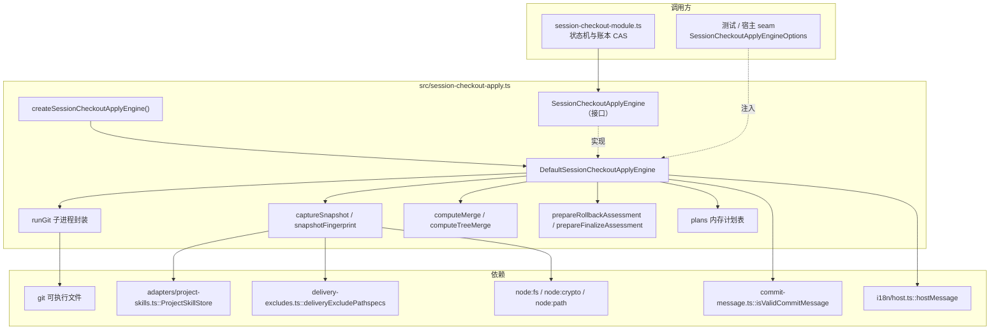

依赖方向单一：引擎不导入任何 adapter 实现，只导入纯函数原语（`commit-message.ts`、`delivery-excludes.ts`）、一个宿主私有的 Skills 存储类（`ProjectSkillStore`，以可选依赖注入）与 i18n 文案函数。`git` 通过 `node:child_process.spawn` 直接调用，而不是走宿主 subprocess 端口——这是与 `src/adapters/git.ts` 的有意分工：adapter 负责宿主侧长任务与超时策略，引擎只跑短命令。

### 2.1 接口与实现

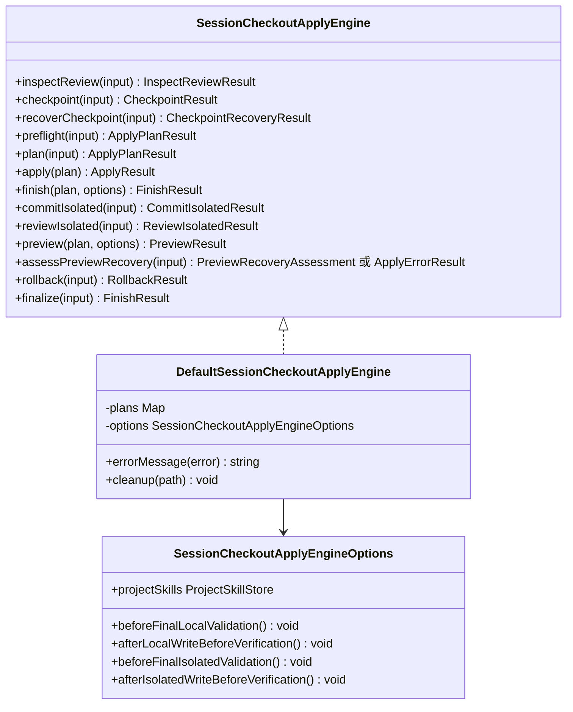

`commitIsolated` 与 `reviewIsolated` 在接口上是**可选方法**（`commitIsolated?` / `reviewIsolated?`），因为它们是「会话分支交付」这一较新语义；编排层在 `operateFinish` 中显式检测缺失并返回 `operation_not_allowed`（错误文案 `thisVersionCannotDeliverToASessionBranch`），因此第三方引擎实现可以只实现 Local 写入路径。

## 3. 方法分组与职责

引擎方法可归为四条能力线：

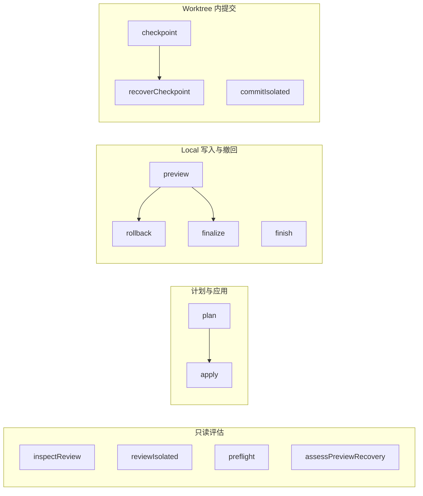

| 方法 | 作用 | 是否改动仓库 | 备注 |
| --- | --- | --- | --- |
| `inspectReview` | 采集 Worktree 相对 `baseOid` 的变更集与指纹 | 否 | 会校验 Local 与 Worktree 同属一个对象库、项目子目录一致 |
| `reviewIsolated` | 只看 Worktree 的评审快照 | 否 | **完全不解析 Local 根**，用于会话分支交付前复核 |
| `preflight` | 复用真实 merge 计算但不持久化计划 | 否 | `calculatePlan(input, false)` |
| `plan` | 计算并**持久化**可执行计划 | 否 | `calculatePlan(input, true)`，写入 `plans` |
| `apply` | 把计划补丁写入 Local 工作区 | 是（仅工作区） | 使用计划时的指纹做 CAS，成功后删除计划 |
| `preview` | 写入 Local 并产出 `PreviewReceipt` | 是 | 写前回调 `beforeWrite(receipt)` 持久化 receipt |
| `rollback` | 按 receipt 撤回预览 | 是 | 只读评估 → 写前回调 → CAS → 打补丁 → 写后独立校验 |
| `finalize` | 把预览中的任务增量提炼为 Local 提交 | 是（ref + index + 工作区） | `index.lock` 协议 + 双备份补偿 |
| `finish` | 把 Worktree 变更合并进 Local 并提交（Local 写入式交付） | 是 | 与 `finalize` 同构，额外做任务增量剥离；当前状态机默认改用 `commitIsolated` |
| `checkpoint` | 在 Worktree 内创建检查点提交 | 是（Worktree ref + index） | `beforeCommit` 先落 journal，再改 HEAD |
| `recoverCheckpoint` | 中断后的检查点收口/回退 | 是 | 用 marker 文件证明锁归属 |
| `commitIsolated` | 把 Worktree 工作区提交到其会话分支 | 是（Worktree ref + index） | 不读写 Local |

### 3.1 核心数据契约

| 类型 | 关键字段 | 语义 |
| --- | --- | --- |
| `ApplyPlanInput` | `baseOid`、`isolatedPath`、`localPath` | 所有只读评估与计划的统一入参；`baseOid` 必须是 40/64 位十六进制（`OID_PATTERN`） |
| `ApplyPlan` | `revision`、`localFingerprint`、`isolatedFingerprint`、`effectiveBaseOid`、`baseStrategy`、`localHeadOid`、`localHeadRef`、`isolatedHeadOid`、`changedFiles` | 可执行计划的公开形态；`localHeadRef` 为 `null` 表示 Local detached（Apply 允许，Finish 拒绝） |
| `StoredPlan`（内部） | `input`、`patch`、`plan`、`scope` | 仅存于内存 `plans`，`scope` 缓存两侧 git 根、项目前缀与源对象库路径 |
| `CheckoutSnapshot`（内部） | `fingerprint`、`headOid`、`headRef`、`headTreeOid`、`indexTreeOid`、`treeOid`、`indexEntries` | 一次采样的完整事实，用于 CAS 与写后独立校验 |
| `PreviewReceipt` | `previewId`、`reviewId`、`iteration`、`previewedAt`、三个基线与策略字段、Local 前后指纹、`localWorkingTreeOid`、`localIndexTreeOid`、`previewWorkingTreeOid`、`isolatedHeadOid`、`isolatedFingerprint`、`isolatedSnapshotOid`、`changedFiles` | 预览的可恢复凭据；回滚与定稿只认它 |
| `PreviewRecoveryAssessment` | `localFingerprint`、`localHeadOid`、`localHeadRef`、`localHeadTreeOid`、`localIndexTreeOid`、`localWorkingTreeOid`、`rollback`、`finalize` | 严格只读的恢复评估结果 |
| `CommitIsolatedSuccess` | `commitOid`、`changedFiles`、`isolatedFingerprint`、`branch`、`created` | `created=false` 表示工作区与 HEAD 一致，未产生空提交 |

## 4. 快照与指纹：所有 CAS 的基础

引擎中几乎所有安全判断都建立在 `CheckoutSnapshot` 之上。`captureSnapshot()` 用**临时索引文件**重建三种视图，因此永不污染真实索引：

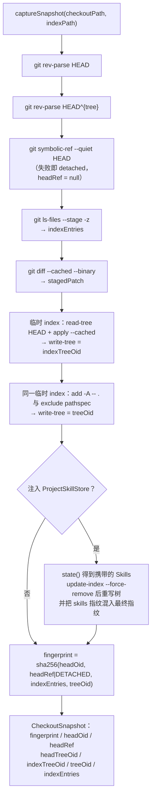

要点：

- **宿主运行期产物被排除**。`deliveryExcludePathspecs()`（`src/delivery-excludes.ts`）默认排除 `.dsh-ops`、`desktop-runtime.json`、`.dsh-runtime.json`，并为每项生成 `:(exclude)path`、`:(exclude)path/**`、`:(exclude,glob)**/path`、`:(exclude,glob)**/path/**` 四条 pathspec。这样面板日志增长不会把一次合法交付判成 `stale_isolated`。
- **随会话携带的 Project Skills 不进入指纹的“脏”判定**。当注入 `projectSkills` 时，引擎会把已携带的 Skills 路径从快照树中移除，并把 Skills 自身指纹混入最终 fingerprint，从而既让「评审看到的 == 交付出去的」，又能在 Skills 被修改时让指纹变化。
- `indexEntries` 原样保留原始字节参与哈希，使「同样的文件、不同的 staged 状态」得到不同指纹。
- 索引树与工作区树分开计算（`indexTreeOid` vs `treeOid`），`finalize` 依赖这个区分来保留用户原有 staged 状态。

## 5. 有效基线与三方合并

### 5.1 有效基线选择

配置的 `baseOid` 未必是合并的最佳基点：Local 可能已经前进，或 Worktree 已经包含 Local HEAD。`selectEffectiveApplyBase()` 只在前置条件可证时才前移基线：

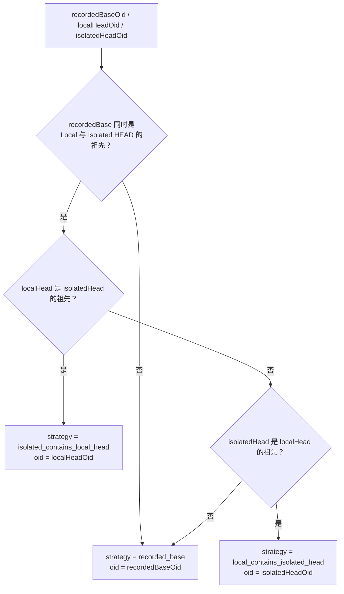

注释中明确指出保守取舍：上次 Apply 写出的内部快照提交通常不在任一分支历史上，因此第二次 Apply 会退回 `recorded_base`，宁可多算一次合并也不误用前移基线。策略值最终写入 `ApplyPlan.baseStrategy` 并出现在用户可见的预检视图（`WorktreeApplyPreflightFacts`）中。

### 5.2 两种合并原语

- `computeMerge()`：把 Local 快照树与 Isolated 快照树各自 `commit-tree` 成以 `baseOid` 为父的临时提交，在一个 `git init --template=` 的临时仓库里 `merge --no-commit --no-ff`。冲突时返回 `conflictingFiles`（过滤到项目子目录、转成项目相对路径、排序）并用 `collectConflictDetails()` 逐文件采集 `git diff` 文本；就绪时产出 `changedFiles`、二进制 `patch` 与 `mergedTreeOid`（在 Local 的对象库上用临时索引重放补丁后再 `write-tree`，保证 OID 落在 Local 仓库）。
- `computeTreeMerge()`：纯树级三方合并（`base`/`ours`/`theirs` 三棵树），用于 `finish`/`finalize`/`rollback` 的「增量剥离」与「索引保留」计算，返回合并后的树 OID。

冲突详情有硬上限：`CONFLICT_DETAIL_FILE_LIMIT = 6` 个文件、`CONFLICT_DETAIL_DIFF_LIMIT = 4096` 字符（来自 `src/types.ts`），超出时追加一条 `worktreeConflictMoreFiles` 提示，避免 payload 撑爆模型上下文。

### 5.3 任务增量剥离公式

`finish` 与 `finalize` 都必须在「用户未提交的 Local 改动」中只提交属于任务的那一部分，引擎用两次树合并实现：

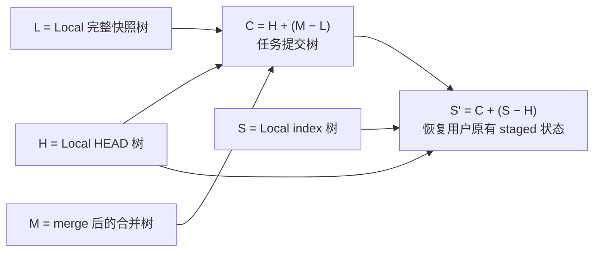

任一步骤冲突都返回 `commit_isolation_conflict`，并附上冲突文件列表——此时引擎选择「拒绝」而不是猜测，因为把用户未提交内容错误地写进提交是不可逆的。

## 6. 主要流程

### 6.1 计划与应用（plan → apply）

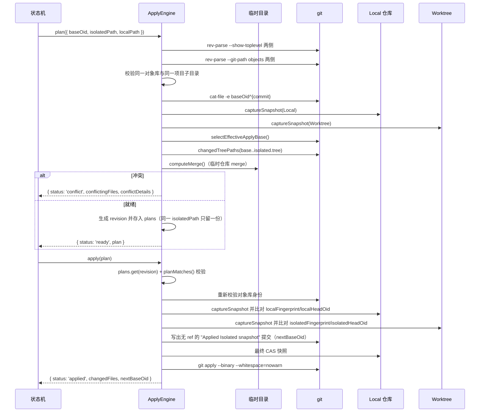

`nextBaseOid` 是本次整合的 Isolated 快照提交，不创建任何 ref，只作为后续 Apply 的内部基线（写入 `record.applyBaseOid`）。计划表在成功后立即删除，`planMatches()` 会逐字段比对 revision、三个指纹、基线策略、两侧 HEAD、`localHeadRef` 与 `changedFiles`，因此被篡改或复用的计划一定被拒绝（`invalid_plan`）。

### 6.2 预览 → 回滚 / 定稿

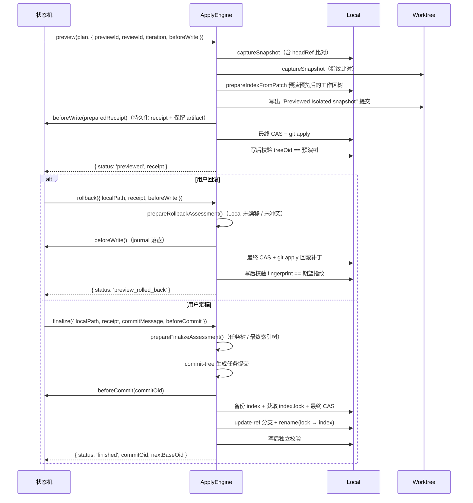

`PreviewReceipt` 是这条链路的核心凭据，记录了预览前后的 Local 指纹、Local 工作区树/索引树、预览工作区树、Isolated 的 HEAD/指纹/快照提交以及 `changedFiles`。`assessPreviewRecovery()` 严格只读地基于该 receipt 判断「回滚是否安全」「定稿是否安全」，返回 `PreviewRecoveryAssessment`，其中：

- `rollback`：`{ status: 'safe', targetTreeOid }` 或 `PreviewRecoveryBlockedAction`；
- `finalize`：`{ status: 'safe', taskTreeOid, finalIndexTreeOid, expectedWorkingTreeOid, commitRequired }` 或阻塞动作。

Local 前进后，评估会在临时仓库里做多次树合并（`preview-rollback-advanced-baseline`、`preview-rollback-preview-absence`、`preview-rollback-advanced-preview`），把「新提交是否已包含预览内容」「新提交是否与预览改动冲突」区分开，从而给出 `preview_modified` 而不是笼统的失败。

### 6.3 检查点与恢复

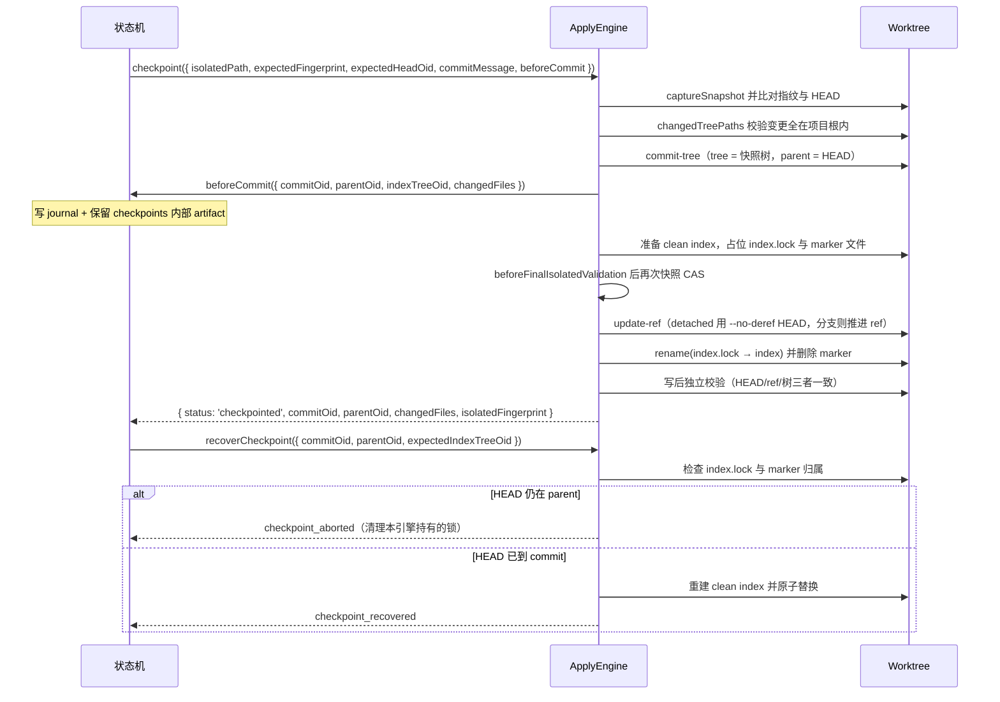

两个细节值得强调：

1. `advanceHead()` 区分符号 HEAD 与 detached HEAD。对分支附加的 Worktree 必须推进 `refs/heads/...` 而不是 `HEAD`，否则 `--no-deref` 会把 HEAD 打成游离，令会话分支失去落点。
2. 锁归属靠 marker 文件 `«index».lock.dsh-«commitOid»` 证明：`recoverCheckpoint` 只有在 marker 内容与提交号一致、且锁内索引树与目标树一致时才敢删除别人的锁；否则报 `stale_isolated`。

### 6.4 会话分支交付（commitIsolated / reviewIsolated）

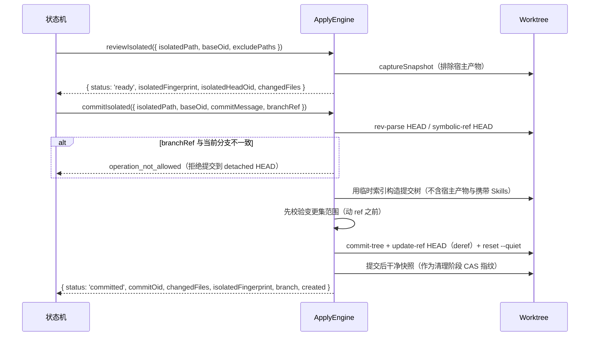

与 `finish` 的根本差别：`commitIsolated` **完全不碰 Local**——不读 Local 的 HEAD/工作区/索引，不与它的未提交改动求三方合并，也不向它写补丁。一旦 ref 已前进而后续步骤失败，结果会带上 `committedOid`，让调用方知道「磁盘上已经多了一个提交」，不能把记录当成什么都没发生退回。

## 7. 错误契约

`ApplyError` 是判别联合，错误码即调用方可依赖的契约：

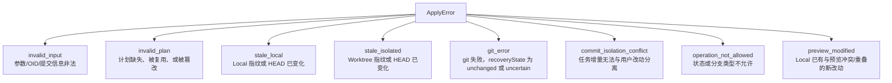

| 错误码 | 触发场景 | 调用方典型处理 |
| --- | --- | --- |
| `invalid_input` | OID 格式、提交信息为空/含 `\0`、项目子目录不匹配、对象库不同、预览身份非法、变更越出项目根 | 直接报错，通常映射到 `invalid_input` |
| `invalid_plan` | `plans` 中没有该 revision、`planMatches` 失败、对象库身份变化、持久快照与评审不一致 | 重新 `plan` |
| `stale_local` | Local 快照指纹/HEAD/headRef 变化，或 `index.lock` 被其他 git 进程占用 | 刷新目标后重试 |
| `stale_isolated` | Worktree 快照变化、检查点输入过期、锁归属无法证明 | 重新准备评审 |
| `git_error` | 任意 git 命令失败、写后校验不通过、超时 | `recoveryState: 'unchanged'` 可安全退回就绪；`'uncertain'` 必须进入 `recovery_required` |
| `commit_isolation_conflict` | 任务树/最终索引树三方合并冲突 | 让用户在 Local 侧处理 |
| `operation_not_allowed` | Local 为 detached HEAD、无新变更可检查点、分支不匹配 | 提示用户切换分支或换动作 |
| `preview_modified` | 新 Local 提交已包含或冲突于预览改动 | 转入 `preview_detached` |

`git_error.recoveryState` 是编排层决定「退回 ready 还是标记 recovery_required」的唯一依据，因此引擎在每条写路径上都尽量给出可证结论：能证明未触碰磁盘就报 `unchanged`，不能证明就报 `uncertain`。

## 8. Git 执行硬化

`runGit()` 是所有命令的唯一出口，固定携带：

- `--no-optional-locks`、`core.quotePath=false`、`core.fsmonitor=false`、`core.hooksPath=<空目录>`（惰性创建于系统临时目录），Windows 上额外 `core.longpaths=true`；
- 环境变量：`GIT_OPTIONAL_LOCKS=0`、`GIT_TERMINAL_PROMPT=0`、`LC_ALL=C`、`LANG=C`；
- **清除环境中的路由类变量**：`AMBIENT_GIT_ENV_PATTERN` 匹配 `GIT_DIR`、`GIT_WORK_TREE`、`GIT_INDEX_FILE`、`GIT_OBJECT_DIRECTORY`、`GIT_ALTERNATE_OBJECT_DIRECTORIES`、`GIT_NAMESPACE`、`GIT_CEILING_DIRECTORIES` 等，避免外部环境把 git 导向非授权仓库；`options.env` 是唯一的显式注入通道且优先级最高；
- 默认超时 30 秒（`GIT_TIMEOUT_MS`），超时 `SIGTERM` 并以 `gitCommandTimedOut` 文案报错；`allowedExitCodes` 让 `merge`（0/1）、`symbolic-ref`、`merge-base --is-ancestor` 等把非零当正常结果。

对象读写通过 `gitObjectEnvironment()` 组合 `GIT_OBJECT_DIRECTORY` 与 `GIT_ALTERNATE_OBJECT_DIRECTORIES`（保留既有 alternates），使临时目录里的合并产物与 Local 的对象库互见，从而让 `write-tree` 产生的 OID 直接可用。

## 9. 索引原子替换与补偿

`finalize`、`finish`、`checkpoint` 都会改真实索引，三者统一使用 Git 的 `index.lock` 协议：

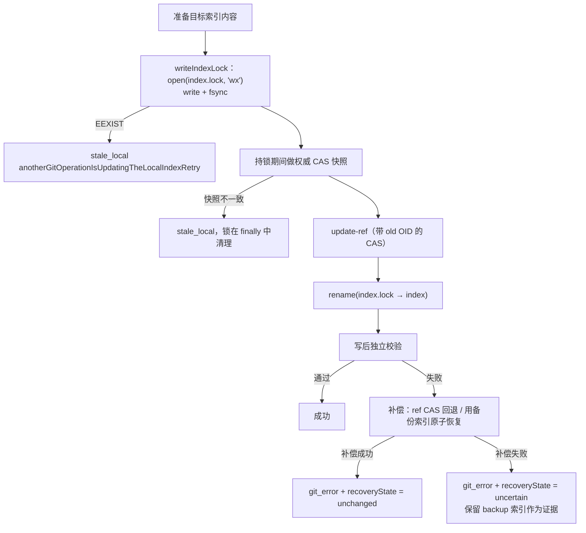

`finalize` 的补偿逻辑尤其保守：只有在「当前索引仍等于 Domi 写入的字节」时才用备份覆盖，否则宁可保留双方的索引与备份文件并报 `uncertain`，也绝不覆盖用户在这期间做的索引改动。

## 10. 测试 seam

`SessionCheckoutApplyEngineOptions` 提供四个仅用于测试/宿主的注入点，它们都插在「权威校验」与「写后校验」之间，用来构造竞态：

| seam | 位置 | 用途 |
| --- | --- | --- |
| `beforeFinalLocalValidation` | Local 最终 CAS 之前 | 模拟 Local 在计划与写入之间被改动 |
| `afterLocalWriteBeforeVerification` | Local 写入完成、独立校验之前 | 模拟写后漂移 |
| `beforeFinalIsolatedValidation` | 检查点权威 CAS 之前 | 模拟 Worktree 在检查点前被改动 |
| `afterIsolatedWriteBeforeVerification` | 检查点 HEAD/index 写后、校验之前 | 模拟检查点写后异常 |
| `projectSkills` | 注入 `ProjectSkillStore` | 让快照排除并携带 Project Skills |

这些 seam 是 `await` 的，因此测试可以在其中真正触发并发写；同时它们不会削弱生产路径，因为默认实现为空。

## 11. 与相邻模块的边界

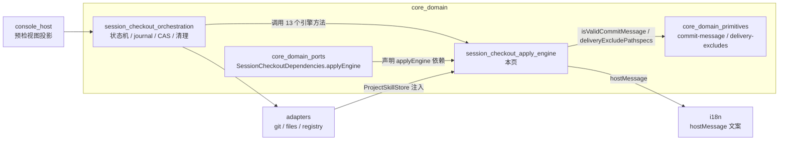

- **不持久化任何状态**：journal、receipt、checkpoint 记录、`applyBaseOid`、清理配额都在 [session_checkout_orchestration](session_checkout_orchestration.md) 中维护。引擎只在 `beforeWrite`/`beforeCommit` 回调里交出「即将发生什么」，由编排层决定写账本。
- **不做身份授权**：`ownerSessionId`、`revision`、`expectedGeneration` 的校验全在状态机；引擎只做 Git 事实校验（同一对象库、同一项目子目录、指纹一致）。
- **不管理 Worktree 生命周期**：创建、删除、隔离区、目录身份由 [adapters](../../adapters.md) 的 `git.ts` / `files.ts` 承担。
- **宿主产物清单**由 [core_domain_primitives](../core_domain_primitives.md) 的 `delivery-excludes.ts` 定义；引擎只消费。

## 12. 构建与验证

该模块是纯 TypeScript 源文件，随包一起编译：

- `package.json` 的 `build` 脚本（`node scripts/clean-lib.mjs && tsc && tsdown`）产出 `lib/`，`typecheck` 为 `tsc --noEmit`，`test` 为 `vitest run`。
- `vitest.config.ts` 把测试范围限定在 `tests/**/*.test.{ts,tsx}`，Windows 上关闭文件级并行（Git fixture 会争用进程与文件句柄），单测超时 60 秒——这与引擎中大量真实 `git` 子进程调用相匹配。
- `.github/workflows/ci.yml` 的 `check` job 依次执行 `pnpm run typecheck`、`pnpm run build`、`pnpm run check:publish:release`、`pnpm run test`，任何指纹/合并逻辑的回归都会在此暴露。

更多构建与发布约束见 [build_and_config](../../build_and_config.md)。
