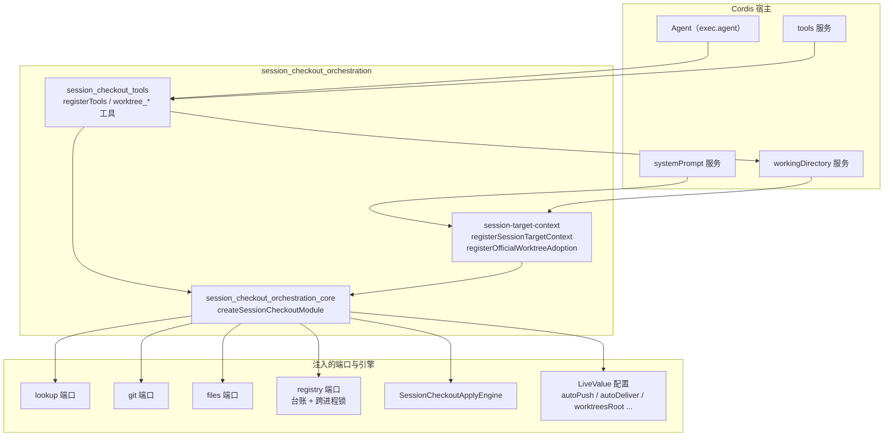
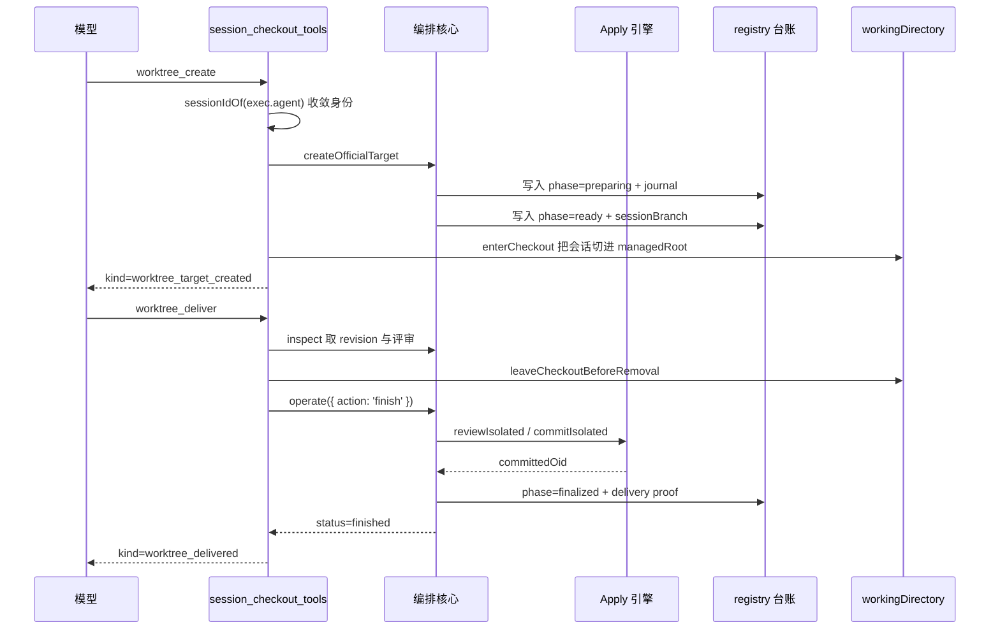

# 会话检出编排（session_checkout_orchestration）

`session_checkout_orchestration` 是 `dsh-git-worktree` 插件中「会话检出（Session Checkout）」能力的中枢层：它向下承接端口（Git、文件系统、台账 registry、Apply 引擎），向上向模型工具层、控制面（console-host）与客户端暴露统一的会话检出语义。这一层本身**不含任何 I/O 实现**——既不 `spawn` Git，也不直接读写文件——而是把注入的端口组合成一个带 CAS（compare-and-swap）、并发锁与崩溃恢复能力的编排状态机。

## 模块职责

该模块解决的核心问题是：让一个会话在「隔离的 Worktree」中工作，同时保证 Local 仓库（用户的工作区、索引、HEAD）在整个生命周期内不被污染，并且在进程崩溃、目录被外部删除、并发请求交错等异常情况下仍然可收敛、可解释、可恢复。

具体职责包括：

- **身份与授权收敛**：以调用者会话 id 作为唯一作用域，非 owner 的会话对分支、记录的访问一律拒绝（`not_owner`）。
- **目标生命周期管理**：创建、绑定、进入、评审、交付、保留、清理、放弃、恢复的完整状态流转。
- **一致性保障**：`expectedRevision` / `expectedReviewId` 构成的 CAS 令牌，加上进程内串行锁与跨进程台账锁。
- **宿主接线**：把台账状态翻译成 system prompt 中的运行时上下文文案，并把「会话走进 Worktree」这一事件登记进台账。
- **模型边界**：向 Agent 暴露受控的 `worktree_*` 工具子集，并负责会话 cwd 的安全迁移。

## 架构

模块由两个源文件层面的子模块构成，二者共享同一个 `SessionCheckoutModule` 门面：

### 一次典型调用的流向

## 核心组件

| 子模块 | 定位 | 主要内容 |
| --- | --- | --- |
| [编排核心](session_checkout_orchestration/session_checkout_orchestration_core.md) | 领域状态机与宿主接线 | `createSessionCheckoutModule` 工厂、台账与绑定数据模型、`phase` / `delivery.state` 两张状态机、`withBindingLock` 并发控制、三态身份校验（`valid` / `invalid` / `unavailable`）、创建/交付/评审/checkpoint/清理/恢复/分支卫生的编排流程、`runtimeContext` 运行时文案、`registerSessionTargetContext` 与 `registerOfficialWorktreeAdoption` |
| [工具层](session_checkout_orchestration/session_checkout_tools.md) | 面向模型的边界层 | `registerTools` 注册的 8 个 `worktree_*` 工具、严格 JSON Schema 输出契约、`withHostLanguage` 语言作用域、`enterCheckout` / `leaveCheckoutBeforeRemoval` 的 cwd 安全不变量、交付门禁与错误处理矩阵 |

## 关键设计约束

- **先收据、后动作**：任何改动磁盘的操作都先把 journal / receipt 写进台账，`reconcile()` 才能在崩溃后判定「做到了哪一步」。
- **交付只写会话分支**：Local 的工作区、索引与 HEAD 全程不动；遗留的「写进 Local」路径会被 `refuseLegacyLocalWrite()` 直接拒绝。
- **身份校验优先于权限**：路径、目录 inode / birthtime、Git common dir 等证据必须先通过，才允许删除或改写。
- **区分瞬时故障与真实不匹配**：`invalid` 与 `unavailable` 分流，避免把 Git 超时之类的瞬时故障持久化为无法自愈的 `recovery_required`。
- **模型只推进到 Ready for Review**：`Discard` / `Remove` 保留为人类命令，`worktree_deliver` 在 `autoDeliver` 关闭时被拒绝。

## 相关文档

- 所属总览：[core_domain_session_checkout](../core_domain_session_checkout.md)
- 交付执行细节：[session_checkout_apply_engine](session_checkout_apply_engine.md)
- 接口与视图类型：[core_domain_public_api](../core_domain_public_api.md)、[core_domain_ports](../core_domain_ports.md)
- 路径候选与 checkpoint 等基础能力：[core_domain_primitives](../core_domain_primitives.md)
- 官方 Worktree 注册与宿主兼容：[core_domain_workspace_lifecycle](../core_domain_workspace_lifecycle.md)
- 真实 I/O 实现：[adapters](../../adapters.md)；控制面与客户端：[console_host](../../console_host.md)、[client_ui](../../client_ui.md)