# session_checkout_orchestration_core：会话检出编排核心

本页记录 `dsh-git-worktree` 插件的**编排核心**：它把「台账（registry）」「Git/文件系统端口」「Apply 引擎」组合成一个带 CAS（compare-and-swap）与崩溃恢复能力的会话检出（Session Checkout）状态机，并在宿主侧把该状态机接入系统提示词（system prompt）与会话工作目录事件。

本模块由两个源文件构成：

| 文件 | 核心导出 | 职责 |
| --- | --- | --- |
| `src/session-checkout-module.ts` | `createSessionCheckoutModule`、`ResolvedSessionProject` | 会话检出的全部编排逻辑：绑定、创建、交付、评审、清理、恢复、并发锁 |
| `src/session-target-context.ts` | `registerSessionTargetContext`、`registerOfficialWorktreeAdoption`、`ContextAgent` | 宿主侧接线：注入运行时上下文文案、把「会话走进 Worktree」这一事件登记进台账 |

> 本页是 [session_checkout_orchestration](../session_checkout_orchestration.md) 的子页。同级子页 [session_checkout_tools](session_checkout_tools.md) 描述面向模型的 `worktree_*` 工具层；Apply 引擎本身见 [session_checkout_apply_engine](../session_checkout_apply_engine.md)。

---

## 1. 模块定位

`createSessionCheckoutModule(dependencies)` 是一个**工厂函数**：它接收一组端口（ports）与若干「活值（LiveValue）」配置，返回实现了 [`SessionCheckoutModule`](../../core_domain_public_api.md) 接口的对象。该接口是对外的唯一门面，被工具层、控制面（[console_host](../../../console_host.md)）、客户端与生命周期模块共同调用。

它在整体系统中的位置：

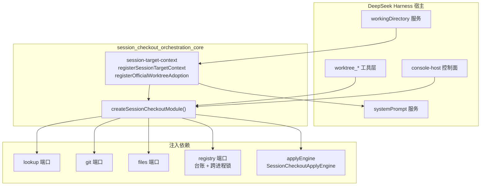

关键设计取向：

- **纯编排、无 I/O 实现**：模块自身不 `spawn` Git、不直接读写文件，全部通过端口完成；因此可以在测试中替换为内存实现。
- **台账即权威**：`ManagedCheckoutsRegistry`（`managedCheckouts` + `sessionBindings` + `revision`）是唯一的事实来源，磁盘状态只是需要被校验的候选事实。
- **先收据、后动作**：任何会改动 Local 或 Worktree 的操作，都先把 journal / receipt 写进台账，再执行，从而让崩溃后的 `reconcile()` 能判定「做到了哪一步」。
- **身份校验优先于权限**：路径、目录 inode/birthtime、Git common dir 等身份证据必须先通过，才允许删除或改写任何东西。

---

## 2. 依赖注入模型

`SessionCheckoutDependencies` 定义在 `src/ports.ts`，是编排核心的全部外部能力面（详见 [core_domain_ports](../../core_domain_ports.md)）：

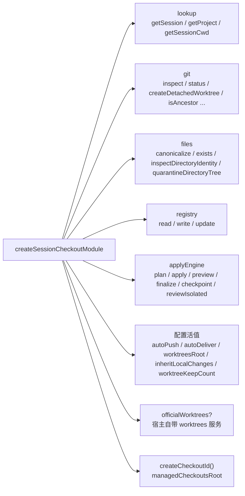

几处值得注意的注入约定：

- **`LiveValue<T>`**：Cordis 的可变配置以「活引用」形式注入，模块每次使用时通过 `liveConfigValue()` 取值，因此设置变更无需重建模块。
- **`officialWorktrees?()` 是惰性函数**：宿主服务可能在本插件之后才挂载，因此延迟解析而不是启动时捕获。
- **可选端口能力探测**：`attachWorktreeBranch`、`pushBranch`、`resolveLocalBranchTip`、`snapshotAbandonedWorktree`、`mergeLocalBranch` 等均为可选；缺失时对应功能降级为「明确拒绝或告警」，而不是静默失败（例如没有 `attachWorktreeBranch` 时退回 detached HEAD 并 `console.warn`）。

---

## 3. 数据模型：台账、记录与绑定

`ManagedCheckoutRecord` 是单个受管 Worktree 的台账条目，`SessionBindingRecord` 是「会话 → 目标」的绑定。两者由 `checkoutId` / `sessionId` 关联。

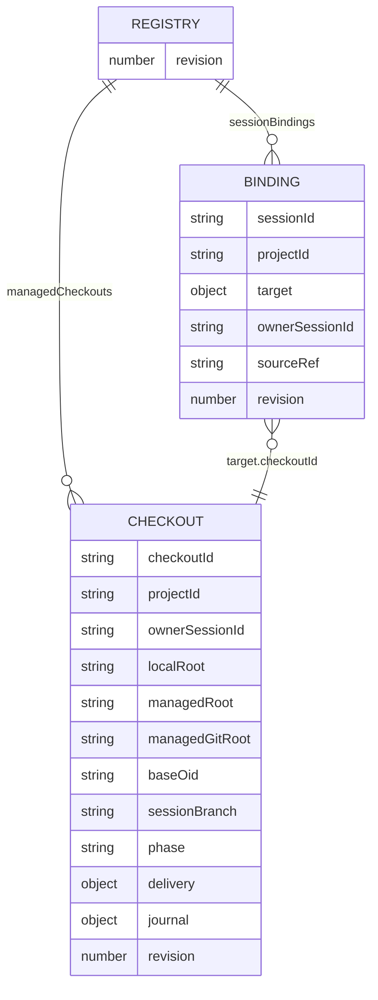

要点：

- `localRoot` 是用户在 Local Checkout 中的项目根；`managedRoot` 是项目在 Worktree 中的根（也是「权威 cwd」）；`managedGitRoot` 是 Git 仓库顶层（项目根可能是其子目录）。
- `sessionBranch` 是本会话自己的分支（`refs/heads/feat/sess-…`）。**交付只写这条分支，Local 的工作区/索引/HEAD 全程不动**。
- `journal` 是「进行中的操作收据」，`delivery` 是「已达成的事实」。`reconcile()` 靠 journal 推进或回退。
- `revision` 是 CAS 令牌：几乎所有写操作都要求调用方带上 `expectedRevision`，不匹配即返回 `stale_target`。

---

## 4. 状态机

### 4.1 记录生命周期（`phase`）

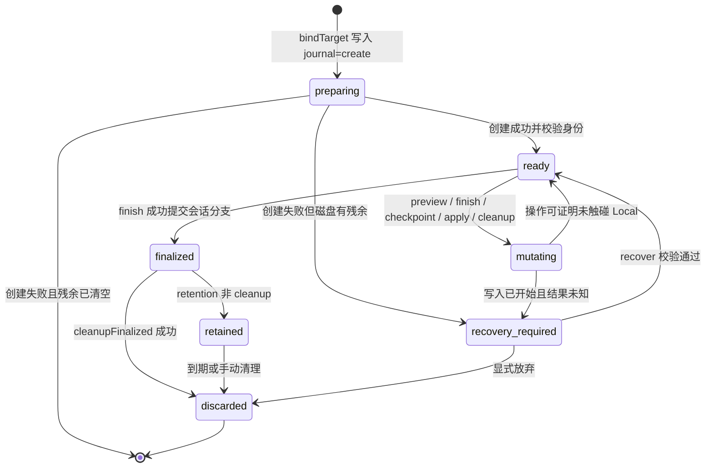

`reconcile()` 是这张图的「收敛器」：启动时（以及 `operateRecover` 需要时）遍历台账，按 journal 的 `operation`/`step` 决定回退到 `ready`、前进到完成态、还是升级为 `recovery_required`。

### 4.2 交付状态（`delivery.state`）

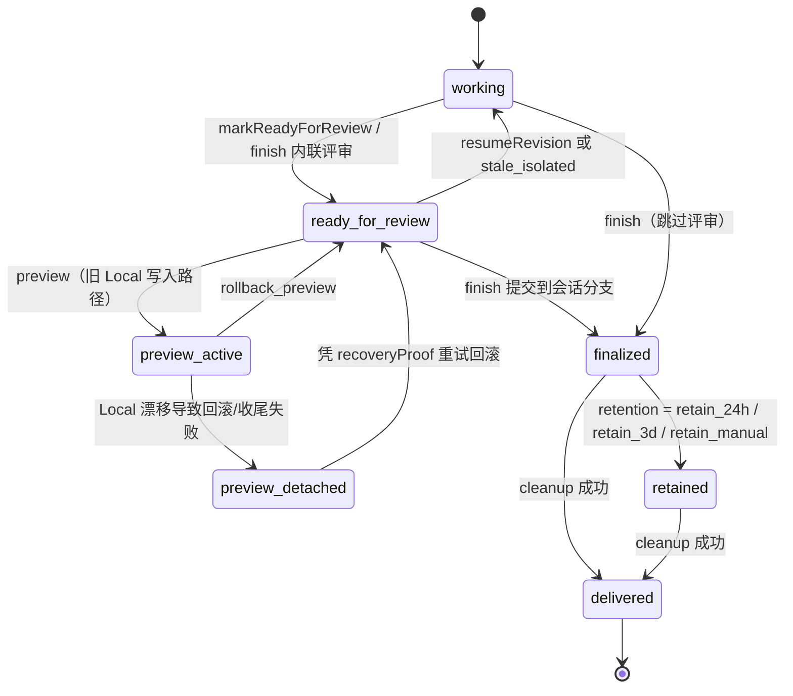

注意：`preview_*` 属于**遗留的「写进 Local」路径**。当前交付语义是「只提交到会话分支」，因此 `refuseLegacyLocalWrite()` 在记录已带 `sessionBranch` 时，会直接拒绝 `apply` / `preview` / `finalize_preview`，并指向正确出口（`worktree_deliver` 后 `worktree_merge`）。

---

## 5. 并发控制：读写锁与旁路

模块内部维护一把**进程内串行队列** `bindingQueue`，所有变更型入口都经 `withBindingLock` 串行化；同时允许「维护型只读」旁路，避免一个卡住的 Windows 目录把整个应用启动拖死。

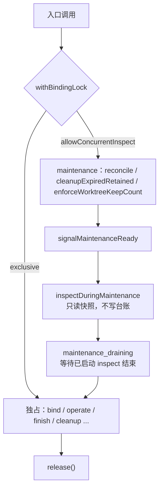

配套机制：

| 机制 | 位置 | 作用 |
| --- | --- | --- |
| `cleanupInFlight` + `withCleanupTimeout` | `session-checkout-module.ts` | 同一 `checkoutId` 的清理任务复用同一个 Promise；超过 `CHECKOUT_CLEANUP_TIMEOUT_MS`（120s）后调用方放弃等待但后台继续，避免两个读-改-写周期在台账上交错丢更新 |
| `retryTransientCleanup` | 同上 | 对 `EBUSY`/`EPERM`/`EACCES`/`ENOTEMPTY` 做 100/300/800ms 退避重试 |
| `inspectAvailable` | 同上 | 交互式 `inspect` 的调度器：维护操作在跑时走只读旁路，排队的维护操作会先取得锁再让 inspect 通过 |
| `registry.update()` | `src/ports.ts` | 在跨进程锁内完成读-改-写，单条记录更新必须走它 |

---

## 6. 身份校验与安全链

删除、交付、合并等破坏性动作前，必须先证明「这块磁盘确实是我记录的那块」。

`validateManagedCheckoutDetailed()` 返回三态：`valid` / `invalid` / `unavailable`。

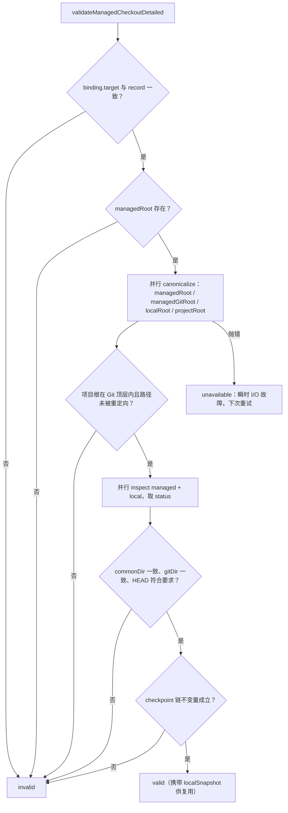

设计要点：

- **`invalid` 与 `unavailable` 分流**：只有确定的身份/路径不匹配才持久写 `recovery_required`；Git 超时、杀毒软件占用等瞬时故障允许下一次 `inspect` 直接重试，不永久污染健康 Worktree。
- **`pathsEqual` 与 `resolvedPathsEqual` 的差异**：前者会 `realpath`，用于「磁盘上的东西是不是同一块」；后者只 `resolve`，用于「canonical 路径与台账原始路径是否同形」，否则 Junction 会冒充原目录。
- **`localSnapshot` 复用**：校验时已经 inspect 过 Local 侧以证明同一仓库，把结果带出，避免上层再 spawn 一次 Git。
- **`checkpointHeadInvariantHolds()`**：校验 checkpoint 序号连续、id 唯一、内部 artifact ref 与 commitOid 匹配、父子链可达 HEAD；取证改为并行（原为循环内 3n+1 次串行 spawn）。

清理链另有 `validateDetachedCleanupResidue()` / `validateCleanupQuarantine()`：当 Git 已不认这棵树、只剩目录残余时，靠 `journal.managedDirectoryIdentity`（device + inode + birthtimeNs）证明「这就是我留下的残骸」，再走 `quarantineDirectoryTree` → `removeDirectoryTree`。

---

## 7. 主要编排流程

### 7.1 创建（`bindTarget` / `createIsolatedTarget` / `createOfficialTarget`）

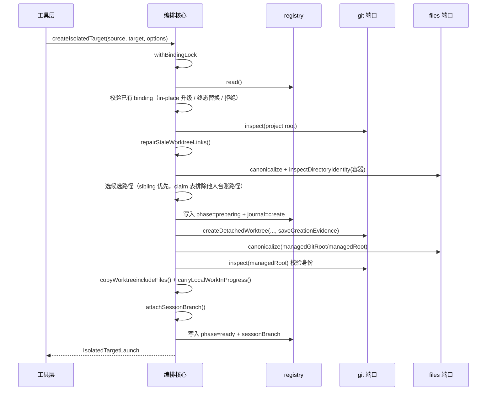

失败路径由 `finishFailedCreation()` 统一收口：`WorktreeCreationFailure` 若声明已回滚，则清 binding 与记录；否则 `markRecoveryRequired()` 保留证据。创建过程还会记录 `creationResiduePaths()`——只要磁盘上还有残余，`discard`/`recover` 都会以 `recovery_unsafe` 拒绝，因为没有身份可校验时就不该有删除权。

`createOfficialTarget()` 走宿主的 `worktrees` 服务创建，然后由 `registerOfficialWorktree()`（[core_domain_workspace_lifecycle](../../core_domain_workspace_lifecycle.md)）补记台账；`firstFreeBranchName()` 负责挑选未被占用的分支名。

### 7.2 交付（`operateFinish`）

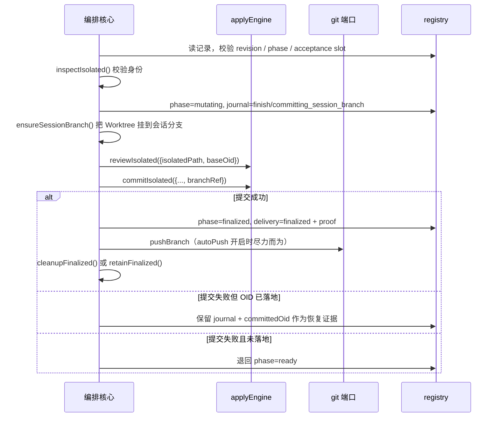

要点：`ensureSessionBranch()` 会在交付前把 Worktree 挂到**它自己的**会话分支。历史记录的 `sourceRef` 可能指向**别的会话**的分支，因此不能作为交付目标；此时以 Worktree 当前 HEAD 为起点新建会话分支，`sourceRef` 退化为「分叉来源」展示。`attachSessionBranch()` 对同名分支只在「指向当前 HEAD」或「是 HEAD 祖先（可快进）」时复用，绝不覆盖别人的提交。

### 7.3 评审、checkpoint 与恢复

- `markReadyForReviewTarget()`：校验摘要/提交信息/长度上限，**先** `ensureSessionBranch()` 再 `inspectReview()`，让评审指纹记录交付期真实的 HEAD 身份（否则 `headRef` 从 DETACHED 变成会话分支，指纹必然不同而被误判 `stale_isolated`）。
- `operateCheckpoint()`：`requestId` 幂等（相同请求精确重放返回同一 checkpoint）；写 journal → `applyEngine.checkpoint()` → `beforeCommit` 中 `retainInternalArtifact` 保留内部 ref → 成功后 `delivery` 回到 `working`，checkpoint 追加到记录。
- `reconcile()` 中 checkpoint 的 `updating_ref` 中断，走 `applyEngine.recoverCheckpoint()`：`checkpoint_aborted` 释放内部 ref 并回 `ready`；`checkpoint_recovered` 校验 ref 后补写 checkpoint 记录；其余升级为 `recovery_required`。
- `resumeRevisionTarget()` / `prepareReviewRegenerationTarget()` / `preparePreviewRecoveryAnalysisTarget()` / `createPreviewRecoveryHandoffTarget()`：都是「一次性授权（continuation）」写入者，把宿主已校验过的身份事实固化成台账里的 `recoveryContinuation`，再允许后续动作。

### 7.4 清理（`cleanupFinalized`）

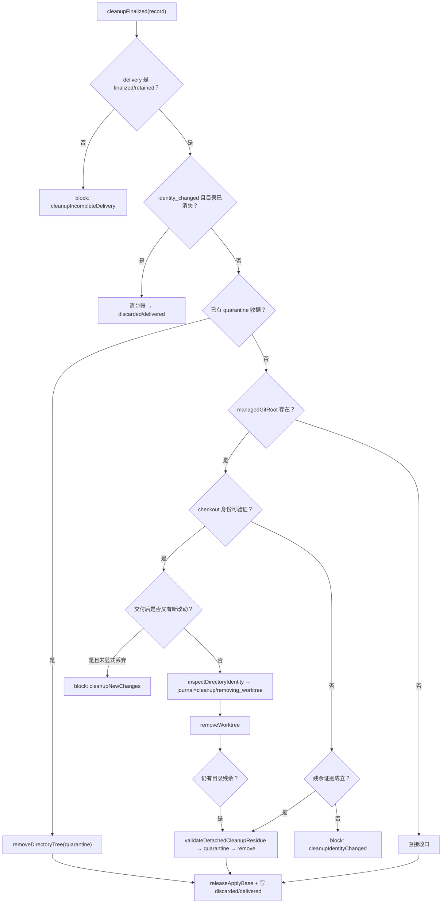

失败归因决定「以后会不会被自动重试」：`directory_busy` / `quarantine_busy` 是暂时性占用，留在定期重试里；`identity_changed` / `modified_after_finalize` 需要人工判断，写入 `delivery.cleanupReason` 结构化字段（旧记录只有散文，靠 `cleanupReasonForMessage()` 关键词兜底）。

### 7.5 启动收敛与配额（`reconcile` / `cleanupExpiredRetained` / `enforceWorktreeKeepCount`）

`reconcile()` 输出 `SessionCheckoutReconcileSummary`（`recoveryRequiredCheckoutIds`、`orphanedCheckoutIds`、`dirtyOrphanedCheckoutIds`、`staleRootCheckoutIds`、`retainedCheckoutCount`）。除状态收敛外还负责：

- 清理 `discarded` 记录留下的空壳目录，并在「路径彻底空掉且无人引用」时删除台账条目；
- 修复 `predecessorCheckoutId` 指向已交付前驱的「下一轮创建中断」记录（回滚 binding）；
- 对 `finalized` / `retained` 逐条执行 `cleanupFinalized`（带超时保护）；
- 调用 `cleanupExpiredRetained()` 与 `enforceWorktreeKeepCount()`（`worktreeKeepCount` LRU，`permanent` 记录豁免）。

### 7.6 分支卫生：合并与安全裁剪

- `mergeBranchForSession()`：把会话分支合进 Local HEAD（`direction: 'forward'`）或反向同步（`'reverse'`）。门控要求 `sourceBranch` 必须是本会话某个受管 Worktree 的分支；若属于**另一个会话**则返回 `not_owner` 并指出 owner。`dryRun` 在临时 worktree 试合；真实合并在项目已有 acceptance slot holder 时以 `project_acceptance_busy` 拒绝。
- `pruneMergedBranchesInRepo()`：只删「已完全合并」的分支（`git branch -d` 语义），当前分支与主干永不进入候选；主干名从 `origin/HEAD` → `init.defaultBranch` 推断，不假设 `main`/`master`；`olderThanDays` 额外要求 tip 时间早于阈值；**活跃会话分支永不删除**（删掉它会让那个会话的下一次交付写到不存在的地方）。

---

## 8. 运行时上下文：把状态说给模型听

`runtimeContext(sessionId, cwd?)` 是**同步**函数：只读台账快照，不做 Git/文件 I/O，因此可以在每次 system prompt 求值时调用。

它按「目标类型 × 交付状态 × cwd 是否在 Worktree 内」生成一段结构化指引，覆盖这些容易出错的情形：

| 情形 | 指引要点 |
| --- | --- |
| Local 且无 pending | 正常在 cwd 干活，不要调用 Worktree 专属工具 |
| Local 且有他人 pending | 停止修改，请用户从 Worktree 卡片打开隔离会话 |
| Local 且 pending 归本会话（in-place） | 不要建第二棵树，文件写入必须用权威 cwd 下的绝对路径 |
| Isolated 未进入 cwd | 说明「in-place 绑定」，写保护 hook 会拦截落在 Local 的写入 |
| `ready_for_review` | 继续讨论但不改 Review；要改代码先 `worktree_resume_revision` |
| `working` | 完成实现与验证后，把完整报告只放进 `worktree_deliver` 的 `report` 参数 |
| `delivered` | Local 从未被写过，用 `worktree_merge` 合并；要新代码先 `worktree_begin_next_iteration` |
| `retained` / `finalized` 但 cwd 已回 Local | 明确「工作边界已回到 Local」，允许普通 Local 杂务，冻结环境只用于回滚与清理 |
| `recovery_required` | 禁止改 Local、禁止自动清理 |

设计细节：判断是否在 Worktree 内用 `pathIsWithin()`（**包含**而非相等），因为会话经常 `cd` 进子目录，那仍然是在 Worktree 里工作。

---

## 9. 宿主侧接线（`session-target-context.ts`）

该文件只有两个注册函数，负责把编排核心接到 Cordis 宿主：

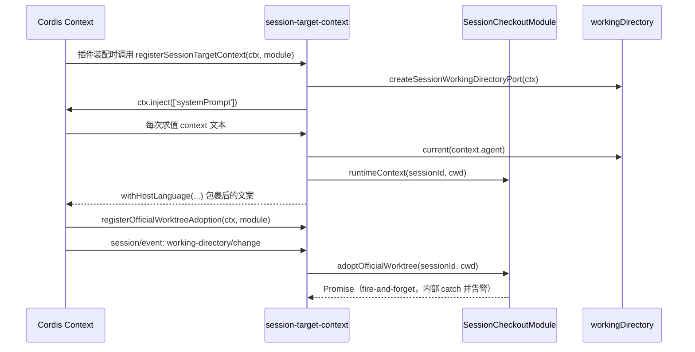

要点：

- **`order: 118`** 的命名快照 `git-worktree:session-target`：只做快照，不做 I/O。
- **语言协商**：文案经 `withHostLanguage(languageForInvocation(...))` 包裹，配合 [i18n](../../../i18n.md) 模块的 host messages 提供中英文。
- **`ContextAgent`**：一个最小结构类型 `{ session?: { id?: unknown } }`，避免依赖完整 Agent 类型。
- **采纳时机**：官方 `worktrees.create` 的最后一步是 `workingDirectory.set`，因此 `working-directory/change` 是「树建好了、且是某个会话落脚点」的唯一可靠信号；比轮询 `git worktree list` 及时，也不必为每个项目起子进程。事件 feed 不等待监听者，所以必须 `void ... .catch()` 接住 rejection。
- `adoptWorktreeForSession()` 的幂等性由三道检查保证：已有 binding 跳过、`isTracked()` 已登记跳过、非 `.agents/worktrees/` 路径跳过。

---

## 10. 对外 API 一览

`createSessionCheckoutModule` 返回对象的方法可分为四组（完整签名见 [core_domain_public_api](../../core_domain_public_api.md)）：

| 组 | 方法 | 是否持锁 |
| --- | --- | --- |
| 读取 | `inspect`、`runtimeContext`、`resolveRoots`、`listManagedWorktrees`、`listManagedWorktreesForSession`、`inspectManagedWorktreeCleanup`、`listAbandonedWorktreeSnapshots`、`isAutoDeliverEnabled` | `inspect` 走调度器；列表类不占全局锁 |
| 绑定/创建 | `bind`、`createIsolatedTarget`、`createOfficialTarget`、`adoptOfficialWorktree`、`beginNextIteration` | 是 |
| 状态流转 | `markReadyForReview`、`resumeRevision`、`prepareReviewRegeneration`、`preparePreviewRecoveryAnalysis`、`createPreviewRecoveryHandoff`、`operate`、`preflight`、`preflightPreviewRecovery` | 是 |
| 维护 | `reconcile`、`cleanupExpiredRetained`、`enforceWorktreeKeepCount`、`bulkCleanupManagedWorktrees`、`manageManagedWorktree`、`manageManagedWorktreeForSession`、`pruneMergedBranchesForSession`、`autoPruneStaleMergedBranches`、`mergeBranchForSession`、`restoreAbandonedWorktreeSnapshot`、`observeManagedCheckout(s)`、`resolveManagedRoot`、`runExclusiveSessionMutation` | 是（`reconcile` / `cleanupExpiredRetained` / `enforceWorktreeKeepCount` / `preflightPreviewRecovery` 允许并发只读） |

`operate(input)` 是一个大分发器：`apply` / `finish` / `preview` / `checkpoint` / `rollback_preview` / `finalize_preview` / `retry_cleanup` / `discard` / `recover`。它把 `SessionCheckoutError` 统一翻译成 `{ status: 'error', code, message, target? }`，其余异常继续上抛。

---

## 11. 错误码与失败语义

错误码来自 `SessionCheckoutErrorCode`（见 [core_domain_public_api](../../core_domain_public_api.md)），编排核心中高频出现的几类：

| 错误码 | 触发场景 | 恢复建议 |
| --- | --- | --- |
| `stale_target` | `expectedRevision` / `expectedReviewId` / 请求幂等键不匹配 | 刷新后重试 |
| `stale_isolated` / `stale_local` | 评审后 Worktree 或 Local 被改动 | 重新准备评审 |
| `project_acceptance_busy` | 同项目 Local 已有 acceptance slot holder | 等待另一任务收口 |
| `recovery_required` / `recovery_unsafe` | 无法证明 Local 未被触碰，或存在创建残余 | 走 `recover` 或显式 `discard` |
| `checkout_mismatch` | 目录身份、Git common dir 或容器不可信 | 人工核查，通常不可自动重试 |
| `not_owner` | 非 owner 会话或分支属于其他会话 | 交给 owner |
| `operation_not_allowed` | 当前 phase/delivery 不允许该动作，或端口能力缺失 | 按 `runtimeContext` 指引换动作 |
| `dirty_confirmation_required` | `discard` 前存在未提交内容 / 未交付 checkpoint | 带 `confirmDirty` 重试（会先做放弃快照） |

---

## 12. 与其他模块的关系

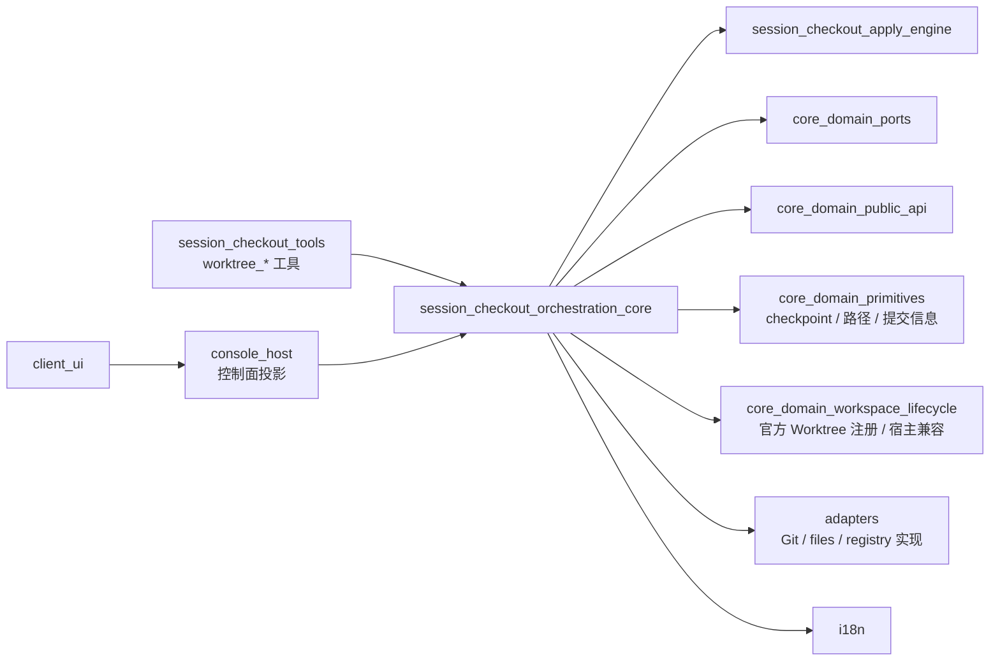

- **向下**：通过 [adapters](../../../adapters.md) 的 `createNodeFilesPort`、`GitPortOptions`、`AtomicJsonCheckoutRegistry` 落地真实 I/O；`checkpointGenerationForRecord`、`createManagedWorktreePathCandidates` 等来自 [core_domain_primitives](../../core_domain_primitives.md)。
- **横向**：`applyEngine` 的完整语义（plan/apply/preview/finalize/checkpoint 的 CAS 与 receipt）见 [session_checkout_apply_engine](../session_checkout_apply_engine.md)。
- **向上**：工具层 [session_checkout_tools](session_checkout_tools.md) 把模型调用翻译成 `operate` / `markReadyForReview` / `createOfficialTarget`；[console_host](../../../console_host.md) 把台账投影成控制面视图供 [client_ui](../../../client_ui.md) 使用。

---

## 13. 构建与验证

本模块是纯 TypeScript（ESM），随插件一起构建与测试（配置见 [build_and_config](../../../build_and_config.md)）：

- `package.json` 中 `build` = `node scripts/clean-lib.mjs && tsc && tsdown`，`typecheck` = `tsc --noEmit`，`test` = `vitest run`（`vitest.config.ts`）。
- `cordis.patch.yml` 以 `id: dsh-git-worktree` 注册插件条目，因此 `createSessionCheckoutModule` 在插件 `apply` 期间被装配。
- 由于全部外部能力都走端口，编排逻辑可在测试中用内存 registry / 伪 Git 端口驱动，无需真实仓库。

---

## 14. 维护提示

1. **不要绕过 `withBindingLock`**：任何写台账或改磁盘的入口都必须持锁；只读列表可豁免。
2. **不要绕过 `registry.update()`**：`read()` + `write()` 之间隔着两次调用，跨进程会丢更新。
3. **新增 journal step 时必须同时实现 reconcile 分支**，否则中断后记录会永久停在 `mutating`。
4. **区分 `invalid` 与 `unavailable`**：把瞬时 I/O 故障持久化为 `recovery_required` 会制造无法自愈的记录。
5. **清理归因要结构化**：新写点必须写 `delivery.cleanupReason`；`cleanupReasonForMessage()` 只是历史记录兜底。
6. **交付只写会话分支**：任何「写进 Local」的新路径都会重新引入跨会话污染，`refuseLegacyLocalWrite()` 就是为此存在。
