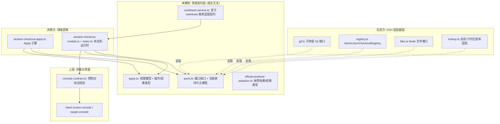
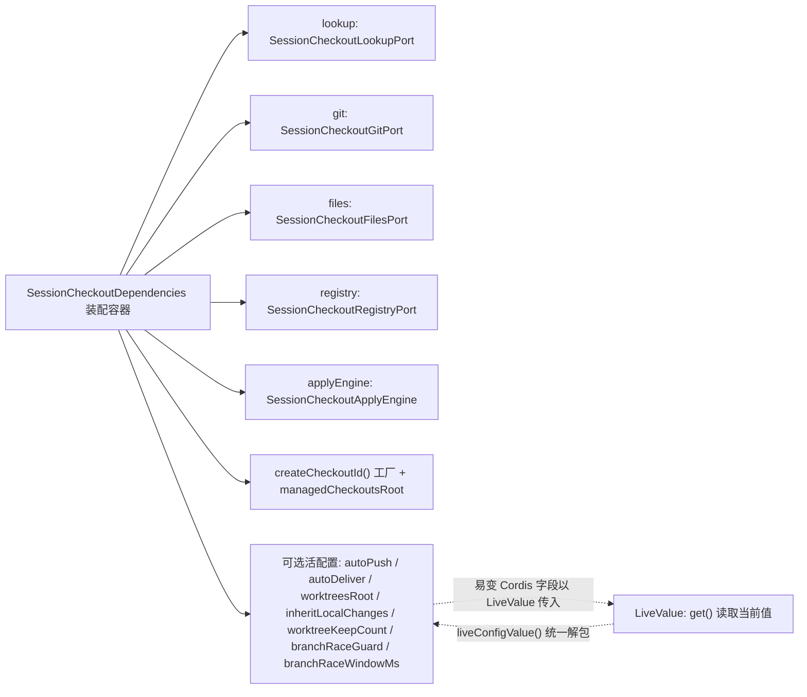
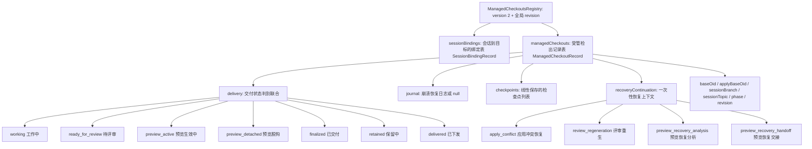
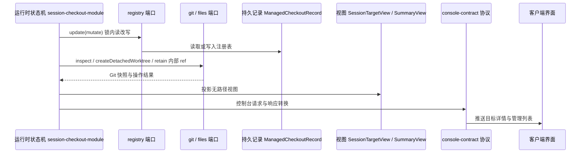

# 会话检出领域契约（session_checkout_domain_contracts）

## 简介

本模块是 `session-checkout` 领域的**类型表面（type surface）**，由四个文件组成：

- `src/ports.ts` —— 端口接口（Port Interfaces）与注册表持久化模型；
- `src/types.ts` —— 对外视图模型、操作（Operation）与结果（Result）判别联合；
- `src/official-worktree-adoption.ts` —— 官方工具创建 Worktree 纳管（adoption）的依赖与结果类型。
- `src/worktrees-service.ts` —— 面向官方实验性 Worktree 服务面（`worktrees.create` / `worktrees.restore` 形状）的适配契约。

领域逻辑（状态机与 Apply 引擎）**只依赖这些契约**，不直接触碰子进程 Git、插件注册表存储或宿主会话服务；DSH 适配器（subprocess-backed git、plugin-owned registry、session/workspace lookup）全部隐藏在端口之后。这使得状态机保持宿主无关（host-agnostic），并可用 fake 端口做单元测试。

消费方与实现方的分工见下图：

- 领域逻辑内部的状态机装配与入口见 [session_checkout_runtime](session_checkout_runtime.md)（尤其 [运行时入口](session_checkout_runtime/session_checkout_runtime_entry.md)）；
- Apply 引擎如何消费 `SessionCheckoutGitPort`/`SessionCheckoutFilesPort` 执行 plan/preview/rollback，见 [session_checkout_apply_engine](session_checkout_apply_engine.md)；
- 端口的生产实现见 [src_adapters](../src_adapters.md)（[持久化](../src_adapters/src_adapters_persistence.md)、[Git 执行](../src_adapters/src_adapters_git_execution.md)、[宿主绑定](../src_adapters/src_adapters_host_binding.md)）；
- 视图如何投影为传输协议，见 [worktree_console_contract](../../worktree_console_protocol_and_host_service/worktree_console_contract.md)。

---

## 一、`src/ports.ts`：端口与持久化契约

### 1.1 端口总览与装配

`SessionCheckoutDependencies` 是领域模块的装配容器，状态机与 Apply 引擎通过它拿到全部协作者：

设计要点：

- **必需端口**：`lookup`、`git`、`files`、`registry`、`applyEngine`、`managedCheckoutsRoot`、`createCheckoutId()` 缺一不可；
- **活配置（LiveValue）**：`autoPush`、`autoDeliver` 等配置既可以是静态值，也可以是 `LiveValue<T>`（易变 Cordis 配置字段的实时引用）。辅助函数 `liveConfigValue(value)` 统一解包：存在 `get()` 方法就调用，否则按普通值返回；
- **可选能力 = 静默降级**：端口上大量方法是 optional 的（标记为 "Local adaptation"）。第三方端口不实现某能力时，领域逻辑不初始化该功能或让守卫"保持沉默"，而不是抛错。

### 1.2 四个端口接口

| 端口 | 职责 | 核心（必需）方法 | 可选能力（示例） |
| --- | --- | --- | --- |
| `SessionCheckoutLookupPort` | 会话/项目/侧边栏的只读导航查询 | `getSession(sessionId)`、`getProject(projectId)` | `getSessionCwd()`（活工作目录，授权证据）、`listLiveSessions()`（并发分支竞争守卫）、`getSidebarMemberships()`、`listProjects()`（Local 根反向归属宿主 Workspace 项目） |
| `SessionCheckoutGitPort` | 全部 Git 读写与探测 | `inspect`、`findContainingWorktreeRoot`、`status`、`createDetachedWorktree`、`removeWorktree`、`retainApplyBase`/`releaseApplyBase`、`retainInternalArtifact`/`readInternalArtifact`/`releaseInternalArtifacts`、`isAncestor` | 分支/标签总览、`pushBranch`、`mergeLocalBranch`、`graphLog`、`listWorktrees()`（Git 权威 Worktree 清单，供官方工具创建的 Worktree 纳管）、放弃快照 `snapshotAbandonedWorktree`/`restoreAbandonedSnapshot`、WIP 携带 `captureLocalWip` 等 |
| `SessionCheckoutFilesPort` | 文件系统操作与目录身份 | `exists`、`canonicalize`、`inspectDirectoryIdentity`、`ensureDirectory`、`removeEmptyDirectoryTree`、`quarantineDirectoryTree`、`removeDirectoryTree`、`measureDirectoryBytes` | `readTextFile`、`copyFile`、`isSymbolicLink` |
| `SessionCheckoutRegistryPort` | 受管检出注册表的持久化 | `read()`、`write(registry)`、`update(mutate)` | — |

关键设计约束：

1. **导航与授权分离**：`getSession()` 返回的 `SessionCheckoutSessionRecord`（id/projectId/title）只是导航证据；宿主会话的**活工作目录**由单独的 `getSessionCwd()` 提供，因为受管 owner 会话的 cwd 就是其不可变 worktree 根——只用 project root 做授权会让所有 owner 调用被 `project_mismatch` 拒绝。
2. **CAS 身份**：`DirectoryIdentity`（`device` + `inode` + `birthtimeNs`）用于清理与迁出前的目录比对，防止"路径还在但目录已被换掉"。
3. **锁内读改写**：`read()` 与 `write()` 之间隔着两次调用，任何并发进程写入都会被后写者抹掉。因此单条记录更新必须走 `update(mutate)`——实现方（`AtomicJsonCheckoutRegistry`）在同一把跨进程文件锁内完成 load → mutate → write。
4. **保留引用（retained refs）**：Apply/preview 的中间快照通过 `retainApplyBase`/`retainInternalArtifact` 以内部 ref（`refs/dsh-worktree/...`）保存在仓库中，崩溃后可用 `readInternalArtifact` 只读取回，不触碰用户可见 refs。

### 1.3 注册表持久化模型

各组件职责：

- **`ManagedCheckoutsRegistry`**：version 固定为 `2`；`revision` 为全局乐观并发版本号；`sessionBindings` 记录会话与目标（`SessionTargetRef`：unselected/local/isolated）、owner、来源 ref/oid 的绑定；`managedCheckouts` 按 checkoutId 索引；
- **`ManagedCheckoutRecord`**：一条受管 worktree 的全部事实——`localRoot`/`managedRoot`/`managedGitRoot` 三个根、`gitCommonDir`/`gitDir`、基线 `baseOid`、会话分支 `sessionBranch` 与主题 `sessionTopic`、`phase`（preparing/ready/mutating/recovery_required/finalized/retained/discarded）等；
- **`ManagedCheckoutDelivery`**：七态判别联合，`finalized`/`retained` 态携带 `ManagedDeliveryProof`（本地分支、交付前后 HEAD、变更文件、验证状态）与清理阻塞信息；
- **评审与检查点**：`ManagedWorktreeReviewRecord`（评审轮次、验证项、变更文件、建议提交信息）、`ManagedWorktreeCheckpointRecord[]`（私有于受管 worktree 的线性保存阶段，带 `requestId` 幂等键）、`ManagedWorktreePreviousReviewRecord`（评审失效后的有界上下文）；
- **`ManagedPreviewReceipt`**：一次预览的完整凭据——配置基线 vs 有效基线、两端 HEAD/指纹/索引树、变更文件。脱钩恢复时以此为事实来源；
- **`ManagedRecoveryContinuation`**：四种一次性、宿主权威的恢复上下文（应用冲突、评审重生、预览恢复分析、预览恢复交接），由状态机在宿主锁内持久化，供客户端随后驱动恢复流程（见 [client_review_console_recovery_delivery](../../worktree_client_interface_layer/client_review_console/client_review_console_recovery_delivery.md)）；
- **`ManagedCheckoutJournal`**：`create` 与 `mutation` 两种日志。mutation 日志记录分步进度（planning → artifacts_retained → committing_session_branch → writing_local → updating_ref → replacing_index → removing_worktree），关键原则是**先持久化日志再写 Local**，进程崩溃后可据此判定断点。

### 1.4 官方 Worktree 纳管（adoption）相关类型

官方实验工具创建的 Worktree 可能既无本插件台账绑定、也无会话投影覆盖。`src/official-worktree-adoption.ts` 的纳管逻辑在**锁外**通过 `git.listWorktrees()` 拿到 Git 权威清单（官方工具把 Worktree 嵌套在含 `/` 的分支名之下，任何目录扫描都无法安全重建），用 `lookup.listProjects()` 把 Local 根反向归属到宿主 Workspace 项目，再把「磁盘上已存在且可读」的树直接落成 `phase: 'ready'` 的台账记录。该文件只声明两个类型（纳管逻辑本身见运行时）：

| 类型 | 字段 | 职责 |
| --- | --- | --- |
| `OfficialWorktreeAdoptionDependencies` | `lookup: SessionCheckoutLookupPort`、`git: SessionCheckoutGitPort`、`registry: SessionCheckoutRegistryPort`、`createCheckoutId()` | 纳管逻辑的依赖注入容器；`git.listWorktrees` 与 `lookup.listProjects` 任一缺失即整体跳过纳管 |
| `OfficialWorktreeAdoptionResult` | `adopted: string[]` | 被纳管的 Worktree 绝对路径清单 |

纳管读取的 Git 条目形态由端口上的 `WorktreeListingEntry` 描述：

| 字段 | 含义 |
| --- | --- |
| `path: string` | Git 报告的绝对工作树根路径 |
| `headOid: string` | 该 Worktree 当前检出的提交号 |
| `branchRef: string \| null` | 检出分支时为 `refs/heads/...`，否则为 `null`（detached） |

---

## 二、`src/types.ts`：视图与操作契约

### 2.1 基础领域类型

| 类型 | 含义 |
| --- | --- |
| `SessionTargetRef` | 持久层稳定的会话目标引用：`unselected` / `local` / `isolated + checkoutId`（路径与分支不是身份） |
| `SessionCheckoutPhase` | 检出阶段机：`preparing` / `ready` / `mutating` / `recovery_required` / `finalized` / `retained` / `discarded`（`applying` 已废弃兼容） |
| `WorktreeValidationStatus` | 验证状态：`passed` / `failed` / `partial` / `not_run` |
| `WorktreeRetentionMode` | 保留模式：`cleanup`（立即删除）/ `retain_24h` / `retain_3d` / `retain_manual`；默认 `DEFAULT_WORKTREE_RETENTION = 'retain_24h'` |
| `WorktreeCleanupReason` | 清理阻塞原因：目录忙 / 交付后被改 / 身份变化 / 脱钩残留 / 隔离区忙 |
| `ApplyBaseStrategy` | 应用基线策略：`recorded_base` / `isolated_contains_local_head` / `local_contains_isolated_head` |
| `ApplyConflictReason` | 本地拒绝合并原因：内容冲突 / 本地脏改 / 未跟踪文件被覆盖 |

### 2.2 视图模型（View）

视图是**持久记录的无路径投影**：面向模型上下文与 UI/传输，不暴露磁盘路径、目录身份等授权与清理事实——"看"永远不能变成"授权"。

- **`SessionTargetView`**：单次会话目标的完整投影——`project`（id/name）、`checkout`（id/kind/label/phase）、`source`（来源 ref/oid）、`current`（分支与 HEAD oid，detached 时分支为 null）、`ownership`（owner/inherited）、`dirty`、`revision`、`delivery`（`WorktreeDeliveryView`）、`checkpoints`、`reviewSlot` 等；
- **`WorktreeDeliveryView`**：与持久 delivery 同构的七态视图，`WorktreeDeliveryProofView` 额外派生 `commitInLocalHistory`（本轮提交是否仍是本地 HEAD 祖先）；
- **`ManagedWorktreeSummaryView`**：管理面列表项——状态枚举、迭代号、近似字节数、保留到期时间、`permanent` 标记、`canCleanup` 与只读 `cleanup` 检查结论；
- **`ManagedWorktreeCleanupView`**：清理资格（`safe`/`retained`/`blocked`）与阻塞原因的**只读结论**——批量真实清理时会重新校验，此视图本身绝不构成授权；
- **预检视图**：`WorktreeApplyPreflightView`（`ready`/`local_advanced`/`already_in_local`/`conflict`/`blocked`，阻塞时附占位 blocker）与 `WorktreePreviewRecoveryPreflightView`；
- **`WorktreePreviewRecoveryProof`**：宿主签发的只读恢复上下文——完整 receipt 指纹、本地 HEAD/树/索引/工作区 OID，以及预先判定的 `rollback`/`finalize` 动作（safe 或 blocked）。它是"待复核的上下文"而非持有权限：真正变更时状态机在宿主锁内重算并比对；
- **辅助视图**：`MergeBranchForSessionView`（含 forward/reverse 方向与 dryRun 探测）、`PruneMergedBranchesView`、`AbandonedWorktreeSnapshotView`（codex 对齐的可恢复放弃快照）、`BulkCleanupManagedWorktreesResult`。

### 2.3 操作契约（Operation）

所有操作共享基类 `SessionCheckoutOperationBase`：`sessionId` + `expectedRevision`（乐观并发版本，不匹配即 `stale_target`）。九种操作：

| 操作 | 附加约束 | 用途 |
| --- | --- | --- |
| `apply` | — | 把评审快照应用到 Local |
| `preview` | — | 在 Local 上生成只读预览 |
| `finish` | `commitMessage`、可选 `retention`、`expectedReviewId` | 交付完成并固化提交 |
| `checkpoint` | `commitMessage`、`expectedReviewId`、`expectedGeneration`、`requestId` | 在受管 worktree 内保存私有检查点（幂等键防重） |
| `rollback_preview` | 可选 `resumeRevision`、可选 `recoveryProof` | 回滚预览 |
| `finalize_preview` | `commitMessage`、可选 `retention`、可选 `recoveryProof` | 定稿预览 |
| `retry_cleanup` | — | 重试被阻塞的清理 |
| `discard` | `confirmDirty`、可选 `rollbackPreview` | 放弃受管 worktree |
| `recover` | — | 从 `recovery_required` 恢复 |

### 2.4 结果契约（Result）与错误码

`SessionCheckoutOperationResult` 是十种结果的判别联合：`applied` / `previewed` / `checkpointed` / `preview_rolled_back` / `preview_detached` / `finished` / `conflict` / `discarded` / `recovered` / `error`。

- **冲突结果 `SessionCheckoutConflictResult`**：携带 `baseStrategy`、`effectiveBaseOid`、两侧 HEAD、冲突文件列表与逐文件合并 diff（`ApplyConflictDetail`）、以及按原因分类的 `resolveHint`。冲突载荷有硬上限——`CONFLICT_DETAIL_FILE_LIMIT = 6` 个文件、每文件 diff 截断到 `CONFLICT_DETAIL_DIFF_LIMIT = 4096` 字节，防止撑爆模型上下文；
- **错误结果 `SessionCheckoutOperationErrorResult`**：`code` 取自 `SESSION_CHECKOUT_ERROR_CODES` 常量数组（30 个稳定错误码，如 `session_not_found`、`project_mismatch`、`not_owner`、`stale_target`、`apply_conflict`、`recovery_unsafe`、`project_acceptance_busy` 等），宿主层据此做 i18n 文案与工具报错映射；
- **失败类型 `SessionCheckoutFailure`**（code + message）与运行时抛出的 `SessionCheckoutError`（见 [运行时入口](session_checkout_runtime/session_checkout_runtime_entry.md)）共享同一错误码空间。

---

## 三、`src/worktrees-service.ts`：官方 Worktree 服务适配契约

本文件声明面向**官方实验性 Worktree 服务面**（`worktrees.create` / `worktrees.restore` 的形状）的适配契约：`createWorktreesService(module)` 把运行时状态机（`SessionCheckoutModule`，见 [运行时入口](session_checkout_runtime/session_checkout_runtime_entry.md)）包装成宿主可直接注册的服务对象，自身不实现任何 Git 行为——创建动作全部经状态机的 `createIsolatedTarget` / `resolveRoots` 完成。

### 3.1 接口与请求/响应类型

| 类型 | 成员 | 职责 |
| --- | --- | --- |
| `WorktreesService` | `create(agent, request?, signal?, onPhase?)`、`restore(agent, request, signal?, onPhase?)` | 官方 worktrees 服务形状的适配面：`agent` 为调用方、`signal` 为中止信号、`onPhase` 为进度回调 |
| `CreateWorktreeRequest` | `name?: string`、`from?: string` | `name` 新分支名（省略时生成 Session 分支名）；`from` 起点本地修订（省略时从当前 HEAD 开始） |
| `CreatedWorktree` | `path`、`branch`、`baseCommit`、`repositoryRoot` | 创建结果：规范绝对检出目录、检出所在 Session 分支、创建时所在提交、源检出的规范根 |
| `RestoreWorktreeRequest` | `path`、`branch`、`baseCommit`、`repositoryRoot` | 恢复入参：待恢复检出目录与其全部身份事实 |
| `RestoredWorktree` | `path`、`branchRecreated` | 恢复结果：目录路径与分支是否被重建 |

配套进度类型 `WorktreePhase = 'prepare' | 'checkout'`：`prepare` 为建前准备，`checkout` 为正式检出。

### 3.2 适配语义

- **`create`**：先 `onPhase('prepare')`，再把 `request.from` 作为种子 Session 分支尖端的本地分支（`createOptions.branch`），`request.name` 只充当本插件自有 Session 分支的可读主题（`topic`）；未给 `from` 时 `name` 仍只供主题使用。随后 `module.createIsolatedTarget(sessionId, sessionId, createOptions)` 在状态机内完成隔离目标移交，`onPhase('checkout')` 后经 `module.resolveRoots(checkoutId)` 取回双根。返回的 `baseCommit` 是创建时 HEAD 所在提交（Session 分支在该基点创建、尚无提交）；`repositoryRoot` 是被分叉的源 Local 根，项目根即仓库根时两者相等。
- **`restore`**：**一律抛错**。已交付（delivered）的 Worktree 会被刻意清理、台账只保留交付历史，磁盘上没有可放回的目录。继续该行工作应走 `beginNextIteration`——从上次 Session 分支尖端起一个全新迭代，而不是复活未提交状态早已被丢弃的检出。

---

## 四、典型数据流

1. **变更路径**：任何 mutation 都经 `registry.update()` 在跨进程锁内完成，journal 先于 Local 写入持久化；
2. **读取路径**：状态机从注册表读出 `ManagedCheckoutRecord`，投影为 `SessionTargetView`/`ManagedWorktreeSummaryView` 等视图，再由 [worktree_console_contract](../../worktree_console_protocol_and_host_service/worktree_console_contract.md) 转成传输 DTO 送往客户端；
3. **降级路径**：optional 端口缺失（如无 `listLiveSessions`）时，并发分支竞争守卫保持沉默；无 `pushBranch` 时 Finish 后的自动推送整体跳过——契约层不假设宿主能力齐备。

## 五、设计约束速查

- **端口 optional = 能力探测**：缺失时功能静默降级，而非初始化失败；
- **revision CAS**：所有操作携带 `expectedRevision`，结果回传新 `revision`，防止并发会话互相覆盖；
- **proof 是上下文不是权限**：恢复类操作的 `recoveryProof` 仅供重新校验，真正变更在宿主锁内重算比对；
- **持久记录与视图分离**：记录含路径与身份（授权/清理用），视图面向 UI/模型（无路径）；
- **清理只认指纹与身份**：删除受管 worktree 前宿主已校验 checkout identity 与含未跟踪文件的完整指纹，`DirectoryIdentity` 不匹配则转入隔离区（quarantine）而非直接删除。
