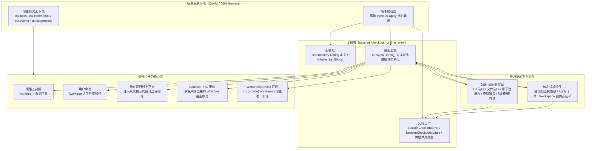

# 会话检出运行时入口模块
本模块是 `dsh-git-worktree` 插件的**装配根（Composition Root）与对外契约出口**，核心作用是将与宿主无关的会话检出领域逻辑安全接入 DeepSeek Harness（DSH）/Cordis 运行时环境。
模块采用「入口即契约」的设计模式：跨层稳定的错误类型、核心业务接口、输入输出视图类型统一定义在本模块内，被下层适配器与领域实现反向导入，从依赖方向上保证契约稳定、实现可替换；同时模块会再导出 Console RPC 契约类型，保证客户端与宿主侧可以从同一个入口获取一致的类型定义。
模块承担的具体职责包括：
1.  定义并导出全局稳定的 `SessionCheckoutError` 错误类、`SessionCheckoutModule` 核心业务接口，以及所有跨层共用的类型定义；
2.  基于宿主提供的配置 schema，构建适配 DSH 运行时的 Git 执行、文件操作、跨进程原子化检出注册表、会话查找、项目技能加载等端口实现；
3.  完成会话检出状态机与 Apply 引擎的依赖注入与实例化，确保所有端口实现与领域逻辑正确衔接；
4.  向宿主注册所有对外能力面：模型可调用的 `worktree_*` 系列工具、用户可执行的 `/worktree` 验收命令、注入系统提示的动态会话运行时上下文、供客户端连接的 Worktree Console RPC 服务，并经 `ctx.provide('worktrees')` 提供宿主唯一的 `WorktreesService`（官方 forge 面板的新 Session Worktree 创建由此落入本插件台账）；
5.  启动启动收敛、过期保留 Worktree 清理、已合并分支自动剪枝、并发分支竞态守卫预热等后台维护任务，并在插件卸载时完成所有资源清理。

## 模块架构
本模块处于宿主运行时与核心领域逻辑之间的装配层位置，依赖方向遵循「契约在上、实现在下」的设计原则，整体架构与依赖关系如下图所示：

> 架构设计说明：图中适配器与领域组件对本模块的反向依赖是刻意设计的结果——所有跨层契约从本模块导出，下层实现永远依赖稳定的契约层而非具体实现，从结构上避免循环依赖与跨层契约漂移。

## 核心组件文档索引
本模块包含两个核心源码实现，详细实现说明可参考以下文档：
1.  [插件入口与装配根 src/index.ts](session_checkout_runtime_entry/src_index.ts.md)：完整实现插件元数据导出、配置 schema 定义、全链路装配流程、后台任务调度规则与系统级安全不变量约束，是理解插件挂载与初始化流程的核心文档。
2.  [会话检出状态机工厂 src/session-checkout-module.ts](session_checkout_runtime_entry/src_session-checkout-module.ts.md)：实现宿主可见的唯一业务对象 `SessionCheckoutModule`，包含会话状态迁移规则、跨模块并发控制、磁盘身份校验、崩溃 journal 收敛、清理与保留策略等核心业务逻辑。