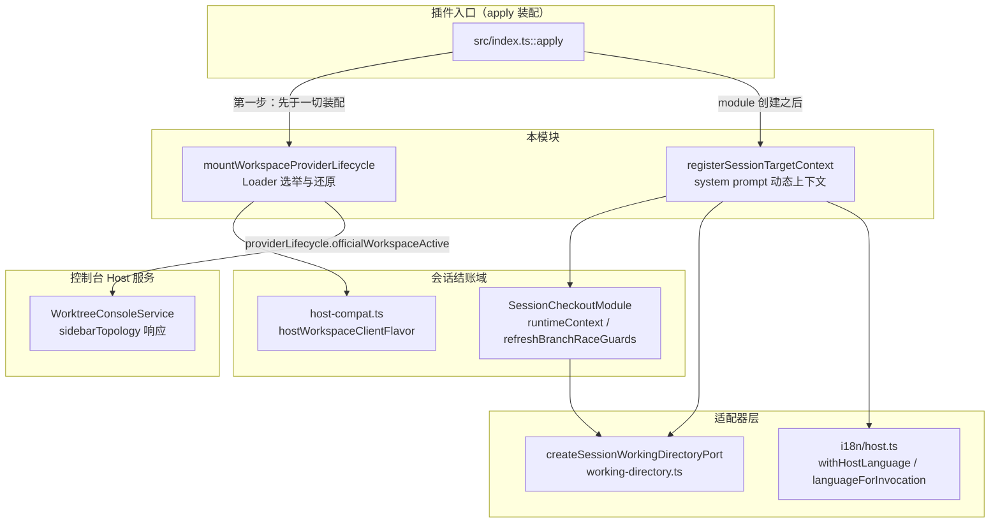
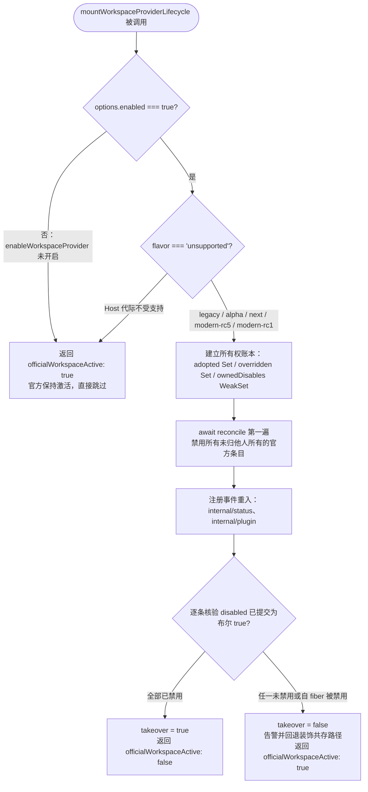
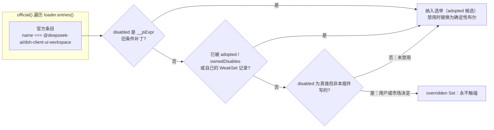
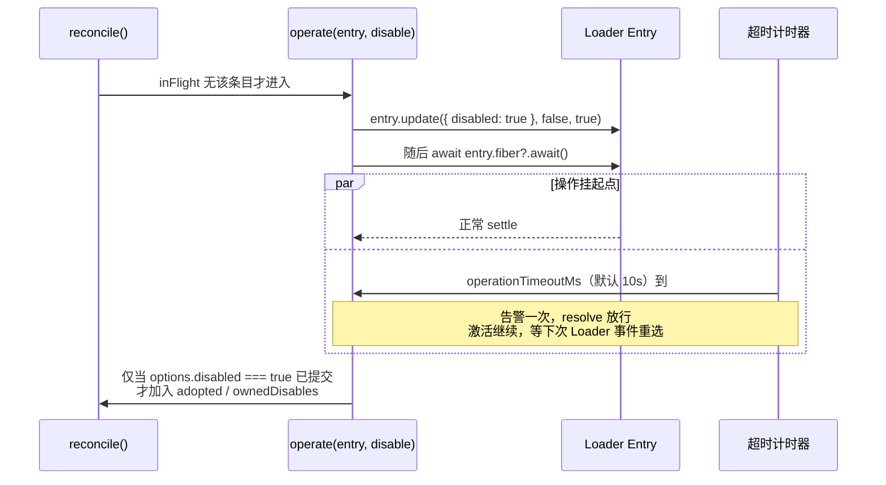
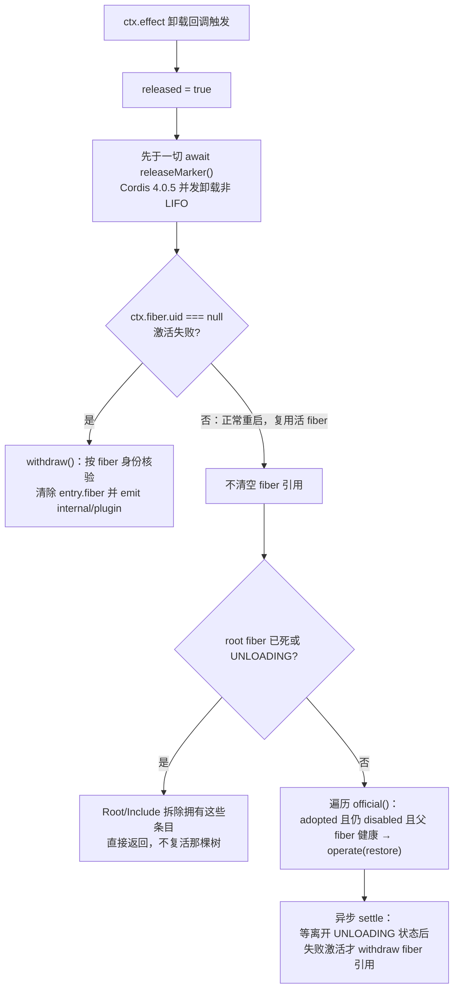
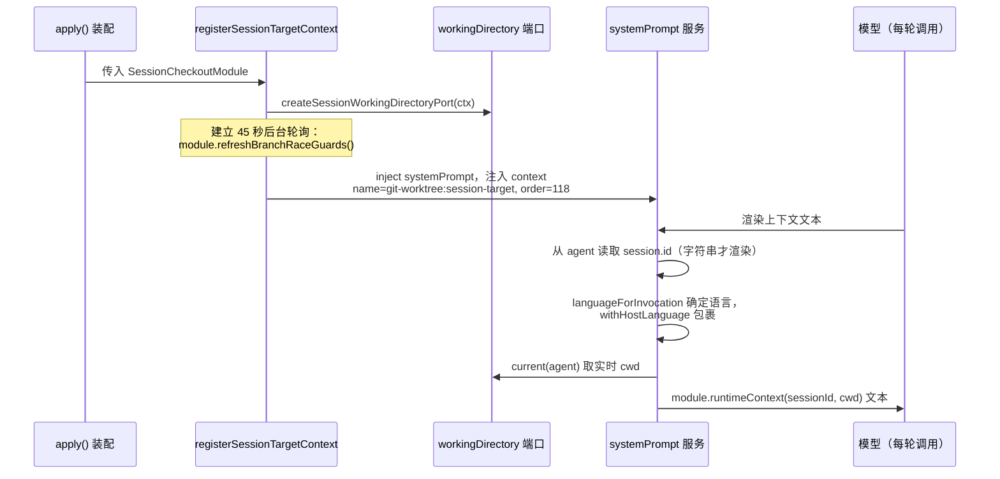
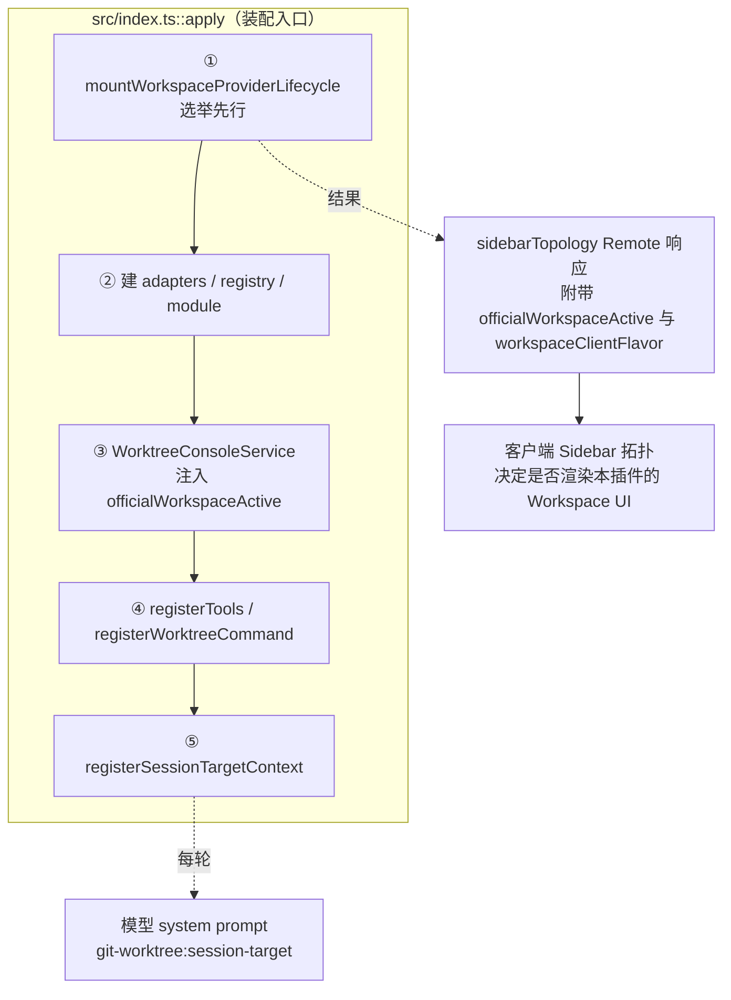

# 工作区提供者生命周期与会话目标上下文

## 简介

本模块是会话结账运行时（session checkout runtime）的最后一块装配，包含两个文件：

| 文件 | 职责 |
| --- | --- |
| `src/workspace-provider-lifecycle.ts` | Host 侧的 `uiWorkspace` 提供者选举：通过 Cordis Loader 操作（`entry.update({ disabled: true })` / `disabled: null`）禁用或还原官方 `@deepseek-ai/dsh-client-ui-workspace` 条目，保证全局只有一个 Workspace 提供者。 |
| `src/session-target-context.ts` | 向模型 system prompt 注入"当前会话目标"动态上下文：同步读取注册表快照，告诉模型该会话已位于托管 checkout 之内还是仍在 Local。 |

这两者都不属于结账状态机本身——它们是把状态机"接到"Host 运行时上的适配层：前者决定插件能否接管官方 Workspace UI，后者决定模型每轮对话时能看到怎样的目标状态。

---

## 模块架构

要点：`mountWorkspaceProviderLifecycle` 在 `apply()` 中**最先执行**——官方条目必须在页面加载之前被禁用，否则 Web 渲染器会观察到两个 `uiWorkspace` 提供者；其选举结果通过构造参数传入 `WorktreeConsoleService`，最终在 Sidebar 拓扑响应中回报给客户端。

---

## 组件说明

### 1. `workspace-provider-lifecycle.ts`

#### 导出类型

| 类型 | 说明 |
| --- | --- |
| `WorkspaceProviderLifecycleOptions` | 调优接缝，目前仅 `operationTimeoutMs?: number`——单次 Loader disable/restore 操作的超时上限，默认 `DEFAULT_OPERATION_TIMEOUT_MS = 10_000` 毫秒。专为测试暴露。 |
| `WorkspaceProviderLifecycleResult` | 选举结果，`officialWorkspaceActive: boolean`——**仅当本插件真正禁用了官方条目（接管成功）时为 `false`**；否则官方保持激活。由 Sidebar 拓扑响应消费。 |
| `Context`（模块增强） | 通过 `declare module '@deepseek-ai/cordis'` 给 `Context` 增加 `worktreeWorkspaceProvider: boolean`。`mountWorkspaceProviderLifecycle` 用 `ctx.provide('worktreeWorkspaceProvider', true)` 注册该服务标记，并在卸载时显式撤回。 |

#### 核心函数：`mountWorkspaceProviderLifecycle(ctx, flavor, options)`

**为什么不用条件表达式？** 旧实现使用 `disabled: !!get('worktreeWorkspaceProvider') && ...` 这种客户端求值表达式：Host apply 期间插件 fiber 还在 LOADING，Cordis strict service 读取返回 `undefined`，选举恒败；而 Web 渲染器稍后审计时插件已 ACTIVE，同一表达式求值为 `true`，又跳过官方条目——两边相反的求值结果导致 `uiWorkspace` 无人提供，17 个下游条目 pending，2026-10-17 18:11 与 20:25 两次 Web 启动崩溃。现在选举只在 Host 侧决定一次，写入的是普通布尔值，后续所有读取（Host 审计、序列化渲染树、模块事件）都是确定性的。

#### 所有权账本（三条规则）

| 账本 | 键 | 含义 |
| --- | --- | --- |
| `adopted` | entry id（字符串） | **本生命周期亲手禁用**的条目——也是唯一允许还原的条目。 |
| `overridden` | entry id（字符串） | 首次见到时已被禁用、且并非本插件所写的官方条目——视为用户/市场决定，永不触碰。 |
| `ownedDisables` | `Entry` 对象（`WeakSet`） | 跨代际所有权：Entry 对象被重启后的新一代共享，WeakSet 记录"这个禁用是我们写的"，避免新一代把自己尚未落地的还原误判为外部决定。 |

#### 守卫与容错（永不阻塞插件激活）

- `inFlight` Set 保证同一 entry 任意时刻至多一个 Loader 变异在跑，后续 reconcile 直接跳过。
- `pending` Promise 链把所有 reconcile 串行化，避免并发禁用同一个条目。
- `selfDisabled()` 检查插件自身条目是否已被市场（持久化禁用列表）外部禁用——被禁用的主人不得再接管任何条目，若日后被重新启用则事件重入选举。
- Loader 1.0.6 适配：`update()` 不等待 fiber 完成且保留已 dispose 的 fiber（`refresh()` 会把残留引用当成仍在运行），所以 disable 必须额外 `fiber.await()`；restore 遇到死亡代际必须用 `entry.init()` 重建而非 `refresh()`。

#### 卸载（fiber dispose）还原流程

设计原因：Loader 只检查 entry 引用而不检查 fiber 状态；Cordis 4.0.5 并发卸载时若不先撤回 `worktreeWorkspaceProvider` 标记，恢复官方 Workspace 的求值会读到已不存在的提供者。另需注意 Cordis 版本差异：Cordis 4.1.0 的 `ctx.plugin()` 返回 `Object.create(fiber)` 包装对象，Loader 将该包装存入 `entry.fiber`，入口引用与 `ctx.fiber` 不再同一（仅原型继承自它）；因此 `withdraw()` 的归属判定从单纯的引用相等放宽为「`entry.fiber` 与 `ctx.fiber` 相同，或其原型链直接指向 `ctx.fiber`」，Cordis 4.0.5 直接存 fiber 本体的旧形态同样被识别。在 Windows 上实测，对已保留的失败 fiber 直接 `fiber.await()` 会死循环（`while (inertia)` 重复 await 已完成的 promise），所以必须轮询等状态离开 UNLOADING 再动手。

#### 事件驱动重入

| 事件 | 触发条件 | 动作 |
| --- | --- | --- |
| `internal/status` | 本 fiber 状态变化且未 released | 重新 `reconcile()`——Includes 可能在接管激活之后才把官方行加进来。 |
| `internal/plugin` | 一个新的官方条目 fiber 带 uid 启动 | 重新 `reconcile()`——外部参与者可能重新启用了被禁用的官方条目。 |

---

### 2. `session-target-context.ts`

#### 导出类型

| 类型 | 说明 |
| --- | --- |
| `ContextAgent` | 结构类型 `{ session?: { id?: unknown } }`——从 Cordis agent 对象上读会话 id 的最小视图，避免与具体 Agent 类型耦合。 |

#### 核心函数：`registerSessionTargetContext(ctx, module)`

三个设计要点：

1. **同步快照、无 Git/文件 I/O**：`runtimeContext` 必须同步返回（system prompt 文本是同步求值的），所以分支竞争守卫的 reflog 探测被挪到 45 秒一次的后台 `setInterval` 里，喂给守卫缓存。
2. **cwd 判定"是否已进 checkout"**：`worktree_create` 可能已把会话移进托管目录，上下文文本据此决定是否仍要宣布绝对路径规则。工作目录端口本身是可选服务——Host 不挂载 `workingDirectory` 时返回 `undefined`，降级为纯引导模式。详见 [主机绑定适配器](../../src_adapters/src_adapters_host_binding.md)。
3. **语言隔离**：每个调用从 Agent 的 ctx 读取 settings.locale，经 `withHostLanguage` 的 `AsyncLocalStorage` 隔离，避免跨用户串语言。语言基础设施见 [国际化模块](../../../project_foundation_and_localization/src_i18n.md)。

---

## 在系统中的位置

- 装配顺序详见 [运行时入口（src/index.ts / src/session-checkout-module.ts）](session_checkout_runtime_entry.md)。
- `SessionCheckoutModule` 的完整契约（`runtimeContext`、`refreshBranchRaceGuards` 等方法）在 [运行时入口页](session_checkout_runtime_entry/src_index.ts.md) 定义；状态机主体属于 [结账应用引擎](../session_checkout_apply_engine.md)。
- `WorktreeConsoleService` 如何把 `officialWorkspaceActive` 编入 `sidebarTopology` 响应，见 [控制台 RPC 服务](../../../worktree_console_protocol_and_host_service/worktree_console_host/worktree_console_host_rpc_service.md)。
- Host 代际探测（`legacy` / `alpha` / `next` / `modern-rc5` / `modern-rc1` / `unsupported`）的判定规则在 [Worktree 核心操作](../../worktree_core_operations.md) 的 `host-compat.ts` 一节。

### 配置开关

选举行为由插件配置 `enableWorkspaceProvider` 控制（定义于 `src/index.ts` 的 `Config` schema，默认 `false`，**非 volatile**——改它需要重挂载）：

| Host 代际 | 行为 |
| --- | --- |
| 0.1.x（legacy/alpha/next） | 接管 opt-in：仅当显式设为 `true` 才禁用官方条目（历史上接管曾破坏新会话创建）。 |
| 0.2.x（modern） | 装饰路径结构性崩溃（Browser 对声明 child slot 调 `renderSlot`），接管实为必需——配置标志仅作建议性闸门。 |
| unsupported（0.3+ 等未验证代际） | 直接返回官方保持激活，绝不触碰。 |

历史背景：`cordis.patch.yml` 已彻底移除旧的 `ui-workspace` 条件禁用表达式块，并由本生命周期在禁用时把残留的 `__jsExpr` 旧补丁 reconcile 成确定性布尔。

---

## 关键常量速查

| 常量 | 值 | 含义 |
| --- | --- | --- |
| `OFFICIAL_WORKSPACE` | `@deepseek-ai/dsh-client-ui-workspace` | 被选举/被禁用的官方条目名。 |
| `DEFAULT_OPERATION_TIMEOUT_MS` | `10_000` | 单次 Loader 操作超时上限；wedged 操作只告警一次，下次 Loader 事件重选。 |
| `UNLOADING` | `FiberState = 5` | Cordis 以声明性 const enum 暴露，代码内手写常量。 |
| system prompt 名 | `git-worktree:session-target` | 注入上下文的名称，`order: 118`。 |
| 守卫轮询间隔 | `45_000` ms | 后台刷新分支竞争守卫缓存的周期。 |
