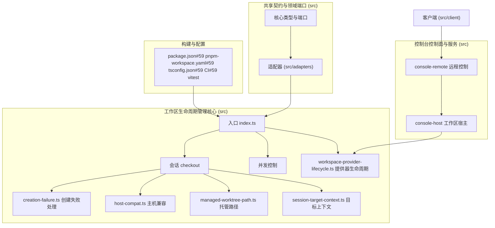
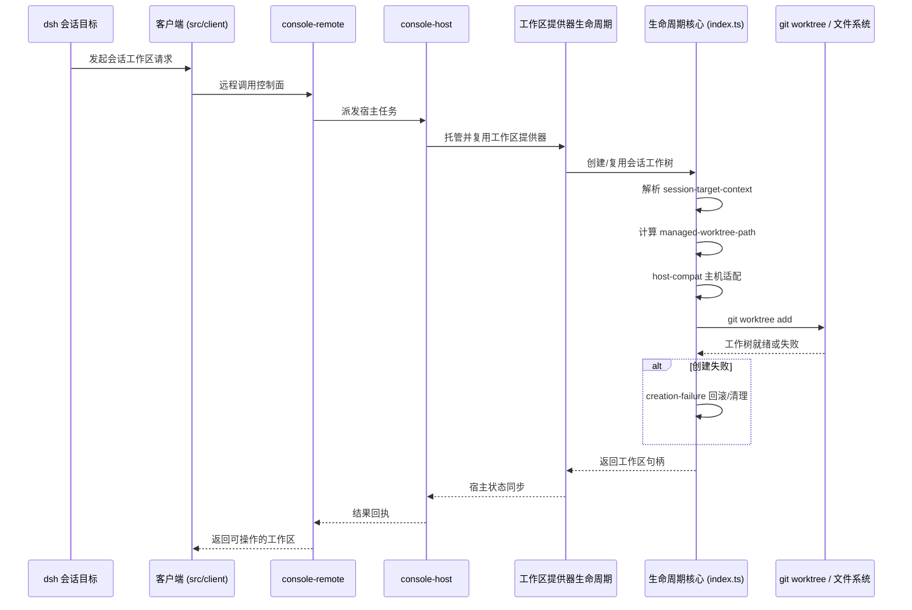

# dsh-git-worktree 概述

## 仓库定位

`dsh-git-worktree` 是 dsh（Deep Shell）生态中的 **Git worktree 工作区生命周期管理插件**。它为 dsh 提供完整的 `git worktree` 操作能力：基于会话目标上下文自动创建、托管、复用并清理隔离的 Git 工作树，支持多会话并发、主机兼容性适配、创建失败回滚，以及控制台侧的工作区宿主（console host）与远程（console remote）服务控制。

## 核心架构

## 端到端调用流

## 核心模块文档

| 模块 | 职责 | 文档 |
| --- | --- | --- |
| 构建与配置 | 包清单、pnpm workspace、TypeScript 编译、CI、测试基础设施与 Cordis 补丁 | [build_and_configuration.md](build_and_configuration.md) |
| 共享契约与领域端口 | 核心类型、领域端口及 `src/adapters` 适配器实现 | [shared_contracts_and_domain_ports.md](shared_contracts_and_domain_ports.md) |
| 工作区生命周期管理核心 | 会话 checkout、并发、创建失败回滚、主机兼容、托管路径、目标上下文与提供器生命周期 | [worktree_lifecycle_management_core.md](worktree_lifecycle_management_core.md) |
| 控制台控制面与服务 | `console-host` 工作区宿主与 `console-remote` 远程控制服务 | [console_control_plane_and_services.md](console_control_plane_and_services.md) |
| 客户端 | 面向调用方的客户端封装 | [client.md](client.md) |

## 构建、测试与部署

本仓库采用 pnpm workspace + TypeScript 构建，通过 `package.json` 中的脚本（`build`、`check:publish`、`dev:dsh`、`dev:dsh:smoke` 等）完成编译、发布前检查与本地 dsh 集成联调；CI 由 `.github/workflows/ci.yml` 的 `check` 工作流驱动，测试基础设施基于 `vitest.config.ts`。详细的构建、打包、发布与配置说明请参见 [Build, Deployment and Configuration 模块文档](build_and_configuration.md)。