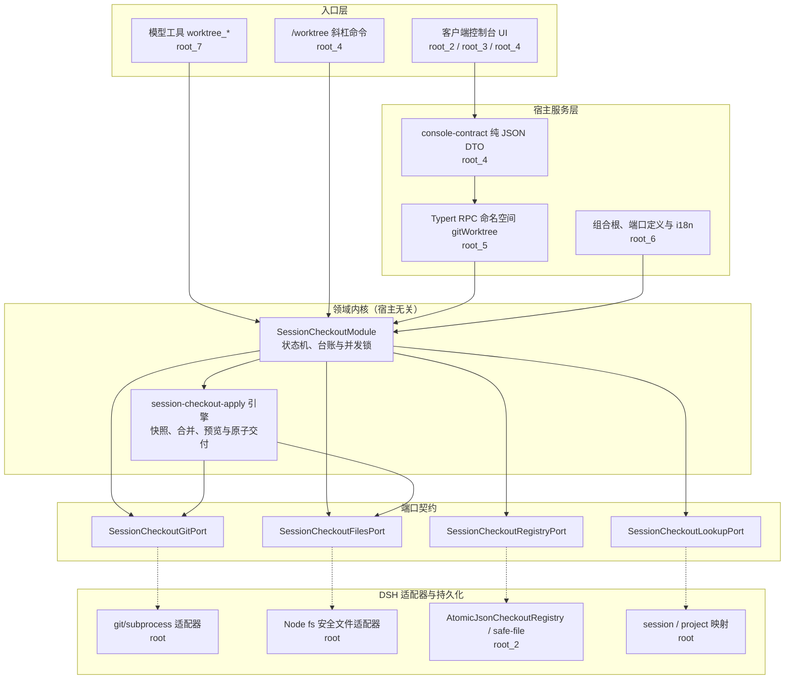
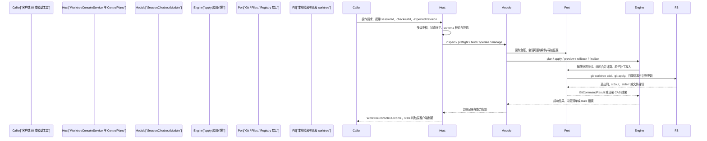

# dsh-git-worktree 仓库总览

## 仓库定位

`dsh-git-worktree` 是 DeepSeek Harness（DSH）的 **Git worktree 会话目标插件**，包版本为 `0.14.0`，MIT 许可证。它为 Agent 会话提供隔离的 Git 工作树环境，核心能力包括：

- 将会话绑定到独立的托管 worktree，避免污染本地检出；
- 支持评审检查点、预览写入本地、人工验收后再交付；
- 提供冲突恢复、崩溃对账、已放弃快照恢复与过期 worktree 清理；
- 通过原子 JSON 台账、目录身份校验、乐观锁与 Git 原子写入降低误删、并发覆盖和符号链接攻击风险；
- 同时暴露模型工具、`/worktree` 斜杠命令与浏览器控制台 UI 三类操作入口。

## 端到端架构

下图展示从入口层、宿主服务层、领域内核、端口契约到 DSH 适配器的完整分层关系：

下图展示一次典型变更请求从客户端或模型入口，经过鉴权、状态机、应用引擎，最终落到 Git 与文件系统的调用链路：

## 核心模块文档

| 模块 | 说明 |
| --- | ---
| [根模块与工程配置](root.md) | 仓库打包配置、CI、`cordis.patch.yml`、Git 文件与 Skill 适配器总览 |
| [持久化适配器与浏览器桥接层](root_2.md) | 原子 JSON 注册表、崩溃安全文件读写、worktree 创建回滚、Typert 远程客户端与工具卡片 |
| [客户端控制台 UI](root_3.md) | 评审控制台、设置卡片、目标胶囊、分支图谱与标签管理弹窗 |
| [控制台客户端与宿主命令面](root_4.md) | 目标控制台 UI、Workspace 侧边栏集成、跨进程 JSON 契约与 `/worktree` 命令 |
| [宿主控制台与远程协议层](root_5.md) | `gitWorktree` RPC 服务、鉴权、状态守卫、领域记录投影与隔离 diff 取证 |
| [组合根、领域端口与国际化](root_6.md) | `apply(ctx, config)` 装配、端口契约、台账数据模型、配置与 i18n |
| [插件出口层](root_7.md) | 8 个模型工具、会话目标上下文、官方 worktree 收养、宿主兼容桥与共享类型面 |
| [会话检出状态机](src_session-checkout-module.ts.md) | 托管 worktree 全生命周期、台账并发锁、崩溃恢复与交付状态机 |
| [会话检出应用引擎](src_session-checkout-apply.ts.md) | 快照指纹、临时三方合并、预览/回滚/定稿、检查点与原子写入 |

## 构建、测试与运行

该插件通过 `package.json` 管理构建、检查、测试与本地开发循环：

- **构建**：`pnpm build`，依次执行 `scripts/clean-lib.mjs`、`tsc` 类型编译与 `tsdown` 客户端打包。
- **类型检查**：`pnpm typecheck`，即 `tsc --noEmit`。
- **测试**：`pnpm test`，即 `vitest run`。
- **发布校验**：`check:sidebar-version`、`check:publish`、`check:publish:release` 会在发布前检查版本、工作区干净度与产物兼容性；`prepublishOnly` 会串联版本检查、构建、发布校验与测试。
- **本地 DSH 开发**：`dev:dsh`、`dev:dsh:install`、`dev:dsh:smoke`、`dev:dsh:remove` 通过 `scripts/dev-dsh.mjs` 完成插件安装、冒烟验证与卸载循环。
- **CI**：`.github/workflows/ci.yml` 在 push 与 PR 时执行冻结依赖安装、类型检查、构建、发布校验与测试。

Node.js 引擎要求为 `>=24.9.0`。入口导出为 `lib/index.js`，并额外暴露 `./client`、`./typert`、`./remote`、`./console-contract` 等子路径。插件 bundle 补丁、DSH 客户端注入、pnpm workspace 供应链豁免与文档截图清单等工程细节，详见 [根模块与工程配置](root.md)。