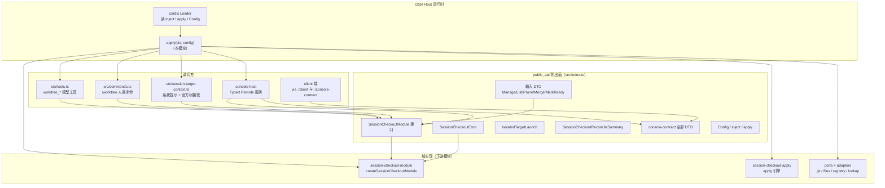
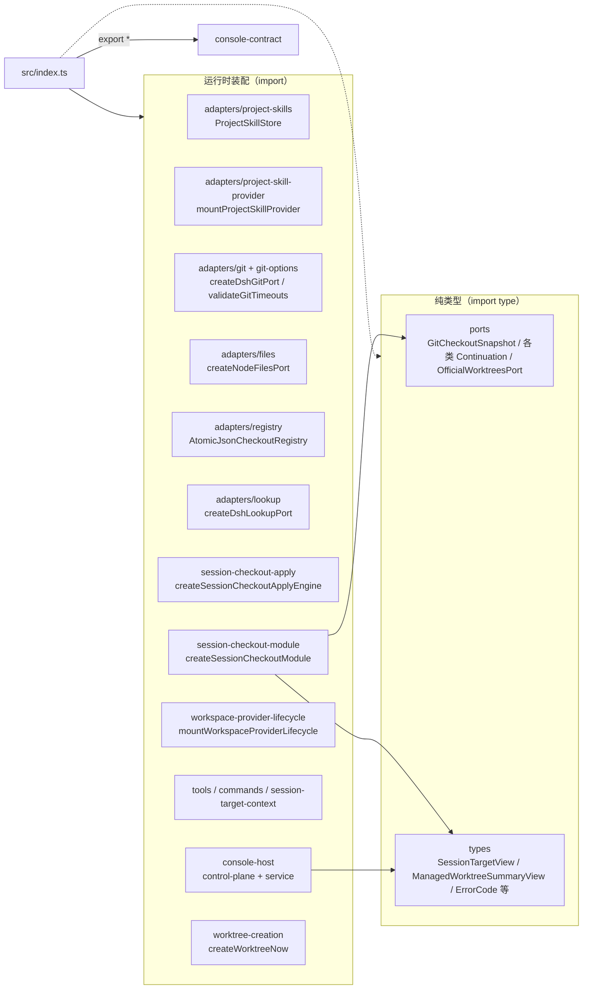
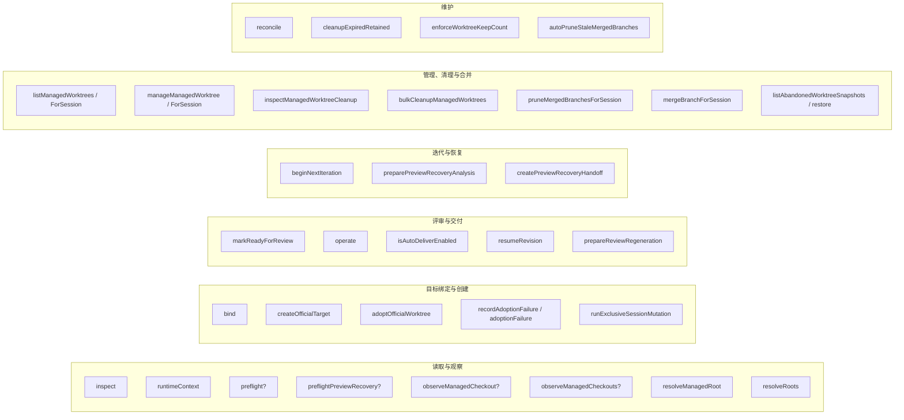
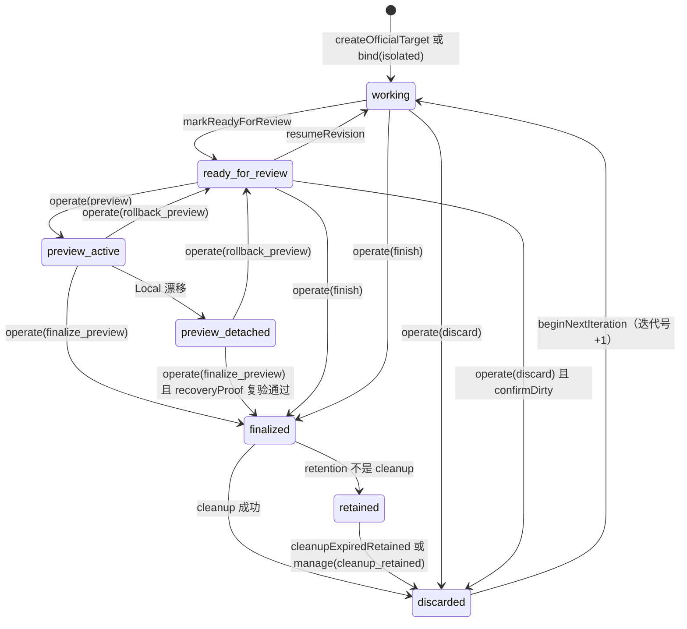
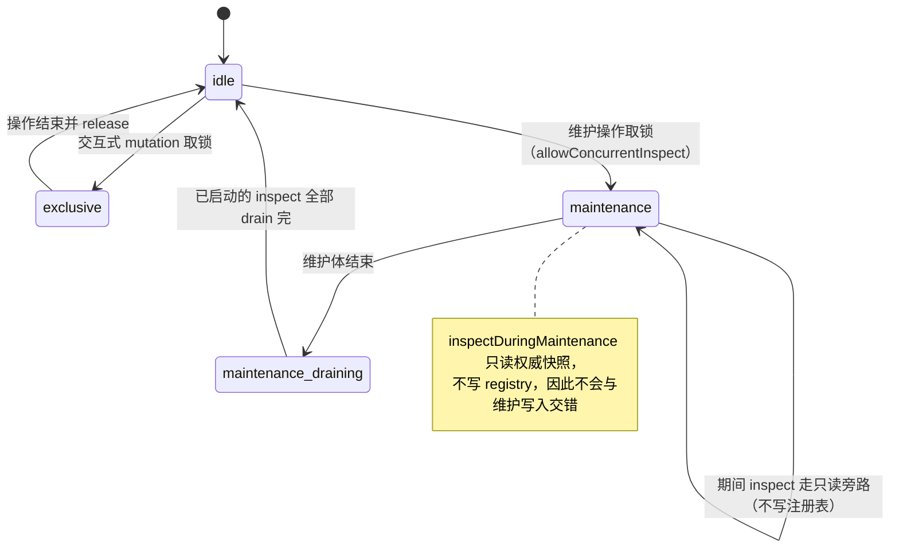
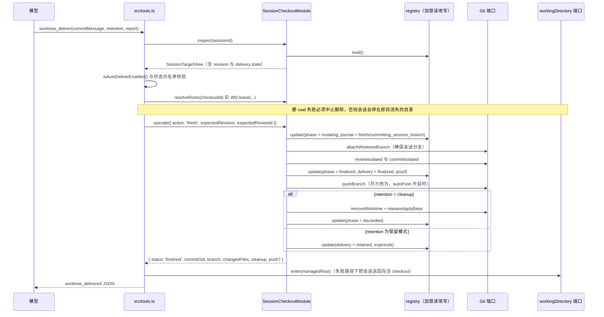
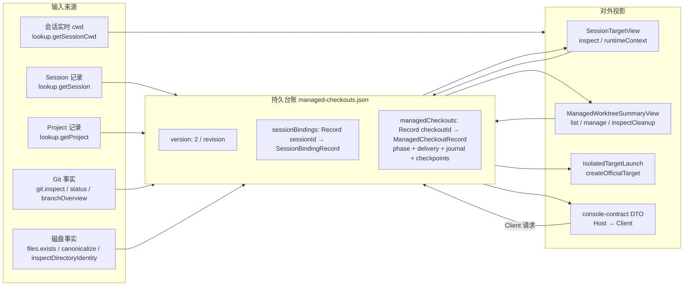
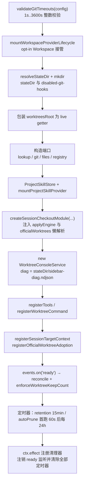
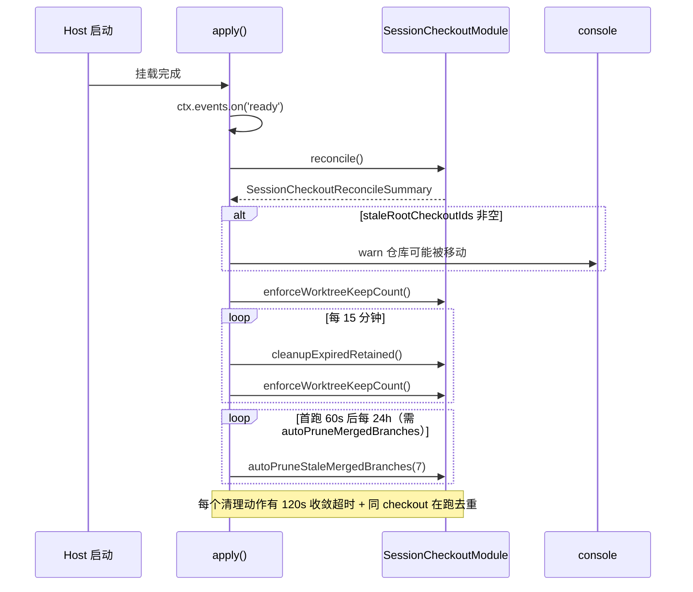

# public_api 模块：插件公共入口与契约面

`public_api` 是 `dsh-git-worktree` 的**唯一插件入口**，实体只有一个文件 `src/index.ts`。它承担三件事：

1. **插件装配面**：导出 Cordis 插件元数据 `inject`、配置 schema `Config` 与挂载函数 `apply()`，把状态机、适配器、工具、命令、系统提示上下文、控制台服务一次性接进 Host。
2. **业务契约面**：导出稳定错误类型 `SessionCheckoutError`、核心接口 `SessionCheckoutModule`，以及全部调用方入参 DTO（`ManageManagedWorktreeInput`、`MergeBranchForSessionInput` 等）。工具层（`src/tools.ts`）、命令层（`src/commands.ts`）、系统提示上下文（`src/session-target-context.ts`）、Host 控制台（`src/console-host/*`）都只依赖这些类型，而不是直接依赖状态机实现。
3. **共享 DTO 转出口**：`export * from './console-contract.js'` 把 Host / Client 双端共享的 JSON 契约（`WorktreeConsoleAdapter` 及其请求/响应 DTO）一并对外暴露，对应 `package.json` 的 `./console-contract` 导出项。

域实现（状态机、apply 引擎、端口、适配器）都在本模块之下：详见 [Worktree_and_Session_Checkout_Domain](Worktree_and_Session_Checkout_Domain.md) 与 [Ports,_Adapters,_and_Infrastructure](Ports,_Adapters,_and_Infrastructure.md)。本页只描述**对外暴露什么、以什么顺序装配、调用方应如何使用**。

---

## 1. 模块在系统中的位置



关键约束：**所有跨模块调用都经过 `SessionCheckoutModule` 接口**。接口方法内部由 `withBindingLock` 串行化（只读 `inspect` 与维护类操作可走只读旁路），因此调用方不需要自己加锁，也不应缓存 `SessionTargetView` 代替重新 `inspect`。

### 1.1 编译期依赖方向

`src/index.ts` 的导入分成两类，二者不可混淆：**运行时装配依赖**（`apply()` 内真正 `import` 并 `new` 的模块）与**纯类型依赖**（`import type`，编译后被擦除）。



注意 `session-checkout-module.ts` 反向 `import { SessionCheckoutError } from './index.js'`——这是刻意的循环引用，因为错误类型必须与接口同源；由于 `SessionCheckoutError` 在模块求值时即完成定义、且只在函数体内使用，ESM 循环引用在此安全。

---

## 2. 包级导出入口（`package.json`）

`package.json` 的 `exports` 字段决定外部真正能 `import` 到什么，是 `public_api` 的物理边界：

| 子路径 | 类型入口 | 运行入口 | 用途 |
| --- | --- | --- | --- |
| `.` | `./lib/index.d.ts` | `./lib/index.js` | Host 侧插件入口，即本模块 |
| `./client` | `./lib/client/console-remote/index.d.ts` | `./lib/client.js` | 浏览器端 UI bundle（tsdown 产物） |
| `./typert` | `./lib/console-remote/typert.d.ts` | `./lib/console-remote/typert.js` | Typert Loader 发现的 Host 贡献 `TYPERT` |
| `./remote` | `./lib/console-remote/remote.d.ts` | `./lib/console-remote/remote.js` | 客户端 Remote 描述表 |
| `./console-contract` | `./lib/console-contract.d.ts` | `./lib/console-contract.js` | 双端共享 JSON 契约，见 [console_contract](console_contract.md) |
| `./package.json` / `./cordis.patch.yml` | — | — | 供 Loader 与市场读取 |

`dsh.bundle.patch` 指向 `./cordis.patch.yml`，其中只有一条 `insert`，把插件自身以 `id: dsh-git-worktree` 插进 profile；`dsh.client.inject` 声明客户端 bundle 需要的 8 个官方客户端包（session-controller、workspace-controller、connection、locale、conversation、tool、gateway、remote-access），`platform` 为 `web`。

构建与校验链路（CI 与本地一致）：`pnpm run typecheck` → `pnpm run build`（`scripts/clean-lib.mjs` + `tsc` + `tsdown`）→ `pnpm run check:publish:release` → `pnpm run test`。`tsconfig.json` 以 `src` 为 `rootDir`、输出 `lib`、`module: NodeNext`，因此 `index.ts` 里所有相对导入都带 `.js` 后缀。详见 [build_deployment_configuration](build_deployment_configuration.md)。

---

## 3. 公共符号清单

### 3.1 插件装配导出

| 符号 | 种类 | 说明 |
| --- | --- | --- |
| `inject` | `const` | `{ tools: {}, commands: {}, subprocess: {}, loader: { await: false } }`。**必须是具名导出**：Loader 只把具名导出当作插件元数据，裸函数导出会导致首次 `ctx.tools` 访问报 "cannot get property without inject"。`workingDirectory` 故意不在 `inject` 中——老 Host 不挂载该服务，适配器按需动态解析，缺失时降级为「仅提示」行为。 |
| `Config` | `@deepseek-ai/schemastery` schema | 配置项定义，见 §6。 |
| `apply` | `async function` | `apply(ctx: Context, config: { stateDir?: string } & GitTimeoutOptions & LocalAdaptationConfig = {})`，见 §5。 |
| `export * from './console-contract.js'` | 转出 | 让 Host/Client 共享 DTO 从主入口同样可达。 |

### 3.2 错误与错误码

```ts
class SessionCheckoutError extends Error {
  readonly code: SessionCheckoutErrorCode
  constructor(code: SessionCheckoutErrorCode, message: string)
}
```

- `name` 固定为 `'SessionCheckoutError'`，`code` 取自 `SESSION_CHECKOUT_ERROR_CODES`（定义在 `src/types.ts`）。
- `message` 是**面向用户**的文案，工具层会原样上抛；文案由 Host 侧 i18n 生成（见 [i18n](i18n.md)）。
- 约定：**会抛异常的方法**（`inspect`、`bind`、`createOfficialTarget`、`listManagedWorktrees*`、`mergeBranchForSession`、`manageManagedWorktree*` 等）用 `SessionCheckoutError` 表达失败；**`operate`** 则把域错误收敛进返回值 `{ status: 'error', code, message, target? }`，只有非域异常才继续抛。

错误码按语义分组（完整常量见 `src/types.ts` 的 `SESSION_CHECKOUT_ERROR_CODES`）：

| 分组 | 错误码 |
| --- | --- |
| 解析与身份 | `session_not_found`、`project_not_found`、`project_root_missing`、`not_git_repository`、`project_mismatch`、`checkout_missing`、`checkout_mismatch` |
| 目标选择 | `target_unselected`、`target_already_bound`、`checkout_limit_reached` |
| 授权 | `not_owner`、`dirty_confirmation_required` |
| 并发与新鲜度 | `stale_target`、`stale_local`、`stale_isolated`、`project_acceptance_busy` |
| Git 与合并 | `git_operation_failed`、`git_error`、`apply_conflict`、`apply_failed`、`commit_isolation_conflict` |
| 状态机 | `operation_not_allowed`、`preview_not_active`、`preview_modified`、`invalid_input`、`invalid_plan` |
| 恢复 | `recovery_required`、`recovery_unsafe`、`registry_corrupt` |

### 3.3 `SessionCheckoutModule`：核心业务接口

`SessionCheckoutModule` 是**唯一被业务代码依赖的接口**，按职责可分为 6 组。标注 `?` 的成员是可选实现（老版本模块或裁剪宿主可能不提供，调用方必须用可选调用 + 降级处理）。



#### (1) 读取与观察

| 方法 | 语义与要点 |
| --- | --- |
| `inspect(sessionId)` | 返回 `SessionTargetView`（project / checkout / source / current / ownership / dirty / revision / delivery / checkpoints）。加锁读取，可能持久化恢复结论。 |
| `runtimeContext(sessionId, cwd?)` | **同步**的注册表快照，用于 replay 稳定的系统提示上下文，不做 Git/磁盘 I/O。`cwd` 传入会话实时工作目录后，才能判断「会话是否已经站在这棵树里」，从而决定是否还要宣布绝对路径规则。 |
| `preflight?(sessionId, expectedRevision)` | 严格只读的 Local 写入前检视，返回 `WorktreeApplyPreflightView`（`ready` / `local_advanced` / `already_in_local` / `conflict` / `blocked`），**不修改** Local、worktree、注册表、评审状态或任何 Git ref。 |
| `preflightPreviewRecovery?(...)` | 只读的 detached Preview 恢复评估，产出确定性复验上下文（`WorktreePreviewRecoveryProof`）。 |
| `observeManagedCheckout?(checkoutId)` / `observeManagedCheckouts?(ids)` | 一次校验拿到 `managedRoot` + 管理侧与 Local 侧双份 `GitCheckoutSnapshot` + `dirty`，让调用方不必再 spawn Git。批量版在同一把锁内执行，结果与入参顺序对齐。 |
| `resolveManagedRoot(checkoutId)` | 身份校验后返回规范化的受管根目录（Workspace 注册用）。 |
| `resolveRoots(checkoutId)` | **纯注册表读取、零 Git I/O**，返回 `{ managedRoot, localRoot }`；用于「即将删除 checkout 前把会话 cwd 挪出去」。 |

#### (2) 目标绑定与创建

| 方法 | 语义与要点 |
| --- | --- |
| `bind(sessionId, choice)` | `choice` 为 `{ kind: 'local' }` 或 `{ kind: 'isolated' }`。已交付并清理的 isolated 目标可退回 Local；未交付时退回会被 `operation_not_allowed` 拒绝。重复绑定返回 `target_already_bound`（已交付的 isolated → 新迭代场景除外）。 |
| `createOfficialTarget(agent, createOptions?)` | **`worktree_create` 的唯一建树路径**：调用宿主自己的 `worktrees` 服务完成 `git worktree add`，本插件只负责台账、交付、评审与清理。返回 `IsolatedTargetLaunch`。宿主未挂载该服务时抛 `operation_not_allowed`。 |
| `adoptOfficialWorktree(sessionId, cwd)` | 会话 cwd 落进 `.agents/worktrees/` 下的树时把它补记进台账（官方 `create_worktree`、forge 面板建的树都靠这条路径进入管理视野）。 |
| `recordAdoptionFailure` / `adoptionFailure` | 接管失败原因的进程内记账，供胶囊下一次轮询展示；进程重启后自然失效。 |
| `runExclusiveSessionMutation(sessionId, op)` | 让**其他模块**在同一把排他锁内完成自定义变更（`op` 收到最新的 `SessionTargetView`）。 |

`IsolatedTargetLaunch` 只有三个字段，但它是「交接契约」：`targetSessionId`（权威 isolated 会话 id）、`managedRoot`（受管根目录）、`target`（完整 `SessionTargetView`）。客户端据此创建权威的 Workspace/Session。

#### (3) 评审与交付

| 方法 | 语义与要点 |
| --- | --- |
| `markReadyForReview(sessionId, input)` | 只允许 owner 的 isolated 会话调用。`MarkReadyForReviewInput` 有长度上限：`summary ≤ 240`、`detailsMarkdown ≤ 12000`、`validationSummary ≤ 500`、`tests ≤ 20` 条且每条 command/summary ≤ 500；`suggestedCommitMessage` 必须通过 `isValidCommitMessage`。调用前会先把 Worktree 挂到自己的会话分支，保证验收指纹记录的是交付期真实 HEAD。 |
| `operate(input)` | 状态机的统一动作入口，见 §4。 |
| `isAutoDeliverEnabled()` | 实时读取 `autoDeliver`；工具层据此在关闭时拒绝模型自行交付。 |
| `resumeRevision(sessionId, expectedRevision, expectedReviewId, recovery?)` | 作废尚未同步的评审并**在同一次迭代内**回到 `working`，不触碰 Local。带 `recovery` 时先重算 preflight 并逐项比对（`reviewId`、`readyRevision`、`localHeadOid`、`conflictingFiles` 顺序），不一致即 `stale_target`。 |
| `prepareReviewRegeneration(...)` | 持久化一次性「只读评审再生成」请求，返回 `ManagedReviewRegenerationContinuation`。 |

#### (4) 迭代与恢复

| 方法 | 语义与要点 |
| --- | --- |
| `beginNextIteration(sessionId, expectedRevision)` | 上一轮必须已 `delivered` 且 `phase === 'discarded'`、owner 匹配、旧路径确实消失、Local 与 Git 身份仍一致；新迭代的基点取**上一轮会话分支 tip**（取不到才退回 Local HEAD），否则迭代链会在交付处断开。 |
| `preparePreviewRecoveryAnalysis(...)` | 在客户端提示 owner Agent 做只读分析之前，先把精确的 detached 恢复证明落盘。 |
| `createPreviewRecoveryHandoff(...)` | 在最新 Local HEAD 上新建一棵受管 Worktree，同时完整保留旧的 detached 证据；返回值额外携带 `continuation`。 |

#### (5) 管理、清理与合并

| 方法 | 语义与要点 |
| --- | --- |
| `listManagedWorktrees(input?)` | 只读列表，不占全局 mutation lock。`includeDiagnostics` 会做慢速目录诊断；`needsAttention` 过滤 `needs_attention` / `cleanup_pending`。 |
| `listManagedWorktreesForSession(sessionId, input?)` | **调用方作用域**版本：只返回同项目且 `ownerSessionId` 或 `sourceSessionId` 等于该会话的记录。 |
| `manageManagedWorktree(input)` / `...ForSession(sessionId, input)` | 单条管理动作，`action` 与 `discardPostDeliveryChanges` 语义见 §3.4 的 `ManageManagedWorktreeInput`。ForSession 版额外校验项目一致与「owner 会话已存在时禁止 source 会话代管」。 |
| `inspectManagedWorktreeCleanup(input?)` | Main 侧只读清理检视，不写注册表、不碰 ref、不删目录。 |
| `bulkCleanupManagedWorktrees(candidates)` | 批量清理；每个候选都按 `expectedRevision` 做 CAS 并重新验证，结果分为 `cleaned` 与 `retained`（后者附带清理不可行原因）。 |
| `pruneMergedBranchesForSession(sessionId, input?)` | 仅 `git branch -d` 语义（已完全合并），当前分支与主干永不入选，活跃会话分支被跳过并给出原因。 |
| `autoPruneStaleMergedBranches(olderThanDays)` | 跨所有受管项目的维护扫描；单项目失败降级为一条 `skipped` 记录，绝不抛。 |
| `mergeBranchForSession(sessionId, input)` | 会话分支 → Local（`forward`）或 Local HEAD → 会话分支（`reverse`）。`dryRun` 在一次性 detached worktree 里试合，绝不触碰 checkout。非 dryRun 且项目存在 acceptance slot holder 时抛 `project_acceptance_busy`。 |
| `listAbandonedWorktreeSnapshots` / `restoreAbandonedWorktreeSnapshot` | 放弃时留下的安全快照列表与「恢复为 Local 分支」入口。 |

#### (6) 维护

| 方法 | 语义与要点 |
| --- | --- |
| `reconcile()` | 启动收敛：按 journal 把中断的操作推进/回退到确定态，收集 `recoveryRequiredCheckoutIds`、`orphanedCheckoutIds`、`dirtyOrphanedCheckoutIds`、`staleRootCheckoutIds`，清掉空壳目录，回收无引用记录，再跑一次到期清理。返回 `SessionCheckoutReconcileSummary`。 |
| `cleanupExpiredRetained(now?)` | 清理已到期的保留 Worktree。只有 `identity_changed` / `modified_after_finalize` 这类需要人工判断的原因会停下；`directory_busy` / `quarantine_busy` 属于瞬时占用，留在重试队列里。 |
| `enforceWorktreeKeepCount()` | 按 `worktreeKeepCount` 做 LRU 逐出，只从 `finalized` / `retained` 中挑，`permanent` 与进行中会话豁免；逐出走完整 `cleanupFinalized` 安全链（含目录身份校验），不复用 `operateDiscard`（后者对 `finalized` / `retained` 一律返回 `operation_not_allowed`，会让逐出静默全失败）。 |

三个维护方法在 `apply()` 中都由定时器驱动：`reconcile` 在 `ready` 事件触发一次，`cleanupExpiredRetained` + `enforceWorktreeKeepCount` 每 15 分钟一轮（`RETENTION_MAINTENANCE_INTERVAL_MS`），`autoPruneStaleMergedBranches` 首跑延迟 60 秒后每 24 小时一轮、且仅在 `autoPruneMergedBranches === true` 时真正执行。所有维护操作都带收敛超时（`CHECKOUT_CLEANUP_TIMEOUT_MS = 120_000`）与同 checkout 在跑去重，单个被占用的记录不会卡住整个启动。

### 3.4 输入 DTO 与视图

| 类型 | 关键字段 | 说明 |
| --- | --- | --- |
| `ManageManagedWorktreeInput` | `checkoutId`、`expectedRevision`、`action`、`retention?`、`permanent?`、`confirmDirty?`、`rollbackPreview?`、`discardPostDeliveryChanges?` | `action` ∈ `cleanup_retained` / `retry_cleanup` / `set_retention` / `set_permanent` / `clear_sidebar_badge` / `discard`。`discardPostDeliveryChanges` 是「交付后的改动我不要了」的显式确认，用于越过 `modified_after_finalize` 阻塞。`expectedRevision` 是 CAS 令牌，不匹配即 `stale_target`。 |
| `ListManagedWorktreesInput` | `projectId?`、`needsAttention?`、`checkoutId?`、`includeDiagnostics?` | 无项目过滤时返回全部非 `discarded` 记录。 |
| `PruneMergedBranchesInput` | `dryRun?`、`olderThanDays?` | 省略 `olderThanDays` 即无年龄过滤（手动调用保持旧行为）。 |
| `MergeBranchForSessionInput` | `sourceBranch`、`dryRun?`、`direction?` | `direction` 默认 `forward`。 |
| `MarkReadyForReviewInput` | `summary`、`detailsMarkdown?`、`validationStatus`、`validationSummary?`、`tests`、`suggestedCommitMessage` | 见 §3.3(3) 的长度约束。 |
| `IsolatedTargetLaunch` | `targetSessionId`、`managedRoot`、`target` | 客户端创建权威 Workspace/Session 的交接数据。 |
| `SessionCheckoutReconcileSummary` | `recoveryRequiredCheckoutIds`、`orphanedCheckoutIds`、`dirtyOrphanedCheckoutIds`、`staleRootCheckoutIds`、`retainedCheckoutCount` | `reconcile()` 的返回结构。 |
| `LocalAdaptationConfig` | `autoDeliver?`、`autoPush?`、`worktreesRoot?`、`inheritLocalChanges?`、`worktreeKeepCount?`、`autoPruneMergedBranches?`、`enableWorkspaceProvider?` | 注意：该 interface **没有 `export` 关键字**，它只作为 `apply()` 形参的类型成分出现在生成的 `.d.ts` 中；外部调用方应通过 `Config` schema 的键名理解这些配置。 |

视图类型（`SessionTargetView`、`ManagedWorktreeSummaryView`、`PruneMergedBranchesView`、`MergeBranchForSessionView`、`WorktreePreviewRecoveryProof` 等）定义在 `src/types.ts`，属于 [core_ports_and_types](core_ports_and_types.md) 的契约面，本模块只是转发引用。

---

## 4. `operate()`：状态机动作入口

`operate(input: SessionCheckoutOperation)` 是 `SessionCheckoutOperation` 判别联合的唯一执行点。每个动作都带 `sessionId` 与 `expectedRevision`；执行前后都重新校验 owner、项目、revision 与（如适用）`expectedReviewId`。

| `action` | 额外入参 | 成功 `status` | 要点 |
| --- | --- | --- | --- |
| `apply` | — | `applied` / `conflict` | 旧「写入 Local」路径；记录已有 `sessionBranch` 时被 `refuseLegacyLocalWrite` 拒绝并指向 `finish` + `merge`。冲突结果带 `reason`（`content_conflict` / `local_dirty` / `untracked_conflict`）、逐文件 `conflictDetails`（最多 6 个文件、每个 4KB）与一条 `resolveHint`。 |
| `finish` | `commitMessage`、`retention?`、`expectedReviewId?` | `finished` | 只在会话分支上提交：先 `ensureSessionBranch`，再 `reviewIsolated` + `commitIsolated`，Local 的工作区/索引/HEAD 全程不读写。`retention` 省略时取 `DEFAULT_WORKTREE_RETENTION`（`retain_manual`）。 |
| `preview` | — | `previewed` / `preview_detached` | 可回滚的 Local Preview。 |
| `checkpoint` | `commitMessage`、`expectedReviewId`、`expectedGeneration`、`requestId` | `checkpointed` | 幂等：同 `requestId` 的精确重放直接返回既有 checkpoint，参数不一致则 `stale_target`。`expectedGeneration` 来自 `checkpointGenerationForRecord`（SHA-256 over 规范化 JSON）。 |
| `rollback_preview` | `resumeRevision?`、`recoveryProof?` | `preview_rolled_back` / `preview_detached` | `recoveryProof` 只是待复验的上下文，**不是** bearer 权限。 |
| `finalize_preview` | `commitMessage`、`retention?`、`recoveryProof?` | `finished` | 把 Preview 落成提交。`preview_detached` 重试时先 `preflightPreviewRecovery` 再逐字段比对 `recoveryProof`，并要求 `proof.finalize.status === 'safe'`。 |
| `retry_cleanup` | — | `finished` | 仅 `finalized` / `retained` 可重试；返回 `cleanup: 'discarded' \| 'pending'`，并附 `cleanupMessage` / `cleanupReason`。 |
| `discard` | `confirmDirty`、`rollbackPreview?` | `discarded` | 有未提交改动或未交付 checkpoint 时必须 `confirmDirty`；带脏内容时先写放弃快照，快照失败即中止（数据保护优先）。 |
| `recover` | — | `recovered` | 终态记录（`delivered` / `discarded` / `finalized` / `retained`）拒绝复活；journal 存在时先 `reconcile()` 再判定，无法证明安全则 `recovery_unsafe`。 |

返回值 `SessionCheckoutOperationResult` 是 `applied` / `previewed` / `checkpointed` / `preview_rolled_back` / `preview_detached` / `finished` / `conflict` / `discarded` / `recovered` / `error` 的联合。`finished` 结果额外携带 `branch`（会话分支名，供后续合并）、`cleanup`（`discarded` / `pending` / `retained`）、可选 `cleanupMessage` / `cleanupReason` 与 `push`（`pushed` / `skipped` / `failed`，失败永不阻塞交付）。

### 4.1 交付状态机（调用方视角）



注意两个「看似回退、实为保护」的边：`preview_detached` 只能靠复验通过的 `recoveryProof` 前进；`finalized` / `retained` / `discarded` 属于终态，`recover` 一律拒绝复活，收口交给 `reconcile` / cleanup。

### 4.2 并发模型：一把排他锁 + 只读旁路

模块内部只有一个 `withBindingLock(operation, { allowConcurrentInspect })`。它的设计动机是「后台维护可能因 Windows 文件占用持续数十秒，不能让它阻塞所有会话的 `inspect`」：



因此：

- **交互式 mutation**（`bind`、`operate`、`manage*`、`merge*`、`beginNextIteration`、`restoreAbandonedWorktreeSnapshot`…）严格串行，绝不并发。
- **维护类**（`reconcile`、`cleanupExpiredRetained`、`enforceWorktreeKeepCount`、`preflightPreviewRecovery`）声明 `allowConcurrentInspect: true`，期间 `inspect` 走只读旁路且**不持久化恢复结论**（`inspectTarget(sessionId, false)`）。
- **列表类**（`listManagedWorktrees`、`listManagedWorktreesForSession`、`inspectManagedWorktreeCleanup`）根本不取锁，因此慢速诊断与用户操作互不阻塞——代价是它们不构成写前检查，真正的清理会在锁内重新验证。

### 4.3 交付时序（`worktree_deliver` → `operate({ action: 'finish' })`）



### 4.4 数据流：以台账为唯一事实源

`public_api` 的每个方法都围绕同一份持久化数据流动，理解这条流是理解全部语义的前提：



三条不变量：

1. **台账是唯一权威**。目录、分支、ref 都只是台账记录的外部对应物；磁盘事实用于**验证**记录是否仍然成立（`validateManagedCheckout`、`validateCleanupLocalIdentity`、`validateDetachedCleanupResidue`），而不是代替记录。
2. **写入必须走 `registry.update(mutate)`**。`read()` 与 `write()` 之间隔着两次调用，另一个进程在这条缝里的写入会被后写者抹掉；因此单条记录更新一律用同一把跨进程锁内的读-改-写，并在每次变更时 `revision += 1`（这就是 `expectedRevision` CAS 的来源）。
3. **journal 是崩溃恢复的唯一证据**。`phase = 'preparing' | 'mutating'` 期间 `journal` 记录 `operation` / `operationId` / `step` / 各阶段 OID，`reconcile()` 据此判断「这一步是否已经落地」，能证明未落地就退回 `ready`，证明不了就升为 `recovery_required`，绝不猜测。

---

## 5. `apply()`：挂载顺序与生命周期

`apply()` 的顺序有强依赖关系，改动顺序会直接破坏恢复语义：



要点：

- **`stateDir` 解析**：显式配置优先；否则 `$DSH_HOME/plugins/dsh-git-worktree`，`DSH_HOME` 未设时退回 `~/.dsh`。目录内固定有两类产物：`managed-checkouts.json`（台账）与 `disabled-git-hooks`（Git 钩子隔离目录）。
- **易变配置**：`gitTimeoutMs`、`worktreeAddTimeoutMs`、`autoDeliver`、`autoPush`、`worktreesRoot`、`inheritLocalChanges`、`worktreeKeepCount`、`autoPruneMergedBranches` 被 `volatile()` 打上 `meta.volatile`，设置页可直接编辑而不重挂插件；值以 `LiveValue` 引用形式到达，必须用 `liveConfigValue()` 每次读取。`worktreesRoot` 被包成 `{ get: () => resolve(...) }`，编辑后下一次读即生效。
- **官方 worktrees 服务懒解析**：`officialWorktrees: () => ctx.get('worktrees')`，服务可能在本插件之后挂载；老 Host 未挂载时返回 `undefined`，建树请求得到 `operation_not_allowed` 而不是启动失败。
- **`ready` 恢复**：`reconcile()` 报告 `staleRootCheckoutIds` 时打印警告（仓库可能被移动），随后 `enforceWorktreeKeepCount()`。
- **定时器全部 `unref()`**，不会阻止进程退出；`ctx.effect` 的 disposer 负责统一清理。
- **自动剪枝是唯一「无逐次确认就删分支」的机制**，因此默认关闭，需 `autoPruneMergedBranches: true` 显式打开；带 `dryRun` 的手动剪枝不受影响。
- **建树能力由 Host 侧注入控制面**：`createWorktreeConsoleControlPlane({ ..., createWorktree: (sessionId, from) => createWorktreeNow(ctx, module, sessionId, from) })`。控制面只拿得到 `lookup` 的只读导航记录，拿不到官方 `worktrees.create` 需要的 live Agent，因此真正的建树必须回到 `apply()` 这一层完成；`createWorktreeNow` 从 `ctx.get('agents')` 取 Agent，再委托 `module.createOfficialTarget`，从而保证客户端「新建工作树」按钮走的是与 `worktree_create` 完全同一条路径（`feat/sess-*` 命名、`.worktreeinclude` 复制、本地未提交修改继承）。

### 5.1 定时任务与收敛语义



超时**不会取消**操作（`files` / `git` 端口没有 `AbortSignal`），后台仍会跑完并写台账；因此同一 checkout 的在跑清理必须复用同一个 Promise，否则两个读-改-写周期会在注册表上交错而丢更新。

---

## 6. `Config` 配置项

| 键 | 类型 / 默认 | 易变 | 说明 |
| --- | --- | --- | --- |
| `stateDir` | `string` | 否 | 插件状态目录。 |
| `gitTimeoutMs` | `number`，1000–3600000，默认 `120000` | 是 | 普通 Git 命令超时。 |
| `worktreeAddTimeoutMs` | `number`，1000–3600000，默认 `300000` | 是 | `git worktree add` 单独超时（大仓库 checkout 慢）。 |
| `autoDeliver` | `boolean`，默认 `true` | 是 | 开启时 Working 态提示引导模型调用 `worktree_deliver`；关闭时模型必须停在 Ready for Review，由人工交付。 |
| `autoPush` | `boolean`，默认 `true` | 是 | Finish 成功后对**会话分支**尽力 push（永不 force）；失败只作为备注上报。 |
| `worktreesRoot` | `string` | 是 | 受管 Worktree 根目录；设置后按 `<worktreesRoot>/<project>/<topic>-<YYYYMMDD>` 命名，应指向任何 Git checkout 之外。 |
| `inheritLocalChanges` | `boolean`，默认 `true` | 是 | 建树时继承本地未提交修改（tracked 走补丁，未 ignore 的 untracked 逐个复制）；仅当基点等于本地 HEAD 时生效，失败只告警。 |
| `worktreeKeepCount` | `number`，0–500，默认 `15` | 是 | 受管 Worktree 总量上限（LRU，`permanent` 与进行中会话豁免）；`0` 关闭该机制。 |
| `autoPruneMergedBranches` | `boolean`，默认 `false` | 是 | 每日对每个受管项目执行一次真实 `git branch -d`（仅已合并、且 tip 早于 7 天）。 |
| `enableWorkspaceProvider` | `boolean`，默认 `false` | 否 | 仅显式 `true` 才接管官方 Workspace UI；接管会禁用官方条目，使依赖它的客户端包失去 bundle，因此绝不自动开启。 |

`enableWorkspaceProvider` 的取值会传给 `mountWorkspaceProviderLifecycle`，其选举结果 `officialWorkspaceActive` 再传给 `WorktreeConsoleService`，影响 Sidebar topology 的呈现。接管机制与历史崩溃根因见 `cordis.patch.yml` 注释与 [core_worktree_domain](core_worktree_domain.md)。

---

## 7. 调用方使用约定

### 7.1 最小调用序列

```ts
// 1) 读取当前目标（永远重新读，不要缓存）
const target = await module.inspect(sessionId)

// 2) 只读检视，不产生任何副作用
const preflight = await module.preflight?.(sessionId, target.revision)

// 3) 变更：带上 expectedRevision 做 CAS
const result = await module.operate({
  sessionId,
  expectedRevision: target.revision,
  action: 'finish',
  commitMessage: 'feat: ...',
  retention: 'retain_manual',
})
if (result.status === 'error') {
  // 域错误已收敛进返回值，可直接上报
}
```

### 7.2 六条硬约束

1. **`expectedRevision` 是唯一并发令牌**：任何变更都要带，收到 `stale_target` 的正确反应是重新 `inspect`，而不是重试原请求。
2. **持久化的 owner id 不是授权**：`manageManagedWorktreeForSession`、`listManagedWorktreesForSession`、`mergeBranchForSession` 等 `...ForSession` 变体都会重新校验调用会话与项目归属；Host 侧可信管理器才可使用不带 `ForSession` 的版本。
3. **`recoveryProof` / `recoveryContinuation` 只是待复验的上下文**，每次变更都在 Host 锁内重算并比对，绝不当作 bearer token。
4. **删除类操作前先挪 cwd**：调用 `resolveRoots(checkoutId)` 拿到两侧根目录，用 `SessionWorkingDirectoryPort.leave()` 把会话送回 Local 边界；`leave` 失败必须中止删除，否则会话 cwd 指向已删除目录，后续所有相对路径写入都会落到原仓库。
5. **只读与维护操作可并发**：`inspect` 在维护操作持锁期间走只读旁路（不写注册表），`listManagedWorktrees` / `inspectManagedWorktreeCleanup` 干脆不取锁，`cleanupExpiredRetained` / `enforceWorktreeKeepCount` / `reconcile` 以 `allowConcurrentInspect` 取锁——这些设计保证慢速 Windows 文件占用不会拖死所有会话；但不要据此认为它们返回的是「最新可写状态」。
6. **`worktree_create` 与官方 `create_worktree` 不可混用**：本插件的交付、评审、清理只认台账里的受管 checkout。官方工具产生的树要么被 `adoptOfficialWorktree` 接管，要么完全在管理视野之外。

### 7.3 模型可见面

`public_api` 之上的模型工具共 7 个（`src/tools.ts` 的 `registerTools`）：`worktree_create`、`worktree_list`、`worktree_begin_next_iteration`、`worktree_deliver`、`worktree_cleanup`、`worktree_prune_branches`、`worktree_merge`。破坏性动作（Discard / Remove / 强制清理）保留在人类命令 `/worktree` 与客户端胶囊菜单里，模型工具一律止步于 Ready for Review 或显式交付。工具描述与提示文案通过 Host i18n 生成，`withHostLanguage(languageForInvocation(agent, ctx), ...)` 包裹每次执行。

每个工具都声明严格的 `output.schema` 与 `render`（统一 `JSON.stringify` 成一条 `text`），且**省略而非填 `undefined`** 空字段——Host 会把 `undefined` 判为「非无损 JSON」而拒绝结果。`presentCall` 一律返回 `{ card: 'generic', kind: 'other' }`，实际展示由客户端 ToolView 接管。

> 注意：`runtimeContext` 的指导文案里还提到 `worktree_ready_for_review` 与 `worktree_resume_revision` 两个名字，但 `registerTools` 当前并未注册它们——对应的能力分别由 `markReadyForReview` / `resumeRevision` 接口与客户端验收 UI 提供。新增工具或改动提示文案时需同时核对这两处，避免模型被指向不存在的工具。

### 7.4 `runtimeContext`：注入模型的唯一状态来源

`runtimeContext(sessionId, cwd?)` 是**同步、无 I/O** 的注册表快照，由 `src/session-target-context.ts` 通过 `scope.systemPrompt.context({ name: 'git-worktree:session-target', order: 118, ... })` 注入。它的输出直接决定模型行为，因此每个分支都是一条显式的行为约定：

| 台账状态 | 注入的指导要点 |
| --- | --- |
| 无 binding | 返回空字符串（插件对该会话完全沉默）。 |
| `local` 且无进行中记录 | 允许普通 Local 工作；明确禁止 `worktree_deliver` / `worktree_cleanup` / `worktree_begin_next_iteration`。 |
| `local` 且存在 `preview_active` | 只读；Preview 只能由用户在验收 UI 接受、回滚或放弃。 |
| `local` 且存在 `preview_detached` | 只读；恢复必须由用户重试回滚，Worktree 保留到回滚成功。 |
| `local` 且待办记录属于**其他**会话 | 停止改动，请用户从 Worktree 卡片打开 isolated 会话（handoff）。 |
| `isolated` 且 cwd 不在 `managedRoot` 内 | 追加「in-place binding」规则：所有任务文件写入必须使用 `managedRoot` 下的绝对路径，`worktree-write-guard` 会拦截落到 Local 边界的写入。 |
| `ready_for_review` | 视 Worktree 为只读；若用户要新改动，先调 `worktree_resume_revision`。 |
| `working` 且 `autoDeliver` 开 | 完成即调 `worktree_deliver`，完整报告只放 `report` 参数。 |
| `working` 且 `autoDeliver` 关 | 禁止调 `worktree_deliver`，报告写在普通回复里，由胶囊菜单交付。 |
| `delivered` + `discarded` | 声明边界已回到 Local、Local 工作重新允许；新改动须先 `worktree_begin_next_iteration`，禁止 `worktree_create`。 |
| `finalized` / `retained` 且 cwd 不在树内 | 声明 Local 边界可用、任务提交在会话分支上；用 `worktree_merge` 合并、`worktree_cleanup` 清理冻结环境。 |
| `recovery_required` | 停止变更与自动清理，要求恢复。 |

判定「会话是否站在树里」用的是**包含关系**而非相等：会话经常 `cd` 进子目录，那仍然是在 Worktree 内工作。

### 7.5 宿主兼容与降级

`public_api` 在旧 Host 上必须能启动，因此所有可选能力都是**运行时探测 + 降级**，而不是硬依赖：

| 宿主能力 | 缺失时的行为 |
| --- | --- |
| `worktrees` 服务 | `createOfficialTarget` 抛 `operation_not_allowed`；其余功能不受影响。 |
| `workingDirectory` 服务 | 建树后不移动 cwd，改为注入「绝对路径 + write-guard」指导；`enter` / `leave` 全部 no-op。 |
| `commands` / `systemPrompt` 服务 | 对应 `inject` 未满足，`/worktree` 命令或上下文注入不挂载。 |
| Git 端口可选方法（`attachWorktreeBranch`、`mergeLocalBranch`、`deleteLocalBranch`、`branchTipTimes`、`snapshotAbandonedWorktree` 等） | 相关操作返回 `operation_not_allowed` 并说明该安装的 Git 端口不支持；会话分支挂载失败会退回 detached HEAD 行为并 `console.warn`。 |
| 官方 `ui-workspace` 客户端包版本 | 由 `host-compat.ts` 的 flavor 探测与 `tsdown` 的 4 个虚拟模块（official / next / rc5 / alpha）覆盖，见 [build_deployment_configuration](build_deployment_configuration.md)。 |

`peerDependencies` 里对 `@deepseek-ai/dsh-*` 全部使用多区间（`^0.1.2-rc.1 || ^0.1.6-alpha.2 || ^0.1.7-rc.2 || ^0.2.0-rc.1`），`engines.node >= 24.9.0`，这是「一套代码跑多个宿主代际」的声明方式。

### 7.6 人类命令面与验证

`registerWorktreeCommand` 注册 `/worktree`，是**唯一**允许人类发起破坏性动作的入口（模型工具做不到这一点）。命令同样先 `resolveRoots` + `leave` 再执行删除类动作，`leave` 失败即中止；执行后需要重新进入时用 `enter`，并把失败以 `enterNote` 形式明确写进输出，而不是假装会话仍在树里。

验证方式与 CI 一致（`.github/workflows/ci.yml`，Node 22 + pnpm 10）：`pnpm run typecheck` → `pnpm run build` → `pnpm run check:publish:release` → `pnpm run test`。`vitest.config.ts` 把 `@deepseek-ai/dsh-client-ui-primitives` 与 4 个 `virtual:dsh-official-workspace-client*` 模块映射到 `tests/` 下的桩件，因此在没有真实宿主的环境里也能跑通客户端与 flavor 相关用例；Windows 上默认关闭 `fileParallelism`，因为重型 Git fixture 会争抢进程与文件句柄。`pnpm run check:sidebar-version` 与 `prepublishOnly` 链路在发布前额外校验 workspace-sidebar 版本对齐，见 [build_deployment_configuration](build_deployment_configuration.md)。

### 7.7 常见失败与正确的反应

| 收到的信号 | 含义 | 正确反应 |
| --- | --- | --- |
| `stale_target` | `expectedRevision`（或 `expectedReviewId` / `expectedGeneration`）已过期。 | 重新 `inspect` 后基于新状态重新决策；**不要**原样重试。 |
| `recovery_required` | 身份无法验证，需人工/恢复流程介入。 | 停止变更，调用 `operate({ action: 'recover' })` 或走 `preflightPreviewRecovery`；不得自动清理。 |
| `recovery_unsafe` | 无法证明 Local 未被触碰。 | 保持现场，交给用户判断；不要重试破坏性动作。 |
| `project_acceptance_busy` | 同项目已有其他 checkout 占着验收槽位。 | 从 `WorktreeAcceptanceBlockerView` 拿到 blocker 信息做导航，等其收口。 |
| `not_owner` | 调用会话不是 owner（或分支属于其他会话）。 | 转交 owner 会话；不要用持久化的 owner id 自行提权。 |
| `dirty_confirmation_required` | 有未提交改动或未交付 checkpoint。 | 由用户显式确认后带 `confirmDirty: true` 重试（会先写放弃快照）。 |
| `preview_modified` | Preview 期间 Local 出现漂移。 | 先 `preflightPreviewRecovery` 拿 proof，再带 `recoveryProof` 重试回滚或 finalize。 |
| `git_operation_failed` / `git_error` | 底层 Git 失败（常为文件占用或超时）。 | 检查 `directory_busy` / `quarantine_busy` 类瞬时原因，稍后 `retry_cleanup`；`identity_changed` 需人工判断。 |
| `operation_not_allowed` | 当前状态不支持该动作，或宿主/端口缺少该能力。 | 按 `message` 指向的替代出口执行（如旧 Local 写入路径改为 `finish` + `worktree_merge`）。 |
| `target_unselected` | 该会话尚未选择 Session Target。 | 先 `bind`（或 `createOfficialTarget`）。 |

---

## 8. 相关页面

- [console_contract](console_contract.md) —— 本模块 `export *` 转出的双端 JSON 契约。
- [Console_API_and_Host_Integration](Console_API_and_Host_Integration.md) —— `WorktreeConsoleService` / 控制面如何消费本接口。
  - [console_host](console_host.md)、[console_remote](console_remote.md)
- [Worktree_and_Session_Checkout_Domain](Worktree_and_Session_Checkout_Domain.md) —— 状态机、apply 引擎、交付与恢复语义。
  - [core_worktree_domain](core_worktree_domain.md)、[session_checkout_engine](session_checkout_engine.md)
- [Ports,_Adapters,_and_Infrastructure](Ports,_Adapters,_and_Infrastructure.md) —— 端口定义、`ManagedCheckoutRecord`、Git/文件适配器。
- [Client_Presentation_and_Interaction](Client_Presentation_and_Interaction.md) —— 客户端如何展示胶囊、控制台与侧栏。
- [Cross-Cutting_Foundation_and_Public_Surface](Cross-Cutting_Foundation_and_Public_Surface.md) —— 构建、CI、发布校验与 i18n。
