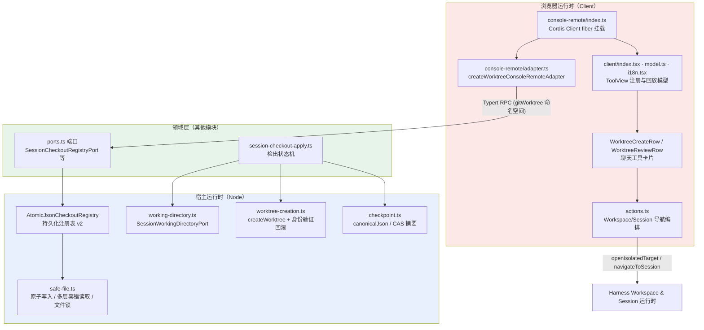
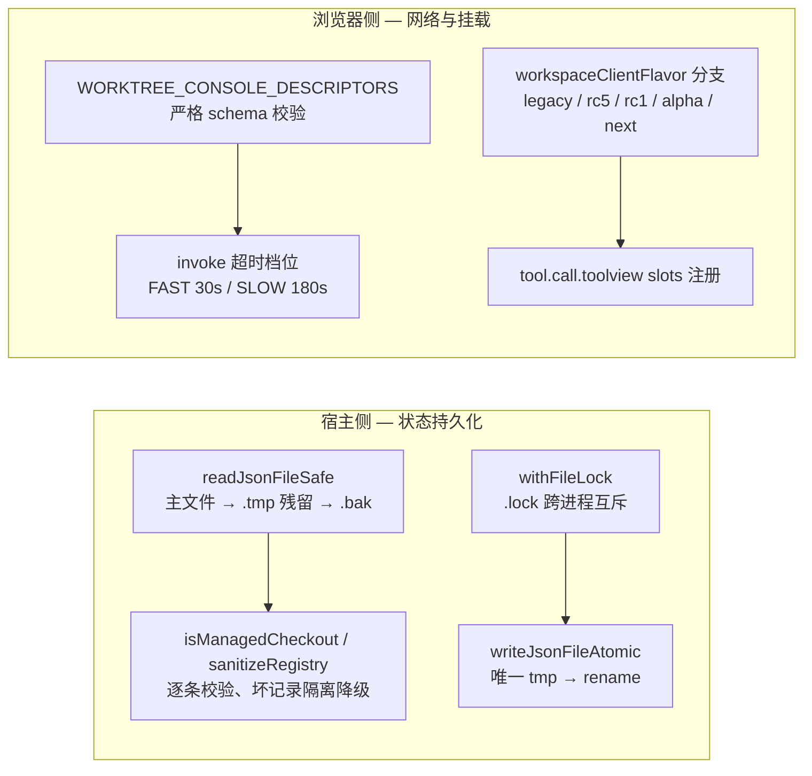
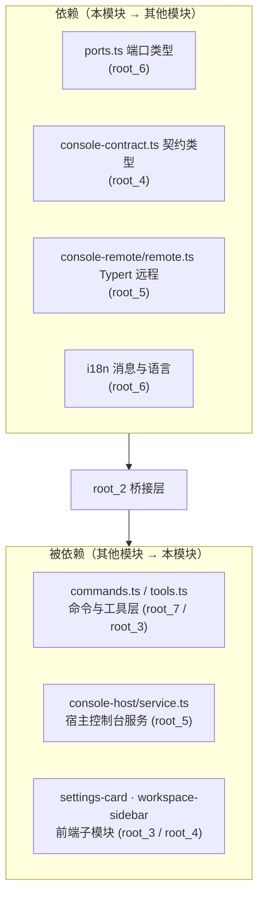

# root_2：持久化适配器与浏览器客户端桥接层

## 模块定位

本模块是 `dsh-git-worktree` 插件的**基础设施桥接层**，横跨两个运行时环境：

- **宿主侧（Node/Host）适配器**：把领域状态机落到磁盘上——原子 JSON 注册表、崩溃安全文件读写、跨进程文件锁、托管 worktree 的创建与回滚、checkpoint 摘要哈希。这些组件为 [root_6](root_6.md) 中的端口（`ManagedCheckoutsRegistry`、`SessionCheckoutRegistryPort`、`WorktreeCreationEvidence`）提供具体实现，使会话检出状态机（见 [src_session-checkout-apply.ts](src_session-checkout-apply.ts.md)）保持宿主无关、可测试。
- **浏览器侧（Client）桥接**：把宿主提供的 `WorktreeConsoleAdapter`（见 [root_4](root_4.md) 中的 `console-contract.ts`）经过 Typert 远程代理引入前端，注册为 Cordis 服务，并在聊天工具调用卡片（ToolView）与 Harness Workspace/Session 运行时之间完成导航与会话交接。

简而言之：**上层（root_4/root_5/root_3/root_7）定义契约与交互逻辑，本模块负责「状态怎么存、网络怎么通、界面怎么挂」。**

## 架构总览

## 运行时分层图

## 子模块导览

### 1. [宿主侧持久化适配器](root_2/root_2_host_adapters.md)

`src/adapters/registry.ts`、`src/adapters/safe-file.ts`、`src/adapters/working-directory.ts`、`src/adapters/worktree-creation.ts`、`src/checkpoint.ts`：

- **`AtomicJsonCheckoutRegistry`**：把全部会话检出绑定与托管记录存为单个 JSON 文件；`read()` 做逐条校验与分区降级（坏记录只影响内存视图、绝不回写抹掉现场）；`update()` 持文件锁完成「读-改-写」，杜绝跨进程覆盖；v1 旧注册表保守迁移到 `recovery_required` 相位。
- **崩溃安全文件原语**：唯一命名 tmp + POSIX 原子 rename（Windows 句柄占用退避重试）+ `.bak` 备份；读取端按「主文件 → 最新可解析 `.tmp` 提升 → `.bak` 回退」三级容错；`withFileLock` 用携带 pid/token 的锁文件实现跨进程互斥，并能回收僵死锁。
- **`createWorktree`**：先持久化「根目录/父目录/commonDir 身份证据」再执行昂贵的 `worktree add`；注册失败且 git 已静止时走 `quarantinePath` 隔离移动 → 未改动性字节级校验 → 强制删除；任何证据缺失都**不授予删除权**，只保留残留供人工排查。
- **`canonicalJson` / `checkpointGenerationForRecord`**：按键排序的规范 JSON 摘要，为活跃 Review 与 checkpoint 链生成确定性 CAS 哈希，作为 `recoveryGeneration` 的基础。

### 2. [客户端核心与运行时编排](root_2/root_2_client_core.md)

`src/client/index.tsx`、`src/client/model.ts`、`src/client/i18n.tsx`、`src/client/actions.ts`、`src/client/harness-platform.d.ts`：

- **`apply()` 浏览器入口**：用 `ClientI18nProvider` 包裹插件自有的 slot 注册（每个 DSH Client 实例隔离），注入带 `data-plugin` 自标记的作用域样式表，向 `tool.call.toolview` 注册 `worktree_create` 与 `worktree_ready_for_review` 两个回放稳定的卡片。
- **`model.ts`**：纯函数从已落盘的工具调用切片解析 `ParsedTool<WorktreeCreatePayload / WorktreeReviewPayload>`——不依赖实时服务，保证历史会话回放时卡片仍然可读。
- **`actions.ts`**：`openIsolatedTarget` 幂等地「校验既有 Session cwd → 建 Workspace → 预分配 Session → 等待 Harness 投影出可信 cwd → 导航」；`openAuthorizedWorktreeTarget` 先用 adapter 做身份复核再走同一条 cwd 校验导航路径；`finalizeCurrentSession` 通过 `/worktree finalize` 命令提交人工确认。

### 3. [Typert 远程适配器与客户端挂载](root_2/root_2_console_remote.md)

`src/client/console-remote/adapter.ts`、`src/client/console-remote/index.ts`：

- **`createWorktreeConsoleRemoteAdapter`**：把 `GitWorktreeRemote`（宿主侧 [root_5](root_5.md) 的 `console-remote/remote.ts` 贡献）包装为 `WorktreeConsoleAdapter`；每个方法经 descriptor 的 strict schema 二次解析；Web RPC 载体无超时，因此客户端自行分档（FAST 30s / SLOW 180s）；协议层拒绝统一归类为 `malformed_response`，传输故障归类为 `transport_unavailable`——服务端工作继续，可变调用可安全重试。
- **`apply()` 挂载 fiber**：挂载包自有 Remote 贡献、提供 `worktreeConsole` 服务、挂载设置卡片（[root_3](root_3.md) 的 settings-card）；随后按 `sidebarTopology` 返回的 `workspaceClientFlavor`（legacy / modern-rc5 / modern-rc1 / alpha / next）与 `officialWorkspaceActive` 选择「接管（inject）」或「装饰（decorate）」侧栏路径；拓扑读不出时退化为「只挂工具视图、不挂侧栏」，保证用户仍能进入界面修复 registry。

### 4. [聊天工具卡片与评审展示组件](root_2/root_2_tool_views.md)

`src/client/WorktreeCreateRow.tsx`、`src/client/WorktreeReviewRow.tsx`、`src/client/review-console/DeliveryProof.tsx`、`src/client/review-console/PreflightStatus.tsx`：

- **`WorktreeCreateRow`**：展示「创建中 / 已就绪 / 已在本会话工作」三态；未交接时提供「打开隔离会话」按钮，调用 `openIsolatedTarget`。
- **`WorktreeReviewRow`**：从 payload 与参数重建 `WorktreeReviewEvidence`；订阅 `WORKTREE_REVIEW_REFRESH_EVENT` 并轮询 `adapter.current` 把已落盘的评审快照升级为实时 target 摘要；命中 `target_unselected` 错误时整卡隐藏。
- **`DeliveryProof`**：以紧凑/完整两种形态展示交付证据——commit OID、local 分支 head 前后变化、变更文件数、验证状态、以及「提交是否仍在本地历史中」。
- **`PreflightStatus`**：把只读预检结果渲染为 ready / local_advanced / already_in_local / conflict / blocked 五态；冲突态提供「请智能体解决冲突」入口，blocked 态可定位到持有同一 Review 槽的其他任务。

## 与其他模块的关系

- 类型契约：宿主侧适配器实现 [root_6](root_6.md) `ports.ts` 的端口；浏览器侧适配器满足 [root_4](root_4.md) `console-contract.ts` 的 `WorktreeConsoleAdapter`。
- 远程对端：浏览器端 `GitWorktreeRemote` 的宿主实现位于 [root_5](root_5.md) 的 `console-remote/`（`descriptors.ts`、`schemas.ts`、`typert.ts`）。
- 上层 UI：卡片面板的完整评审控制台（ReviewActions、ReviewPanel、preflight-cache 等）见 [root_3](root_3.md)；目标控制台视图（TargetConsoleView、分支图、标签管理）见 [root_4](root_4.md)。
- 状态机：注册表与工作目录端口支撑 [src_session-checkout-apply.ts](src_session-checkout-apply.ts.md) 的检出引擎；宿主入口模块见 [src_session-checkout-module.ts](src_session-checkout-module.ts.md) 与 [root_7](root_7.md)。

## 关键设计约束

1. **坏记录不回写**：`sanitizeRegistry` 的降级只作用于内存读视图；任何写回都以磁盘原始事实为基础，防止被丢弃的记录在下次 mutation 后被静默抹除。
2. **证据不足即不删除**：worktree 创建回滚要求目录身份、元数据指纹、index 字节指纹与未改动性全部复核通过，才允许 `worktree remove`；超时/锁残留一律保留现场。
3. **导航必须 cwd 可信**：打开既有 Session 前必须核对 Harness 投影的 `cwd` 与预期 `managedRoot` 完全一致，拒绝凭路径猜测导航。
4. **挂载降级优先于整包失败**：任何一代 Workspace 读不出拓扑或缺少服务时，至少保证工具视图与控制台可用，而不是整条浏览器 bundle 消失。

## 子模块文档清单

| 子模块页面 | 覆盖文件 | 核心职责 |
| --- | --- | --- |
| [宿主侧持久化适配器](root_2/root_2_host_adapters.md) | `adapters/registry.ts` · `adapters/safe-file.ts` · `adapters/working-directory.ts` · `adapters/worktree-creation.ts` · `checkpoint.ts` | 原子注册表、崩溃安全文件原语、Session 工作目录切换、带身份验证回滚的 worktree 创建、规范 JSON 摘要 |
| [客户端核心与运行时编排](root_2/root_2_client_core.md) | `client/index.tsx` · `client/model.ts` · `client/i18n.tsx` · `client/actions.ts` · `client/harness-platform.d.ts` | 浏览器入口与 ToolView 注册、回放稳定的工具调用解析模型、i18n、Workspace/Session 导航编排、Harness 平台类型声明 |
| [Typert 远程适配器与客户端挂载](root_2/root_2_console_remote.md) | `client/console-remote/adapter.ts` · `client/console-remote/index.ts` | 远程调用包装（schema 校验、超时分档、错误归类）、Cordis Client fiber 按 Workspace 代际的挂载分支 |
| [聊天工具卡片与评审展示组件](root_2/root_2_tool_views.md) | `client/WorktreeCreateRow.tsx` · `client/WorktreeReviewRow.tsx` · `client/review-console/DeliveryProof.tsx` · `client/review-console/PreflightStatus.tsx` | 创建/评审卡片、交付证据展示、只读预检状态展示 |
