# 主机适配层（Host Adapters）

本模块（`src/adapters/` 与 `src/checkpoint.ts`）是 session-checkout 领域与
DSH 宿主运行环境之间的**唯一接缝**：领域状态机与 apply 引擎只依赖 [ports 抽象](../root_6.md)，
本模块把这些端口落地为真实的 Node/DSH 实现，同时为它们提供崩溃安全、跨进程并发与身份校验等
工业级硬化能力。

## 快速概览

| 文件 | 核心导出 | 角色 |
| --- | --- | --- |
| `src/adapters/safe-file.ts` | `writeJsonFileAtomic`、`readJsonFileSafe`、`withFileLock`、`FileLockOptions`、`FileLockPayload` | 崩溃安全的 JSON 读写 + 跨进程文件锁 |
| `src/adapters/registry.ts` | `AtomicJsonCheckoutRegistry` | 持久化台账（managed-checkouts 注册表） |
| `src/adapters/working-directory.ts` | `createSessionWorkingDirectoryPort`、`SessionWorkingDirectoryPort`、`WorkingDirectoryServiceLike` | 把 Session 的 cwd 移入/移出受管 Worktree |
| `src/adapters/worktree-creation.ts` | `createWorktree`、`Result` | 身份取证驱动的 Worktree 创建与失败回滚 |
| `src/checkpoint.ts` | `canonicalJson`、`checkpointGenerationForRecord` | checkpoint 链的 CAS 生成指纹 |

---

## 架构定位

本模块属于 **端口与适配器（Hexagonal）** 架构中的适配器侧：领域层（状态机、apply 引擎）
保持宿主无关、可用 fake 测试；所有真实副作用（JSON 文件、git 子进程、宿主服务）都收敛到这里。

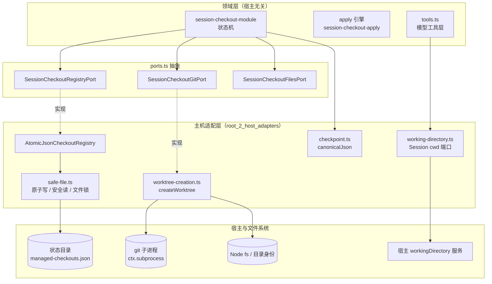

> 说明：`SessionCheckoutGitPort` 的 DSH 侧实现 `createDshGitPort` 位于
> [主机集成模块](../root.md) 的 `src/adapters/git.ts`，它在内部调用本模块的
> `createWorktree`（见下方「协作关系」）。`SessionCheckoutFilesPort` 的 Node 实现
> `createNodeFilesPort` 位于 `src/adapters/files.ts`，被 `worktree-creation.ts` 直接复用。

---

## 1. safe-file：崩溃安全与跨进程互斥

`src/adapters/safe-file.ts` 解决一个核心问题：**系统强制关机/崩溃时 JSON 索引文件被截断**。
它提供三件基础能力，被 registry 与其它 JSONL/JSON 索引文件复用。

### 1.1 原子写入：唯一临时文件 + rename + 备份

写入路径是「写唯一命名 tmp → POSIX 原子 rename → 自动保留 `.bak`」：

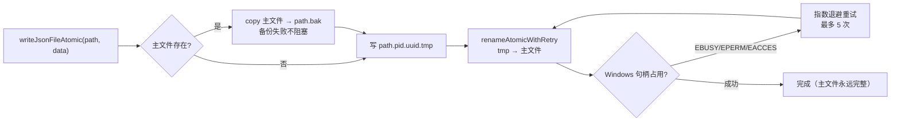

关键设计点：

- **唯一 tmp 命名**（`${file}.${pid}.${uuid}.tmp`）：固定 `<file>.tmp` 会让并发写者互相截断，
  且半写状态的 tmp 会被读取端误提升为主文件。
- **Windows 容错 rename**：`EBUSY/EPERM/EACCES/ENOTEMPTY` 按 `20 * 2^(n-1)` 退避重试，
  保持原子语义不被短暂句柄占用破坏。
- **`writeTextFileAtomic`**：同款语义但不做 JSON 序列化/备份，用于 JSONL 会话等非单 JSON 文档。

### 1.2 安全读取：主文件 → tmp 残留 → .bak 三级回退

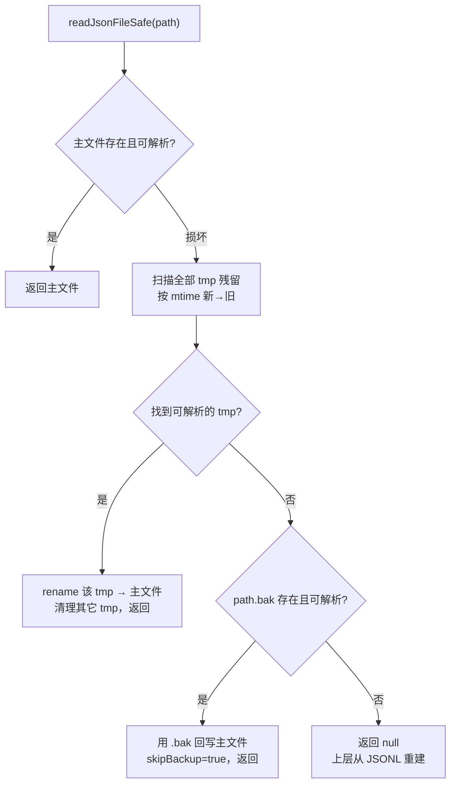

主文件损坏时，读取端会**主动提升**最新完整 tmp 或 `.bak` 恢复现场，而不是直接报错。

### 1.3 跨进程文件锁：`withFileLock`

「读-改-写」的并发互斥由锁文件 `<target>.lock` 提供，消除「最后写入者获胜」的丢更新窗口。

| 概念 | 类型 / 默认值 | 说明 |
| --- | --- | --- |
| `FileLockPayload` | `{ pid, createdAt, token }` | 锁文件内容；`token` 是持有者唯一凭证 |
| `FileLockOptions` | `{ timeoutMs?, staleAfterMs? }` | 超时与陈旧阈值 |
| `LOCK_DEFAULT_TIMEOUT_MS` | `10_000` | 获取锁的默认等待上限 |
| `LOCK_STALE_MS` | `30_000` | 持锁超过即视为陈旧可回收 |
| `LOCK_RETRY_DELAY_MS` | `25` | 抢锁轮询间隔 |

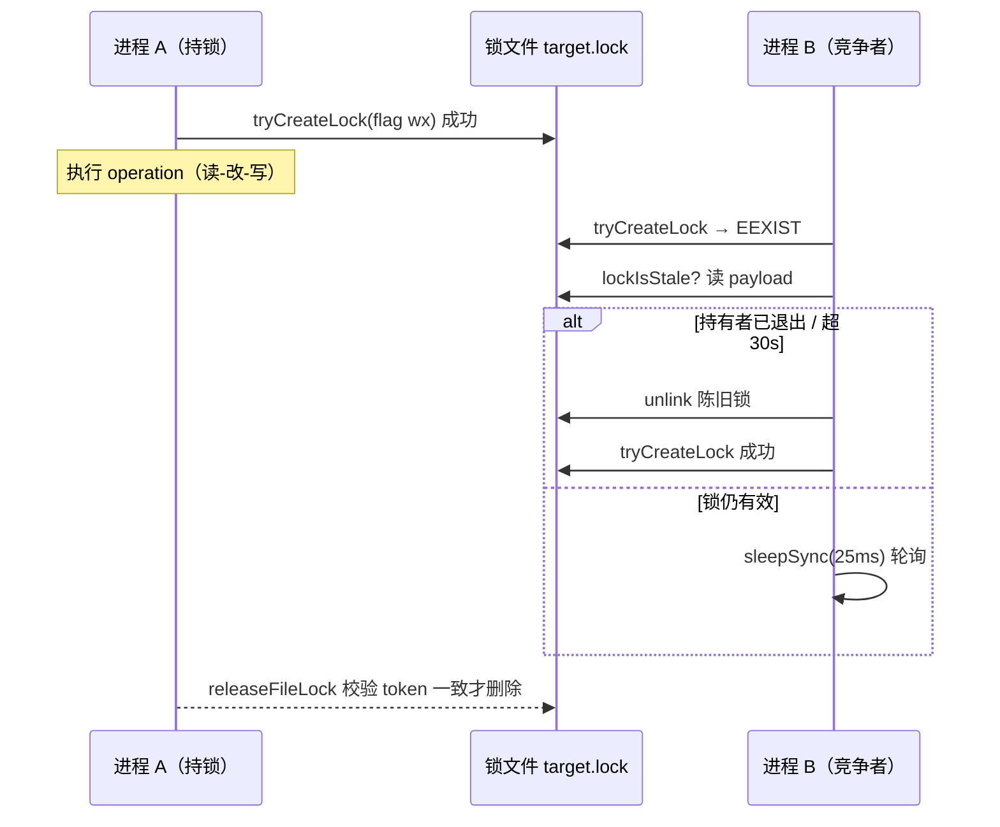

设计要点：

- **`flag: 'wx'` 占位创建**是唯一的抢锁原语；不可解析的锁文件按 mtime 判龄回收（持有者刚占位、
  内容未落盘时也读不出 JSON）。
- **同进程重入**：模块级 `heldLocks: Map<lockPath, token>` 记录已持锁，`read()` 的 legacy 迁移会
  回调 `write()`，内层必须复用同一把锁而不是再抢一次。
- **释放只删自己的锁**：`token` 不符说明锁已过期回收并被他人重建，仅告警不删除。
- **超时抛 `ELOCKTIMEOUT`**：超过 `timeoutMs` 仍未拿到锁时抛出带 `code` 的错误，携带等待时长与锁路径。

---

## 2. AtomicJsonCheckoutRegistry：持久化台账

`src/adapters/registry.ts` 实现 `SessionCheckoutRegistryPort`，把 session-checkout 台账
（version 2）存成状态目录下的**单个原子 JSON 文件**（默认 `managed-checkouts.json`）。
它是整个插件最关键的持久化边界。

### 2.1 三层读写语义

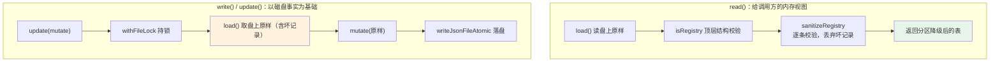

三条不可违反的不变量：

1. **校验门控每次读**：顶层结构 `isRegistry` 不通过时，先尝试 v1→v2 迁移；都失败且文件存在则
   抛 `SessionCheckoutError('registry_corrupt', …)` —— 坏文件**大声失败**，绝不被静默覆盖。
2. **分区降级只作用于内存视图**：`sanitizeRegistry` 逐条校验 `sessionBindings` 与 `managedCheckouts`，
   丢弃坏记录并告警（`registryRecordDropped`），但**不回写原文件**——用户现场保留。
3. **update 持锁读-改-写**：`mutate` 拿到的是盘上原样（含未通过校验的记录），原样写回；
   否则被丢弃的记录会被这次写入悄悄抹掉。单条记录更新必须走 `update`，不能自己 `read` 再 `write`。

### 2.2 校验器族（defensive schemas）

`registry.ts` 内置一组类型守卫，对持久化的每一类记录做**结构性 + 边界 + 安全字符**校验：

| 守卫 | 守护对象 | 典型约束 |
| --- | --- | --- |
| `isOid` | git 对象 id | 40 或 64 位十六进制 |
| `isBoundedText` | 短文本字段 | 非空、≤N、无 `\0` |
| `isSafeRelativePath` | changedFiles 等路径 | 非绝对、无 `..`/`.`、无控制字符、≤1000 |
| `isSessionBinding` | 会话-目标绑定 | `target` 为 unselected/local/isolated 联合 |
| `isReview` / `isPreviousReview` | 评审记录 | `validationStatus` 枚举、tests 数组、`isValidCommitMessage` |
| `isCheckpoint` | checkpoint 链 | sequence 从 1 递增、checkpointId/reviewId 唯一 |
| `isPreviewReceipt` | 本地预览回执 | `baseStrategy` 三态、全套指纹字段 |
| `isDelivery` | 交付状态机 | working/ready_for_review/preview_active/preview_detached/finalized/retained/delivered |
| `isJournal` | 崩溃恢复日志 | create（含身份证据）/ 七种 mutation operation |
| `isRecoveryContinuation` | 恢复续作 | 四种 kind 各自的必填字段与 64 位 generation |
| `isManagedCheckout` | 单条 checkout 主记录 | phase 七态、delivery/journal 联合、revision |

### 2.3 v1 保守迁移

`migrateLegacyRegistry` 把 version 1 台账升级为 v2：仅当 sessionBindings 全部合法时才迁移；
v1 的 `phase` 只有 `ready` / `discarded` 原样保留，其余一律降级为 **`recovery_required`**（与 Domi 行为一致），
并把 delivery 置为 `{ state: 'working', iteration: 1 }`。迁移成功后**立即回写 v2 文件**。

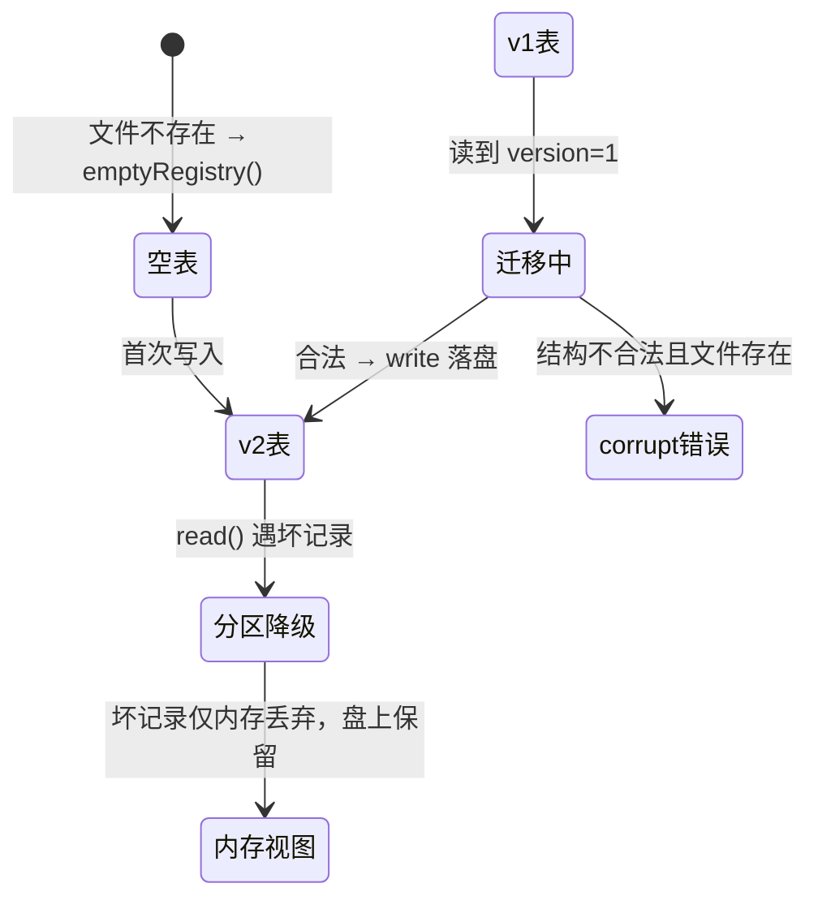

---

## 3. working-directory：Session cwd 适配

`src/adapters/working-directory.ts` 是官方实验性 worktree bundle 的对齐机制——
官方 bundle 创建 Worktree 的最后一步是 `ctx.workingDirectory.set(agent, path)`，
让 Session **真正进入**新 checkout 工作；没有它，受管 Worktree 只改文件位置、不改 Session 工作目录。

### 3.1 两个结构视图

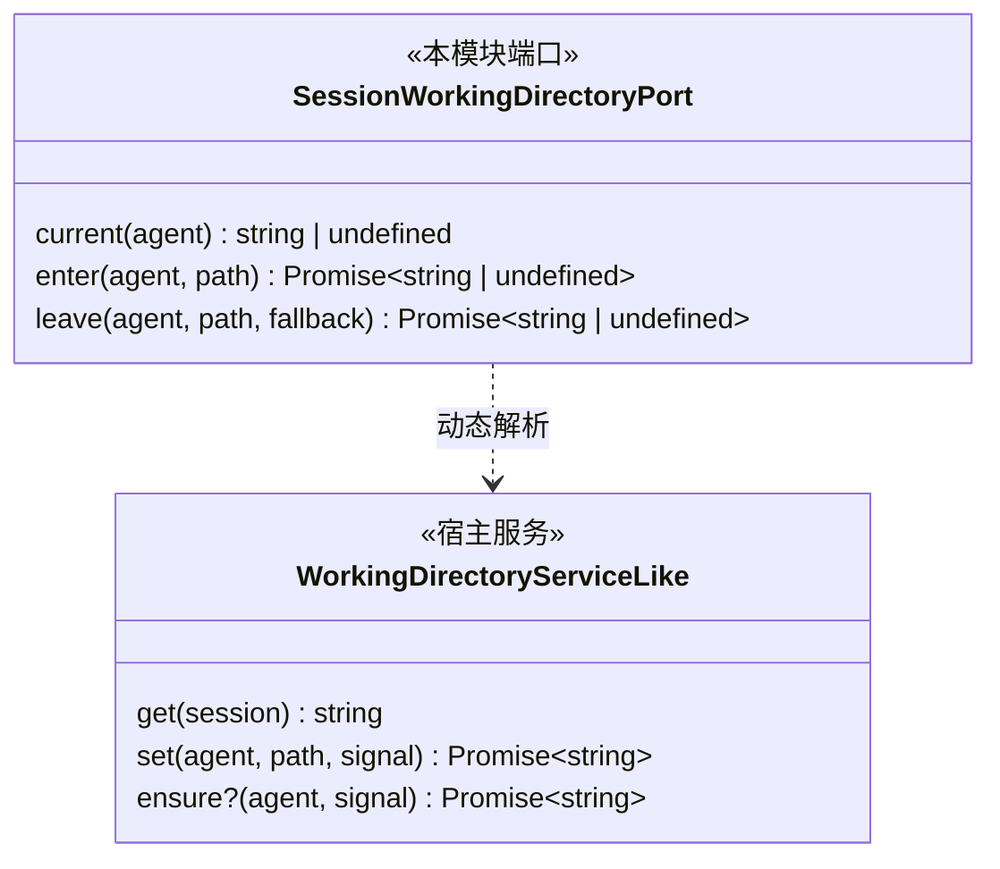

- **`WorkingDirectoryServiceLike`**：宿主 `@deepseek-ai/dsh-working-directory` 服务的最小结构视图，
  只断言 `get`/`set` 是函数。
- **`SessionWorkingDirectoryPort`**：工具层用于移动 Session cwd 的端口。

### 3.2 可选挂载与优雅降级

服务通过 `ctx.get('workingDirectory')` **动态解析**——它是可选挂载：

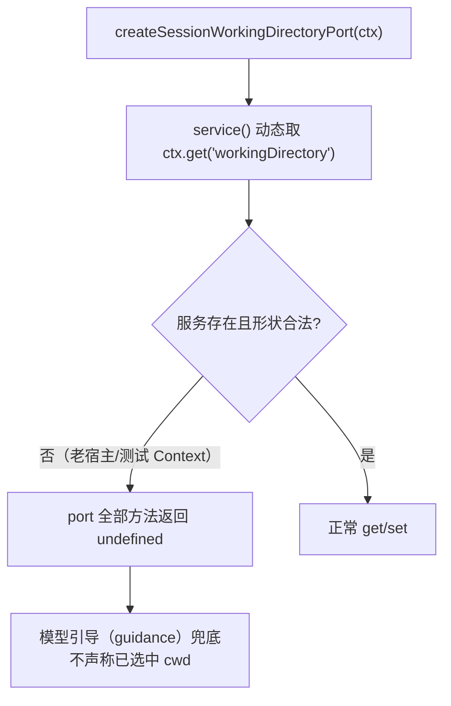

三个方法的契约：

| 方法 | 无服务 / 异常时 | 语义 |
| --- | --- | --- |
| `current(agent)` | `undefined` | 返回 Session 已提交的 cwd |
| `enter(agent, path)` | `undefined`（且不移动） | 持久化把 Session 移入 `path`；返回生效的规范目录 |
| `leave(agent, path, fallback)` | `undefined` | 仅当 Session **当前在 `path` 之内**时才移回 `fallback`（Local 边界） |

关键不变量：

- `enter` 收到 `undefined` 的 agent（工具调用方没有活 Agent）时**什么都不做**——
  返回 `path` 会让调用方声称一个从未设置过的 cwd。
- `leave` 用 `isWithin(candidate, root)`（跨平台归一化 + 大小写）判断包含关系，
  未站在 checkout 内则返回 `undefined` 不动作；`fallback` 为 `undefined` 时同样不动作。
- 这套「是否在 Worktree 内」的判定与 session-checkout-module 中的 `pathIsWithin` 保持一致，
  保证注入的引导文本与真实 cwd 切换对「inside the Worktree」不产生分歧。

---

## 4. worktree-creation：身份取证驱动的创建与回滚

`src/adapters/worktree-creation.ts` 的 `createWorktree(localRoot, target, baseOid, run, saveEvidence)`
是 `SessionCheckoutGitPort.createDetachedWorktree` 的核心实现。它的最高原则是：
**创建失败不是推断空路径安全的授权**；任何删除/回滚都必须先过完整的身份与指纹校验。

### 4.1 `Result` 与 `Run` 抽象

```typescript
type Result = { code: number; stdout: string; stderr: string; quiescent?: boolean }
type Run = (cwd: string, args: string[], creating?: boolean) => Promise<Result>
```

- `Result` 复用 `src/adapters/git.ts` 的 `GitCommandResult` 形状；`quiescent` 标记
  **子进程整树退出已被确认**——这是回滚授权的前提之一。
- `Run` 由 `createDshGitPort` 注入，把 git 命令接到 `ctx.subprocess`（见 [主机集成模块](../root.md)）。

### 4.2 创建主流程

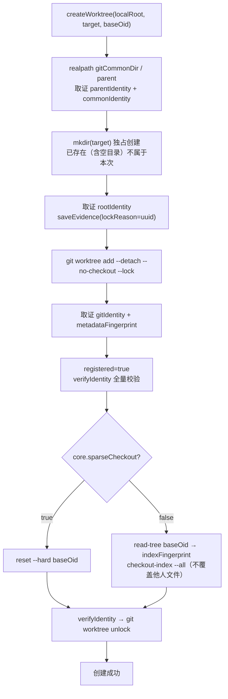

阶段分界（注释原文：「Registration is short; the expensive checkout runs only after its ownership proof is durable.」）：

1. **登记先于检出**：把身份证据（root/parent/commonDir/gitDir 的 device/inode/birthtime）持久化到
   `saveEvidence`（即台账 journal 的 `creation` 字段），再跑昂贵的 `worktree add`。
2. **稀疏检出对齐原生语义**：`read-tree` 先发布完整 index，`checkout-index` 不带 `-f`，
   绝不覆盖其它写者已存在的文件。

### 4.3 失败回滚：两级授权

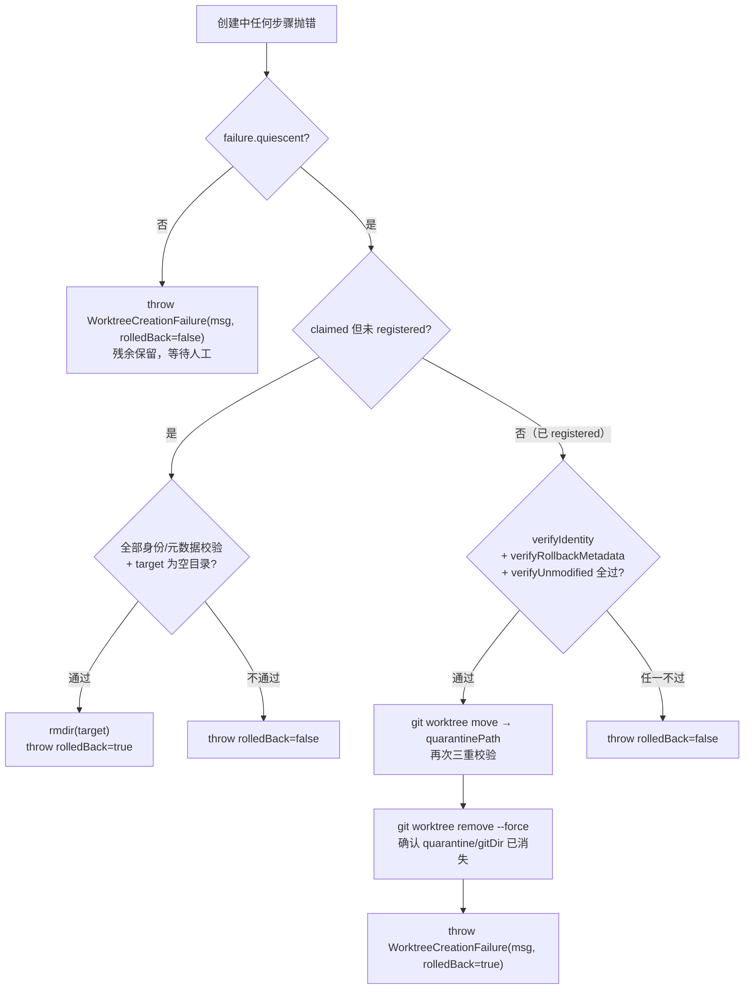

两级回滚的授权差异：

| 阶段 | 条件 | 动作 |
| --- | --- | --- |
| **未登记**（claimed && !registered） | quiescent + 身份未变 + git 未注册该 root + 元数据未变 + target 为空 | 直接 `rmdir` 空目录 |
| **已登记**（registered） | quiescent + 三重校验（身份 / 元数据指纹 / 未改动字节） | `worktree move` 到隔离区 → 再校验 → `worktree remove` |

回滚失败一律包装为 `WorktreeCreationFailure(message, rolledBack=false)`，把残余路径（quarantine）
带进消息——**超时、进程树观测丢失、身份缺失永远不构成删除授权**。

### 4.4 三道校验的内容

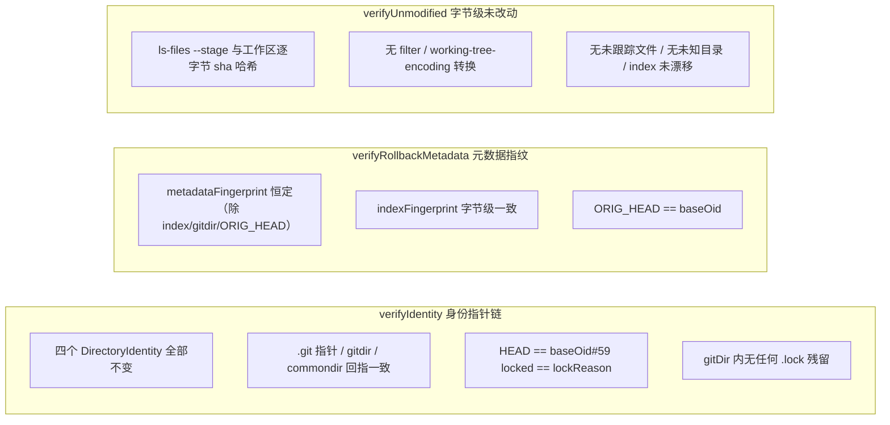

- `metadataFingerprint` 对 gitDir 白名单（HEAD/commondir/locked/config.worktree/logs/info）做
  结构化 sha256 游走，拒绝意外符号链接与越界对象。
- `verifyUnmodified` 拒绝「语义比较能过、字节却被 clean filter 丢弃」的场景——
  那样的比较**不能授权删除失败的 checkout**。

---

## 5. checkpoint.ts：CAS 生成指纹

`src/checkpoint.ts` 为「当前活跃的 Review 与 checkpoint 链」派生宿主权威的 CAS（Compare-And-Swap）生成值。

### 5.1 canonicalJson

```typescript
canonicalJson(value): string
```

确定性序列化：

- 数组递归；对象**按键名排序**并**剔除 `undefined`** 字段——保证同一份逻辑对象永远得到同一字节串。
- 键名走 `JSON.stringify(key)`（保留转义），其它标量走原生 `JSON.stringify`。

### 5.2 checkpointGenerationForRecord

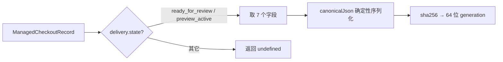

纳入哈希的字段：`checkoutId`、`revision`、`reviewId`、`isolatedHeadOid`、`isolatedFingerprint`、
`checkpointCount`、`previewId`（仅 preview_active）、`phase`。

用途：apply 引擎在写 checkpoint / 恢复续作时携带这个 generation，宿主据此判断「这条 Review 链
自上次观察以来是否漂移过」——漂移即拒绝基于过期快照的变更。它与 registry 的 `isCheckpoint` /
`isRecoveryContinuation` 中对 `generation` 的 64 位十六进制校验互为表里。

---

## 协作关系与数据流

### 6.1 装配点（src/index.ts `apply()`）

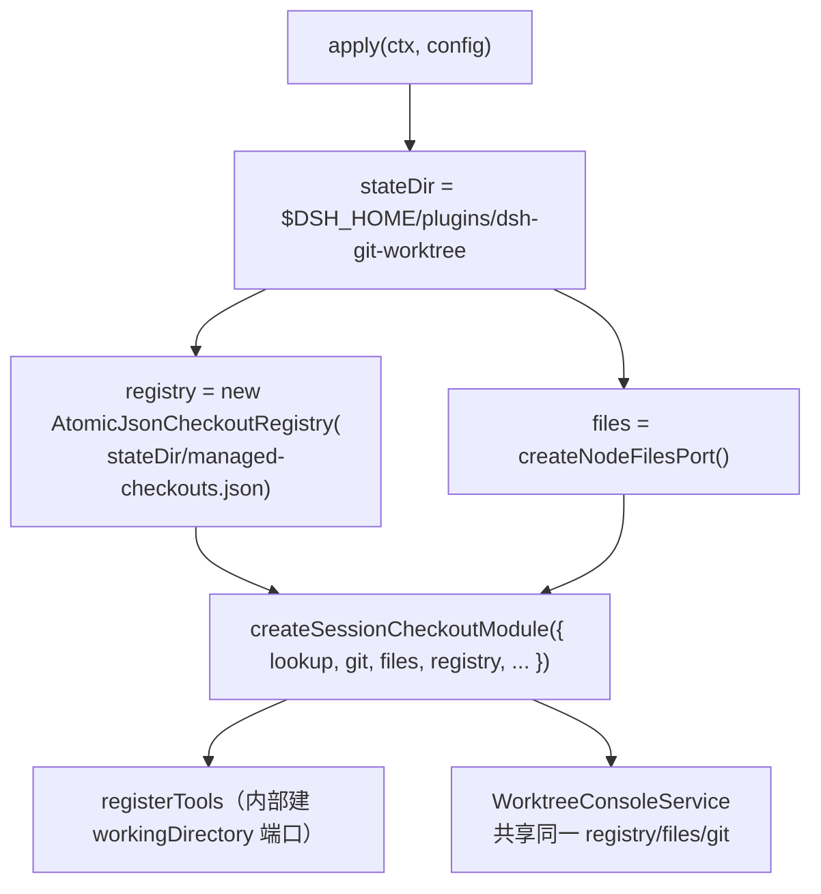

- registry 的落盘路径来自配置 `stateDir`（默认 `~/.dsh/plugins/dsh-git-worktree`），
  其 `.lock` / `.bak` / tmp 残留都在同目录。
- `AtomicJsonCheckoutRegistry` 同时被领域模块与 `WorktreeConsoleService` 共享——
  跨进程/跨入口的写都必须经 `update()` 持锁路径。

### 6.2 端到端：一次 worktree_create 的数据流

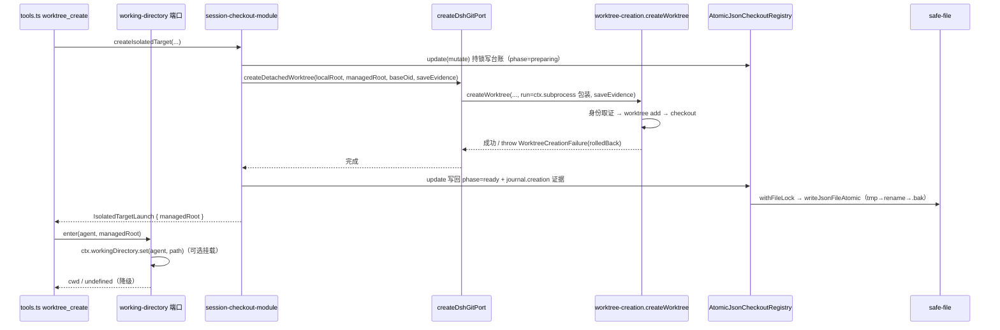

### 6.3 依赖方向图

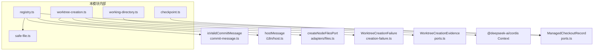

---

## 故障与降级行为速查

| 场景 | 行为 | 抛出 / 返回 |
| --- | --- | --- |
| 台账文件损坏且非 v1 | 大声失败，拒绝访问 | `SessionCheckoutError('registry_corrupt')` |
| 台账单条记录损坏 | 该条内存丢弃，盘上保留 | `console.warn(registryRecordDropped)` |
| v1 台账 | 保守迁移，非 ready/discarded 降为 `recovery_required` 并回写 | 自动 |
| 抢锁超时（默认 10s） | 放弃，带错误码 | `Error` + `code = 'ELOCKTIMEOUT'` |
| 锁文件陈旧（持有者退出 / 超 30s） | 回收重建 | 静默（不可解析时告警） |
| 主 JSON 文件被截断 | 提升最新可解析 tmp，否则回退 `.bak` | `recoveredFromTmp` / `recoveredFromBak` |
| 宿主未挂载 workingDirectory | 全部方法返回 `undefined`，引导兜底 | 不报错 |
| 创建未登记失败 + 非 quiescent | 保留残余 | `WorktreeCreationFailure(msg, false)` |
| 创建已登记失败 + 校验全过 | move 到隔离区再 remove | `WorktreeCreationFailure(msg, true)` |
| 回滚中任一校验不过 | 保留残余（含 quarantine 路径） | `WorktreeCreationFailure(msg, false)` |

## 相关模块

- [ports.ts 端口抽象](../root_6.md)：`SessionCheckoutRegistryPort`、`WorktreeCreationEvidence`、
  `ManagedCheckoutRecord`、插件入口 `apply()`（`src/index.ts`）与 i18n 主机消息（`src/i18n/host.ts`）
  所在的根模块，即本模块落地的契约定义与装配点。
- [主机集成模块（root）](../root.md)：`createDshGitPort`（`src/adapters/git.ts`）、`createNodeFilesPort`
  （`src/adapters/files.ts`）等本模块复用的兄弟适配器。
- [领域状态机](../src_session-checkout-module.ts.md)：消费 registry 端口、调用 `createWorktree`、
  使用 `checkpointGenerationForRecord` 的状态机。
- [apply 引擎](../src_session-checkout-apply.ts.md)：CAS generation 的消费方与预览/回滚语义。
- [主机控制台服务与失败类型](../root_5.md)：`WorktreeConsoleService`（`src/console-host/service.ts`）
  与 `WorktreeCreationFailure`（`src/creation-failure.ts`）所在的宿主侧模块。
- [commit-message 校验](../root_4.md)：`isValidCommitMessage`（`src/commit-message.ts`），
  被 registry 的记录守卫与 checkpoint 校验复用。
