# Adapters 适配层

本模块是 **DSH 宿主适配层（Hexagonal Architecture 的外围）**，把宿主机（DeepSeek Harness / Cordis 运行时）的具体能力——`ctx.subprocess` 子进程服务、`workspaceRegistry` 工作区服务、`sessions` 会话存储、`workingDirectory` 工作目录服务、`skills` 技能注册中心——适配为领域层定义的 **端口（Port）**。

领域状态机与 apply 引擎保持宿主无关、可用测试替身（fake）驱动；所有对宿主文件系统、Git 进程、注册表 JSON、技能目录的实际访问都收敛在 `src/adapters/` 之下。

## 模块定位

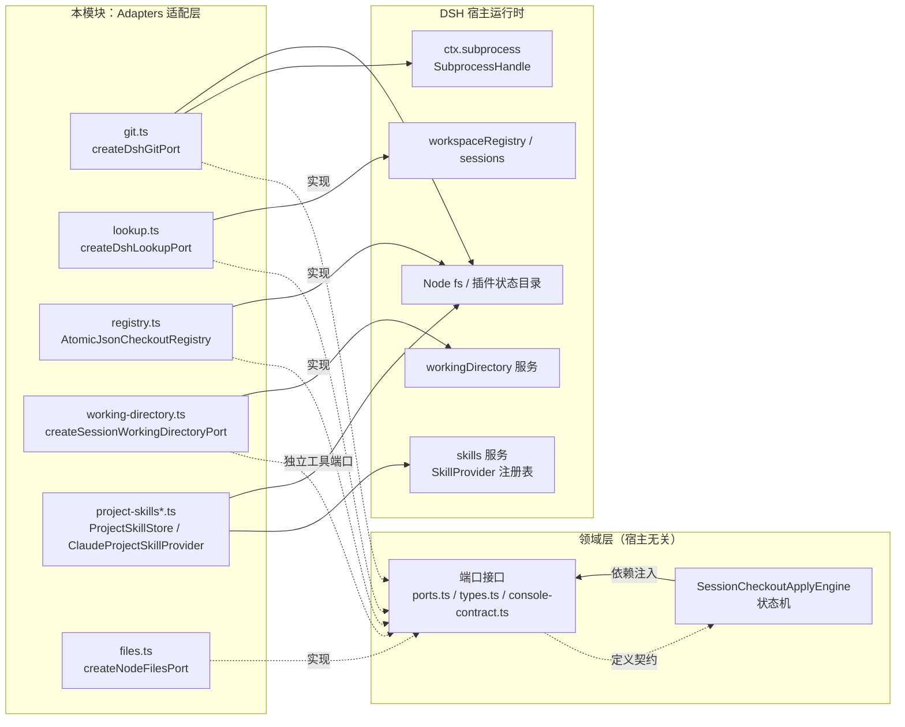

如上图，`SessionCheckoutDependencies`（定义于 `src/ports.ts`）是组装入口：领域层只依赖四个核心端口 `lookup / git / files / registry`（外加 apply 引擎）；`working-directory` 与 `skills` 适配是旁挂能力。

## 子组件一览

| 文件 | 导出的核心类型 / 工厂 | 实现的端口或角色 |
| --- | --- | --- |
| `src/adapters/git.ts` | `createDshGitPort`、`GitPortOptions`、`GitCommandResult` | `SessionCheckoutGitPort` —— 全部 Git 操作的子进程后端 |
| `src/adapters/git-options.ts` | `GitTimeoutOptions`、`validateGitTimeouts`、`gitTimeoutMs` | Git 超时策略与校验 |
| `src/adapters/initial-commit.ts` | `initialCommitActions`、`GitCommitProtocol` | 空仓库首次提交（CAS + 锁） |
| `src/adapters/lookup.ts` | `createDshLookupPort`、`WorkspaceLike`、`WorkspaceRegistryLike`、`SessionStoreLike`、`LiveSessionLike` | `SessionCheckoutLookupPort` —— 会话 / 工作区映射 |
| `src/adapters/registry.ts` | `AtomicJsonCheckoutRegistry` | `SessionCheckoutRegistryPort` —— 持久化注册表 |
| `src/adapters/working-directory.ts` | `createSessionWorkingDirectoryPort`、`WorkingDirectoryServiceLike` | `SessionWorkingDirectoryPort` —— 把 Session 移进 / 移出 worktree |
| `src/adapters/project-skill-io.ts` | `SkillRead`、`SkillBytes`、`readSkillFiles` / `createSkillDirectories` / `createSkillFiles` | Skill 文件安全读写底层 |
| `src/adapters/project-skills.ts` | `ProjectSkillStore`、`SkillSnapshot`、`Manifest`、`Entry`、`CarriedSkillState` | Skill 快照 / 携带 / 溯源清单 |
| `src/adapters/project-skill-provider.ts` | `ClaudeProjectSkillProvider`、`Locator`、`managedSkillRoot`、`mountProjectSkillProvider` | 向宿主 `skills` 服务注册 `.claude/skills` 提供方 |
| `src/adapters/files.ts` | `createNodeFilesPort` | `SessionCheckoutFilesPort` —— 目录身份 / 隔离 / 删除 |
| `src/adapters/safe-file.ts` | `readJsonFileSafe`、`writeJsonFileAtomic` | 崩溃安全的 JSON 读写（注册表与 Skill 溯源共用） |

> 说明：`files.ts` 与 `safe-file.ts` 虽在本目录下，但模块树未单列其组件；本文在相关数据流中一并引用。

## 装配关系（在 `src/index.ts::apply` 中）

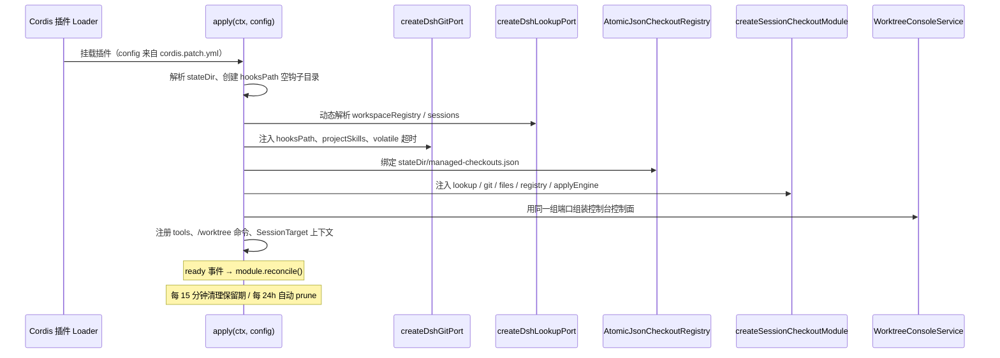

领域层的其他页面：

- 端口契约与数据结构的完整定义见 [核心类型与端口](core_types_and_ports.md)。
- 状态机与 apply 引擎如何消费这些端口见 [Worktree 生命周期管理核心](../worktree_lifecycle_management_core.md)。
- 控制面 / 控制台服务如何复用同一组端口见 [控制台控制面与服务](../console_control_plane_and_services.md)。

## Git 适配（git.ts + git-options.ts + initial-commit.ts）

### 核心设计

`createDshGitPort(ctx, options)` 返回一个完整的 `SessionCheckoutGitPort` 实现，所有 Git 调用经由 `ctx.subprocess.spawn` 执行，不经过 shell 解释，argv 原样传递。关键加固策略：

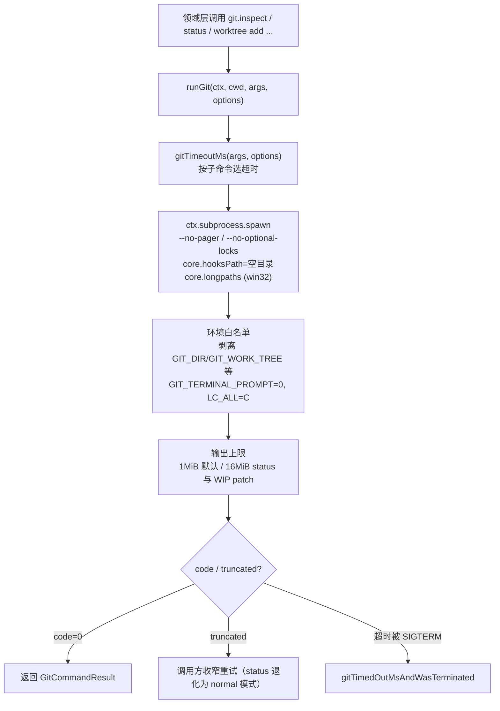

### 关键常量与超时

| 常量 / 配置 | 默认值 | 含义 |
| --- | --- | --- |
| `DEFAULT_GIT_TIMEOUT_MS` | 120 000 ms | 普通 Git 命令超时 |
| `DEFAULT_WORKTREE_ADD_TIMEOUT_MS` | 5 min | `git worktree add` 超时 |
| `worktree remove` 超时 | 5 min（硬编码） | Windows 长路径删除硬上限 |
| `MAX_GIT_TIMEOUT_MS` | 60 min | `validateGitTimeouts` 允许上限 |
| `GIT_COLLECT_BYTES` | 1 MiB | 普通命令 stdout/stderr 收集上限 |
| `STATUS_COLLECT_BYTES` / `WIP_PATCH_COLLECT_BYTES` | 16 MiB | `status --untracked-files=all` 与二进制 patch 的宽上限 |

`gitTimeoutMs` 每次调用即时读取 `LiveValue`，因此设置页（settings）上修改 `gitTimeoutMs` / `worktreeAddTimeoutMs` 无需重新挂载插件即可对下一条命令生效。

### 内部 ref 命名空间

插件产物使用独立的 Git ref 命名空间，避免与用户 ref 冲突：

```
refs/dsh-worktree/session-checkouts/<sha256(checkoutId)[:24]>/<artifact>
refs/dsh-worktree/abandoned/<checkoutId>
```

- `checkoutRefRoot` 用 checkoutId 的 SHA-256 前 24 位做命名空间键。
- `apply-base` 等内部 artifact 通过 `internalArtifactRef` 写入；artifact 名逐段经过 `assertArtifactName` 白名单校验。
- **放弃快照 ref 刻意放在 `checkoutRefRoot` 之外**：discard 流程会释放整个 per-checkout 命名空间，但新写入的安全快照不能随之被释放。

### 空仓库首次提交（initial-commit.ts）

`initialCommitActions(inspect, run)` 返回三个动作，仅在 Console 确认的宿主动作中调用：

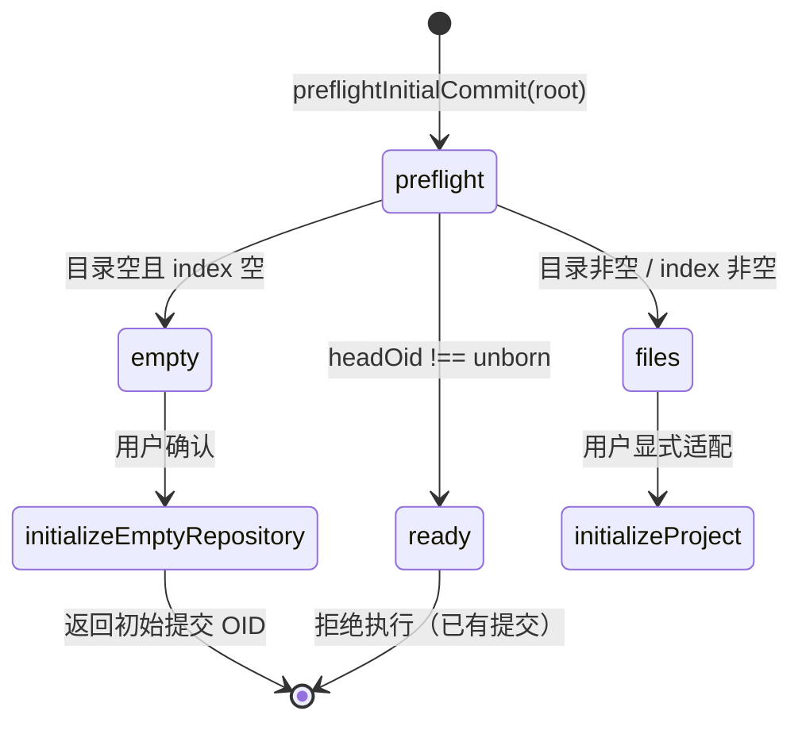

`initializeEmptyRepository` 的并发安全靠三重指纹 CAS + 文件锁：

1. 计算 `fingerprint`（root / gitDir / commonDir 身份、HEAD 内容、index bytes、文件清单）。
2. 抢占 `index.lock`（`open(..., 'wx')`），再次比对指纹；EEXIST 说明有竞争初始化者 → `operation_not_allowed`。
3. `mktree` 建空树、`commit-tree` 建提交，最后 `update-ref --stdin` 用 `prepare/beforeCommit` 回调在 HEAD 锁内做最后一次指纹比对（compare-and-swap，old=40 个 0）。
4. `finally` 中反向关闭并 `unlink` 自己创建的锁——清理失败不掩盖主错误。

## Lookup 适配（lookup.ts）

### 结构视图（Structural Typing）

因为已发布包版本滞后于 rc.6 运行时，lookup 适配**动态**从 `ctx.get('workspaceRegistry')`、`ctx.get('sessions')`、`ctx.get('sessionQuery')` 取服务，并用最小结构类型描述：

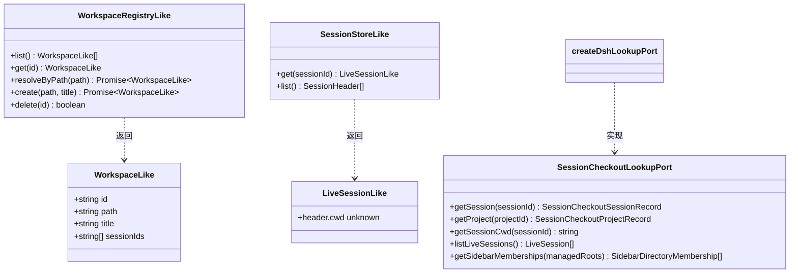

### 会话 → 项目映射的两条路径

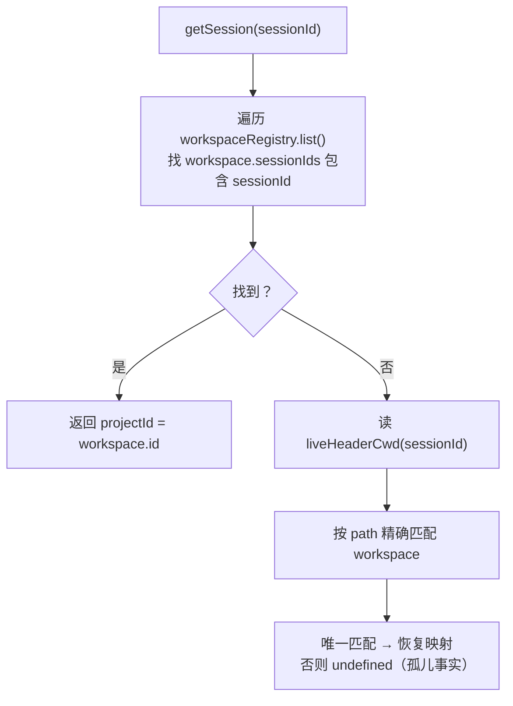

第二条路径是必要的：当 Harness 因「cwd 已被清理」把 live Session 从 `Workspace.sessionIds` 投影中过滤掉时，只有 immutable live header 仍保留原始 cwd，可用于恢复精确映射。缺失服务或记录一律降级为 `undefined`，由状态机当作 **recovery / orphan 事实**处理，而不是失败。

`listLiveSessions` 只取 header 字段（id / createdAt / cwd），供给并发分支竞争守卫（见 [并发守卫](../worktree_lifecycle_management_core/concurrency.md)）；结构未知时返回空列表，守卫保持沉默而非猜测。

## 注册表适配（registry.ts + safe-file.ts）

### 持久化文件布局

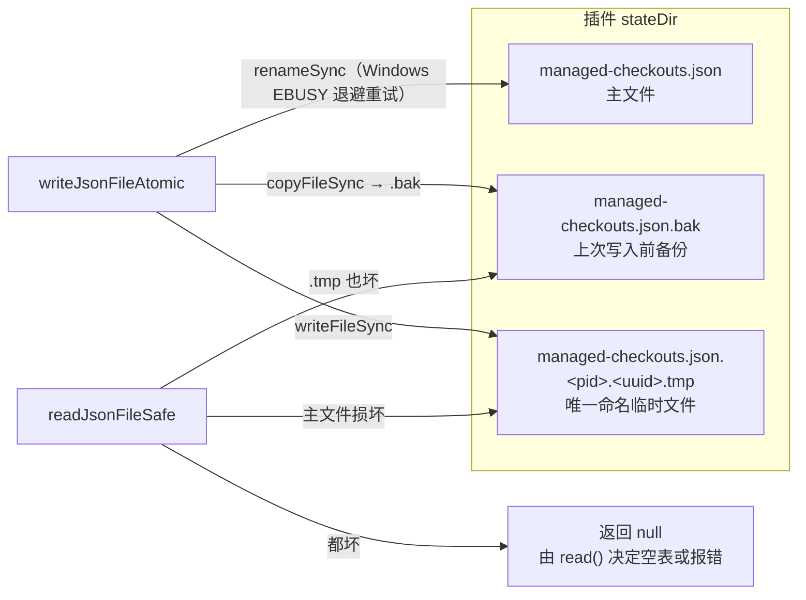

写入侧刻意**不用跨进程锁**：唯一命名 tmp + 原子 rename 已经消除「tmp 互踩」与「半写提升」；文件级 last-writer-wins 可接受。读取侧是三层容错：主文件 → 最新可解析的 `.tmp` 残留（提升为主文件）→ `.bak`。

### 读路径的校验闸门

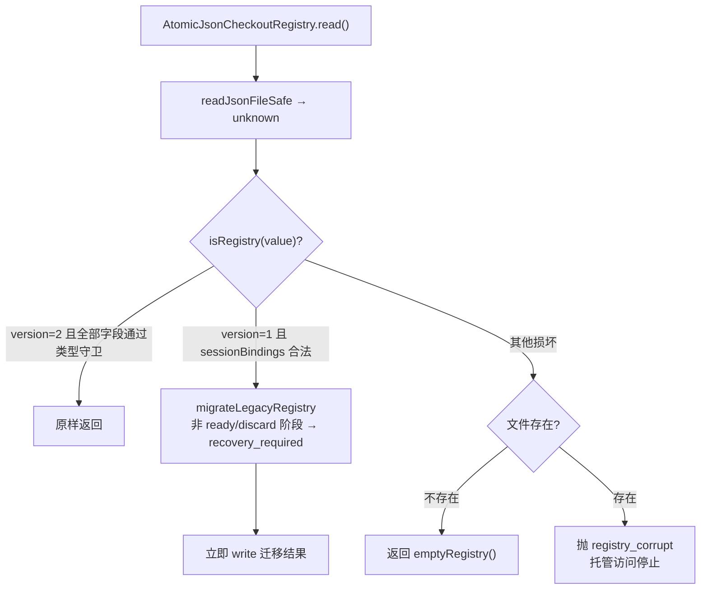

每个嵌套字段（`isSessionBinding`、`isManagedCheckout`、`isReview`、`isCheckpoint`、`isPreviewReceipt`、`isDeliveryProof`、`isJournal`、`isRecoveryContinuation`）都有独立的类型守卫：OID 必须是 40/64 位十六进制、路径必须是无空字节的安全相对路径、checkpoint 的 `sequence` 必须严格自增、`requestId` 唯一性也被校验。**损坏文件响亮失败，绝不被静默覆盖**——这是 Domi 沿用的安全边界。

## Working Directory 适配（working-directory.ts）

这是让 Session *真正进入* 新建 worktree 的机制（官方 experimental worktree bundle 的最后一步即 `ctx.workingDirectory.set(agent, path)`）：

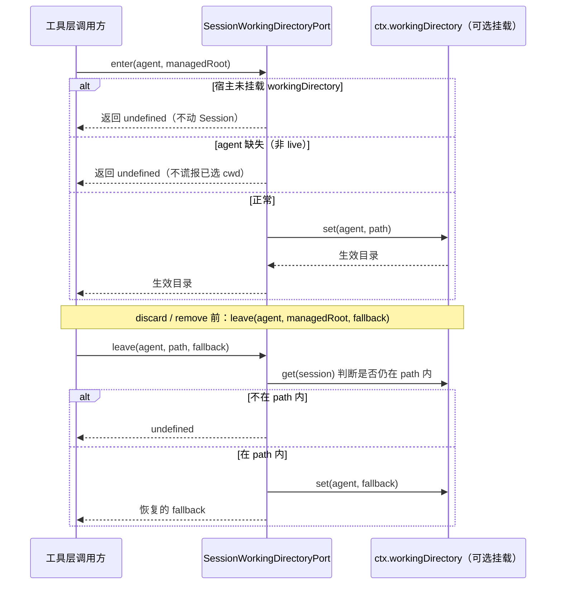

宿主不挂载该服务时，插件退化为「仅指引（guidance-only）」行为——模型提示仍会告知 worktree 位置，但 Session 的 cwd 不动。

## Project Skills 适配（project-skill-io / project-skills / project-skill-provider）

这是把 Local 检出中的 `.dsh/skills` / `.agents/skills` / `.claude/skills` 携带进新建 worktree、并让宿主技能发现能在受管 worktree 内读到 `.claude/skills` 的完整链路。

### 安全边界常量

- `PROJECT_SKILL_ROOTS = ['.dsh/skills', '.agents/skills', '.claude/skills']`
- `MAX_FILES = 5000`、`MAX_BYTES = 64 MiB`
- 树遍历：最大 10000 条目、深度 64
- 溯源清单文件上限：2 MiB，权限 `0600`

### 携带（carry）流程

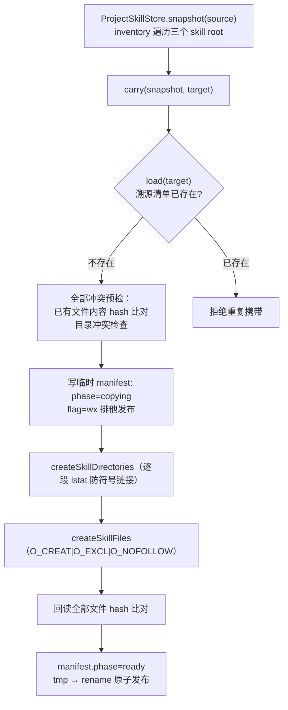

### 文件读写底层（project-skill-io.ts）

`readSkillFiles` / `createSkillFiles` / `createSkillDirectories` 每个操作前后都做两道防线：

1. `checkRoot(root, identity)`：用 `dev:ino:birthtimeNs` 比对根目录身份，检测 checkout 根被替换。
2. `checkPath`：逐段 `lstat`，拒绝符号链接、拒绝 `..` / 绝对路径 / 控制字符，路径白名单限定在三个 skill root 之下。

打开文件一律带 `O_NOFOLLOW`，写文件带 `O_EXCL`（拒绝覆盖），写完 `fsync`。注释明确说明：这些检查支持的是**可信本地创建**，不是对抗另一进程恶意替换祖先的原子包含。

### 状态监测与删除保护

- `state(root, tracked)`：对比 manifest 中每个文件的 hash/mode、检测新增文件、目录缺失，产出 `CarriedSkillState { paths, fingerprint, modified }`。
- `assertRemovable(root, tracked)`：删除受管 worktree 前调用——若 carried Skills 被修改，拒绝删除并提示用户保留该 worktree；发现清单外的新 Skill 资源也拒绝删除。

### 宿主 Skill 提供方（project-skill-provider.ts）

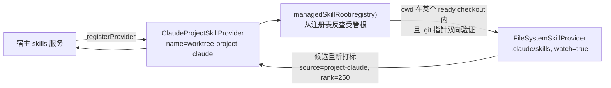

`managedSkillRoot` 是安全关键：只接受**宿主拥有的注册表记录**声明的根，并且双向验证 `.git` 文件指针与 `gitDir/gitdir` 回指，绝不接受 Skill 文件自己声称的根。provider 内部对每个根缓存一个 `FileSystemSkillProvider`（上限 32 个，LRU 淘汰最旧），所有 `list` / `get` 操作串行化排队（`this.run` 链），并在每次返回前对候选路径做 `assertSkillTree` / `assertSkillPath` 复检。

`mountProjectSkillProvider(ctx, registry)` 通过 `ctx.inject(['skills'])` 挂载，并把 `fs/observed` 事件转发给 provider 做失效观察；作用域退出时 `dispose()` 释放全部文件 watcher。

## 依赖与被依赖关系

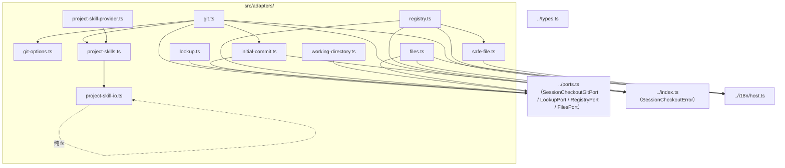

与其他模块的关系：

- 上游契约：[核心类型与端口](core_types_and_ports.md) 定义了本层实现的全部端口接口（`SessionCheckoutGitPort`、`SessionCheckoutLookupPort`、`SessionCheckoutRegistryPort`、`SessionCheckoutFilesPort`、`InitialCommitPreflight`、`LiveValue` 等）。
- 消费方：[Worktree 生命周期管理核心](../worktree_lifecycle_management_core.md) 中的 `SessionCheckoutModule` 与 `SessionCheckoutApplyEngine` 通过 `SessionCheckoutDependencies` 拿到本层实例，自身不含任何宿主 I/O。
- 控制台复用：[控制台控制面与服务](../console_control_plane_and_services/console_host.md) 的 `WorktreeConsoleControlPlane` 直接复用同一组 `lookup / files / registry / git` 实例（见 `src/index.ts` 中 `createWorktreeConsoleControlPlane({...})` 的组装）。
- 构建与配置：本层的 volatile 配置（`gitTimeoutMs`、`worktreeAddTimeoutMs`）由 [构建与配置](../build_and_configuration.md) 中的 `cordis.patch.yml` / settings 页面投影，运行时以 `LiveValue` 注入。

## 设计取舍小结

1. **结构类型 + 动态解析**：`WorkspaceRegistryLike`、`WorkingDirectoryServiceLike` 等都是最小结构视图，服务缺失时降级为 `undefined` 而不是崩溃——宿主版本漂移（rc.6 / 0.2.x）不会让插件挂载失败。
2. **绝不沙化 git**：与官方 experimental worktree 服务不同，本插件的受管 checkout 在 session workspace *之外*，`sandbox.confine` 会拒绝创建目标目录；文件策略强制留在宿主自己的 file/shell 工具中。
3. **身份（identity）作为安全边界**：目录删除、Skill 携带、初始提交、注册表迁移全部依赖 `dev:ino:birthtimeNs` 指纹做 CAS，路径以安全相对路径白名单约束。
4. **ref 命名空间隔离**：所有插件内部 ref 落在 `refs/dsh-worktree/...` 下，且放弃快照 ref 刻意游离于 per-checkout 命名空间之外。
5. **崩溃安全优先**：注册表与 Skill 溯源都用「唯一 tmp → 原子 rename → .bak」三段式，进程强制结束不会留下半截状态。
