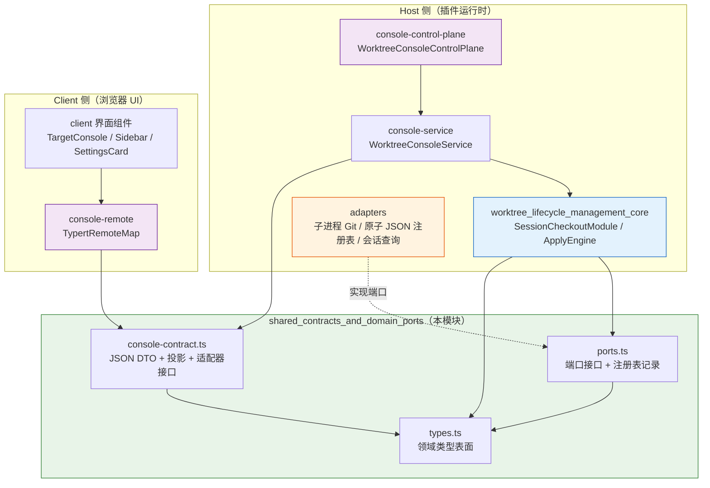
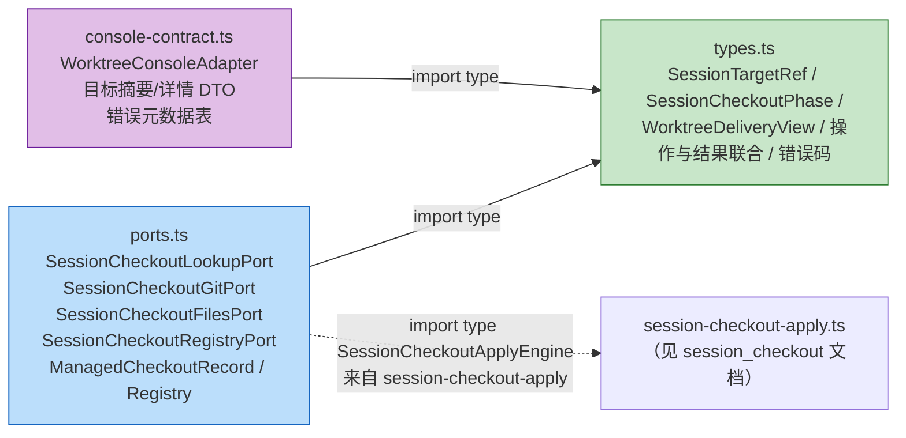
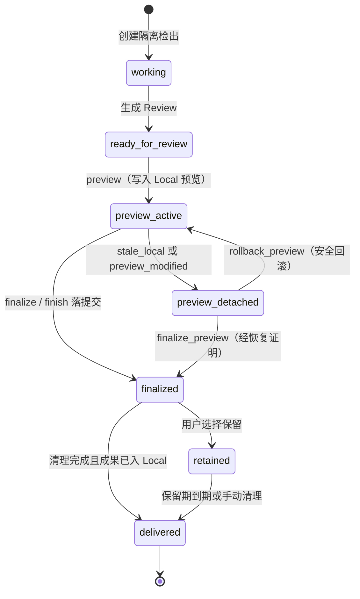
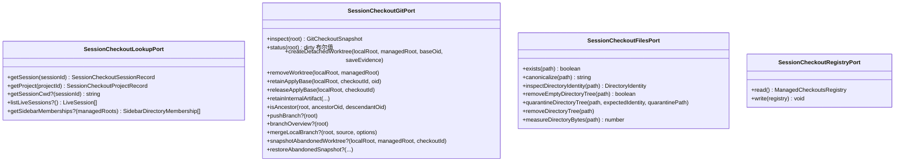
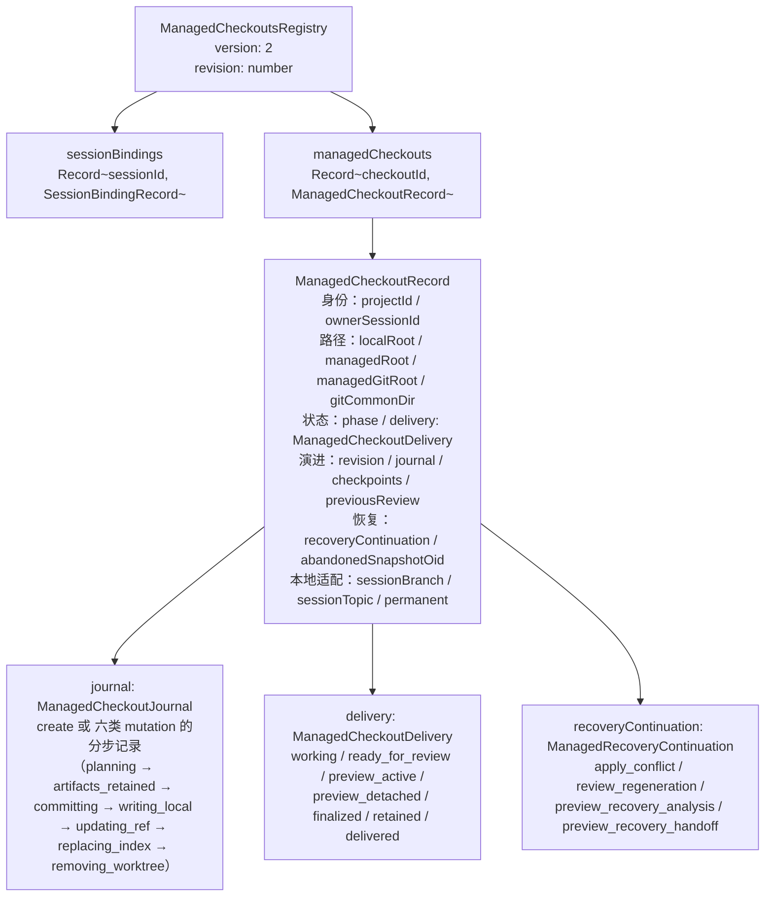
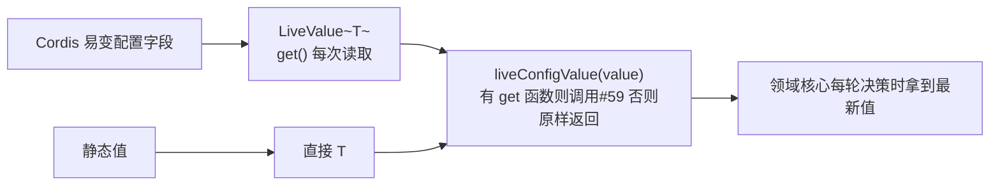
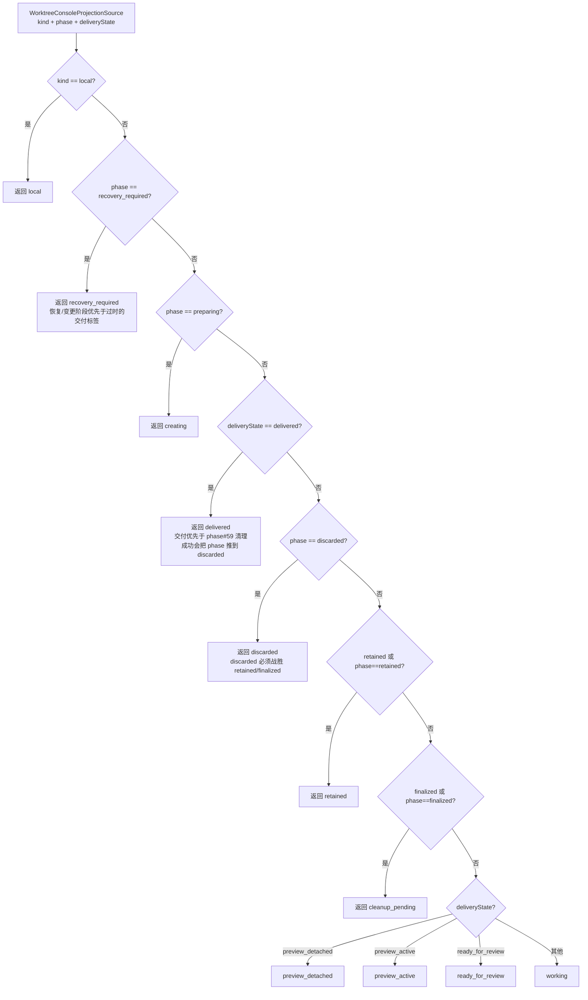
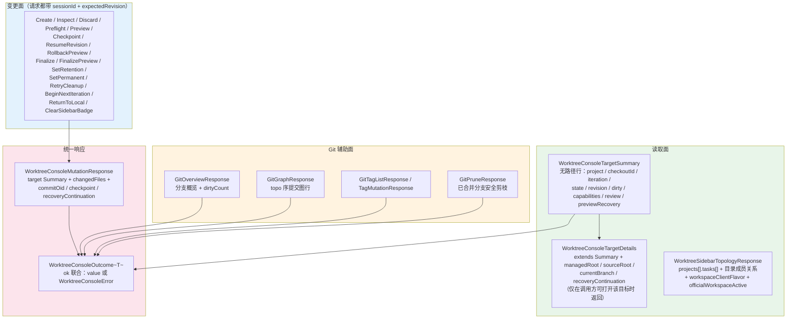
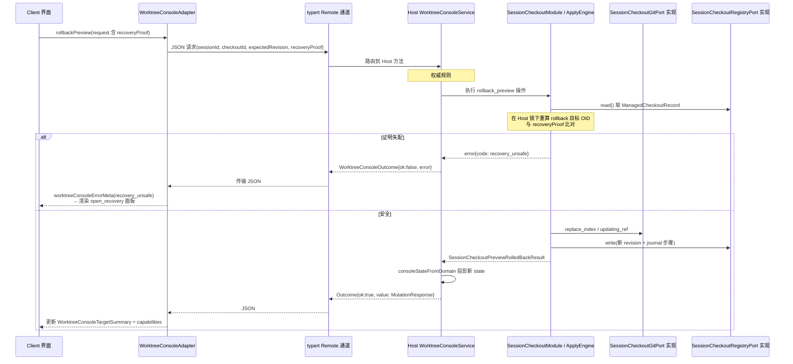

# 核心类型与端口（core_types_and_ports）

## 简介

`core_types_and_ports` 是 `dsh-git-worktree` 插件的**共享契约与领域端口层**，位于整个系统的最底层。它由三个纯 TypeScript 模块组成，刻意不包含任何 Cordis、React、远程传输或文件系统实现：

| 源文件 | 角色 | 模块注释中的定位 |
| --- | --- | --- |
| `src/types.ts` | **类型表面**（type surface）：领域状态、操作、结果、错误码 | 从 Domi 的 `@proma/shared` types/session-target 移植的宿主无关状态机类型 |
| `src/ports.ts` | **端口接口**（port interfaces）：领域逻辑依赖的抽象接缝 | 从 Domi 的 `session-checkout/ports.ts` 移植；领域逻辑只依赖这些端口，子进程 Git、插件自有注册表、会话/工作区查询等实现都藏在端口后面 |
| `src/console-contract.ts` | **JSON 共享契约**：Host 与 Client 两端共用的 DTO、状态投影函数、错误元数据与适配器接口 | 为 Harness 原生 Worktree Console 设计；Host 与 Client 共享这些 DTO，同时保留一条权威规则——每次 Host 操作都要解析出确切的调用方 Session，并在执行时重新校验 project、owner、cwd、revision 与 review 身份 |

该模块存在的意义是让**状态机与 apply 引擎保持宿主无关、可被假对象（fakes）测试**。所有真正的宿主适配实现（子进程 Git、原子 JSON 注册表、会话存储查询等）都位于上层的 [adapters](adapters.md) 模块；真正的业务编排位于 [worktree_lifecycle_management_core](../worktree_lifecycle_management_core.md)；Host/Client 的传输与 UI 装配位于 [console_control_plane_and_services](../console_control_plane_and_services.md) 与 [client](../client.md)。

从 `package.json` 的 `exports` 字段可以看到，`./console-contract` 是被独立导出的公共子路径（`lib/console-contract.js`），说明 Console 契约是对外的稳定 API 面；`types.ts` 与 `ports.ts` 则通过包主入口（`lib/index.js`）供插件内部使用。

---

## 架构定位

### 在系统分层中的位置

要点：

- **依赖方向永远向内**：`console-contract.ts` 与 `ports.ts` 都只 `import type` 自 `types.ts`；`types.ts` 本身零依赖。没有任何上层模块（核心逻辑、Host 服务、Client）的类型会反向泄漏进这一层。
- **适配器实现端口**：`ports.ts` 声明的 `SessionCheckoutGitPort`、`SessionCheckoutRegistryPort` 等由 [adapters](adapters.md) 中的 `AtomicJsonCheckoutRegistry`、子进程 Git 实现等提供，领域核心只面向接口编程。
- **Console 契约跨进程**：`console-contract.ts` 里的 DTO 同时被 Host 侧的 `WorktreeConsoleService`（见 [console_host](../console_control_plane_and_services/console_host.md)）和 Client 侧的远程客户端（见 [console_remote](../console_control_plane_and_services/console_remote.md)）使用，通过 typert 远程调用传 JSON。

### 模块内部依赖

> 唯一的例外：`ports.ts` 从 `./session-checkout-apply.js` 引用了 `SessionCheckoutApplyEngine`（用于 `SessionCheckoutDependencies.applyEngine`）。这是领域核心在端口层的反向引用，使依赖装配（composition root）能把引擎注入进来；引擎自身的完整定义见 [session_checkout](../worktree_lifecycle_management_core/session_checkout.md)。

---

## types.ts —— 领域类型表面

`types.ts` 定义了会话检出（session-checkout）领域的全部**稳定词汇表**：目标引用、阶段、交付状态机、预检视图、操作命令与结果联合，以及错误码。

### 核心状态类型

| 类型 | 含义 |
| --- | --- |
| `SessionTargetRef` | 持久层的稳定会话目标引用：`unselected` / `local` / `isolated{checkoutId}`。路径与分支**不是**检出身份 |
| `SessionCheckoutPhase` | 检出阶段：`preparing` → `ready` → `mutating`（含已废弃的 `applying`）→ `recovery_required` / `finalized` / `retained` / `discarded` |
| `WorktreeRetentionMode` | 保留策略：`cleanup`（立即删除）/ `retain_24h` / `retain_3d` / `retain_manual`；导出常量 `DEFAULT_WORKTREE_RETENTION = 'retain_24h'` |
| `WorktreeValidationStatus` | 校验状态：`passed` / `failed` / `partial` / `not_run` |
| `WorktreeCleanupReason` | 清理被阻塞的结构化原因：`directory_busy` / `modified_after_finalize` / `identity_changed` / `detached_residue` / `quarantine_busy` |

### 交付状态机（WorktreeDeliveryView）

这是隔离 Worktree 从工作到交付的完整生命周期投影。它是一个可辨识联合（discriminated union）：

每个状态变体携带对应事实：`ready_for_review` 与 `preview_active` 携带 `WorktreeReviewView`（迭代号、摘要、校验项、变更文件、建议提交信息）；`preview_detached` 额外记录 `reason`（`stale_local` / `preview_modified`）与被中断的 `attemptedAction`；`finalized` / `retained` 携带 `WorktreeDeliveryProofView`（Local HEAD 前后对比、`commitInLocalHistory` 祖先校验、清理阻塞原因）。

### 目标视图与会话操作

- **`SessionTargetView`**：一次查询返回的完整目标投影 —— project、checkout（kind/label/phase）、source ref、current branch/oid、ownership（`owner` / `inherited`）、dirty 标记、revision，以及隔离目标的 `delivery`、私有 `checkpoints`、`checkpointGeneration` 与项目预览槽位状态（`reviewSlot: 'available' | 'waiting'`）。
- **`SessionCheckoutOperation`**：全部变更操作命令的联合，每个操作都带 `sessionId` + `expectedRevision`（CAS 乐观锁）：
  - `apply` / `preview` / `checkpoint` / `finish` / `discard` / `recover` / `retry_cleanup`
  - `rollback_preview` 与 `finalize_preview` 在 `preview_detached` 时必须附带 `recoveryProof`（注释强调：它只是**待重新校验的上下文，不是持有者权限**）。
- **`SessionCheckoutOperationResult`**：对应结果联合 —— `applied` / `previewed` / `checkpointed` / `preview_rolled_back` / `preview_detached` / `finished`（含 `WorktreePushOutcome` 自动推送结果）/ `conflict`（`SessionCheckoutConflictResult`，含 `conflictDetails` 与分类 `resolveHint`）/ `discarded` / `recovered` / `error`。

### 预检与恢复证明

- **`WorktreeApplyPreflightView`**：apply 前的只读预检 —— `ready` / `local_advanced` / `already_in_local` / `conflict`（附冲突文件与截断后的逐文件 diff）/ `blocked`（带 `WorktreeApplyPreflightBlockedReason` 与占用同一项目预览槽的 `WorktreeAcceptanceBlockerView`）。`WorktreeApplyPreflightFacts` 固化了配置基线、有效基线与 `ApplyBaseStrategy`（`recorded_base` / `isolated_contains_local_head` / `local_contains_isolated_head`）。
- **`WorktreePreviewRecoveryProof`**：Host 签发的只读恢复上下文 —— 绑定 `previewId`、`revision`、`generation`、对完整持久化收据的 SHA-256（`receiptFingerprint`）、Local 的 HEAD/index/worktree 三层 OID，以及预先评估的 `rollback` 与 `finalize` 两条动作（各为 `safe{targetTreeOid…}` 或 `blocked{code, conflictingFiles}`）。注释明确：mutation 必须在 Host 锁下**重新计算并比对**这份证明，而不是信任它。
- 冲突 payload 有硬上限常量：`CONFLICT_DETAIL_FILE_LIMIT = 6`、`CONFLICT_DETAIL_DIFF_LIMIT = 4096`，防止撑爆模型上下文。

### 批量清理、管理视图与错误码

- **`ManagedWorktreeSummaryView`**：管理面板使用的**无路径**投影（状态枚举 `ManagedWorktreeSummaryState`、`canCleanup`、近似体积、`cleanup` 只读检查结论、活跃占用会话列表）。真实清理会重新校验，该视图本身绝不是授权依据。
- **`BulkCleanupManagedWorktreesResult`**：批量清理结果（已清理 / 被保留两桶）。
- **`PruneMergedBranchesView` / `MergeBranchForSessionView`**：合并分支剪枝与双向合并（forward：worktree→Local；reverse：Local→worktree）的结果投影。
- **错误码**：`SESSION_CHECKOUT_ERROR_CODES` 常量数组列出 28 个领域错误（`session_not_found` … `preview_modified` / `recovery_unsafe`），由 `SessionCheckoutErrorCode` 推导联合类型；`SessionCheckoutFailure` 是其轻量载体。

---

## ports.ts —— 端口接口与持久化记录

`ports.ts` 是依赖倒置（dependency inversion）的接缝层。注释原话：*领域逻辑只依赖这些端口；DSH 适配器（子进程 Git、插件自有注册表存储、会话/工作区查询）藏在它们后面，使状态机与 apply 引擎保持宿主无关、可用假对象测试。*

### 四大功能端口

设计要点：

1. **查询与授权分离**：`getSessionCwd?()` 存在的理由被详细注释——受管 owner 会话运行时的 cwd 就是其不可变 worktree 根，若只拿 `getProject().root`（Local 检出）做授权，所有 owner 调用都会被 `project_mismatch` 拒绝。同时它与导航记录分离，避免把授权证据混进导航数据。
2. **可选方法 = 本地适配能力**：大量方法带 `?` 标记（`pushBranch`、`mergeLocalBranch`、`snapshotAbandonedWorktree`、`branchCreationTimes` 等）。注释规定：不支持的端口**不得初始化**；缺失能力时守卫逻辑保持沉默（silent）而非猜测行为。例如 `branchCreationTimes` 缺失时并发分支竞争守卫不启用，而不是用错误数据去判断。
3. **保留引用（retained refs）作为恢复证据**：`retainApplyBase` / `retainInternalArtifact` 把 apply 基线与内部产物固化为 Git 引用（如 `refs/dsh-worktree/...`），使崩溃后的预览恢复能从对象库取回快照；`readInternalArtifact` 只读、不触碰引用与对象存储。
4. **目录身份（DirectoryIdentity）**：`device + inode + birthtimeNs` 三元组用于删除前的 CAS 校验——只有目录身份完全匹配才允许清理/隔离（quarantine）残留，防止误删用户目录。

### 持久化注册表（v2）

- **`SessionBindingRecord`**：会话到目标的绑定（`target: SessionTargetRef`、`sourceRef/sourceOid`、`ownerSessionId`、`inheritedFromSessionId`、`revision`），授权判断的根。
- **Journal 是崩溃恢复的关键**：`ManagedCheckoutMutationJournal` 记录 mutation 的当前步骤与全部关键 OID（base、effectiveBase、local/isolated HEAD、commit、checkpoint 序列等）。进程在任一步骤崩溃后，重启可据此判断重放或进入 `recovery_required`。
- **`ManagedCheckoutDelivery`** 是持久化形态的交付状态机（对应 [types.ts 中的 `WorktreeDeliveryView`](#交付状态机worktreedeliveryview)），但携带持久化所需的额外字段（如 `ManagedPreviewReceipt` 的完整基线指纹、`isolatedSnapshotOid`）。

### 依赖装配根（SessionCheckoutDependencies）

`SessionCheckoutDependencies` 是领域核心模块的构造参数包：四个端口 + `applyEngine` + `managedCheckoutsRoot` + `createCheckoutId()` 工厂，外加一组**本地适配开关**（`autoPush`、`autoDeliver`、`worktreesRoot`、`inheritLocalChanges`、`worktreeKeepCount`、`branchRaceGuard`、`branchRaceWindowMs`）。

所有配置字段都允许 `LiveValue<T>` 形式；导出的辅助函数 `liveConfigValue(value)` 统一从「裸值或易变 Cordis 配置引用」读出当前值：

---

## console-contract.ts —— Console 共享契约

这是面向「Harness 原生 Worktree Console」的 JSON-only 契约。文件头注释声明了一条**权威规则**：每次 Host 操作都必须解析出确切的调用方 Session，并在执行时重新校验 project、owner、cwd、revision 与 review 身份。契约本身不携带任何权限——它只是待校验的上下文。

### 状态投影（领域 phase → UI state）

领域内部的 `SessionCheckoutPhase` + `WorktreeConsoleDeliveryState` 被投影为 11 个 UI 目标状态（`WORKTREE_CONSOLE_TARGET_STATES`）：`local / creating / working / ready_for_review / preview_active / preview_detached / retained / cleanup_pending / recovery_required / delivered / discarded`。

两个纯函数完成投影：

- `worktreeReachedDelivery(phase, deliveryState)`：判断任务是否已真正交付（delivered / finalized / retained）——用于侧栏聚合时**绝不**把已交付任务投影为「被放弃」。
- 注释特别强调两条优先级规则：① 交付优先于 phase（因为成功的清理会把 phase 推进到 `discarded`）；② `discarded` phase 必须战胜 retained/finalized 的交付标签，否则一个带未提交内容的放弃快照会被误显示为保留环境。

### DTO 族

几个值得注意的契约设计：

- **`WorktreeConsoleCapabilities`**：Host 针对单个目标实时计算的能力位图（`create / preview / checkpoint / finalize / returnToLocal / beginNextIteration` 等 16 个布尔位），Client 据此渲染按钮，而不是靠 Client 自己猜状态。
- **`WorktreeConsoleDiffFile`**：Review 差异的逐文件 DTO（`added/modified/deleted/renamed/binary`、patch、`truncated` 标记）。
- **放弃快照（codex 对齐）**：`WorktreeConsoleAbandonedSnapshot` + `listAbandoned` / `restoreAbandoned` 接口——`discarded` 记录没有活 target，带未提交内容的 Worktree 放弃时会留下可恢复为 Local 分支的安全快照。

### 错误模型与 `WorktreeConsoleAdapter`

**错误扩展**：`WORKTREE_CONSOLE_ERROR_CODES` = 领域错误码（来自 types.ts 的 28 个）∪ 3 个传输错误（`transport_unavailable` / `malformed_response` / `timeout`）。

**错误元数据表**：`ERROR_META` 用 `satisfies Record<WorktreeConsoleErrorCode, WorktreeConsoleErrorMeta>` 静态保证每个错误码都有元数据 —— `category`（permission/stale/confirmation/recovery/conflict/unavailable/invalid/internal）、`recovery`（none/refresh/confirm_dirty/open_recovery/retry）、`retryable`。`worktreeConsoleErrorMeta(code)` 供 Client 把错误渲染为「刷新重试 / 打开恢复面板 / 要求确认 dirty」等具体动作。示例对照：

| 错误码 | category | recovery | retryable |
| --- | --- | --- | --- |
| `stale_target` | stale | refresh | true |
| `apply_conflict` | conflict | open_recovery | false |
| `project_mismatch` | permission | none | false |
| `dirty_confirmation_required` | confirmation | confirm_dirty | true |
| `registry_corrupt` | recovery | open_recovery | false |

**`WorktreeConsoleOutcome<T>`**：`{ ok: true; value: T } | { ok: false; error: WorktreeConsoleError }`——所有远程调用的标准返回形态。

**`WorktreeConsoleAdapter`**：归一化的 Client 接缝接口（约 30 个方法：`current / list / create / preview / checkpoint / rollbackPreview / discard / finalize / gitOverview / gitGraph / gitListTags / sidebarTopology …`）。注释说明：*Remote 传输细节藏在一个适配器后面*。Client 界面只面向此接口编程，typert 远程实现位于 [console_remote](../console_control_plane_and_services/console_remote.md)，Host 侧的真实服务实现位于 [console_host](../console_control_plane_and_services/console_host.md)。

---

## 关键数据流：一次带冲突恢复的 finalize

这个序列体现了本模块三条贯穿性设计原则：

1. **expectedRevision 做 CAS**：每个 mutation 请求携带 `expectedRevision`，Host 比对注册表当前 revision，过期即 `stale_target`。
2. **恢复证明是待重验的上下文**：`recoveryProof` 从 Client 一路透传，但 Host 在锁内重新计算比对——它不是持有者令牌。
3. **投影与授权分离**：Client 拿到的永远是无路径 Summary + capabilities；路径、cwd 等敏感身份只在 Host 内部校验时使用。

---

## 与其他模块的关系

| 模块 | 关系 |
| --- | --- |
| [adapters](adapters.md) | 实现 `ports.ts` 声明的四大端口：子进程 Git（`GitPortOptions`）、原子 JSON 注册表（`AtomicJsonCheckoutRegistry`）、会话/工作区查询（`SessionStoreLike` 等）、技能存储。端口的可选方法在此按宿主能力逐一落地 |
| [worktree_lifecycle_management_core](../worktree_lifecycle_management_core.md) | 消费本模块的类型与端口：`SessionCheckoutModule` 通过 `SessionCheckoutDependencies` 装配全部端口；`session-checkout-apply.ts` 的 `SessionCheckoutApplyEngine` 是 `SessionCheckoutDependencies.applyEngine` 的实现（见 [session_checkout](../worktree_lifecycle_management_core/session_checkout.md)）；并发守卫、创建失败、路径推导等子模块也都使用本模块的错误码与视图类型 |
| [console_control_plane_and_services](../console_control_plane_and_services.md) | Host 侧 `WorktreeConsoleService` 把核心操作的结果（`SessionCheckoutOperationResult`）翻译为 `console-contract.ts` 的 DTO（`WorktreeConsoleTargetSummary`、`WorktreeConsoleMutationResponse`）；`TypertRemoteMap` 按 `WorktreeConsoleAdapter` 的形状暴露远程方法 |
| [client](../client.md) | Client 界面组件消费 `WorktreeConsoleAdapter` 接口与 `WorktreeConsoleErrorMeta` 渲染错误动作；侧栏投影消费 `WorktreeSidebarTopologyResponse` |
| [build_and_configuration](../build_and_configuration.md) | `package.json` 的 `exports` 将 `./console-contract` 发布为独立子路径；`tsconfig.json` 的编译目标与 `vitest.config.ts` 的测试环境决定本模块纯类型/无实现的性质可被任意假对象单测 |

## 延伸阅读

- 上层契约总览：[shared_contracts_and_domain_ports](../shared_contracts_and_domain_ports.md)
- 适配器实现细节：[adapters](adapters.md)
- 领域核心与状态机：[worktree_lifecycle_management_core](../worktree_lifecycle_management_core.md)
- Console 控制面与远程通道：[console_control_plane_and_services](../console_control_plane_and_services.md)
