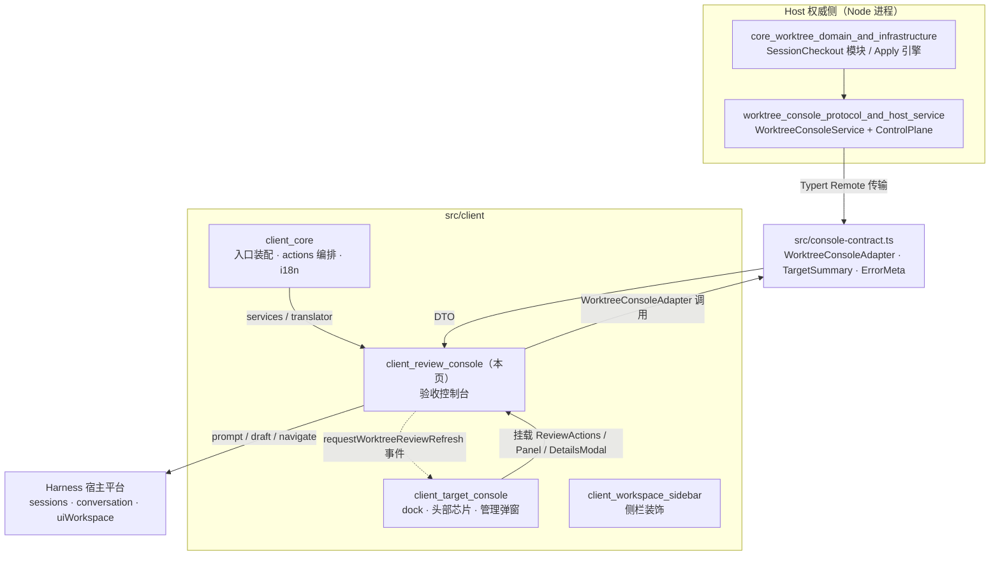
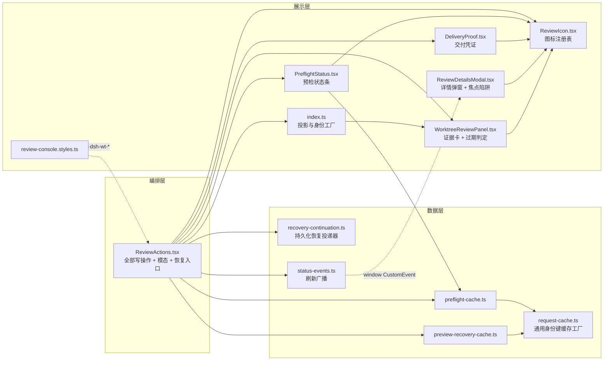
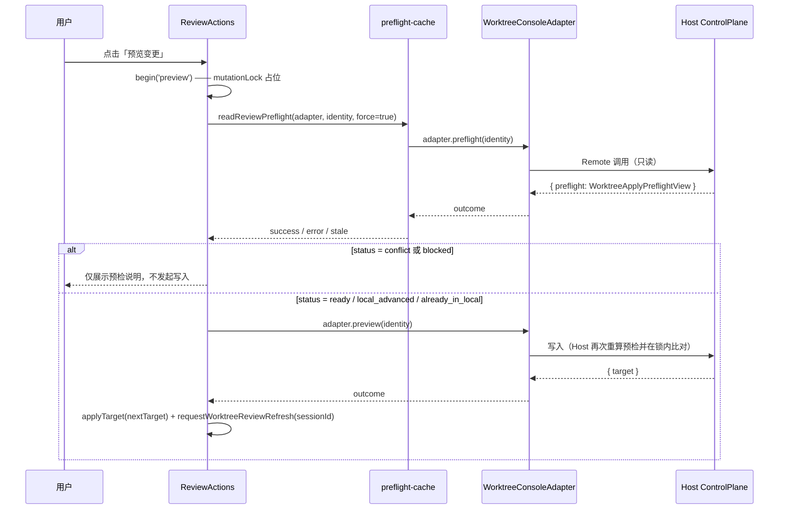
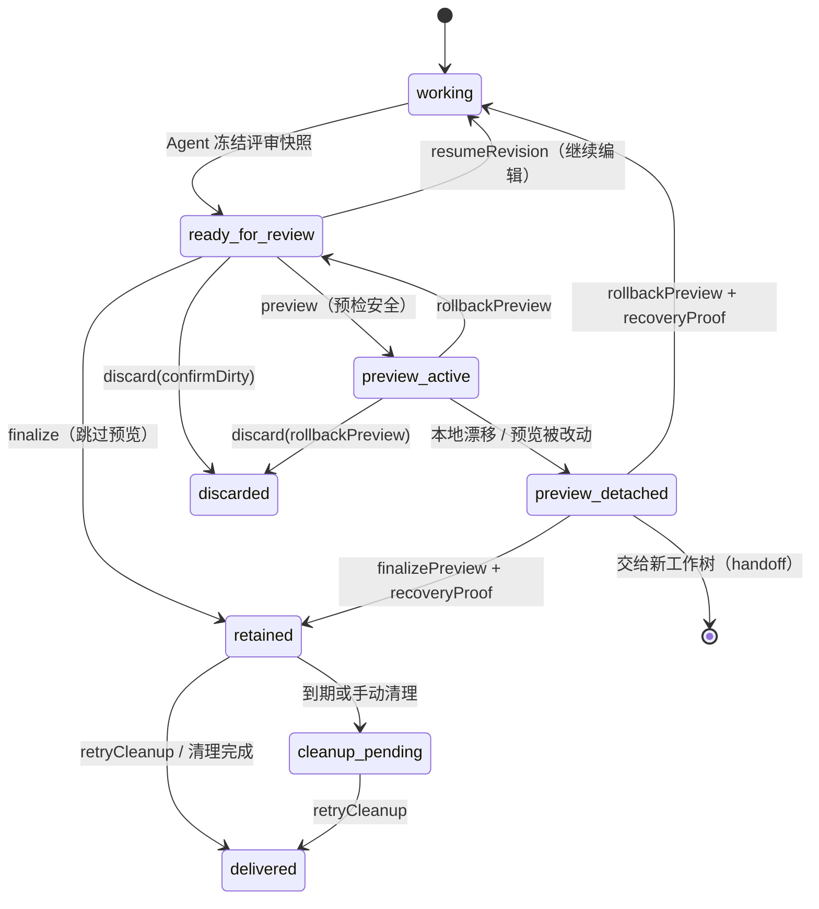

# client_review_console：受管 Worktree 验收控制台（浏览器端）

`client_review_console` 位于 `src/client/review-console/`，是 dsh-git-worktree 插件在**浏览器侧的验收（review / delivery）控制台**。它把 Host 侧 SessionCheckout 状态机的投影结果（`WorktreeConsoleTargetSummary`）渲染成可操作界面，并把用户的每一次写操作转换为携带 **CAS 身份**（`sessionId` + `checkoutId` + `expectedRevision` + `expectedReviewId`）的 Remote 调用。

本模块解决四个问题：

1. **证据呈现**：一次「待验收」迭代的摘要、变更文件、自动化校验结果、建议提交信息如何在不依赖实时状态的前提下稳定展示（历史会话也能回放）。
2. **同步预检（preflight）**：在真正写入 Local 之前，以**只读**方式确认「本地是否前进 / 是否有冲突 / 验收槽是否被别的任务占用」，并且这套判定结果必须被缓存、被 single-flight、被 `force` 刷新——因为 Host 要求所有写操作前重新读取一次。
3. **交付动作编排**：预览（preview）→ 回滚 / 确认保存（rollback / finalize preview）→ 暂存（checkpoint）→ 直接保存（finalize）→ 放弃（discard）→ 重试清理（retryCleanup），以及**分离态（preview_detached）恢复**（只读分析、交接给新工作树）。
4. **恢复续作（recovery continuation）投递**：冲突解决 / 评审重生成这类请求需要交给 Agent 执行，而 Agent 所在的主会话可能尚未就绪；因此需要一个可持久化、可重放、每次发送前都重新校验 Host 身份的**排队投递器**。

> 本模块**不做任何 Git 判定**：所有状态机推进、冲突计算、身份校验都在 Host 侧完成。界面层只做「投影 + 编排 + 保守拒绝」。

---

## 1. 在系统中的位置



| 边界 | 提供者 | 本模块的使用方式 |
| --- | --- | --- |
| `WorktreeConsoleAdapter` | [worktree_console_contract.md](../worktree_console_protocol_and_host_service/worktree_console_contract.md)，实例由 [client_console_remote.md](client_console_remote.md) 创建 | 唯一的读写通道；返回值一律是 `WorktreeConsoleOutcome<T>`，从不抛异常表示业务失败 |
| `WorktreeConsoleTargetSummary` / `WorktreeConsoleReviewSummary` | 同上 | 面板、预检、交付凭证的输入 |
| `WorktreeApplyPreflightView` / `WorktreePreviewRecoveryProof` | [session_checkout_domain_contracts.md](../core_worktree_domain_and_infrastructure/session_checkout_domain/session_checkout_domain_contracts.md) | 预检状态与恢复证明的字段来源 |
| `WorktreeClientServices` / `openIsolatedTarget` / `openAuthorizedWorktreeTarget` / `prefillSessionDraft` / `selectedSessionId` | [client_core.md](client_core.md) | 把恢复请求投递给 Agent、把工作树打开给持有验收槽的任务 |
| `useClientTranslator` / `translatorForServices` | [client_core.md](client_core.md)（`src/client/i18n.tsx`） | 所有文案；词条见 [src_i18n.md](../project_foundation_and_localization/src_i18n.md) |
| `Modal`（`@deepseek-ai/dsh-client-ui-primitives`） | 宿主 UI 原语，声明于 `src/client/harness-platform.d.ts` | 暂存 / 提交 / 放弃 / 详情四个对话框 |
| `isValidCommitMessage` | `src/commit-message.ts`，见 [worktree_core_operations.md](../core_worktree_domain_and_infrastructure/worktree_core_operations.md) | 提交与暂存按钮的启用条件 |
| 挂载点 `conversation.input.dock` | [client_target_console.md](client_target_console.md) 的 `WorktreeReviewStatus` | dock 复用本模块的 `ReviewActions`（compact 凭证）、`ReviewDetailsModal`、缓存与恢复投递器 |

样式归属：本模块导出 `REVIEW_CONSOLE_STYLES`，由 [client_core.md](client_core.md) 的 `src/client/styles.ts` 拼接进唯一一张 `WORKTREE_STYLES`，再由 `src/client/index.tsx` 的 `ctx.effect` 以带 `data-plugin` 标记的 `<style>` 注入 `document.head`（详见 `package.json` 的 `dsh.client` 声明与 [build_ci_and_packaging.md](../project_foundation_and_localization/build_ci_and_packaging.md)）。

---

## 2. 组件构成与文件地图



| 文件 | 一句话职责 | 归属子模块 |
| --- | --- | --- |
| `WorktreeReviewPanel.tsx` | 渲染一次评审的证据（摘要 / 校验 / 文件 / 阶段数），并判定该快照是否已过期 | [client_review_console_review_surfaces.md](client_review_console/client_review_console_review_surfaces.md) |
| `ReviewDetailsModal.tsx` | 全屏详情弹窗：冲突文件、变更文件、校验命令、版本标识；含 Tab 焦点陷阱与折叠列表 | [client_review_console_review_surfaces.md](client_review_console/client_review_console_review_surfaces.md) |
| `ReviewIcon.tsx` | `lucide-react` 图标到语义名（`preview` / `rollback` / `discard` …）的唯一注册表 | [client_review_console_review_surfaces.md](client_review_console/client_review_console_review_surfaces.md) |
| `review-console.styles.ts` | `REVIEW_CONSOLE_STYLES`：面板 / dock / 弹窗 / 按钮 / 状态条的样式令牌 | [client_review_console_review_surfaces.md](client_review_console/client_review_console_review_surfaces.md) |
| `index.ts` | `reviewEvidenceFromTarget()` 与 `reviewIdentityFromTarget()`：从 Host target 投影出证据与 CAS 身份 | [client_review_console_review_surfaces.md](client_review_console/client_review_console_review_surfaces.md) |
| `PreflightStatus.tsx` | 只读预检的可视化：`ready` / `local_advanced` / `already_in_local` / `conflict` / `blocked`，并暴露恢复入口 | client_review_console_status_readouts.md |
| `DeliveryProof.tsx` | 交付后的不可篡改凭据（本地分支、before→after、文件数、校验状态、是否仍在历史中），支持 compact 单行 | client_review_console_status_readouts.md |
| `ReviewActions.tsx` | 所有写操作与对话框的唯一编排者（约 700 行的状态机式回调集合） | [client_review_console_review_actions.md](client_review_console/client_review_console_review_actions.md) |
| `request-cache.ts` | `createRequestCache()`：per-adapter WeakMap + 身份键 + single-flight + generation 隔离 | [client_review_console_read_caches.md](client_review_console/client_review_console_read_caches.md) |
| `preflight-cache.ts` | 评审预检的缓存实例 | [client_review_console_read_caches.md](client_review_console/client_review_console_read_caches.md) |
| `preview-recovery-cache.ts` | 分离态恢复评估的缓存实例 | [client_review_console_read_caches.md](client_review_console/client_review_console_read_caches.md) |
| `recovery-continuation.ts` | 恢复请求的排队投递 + `localStorage` 持久化 + 双重 Host 重校验 | [client_review_console_recovery_delivery.md](client_review_console/client_review_console_recovery_delivery.md) |
| `status-events.ts` | `requestWorktreeReviewRefresh()`：让所有已挂载的验收面重新读取 Host 权威 | [client_review_console_recovery_delivery.md](client_review_console/client_review_console_recovery_delivery.md) |

---

## 3. 核心概念：身份、代次与「只读先于写入」

### 3.1 CAS 身份四元组

浏览器永远不自选身份，只回传 Host 给出的值：

```
WorktreeReviewIdentity = { sessionId, checkoutId, expectedRevision, expectedReviewId }
```

- `index.ts::reviewIdentityFromTarget()` 从 target 构造它：`checkoutId` 或 `review` 缺失时返回 `null`，按钮随之禁用。
- 分离态（`preview_detached`）额外要求 `expectedPreviewId`，因此恢复缓存的键是**五元组**。
- `client_core` 中的 `WorktreeReviewRow` 只在 `liveTarget.review.reviewId === payload.reviewId` 时才采用实时 `revision`，否则坚持冻结值——这是「过期快照」判定的根源（见 `WorktreeReviewPanel.tsx::reviewIsStale()`）。

### 3.2 只读先于写入（read-only preflight before every write）



`force = true` 是**强制要求**：`preflight-cache.ts` 与 `preview-recovery-cache.ts` 的注释都明确写明「写操作前必须绕过缓存的成功结果」。Host 侧才是权威——缓存只用于减少重复的只读 RPC。

### 3.3 状态驱动的动作矩阵

`ReviewActions` 的主按钮完全由 `target.state` × `capabilities` × 预检快照决定：

| `target.state` | 主按钮 | 「更多」菜单项 | 附加区域 |
| --- | --- | --- | --- |
| `ready_for_review` | 预览变更（需 `capabilities.preview` 且预检安全） | 保存阶段并继续、继续编辑、跳过预览并保存、查看评审、放弃任务 | `PreflightStatus`（仅冲突/阻塞时可见） |
| `preview_active` | 确认并保存 | 保存阶段并继续、继续编辑（`rollbackPreview(true)`）、回滚此次预览、放弃任务 | —— |
| `preview_detached` | 恢复并回滚预览（`proof.rollback.status==='safe'`）或「再检查一次」 | 重新回滚、保存变更（`proof.finalize==='safe'`） | 分离态恢复面板：只读分析 / 交给新工作树 / 打开持有槽的任务 |
| `recovery_required` | ——（仅当 `rollbackPreview` 能力存在时按恢复路径处理） | 回滚 | 同上 |
| `cleanup_pending` | 重试环境清理 | 放弃任务（若 `capabilities.discard`） | `DeliveryProof` |
| `retained` / `delivered` | —— 终态说明文案 | —— | `DeliveryProof`（面板完整版 / dock compact 版） |
| `working` | —— | —— | 面板判定「快照已过期，请刷新」 |

---

## 4. 交付生命周期在界面上的落地



界面侧的三条硬性规则：

- **默认保留环境**：`DEFAULT_RETAIN_ENVIRONMENT = true`、默认保留期 `retain_24h`，使误交付仍可在保留期内回滚，之后由定时器自动清理。
- **写入锁**：`mutationLock` ref + `submitting` 状态保证同一时刻只有一个变更在飞；所有回调在发起前先 `begin(kind)`，失败路径统一走 `finishError()`。
- **活性守卫**：每个异步步骤之后都检查 `isActive()`。宿主传入的 `isActive` 综合了「组件仍挂载 + 会话未切换 + 会话代次一致」，因此旧会话的迟到响应不会污染新会话。

---

## 5. 子模块文档

| 子模块 | 内容 |
| --- | --- |
| [client_review_console_review_surfaces.md](client_review_console/client_review_console_review_surfaces.md) | 评审证据面板、详情弹窗、图标注册表、样式令牌、投影与身份工厂 |
| client_review_console_status_readouts.md | `PreflightStatus` 五种预检态的呈现与恢复入口、`DeliveryProof` 完整版与 compact 版 |
| [client_review_console_review_actions.md](client_review_console/client_review_console_review_actions.md) | `ReviewActions`：变更编排、模态、冲突/过期/不匹配的分类处理、分离态恢复分析与交接 |
| [client_review_console_read_caches.md](client_review_console/client_review_console_read_caches.md) | `createRequestCache()` 的 WeakMap/single-flight/generation 机制及两个缓存实例 |
| [client_review_console_recovery_delivery.md](client_review_console/client_review_console_recovery_delivery.md) | 恢复续作的排队投递、`localStorage` 持久化与严格校验、刷新广播事件 |

相关外部文档：
- 挂载本模块的三个宿主槽位与 dock：[client_target_console.md](client_target_console.md)
- 工具日志卡片（历史回放入口）与服务编排：[client_core.md](client_core.md)
- Host 侧写操作的真正实现（Apply 引擎 / 模块）：[session_checkout_domain.md](../core_worktree_domain_and_infrastructure/session_checkout_domain.md)、[session_checkout_apply_engine.md](../core_worktree_domain_and_infrastructure/session_checkout_domain/session_checkout_apply_engine.md)
- 协议 DTO 与错误元数据：[worktree_console_contract.md](../worktree_console_protocol_and_host_service/worktree_console_contract.md)
- 词条与语言回退：[src_i18n.md](../project_foundation_and_localization/src_i18n.md)

---

## 6. 安全与保守性设计一览

| 设计 | 位置 | 目的 |
| --- | --- | --- |
| 身份字符串使用 `\u0000` 连接 | `preflight-cache.ts` / `preview-recovery-cache.ts` | 防止字段拼接产生歧义键，导致不同 checkout 共享条目 |
| 缓存挂在 per-adapter `WeakMap` | `request-cache.ts` | 重新挂载的客户端永远读不到另一个 adapter 的数据 |
| `generation` 计数 | `request-cache.ts::invalidate()` | 使「已被作废的在飞响应」既不覆盖新快照，也不清空更新的 promise |
| 恢复请求的完整结构校验 `validRequest()` | `recovery-continuation.ts` | 浏览器状态不可信：长度、控制字符、`..`、路径分段、OID 十六进制格式全部检查 |
| 发送前**两次** `inspect` | `recovery-continuation.ts::attempt()` | 第一次判定就绪，第二次紧贴 `prompt` 之前重算身份；任何偏差立即 `cancel` |
| 冲突恢复返回值的逐项比对 | `ReviewActions.tsx::startConflictRecovery()` | Host 必须返回精确的 `recoveryContinuation`，否则报 `checkout_mismatch` 而非盲目续作 |
| 交接（handoff）后二次 Host cwd 校验 | `ReviewActions.tsx::handoffRecovery()` | 确认新工作树路径与 `requestId` 匹配才允许投递 |
| `prefillSessionDraft` 只填草稿 | `client_core::actions.ts` | 恢复请求绝不自动 `send` / `command`，把最终决定权留给用户 |
| `safeConflictFile()` 拒绝绝对路径与 `.`/`..` 段 | `recovery-continuation.ts` | 阻止持久化数据被用作路径注入载体 |
| 指数退避轮询（250ms → 5s） | `recovery-continuation.ts::pollUntilReady()` | 每次唤醒都是一次真实 `inspect` RPC，必须限速；延迟存在 entry 上以免重入重置 |

---

## 7. 测试与类型检查约定

- 类型：`tsconfig.json` 开启 `strict` 与 `noUncheckedIndexedAccess`，`jsx: react-jsx`，输出到 `lib/`；因此本模块所有可选字段（如 `target.reviewSlotHolder`、`proof.conflictingFiles`）都做了显式空值分支。
- 测试：`vitest.config.ts` 把 `@deepseek-ai/dsh-client-ui-primitives` 别名指向 `tests/support/ui-primitives.tsx`，使 `Modal` 等原语在无宿主环境下可测；`tests/**/*.test.{ts,tsx}` 由 `pnpm test`（`vitest run`）执行，非 Windows 才启用文件并行。
- 打包：`package.json` 的 `dsh.client.platform: "web"` 与 `exports["./client"]` 指向 `lib/client.js`，即本模块随浏览器 bundle 分发，`lucide-react` 是唯一的直接运行时依赖之一。