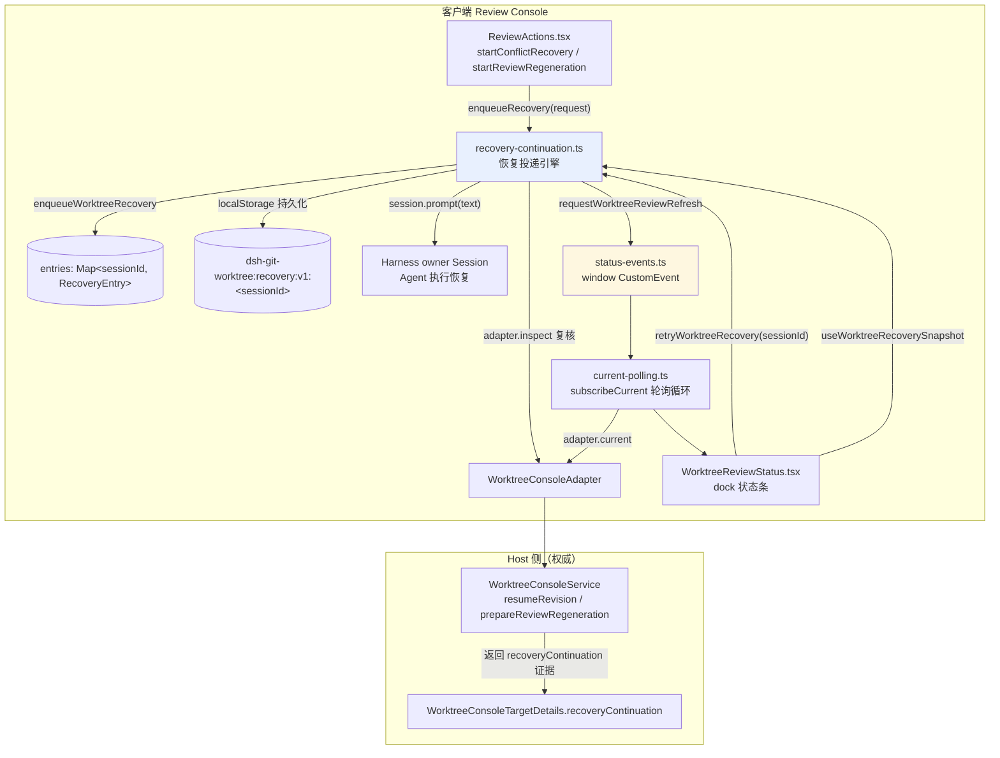
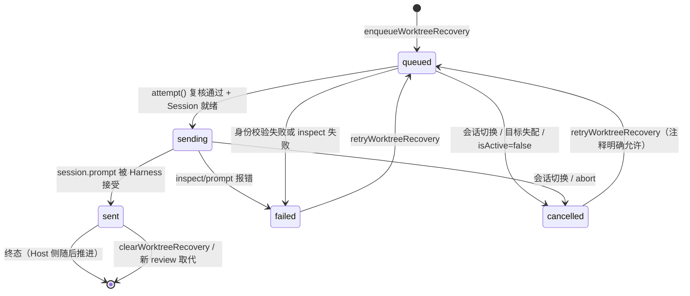
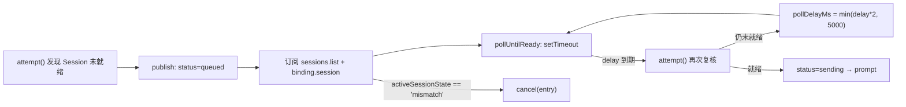
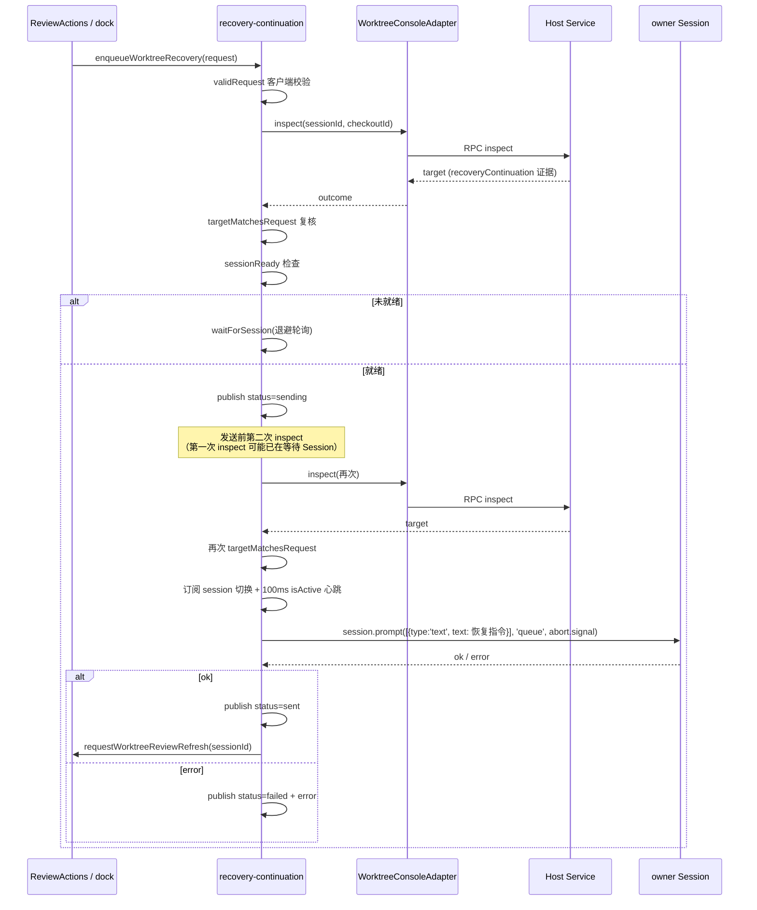
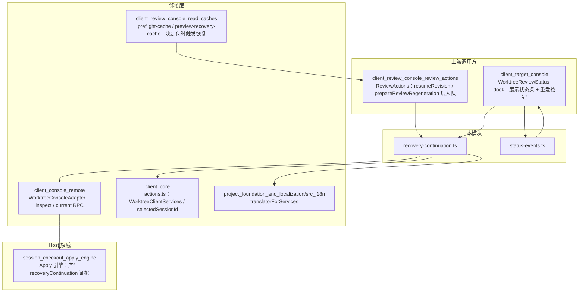

# 恢复投递与状态刷新分发（client_review_console_recovery_delivery）

## 简介

本模块是客户端 Review Console 的「恢复投递（Recovery Delivery）」子层，负责把用户显式批准后的**两类恢复请求**可靠、原子地投递回 owner Session，并在投递完成后驱动所有 Review 界面重新读取 Host 权威状态。

它包含两个文件：

- `src/client/review-console/recovery-continuation.ts` —— 客户端侧恢复投递引擎：队列、身份复核、Session 就绪等待、轮询退避、`localStorage` 持久化、React 订阅。
- `src/client/review-console/status-events.ts` —— 跨界面刷新事件总线：一个 `window` 自定义事件，通知所有挂载中的 Review 表面重新拉取 Host 权威 target。

本模块不直接执行 Git 或变更操作——所有「写动作」由 Host 侧 [core_worktree_domain_and_infrastructure/session_checkout_domain/session_checkout_apply_engine.md](../../core_worktree_domain_and_infrastructure/session_checkout_domain/session_checkout_apply_engine.md) 的 Apply 引擎完成；本模块只负责**把恢复指令以 prompt 形式发回给 owner Session 的 Agent**。

## 两类恢复请求

| 请求类型 | kind | 触发场景 | Host 权威证据 |
| --- | --- | --- | --- |
| 应用冲突恢复 | `worktree_apply_conflict` | 用户在「同步预览」或「直接交付」前确认后，实时写检查发现真实冲突；`resumeRevision` 在 CAS 下把 target 推回 Working 态并返回 `recoveryContinuation` | `WorktreeApplyConflictRecoveryProof` |
| Review 重新生成 | `worktree_review_regeneration` | preflight 以只读复检发现 `stale_isolated`，旧 Review 快照已失效但 Revision 保持 Ready 不变；`prepareReviewRegeneration` 返回 `recoveryContinuation` | `WorktreeReviewRegenerationProof` |

两类请求都由上游 [client_review_console_review_actions](client_review_console_review_actions.md) 的 `ReviewActions` 在拿到 Host 返回的 `recoveryContinuation` 后调用 `enqueueWorktreeRecovery(...)` 入队。

## 架构总览



## 核心组件

### `recovery-continuation.ts`

模块内部维护一个按 `sessionId` 键控的单例队列 `entries: Map<string, RecoveryEntry>`，以及一个订阅表 `listenerSets: Map<string, Set<() => void>>`。每个 `RecoveryEntry` 承载运行时所需的全部上下文：

```typescript
interface RecoveryEntry {
  snapshot: WorktreeRecoverySnapshot   // 状态机快照（status + request + error?）
  adapter: WorktreeConsoleAdapter     // Host 权威 RPC 通道
  services: WorktreeClientServices    // Harness Session/Workspace 运行时
  isActive: () => boolean             // 调用方（React 组件）是否仍有效
  claimed: boolean                    // 单次飞行锁，防并发 attempt
  pollDelayMs: number                 // Session 未就绪时的退避延迟
  abort?: AbortController             // 中止进行中的 prompt 发送
  unsubscribers: Array<() => void>    // Session list / binding 订阅清理
  listeners: Set<() => void>          // 本 entry 的 React 订阅者
}
```

#### 状态机

`WorktreeRecoveryStatus` 共 5 个状态：



> 关键不变量：**`sent` 与 `cancelled` 不写 localStorage**；`queued / sending / failed` 才持久化，且 `sending` 恢复时一律降级为 `failed`（因为发送中的请求无法安全续发）。

#### 导出 API 一览

| 函数 | 职责 |
| --- | --- |
| `enqueueWorktreeRecovery({adapter, services, request, isActive})` | 入队；同 `requestId` 复用 entry，旧请求先 `cancel`；客户端侧先做 `validRequest` 边界校验 |
| `restoreWorktreeRecovery({sessionId, adapter, services, isActive?})` | React 挂载时恢复：优先复用内存 entry（运行时重建时把 `sending` 降级为 `failed`），否则从 `localStorage` 读回 `PersistedRecovery` |
| `retryWorktreeRecovery(sessionId)` | 仅 `failed / cancelled` 可重试；`attempt()` 会重新复核身份，过期请求只会再次被 `cancel` |
| `getWorktreeRecoverySnapshot(sessionId)` | 命令式读取当前快照 |
| `subscribeWorktreeRecovery(sessionId, listener)` | 外部（非 React）订阅 |
| `useWorktreeRecoverySnapshot(sessionId?)` | React Hook，基于 `useSyncExternalStore` |
| `cancelWorktreeRecovery(sessionId, requestId?)` | 新 review 取代或测试后丢弃渲染期证据 |
| `detachWorktreeRecoveryRuntime(sessionId)` | 模拟渲染器/模块卸载：停订阅、中止 abort、删 entry，但**保留未发送的持久化上下文** |
| `clearWorktreeRecovery(sessionId)` | 彻底清理：含 localStorage |
| `buildWorktreeRecoveryPrompt(request, t)` | 构造发回 Agent 的人类可读 prompt 文本（i18n） |

### `status-events.ts`

仅有一个导出：

```typescript
export const WORKTREE_REVIEW_REFRESH_EVENT = 'dsh-git-worktree:review-refresh'
export function requestWorktreeReviewRefresh(sessionId: string): void
```

它在 `window` 上派发 `CustomEvent`，`detail: { sessionId }`。消费者是 [client_target_console](../client_target_console.md) 的 `current-polling.ts`：其 `Poll` 在首个订阅者挂载时监听该事件，`detail.sessionId` 匹配即 `invalidate()`，立即触发一次 `adapter.current` 重拉。这样任何 Review 界面完成一次 Host 变更后，无需等待 5 秒轮询间隔即可刷新。

## 身份复核与安全模型

本模块的核心设计原则是：**浏览器状态不可信，Host 身份始终权威**。

入队时做两层校验：

1. **客户端边界校验** `validRequest(request)`：
   - `sessionId / checkoutId / reviewId` 长度与字符集白名单（拒绝控制字符、路径分隔符、`..`）；
   - `revision` 为非负安全整数；
   - `worktree_apply_conflict` 额外校验 `localHeadOid` 为 40/64 位十六进制、`conflictingFiles` ≤ 500 个且每个文件路径经 `safeConflictFile` 检查（拒绝绝对路径、Windows 盘符、空段、`.`、`..`）；
   - `hasExactKeys` 防止多余字段注入。
2. **发送前 Host 复核** `attempt()` 内调用 `adapter.inspect(...)`，再由 `targetMatchesRequest(target, request)` 比对：
   - `checkoutId / ownerSessionId / targetSessionId / revision` 全等；
   - `managedRoot !== null`；
   - 冲突恢复额外要求 `state === 'working'`、`review === undefined`，且 `target.recoveryContinuation` 的 `requestId / localHeadOid / conflictingFiles` 与请求逐项相等；
   - Review 重新生成额外要求 `state === 'ready_for_review'`、`review.reviewId` 匹配、`capabilities.preflight === true`。

任一步不匹配 → `cancel(entry)`，绝不把过期请求发给 Agent。

## Session 就绪等待与轮询退避

owner Session 可能尚未打开、不在前台、或 `cwd` 尚未指向 `managedRoot`。`sessionReady(...)` 要求同时满足：

- `binding.session` 提供 `getSnapshot / subscribe / prompt`；
- 当前选中 Session（`selectedSessionId`，兼容旧 `current` 与新 `retainedBy` 两种契约）== 请求 `sessionId`；
- `summary.cwd` 与 `target.managedRoot` 经 `samePath` 归一化后相等（Windows 盘符大小写不敏感）；
- `snapshot.openState === 'open' && !running && !removed`。

未就绪时进入 `waitForSession`：



退避参数：`POLL_INITIAL_MS = 250`，上限 `POLL_MAX_MS = 5_000`。退避延迟保存在 `entry.pollDelayMs` 上，而非每次重入时重置——因为每次 `attempt` 都会重新进入 `waitForSession`，不能让退避链每次都从 250ms 重新开始。一旦发送落地（进入 `sending`），`pollDelayMs` 重置回 250。

## 发送时序（双重 inspect 防护）

`attempt()` 的发送段是整个模块最严谨的部分：



注释明确说明了第二次 inspect 的原因：「第一次 inspect 可能已在等待 Session 就绪，prompt 外发前必须再确认一次 Host 权威身份」。

发送期间还有两道防护：

- `sessions.list.subscribe(...)`：一旦切走 owner Session（`activeSessionState !== 'active'`）立即 `cancel` 并 `abort`；
- `setInterval(..., 100)` 心跳：每 100ms 检查 `isActive()`，调用方组件卸载/会话代际失效即取消。

## 持久化与恢复

`localStorage` 键：`dsh-git-worktree:recovery:v1:<sessionId>`，值为 `PersistedRecovery`：

```typescript
interface PersistedRecovery {
  version: 1
  status: 'queued' | 'sending' | 'failed'   // sent / cancelled 不落盘
  request: WorktreeRecoveryRequest
  error?: string
}
```

读回时 `readPersisted` 做严格形状校验（版本号、状态枚举、`sessionId` 必须匹配、`validRequest` 复检），任何不合法条目直接删除——持久化只是「上下文恢复」，不是授权来源。

恢复语义：

| 持久化状态 | 恢复后的运行时状态 |
| --- | --- |
| `queued` | `queued`，立即 `void attempt(entry)` 重新进入投递流程 |
| `sending` | 一律降级为 `failed`，附带「发送时 Session 运行器重建」错误——无法安全续发进行中的 prompt |
| `failed` | `failed`，保留原 `error`，用户可点「重发」 |

`restoreWorktreeRecovery` 在两种场景被调用：

1. `ReviewActions` 的 `useEffect`（adapter/services/sessionId 变化时）；
2. `WorktreeReviewStatus` dock 的 `useEffect`。

## 与其他模块的关系



- 上游动作编排见 [client_review_console_review_actions](client_review_console_review_actions.md)；
- preflight 读取与证据缓存（决定冲突/过期分类）见 [client_review_console_read_caches](client_review_console_read_caches.md)；
- Review 卡片/弹窗等展示表面见 [client_review_console_review_surfaces](client_review_console_review_surfaces.md)；
- RPC 通道定义见 [worktree_console_protocol_and_host_service/worktree_console_contract.md](../../worktree_console_protocol_and_host_service/worktree_console_contract.md)（`WorktreeConsoleAdapter`、`WorktreeRecoveryProof`、`WorktreeApplyConflictContinuation`）；
- Host 侧产生恢复证据的 Apply 引擎见 [core_worktree_domain_and_infrastructure/session_checkout_domain/session_checkout_apply_engine.md](../../core_worktree_domain_and_infrastructure/session_checkout_domain/session_checkout_apply_engine.md)。

## 设计要点小结

1. **单飞 + 身份权威**：`claimed` 锁防并发，`attempt()` 内外两次 `inspect` + `targetMatchesRequest` 保证只把仍被 Host 认可的请求发给 Agent。
2. **浏览器仅做上下文**：`localStorage` 持久化注释明确「best-effort context only; Host identity checks remain authoritative」。
3. **可取消性贯穿全程**：`isActive()` 心跳、Session 切换订阅、`AbortController` 三重取消路径，杜绝组件卸载后幽灵 prompt。
4. **退避有界**：250ms → 5s 指数退避，避免对未就绪 Session 高频空轮询。
5. **刷新解耦**：恢复投递落地后通过 `status-events.ts` 的 window 事件立即驱动 `current` 轮询失效，Review 界面无需等待 5 秒。
