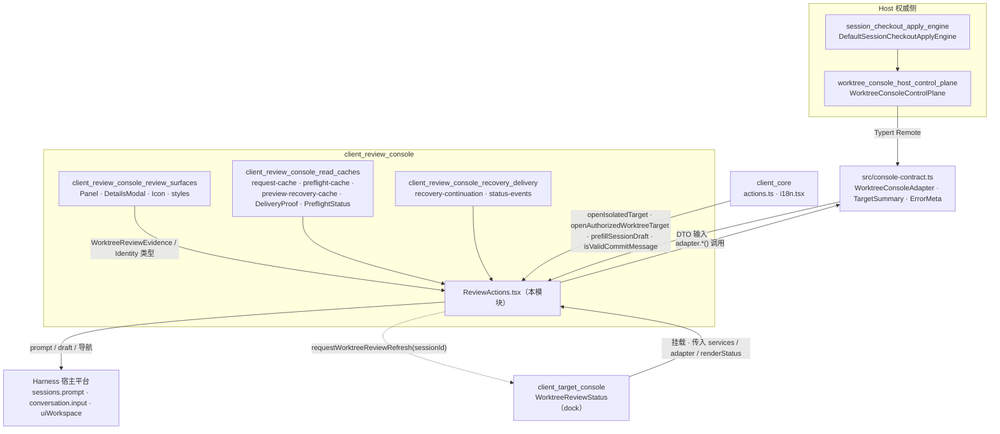
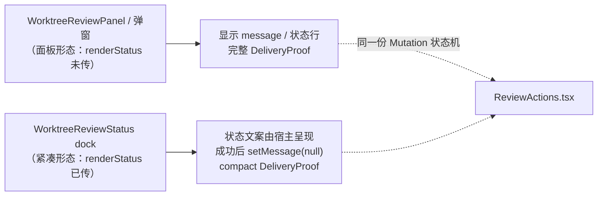
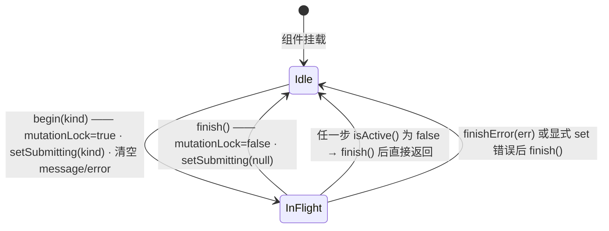
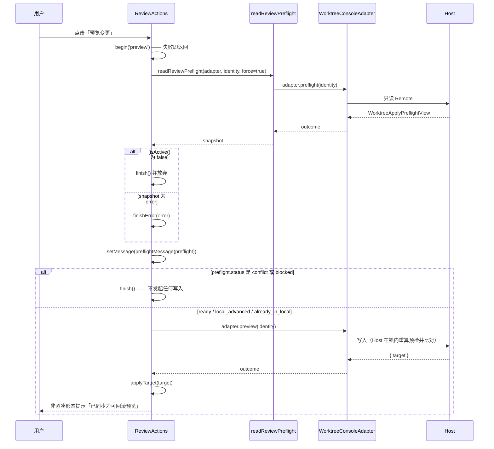
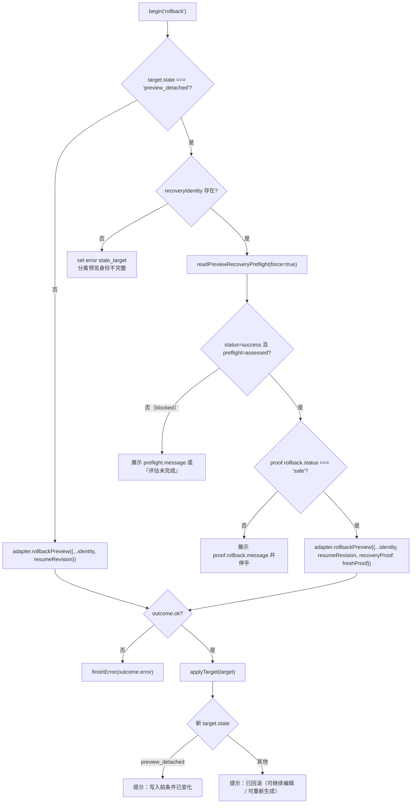
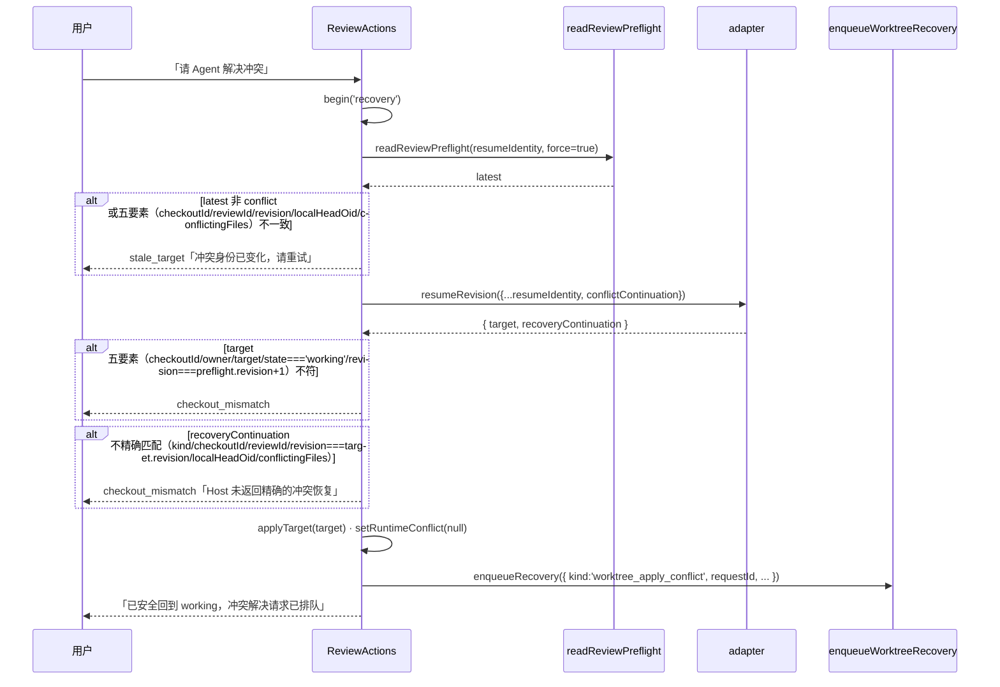
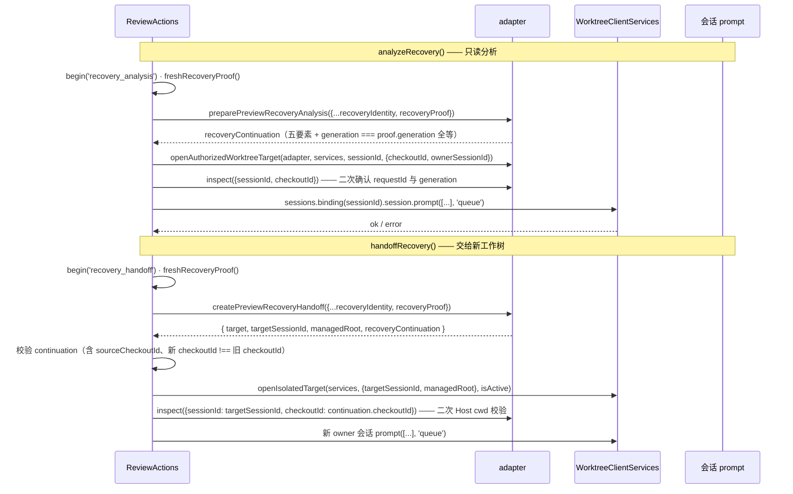
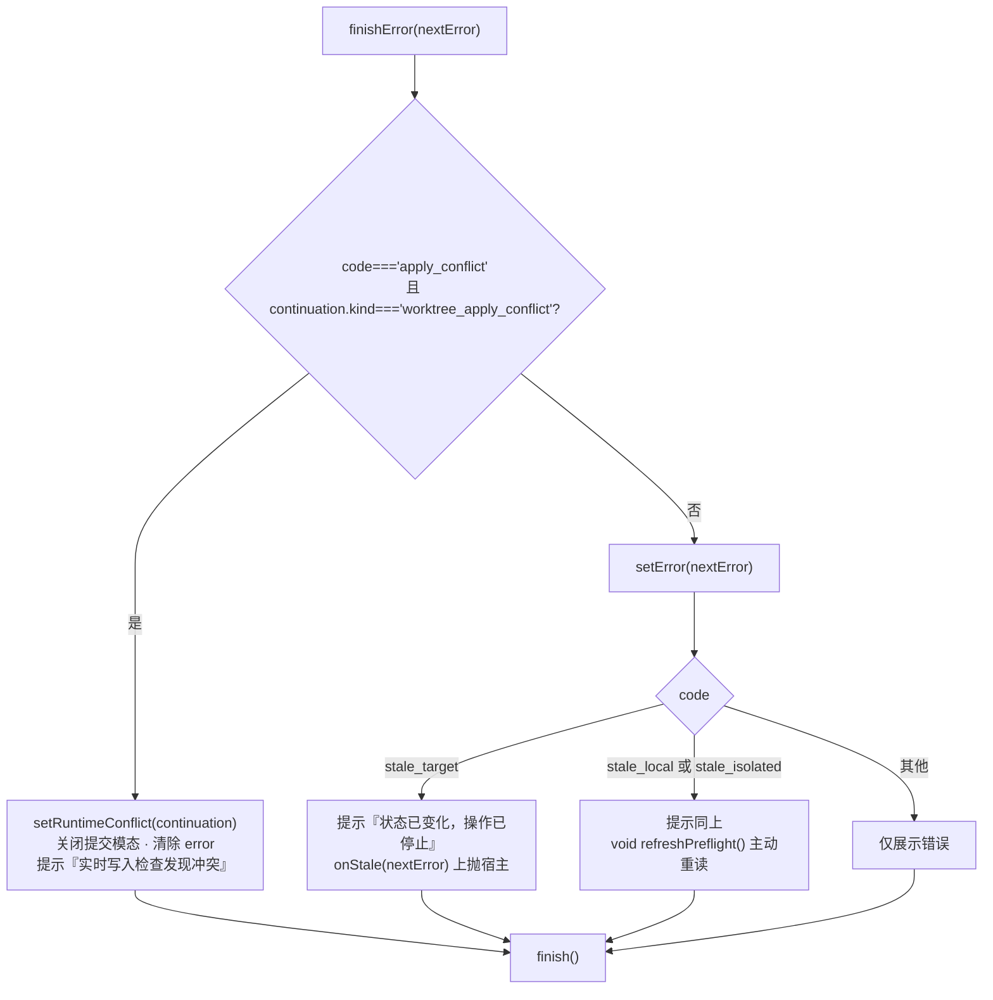
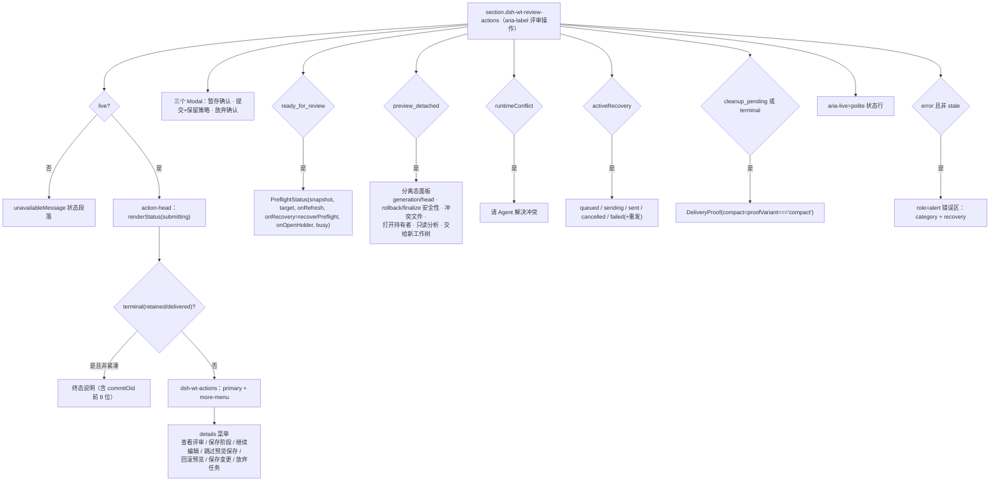

# client_review_console_review_actions：`ReviewActions` 交付动作编排器

`src/client/review-console/ReviewActions.tsx` 是验收控制台中**唯一的写操作编排者**。它把一次「待验收迭代」的所有交付动作（预览、回滚、暂存、继续编辑、确认保存、直接保存、放弃、重试清理、冲突恢复、评审重生成、分离态分析与交接）收敛成一个 React 组件，将每次点击转换为携带 **CAS 身份四元组**（`sessionId` + `checkoutId` + `expectedRevision` + `expectedReviewId`）的 Remote 调用，并对 Host 返回值做**逐项一致性比对**后才接受它。

本文件所在的父模块是 [client_review_console.md](../client_review_console.md)；本组件只负责「编排 + 保守拒绝」，**不做任何 Git 判定**——状态机推进、冲突计算、恢复证明的生成全部在 Host 侧（见 [session_checkout_apply_engine.md](../../core_worktree_domain_and_infrastructure/session_checkout_domain/session_checkout_apply_engine.md)）。

组件的三个核心不变量：

1. **单飞写入**：`mutationLock` ref + `submitting` state 保证同一时刻只有一个变更在飞；所有异步回调都以 `begin(kind)` 开头、以 `finish()` 结尾。
2. **写前先读**：任何可能修改 Local 或推进状态机的动作，发起前都会以 `force = true` 重新读取一次只读预检（`readReviewPreflight` / `readPreviewRecoveryPreflight`）。
3. **活性守卫**：每个 `await` 之后立即检查 `isActive()`；过期会话的迟到响应既不写 state，也不派发刷新事件。

---

## 1. 在系统中的位置



| 外部依赖 | 来源页面 | 在本组件中的用途 |
| --- | --- | --- |
| `WorktreeConsoleAdapter` | [worktree_console_contract.md](../../worktree_console_protocol_and_host_service/worktree_console_contract.md)，实例由 [client_console_remote.md](../client_console_remote.md) 的 `createWorktreeConsoleRemoteAdapter()` 创建 | 唯一的读写通道；返回值恒为 `WorktreeConsoleOutcome<T>`，业务失败不抛异常 |
| `WorktreeConsoleTargetSummary` / `WorktreeConsoleCapabilities` | [worktree_console_contract.md](../../worktree_console_protocol_and_host_service/worktree_console_contract.md) | 状态与能力的真相来源，决定主按钮、菜单项与禁用条件 |
| `WorktreeConsoleError` / `worktreeConsoleErrorMeta()` | 同上 | 错误分类（`apply_conflict` / `stale_*`）与错误区的 category + recovery 文案 |
| `WorktreeApplyPreflightView` / `WorktreePreviewRecoveryProof` / `WorktreeRetentionMode` | [session_checkout_domain_contracts.md](../../core_worktree_domain_and_infrastructure/session_checkout_domain/session_checkout_domain_contracts.md) | 预检状态分支、恢复证明字段、保留期选项 |
| `WorktreeReviewEvidence` / `WorktreeReviewIdentity` | [client_review_console_review_surfaces.md](client_review_console_review_surfaces.md)（`WorktreeReviewPanel.tsx`） | 组件的输入类型；身份由 `reviewIdentityFromTarget()` 构造 |
| `readReviewPreflight` / `useReviewPreflight` / `invalidateReviewPreflight` | [client_review_console_read_caches.md](client_review_console_read_caches.md) | `ready_for_review` 状态的只读预检；写前 `force` 重读 |
| `readPreviewRecoveryPreflight` / `usePreviewRecoveryPreflight` | [client_review_console_read_caches.md](client_review_console_read_caches.md) | `preview_detached` 恢复评估；回滚/定稿前的新鲜证明 |
| `enqueueWorktreeRecovery` / `restoreWorktreeRecovery` / `retryWorktreeRecovery` / `useWorktreeRecoverySnapshot` | [client_review_console_recovery_delivery.md](client_review_console_recovery_delivery.md) | 把需要 Agent 执行的续作请求排队投递，并展示其状态 |
| `requestWorktreeReviewRefresh` | [client_review_console_recovery_delivery.md](client_review_console_recovery_delivery.md) | 每次成功写入后广播刷新，让所有已挂载的验收面重读 Host |
| `openAuthorizedWorktreeTarget` / `openIsolatedTarget` / `prefillSessionDraft` / `WorktreeClientServices` | [client_core.md](../client_core.md)（`src/client/actions.ts`） | 打开持有验收槽的任务、打开交接出的新工作树、把恢复请求写成草稿 |
| `isValidCommitMessage` | [worktree_core_operations.md](../../core_worktree_domain_and_infrastructure/worktree_core_operations.md)（`src/commit-message.ts`） | 提交 / 暂存按钮的启用条件与提交前的二次校验 |
| `useClientTranslator` / `defaultClientTranslator` / `ClientTranslator` | [client_core.md](../client_core.md)（`src/client/i18n.tsx`），词条见 [src_i18n.md](../../project_foundation_and_localization/src_i18n.md) | 全部文案；`message` / `errorText` 以「翻译函数 → 字符串」闭包形式存储，语言切换后自动重渲染 |
| `Modal` | `@deepseek-ai/dsh-client-ui-primitives`（声明于 `src/client/harness-platform.d.ts`） | 暂存 / 提交 / 放弃三个确认对话框 |
| `ReviewIcon`、`PreflightStatus`、`DeliveryProof` | [client_review_console_review_surfaces.md](client_review_console_review_surfaces.md)、[client_review_console_read_caches.md](client_review_console_read_caches.md) | 图标、预检状态条、交付凭证的渲染 |

`client_review_console_review_actions` 自身不含子模块，全部逻辑集中在单文件 `ReviewActions.tsx` 的 `ReviewActions` 组件与其上方四个模块级纯函数中。

---

## 2. Props 契约与两种渲染形态

```ts
interface ReviewActionsProps {
  review: WorktreeReviewEvidence
  adapter?: WorktreeConsoleAdapter | null
  services?: WorktreeClientServices
  identity?: WorktreeReviewIdentity
  target?: WorktreeConsoleTargetSummary
  disabled: boolean
  unavailableMessage: string
  renderStatus?: (operation: Mutation | null) => ReactNode
  proofVariant?: 'compact'
  focusReview?: () => void
  isActive?: () => boolean
  onStale: (error: WorktreeConsoleError) => void
  onTargetChange: (target: WorktreeConsoleTargetSummary) => void
}
```

| Prop | 语义 | 缺省行为 |
| --- | --- | --- |
| `review` | 冻结的评审证据，提供 `reviewId` / `revision` / `suggestedCommitMessage` | 必传；变更时触发草稿重置 |
| `adapter` / `services` / `identity` / `target` | 四者齐备才算「live」，否则 `live = false` | 缺失时仅渲染 `unavailableMessage`，所有动作被 `begin()` 拒绝 |
| `disabled` | 宿主级禁用（如历史回放卡片） | 参与 `allDisabled` 与 `autoPreflightEnabled` 计算 |
| `renderStatus` | **紧凑 dock 形态**的开关：存在时状态文案交由宿主渲染 | 为 `undefined` 时走「面板形态」，组件自己显示状态与提示文案 |
| `proofVariant` | `'compact'` 时 `DeliveryProof` 使用单行形态 | 面板/弹窗使用完整卡片 |
| `focusReview` | 「查看评审」菜单项回调（dock 中打开详情弹窗） | 缺失或紧凑形态时该项不渲染 |
| `isActive` | 迟到响应守卫 | `() => true` |
| `onStale` / `onTargetChange` | 把 `stale_target` 上抛宿主、把 Host 返回的新 target 交还宿主 | 必传 |

同一个组件被两类宿主复用，形态差异全部由 `renderStatus` 派生：



---

## 3. Mutation 状态机与写入锁

`Mutation` 联合类型是本组件所有异步动作的标签集合，也是 `submitting` 的取值域：

```ts
type Mutation =
  | 'preview' | 'checkpoint' | 'resume_revision'
  | 'recovery' | 'recovery_analysis' | 'recovery_handoff' | 'open_holder'
  | 'rollback' | 'finish' | 'finalize_preview' | 'discard' | 'retry_cleanup'
type CommitMode = 'finish' | 'finalize_preview'
```



`begin` / `finish` 是成对的临界区原语：

- `begin(mutation)` 依次检查 `disabled`、`adapter`、`identity`、`target`、`mutationLock.current`；任一不满足**立即返回 `false`**，调用方以 `if (!begin('x') || ...) return` 短路。
- `finish()` 释放 `mutationLock` 并把 `submitting` 置 `null`，是每条路径（含 `isActive()` 失败、`catch` 分支）唯一的出口。
- 唯一不走 `begin()` 的是 `openHolder()`：它自行占锁并设 `submitting = 'open_holder'`，因为它在 `try/finally` 中包裹了 `openAuthorizedWorktreeTarget()` 抛出的异常。

`allDisabled = disabled || submitting !== null || !live`，用于三个模态框的取消/确认按钮与所有菜单项。

### 3.1 模块级纯函数与常量

组件之外只有四个纯函数与一个常量，均不依赖 React，可单独推理与测试：

| 名称 | 签名 | 作用 |
| --- | --- | --- |
| `checkpointRequestIdForGeneration()` | `(generation: string) => string` | 生成 `checkpoint:${generation}` 形式的幂等 `requestId`，把暂存请求钉在阶段代次上；代次变化后旧请求必然不再匹配 |
| `isStale()` | `(error: WorktreeConsoleError) => boolean` | 判定 `stale_target` / `stale_isolated` / `stale_local` 三类过期错误，用于**抑制**底部 `role="alert"` 的重复展示 |
| `sameStrings()` | `(left, right) => boolean` | 有序逐项比较字符串数组（冲突文件列表）：长度相同且每个下标相等才算一致，防止「集合相同但顺序不同」被误判为可续作 |
| `preflightMessage()` | `(preflight, t = defaultClientTranslator) => string` | 把 `WorktreeApplyPreflightView` 的分支（`ready` / `local_advanced` / `already_in_local` / `conflict` 附文件数 / `blocked` 附 Host 原因）映射成一句提示；默认翻译器参数使其可在无 Hook 环境复用 |
| `DEFAULT_RETAIN_ENVIRONMENT = true` | 常量 | 交付默认保留冻结环境：误交付仍可在保留期内回滚，之后由 Host 的保留定时器清理 |

---

## 4. 副作用（`useEffect`）一览

| 顺序 | 触发依赖 | 行为 |
| --- | --- | --- |
| 1 | `adapter` / `services` / `identity?.sessionId` | `restoreWorktreeRecovery()`：从 `localStorage` 恢复该会话尚未发送的续作请求（详见 [client_review_console_recovery_delivery.md](client_review_console_recovery_delivery.md)） |
| 2 | `review.reviewId` / `review.suggestedCommitMessage` | 草稿重置：把提交与暂存信息回填为 `suggestedCommitMessage`，关闭暂存框、关闭「更多」菜单、清空 `checkpointRequestId`，并把保留策略复位为 `DEFAULT_RETAIN_ENVIRONMENT = true` + `retain_24h` |
| 3 | `[]`（挂载期） | 在 `document` 上注册 `mousedown` / `keydown`，点击外部或按 Escape 时关闭 `<details>` 菜单并把焦点还给 `<summary>` |
| 4 | `submitting` / `target?.revision` | 外部 revision 漂移且当前无在飞写入时，清空 `message` / `error` / `runtimeConflict`（`observedTargetRevision` 记录上一次值，避免首帧误清） |
| 5 | `adapter` / `identity.*` / `target?.reviewSlot` | 验收槽从 `waiting` 翻转为 `available` 时，先 `invalidateReviewPreflight()` 再 `readReviewPreflight()`——旧槽位判定结果必须作废 |

派生值（每次渲染重算）：

- `autoPreflightEnabled`：`adapter && identity && !disabled && target.state === 'ready_for_review' && target.capabilities.preflight`。
- `safeReadyPreflight`：预检 `success` 且状态既非 `blocked` 也非 `conflict`——它门控「预览变更」与「跳过预览并保存」。
- `recoveryIdentity`：仅 `preview_detached` 且存在 `target.previewRecovery` 时，在四元组上追加 `expectedPreviewId`（缓存键的五元组）。
- `recoveryProof`：恢复评估 `assessed` 时的 `WorktreePreviewRecoveryProof`。
- `activeRecovery`：仅当快照的 `checkoutId` / `reviewId` 与当前身份匹配才展示，防止跨迭代串状态。

---

## 5. 状态驱动的动作矩阵

主按钮（`primary`）由 `target.state` × `capabilities` × 预检快照决定；「更多」菜单（`<details className="dsh-wt-more-menu">`）按状态追加条目。

| `target.state` | 主按钮 | 「更多」菜单项 | 附加区域 |
| --- | --- | --- | --- |
| `ready_for_review` | **预览变更**（需 `capabilities.preview` && `safeReadyPreflight`；预检进行中显示「检查中」） | 保存阶段并继续（需 `checkpoint` && `checkpointGeneration`）、继续编辑（`resumeRevision`）、跳过预览并保存（`finalize` && `safeReadyPreflight`）、查看评审、放弃任务（`discard`） | `PreflightStatus`（含冲突/阻塞恢复入口） |
| `preview_active` | **确认并保存**（`finalizePreview`） | 保存阶段并继续、继续编辑（`rollbackPreview(true)`）、回滚此次预览、放弃任务 | —— |
| `preview_detached` | `proof.rollback === 'safe'` → **恢复并回滚预览**；否则 → **再检查一次**（`refreshRecoveryPreflight`） | 重新回滚（回滚安全时）、保存变更（`proof.finalize === 'safe'` 且 `finalizePreview`）、放弃任务 | 分离态恢复面板 + `analyzeRecovery` / `handoffRecovery` / `openHolder` |
| `recovery_required` | 仅当 `capabilities.rollbackPreview` 时并入恢复分支 | 回滚 | 同上 |
| `cleanup_pending` | **重试环境清理**（`retryCleanup`） | 放弃任务（若允许） | `DeliveryProof` |
| `retained` / `delivered` | ——（终态说明文案，附 `commitOid` 前 8 位） | —— | `DeliveryProof` |
| `working` | `null` | 仅「放弃任务」（若能力允许） | 面板层判定快照过期 |

特殊渲染：当 `ready_for_review` 且预检结果为 `conflict` 时，主按钮被**刻意隐藏**（`primary` 位置渲染 `null`），把用户引导到 `PreflightStatus` 的冲突恢复入口，而不是让其继续点击注定失败的预览。

---

## 6. 各动作流程

### 6.1 `previewLocal()` —— 预览（写前强制重读）



### 6.2 `checkpoint()` —— 受管 Worktree 内的阶段保存

`openCheckpoint()` 先把 `checkpointRequestId.current` 设为 `checkpoint:${target.checkpointGeneration}`（代次绑定的幂等 ID），再打开模态框。提交时：

1. `isValidCommitMessage(checkpointMessage.trim())` 与 `requestId` 齐备才 `begin('checkpoint')`。
2. 携带 `expectedGeneration` + `requestId` 调用 `adapter.checkpoint()`。
3. **返回值七项比对**：`saved.reviewId === identity.expectedReviewId`、`saved.sequence === expectedCount + 1`、`nextTarget.checkoutId`、`ownerSessionId`、`state === 'working'`、`nextTarget.review === undefined`、`checkpoints.at(-1).checkpointId === saved.checkpointId`。任一不符即写入 `checkout_mismatch`，**不接受**该结果。
4. 通过后 `applyTarget(nextTarget)`、关闭模态、清空 `requestId`，提示「已保存第 N 个阶段」。

> 阶段（checkpoint）只在受管 Worktree 内生效，绝不写入 Local；模态框顶部用 `dsh-wt-checkpoint-note` 明示这一点。

### 6.3 `resumeRevision()` —— 使评审失效并继续编辑

调用 `adapter.resumeRevision(identity)`，成功后若 `services` 可用则用 `prefillSessionDraft()` 写入一条「请重新检查改动、重跑校验并生成新评审」的草稿（**只填草稿，绝不自动发送**），并据 `drafted` 结果给出两种提示。

### 6.4 `rollbackPreview(resumeRevision)` —— 回滚（含分离态新鲜证明）



`rollbackPreview` 是唯一显式 `try/catch` 适配层异常的动作：捕获后合成 `transport_unavailable` 错误并额外调用 `requestWorktreeReviewRefresh(identity.sessionId)` 触发一次全量重读。

### 6.5 `submitCommit()` —— 确认保存（`finish` 与 `finalize_preview` 两条路）

`commitMode` 由菜单项或主按钮设定，模态框据此切换标题与说明。公共尾部是 `retention` 计算：`retainEnvironment ? retention : 'cleanup'`，默认 `true` + `retain_24h`（**误交付应保持可回滚**）。

| 模式 | 前置门禁 | 最终调用 |
| --- | --- | --- |
| `finish`（跳过预览直接保存） | 强制 `readReviewPreflight(..., true)`；非 `success` 或 `blocked`/`conflict` → 只出提示不写 | `adapter.finalize({ ...identity, commitMessage, retention })` |
| `finalize_preview` | 若 `preview_detached`，额外要求 `readPreviewRecoveryPreflight` 为 `assessed` 且 `proof.finalize.status === 'safe'`，并把 `recoveryProof` 一并提交 | `adapter.finalizePreview({ ...request, recoveryProof? })` |

成功后按新 `target.state` 区分：`preview_detached` 提示「本地已变化，无法可靠提交」；否则按 `retention` 是否为 `cleanup` 提示「已提交并启动清理」或「已提交并保留环境」。

### 6.6 `discard()` / `retryCleanup()`

- `discard()`：`confirmDirty: true` 硬编码（模态框就是确认环节）；当 `target.state === 'preview_active'` 或 `capabilities.rollbackPreview` 为真时附带 `rollbackPreview: true`，保证「先无损回滚预览，再丢弃」。
- `retryCleanup()`：仅传 `{ sessionId, checkoutId, expectedRevision }`；结果按 `state === 'delivered'` 区分为「环境已清理」或「清理仍未完成，恢复信息已保留」。

### 6.7 冲突恢复 `startConflictRecovery()`

预检 `conflict`（或写入时撞上 `apply_conflict`）时走这条分支，它是本文件中校验最密的流程：**先重读、再恢复、然后两轮逐项比对**。



`requestId` 默认按 `preflight-conflict:${checkoutId}:${reviewId}:${revision}:${localHeadOid}` 组合，保证同一冲突在渲染生命周期内幂等；来自 `runtimeConflict` 的重试则复用 Host 原本给出的 `requestId`（见 `recoverRuntimeConflict()`，它把 continuation 反向拼成一个合成的 `conflict` 预检视图，`baseStrategy` 取 `'recorded_base'`）。

### 6.8 评审重生成 `startReviewRegeneration()`

针对 `blocked` 且 `reason === 'stale_isolated'` 且 `reviewId !== null` 的预检：先 `readReviewPreflight(force=true)` 确认仍是同一 `blocked/stale_isolated` 身份，再 `adapter.prepareReviewRegeneration()`，并逐项校验返回的 `recoveryContinuation.kind === 'worktree_review_regeneration'` 且 `checkoutId`/`reviewId`/`revision` 完全一致，最后 `enqueueRecovery()`。此路径**只读**——它要求 Ready revision 保持不变。

### 6.9 分离态的两个 Agent 出口

`freshRecoveryProof()` 是两者的公共前置：强制重读恢复评估，只在 `assessed` 时返回 `proof`，否则把 `blocked.message` / 「评估未完成」写进状态区并返回 `null`。



两个出口都把「校验不通过」变成抛错 → `catch` → `checkout_mismatch`，绝不降级为「大概没问题」。与冲突恢复的差别在于：这里的 prompt 是**即时**发送（走 `prompt.call`），而冲突/重生成走 `enqueueWorktreeRecovery` 的排队投递器。

### 6.10 `openHolder()` —— 打开占用验收槽的任务

持有者标识优先取预检 `blocked/project_acceptance_busy` 的 `preflight.blocker`，其次 `recoveryProof.blocker`，最后回落到 `target.reviewSlotHolder`；三者皆无则不动作。执行体为 [client_core.md](../client_core.md) 的 `openAuthorizedWorktreeTarget()`——它内部再走一次 `inspect` + cwd 校验，本组件只负责占锁与异常转 `checkout_mismatch`。

---

## 7. 错误分类：`finishError()` 的四条分支



配套的 `isStale()` 判定用于**渲染层抑制**：当错误是 `stale_target` / `stale_isolated` / `stale_local` 时，底部 `role="alert"` 错误区**不渲染**——因为此时状态区已经给出了更贴切的「状态已变化」说明，重复展示只会制造噪声。非过期类错误才展开 `worktreeConsoleErrorMeta(code)` 提供的 `category` 与 `recovery` 词条（见 [worktree_console_contract.md](../../worktree_console_protocol_and_host_service/worktree_console_contract.md)）。

---

## 8. 渲染结构



`busy` 传入 `PreflightStatus` 的值为 `submitting !== null || activeRecovery.status ∈ {queued, sending, sent}`，确保恢复请求在飞期间不会重复触发冲突动作。

---

## 9. 无障碍与安全要点

| 类别 | 具体做法 |
| --- | --- |
| 焦点管理 | 「更多」菜单是原生 `<details>/<summary>`；Escape 关闭后 `menu.querySelector('summary')?.focus()` 归还焦点；点击外部通过 `mousedown` 监听关闭 |
| 语义角色 | 菜单容器 `role="menu"`、条目 `role="menuitem"`、状态行 `aria-live="polite"`、错误区 `role="alert"`、`<section aria-label>` 标注区块 |
| 表单关联 | `useId()` 生成 `formId`，`htmlFor` 与 `id` 成对绑定到 `${formId}-message` / `${formId}-checkpoint-message`，并附 `aria-label` 与字符计数 |
| 幂等 | 暂存 `checkpointRequestIdForGeneration(generation)`、冲突恢复的复合 `requestId`，均由身份要素派生，不依赖时间戳 |
| 状态隔离 | `observedTargetRevision` / `observedReviewSlot` 两个 ref 区分「外部漂移」与「自身写入」，避免在飞写入被自己的结果清空提示 |
| 保守拒绝 | 预检 `blocked`/`conflict` 时预览直接返回；恢复证明非 `safe` 时只展示 Host 给出的解释；`recoveryIdentity` 缺失时拒绝回滚分离预览 |
| 不自动发送 | `prefillSessionDraft` 仅填草稿；只有冲突/重生成的排队投递器与分离态两个 Agent 出口会 `prompt(..., 'queue')` |

---

## 10. 与其他子模块的协作

- 输入的 `review` / `identity` 由 [client_review_console_review_surfaces.md](client_review_console_review_surfaces.md) 的 `reviewEvidenceFromTarget()` / `reviewIdentityFromTarget()` 投影，且与 `WorktreeReviewPanel.tsx::reviewIsStale()` 共用同一份过期判定语义。
- 只读通道全部经 [client_review_console_read_caches.md](client_review_console_read_caches.md)：per-adapter `WeakMap` 保证重挂载的客户端不会读到别的 adapter 数据，`generation` 保证被作废的在飞响应不会覆盖新快照。
- 需要 Agent 执行的续作全部委托 [client_review_console_recovery_delivery.md](client_review_console_recovery_delivery.md)，本组件只负责**构造请求**与**渲染状态**，排队、退避轮询、`localStorage` 持久化与发送前双重 `inspect` 都在那里完成。
- 挂载本组件的 dock（含 `isActive` 的「挂载 + 会话 + 代次」三重判定实现）见 [client_target_console.md](../client_target_console.md)。
- Host 侧对应的真实写操作见 [session_checkout_apply_engine.md](../../core_worktree_domain_and_infrastructure/session_checkout_domain/session_checkout_apply_engine.md) 与 [session_checkout_domain_contracts.md](../../core_worktree_domain_and_infrastructure/session_checkout_domain/session_checkout_domain_contracts.md)。

---

## 11. 类型与测试约定

- `Mutation` / `CommitMode` 是文件内私有联合类型，不导出；`ReviewActionsProps` 同样未导出，宿主通过 JSX 属性推断契约。
- `message` 与 `errorText` 存储的是 `(t: ClientTranslator) => string | WorktreeConsoleError` 闭包而非已翻译字符串，语言切换时随之重算；`errorText` 到 `error` 的解包发生在每次渲染顶部（`errorText?.(t) ?? null`）。
- 严格模式：`tsconfig.json` 开启 `strict` 与 `noUncheckedIndexedAccess`（见 [build_ci_and_packaging.md](../../project_foundation_and_localization/build_ci_and_packaging.md)），因此 `target?.checkpoints?.at(-1)?.checkpointId`、`preflight.reviewId`、`proof.blocker` 等全部为显式空值分支；`pnpm typecheck` 覆盖本文件。
- 测试：`vitest.config.ts` 将 `@deepseek-ai/dsh-client-ui-primitives` 别名指向 `tests/support/ui-primitives.tsx`，使三个 `Modal` 在无宿主环境下可渲染；`pnpm test`（`vitest run`）与 `.github/workflows/ci.yml` 的 `check` 作业共同守护本文件的回归。
