# Worktree Console 控制面（`src/console-host/control-plane.ts`）

本页文档化 **Worktree Console 宿主侧的授权与编排核心**——工厂函数 `createWorktreeConsoleControlPlane(options)` 与其产出的 `WorktreeConsoleControlPlane` 接口。它是浏览器控制台与「会话检出领域层」之间唯一的一道**身份闸门**：领域层（`SessionCheckoutModule`、Apply 引擎、各类 Port）是为模型工具与人类 UI 共享而设计的、与宿主无关的状态机；控制面则负责把这套能力翻译成一组**可被远端安全调用**的方法，并在每一次调用时重新证明「调用方是谁、它有没有资格动这条记录」。

控制面只导出两个契约符号（`WorktreeConsoleControlPlane` 与 `WorktreeConsoleControlPlaneOptions`），其余全部是工厂函数内部的闭包私有函数——这不是风格偏好，而是**安全边界**：授权链、观测复用、验收位仲裁这些逻辑一旦能被绕过或单独调用，整个命令面的可信度就不复存在。

控制面的四条硬性不变量：

1. **异常绝不跨越边界**。每个方法的返回值都是 `WorktreeConsoleOutcome<T>`：要么由 `outcome()` 包装（异常经 `consoleFailure` 折叠），要么显式 `failure()`；内部一律用 `domainError()` 抛带领域码的异常。
2. **授权靠证据，不靠记录字段**。持久化的 `ownerSessionId` 只是路由提示；每次调用都要过 `record 存在 → 归属关系 → 项目一致 → 工作目录（root）证据 → 可见性` 五道校验。
3. **写操作永远重新观测**。只有读端点会接受「本次请求中已观察到的 caller」用于复用，变更族一律在执行前重新 `module.inspect()`。
4. **已抵达交付的记录必须读作 Local**。`verifyCallerRoot`、`settledLocalBranch`、`returnToLocal` 与投影层共享同一条谓词 `worktreeReachedDelivery()`（定义在 `src/console-contract.ts`），Host 与 UI 不允许对「交付完成」有两套解释。

契约本身（DTO、状态枚举、能力位、错误码表 `ERROR_META`、`WorktreeConsoleAdapter`）在 [Worktree Console 共享契约](../worktree_console_contract.md) 中详述，本页只讲**这些契约如何被计算、校验与执行**。

---

## 1. 在宿主服务中的位置

控制面被 RPC 服务面调用，向下依赖领域层与 Port，向右使用投影、错误折叠与评审 diff 三个同目录组件。

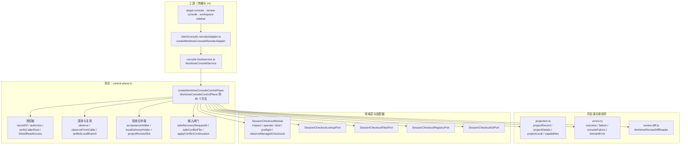

相关页面：

- 上层总览：[Worktree Console 宿主服务](../worktree_console_host.md)
- 兄弟子模块：[投影与错误折叠](worktree_console_host_projection_and_errors.md)、[RPC 服务面](worktree_console_host_rpc_service.md)、[评审 diff 读取器](worktree_console_host_review_diff.md)
- 被调用的领域层：[会话运行时入口](../../core_worktree_domain_and_infrastructure/session_checkout_domain/session_checkout_runtime/session_checkout_runtime_entry.md)、[Apply 引擎](../../core_worktree_domain_and_infrastructure/session_checkout_domain/session_checkout_apply_engine.md)、[会话检出域契约](../../core_worktree_domain_and_infrastructure/session_checkout_domain/session_checkout_domain_contracts.md)
- Port 的 Node 实现：[src_adapters](../../core_worktree_domain_and_infrastructure/src_adapters.md)
- 传输绑定：[Worktree Console Remote 绑定](../worktree_console_remote.md)
- 本地化（`hostMessage`）：[src_i18n](../../project_foundation_and_localization/src_i18n.md)

---

## 2. `WorktreeConsoleControlPlaneOptions`：七个注入依赖

```typescript
export interface WorktreeConsoleControlPlaneOptions {
  module: SessionCheckoutModule
  lookup: SessionCheckoutLookupPort
  files: SessionCheckoutFilesPort
  registry: SessionCheckoutRegistryPort
  git: SessionCheckoutGitPort
  reviewDiff: WorktreeReviewDiffReader
  createTargetSessionId?: () => string
}
```

| 依赖 | 控制面用它做什么 | 关键调用点 |
| --- | --- | --- |
| `module` | 领域层的完整命令/查询面：`inspect`、`operate`、`bind`、`listManagedWorktreesForSession`、`preflight`、`preflightPreviewRecovery`、`createIsolatedTarget`、`beginNextIteration`、`resumeRevision`、`prepareReviewRegeneration`、`preparePreviewRecoveryAnalysis`、`createPreviewRecoveryHandoff`、`manageManagedWorktreeForSession`、`pruneMergedBranchesForSession`、`listAbandonedWorktreeSnapshots`、`restoreAbandonedWorktreeSnapshot`，以及**可选**的 `observeManagedCheckout` / `observeManagedCheckouts` | 几乎所有方法 |
| `lookup` | Session / Project 解析（`getSession`、`getProject`）、**实时 cwd**（可选 `getSessionCwd`）、侧栏目录归属（可选 `getSidebarMemberships`） | `verifyCallerRoot`、`unboundLocalTarget`、`projectRootFor`、`sidebarTopology` |
| `files` | `exists` 存在性检查与 `canonicalize` 规范化（realpath）——root 证据的唯一来源 | `verifyCallerRoot`、`withCreation` 的 root 锁键 |
| `registry` | `read()` 全表快照：按 `checkoutId` 取记录、跨记录扫描验收位/持有者、读取 `sessionBindings` | `recordOf`、`acceptanceHolder`、`localDeliveryHolder`、`returnToLocal` |
| `git` | 直接面向 Local 仓库的只读与轻量变更（`inspect`、`status`、`branchOverview`、`graphLog`、`listTags`、`createTag`、`pushTag`、`switchLocalBranch`、`preflightInitialCommit`、`initializeEmptyRepository`、`initializeProject`、`listLocalBranches`） | Git 概览族、创建族、`unboundLocalTarget`、`observe` 降级路径 |
| `reviewDiff` | 已就绪评审的 diff 取证（唯一方法 `read(input)`），装配时是 `createGitWorktreeReviewDiffReader(projectSkills)` | `reviewDiff()` |
| `createTargetSessionId` | 新 owner Session 的 id 生成器，缺省为 `randomUUID`——**targetSessionId 永远在 Host 侧分配**，浏览器无法选择归属身份 | `createTarget()`、`createPreviewRecoveryHandoff()` |

装配发生在插件入口 `src/index.ts` 的 `apply()` 中（见该文件末尾）：控制面拿到的 `lookup` / `files` / `registry` / `git` 与 `createSessionCheckoutModule(...)` 内部是**同一批实例**，因此 `registry.read()` 与 `module.inspect()` 观察到同一份真相——这正是 §5.2 观测复用得以成立的前提。装配同时传入 `createGitWorktreeReviewDiffReader(projectSkills)`，并把服务实例的诊断落点设为 `<stateDir>/sidebar-diag.ndjson`。`stateDir` 的推导（`$DSH_HOME/plugins/dsh-git-worktree`，未设置时 `~/.dsh/...`）见 [会话运行时入口](../../core_worktree_domain_and_infrastructure/session_checkout_domain/session_checkout_runtime/session_checkout_runtime_entry.md)；构建与打包流程见 [构建、CI 与打包](../../project_foundation_and_localization/build_ci_and_packaging.md)（`package.json` 中 `"build": "node scripts/clean-lib.mjs && tsc && tsdown"`）。

---

## 3. 接口面：方法分组

`WorktreeConsoleControlPlane` 声明 38 个方法，按语义可分七族。RPC 服务面与 `WorktreeConsoleAdapter` 与之**逐一同构**，因此三者的方法清单可以互相印证（见 [RPC 服务面](worktree_console_host_rpc_service.md) 与 [共享契约](../worktree_console_contract.md)）。

| 分组 | 方法 | 关键约束 |
| --- | --- | --- |
| 拓扑与读取 | `sidebarTopology`、`current`、`list`、`inspect`、`reviewDiff` | 只读；只有这一族会把 `observedCaller` 传下去做复用 |
| 创建族 | `preflightCreate`、`createWithInitialCommit`、`create`、`initProject` | `withCreation` 的 session + canonical root 双键互斥；确认 token 300 s TTL、500 条上限 |
| 评审 → 交付 | `preflight`、`preview`、`checkpoint`、`resumeRevision`、`prepareReviewRegeneration`、`rollbackPreview`、`discard`、`finalize`、`finalizePreview` | 一律 `expectedRevision` / `expectedReviewId` CAS；`apply_conflict` 附带 continuation |
| Preview 恢复族 | `previewRecoveryPreflight`、`preparePreviewRecoveryAnalysis`、`createPreviewRecoveryHandoff` | 以一次性 `recoveryProof` 的身份匹配为闸门 |
| 保留、清理与侧栏 | `setRetention`、`setPermanent`、`retryCleanup`、`beginNextIteration`、`returnToLocal`、`clearSidebarBadge` | 前三者由 `requireOwner` 收紧到 owner-only（作用于冻结目录本身） |
| Git 概览族 | `gitOverview`、`gitGraph`、`gitCreateBranch`、`gitSwitchBranch`、`gitPruneMergedBranches`、`gitListTags`、`gitCreateTag`、`gitDeleteTag`、`gitPushTag` | 经 `projectRootFor` 恒定绑定项目 **Local 仓库**，与会话当前所在 worktree 无关 |
| 放弃快照 | `listAbandoned`、`restoreAbandoned` | `discarded` 记录没有活 target，故单列一族 |

---

## 4. 授权链

任何带 `checkoutId` 的调用都从 `recordOf` 起步，然后走同一条链。

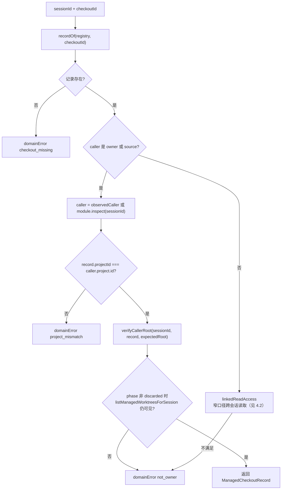

`expectedRoot` 的这一行是整个权限模型的形状来源：

```typescript
const expectedRoot = record.ownerSessionId === sessionId ? record.managedRoot : record.localRoot
```

owner Session 只能在冻结目录内活动，source（Local）Session 只能在 Local 边界活动。此外，写操作**总是**先做新鲜 `inspect`；只有读端点会把本次请求中观察到的 caller 传入 `authorize` 复用。

### 4.1 `verifyCallerRoot`：五条证据路径

这是链上最微妙的一环。Workspace 的 project 记录**始终指向 Local 检出**，而 owner Session 的实时 cwd 才是它不可变的 worktree 根。只用 `project.root` 比对，会把每一次健康的 owner 调用都判成 `project_mismatch`（顶部胶囊对一个完全正常的受管检出报失败）。取证顺序如下：

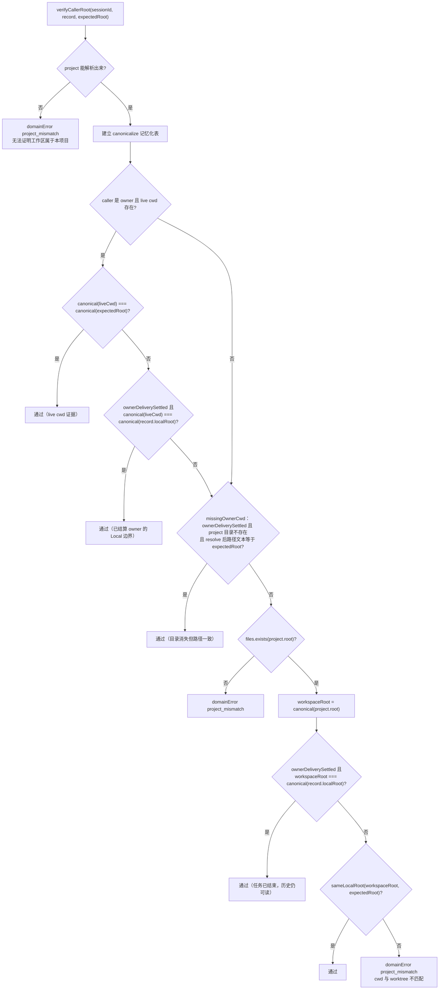

三个必须理解的设计细节：

- **live cwd 证据只对 owner 生效**。源码注释写得很直白：一个等于 `localRoot` 的 live cwd 对 source Session 什么也证明不了——source Session 的意义就站在 Local 边界上。若把它也用来比对 `expectedRoot`，任何停在 Local 的同项目 source Session 都能拿到别人的 `managedRoot`。
- **`ownerDeliverySettled` 是双条件**：`worktreeReachedDelivery(phase, delivery.state)` **且** `phase ∈ { discarded, finalized, retained }`。单有交付标签不够——一个半写入或未来非法的组合（delivery 已 retained 而 phase 仍 active）不得溜过 Local 边界豁免。这条豁免的必要性来自 `worktree_deliver` 默认 `retain_24h`：交付之后整整一天，记录坐在 (phase retained, delivery retained) 上、冻结环境还在磁盘上，而 owner 的 cwd 早已回到 Local。
- **`canonicalize` 记忆化**。规范化一次路径是一次 realpath syscall，而这道闸门在同一次调用里最多问四条路径（live cwd、`expectedRoot`、`record.localRoot`、`project.root`），因此用一个 `Map<string, Promise<string>>` 保证**每条不同路径最多一次 IO**（Promise 复用，并发也不会重复 syscall）。

### 4.2 `linkedReadAccess`：窄口径跨会话读取

`sidebarTopology` 与列表面板会让一个 Local 会话看到同组其它 worktree 的摘要。控制面允许两种情形：

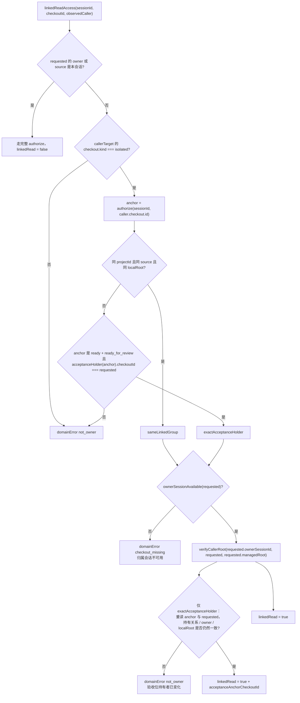

注意 `verifyCallerRoot` 在这里是**以被读取记录的 owner 身份**去校验的（`requested.ownerSessionId`），而不是以调用方身份——调用方已经通过「同关联组」或「精确持有者」证明了自己与该记录的关系，root 证据要证明的是记录本身仍然自洽。而 `exactAcceptanceHolder` 分支会在读取前后各验证一次持有关系，防止 holder 在投影过程中漂移；`details()` 里还会再加一次 `observed.managedRoot === currentRequested.managedRoot` 的复核（见 §6）。

### 4.3 收紧到 owner 的三个谓词

| 谓词 | 语义 | 使用者 |
| --- | --- | --- |
| `requireOwner(record, sessionId)` | 只有 owner 才能删改冻结目录（`sourceSessionId` 不够，因为模块在 owner 缺失时会回退到 source 会话） | `setRetention`、`setPermanent`、`retryCleanup` |
| `ownerSessionAvailable(record)` | `lookup.getSession(ownerSessionId)` 是否存在，投影为 `capabilities.open` 的关键输入 | 投影装配、`discard` 的接管判断、`linkedReadAccess` |
| `readyReview` / `previewReview` | 状态闸门：非 `ready + ready_for_review` 抛 `operation_not_allowed`；非 `ready + preview_active/preview_detached` 抛 `preview_not_active` | `reviewDiff`、`preflight`、`preview`、`resumeRevision`、`prepareReviewRegeneration`、`finalize`、`finalizePreview` |

### 4.4 `callerTarget` 与合成的 Local 视图

`unboundLocalTarget(sessionId)` 处理「会话尚未选定 target」这一状态：它按 `lookup → files.exists → git.inspect → git.status` 的顺序构造一个**合成** `SessionTargetView`（`checkout.id = 'local'`、`kind = 'local'`、`phase = 'ready'`、`revision = 0`、`ownership = 'owner'`）。`callerTarget` 捕获 `target_unselected` 错误码并退到该视图，其它错误原样抛出。这意味着**一个从未使用过 worktree 的普通会话依然能看到自己的 Local 胶囊与 Git 面板**，而 `list`、`gitSwitchBranch` 等则据此拿到正确的 Local 根。

---

## 5. 观测、复用与性能

### 5.1 `observe` 的三级优先

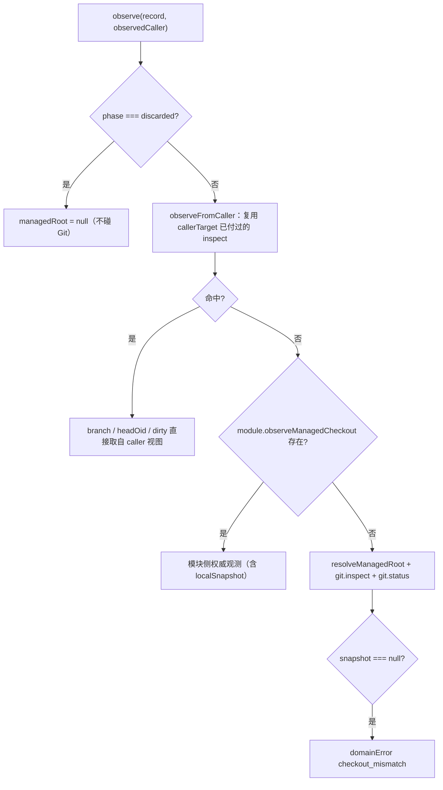

### 5.2 为什么必须复用：`observeFromCaller`

对话顶部的胶囊每几秒轮询一次 `current`，而 `current` 内部先执行 `module.inspect(sessionId)`（`inspectIsolated` 会为受管检出做一次 `git status` + 两次 `git inspect`），随后的投影又会对**同一条记录**再观测一遍——那等于把同样的三次 spawn 再付一次。在 Windows 热检出上每次 spawn 约 30–50 ms，这一份重复约占整次轮询成本的三分之一。

复用条件严格（全部满足才命中）：caller 的 `checkout.kind === 'isolated'`、`checkout.id === record.checkoutId`、**双方** phase 均为 `ready`、`ownership === 'owner'`，且 `caller.revision === record.revision`（否则旧 branch/HEAD 数据会被投影到新的 review/proof 状态旁边）。**已交付的终态刻意不走复用**：`committedFollowupView` 报告的是保守的 `dirty: true`，而芯片必须显示冻结环境真实的 Git 状态。

### 5.3 `list` 的批量观测与降级

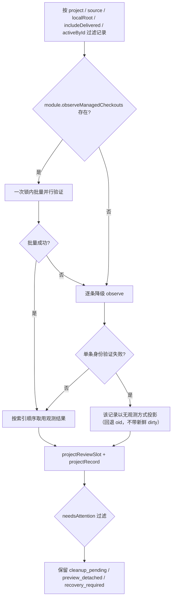

批量失败**不拖垮整个面板**：单条记录降级为「无观测」投影，其余照常渲染；后续任何写操作的 CAS 校验仍会兜底拒绝这条身份可疑的记录。`needsAttention` 请求的语义也在这里补齐——**与 Local 漂移的 preview（`preview_detached`）** 和阻塞清理、不可恢复记录一样需要用户注意，否则会被面板藏起来。

### 5.4 `settledLocalBranch`：交付后芯片该报哪个分支

一个已交付的 worktree，其 owner 会话实际已经站在 Local 边界上；继续把冻结的任务分支（`feat/...`）报给顶部芯片，用户就分不清自己是在 `master` 上还是仍在隔离中。该函数返回三态：

| 返回值 | 含义 | 触发条件 |
| --- | --- | --- |
| `undefined` | 不是「已交付的 owner 读取」，保持 worktree 分支 | 非 owner；未抵达交付；phase 不在终态集合；或 live cwd 仍在 `managedRoot` 之内（owner 交付后又重新进入了保留环境——hook 会为了回滚把它留着） |
| `string \| null` | Local 的真实分支；`null` 表示 Local 暂时不可观测，记录的标签仍是最佳答案 | 优先复用观测同一趟验证里得到的 `observedLocalSnapshot.branch`（**零额外 IO**），否则 `files.exists` + `git.inspect(record.localRoot)`，异常/无快照折叠为 `null` |

路径比较由两个小工具统一处理跨平台差异：`sameLocalRoot`（win32 大小写不敏感的相等）与 `withinRoot`（把 `\` 归一为 `/`、去掉尾斜杠、win32 下小写后判断前缀关系）。

---

## 6. 验收位与并发交付仲裁

同一个 Local 检出在同一时刻只应有一个「正在交付」的 worktree——`preview` / `finalize` 写的就是这个检出。控制面用两个纯注册表扫描表达这条约束，再把它落到投影里。

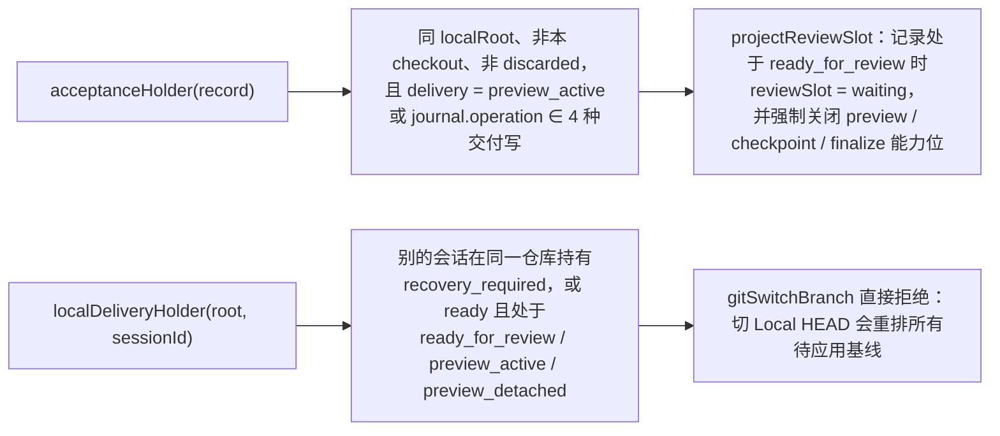

- `journal?.operation` 的四个取值是 `preview` / `rollback_preview` / `finalize_preview` / `finish`——**正在写 Local 的记录即使 delivery 标签还没翻，也必须占住槽位**。
- `gitSwitchBranch` 有两道拒绝：第一道查**自己**是否持有交付中的槽位，第二道用 `localDeliveryHolder` 查别人；两者都折叠为 `operation_not_allowed`，消息里带上持有者的 `ownerSessionId` 便于用户判断。
- `projectReviewSlot` 只改写摘要对象的 `reviewSlot` 与 `capabilities`，不改记录本身；真实的阻塞者身份来自 `acceptanceHolder`，被投影为 `reviewSlotHolder`（`WorktreeAcceptanceBlockerView`）。

`details()` 是把上述一切组装成 `WorktreeConsoleTargetDetails` 的汇合点：

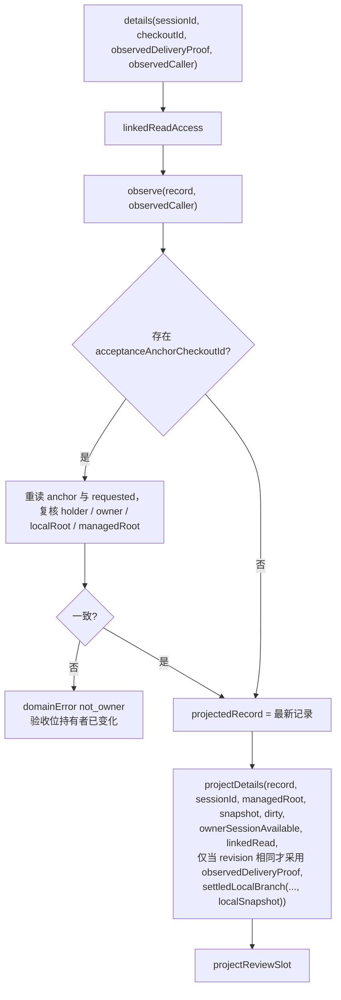

`deliveryProof` 的取舍值得单独注意：**先于注册表推进观察到的 caller 可能携带更旧的 proof**，所以只有 `access.record.revision === observedCaller?.revision` 时才复用 caller 的 proof，否则改用刚刚授权的记录上的 proof。`mutationResponse()` 是变更族的统一出口：`discarded` 记录直接以「无观测」投影（目录已不存在），否则 `observe(record)`（不带 caller，因为写操作后必须重新取证）+ `projectRecord` + `projectReviewSlot`。

---

## 7. 输入安全闸门

远端可以伪造字符串，但不能伪造路径或越界文件。控制面在进入领域层之前把所有外部输入过一遍：

| 闸门 | 规则 | 违反时的错误码 |
| --- | --- | --- |
| `isValidCommitMessage`（`src/commit-message.ts`） | 非空、trim 后有内容、不含 NUL | `invalid_input` |
| `safeRecoveryRequestId(value)` | `1 ≤ length ≤ 500`，且不含 `\0` `\r` `\n` | `invalid_input` |
| `safeConflictFile(file)` | 非空、`≤ 1000`、无控制字符与 DEL；不是绝对路径或盘符路径；按 `/` 或 `\` 切分后每段非空且不是 `.` / `..` | `git_error`（在 continuation 构造中） |
| OID 形状 | 局部 HEAD 与恢复凭据里的 `localHeadOid` 必须是 40 位或 64 位十六进制 | `git_error` |
| `requestedRecovery` 全量身份 | `kind === 'worktree_apply_conflict'`、`checkoutId`/`reviewId`/`revision` 与 CAS 参数逐项相等、`conflictingFiles ≤ 500` 且逐条安全 | `invalid_input` |
| `recoveryProof` 全量身份 | `sessionId`/`checkoutId`/`revision`/`reviewId`/`previewId` 与请求逐项相等，且 caller 必须是 owner | `stale_target` |

`applyConflictContinuation(result, reviewId)` 把领域层的冲突结果转成 Host 签发的恢复凭据，其 `requestId` 是**内容寻址**的：`apply-conflict:checkoutId:reviewId:revision:localHeadOid`。同一场冲突在任何渲染器生命周期内得到同一个 id，客户端的单飞与重试因此天然幂等；而 revision 或 Local HEAD 一变，id 就变，旧的恢复凭据自动失效。

---

## 8. 创建族：互斥锁与一次性确认令牌

创建 worktree 是少数**由 Local 边界发起、结果落在新会话**上的操作，因此它不用 CAS 而用两把锁加一个令牌。

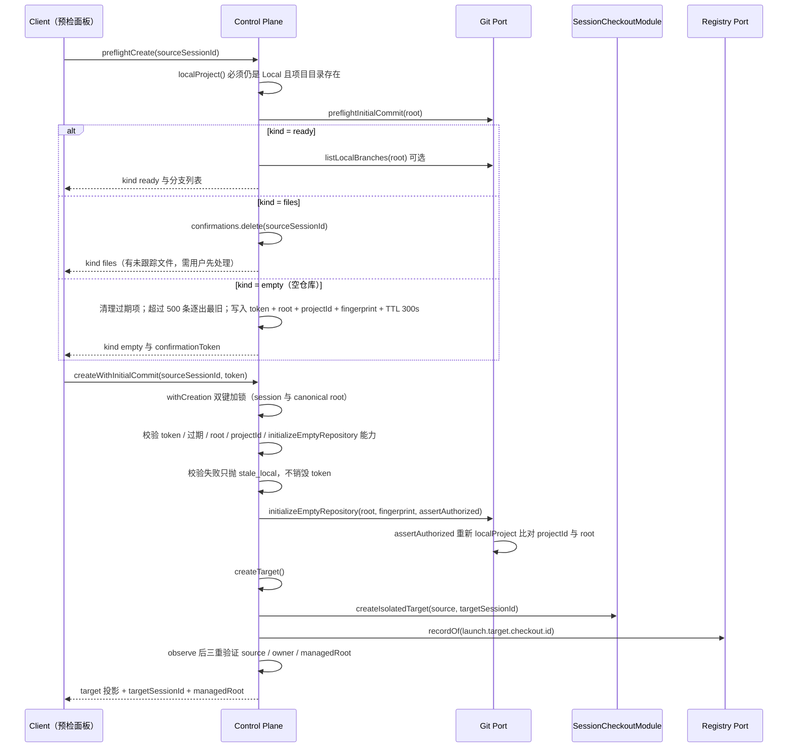

三个关键决策：

1. **`withCreation` 的两把内存锁**：`session:<sessionId>` 与 `root:<canonical>`（win32 下小写）。前者防同一会话重复点击，后者防**两个不同会话**同时初始化同一个仓库。任一在持有时抛 `operation_not_allowed`；`finally` 中一定释放，锁只在进程内，不依赖注册表。
2. **确认令牌校验失败不得先销毁令牌**。客户端拿到 `stale_local` 后会重新预检取新 token；若一次错点或一次并发预检就把用户手里那个有效 token 吃掉，用户只会反复重试。因此只在**校验通过之后**才 `confirmations.delete(sourceSessionId)`。
3. **空仓库初始化后再建 worktree，若失败一律报 `git_operation_failed`**——此时仓库已经被初始化，把底层异常原样抛回去会让人误以为什么都没发生。

`initProject` 是这条路径的补集：`git.initializeProject` 缺失时直接 `operation_not_allowed`（能力缺失不伪装成成功）。

`create` 与 `createWithInitialCommit` 共用 `withCreation`，但只有后者携带确认令牌；`create(sourceSessionId, branch)` 可以把 worktree 起点指定为某个本地分支的尖端。

---

## 9. 评审 → 交付 CAS 族

变更族的通用骨架高度一致，理解一个就理解了全部：

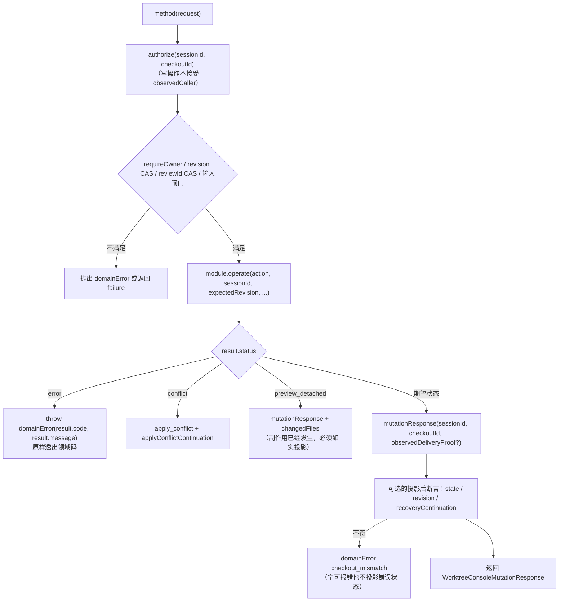

### 9.1 两种失败风格

| 风格 | 使用者 | 原因 |
| --- | --- | --- |
| `outcome(async () => ...)` + 内部 `throw domainError(...)` | 绝大多数方法（`preview`、`checkpoint`、`resumeRevision`、`discard`、`setRetention`、`git*`、`list`、`current` 等） | 校验分支多、失败即终止，折叠统一交给 `consoleFailure` |
| 显式 `try/catch` + `return failure(code, message, details?, continuation?)` | `finalize`、`finalizePreview`、`reviewDiff` | 这些方法的「业务性失败」（冲突、过期、身份漂移）是**预期返回值**而非异常；`apply_conflict` 还要携带第四参数 continuation，`throw` 路径无法表达 `details` |

### 9.2 每个方法的专属闸门

| 方法 | 专属校验 | 领域动作 | 投影后断言 |
| --- | --- | --- | --- |
| `preflight` | owner + revision + `readyReview` + reviewId；`module.preflight` 缺失则 `git_error` | 只读同步预检 | 无（直接返回 `preflight` 视图） |
| `preview` | owner + revision + `readyReview` | `operate(action = preview)` | `conflict` 转 `apply_conflict` + continuation |
| `checkpoint` | owner + commit message + `safeRecoveryRequestId(requestId)` | `operate(action = checkpoint)`（带 `expectedGeneration`） | `target.state` 必须回到 `working` 且 revision 等于结果，否则 `checkout_mismatch` |
| `resumeRevision` | owner + revision + reviewId + `conflictContinuation` 全量身份 | `module.resumeRevision(...)`（可选 recovery） | 结果 `checkout.id` 与 `delivery.state = working`；带恢复时还必须读到**完全一致**的持久化 `recoveryContinuation`，否则 `checkout_mismatch` |
| `prepareReviewRegeneration` | owner + revision + reviewId | `module.prepareReviewRegeneration(...)`（requestId 为 `review-regeneration:uuid`） | 返回 `recoveryContinuation` |
| `rollbackPreview` | owner | `operate(action = rollback_preview)`（可带 `resumeRevision` / `recoveryProof`） | 结果必须是 `preview_rolled_back` 或 `preview_detached` |
| `discard` | owner；**owner 会话仍在**时非 owner 一律 `not_owner`，owner 缺失时才允许 source 通过 `manageManagedWorktreeForSession` 清理 | `operate(action = discard)` 或管理入口 | 允许 `preview_detached`（回滚预览失败时不谎报已放弃） |
| `finalize` | owner + revision + `readyReview` + `isValidCommitMessage` | `operate(action = finish, commitMessage, retention)` | 冲突 → `failure("apply_conflict", ..., continuation)`；`finished` 才带 `commitOid` 与 `deliveryProof` |
| `finalizePreview` | owner + revision + `previewReview` + `isValidCommitMessage` | `operate(action = finalize_preview)` | `preview_detached` 是合法成功（返回 `ok: true`）；否则须为 `finished` |

`preflightFailure(view)` 把领域预检的 `blocked.reason` 映射为控制台错误码，供 `reviewDiff` 使用：

| `blocked.reason` | 错误码 |
| --- | --- |
| `undefined`（模块不支持预检） | `git_error` |
| `stale_isolated` / `stale_local` / `stale_target` / `project_acceptance_busy` / `not_owner` | 同名 |
| `not_ready_for_review` | `operation_not_allowed` |
| `checkout_unavailable` | `checkout_mismatch` |
| 其它 | `git_error` |

### 9.3 `apply_conflict` 的恢复闭环

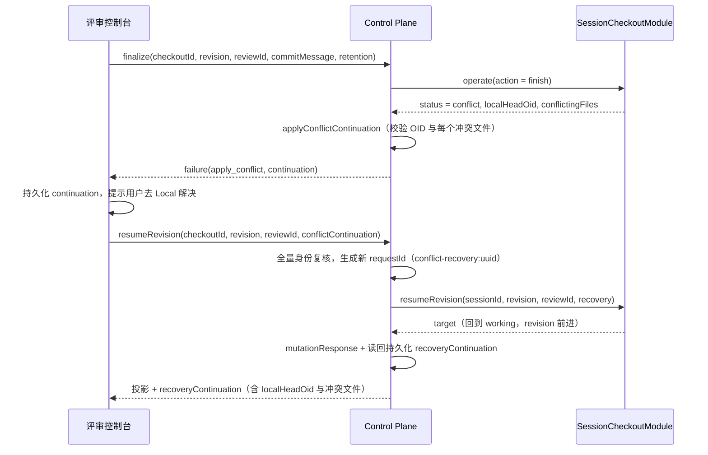

关键点：冲突**不会**破坏评审——记录回到 `working` 但 review 身份仍在，只有用户显式 `resumeRevision` 才会作废这次评审；而 Host 必须确认自己**确实把这份恢复凭据持久化成功了**（`requestId` 与 `workingRevision` 逐字匹配），否则报 `checkout_mismatch`，因为一旦丢失，用户在 Local 侧的解决动作就失去了对应的恢复入口。

---

## 10. Preview 恢复族

当 Local 在 preview 期间被别的东西改动，preview 会 `detached`（`delivery.state = 'preview_detached'`），此时既不能盲目回滚也不能盲目接受。恢复族围绕一次性 `recoveryProof`（`WorktreePreviewRecoveryProof`，见 [会话检出域契约](../../core_worktree_domain_and_infrastructure/session_checkout_domain/session_checkout_domain_contracts.md)）建立。

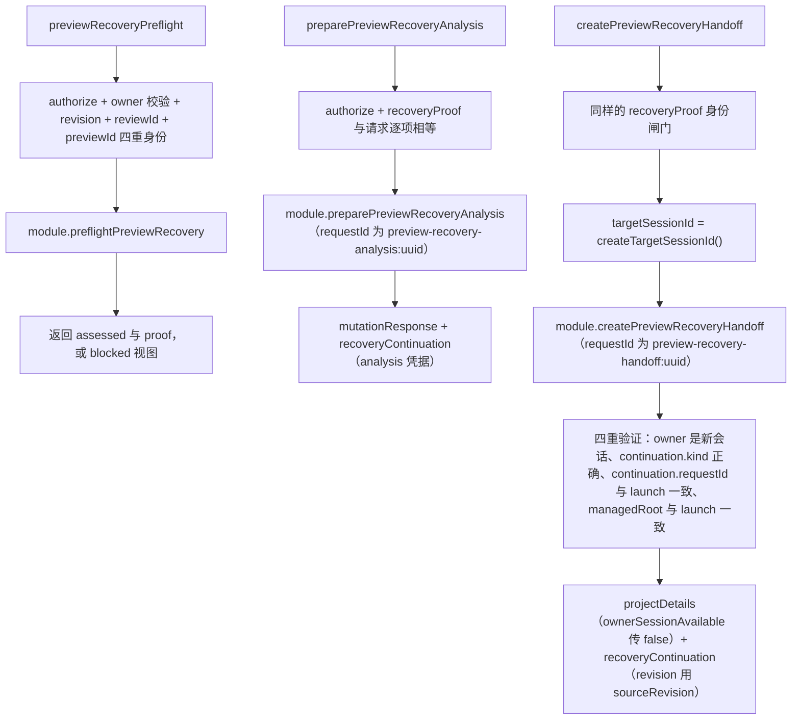

三处值得强调：

- **proof 是上下文，不是 bearer 权限**。`recoveryProof` 里带着 `localFingerprint`、`receiptFingerprint`、`rollback` / `finalize` 的安全评估，但控制面**只**用它做身份匹配（`sessionId`/`checkoutId`/`revision`/`reviewId`/`previewId`），真正的重算与比较发生在模块的排他锁内。
- **handoff 会新建一个 owner 会话**。旧的 detached preview 证据被完整保留，新 worktree 建在最新的 Local HEAD 上；`ownerSessionAvailable` 被硬编码为 `false`，因为新会话此刻还没有注册表可查的实例。
- **continuation 的 revision 语义不同**：analysis 用 `prepared.revision`，handoff 用 `launch.continuation.sourceRevision`（它描述的是**源**检出的修订）。

---

## 11. 保留、清理、侧栏与释放

| 方法 | 前置 | 领域入口 | 备注 |
| --- | --- | --- | --- |
| `setRetention` | `requireOwner` + CAS | `manageManagedWorktreeForSession(action = set_retention)` | 只改保留模式，不动目录 |
| `setPermanent` | `requireOwner` + CAS | `set_permanent` | 常驻标记豁免保留期到期与 keep-count LRU 逐出（手动清理不受限） |
| `retryCleanup` | `requireOwner` + CAS | `retry_cleanup`，可带 `discardPostDeliveryChanges` | 交付后出现新改动时，清理默认停下并报告 `cleanupReason`；只有显式确认才越过 `modified_after_finalize` |
| `clearSidebarBadge` | `authorize`（owner 或 source 皆可）+ 状态必须是终态 | `clear_sidebar_badge` | 终态判定用 `sidebarTaskState`；非 `discarded` / `finalized` 抛 `operation_not_allowed` |
| `beginNextIteration` | 见下 | `module.beginNextIteration(sessionId, expectedRevision)` | 复用上一个已交付会话的不可变 cwd |
| `returnToLocal` | 见下 | `module.bind(sessionId, { kind: 'local' })` | 幂等释放，记录本身不动 |

`beginNextIteration` 是控制面里前置校验最长的一条路径，因为它同时触碰目录与会话身份：

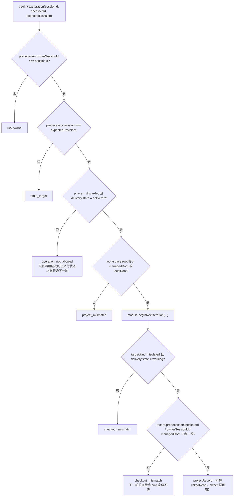

其中「workspace.root 等于 `managedRoot` **或** `localRoot`」这条看似宽松的判定是必须的：独立的隔离会话住在 managed root，而**就地（in-place）会话在清理成功后已经回到 Local 边界**，只接受 managed root 会让每一次就地下一轮迭代都失败。

`returnToLocal` 解决的是本地适配新增的一类体验问题：交付后记录进入 `retained`（默认保留 24 小时），会话仍被绑在 isolated 上，于是顶部胶囊、侧栏与运行上下文继续按隔离态描述，用户既看不到「我其实已经回到 master」，也没有入口主动回 Local。规则：

- 只放行 owner，且必须 `worktreeReachedDelivery(...)` **且** `phase ∈ { discarded, finalized, retained }`（未交付时解绑会把未合并的工作留在冻结目录里，一律拒绝）；
- 若 `sessionBindings[sessionId]` 已经不指向这条 checkout，就**幂等地返回当前 Local 投影**，而不是把一个 no-op 判成失败；
- 保留期倒计时、已交付徽章与回滚材料全部不动——它解的是**绑定**，不是记录。

`sidebarTopology()` 的聚合规则（供 [客户端工作区侧栏](../../worktree_client_interface_layer/client_workspace_sidebar.md) 消费）：

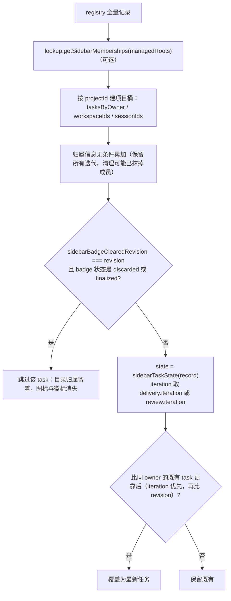

`sidebarTaskState` 是投影规则在侧栏这一路的镜像，顺序即优先级：**交付胜过 phase**——一个抵达 Local 之后又被清理掉的 worktree（`phase = discarded` + `delivery = delivered`）完成了任务，绝不能被读成「已放弃」；只有**没有交付的 discard** 才是放弃。

| 判定顺序 | 条件 | 侧栏状态 |
| --- | --- | --- |
| 1 | `worktreeReachedDelivery(phase, delivery.state)` | `finalized` |
| 2 | `phase === 'discarded'` | `discarded` |
| 3 | `phase === 'recovery_required'` | `recovery_required` |
| 4 | `delivery.state === 'preview_detached'` / `'preview_active'` / `'ready_for_review'` | 同名 |
| 5 | 其余 | `working` |

---

## 12. Git 概览族：恒定绑定 Local 仓库

`projectRootFor(sessionId)` 解析调用方会话所属项目的**仓库根（Local，绝不是受管 worktree）**并做一次 `git.inspect`；缺失或非法时依次抛 `session_not_found`、`project_not_found`、`project_root_missing`、`not_git_repository`。

这条设计的理由是：分支芯片的 Git 面板是**仓库级**的视图，必须与会话此刻正占据着哪个 worktree 无关。用户在一个隔离会话里也应该能浏览整个仓库的分支、提交图与标签。

| 方法 | 依赖的 Port 能力 | 缺失能力 / 失败时的行为 |
| --- | --- | --- |
| `gitOverview` | `branchOverview` | `null` → `git_error`（`for-each-ref`）；`dirtyCount` 可为 `-1`，表示未知而非「干净」 |
| `gitGraph` | `graphLog` | 缺失 → `git_error`；`limit` 默认 200 |
| `gitCreateBranch` | `createLocalBranch` | 缺失 → `git_error`（`branch`） |
| `gitSwitchBranch` | `switchLocalBranch` | 先过两道交付闸门（§6），再执行 |
| `gitPruneMergedBranches` | — | 直接委派 `module.pruneMergedBranchesForSession(sessionId, { dryRun })`，语义与 CAS 在领域层 |
| `gitListTags` | `listTags` | `null` → `git_error` |
| `gitCreateTag` | `createTag`、可选 `pushTag` | push 能力缺失或失败 → 软降级 `pushed: false` + `pushMessage`，**不是**失败 |
| `gitDeleteTag` | `deleteRemoteTag`、`deleteLocalTag` | **先删远端**：远端失败时本地标签仍在，用户可重试，而不是丢掉唯一副本 |
| `gitPushTag` | `pushTag` | 软降级同 `gitCreateTag` 的 push 步骤 |

「软降级」是这一族的一致约定：**推送被拒是一个可报告的结果，而不是一次失败的变更**。`pushed` / `pushMessage` 字段因此与 `capabilities` 一样进入响应体，由 UI 决定如何呈现（见 [客户端目标控制台](../../worktree_client_interface_layer/client_target_console.md)）。

放弃快照族 `listAbandoned` / `restoreAbandoned` 是同一思路下的另一条补充：`discarded` 记录已经没有活 target，但放弃前固化的快照提交（`refs/dsh-worktree/abandoned/<checkoutId>`）仍可恢复为 Local 分支；恢复前同样要走 `authorize`。

---

## 13. `reviewDiff`：读取夹在两次预检之间

评审 diff 是唯一**既昂贵又必须绝对可信**的读取，因此它是全文件中校验最密的路径（并且是显式 `try/catch` 风格）：

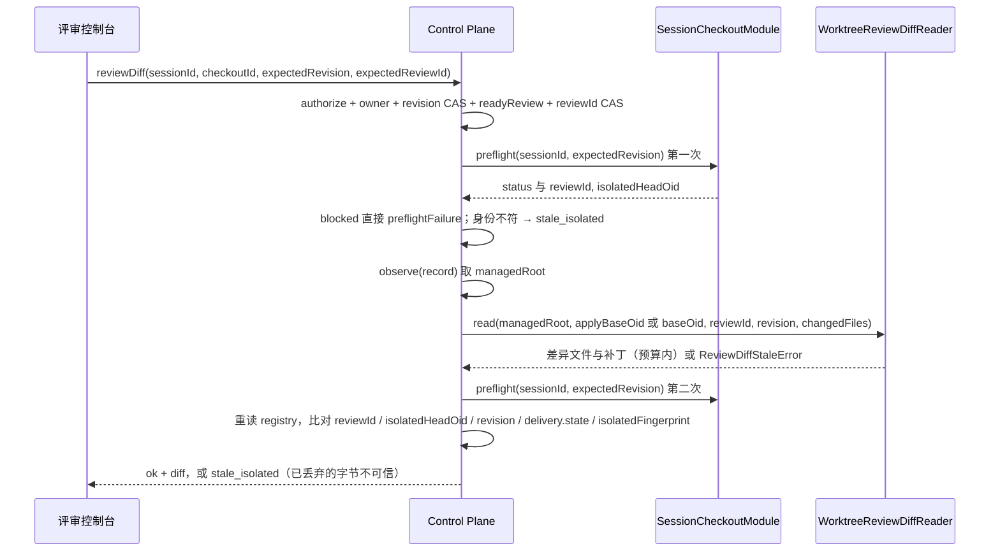

为什么读前读后各一次预检：diff 取证要在冻结检出里跑一串 `git` 子进程（临时索引重建 + 逐批 `numstat` / `patch`，文件多时可达数百次 spawn），耗时以秒计；这期间 Local 或隔离 HEAD 的任何漂移都可能让用户**对着一份已经不存在的实现下确认**。因此读取之后不仅要比对模块预检，还要重新 `recordOf` 逐项比对六项身份。`ReviewDiffStaleError`（由 diff 读取器在「快照与评审 changedFiles 不一致」时抛出）被折叠为 `stale_isolated`，与预算截断（`truncated: true`，属于成功）严格区分。

`baseOid` 的取法是 `record.applyBaseOid ?? record.baseOid`：已经 checkpoint 或部分应用过的检出，其**可交付基线**并不等于最初的 fork 点。

---

## 14. 端到端示例：一次 `current` 轮询

RPC 服务面每 5 秒会代表顶部胶囊调用一次 `current`，这条路径集中体现了控制面的观测复用与终态处理。

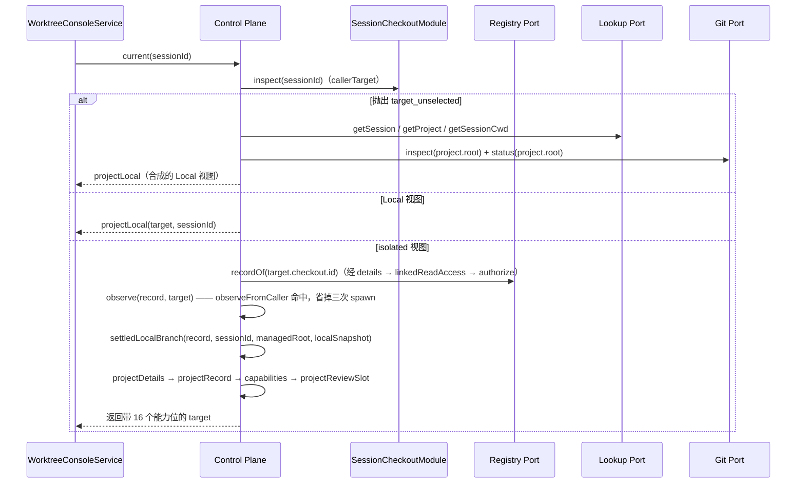

`deliveryProofFromTarget(target)` 在这里负责把 caller 视图上的 proof 复制一份（`changedFiles` 做浅拷贝），供 `details()` 在 revision 一致时复用，避免第二次读注册表。

---

## 15. 错误码使用清单

控制面产生的错误码是 `SESSION_CHECKOUT_ERROR_CODES` 的子集（完整码表、`ERROR_META` 分类与恢复动作见 [共享契约](../worktree_console_contract.md)）：

| 错误码 | 典型触发点 |
| --- | --- |
| `checkout_missing` | `recordOf` 未命中；`linkedReadAccess` 中归属会话不可用 |
| `not_owner` | 归属不匹配；`acceptanceHolder` 复核漂移；`requireOwner`；`details` 中持有者变化 |
| `project_mismatch` | `record.projectId ≠ caller.project.id`；`verifyCallerRoot` 全部证据失败；`beginNextIteration` 的 cwd 不符 |
| `session_not_found` / `project_not_found` / `project_root_missing` / `not_git_repository` | `unboundLocalTarget` 与 `projectRootFor` 的四段解析 |
| `checkout_mismatch` | `observe` 无法验证 Git 身份；create/handoff/next-iteration 的事后一致性断言；`checkpoint` 未回到 working；恢复凭据未持久化成功；`preflight` 的 `checkout_unavailable` |
| `stale_target` | 所有 `expectedRevision` / `expectedReviewId` / previewId / recoveryProof 的 CAS 失败 |
| `stale_local` | 确认令牌校验失败或 `localProject` 状态改变；预检的 `stale_local` |
| `stale_isolated` | diff 前后预检身份漂移；`isolatedFingerprint` 变化；预检的 `stale_isolated` |
| `operation_not_allowed` | `readyReview` 不满足；`beginNextIteration` 非 delivered；`clearSidebarBadge` 非终态；`returnToLocal` 未交付；交付中切分支；`withCreation` 忙；预检 `not_ready_for_review` |
| `preview_not_active` | `previewReview` 不满足 |
| `apply_conflict` | `preview` / `finalize` 命中内容冲突（携带 continuation） |
| `invalid_input` | commit message / requestId / 冲突文件 / 恢复凭据非法 |
| `git_error` | Port 可选能力缺失；`branchOverview` / `listTags` 返回 null；OID 或冲突文件不安全；`git_operation_failed` 之外的兜底 |
| `git_operation_failed` | 空仓库初始化后创建 worktree 失败 |
| `project_acceptance_busy` | 预检的验收位占用（由模块产生，控制面透传） |

---

## 16. 设计要点速查

1. **工厂即封装**：所有授权与观测辅助函数都是闭包私有，外部（包括同目录兄弟文件）无法绕过 `authorize` 直接调用领域层。
2. **写前重观测、读时可复用**：`authorize` 的注释写得很清楚——只有读端点会传入本次请求观察到的 caller；`observeFromCaller` 的六个命中条件就是这条规则的代价控制。
3. **投影后的断言不是装饰**：`checkpoint`、`resumeRevision`、`createTarget`、`createPreviewRecoveryHandoff`、`beginNextIteration` 都会在读回注册表后**再次**校验状态、血缘或凭据是否真的落盘。领域层返回成功不等于 Host 能可信地把它投影给用户。
4. **`discarded` 全程免碰 Git**：`observe`、`mutationResponse`、`authorize` 的可见性检查、`settledLocalBranch` 都对已清理记录短路，避免对一个不存在的目录反复 spawn。
5. **路径比较只有两个入口**：`sameLocalRoot`（相等）与 `withinRoot`（包含），二者共同处理 win32 的大小写与分隔符差异；新增比较点请复用它们。
6. **终态谓词集中定义**：`worktreeReachedDelivery` 来自 `src/console-contract.ts`，Host 与 UI 共用同一实现，这是「交付胜过 phase」不会漂移的原因。
7. **软降级优先于失败**：Git 概览族的推送类操作、`list` 的批量观测、`preview_detached` 的返回，都是「如实报告结果」而不是「把不确定性包装成错误」。
8. **消息全部本地化**：每一条 `domainError` / `failure` 的 message 都来自 `hostMessage(...)`，其语言由服务面的 `withHostLanguage` 作用域决定（见 [src_i18n](../../project_foundation_and_localization/src_i18n.md)）。

---

## 17. 相关页面

- [Worktree Console 宿主服务（父页）](../worktree_console_host.md)
- [Worktree Console 共享契约](../worktree_console_contract.md)
- [投影与错误折叠](worktree_console_host_projection_and_errors.md)
- [RPC 服务面](worktree_console_host_rpc_service.md)
- [评审 diff 读取器](worktree_console_host_review_diff.md)
- [Worktree Console Remote 绑定](../worktree_console_remote.md)
- [会话运行时入口](../../core_worktree_domain_and_infrastructure/session_checkout_domain/session_checkout_runtime/session_checkout_runtime_entry.md)
- [Apply 引擎](../../core_worktree_domain_and_infrastructure/session_checkout_domain/session_checkout_apply_engine.md)
- [会话检出域契约](../../core_worktree_domain_and_infrastructure/session_checkout_domain/session_checkout_domain_contracts.md)
- [src_adapters](../../core_worktree_domain_and_infrastructure/src_adapters.md)
- [客户端控制台 Remote 适配器](../../worktree_client_interface_layer/client_console_remote.md)、[客户端评审控制台](../../worktree_client_interface_layer/client_review_console.md)、[客户端目标控制台](../../worktree_client_interface_layer/client_target_console.md)、[客户端工作区侧栏](../../worktree_client_interface_layer/client_workspace_sidebar.md)
- [构建、CI 与打包](../../project_foundation_and_localization/build_ci_and_packaging.md)
