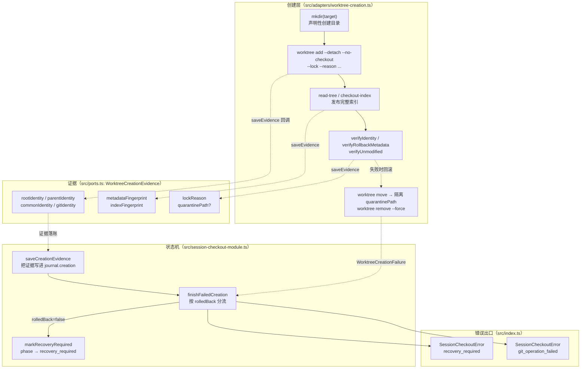
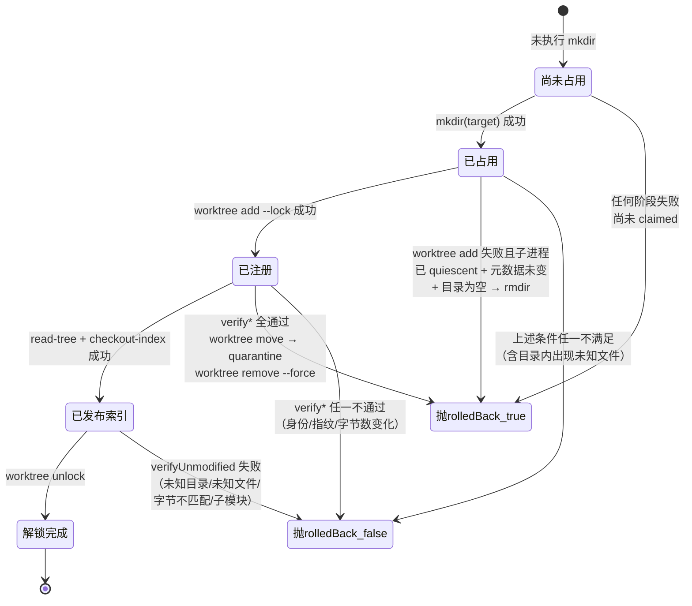
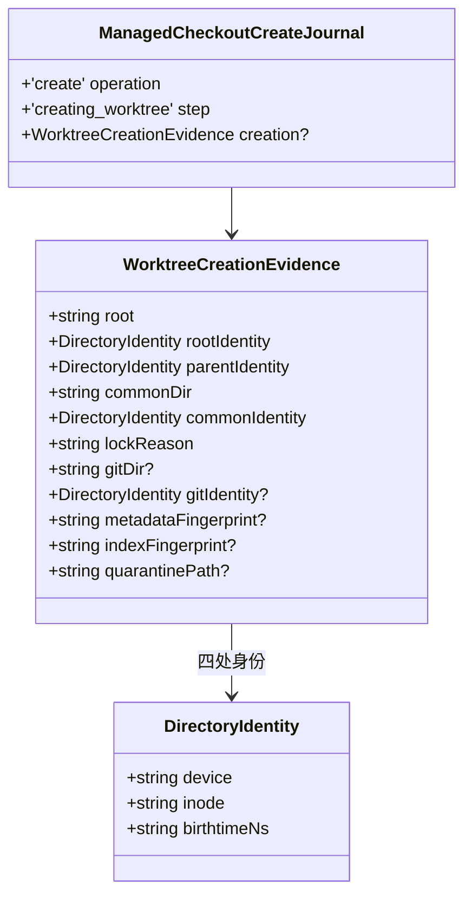
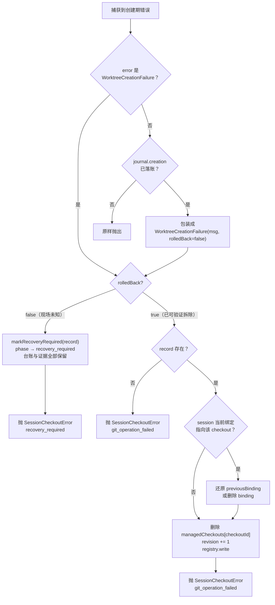
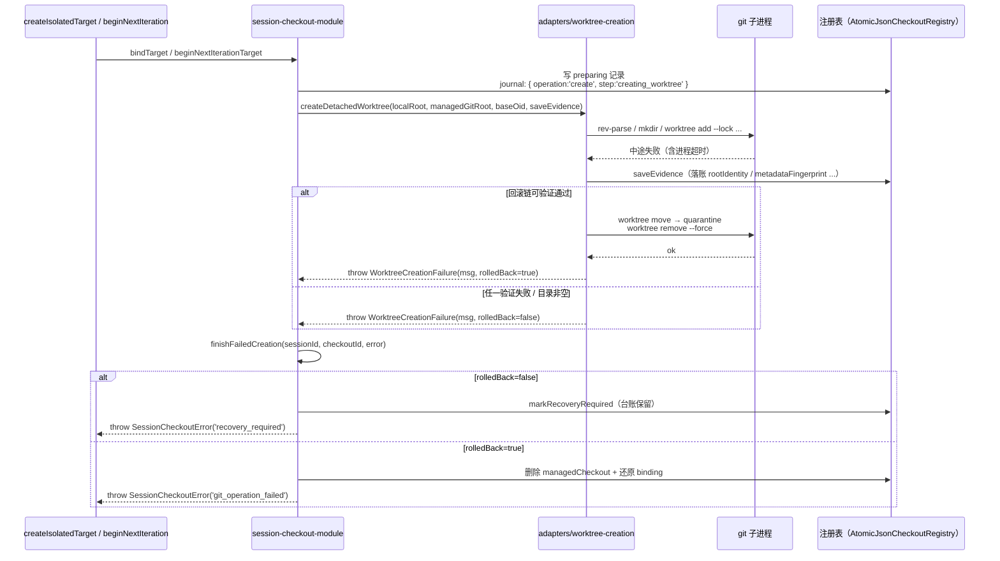

# 创建失败处理（creation_failure）

`creation_failure` 是受管 Worktree 生命周期中「创建失败」这一极端分支的全部事故语义所在。它的核心只有一个类型：[`WorktreeCreationFailure`](../../../src/creation-failure.ts)——一个携带 `rolledBack` 布尔标志的 `Error` 子类。这个模块的价值不在于类型本身，而在于它定义了一条贯穿 **创建适配器 → 状态机 → 注册表 → 用户可见错误** 的铁律：

> **创建失败绝不等于「空路径看起来安全」的授权。** 任何时候，只要无法用目录身份（device / inode / birthtime）与 Git 元数据指纹自证「残余物确实没有被第三方触碰」，就一律保留现场并转入 `recovery_required`，绝不自动删除。

## 在生命周期中的位置

受管 Worktree 的创建发生在两条入口路径上，两条路径都被同一套失败语义覆盖：

- **首次创建**：`createIsolatedTarget` / `bindTarget(..., {kind:'isolated'})`（`src/session-checkout-module.ts` 中 `bindTarget`）。
- **下一轮迭代**：`beginNextIteration`（同文件的 `beginNextIterationTarget`），在上一轮 Worktree 已交付并清理后，复用同一物理目录身份重建下一轮的隔离工作区。

两条路径共同的事故收口点是 `finishFailedCreation(...)`，而真正决定「能不能安全清理」的判定发生在创建适配器 `createWorktree`（`src/adapters/worktree-creation.ts`）内部。

## 架构：失败语义的四层结构



## 核心组件：`WorktreeCreationFailure`

```ts
export class WorktreeCreationFailure extends Error {
  constructor(message: string, readonly rolledBack: boolean) {
    super(message)
    this.name = 'WorktreeCreationFailure'
  }
}
```

- `message`：创建失败的人类可读原因（通常是底层 `git` 子进程的 stderr）。
- **`rolledBack`**：本模块唯一的语义开关。`true` 表示适配器已经用**可验证的回滚链**把失败的 Worktree 物理拆除，状态机可以安全地从注册表删除台账；`false` 表示现场未知，必须保留。

模块顶部那一行注释（`A creation failure is not permission to infer that an empty-looking path is safe.`）就是 `rolledBack` 这个字段存在的全部理由：它把「删除残余」的授权**收紧**成一个布尔，而不是交给「目录看起来空不空」这种不可靠的启发式判断。

## 创建适配器如何判定 `rolledBack`

`createWorktree` 把创建拆成若干阶段，每个阶段失败时采取不同的回滚姿态：



关键判定链（`src/adapters/worktree-creation.ts` 第 70–123 行）：

1. **未 `claimed`（还没 `mkdir`）**：没有任何东西要清理，`rolledBack = true`。
2. **已 `claimed` 但尚未 `registered`**：只有在「子进程确实已退出（`quiescent === true`）+ `git worktree list` 找不到该注册 + `commonDir/worktrees` 元数据前后一致 + 四个目录身份全部匹配 + `target` 目录为空」全部成立时，才 `rmdir` 并 `rolledBack = true`。任一条件失败，`rolledBack = false`，残余原样保留。
3. **已 `registered`**：进入**重型回滚**——连续通过 `verifyIdentity`、`verifyRollbackMetadata`、`verifyUnmodified` 三道验证后，才 `worktree move` 到 `<target>.failed-<uuid>` 隔离路径，再 `worktree remove --force`。任何一道验证失败（例如 `verifyUnmodified` 发现「未知创建目录」「tracked 文件字节哈希不等于索引 OID」「出现子模块」），立即抛出 `rolledBack = false`，残余连同 quarantine 路径一起保留。

`verifyUnmodified`（第 185–250 行）是这套防线中最保守的一环：它拒绝把**任何**不在授权索引里的文件、任何与索引 OID 字节哈希不匹配的工作区文件、任何 `skip-worktree`/`assume-unchanged` 标记视为「可以安全删除」。

## 证据如何落账：`WorktreeCreationEvidence`

创建适配器每推进一个阶段，就通过 `saveEvidence` 回调把最新证据写入 `journal.creation`（由状态机的 `saveCreationEvidence` 持久化进注册表）：



- 四处 `DirectoryIdentity`（root / parent / commonDir / gitDir）是回滚 CAS 的锚点：回滚链每一步都要重新比对，发现任何一处被替换（例如杀毒软件把目录换成了另一个 inode）就放弃删除。
- `metadataFingerprint` / `indexFingerprint` 是 gitDir 内容与 index 字节的哈希，用来发现「创建期间有人动了元数据」。
- `quarantinePath?` 一旦出现，说明回滚已经走过 move 步骤——它本身也是证据的一部分，用户错误消息里会带上这个路径，便于人工定位残余。

## 状态机如何消费 `rolledBack`

`finishFailedCreation(sessionId, checkoutId, error, previous?)`（`src/session-checkout-module.ts` 第 498–521 行）是唯一的分流点：



两条分支对应的用户可见错误码（定义见 [shared_contracts_and_domain_ports/core_types_and_ports.md](../shared_contracts_and_domain_ports/core_types_and_ports.md) 的 `SESSION_CHECKOUT_ERROR_CODES`）：

| `rolledBack` | 记录去向 | 抛出的 `SessionCheckoutError.code` | 用户语义 |
|---|---|---|---|
| `false` | 保留台账，`phase: 'recovery_required'`，`journal.creation` 原样保留 | `recovery_required` | 创建现场可能还有残余，必须人工或 `recover`/`discard` 流程处理 |
| `true` | 从注册表彻底删除台账与绑定 | `git_operation_failed` | 失败的 Worktree 已被可验证回滚链拆除，用户可以安全重试 |

## 创建失败后的外围清理

状态机在 `finishFailedCreation` 之后还有一段「残余探测」逻辑（`bindTarget` 第 5151–5199 行、`beginNextIterationTarget` 第 4706–4743 行），它是 `rolledBack` 语义的最后一道兜底：

1. 检查 `<managedGitRoot>/.git` 是否还在——存在则说明 git 认为这里曾是一个有效 worktree，**绝不自动删除**，直接 `markRecoveryRequired` 并把原始错误抛给用户。
2. 否则尝试 `removeEmptyDirectoryTree(managedGitRoot)`（`src/adapters/files.ts`：只有整棵树完全没有文件/符号链接时才递归 `rmdir`）。
   - 删除成功：从注册表删除台账、把 session binding 还原到 `previousBinding`，首次创建路径还允许再 `createAttempt + 1` 重试一次（sibling 容器降级到 fallback 容器）。
   - 删除失败：`markRecoveryRequired`，抛 `recovery_required`，消息明确指出「残余目录包含未知内容」。



## 与其他模块的关系

- **[session_checkout](session_checkout.md)**：`SessionCheckoutModule` 状态机本体（`src/session-checkout-module.ts`）。`finishFailedCreation`、`saveCreationEvidence`、`bindTarget`、`beginNextIterationTarget` 都在那里；本模块只提供错误类型与语义开关。
- **[shared_contracts_and_domain_ports](../shared_contracts_and_domain_ports.md)**：`WorktreeCreationEvidence`、`DirectoryIdentity`、`ManagedCheckoutCreateJournal` 等端口类型定义所在；`SESSION_CHECKOUT_ERROR_CODES`（`recovery_required` / `git_operation_failed`）与 `SessionCheckoutError` 的错误码字典也在共享契约层。
- **[worktree_lifecycle_management_core_index](worktree_lifecycle_management_core_index.md)**：模块对外门面 `SessionCheckoutModule` 接口与 `IsolatedTargetLaunch` 的定义页，创建失败最终会终止到这个接口的调用方（控制台控制面与客户端）。
- **[managed_worktree_path](managed_worktree_path.md)**：`createManagedWorktreePathCandidates`、`createManagedWorktreeRepositoryKey` 决定「往哪儿创建」；创建失败后 sibling → fallback 的容器降级重试（`createAttempt < 1`）依赖这些候选路径。

- **[host_compat](host_compat.md)** / **[workspace_provider_lifecycle](workspace_provider_lifecycle.md)**：决定「哪个 Host 世代能挂载这个插件」，属于创建动作发生之前的环境判定，不参与创建期失败语义。
- **控制台控制面与服务层（[console_control_plane_and_services](../console_control_plane_and_services.md)）**：把 `recovery_required` 错误码与残留台账投影成「需要人工恢复」的侧栏状态；**客户端（[client](../client.md)）** 据此向用户展示恢复 / 放弃按钮。

## 设计要点速查

1. **保守优先于自动清理**：`rolledBack = true` 必须由「连续三道验证全部通过」换来，而不是「目录看起来空」。
2. **证据先于删除**：任何回滚动作发生之前，目录身份与元数据指纹已经通过 `saveEvidence` 持久化到注册表 journal，这样即使回滚过程本身崩溃，下次启动 `reconcile` 也能基于证据判断现场状态。
3. **失败是收口而非重试**：注释中明确写道「A failed checkout is not a reason to silently repeat the entire creation deadline」——只有 sibling→fallback 容器降级这一种受控重试，其余一律以错误码终止，把决策权交还给用户或上层工具。
4. **与 `SessionCheckoutError` 分层**：`WorktreeCreationFailure` 是**内部**的、携带 `rolledBack` 语义；对外抛出的永远是 `SessionCheckoutError`（`recovery_required` 或 `git_operation_failed`），工具层与控制台不需要感知 `rolledBack` 这个布尔。
