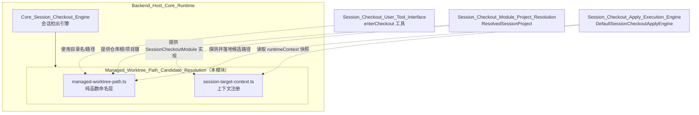
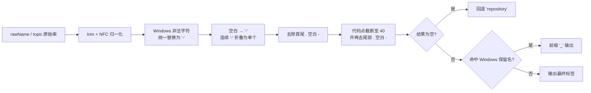
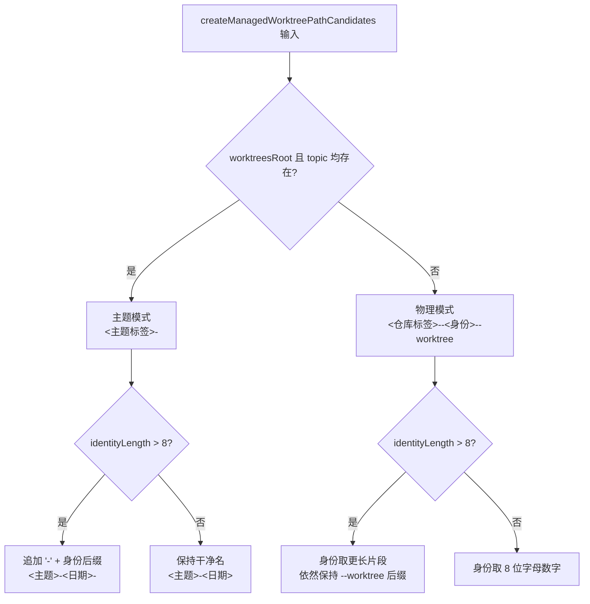
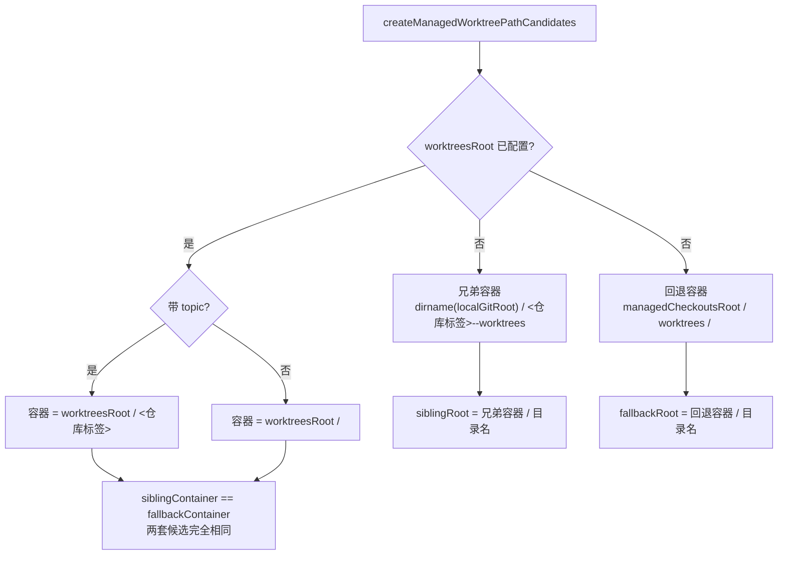
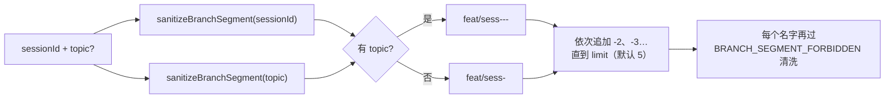
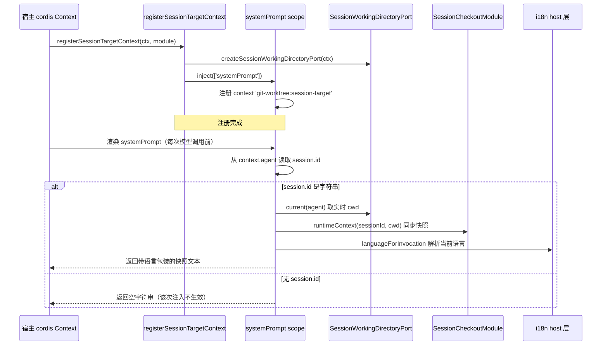
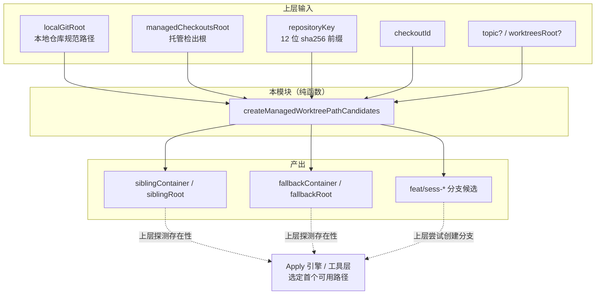

# 托管 Worktree 路径候选解析（Managed_Worktree_Path_Candidate_Resolution）

!!! info "Generated documentation"
    This page was written by CodeWiki from the source code at commit [`b0979671`](https://github.com/wloops/dsh-git-worktree/commit/b0979671ecdb749b8ca1bf1b3c9f06182f618b95) on 2026-11-07 with `doubao-seed-2.1-lite`. Check the code before relying on details.

## 简介

本模块是会话检出引擎（[会话检出核心引擎（Core_Session_Checkout_Engine）](../Core_Session_Checkout_Engine.md)）中**完全无副作用的命名与路径候选层**。它负责两件事：

1. **路径/分支命名候选生成**（`src/managed-worktree-path.ts`）——把仓库名、会话标识、任务主题等原始字符串压成跨平台安全、人类可读的目录名与 Git 分支名，并一次性产出「兄弟容器」与「回退容器」两套路径候选；整个过程**不触碰文件系统、不执行 Git**。
2. **会话目标系统提示上下文注册**（`src/session-target-context.ts`）——在 cordis `Context` 上注册一个回放稳定（replay-stable）的 `systemPrompt.context` 条目 `git-worktree:session-target`，运行期由 `SessionCheckoutModule.runtimeContext` 同步快照渲染，让模型始终知道当前会话处于 Local 还是已迁入自己的托管 Worktree。

设计上，候选生成与存在性探测严格分离：本模块只产出「候选」，由上层（Apply 执行引擎 / 模块项目解析）对 8 / 12 / 全长度身份后缀逐一探测，选定第一个不存在的路径。

---

## 模块定位



---

## 核心组件清单

### `src/managed-worktree-path.ts` — 纯命名与候选生成

| 导出 | 类型 | 职责 |
|---|---|---|
| `sanitizeManagedWorktreeLabel(rawName)` | `(string \| undefined) => string` | 把仓库 basename 清洗为单一可读、跨平台安全的路径片段 |
| `createManagedWorktreeRepositoryKey(canonicalGitRoot)` | `(string) => string` | 对规范 Git 根做 sha256 取前 12 位 hex，作为同名仓库的稳定分区键 |
| `sanitizeBranchSegment(raw)` | `(string \| undefined) => string` | 把任意会话标识/主题压成安全的 Git 分支路径片段（保留 `-`、`_`、`.`） |
| `createSessionBranchCandidates({ sessionId, topic?, limit? })` | `(input) => string[]` | 生成 `feat/sess-<会话>[--主题][-N]` 分支候选，供创建撞名时逐个重试 |
| `createManagedWorktreeDirectoryName({ repositoryName, checkoutId, identityLength? })` | `(input) => string` | 物理 basename：`<仓库标签>--<身份>--worktree` |
| `createTopicManagedWorktreeDirectoryName({ topic, dateStamp, checkoutId, identityLength? })` | `(input) => string` | 本地适配命名：`<主题>-<YYYYMMDD>[-<身份>]` |
| `createTopicDateStamp(now?)` | `(Date?) => string` | 生成 `YYYYMMDD` 日期戳（本地时区） |
| `createManagedWorktreePathCandidates(input)` | `(input) => ManagedWorktreePathCandidates` | 一次产出兄弟/回退两套容器与根目录候选 |
| `ManagedWorktreePathCandidates` | `interface` | `{ siblingContainer, siblingRoot, fallbackContainer, fallbackRoot }` |

模块内部常量与私有工具：

- `WINDOWS_INVALID_CHARACTERS`（控制符与 `<>:"/\|?*`）、`WINDOWS_RESERVED_NAME`（`CON`/`PRN`/`AUX`/`NUL`/`COM[1-9]`/`LPT[1-9]`）——保证在 Windows 上也可创建。
- `BRANCH_INVALID_CHARACTERS` 与 `BRANCH_SEGMENT_FORBIDDEN`——保证分支名满足 Git 引用规则。
- `MAX_LABEL_LENGTH = 40`（代码点截断）、`DEFAULT_IDENTITY_LENGTH = 8`。
- `truncateCodePoints`（按 Unicode 代码点而非 UTF-16 截断）、`checkoutIdentity`（从 `checkoutId` 提取字母数字身份）。

### `src/session-target-context.ts` — 系统提示上下文注册

| 导出 | 类型 | 职责 |
|---|---|---|
| `registerSessionTargetContext(ctx, module)` | `(Context, SessionCheckoutModule) => void` | 注册 `systemPrompt.context({ name: 'git-worktree:session-target', order: 118 })`，**注册期不做任何 Git / 文件系统 I/O** |
| `ContextAgent` | `interface` | 最小结构断言：`{ session?: { id?: unknown } }`，用于从 agent 读取当前会话 id |

运行期渲染函数在取到 `sessionId` 后调用：

```text
module.runtimeContext(sessionId, workingDirectory.current(agent))
```

并由 `withHostLanguage(languageForInvocation(...))` 包裹，使提示文案跟随宿主语言设置。`workingDirectory` 端口来自 [`createSessionWorkingDirectoryPort`](../Adapter_Infrastructure_Implementations.md)，用于判断当前会话是已迁入 Worktree（`worktree_create` 移动了 cwd）还是仍在 Local。

---

## 命名与候选解析体系

### 1. 标签清洗管线



分支片段（`sanitizeBranchSegment`）共享同款清洗思路，但允许 `.`、`_`、`/` 通过，并在末尾统一过一遍 `BRANCH_SEGMENT_FORBIDDEN`（拒绝 `.` 开头、`..`、`@{"`、`//`、`.lock` 结尾、`/` 结尾）。

### 2. 目录命名双模式



> **本地适配（local adaptation）语义**：当调用方配置了 `worktreesRoot`，所有托管 Worktree 都不再出现在仓库旁边、也不再落在状态目录里；它们统一迁入自定义根下的项目分桶目录。主题命名只在「同时提供 `worktreesRoot` 与 `topic`」时启用——这是面向智能体产出可读目录的人因设计。

### 3. 容器与根候选选择



- **兄弟容器（sibling）**：与仓库平级，路径短、人眼友好；当目录所在位置不可写或被占用时调用方才会落到 **回退容器（fallback）**。
- **repositoryKey**：是「两个不同路径的仓库共享同一 basename 时」的稳定分流键，避免回退容器下串目录。

### 4. 会话分支候选生成



会话分支是**交付目标分支**——必须一眼看出属于哪个会话、对应哪次任务；撞名时由上层逐个尝试创建，`-N` 递增序列保证确定性重试。

---

## 会话目标上下文注册（运行期时序）



---

## 数据流与不变量



### 关键不变量

1. **零副作用**：`managed-worktree-path.ts` 不 `import` 任何 fs/git 端口；所有函数同输入永远同输出。
2. **跨平台安全**：Windows 非法字符、保留名、Git 引用规则三类约束在生成期一次性消化。
3. **确定性重试**：目录身份从 8 位起步，撞名时由上层换更长 `identityLength`；分支名撞名时由 `feat/sess-...` → `-2` → `-3` 线性递增。
4. **候选≠落地**：`siblingRoot`/`fallbackRoot` 只是「建议位置」，真实创建由 [会话检出应用执行引擎（Session_Checkout_Apply_Execution_Engine）](Session_Checkout_Apply_Execution_Engine.md) 在同一把互斥锁内完成。
5. **上下文注入同步化**：`runtimeContext` 是同步快照，避免在系统提示渲染期触发异步 Git/FS 抖动，保证 cordis 回放稳定。

---

## 与其他模块的关系

| 方向 | 模块 | 关系 |
|---|---|---|
| 被消费 | [会话检出应用执行引擎（Session_Checkout_Apply_Execution_Engine）](Session_Checkout_Apply_Execution_Engine.md) | 拿到 `siblingRoot`/`fallbackRoot` 后探测存在性并执行真实 `git worktree add` |
| 被消费 | [会话检出模块 · 项目解析（Session_Checkout_Module_Project_Resolution）](Session_Checkout_Module_Project_Resolution.md) | 提供 `localGitRoot`、`managedCheckoutsRoot`、`repositoryKey` 与 `SessionCheckoutModule.runtimeContext` 实现 |
| 被消费 | [会话签出用户工具接口（Session_Checkout_User_Tool_Interface）](Session_Checkout_User_Tool_Interface.md) | `enterCheckout` 依赖解析出的 `managedRoot` 把会话 cwd 迁入已建好的 Worktree |
| 依赖 | [适配器基础设施实现（Adapter Infrastructure Implementations）](../Adapter_Infrastructure_Implementations.md) | `createSessionWorkingDirectoryPort` 提供实时 cwd 读取能力 |
| 依赖 | [Internationalization (i18n) 层](../../../Shared_Cross-Tier_Contracts___Utilities/Internationalization_(i18n)_Layer.md) | `languageForInvocation` / `withHostLanguage` 决定提示文本语言 |
| 宿主 | [后端宿主核心运行时（Backend_Host_Core_Runtime）总览](../../Backend_Host_Core_Runtime.md) | 本模块运行于其会话检出引擎内部 |

---

## 维护要点

- 若未来放宽目录长度（当前 40 代码点），需同步评估 Windows MAX_PATH 与 Git core.longpaths 的交互。
- 新增命名模式时，应优先在 `managed-worktree-path.ts` 内追加纯函数，**不要**让上层直接拼路径——所有跨平台规则只在此处收口。
- 修改 `registerSessionTargetContext` 的 `order`（当前 118）会影响系统提示中该段上下文的相对位置；调整前请确认不与其它插件 cordis patch 冲突（参考仓库根的 `cordis.patch.yml`）。

??? abstract "Documented components (2)"
    - [`ManagedWorktreePathCandidates`](https://github.com/wloops/dsh-git-worktree/blob/b0979671ecdb749b8ca1bf1b3c9f06182f618b95/src%5Cmanaged-worktree-path.ts) — `src\managed-worktree-path.ts`
    - [`ContextAgent`](https://github.com/wloops/dsh-git-worktree/blob/b0979671ecdb749b8ca1bf1b3c9f06182f618b95/src%5Csession-target-context.ts) — `src\session-target-context.ts`

