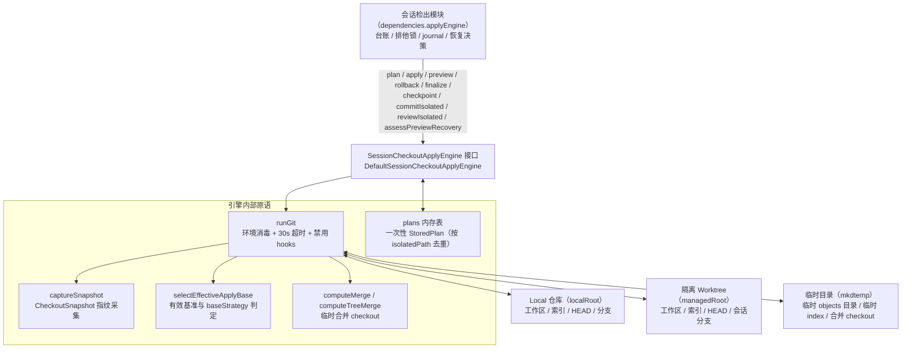
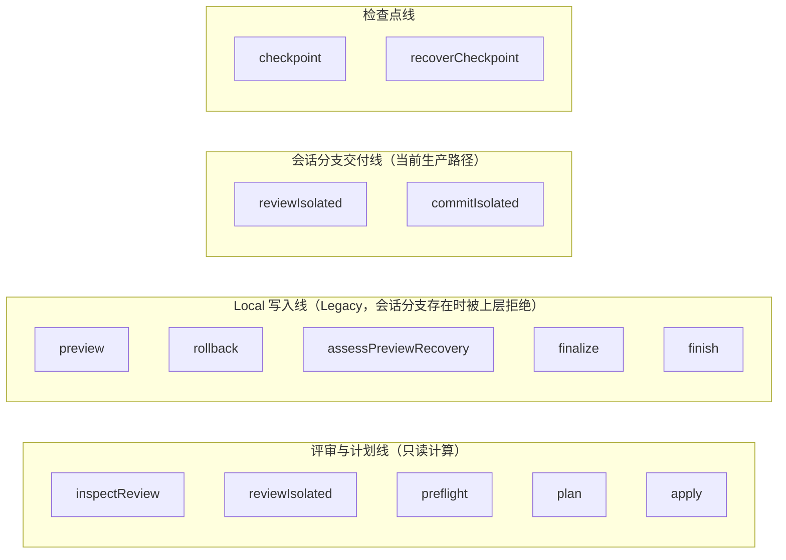
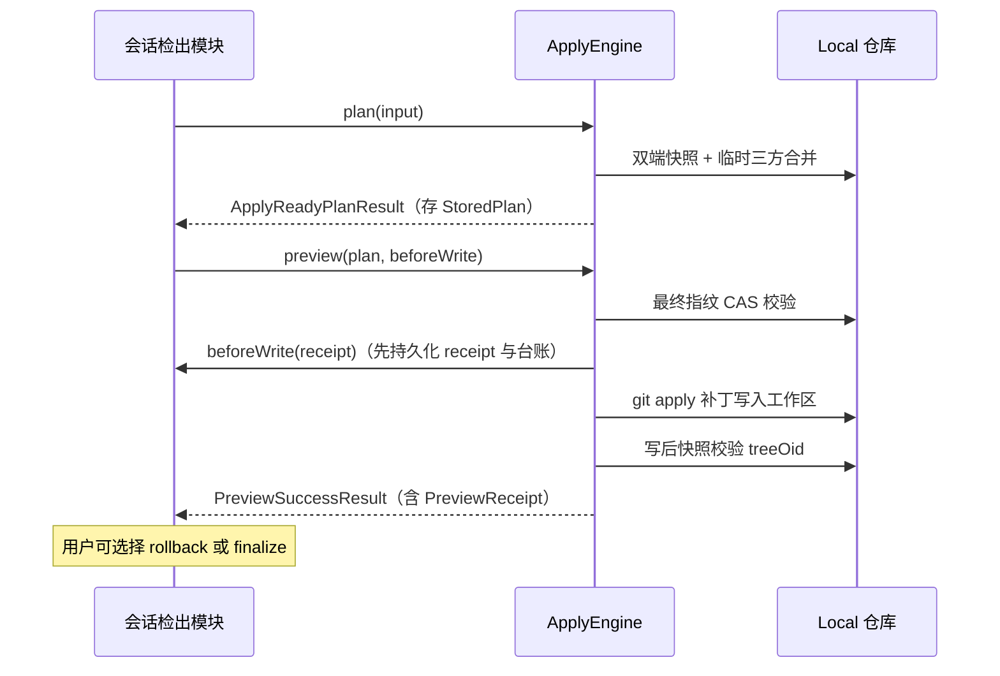
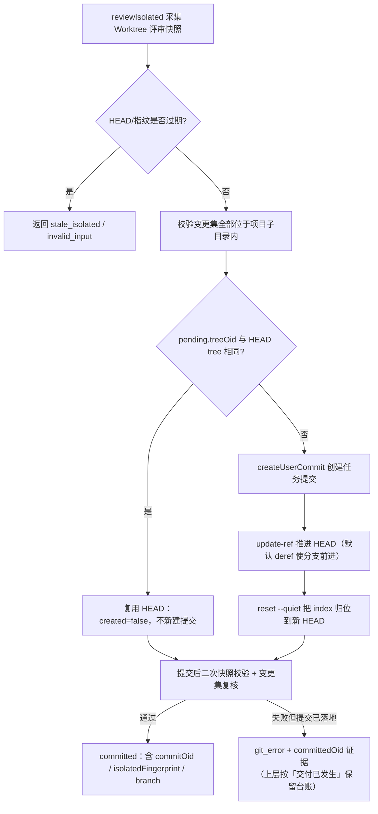
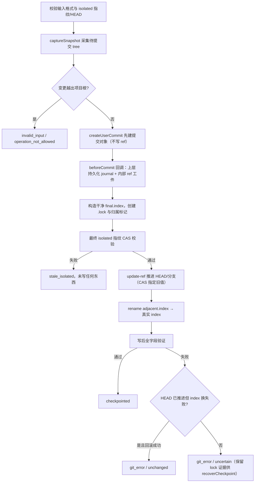

# 会话检出应用执行引擎（Session_Checkout_Apply_Execution_Engine）

!!! info "Generated documentation"
    This page was written by CodeWiki from the source code at commit [`47ebbe95`](https://github.com/wloops/dsh-git-worktree/commit/47ebbe95f01b195727094f9030c58cb5b5145601) on 2026-11-06 with `doubao-seed-2.1-lite`. Check the code before relying on details.

> 源码位置：`src/session-checkout-apply.ts`
> 父模块：[会话检出核心引擎（Core_Session_Checkout_Engine）](../Core_Session_Checkout_Engine.md)

## 简介

`Session_Checkout_Apply_Execution_Engine` 是整个会话检出体系中的 **Git 原子操作执行层**。它在两个真实 checkout 之间工作：

- **Local 边界**（`localPath`，即用户的主工作仓库）；
- **隔离 Worktree**（`isolatedPath`，托管的任务工作树）。

它的核心命题是：**如何在不借助数据库事务的前提下，安全地把 Worktree 中的任务变更写入用户的 Local 边界，或者提交到会话分支上，并在任意一步崩溃后都能被证明「没动过」或「可以精确恢复」**。

为此该引擎完全不读注册表（registry），只做两件事：

1. **计算**：通过临时 index 与临时合并 checkout，把两侧工作区/索引/HEAD 全部折叠成 tree OID 并做三方合并；
2. **写入**：以「指纹 CAS（compare-and-swap）」反复校验 checkout 指纹，校验通过后才落补丁、写 ref、换 index，写后再独立快照验证。

上层 [会话检出模块 · 项目解析（Session_Checkout_Module_Project_Resolution）](Session_Checkout_Module_Project_Resolution.md) 中的 `createSessionCheckoutModule` 把该引擎实例装配为 `dependencies.applyEngine`，负责台账、排他锁（binding lock）与 journal；引擎本身则是无状态的 Git 执行内核（仅持有内存中的一次性 `StoredPlan`）。

## 总体架构



### 分层职责

| 层 | 组件 | 职责 |
| --- | --- | --- |
| 接口层 | `SessionCheckoutApplyEngine` | 暴露全部 13 个操作方法，供模块调用 |
| 实现层 | `DefaultSessionCheckoutApplyEngine` | 编排快照、CAS 校验、合并计算、写入与验证 |
| 原语层 | `runGit` / `captureSnapshot` / `computeMerge` 等 | Git 子进程执行与纯计算 |
| 适配层 | `createSessionCheckoutApplyEngine(options)` | 注入 `projectSkills` 与测试/宿主 seam |

## 核心数据结构

### CheckoutSnapshot 与指纹 CAS

`CheckoutSnapshot` 是引擎判断「checkout 是否被别人动过」的唯一依据：

```ts
interface CheckoutSnapshot {
  fingerprint: string      // sha256(headOid \0 headRef \0 indexEntries \0 treeOid)
  headOid: string
  headRef: string | null   // null = detached HEAD
  headTreeOid: string
  indexTreeOid: string     // 经临时 index 构造，反映 staged 语义 + 工作区
  treeOid: string          // 含工作区全部变更的完整最终 tree
  indexEntries: Buffer
}
```

`fingerprint` 同时叠加了「随会话携带的 Project Skills」的指纹（通过 `options.projectSkills`），保证宿主运行期产物与技能文件的变化也能被检出。所有写入操作都遵循同一套 CAS 纪律：

1. **写前校验**：重新采集快照，与计划时记录的指纹逐字段比对；
2. **落写前回调**：通过 `beforeWrite` / `beforeCommit` 让上层先把 receipt / journal 持久化进台账，**然后**才碰磁盘；
3. **写后独立验证**：再采一次快照，要求 HEAD、ref、index、tree、指纹全部符合预期，否则归类为 `recoveryState: 'uncertain'`。

### ApplyPlan / StoredPlan（一次性计划）

`plan()` 计算出的 `ApplyPlan`（含 `revision`、两侧指纹、有效基准、变更文件清单）会与原始补丁 `patch` 一起存进引擎内存的 `plans` 表。关键不变量：

- **每个 isolated checkout 只保留最新一份计划**：再次计算时会清掉同路径的旧 revision，防止内存无限增长；
- **计划一次性**：`apply()` / `preview()` / `finish()` 成功后立即 `delete(plan.revision)`，同一个 plan 不能被重放；
- **计划防篡改**：执行前用 `planMatches()` 逐字段比对调用方传回的 plan，字段不符或仓库对象目录身份变化（`pathsMatch`）一律报 `invalid_plan`。

### EffectiveApplyBase（有效基准）

`selectEffectiveApplyBase()` 在三方合并前决定真正用于合并的 base：

| baseStrategy | 触发条件 | 含义 |
| --- | --- | --- |
| `recorded_base` | 记录的 base 不在某一侧历史中，或两侧已分叉 | 保守使用记录 base（上次 Apply 生成的内部快照通常走这条路） |
| `isolated_contains_local_head` | Local HEAD 是 Worktree HEAD 的祖先 | 直接以 Local HEAD 为 base，变更集最小 |
| `local_contains_isolated_head` | Worktree HEAD 是 Local HEAD 的祖先 | 以 Worktree HEAD 为 base |

### PreviewReceipt（预览收据）

`preview()` 成功后返回的 `PreviewReceipt` 是可逆预览的全部证据：两侧 HEAD/ref/指纹/工作区 tree OID/index tree OID/预览后 tree OID/隔离快照 OID。上层模块据此持久化内部 ref 工件，并在后续 `rollback` / `finalize` / `assessPreviewRecovery` 中原样回传。

## 操作方法分组

引擎接口共分四条能力线：



### 1. 评审与计划线

| 方法 | 行为 | 上层调用点 |
| --- | --- | --- |
| `inspectReview` | 对比 Worktree 快照与 `baseOid`，输出变更文件清单；会同时校验 Local 与 Worktree 属于同一仓库且项目子目录一致 | `markReadyForReviewTarget`、交付后清理诊断 |
| `reviewIsolated` | 只读 Worktree 的评审快照，**完全不读 Local**；供会话分支交付前判断「评审之后 Worktree 是否又改过」 | `operateFinish` |
| `preflight` | 复用 `plan` 的真实合并计算，但不持久化可执行 plan、也不修改任一 checkout | `preflightTarget`（验收预检） |
| `plan` | 与 preflight 同算，但把结果存为一次性 `StoredPlan` | `operateApply`、`operatePreview` |
| `apply` | 按 plan 把补丁写进 Local 工作区，并生成无 ref 的内部快照 commit `nextBaseOid` 供后续迭代去重 | `operateApply` |

### 2. Local 写入线（Legacy）

这条线把评审后的变更直接写进 Local 边界，是「预览 → 用户验收 → 提交」的旧路径。当前上层在记录存在 `sessionBranch` 时通过 `refuseLegacyLocalWrite` 整体拒绝这类调用，以避免改动混进别人的分支；但引擎仍完整保留该能力并被 reconcile/恢复逻辑依赖。

典型时序：



- `rollback`：用 receipt 把 Local 工作区还原到预览前 tree，先 `beforeWrite` 落 mutation journal，再在补丁前后各做一次指纹 CAS；
- `assessPreviewRecovery`：**严格只读**地评估「预览后 Local 又漂移」时，rollback 与 finalize 是否仍然安全（通过多轮 `computeTreeMerge` 判断冲突域），返回 `PreviewRecoveryAssessment`（`safe` 或带 code 的 `blocked`）；
- `finalize`：把任务增量从 Local 完整快照中剥离（`C = H + (M - L)`），创建任务提交并恢复用户原有 staged 状态（`S' = C + (S - H)`），全程持有 Git 规范的 `index.lock` 原子换索引；
- `finish`：一次性完成「重算合并校验 + 剥离任务增量 + 写 ref + 换 index」的完整交付，失败时按补偿顺序回滚 ref 与工作区补丁。

### 3. 会话分支交付线（当前生产路径）

`commitIsolated` 与 `finish` 的根本差别是 **完全不碰 Local**：不读 Local 的 HEAD/工作区/索引，不与它的未提交改动求三方合并，只把 Worktree 自身工作区提交到它此刻检出的（会话）分支上。



注意 `ApplyErrorResult.committedOid` 的存在意义：提交已经写进分支 ref 之后才失败时，上层不能把记录当「什么都没发生」退回交付前状态，而是把已落地的 OID 作为恢复证据保留在 journal 中。

### 4. 检查点线

`checkpoint()` 在评审期间把 Worktree 当前未发布改动存为一个 checkpoint 提交（不发布给 Local），其写入协议是引擎中最严格的：



`recoverCheckpoint()` 是配套的崩溃恢复入口：根据 journal 中记录的 `commitOid / parentOid / expectedIndexTreeOid` 判断现场属于「提交未落地（中止残留 lock）」还是「提交已落地但 index 未归位（补做原子换 index）」，两种结局分别返回 `checkpoint_aborted` 与 `checkpoint_recovered`。上层 `reconcile()` 在启动时正是靠它把中断的 checkpoint 操作收口到确定态。

## 并发、安全与环境纪律

| 机制 | 实现要点 |
| --- | --- |
| 环境消毒 | `scrubbedAmbientGitEnv()` 清除 `GIT_DIR` / `GIT_WORK_TREE` 等全部 ambient 变量，仓库路由只来自授权 cwd；`options.env`（如 `GIT_INDEX_FILE`）永远优先 |
| 禁用 hooks | 每个进程使用懒创建的空目录作为 `core.hooksPath`，防止交付路径触发用户仓库 hook |
| 超时 | apply 路径统一 30s（`GIT_TIMEOUT_MS`），`SIGTERM` 兜底；与 `src/adapters/git.ts` 的 120s 常态路径区分 |
| Windows 兼容 | 注入 `core.longpaths=true`、`core.quotePath=false`、`core.fsmonitor=false`；路径比较按平台决定大小写敏感性 |
| 临时对象隔离 | 每次操作用 `mkdtemp` 建临时 `objects` 目录，通过 `GIT_OBJECT_DIRECTORY` + `GIT_ALTERNATE_OBJECT_DIRECTORIES` 回指真实仓库，合并计算不污染源对象库 |
| index.lock 原子协议 | `writeIndexLock()` 以 `open(..., 'wx')` 排他创建 `.lock`，再 `rename` 为真实 index；并发争用（`EEXIST`）翻译为可重试的 `stale_local` / `stale_isolated` |
| 宿主产物排除 | 提交/评审快照统一叠加 `deliveryExcludePathspecs()`（如 `.dsh-ops`），避免把运行期产物带进交付提交 |

## 错误模型

所有方法的失败统一收敛为 `ApplyError` 联合类型：

| 错误码 | 语义 | 上层典型处置 |
| --- | --- | --- |
| `invalid_input` | OID 格式、提交消息、preview 标识等不合法 | 直接作为用户可见错误返回 |
| `invalid_plan` | plan 丢失/已被消费/被篡改，或仓库对象目录身份变化 | 证明未触碰 checkout，退回到 ready |
| `stale_local` | Local 在计划/校验之后被修改 | 重算计划；preview 场景则把预览 detach 保留证据 |
| `stale_isolated` | Worktree 在计划/评审/checkpoint 之后被修改 | 作废评审回到 working，或 checkpoint 中止 |
| `git_error` | git 子进程失败；带 `recoveryState`：`unchanged` 可证明未写，`uncertain` 无法证明 | `unchanged` 退 ready；`uncertain` 进 `recovery_required` 等待 reconcile 收口 |
| `commit_isolation_conflict` | 任务增量无法从 Local 既有 staged/工作区改动中可靠剥离 | 提示用户先处理本地改动 |
| `operation_not_allowed` | detached HEAD 提交、非分支 HEAD 等状态限制 | 引导用户挂会话分支后重试 |
| `preview_modified` | 用户在预览区域又叠加了改动 | detach 预览，等待用户显式恢复操作 |

## 测试与宿主 seam

`SessionCheckoutApplyEngineOptions` 暴露四个「最后一次 CAS 之前/独立写后验证之前」的回调点：

- `beforeFinalLocalValidation` / `afterLocalWriteBeforeVerification`：Local 写入路径的缝；
- `beforeFinalIsolatedValidation` / `afterIsolatedWriteBeforeVerification`：isolated 写入路径的缝。

这些 seam 让宿主与测试可以在「写前校验已过、落盘未发生」或「已落盘、独立验证未开始」两个精确窗口制造并发干扰，从而验证 CAS 与回滚分支。

## 与其他模块的关系

- **上游装配**：[会话检出核心引擎（Core_Session_Checkout_Engine）](../Core_Session_Checkout_Engine.md) 与 [会话检出模块 · 项目解析（Session_Checkout_Module_Project_Resolution）](Session_Checkout_Module_Project_Resolution.md)——模块层持有引擎实例，负责台账、排他锁、journal 持久化与恢复决策；本引擎是它的执行内核。
- **用户入口**：[会话签出用户工具接口（Session_Checkout_User_Tool_Interface）](Session_Checkout_User_Tool_Interface.md)——模型工具（`enterCheckout` 等）经由模块层间接触达本引擎的操作。
- **领域类型**：[核心工作区与 Worktree 领域层](../Core_Workspace___Worktree_Domain_Layer.md)——`ApplyBaseStrategy`、`ApplyConflictDetail`、`CONFLICT_DETAIL_FILE_LIMIT` 等共享类型与常量定义在该层的 `types.ts` 中。
- **基础设施**：[适配器基础设施实现（Adapter Infrastructure Implementations）](../Adapter_Infrastructure_Implementations.md)——`ProjectSkillStore`（`adapters/project-skills.ts`）为本引擎提供随会话携带的技能状态；引擎内部自带的 `runGit` 是对 `adapters/git.ts`「环境消毒 + 无锁」纪律的 apply 路径复用。
- **i18n**：[Shared_Cross-Tier_Contracts___Utilities 国际化层](../../Shared_Cross-Tier_Contracts___Utilities/Internationalization_(i18n)_Layer.md)——全部面向用户的错误消息经 `hostMessage()` 输出。
- **控制台服务**：[Worktree 控制台宿主服务（Worktree_Console_Host_Service）](../Worktree_Console_Host_Service.md)——其 RPC 面（如 preview/finalize 相关请求）最终也经由模块层落到本引擎的 receipt 与恢复评估上。

??? abstract "Documented components (42)"
    - [`ApplyConflictPlanResult`](https://github.com/wloops/dsh-git-worktree/blob/47ebbe95f01b195727094f9030c58cb5b5145601/src%5Csession-checkout-apply.ts) — `src\session-checkout-apply.ts`
    - [`ApplyErrorResult`](https://github.com/wloops/dsh-git-worktree/blob/47ebbe95f01b195727094f9030c58cb5b5145601/src%5Csession-checkout-apply.ts) — `src\session-checkout-apply.ts`
    - [`ApplyPlan`](https://github.com/wloops/dsh-git-worktree/blob/47ebbe95f01b195727094f9030c58cb5b5145601/src%5Csession-checkout-apply.ts) — `src\session-checkout-apply.ts`
    - [`ApplyPlanErrorResult`](https://github.com/wloops/dsh-git-worktree/blob/47ebbe95f01b195727094f9030c58cb5b5145601/src%5Csession-checkout-apply.ts) — `src\session-checkout-apply.ts`
    - [`ApplyPlanInput`](https://github.com/wloops/dsh-git-worktree/blob/47ebbe95f01b195727094f9030c58cb5b5145601/src%5Csession-checkout-apply.ts) — `src\session-checkout-apply.ts`
    - [`ApplyReadyPlanResult`](https://github.com/wloops/dsh-git-worktree/blob/47ebbe95f01b195727094f9030c58cb5b5145601/src%5Csession-checkout-apply.ts) — `src\session-checkout-apply.ts`
    - [`ApplyScope`](https://github.com/wloops/dsh-git-worktree/blob/47ebbe95f01b195727094f9030c58cb5b5145601/src%5Csession-checkout-apply.ts) — `src\session-checkout-apply.ts`
    - [`ApplySuccessResult`](https://github.com/wloops/dsh-git-worktree/blob/47ebbe95f01b195727094f9030c58cb5b5145601/src%5Csession-checkout-apply.ts) — `src\session-checkout-apply.ts`
    - [`CheckoutSnapshot`](https://github.com/wloops/dsh-git-worktree/blob/47ebbe95f01b195727094f9030c58cb5b5145601/src%5Csession-checkout-apply.ts) — `src\session-checkout-apply.ts`
    - [`CheckpointInput`](https://github.com/wloops/dsh-git-worktree/blob/47ebbe95f01b195727094f9030c58cb5b5145601/src%5Csession-checkout-apply.ts) — `src\session-checkout-apply.ts`
    - [`CheckpointRecoverySuccessResult`](https://github.com/wloops/dsh-git-worktree/blob/47ebbe95f01b195727094f9030c58cb5b5145601/src%5Csession-checkout-apply.ts) — `src\session-checkout-apply.ts`
    - [`CheckpointSuccessResult`](https://github.com/wloops/dsh-git-worktree/blob/47ebbe95f01b195727094f9030c58cb5b5145601/src%5Csession-checkout-apply.ts) — `src\session-checkout-apply.ts`
    - [`CommitIsolatedInput`](https://github.com/wloops/dsh-git-worktree/blob/47ebbe95f01b195727094f9030c58cb5b5145601/src%5Csession-checkout-apply.ts) — `src\session-checkout-apply.ts`
    - [`CommitIsolatedSuccess`](https://github.com/wloops/dsh-git-worktree/blob/47ebbe95f01b195727094f9030c58cb5b5145601/src%5Csession-checkout-apply.ts) — `src\session-checkout-apply.ts`
    - [`CommitIsolationApplyError`](https://github.com/wloops/dsh-git-worktree/blob/47ebbe95f01b195727094f9030c58cb5b5145601/src%5Csession-checkout-apply.ts) — `src\session-checkout-apply.ts`
    - [`DefaultSessionCheckoutApplyEngine`](https://github.com/wloops/dsh-git-worktree/blob/47ebbe95f01b195727094f9030c58cb5b5145601/src%5Csession-checkout-apply.ts) — `src\session-checkout-apply.ts`
    - [`EffectiveApplyBase`](https://github.com/wloops/dsh-git-worktree/blob/47ebbe95f01b195727094f9030c58cb5b5145601/src%5Csession-checkout-apply.ts) — `src\session-checkout-apply.ts`
    - [`FinishSuccessResult`](https://github.com/wloops/dsh-git-worktree/blob/47ebbe95f01b195727094f9030c58cb5b5145601/src%5Csession-checkout-apply.ts) — `src\session-checkout-apply.ts`
    - [`GitApplyError`](https://github.com/wloops/dsh-git-worktree/blob/47ebbe95f01b195727094f9030c58cb5b5145601/src%5Csession-checkout-apply.ts) — `src\session-checkout-apply.ts`
    - [`GitCommandFailure`](https://github.com/wloops/dsh-git-worktree/blob/47ebbe95f01b195727094f9030c58cb5b5145601/src%5Csession-checkout-apply.ts) — `src\session-checkout-apply.ts`
    - [`GitResult`](https://github.com/wloops/dsh-git-worktree/blob/47ebbe95f01b195727094f9030c58cb5b5145601/src%5Csession-checkout-apply.ts) — `src\session-checkout-apply.ts`
    - [`InvalidInputApplyError`](https://github.com/wloops/dsh-git-worktree/blob/47ebbe95f01b195727094f9030c58cb5b5145601/src%5Csession-checkout-apply.ts) — `src\session-checkout-apply.ts`
    - [`InvalidPlanApplyError`](https://github.com/wloops/dsh-git-worktree/blob/47ebbe95f01b195727094f9030c58cb5b5145601/src%5Csession-checkout-apply.ts) — `src\session-checkout-apply.ts`
    - [`MergeConflictResult`](https://github.com/wloops/dsh-git-worktree/blob/47ebbe95f01b195727094f9030c58cb5b5145601/src%5Csession-checkout-apply.ts) — `src\session-checkout-apply.ts`
    - [`MergeReadyResult`](https://github.com/wloops/dsh-git-worktree/blob/47ebbe95f01b195727094f9030c58cb5b5145601/src%5Csession-checkout-apply.ts) — `src\session-checkout-apply.ts`
    - [`OperationNotAllowedApplyError`](https://github.com/wloops/dsh-git-worktree/blob/47ebbe95f01b195727094f9030c58cb5b5145601/src%5Csession-checkout-apply.ts) — `src\session-checkout-apply.ts`
    - [`PreviewModifiedApplyError`](https://github.com/wloops/dsh-git-worktree/blob/47ebbe95f01b195727094f9030c58cb5b5145601/src%5Csession-checkout-apply.ts) — `src\session-checkout-apply.ts`
    - [`PreviewReceipt`](https://github.com/wloops/dsh-git-worktree/blob/47ebbe95f01b195727094f9030c58cb5b5145601/src%5Csession-checkout-apply.ts) — `src\session-checkout-apply.ts`
    - [`PreviewRecoveryAssessment`](https://github.com/wloops/dsh-git-worktree/blob/47ebbe95f01b195727094f9030c58cb5b5145601/src%5Csession-checkout-apply.ts) — `src\session-checkout-apply.ts`
    - [`PreviewRecoveryBlockedAction`](https://github.com/wloops/dsh-git-worktree/blob/47ebbe95f01b195727094f9030c58cb5b5145601/src%5Csession-checkout-apply.ts) — `src\session-checkout-apply.ts`
    - [`PreviewRecoverySafeFinalize`](https://github.com/wloops/dsh-git-worktree/blob/47ebbe95f01b195727094f9030c58cb5b5145601/src%5Csession-checkout-apply.ts) — `src\session-checkout-apply.ts`
    - [`PreviewRecoverySafeRollback`](https://github.com/wloops/dsh-git-worktree/blob/47ebbe95f01b195727094f9030c58cb5b5145601/src%5Csession-checkout-apply.ts) — `src\session-checkout-apply.ts`
    - [`PreviewSuccessResult`](https://github.com/wloops/dsh-git-worktree/blob/47ebbe95f01b195727094f9030c58cb5b5145601/src%5Csession-checkout-apply.ts) — `src\session-checkout-apply.ts`
    - [`ReviewIsolatedInput`](https://github.com/wloops/dsh-git-worktree/blob/47ebbe95f01b195727094f9030c58cb5b5145601/src%5Csession-checkout-apply.ts) — `src\session-checkout-apply.ts`
    - [`ReviewSnapshotResult`](https://github.com/wloops/dsh-git-worktree/blob/47ebbe95f01b195727094f9030c58cb5b5145601/src%5Csession-checkout-apply.ts) — `src\session-checkout-apply.ts`
    - [`RollbackSuccessResult`](https://github.com/wloops/dsh-git-worktree/blob/47ebbe95f01b195727094f9030c58cb5b5145601/src%5Csession-checkout-apply.ts) — `src\session-checkout-apply.ts`
    - [`SessionCheckoutApplyEngine`](https://github.com/wloops/dsh-git-worktree/blob/47ebbe95f01b195727094f9030c58cb5b5145601/src%5Csession-checkout-apply.ts) — `src\session-checkout-apply.ts`
    - [`SessionCheckoutApplyEngineOptions`](https://github.com/wloops/dsh-git-worktree/blob/47ebbe95f01b195727094f9030c58cb5b5145601/src%5Csession-checkout-apply.ts) — `src\session-checkout-apply.ts`
    - [`StaleIsolatedApplyError`](https://github.com/wloops/dsh-git-worktree/blob/47ebbe95f01b195727094f9030c58cb5b5145601/src%5Csession-checkout-apply.ts) — `src\session-checkout-apply.ts`
    - [`StaleLocalApplyError`](https://github.com/wloops/dsh-git-worktree/blob/47ebbe95f01b195727094f9030c58cb5b5145601/src%5Csession-checkout-apply.ts) — `src\session-checkout-apply.ts`
    - [`StoredPlan`](https://github.com/wloops/dsh-git-worktree/blob/47ebbe95f01b195727094f9030c58cb5b5145601/src%5Csession-checkout-apply.ts) — `src\session-checkout-apply.ts`
    - [`TreeMergeReadyResult`](https://github.com/wloops/dsh-git-worktree/blob/47ebbe95f01b195727094f9030c58cb5b5145601/src%5Csession-checkout-apply.ts) — `src\session-checkout-apply.ts`

