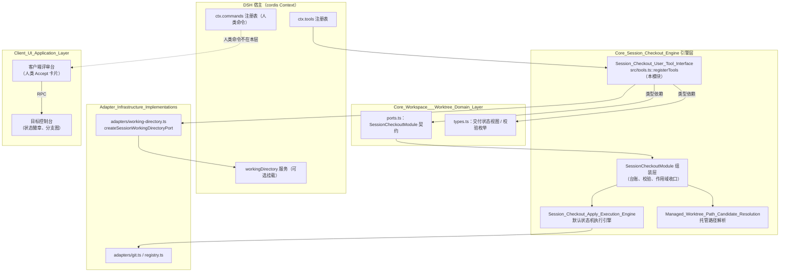
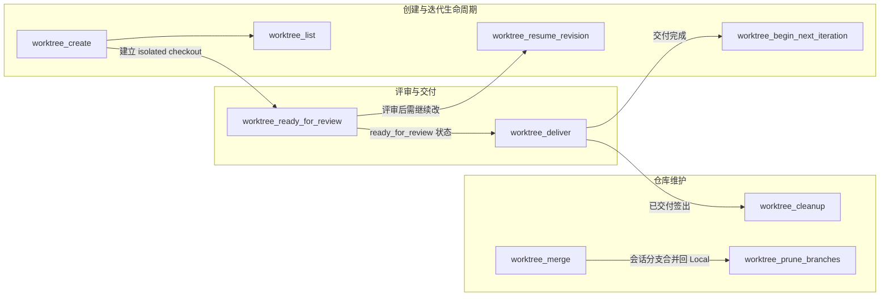
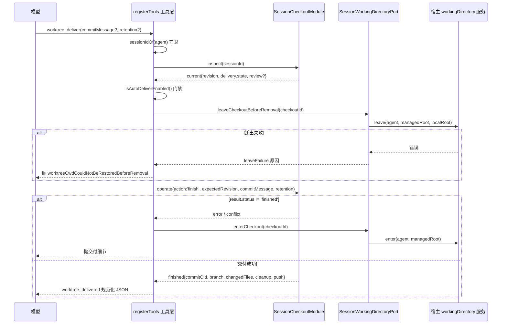
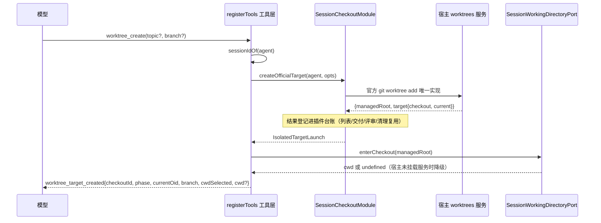
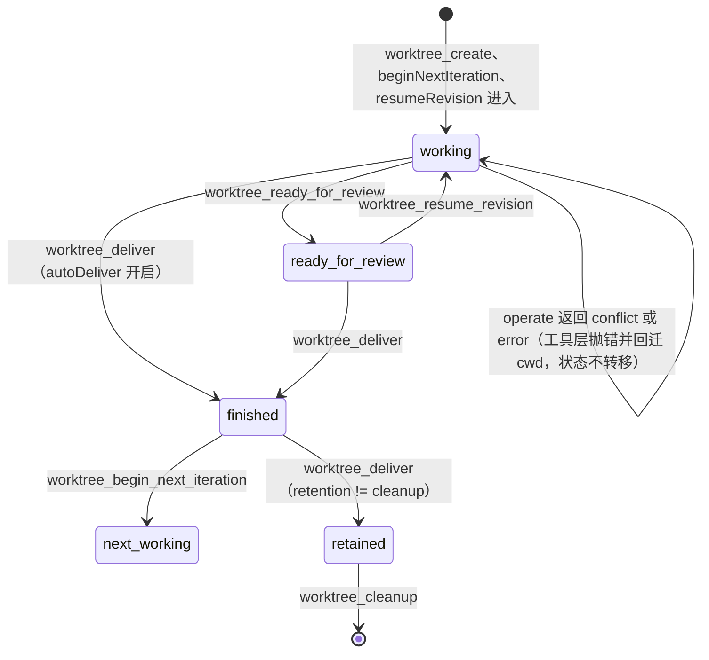
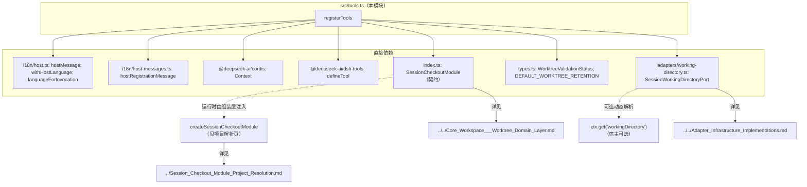

# 会话签出用户工具接口（Session_Checkout_User_Tool_Interface）

!!! info "Generated documentation"
    This page was written by CodeWiki from the source code at commit [`4910b846`](https://github.com/wloops/dsh-git-worktree/commit/4910b846b1a2225eb764858a3a7f38e857681333) on 2026-11-07 with `doubao-seed-2.1-lite`. Check the code before relying on details.

## 简介

本模块是整个托管 Worktree 状态机面向 **模型（Agent）** 的唯一工具入口，对应源码文件 [`src/tools.ts`](../../../src/tools.ts)。它对外导出一个 `registerTools(ctx, module)` 注册函数，把九个语义安全、参数受控的 DSH 模型工具挂载到宿主工具注册表上；自身 **不实现任何 Git 操作或状态机逻辑**，而是把每次调用翻译为对 [`SessionCheckoutModule`](../Core_Workspace___Worktree_Domain_Layer.md) 契约方法的幂等调用，并在前后包裹三类安全约束：

1. **会话作用域校验** —— 所有工具必须运行在真实 DSH Session 内（`sessionIdOf`），拒绝裸环境调用；
2. **Session 工作目录（cwd）生命周期** —— 在签出目录建立/重建时 `enter`，在目录被删除前 `leave`，在交付失败时回退 `enter`，避免相对路径写入落进原仓库；
3. **交付门禁** —— `worktree_deliver` 受 `autoDeliver` 配置开关与交付状态机双重约束，人工接受（Accept）通道始终绕开模型工具。

> 人类命令（`/worktree` 接受、Discard/Remove）不在本模块注册，它们由 [`src/commands.ts`](../../../src/commands.ts) 的 Human Command 层与客户端 ToolView 呈现；本模块只负责模型可调用的那一侧。

---

## 在系统中的位置

- 引擎层的其他组成与职责分工见父页 [会话检出核心引擎（Core_Session_Checkout_Engine）](../Core_Session_Checkout_Engine.md)；
- 本模块依赖的 domain 契约与视图类型定义见 [核心工作区与 Worktree 领域层](../Core_Workspace___Worktree_Domain_Layer.md)；
- 人类侧评审/接受界面如何消费本模块产生的 reviewId 与交付状态，见 [客户端评审控制台功能（Client Review Console Feature）](../../Client_UI_Application_Layer/Client_Review_Console_Feature.md)。

---

## 组件总览

`src/tools.ts` 内部由一个注册入口与五个私有辅助函数构成：

| 组件 | 角色 | 关键行为 |
| --- | --- | --- |
| `registerTools(ctx, module)` | 注册入口 | 构造 `SessionWorkingDirectoryPort`，循环 `ctx.tools.register(defineTool({...}))` 注册全部九个工具 |
| `sessionIdOf(agent)` | 作用域守卫 | 从 `exec.agent.session.id` 取 SessionId；缺失即抛 `worktreeToolsCanOnlyBeCalledInADSH` |
| `renderJson(value)` | 输出渲染器 | 把工具返回值序列化为单一 `{ type: 'text', text: JSON }` 块，供模型与客户端 keyed ToolView 共同消费 |
| `enterCheckout(port, module, agent, checkoutId)` | cwd 迁入 | 先从台账 `resolveRoots` 读 managedRoot（同步、免 Git 校验），缺失再回退 `resolveManagedRoot`（持锁全量校验）；失败返回 `failure` 而非静默 |
| `leaveCheckoutBeforeRemoval(port, module, agent, checkoutId)` | cwd 迁出 | 删除签出前把 Session 移出；返回非空原因表示迁出失败，调用方必须中止删除 |
| `parseWorktreeRetention(value)` | 参数解析 | 校验 `cleanup / retain_24h / retain_3d / retain_manual`，缺省回落到 `DEFAULT_WORKTREE_RETENTION`（`retain_manual`） |

所有工具执行体都被 `withHostLanguage(languageForInvocation(exec.agent, ctx), async () => {...})` 包裹，按本次调用的 Agent 作用域设定语言快照；i18n 机制细节见 [Internationalization (i18n) Layer](../../../Shared_Cross-Tier_Contracts___Utilities/Internationalization_(i18n)_Layer.md)。

---

## 注册的九个模型工具

### 1. 创建与迭代生命周期

| 工具 | 调用的模块方法 | 入参 | 成功语义 |
| --- | --- | --- | --- |
| `worktree_create` | `module.createOfficialTarget(agent, {topic?, branch?})` → 随后 `enterCheckout` | 可选 `topic`（人类可读命名）、`branch`（以该分支 tip 为基点） | 经宿主官方 `worktrees` 服务建树，插件登记台账；会话 cwd 迁入新签出（`cwdSelected`/`cwdError` 如实报告） |
| `worktree_list` | `module.listManagedWorktreesForSession(sessionId)` | 无 | 返回当前会话可见的受管 Worktree 摘要（checkoutId、迭代号、revision、state、phase、dirty 等）；空 `commitOid` 键直接省略而非置 null |
| `worktree_resume_revision` | `module.inspect` 前置状态断言 → `module.resumeRevision(sessionId, revision, reviewId)` | 无 | 仅当当前处于 `ready_for_review` 时可用：作废未同步评审，同迭代回到 `working` |
| `worktree_begin_next_iteration` | `module.inspect` → `module.beginNextIteration(sessionId, revision)` → 随后 `enterCheckout` | 无 | 上一迭代已清理后重建签出为下一孤立迭代，并把会话 cwd 重新迁入 |

### 2. 评审与交付

| 工具 | 调用的模块方法 | 关键入参 | 门禁与语义 |
| --- | --- | --- | --- |
| `worktree_ready_for_review` | `module.markReadyForReview(sessionId, {...})` | 必填 `summary`（≤240 字）、`validationStatus`（`passed/failed/partial/not_run`）、`tests[]`、`suggestedCommitMessage`；可选 `details` Markdown | 把签出推进到 `ready_for_review`，产出 `reviewId`、changedFiles；人工 Accept 卡片随后由客户端渲染 |
| `worktree_deliver` | `module.inspect` → 门禁 → `leaveCheckoutBeforeRemoval` → `module.operate({action:'finish', expectedRevision, ...})` | 可选 `commitMessage`、`retention`、`report` | ① `isAutoDeliverEnabled()` 为 false 直接拒绝；② 状态必须是 `working` 或 `ready_for_review`；③ ready 状态下缺省沿用评审建议的提交信息；④ 交付失败时自动 `enterCheckout` 回迁并把失败细节一并抛出 |

> **设计约束**：注释明确写出——`autoDeliver` 关闭时交付被拒绝，改由 `worktree_ready_for_review` + 人类 Accept 栏完成；Discard/Remove 始终是人类命令，不出现在模型工具面。

### 3. 仓库维护

| 工具 | 调用的模块方法 | 关键入参 | 语义 |
| --- | --- | --- | --- |
| `worktree_cleanup` | `module.manageManagedWorktreeForSession(sessionId, {checkoutId, expectedRevision, action:'cleanup_retained'})` | 必填 `checkoutId`、`expectedRevision`（整数） | 删除保留期已结束的签出；删除前 `leaveCheckoutBeforeRemoval`，迁出失败即中止 |
| `worktree_prune_branches` | `module.pruneMergedBranchesForSession(sessionId, {dryRun?, olderThanDays?})` | 可选 `dryRun`、`olderThanDays` | 会话项目内对已完全合并分支做 `git branch -d` 语义安全剪枝，永不 force；返回 pruned / skipped 明细 |
| `worktree_merge` | `module.mergeBranchForSession(sessionId, {sourceBranch, dryRun?, direction?})` | 必填 `sourceBranch`；`direction` ∈ `forward/reverse` | forward：会话分支合入 Local；reverse：Local HEAD 同步进会话分支；`dryRun` 在临时 detached 工作区探测；冲突时返回 conflictingFiles 与 conflictDetails |

---

## 核心交互流程

### 流程一：`worktree_deliver` 的 cwd 安全闭环（最复杂的调用链）

要点：**交付可能删除签出目录**，因此「先迁出、再操作、失败回迁」是一个原子性闭环——任何一步 cwd 操作失败都会以 `hostMessage` 错误抛回模型，绝不允许 Session 停留在即将消失或已消失的目录里。

### 流程二：`worktree_create` 与宿主官方建树的衔接

设计意图在源码注释中明确：全机只有一份 `git worktree add`（宿主拥有），插件拥有跟踪、交付、评审与清理；`cwdSelected === false` 是合法降级而非错误——没有 `workingDirectory` 服务的老宿主退化为「引导式」工作树。

### 流程三：交付状态机与工具的映射

工具层不直接操作这些状态的转移——它只做 **前置断言**（如 `inspect` 看到的 `delivery.state` 必须符合预期），断言失败抛出对应 `hostMessage`，真正的状态机转移由 [会话检出应用执行引擎（Session_Checkout_Apply_Execution_Engine）](Session_Checkout_Apply_Execution_Engine.md) 完成。

---

## 依赖关系

- `SessionCheckoutModule` 契约的完整方法清单与作用域收口规则：见 [会话检出模块 · 项目解析（Session_Checkout_Module_Project_Resolution）](Session_Checkout_Module_Project_Resolution.md)；
- `workingDirectory` 适配器的降级语义与跨平台路径归一化：见 [适配器基础设施实现（Adapter Infrastructure Implementations）](../Adapter_Infrastructure_Implementations.md)；
- 工具产出的 `reviewId`、`changedFiles` 等数据如何经控制台服务投影给客户端：见 [Worktree 控制台宿主服务（Worktree_Console_Host_Service）](../Worktree_Console_Host_Service.md) 与 [Shared_Worktree_Console_API_Contract —— 共享 Worktree 控制台 API 契约](../../Shared_Worktree_Console_API_Contract.md)。

---

## 关键设计约束速查

| 约束 | 位置 | 说明 |
| --- | --- | --- |
| 必须在 DSH Session 内调用 | 每个工具的 `sessionIdOf(exec.agent)` | 非 Session 上下文（如测试裸调用）直接抛错 |
| 语言按调用快照隔离 | `withHostLanguage(languageForInvocation(exec.agent, ctx), ...)` | 复用 i18n 层的 `AsyncLocalStorage`，避免跨用户串语言 |
| 输出一律规范化 JSON | `renderJson` | 模型侧与客户端 keyed ToolView 共用同一份载荷，空键省略（`commitOid`）而非置 `null`/`''` |
| 签出删除前必须迁出 cwd | `leaveCheckoutBeforeRemoval` | 失败即中止删除，由 `worktree_deliver`/`worktree_cleanup` 强制执行 |
| 交付失败必须回迁签出 | `worktree_deliver` 的 error 分支 | 否则相对路径写入会落回原 Local 仓库 |
| 模型交付受双门禁 | `isAutoDeliverEnabled()` + 状态白名单 | 关闭 autoDeliver 时人工 Accept 是唯一交付通道 |
| 保留期参数白名单 | `parseWorktreeRetention` | 缺省 `retain_manual`（无定时器，永久可检视） |

??? abstract "Documented components (1)"
    - [`enterCheckout`](https://github.com/wloops/dsh-git-worktree/blob/4910b846b1a2225eb764858a3a7f38e857681333/src%5Ctools.ts) — `src\tools.ts`

