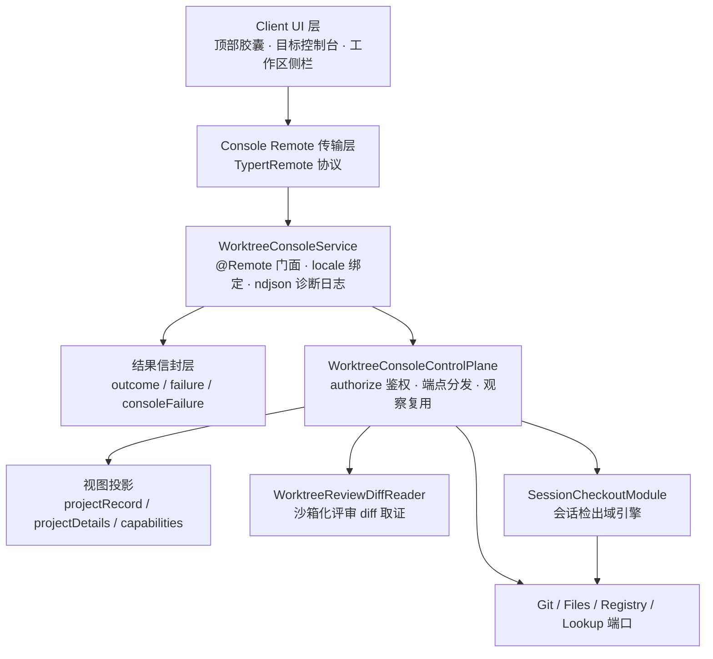
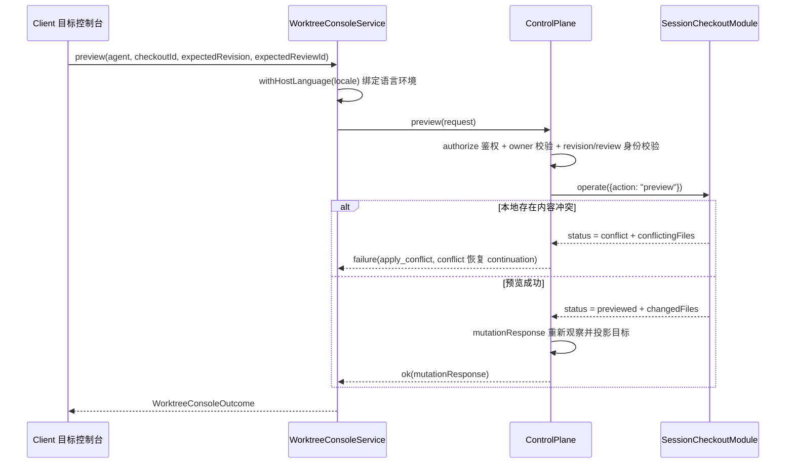

# Worktree 控制台宿主服务（Worktree_Console_Host_Service）

!!! info "Generated documentation"
    This page was written by CodeWiki from the source code at commit [`3e52684b`](https://github.com/wloops/dsh-git-worktree/commit/3e52684b7fe9828f1095e076b810db542fa5dfbb) on 2026-11-07 with `doubao-seed-2.1-lite`. Check the code before relying on details.

## 模块定位

本模块是托管工作树（Worktree）控制台在 **Host 端**的全部实现，对应源码目录 `src/console-host/`。它把 [Shared_Worktree_Console_API_Contract —— 共享 Worktree 控制台 API 契约](../Shared_Worktree_Console_API_Contract.md) 中定义的 `WorktreeConsoleAdapter` 契约落地为可远程调用的服务：Client UI 层（顶部胶囊、目标控制台、工作区侧栏）通过 `gitWorktree` Typert Remote 命名空间发起调用，本模块负责 **鉴权校验 → 域操作分发 → 视图投影 → 统一结果信封** 的完整闭环。

与其他模块的分工：

- **不负责**工作树的创建、应用、合并等域逻辑本身——这些在 [会话检出核心引擎（Core_Session_Checkout_Engine）](Core_Session_Checkout_Engine.md)（`SessionCheckoutModule`）中实现；
- **不定义**请求/响应类型——这些在 [Shared_Worktree_Console_API_Contract —— 共享 Worktree 控制台 API 契约](../Shared_Worktree_Console_API_Contract.md) 中定义；
- **不负责**协议序列化——传输层由 [Console Remote 传输层（Console_Remote_Transport_Layer）](../Shared_Cross-Tier_Contracts___Utilities/Console_Remote_Transport_Layer.md) 提供（`Remote` / `TypertRemoteService`）；
- 本模块只做四件事：RPC 门面与诊断、结果信封、访问控制与端点分发、控制台视图投影（外加一个沙箱化的评审 diff 取证器）。

## 架构总览

调用链自上而下：Client 发起 RPC → `WorktreeConsoleService`（绑定语言环境、写诊断日志）→ `WorktreeConsoleControlPlane`（做身份与路径归属校验，再委派域引擎）→ `SessionCheckoutModule`（事务性域操作）→ 投影函数把注册表记录翻译成控制台视图 → 统一封装为 `WorktreeConsoleOutcome<T>` 返回。

## 核心组件一览

| 组件 | 文件 | 职责 |
| --- | --- | --- |
| `WorktreeConsoleService` | `src/console-host/service.ts` | Typert Remote 服务门面（命名空间 `gitWorktree`），约 35 个 `@Remote` 方法；负责 locale 绑定（`withHostLanguage`）、诊断日志写入与 8MB 轮转 |
| `consoleFailure` / `outcome` / `failure` / `domainError` | `src/console-host/errors.ts` | 统一结果信封：域错误携带 `SESSION_CHECKOUT_ERROR_CODES` 中的稳定 code；未知异常降级为 `git_error` |
| `WorktreeConsoleControlPlane` / `createWorktreeConsoleControlPlane` | `src/console-host/control-plane.ts` | 全部端点的实现：当前态、列表、详情、预览/检查点/交付/回滚、Git 分支与标签操作、侧栏拓扑、废弃快照恢复；内含 `authorize`、`linkedReadAccess`、`verifyCallerRoot` 三级鉴权 |
| `capabilities` / `projectRecord` / `projectDetails` / `projectLocal` | `src/console-host/projection.ts` | 把 `ManagedCheckoutRecord` 投影为 `WorktreeConsoleTargetSummary` / `WorktreeConsoleTargetDetails`，并按调用者身份计算能力开关 |
| `WorktreeReviewDiffReader` / `createGitWorktreeReviewDiffReader` | `src/console-host/review-diff.ts` | 在临时 GIT_INDEX_FILE / GIT_OBJECT_DIRECTORY 沙箱中取证 baseOid 与工作树之间的 diff；校验 changedFiles 集合一致性（不一致抛 `ReviewDiffStaleError`）；限制文件数（200）、单补丁字节（100KB）、总负载字节（1MB） |

## 关键设计

### 访问控制模型

控制平面实现了三级访问，全部端点在执行前先走 `authorize(sessionId, checkoutId)`：

1. **Owner / Source 直读**：调用者是记录的 `ownerSessionId` 或 `sourceSessionId`；
2. **linkedRead（关联读）**：调用者正站在另一个隔离 worktree 上，通过 `linkedReadAccess` 校验「同一项目 + 同一 source 组 + 同一 localRoot」后方可读；
3. **验收槽互斥**：同一 localRoot 上同时只允许一个 `ready_for_review` 记录被预览/交付，`acceptanceHolder` / `localDeliveryHolder` 负责阻止并发交付与本地分支切换。

路径归属校验 `verifyCallerRoot` 是安全关键：它通过 canonicalize 比对「调用者 cwd / 项目 root / 记录的 localRoot / managedRoot」，并对已交付终态（`discarded` / `finalized` / `retained`）放宽到 Local 边界——因为交付完成后 owner 会话已回到 Local 检出。代码中对每路径的 IO 做了 memoize（`canonicalCache`），避免重复 realpath。

### 幂等与并发防护

- 所有变更端点携带 `expectedRevision` / `expectedReviewId` 等身份参数，与注册表当前值不符即抛 `stale_target`；
- `withCreation` 用进程内 `creating` 集合按 session 与 canonical root 双维度互斥，防止同一仓库并发初始化；
- `returnToLocal` 是幂等的：若会话已解绑，直接返回当前 Local 投影而不报错。

### 性能优化

- `observeFromCaller`：顶部胶囊每 5 秒轮询 `current`，该函数复用 `inspect` 已经付出的 git spawn 结果（每次 `git status` + 两次 `git inspect` 在 Windows 热路径上约 30–50ms），仅当 caller 视图与记录 revision 一致时复用；
- `list` 优先走 `module.observeManagedCheckouts` 批量观察，批量失败时逐条降级，单条验证失败的记录以无观察投影呈现而不拖垮整个面板；
- 评审 diff 按批并行取证（批大小 8），避免逐文件串行 spawn 顶爆超时。

### 诊断可观测

`WorktreeConsoleService` 以 ndjson 面包屑方式记录 RPC 调用（`current` 额外记录耗时 `durationMs` 与失败 code），文件超过 8MB 时轮转备份为 `.1`；`sidebarTopology` 还会附带 Workspace flavor 诊断锚点。

## 端到端流程示例：预览（preview）

## 子模块索引

本模块进一步拆分为以下子模块，详见各自的详细文档：

- [RPC 门面与结果信封层（Worktree_Console_Host_Service_RPC_Facade）](Worktree_Console_Host_Service/Worktree_Console_Host_Service_RPC_Facade.md) —— `src/console-host/service.ts` 与 `src/console-host/errors.ts`：`gitWorktree` 命名空间的 RPC 门面、locale 绑定、诊断日志，以及统一的 `WorktreeConsoleOutcome` 错误信封（`outcome` / `failure` / `consoleFailure` / `domainError`）。
- [控制平面与视图投影层（Worktree_Console_Host_Service_Control_Plane）](Worktree_Console_Host_Service/Worktree_Console_Host_Service_Control_Plane.md) —— `src/console-host/control-plane.ts`、`src/console-host/projection.ts`、`src/console-host/review-diff.ts`：三级访问控制、全部业务端点分发、控制台视图投影（`capabilities` / `projectRecord` / `projectDetails`）与评审 diff 沙箱取证（`WorktreeReviewDiffReader`、`ReviewDiffStaleError`）。

## 周边模块依赖

| 方向 | 模块 | 关系 |
| --- | --- | --- |
| 上游调用方 | [客户端目标控制台特性（Client_Target_Console_Feature）](../Client_UI_Application_Layer/Client_Target_Console_Feature.md)、[客户端评审控制台功能（Client Review Console Feature）](../Client_UI_Application_Layer/Client_Review_Console_Feature.md)、[客户端工作区侧栏功能（Client_Workspace_Sidebar_Feature）](../Client_UI_Application_Layer/Client_Workspace_Sidebar_Feature.md) | 通过远程适配器调用本模块暴露的 `gitWorktree` 方法 |
| 域操作委托 | [会话检出核心引擎（Core_Session_Checkout_Engine）](Core_Session_Checkout_Engine.md) | `SessionCheckoutModule` 提供 `operate` / `inspect` / `preflight` / `manageManagedWorktreeForSession` 等事务方法 |
| 端口与记录类型 | [核心工作区与 Worktree 领域层](Core_Workspace___Worktree_Domain_Layer.md) | `ports.ts`（`ManagedCheckoutRecord`、各端口）、`types.ts`（`SessionTargetView`、错误码）、`checkpoint.ts`、`commit-message.ts` |
| 契约类型 | [Shared_Worktree_Console_API_Contract —— 共享 Worktree 控制台 API 契约](../Shared_Worktree_Console_API_Contract.md) | 全部请求/响应/错误类型及 `worktreeReachedDelivery` 终态判定谓词 |
| 传输协议 | [Console Remote 传输层（Console_Remote_Transport_Layer）](../Shared_Cross-Tier_Contracts___Utilities/Console_Remote_Transport_Layer.md) | `Remote` 装饰器与 `TypertRemoteService` 基类 |
| 语言环境 | [Internationalization_(i18n)_Layer](../Shared_Cross-Tier_Contracts___Utilities/Internationalization_(i18n)_Layer.md) | `hostMessage` / `withHostLanguage` / `currentHostLanguage` |
| 底层适配 | [适配器基础设施实现（Adapter Infrastructure Implementations）](Adapter_Infrastructure_Implementations.md) | 评审 diff 读取器消费 `ProjectSkillStore`（携带的 skill 文件需从临时索引中剔除） |

??? abstract "Documented components (10)"
    - [`WorktreeConsoleControlPlane`](https://github.com/wloops/dsh-git-worktree/blob/3e52684b7fe9828f1095e076b810db542fa5dfbb/src%5Cconsole-host%5Ccontrol-plane.ts) — `src\console-host\control-plane.ts`
    - [`WorktreeConsoleControlPlaneOptions`](https://github.com/wloops/dsh-git-worktree/blob/3e52684b7fe9828f1095e076b810db542fa5dfbb/src%5Cconsole-host%5Ccontrol-plane.ts) — `src\console-host\control-plane.ts`
    - [`consoleFailure`](https://github.com/wloops/dsh-git-worktree/blob/3e52684b7fe9828f1095e076b810db542fa5dfbb/src%5Cconsole-host%5Cerrors.ts) — `src\console-host\errors.ts`
    - [`capabilities`](https://github.com/wloops/dsh-git-worktree/blob/3e52684b7fe9828f1095e076b810db542fa5dfbb/src%5Cconsole-host%5Cprojection.ts) — `src\console-host\projection.ts`
    - [`ChangedEntry`](https://github.com/wloops/dsh-git-worktree/blob/3e52684b7fe9828f1095e076b810db542fa5dfbb/src%5Cconsole-host%5Creview-diff.ts) — `src\console-host\review-diff.ts`
    - [`GitOutput`](https://github.com/wloops/dsh-git-worktree/blob/3e52684b7fe9828f1095e076b810db542fa5dfbb/src%5Cconsole-host%5Creview-diff.ts) — `src\console-host\review-diff.ts`
    - [`ReviewDiffReadInput`](https://github.com/wloops/dsh-git-worktree/blob/3e52684b7fe9828f1095e076b810db542fa5dfbb/src%5Cconsole-host%5Creview-diff.ts) — `src\console-host\review-diff.ts`
    - [`ReviewDiffStaleError`](https://github.com/wloops/dsh-git-worktree/blob/3e52684b7fe9828f1095e076b810db542fa5dfbb/src%5Cconsole-host%5Creview-diff.ts) — `src\console-host\review-diff.ts`
    - [`WorktreeReviewDiffReader`](https://github.com/wloops/dsh-git-worktree/blob/3e52684b7fe9828f1095e076b810db542fa5dfbb/src%5Cconsole-host%5Creview-diff.ts) — `src\console-host\review-diff.ts`
    - [`WorktreeConsoleService`](https://github.com/wloops/dsh-git-worktree/blob/3e52684b7fe9828f1095e076b810db542fa5dfbb/src%5Cconsole-host%5Cservice.ts) — `src\console-host\service.ts`

