# 构建、CI 与项目配置

!!! info "Generated documentation"
    This page was written by CodeWiki from the source code at commit [`47ebbe95`](https://github.com/wloops/dsh-git-worktree/commit/47ebbe95f01b195727094f9030c58cb5b5145601) on 2026-11-06 with `doubao-seed-2.1-lite`. Check the code before relying on details.

> 本模块汇总了 `dsh-git-worktree` 项目的工程化配置：包清单、TypeScript/tsdown 双段构建管线、Vitest 测试基础设施、GitHub Actions 持续集成、Cordis 宿主挂载补丁（`cordis.patch.yml`）以及 pnpm 的供应链放行规则。这些文件不承载业务逻辑，而是决定源码如何被编译、打包、校验、测试并发布到 DeepSeek Harness（DSH）运行时。

## 1. 模块定位

`dsh-git-worktree` 是一个面向 DSH 宿主的 Cordis 插件。它的源码由两大运行时组成：

- **Host 侧（Node 端）**：`src/**` 下的 TypeScript 源码，通过 `tsc` 编译为 `lib/` 下的 NodeNext ESM + `.d.ts` 声明。
- **Client 侧（浏览器端）**：`src/client/console-remote/index.ts`，通过 `tsdown` 打成一个 **CJS 闭包**，并包装成 `window.__ModuleLoader__.load({...})` 的浏览器插件入口。

构建产物随后通过 `package.json` 中的 `dsh.bundle.patch`（指向 `cordis.patch.yml`）被 DSH 宿主发现并挂载。本模块正是围绕这条「源码 → 产物 → 宿主挂载」的链路展开。

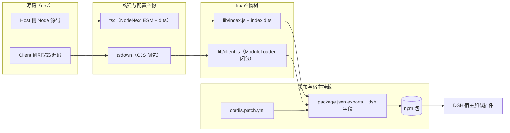

## 2. 配置文件总览

| 文件 | 作用 | 关键内容 |
| --- | --- | --- |
| `package.json` | 包清单、脚本、依赖、导出声明、DSH 挂载元数据 | 名称 `dsh-git-worktree`、版本 `0.14.0`、`dsh.bundle.patch`、`dsh.client.inject` |
| `tsconfig.json` | TypeScript 编译选项 | `ES2022` + `NodeNext`、`strict`、`noUncheckedIndexedAccess`、`rootDir: src` → `outDir: lib` |
| `tsdown.config.ts` | 浏览器客户端打包配置 | CJS 格式、`platform: neutral`、ModuleLoader banner/footer、虚拟工作区模块插件 |
| `vitest.config.ts` | 测试运行器配置 | 别名 mock、`tests/**/*.test.{ts,tsx}`、Windows 下关闭文件并行、60s 超时 |
| `pnpm-workspace.yaml` | pnpm 供应链放行规则 | `allowBuilds`（esbuild）、`minimumReleaseAgeExclude`（预发布包放行） |
| `cordis.patch.yml` | 宿主 Profile 挂载补丁 | 向 cordis 插件清单插入 `dsh-git-worktree` 条目 |
| `screenshots.json` | 文档截图清单 | 3 张文档用 PNG 路径 |
| `.github/workflows/ci.yml` | GitHub Actions CI | 在 `ubuntu-latest` 上执行 install → typecheck → build → check:publish:release → test |

## 3. TypeScript 编译配置（tsconfig.json）

`tsconfig.json` 描述了 Host 侧 Node 产物的编译方式：

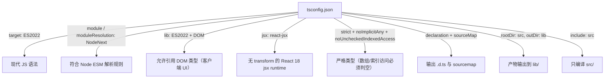

要点：

- **双段打包**：`tsc` 只负责类型 + Node 端 ESM 输出（`lib/index.js`、`lib/index.d.ts` 及各子路径的 `.d.ts`）；浏览器端 `lib/client.js` 由 `tsdown` 负责，且 `tsdown.config.ts` 中 `dts: false`、`sourcemap: false`，因此 Client 闭包**不**再生成声明与 sourcemap（声明走 `tsc` 的 `lib/client/console-remote/index.d.ts`）。
- **严格性**：`noUncheckedIndexedAccess` 强制所有数组/对象索引访问返回 `T | undefined`，这是本项目能在「预发布宿主版本兼容」下保持类型安全的基础。

## 4. 双段构建管线（scripts + package.json scripts）

`package.json` 的 `scripts` 是构建、校验、发布、本地开发的入口。

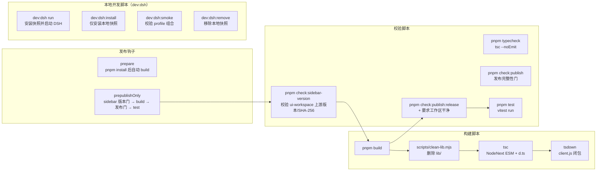

### 4.1 构建脚本细节

- **`build`**：`node scripts/clean-lib.mjs && tsc && tsdown`。
  - `clean-lib.mjs` 先**整体删除 `lib/`**，注释明确说明：「TypeScript 不会为被删除的源文件清理旧产物，因此每次都从空目录重建可发布树，避免过时 UI 模块残留进 tarball」。这是一个重要的防陈旧机制。
  - 随后 `tsc` 生成 Node 端 ESM 与声明；`tsdown` 生成浏览器端 `lib/client.js`。

### 4.2 发布完整性门（check-publish.mjs）

`check:publish`（`scripts/check-publish.mjs`）不是简单的「能否打包」，而是一套**发布前的七重静态/运行时校验**，确保插件在真实 DSH 宿主中可挂载、可启动、不会触发 web boot 循环：

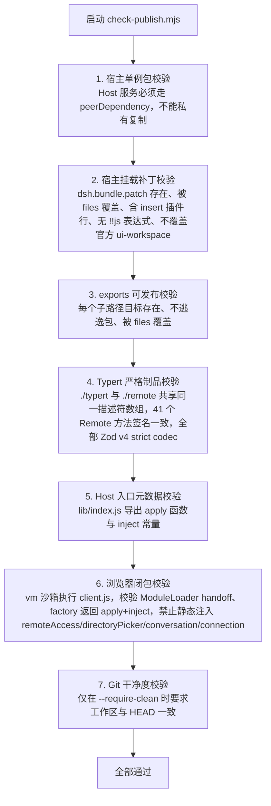

设计要点（来自代码注释）：

- **宿主单例身份**：`cordis`、`dsh-agent`、`dsh-session` 等 13 个包必须是 `peerDependencies`——如果插件私有安装一份，会导致宿主服务身份破裂（两个不同的 cordis 容器）。
- **杜绝 `!!js` 表达式**：历史上曾因 client 侧表达式在 Host apply（fiber 仍 LOADING）与 renderer 审计（fiber 已 ACTIVE）两次求值结果相反而导致 web boot 崩溃（2026-10-17 两次桌面崩溃）。补丁现完全由 Host 侧 `workspace-provider-lifecycle` 用确定性布尔接管。
- **浏览器注入黑名单**：client bundle 的静态 `inject` 绝不能包含 `remoteAccess`、`remote.directoryPicker`、`conversation`、`connection`——0.2.0-rc.2 宿主中没有这些服务或存在循环依赖，静态等待会让 web boot 永久挂起（"14 entries did not activate"）。

### 4.3 工作区侧边栏版本门（check-workspace-sidebar-version.mjs）

本项目的 Client UI 需要**派生（decorate）官方 `@deepseek-ai/dsh-client-ui-workspace` 产物**。由于上游是发布后的生成代码，任何漂移都会让「精确接缝替换」失败。因此构建管线在 `prepublishOnly` 中先执行版本/SHA-256 门：

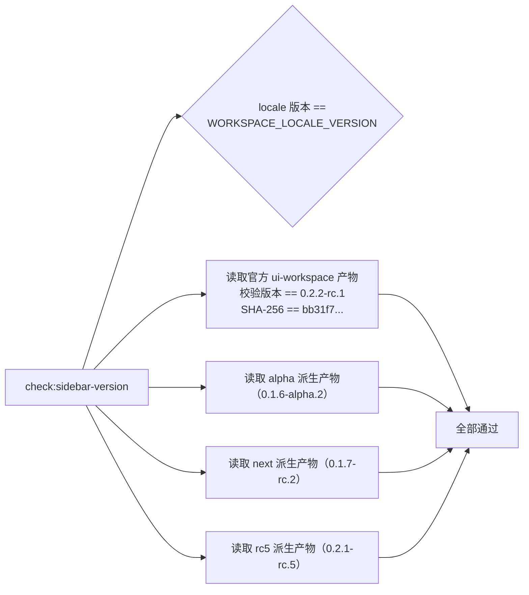

对应地，`package.json` 的 `devDependencies` 里以别名方式钉死了四份上游产物：

- `@deepseek-ai/dsh-client-ui-workspace`：`0.2.2-rc.1`（主线）
- `@deepseek-ai/dsh-client-ui-workspace-alpha`：`npm:@deepseek-ai/dsh-client-ui-workspace@0.1.6-alpha.2`
- `@deepseek-ai/dsh-client-ui-workspace-next`：`npm:@deepseek-ai/dsh-client-ui-workspace@0.1.7-rc.2`
- `@deepseek-ai/dsh-client-ui-workspace-rc5`：`npm:@deepseek-ai/dsh-client-ui-workspace@0.2.1-rc.5`

## 5. 浏览器客户端打包（tsdown.config.ts）

`tsdown.config.ts` 将 `src/client/console-remote/index.ts` 打成一个 DSH 浏览器 ModuleLoader 可消费的 CJS 闭包。

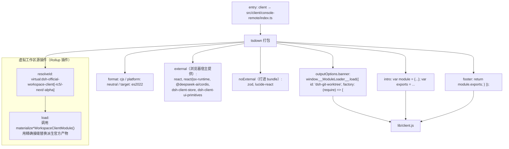

关键点：

- **闭包包装**：banner/intro/footer 把产物包成 `window.__ModuleLoader__.load({ id, factory })`。DSH 浏览器端的 ModuleLoader 在运行时用 `factory(require)` 拿到插件的 `{ apply, inject }`。
- **external 白名单**：只有 `react`、`react/jsx-runtime`、`@deepseek-ai/cordis`、`dsh-client-store`、`dsh-client-ui-primitives` 是浏览器 ModuleLoader 表里保证存在的模块——这与 `check-publish` 第 6 步的 `allowedBrowserRequires` 完全对应。
- **虚拟工作区模块**：`virtual:dsh-official-workspace-client` 等四个虚拟 ID 在 `resolveId` 被改写为「已 materialize 的派生源码」，由 `scripts/workspace-sidebar-upstream*.mjs` 在打包时即时生成。`dts: false`、`sourcemap: false`、`clean: false`（不清理 `tsc` 已生成的 `lib/`）。

## 6. 宿主挂载补丁（cordis.patch.yml）

`cordis.patch.yml` 是 `package.json` 中 `dsh.bundle.patch` 指向的 DSH 宿主 Profile 补丁。DSH 在安装插件时会把它合并进宿主的 cordis 插件清单：

```yaml
- insert:
    - id: dsh-git-worktree
      name: dsh-git-worktree
```

补丁顶部的长注释记录了 2026-10-17 的修复决策：彻底移除曾用于禁用官方 `ui-workspace` 的 client 侧 `!!js` 条件表达式，改为由 Host 侧 `workspace-provider-lifecycle`（见 [后端宿主核心运行时（Backend_Host_Core_Runtime）总览](Backend_Host_Core_Runtime.md) 中的 `Core_Workspace___Worktree_Domain_Layer`）用 Loader 操作直接写入确定性布尔并在停用后还原。`check-publish` 第 2 步会强制补丁**不含任何 `!!js` 表达式**、**不直接 patch 官方 ui-workspace 条目**。

## 7. 测试基础设施（vitest.config.ts）

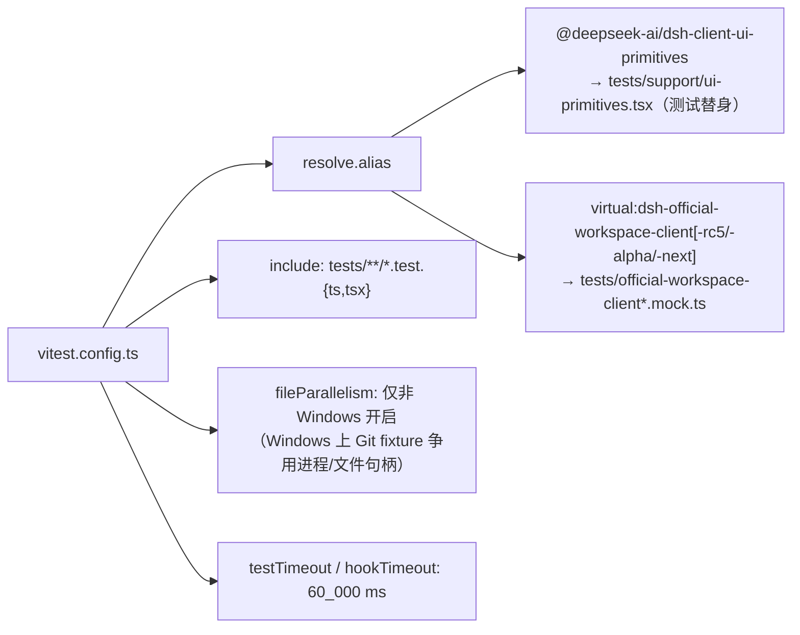

- 测试中通过别名把重型 UI 原语与四份「官方工作区产物」替换为轻量 mock，使单元测试无需真实浏览器宿主即可运行。
- 注释说明：Windows 下并行执行 Git fixture 套件会争用进程与临时目录句柄并超时，因此 Windows 上关闭文件并行。

测试覆盖的运行时模块可参见 [后端宿主核心运行时（Backend_Host_Core_Runtime）总览](Backend_Host_Core_Runtime.md) 与 [Client_UI_Application_Layer（客户端 UI 应用层）](Client_UI_Application_Layer.md)。

## 8. CI 流水线（.github/workflows/ci.yml）

CI 在 `push` 到 `master`/`main` 或任意 `pull_request` 时触发，单 job `check` 运行在 `ubuntu-latest`：

```mermaid
flowchart LR
    TRIG["push master/main 或 pull_request"] --> JOB["job: check（ubuntu-latest）"]

    JOB --> S1["actions/checkout@v4"]
    S1 --> S2["pnpm/action-setup@v4（version: 10）"]
    S2 --> S3["actions/setup-node@v4（node 22, cache: pnpm）"]
    S3 --> S4["pnpm install --frozen-lockfile"]
    S4 --> S5["pnpm run typecheck"]
    S5 --> S6["pnpm run build"]
    S6 --> S7["pnpm run check:publish:release"]
    S7 --> S8["pnpm run test"]
```

注意 CI 用的是 `check:publish:release`（即 `check-publish.mjs --require-clean`），而不是普通的 `check:publish`——因为 CI 检出的工作区必然是干净的，所以把「工作区与 HEAD 一致」作为发布门禁的一部分。这与本地开发「故意跑在脏的托管 Worktree 上」形成对比（见 `check-publish.mjs` 第 7 步注释）。

## 9. pnpm 供应链放行（pnpm-workspace.yaml）

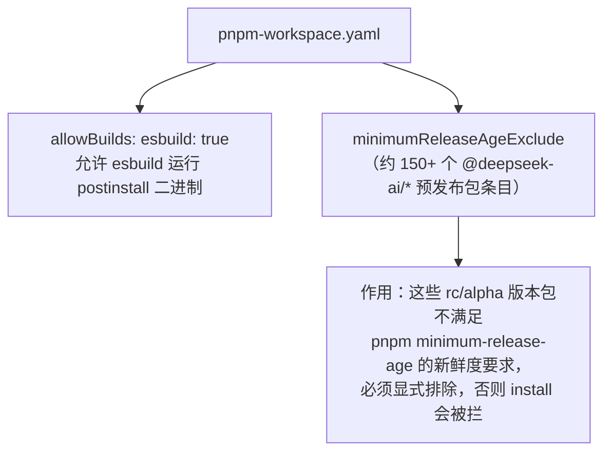

- `allowBuilds.esbuild: true`：tsdown 依赖 esbuild，需要允许其安装平台二进制。
- `minimumReleaseAgeExclude`：本项目与 DSH 的 `0.1.2-rc.1`、`0.1.6-alpha.2`、`0.1.7-rc.2`、`0.2.x-rc.x` 等一系列预发布版本耦合，这些包发布时间太近而无法通过 pnpm 「最低发布年龄」供应链规则，必须逐一显式排除。该列表与 `package.json` 的 `peerDependencies` 多版本兼容范围（`^0.1.2-rc.1 || ^0.1.6-alpha.2 || ^0.1.7-rc.2 || ^0.2.0-rc.1`）一一对应。

## 10. 本地开发循环（dev:dsh 脚本族）

`scripts/dev-dsh.mjs` 提供了不经过 npm/GitHub 发布的本地宿主联调能力：

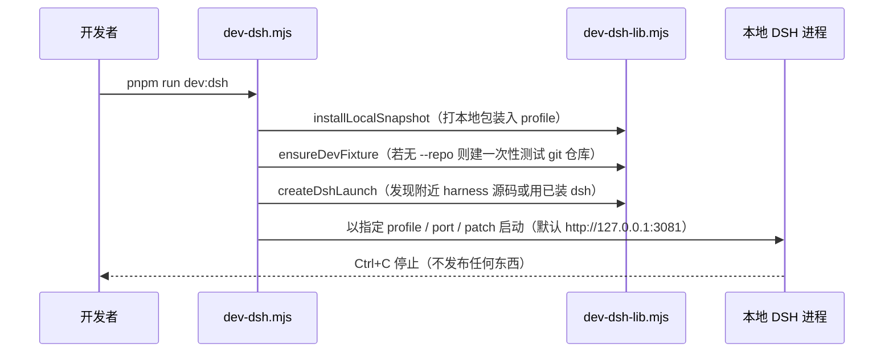

- `dev:dsh`：安装本地快照 + 建测试仓库 + 启动 DSH。
- `dev:dsh:install`：仅把本地快照装入 profile（保留 archive 以复现）。
- `dev:dsh:smoke`：仅校验 profile 能否组合 `dsh-git-worktree`。
- `dev:dsh:remove`：从 profile 移除并清理本地 archive。
- 可用 `DSH_HOME` 指向一个临时目录以隔离 web profile、archive 与默认 Workspace。

## 11. 与其他模块的关系

本模块是「地基」，被以下业务模块依赖但其自身不依赖业务实现：

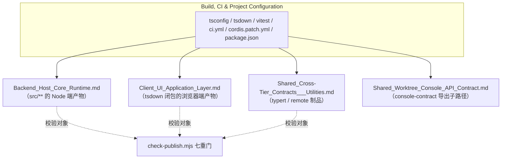

- Host 侧实现详见 [后端宿主核心运行时（Backend_Host_Core_Runtime）总览](Backend_Host_Core_Runtime.md)。
- Client UI 实现详见 [Client_UI_Application_Layer（客户端 UI 应用层）](Client_UI_Application_Layer.md)。
- 跨层 Typert/Remote 契约详见 [共享跨层契约与工具模块（Shared_Cross-Tier_Contracts___Utilities）](Shared_Cross-Tier_Contracts___Utilities.md)。
- 控制台 API 契约详见 [Shared_Worktree_Console_API_Contract —— 共享 Worktree 控制台 API 契约](Shared_Worktree_Console_API_Contract.md)。

## 12. 常用命令速查

| 命令 | 用途 |
| --- | --- |
| `pnpm install --frozen-lockfile` | 按 lockfile 安装（CI 用） |
| `pnpm run typecheck` | `tsc --noEmit` 全量类型检查 |
| `pnpm run build` | 清空 `lib/` → `tsc` → `tsdown` |
| `pnpm run check:sidebar-version` | 校验四份 ui-workspace 派生版本与 SHA-256 |
| `pnpm run check:publish` | 发布完整性七重门（本地） |
| `pnpm run check:publish:release` | 同上 + 要求 Git 工作区干净（CI/release） |
| `pnpm run test` | `vitest run` 全量测试 |
| `pnpm run dev:dsh` | 本地安装快照并启动 DSH 联调 |
| `pnpm run dev:dsh:smoke` | 仅校验本地 profile 组合 |
| `pnpm run dev:dsh:remove` | 移除本地快照 |

??? abstract "Documented components (21)"
    - [`check`](https://github.com/wloops/dsh-git-worktree/blob/47ebbe95f01b195727094f9030c58cb5b5145601/.github/workflows/ci.yml) — `.github/workflows/ci.yml`
    - [`ci.yml`](https://github.com/wloops/dsh-git-worktree/blob/47ebbe95f01b195727094f9030c58cb5b5145601/.github/workflows/ci.yml) — `.github/workflows/ci.yml`
    - [`cordis.patch.yml`](https://github.com/wloops/dsh-git-worktree/blob/47ebbe95f01b195727094f9030c58cb5b5145601/cordis.patch.yml) — `cordis.patch.yml`
    - [`build`](https://github.com/wloops/dsh-git-worktree/blob/47ebbe95f01b195727094f9030c58cb5b5145601/package.json) — `package.json`
    - [`check:publish`](https://github.com/wloops/dsh-git-worktree/blob/47ebbe95f01b195727094f9030c58cb5b5145601/package.json) — `package.json`
    - [`check:publish:release`](https://github.com/wloops/dsh-git-worktree/blob/47ebbe95f01b195727094f9030c58cb5b5145601/package.json) — `package.json`
    - [`check:sidebar-version`](https://github.com/wloops/dsh-git-worktree/blob/47ebbe95f01b195727094f9030c58cb5b5145601/package.json) — `package.json`
    - [`dev:dsh`](https://github.com/wloops/dsh-git-worktree/blob/47ebbe95f01b195727094f9030c58cb5b5145601/package.json) — `package.json`
    - [`dev:dsh:install`](https://github.com/wloops/dsh-git-worktree/blob/47ebbe95f01b195727094f9030c58cb5b5145601/package.json) — `package.json`
    - [`dev:dsh:remove`](https://github.com/wloops/dsh-git-worktree/blob/47ebbe95f01b195727094f9030c58cb5b5145601/package.json) — `package.json`
    - [`dev:dsh:smoke`](https://github.com/wloops/dsh-git-worktree/blob/47ebbe95f01b195727094f9030c58cb5b5145601/package.json) — `package.json`
    - [`package.json`](https://github.com/wloops/dsh-git-worktree/blob/47ebbe95f01b195727094f9030c58cb5b5145601/package.json) — `package.json`
    - [`prepare`](https://github.com/wloops/dsh-git-worktree/blob/47ebbe95f01b195727094f9030c58cb5b5145601/package.json) — `package.json`
    - [`prepublishOnly`](https://github.com/wloops/dsh-git-worktree/blob/47ebbe95f01b195727094f9030c58cb5b5145601/package.json) — `package.json`
    - [`test`](https://github.com/wloops/dsh-git-worktree/blob/47ebbe95f01b195727094f9030c58cb5b5145601/package.json) — `package.json`
    - [`typecheck`](https://github.com/wloops/dsh-git-worktree/blob/47ebbe95f01b195727094f9030c58cb5b5145601/package.json) — `package.json`
    - [`pnpm-workspace.yaml`](https://github.com/wloops/dsh-git-worktree/blob/47ebbe95f01b195727094f9030c58cb5b5145601/pnpm-workspace.yaml) — `pnpm-workspace.yaml`
    - [`screenshots.json`](https://github.com/wloops/dsh-git-worktree/blob/47ebbe95f01b195727094f9030c58cb5b5145601/screenshots.json) — `screenshots.json`
    - [`tsconfig.json`](https://github.com/wloops/dsh-git-worktree/blob/47ebbe95f01b195727094f9030c58cb5b5145601/tsconfig.json) — `tsconfig.json`
    - [`defineConfig`](https://github.com/wloops/dsh-git-worktree/blob/47ebbe95f01b195727094f9030c58cb5b5145601/tsdown.config.ts) — `tsdown.config.ts`
    - [`vitest.config.ts`](https://github.com/wloops/dsh-git-worktree/blob/47ebbe95f01b195727094f9030c58cb5b5145601/vitest.config.ts) — `vitest.config.ts`

