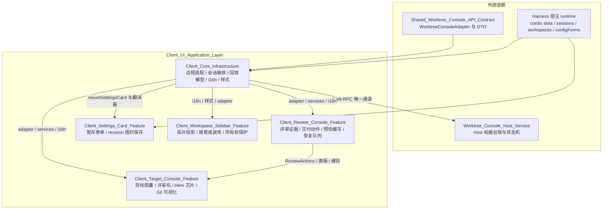

# Client_UI_Application_Layer（客户端 UI 应用层）

!!! info "Generated documentation"
    This page was written by CodeWiki from the source code at commit [`4910b846`](https://github.com/wloops/dsh-git-worktree/commit/4910b846b1a2225eb764858a3a7f38e857681333) on 2026-11-07 with `doubao-seed-2.1-lite`. Check the code before relying on details.

## 模块目的

`Client_UI_Application_Layer` 是 `dsh-git-worktree` 插件的浏览器端 UI 组装层。它把 Harness 宿主运行时、跨层 RPC 契约与 Host 端 `Worktree_Console_Host_Service` 适配为用户可直接交互的客户端表面，包括：目标状态胶囊、评审交付坞、工作区/会话侧栏、插件设置卡片，以及会话内的工具结果渲染行。

本层遵循 **“Host 权威、客户端投影”** 的原则：目标台账、拓扑、状态机与能力标志由 Host 返回，客户端只负责只读投影、用户动作编排、写前预检、CAS 身份校验、缓存与恢复队列，不实现 Git 或 worktree 领域规则。

## 内部架构

关键协作关系：

- `Client_Core_Infrastructure` 是其余四个特性模块的底座，负责创建类型严格的 `WorktreeConsoleAdapter`、收敛 Harness 服务面、提供回放稳定的工具结果解析、i18n 与样式注册。
- `Client_Review_Console_Feature` 专注评审证据展示与交付生命周期，其面板、动作与缓存被 `Client_Target_Console_Feature` 复用。
- `Client_Target_Console_Feature` 面向用户操作入口，把目标状态、分支管理、提交图、标签管理与评审坞装配到会话头部与输入框上方。
- `Client_Workspace_Sidebar_Feature` 通过接管或装饰两条路径，把 worktree 拓扑投影进官方工作区侧栏，并保护 owner Session 与 Worktree 的绑定不变量。
- `Client_Settings_Card_Feature` 是自包含的设置卡片，通过暂存表单与 revision 围栏向 Host 配置文档写入运行期设置。

## 核心组件文档

| 模块 | 主要职责 | 详细文档 |
| --- | --- | --- |
| `Client_Core_Infrastructure` | 客户端引导、远程适配器、会话/工作区编排、回放模型、i18n 与样式底座 | [Client_Core_Infrastructure（客户端核心基础设施层）](Client_UI_Application_Layer/Client_Core_Infrastructure.md) |
| `Client_Review_Console_Feature` | 评审证据卡片、预览/回滚/定稿动作、预检缓存、冲突与评审重生成恢复队列 | [客户端评审控制台功能（Client Review Console Feature）](Client_UI_Application_Layer/Client_Review_Console_Feature.md) |
| `Client_Target_Console_Feature` | 目标胶囊、评审状态坞、Hero 芯片、全量管理面板、提交图与标签管理 | [客户端目标控制台特性（Client_Target_Console_Feature）](Client_UI_Application_Layer/Client_Target_Console_Feature.md) |
| `Client_Settings_Card_Feature` | Plugins 页面设置卡片、三层配置值解析、暂存编辑与原子保存 | [Client_Settings_Card_Feature（设置卡片功能）](Client_UI_Application_Layer/Client_Settings_Card_Feature.md) |
| `Client_Workspace_Sidebar_Feature` | 侧栏拓扑投影、Takeover/Decorate 双模式、徽章渲染与 owner Session 保护 | [客户端工作区侧栏功能（Client_Workspace_Sidebar_Feature）](Client_UI_Application_Layer/Client_Workspace_Sidebar_Feature.md) |

??? abstract "Documented components (78)"
    - [`__file__`](https://github.com/wloops/dsh-git-worktree/blob/4910b846b1a2225eb764858a3a7f38e857681333/src%5Cclient%5CWorktreeCreateRow.tsx) — `src\client\WorktreeCreateRow.tsx`
    - [`__file__`](https://github.com/wloops/dsh-git-worktree/blob/4910b846b1a2225eb764858a3a7f38e857681333/src%5Cclient%5CWorktreeReviewRow.tsx) — `src\client\WorktreeReviewRow.tsx`
    - [`ClientSessionBinding`](https://github.com/wloops/dsh-git-worktree/blob/4910b846b1a2225eb764858a3a7f38e857681333/src%5Cclient%5Cactions.ts) — `src\client\actions.ts`
    - [`ClientSessionSnapshot`](https://github.com/wloops/dsh-git-worktree/blob/4910b846b1a2225eb764858a3a7f38e857681333/src%5Cclient%5Cactions.ts) — `src\client\actions.ts`
    - [`ClientSessions`](https://github.com/wloops/dsh-git-worktree/blob/4910b846b1a2225eb764858a3a7f38e857681333/src%5Cclient%5Cactions.ts) — `src\client\actions.ts`
    - [`ClientWorkspaces`](https://github.com/wloops/dsh-git-worktree/blob/4910b846b1a2225eb764858a3a7f38e857681333/src%5Cclient%5Cactions.ts) — `src\client\actions.ts`
    - [`IsolatedTargetLocation`](https://github.com/wloops/dsh-git-worktree/blob/4910b846b1a2225eb764858a3a7f38e857681333/src%5Cclient%5Cactions.ts) — `src\client\actions.ts`
    - [`SnapshotStore`](https://github.com/wloops/dsh-git-worktree/blob/4910b846b1a2225eb764858a3a7f38e857681333/src%5Cclient%5Cactions.ts) — `src\client\actions.ts`
    - [`WorktreeClientServices`](https://github.com/wloops/dsh-git-worktree/blob/4910b846b1a2225eb764858a3a7f38e857681333/src%5Cclient%5Cactions.ts) — `src\client\actions.ts`
    - [`createWorktreeConsoleRemoteAdapter`](https://github.com/wloops/dsh-git-worktree/blob/4910b846b1a2225eb764858a3a7f38e857681333/src%5Cclient%5Cconsole-remote%5Cadapter.ts) — `src\client\console-remote\adapter.ts`
    - [`ConsoleClientContext`](https://github.com/wloops/dsh-git-worktree/blob/4910b846b1a2225eb764858a3a7f38e857681333/src%5Cclient%5Cconsole-remote%5Cindex.ts) — `src\client\console-remote\index.ts`
    - [`Context`](https://github.com/wloops/dsh-git-worktree/blob/4910b846b1a2225eb764858a3a7f38e857681333/src%5Cclient%5Cconsole-remote%5Cindex.ts) — `src\client\console-remote\index.ts`
    - [`MenuEntry`](https://github.com/wloops/dsh-git-worktree/blob/4910b846b1a2225eb764858a3a7f38e857681333/src%5Cclient%5Charness-platform.d.ts) — `src\client\harness-platform.d.ts`
    - [`ClientLocaleSource`](https://github.com/wloops/dsh-git-worktree/blob/4910b846b1a2225eb764858a3a7f38e857681333/src%5Cclient%5Ci18n.tsx) — `src\client\i18n.tsx`
    - [`ClientContextLike`](https://github.com/wloops/dsh-git-worktree/blob/4910b846b1a2225eb764858a3a7f38e857681333/src%5Cclient%5Cindex.tsx) — `src\client\index.tsx`
    - [`ParsedTool`](https://github.com/wloops/dsh-git-worktree/blob/4910b846b1a2225eb764858a3a7f38e857681333/src%5Cclient%5Cmodel.ts) — `src\client\model.ts`
    - [`ReviewArgs`](https://github.com/wloops/dsh-git-worktree/blob/4910b846b1a2225eb764858a3a7f38e857681333/src%5Cclient%5Cmodel.ts) — `src\client\model.ts`
    - [`ToolCallBlockLike`](https://github.com/wloops/dsh-git-worktree/blob/4910b846b1a2225eb764858a3a7f38e857681333/src%5Cclient%5Cmodel.ts) — `src\client\model.ts`
    - [`ToolCallViewPropsLike`](https://github.com/wloops/dsh-git-worktree/blob/4910b846b1a2225eb764858a3a7f38e857681333/src%5Cclient%5Cmodel.ts) — `src\client\model.ts`
    - [`ToolContentBlock`](https://github.com/wloops/dsh-git-worktree/blob/4910b846b1a2225eb764858a3a7f38e857681333/src%5Cclient%5Cmodel.ts) — `src\client\model.ts`
    - [`WorktreeCreatePayload`](https://github.com/wloops/dsh-git-worktree/blob/4910b846b1a2225eb764858a3a7f38e857681333/src%5Cclient%5Cmodel.ts) — `src\client\model.ts`
    - [`WorktreeReviewPayload`](https://github.com/wloops/dsh-git-worktree/blob/4910b846b1a2225eb764858a3a7f38e857681333/src%5Cclient%5Cmodel.ts) — `src\client\model.ts`
    - [`__file__`](https://github.com/wloops/dsh-git-worktree/blob/4910b846b1a2225eb764858a3a7f38e857681333/src%5Cclient%5Cstyles.ts) — `src\client\styles.ts`
    - [`__file__`](https://github.com/wloops/dsh-git-worktree/blob/4910b846b1a2225eb764858a3a7f38e857681333/src%5Cclient%5Creview-console%5CDeliveryProof.tsx) — `src\client\review-console\DeliveryProof.tsx`
    - [`PreflightStatus`](https://github.com/wloops/dsh-git-worktree/blob/4910b846b1a2225eb764858a3a7f38e857681333/src%5Cclient%5Creview-console%5CPreflightStatus.tsx) — `src\client\review-console\PreflightStatus.tsx`
    - [`__file__`](https://github.com/wloops/dsh-git-worktree/blob/4910b846b1a2225eb764858a3a7f38e857681333/src%5Cclient%5Creview-console%5CReviewActions.tsx) — `src\client\review-console\ReviewActions.tsx`
    - [`validationIcon`](https://github.com/wloops/dsh-git-worktree/blob/4910b846b1a2225eb764858a3a7f38e857681333/src%5Cclient%5Creview-console%5CReviewDetailsModal.tsx) — `src\client\review-console\ReviewDetailsModal.tsx`
    - [`ReviewIcon`](https://github.com/wloops/dsh-git-worktree/blob/4910b846b1a2225eb764858a3a7f38e857681333/src%5Cclient%5Creview-console%5CReviewIcon.tsx) — `src\client\review-console\ReviewIcon.tsx`
    - [`WorktreeReviewEvidence`](https://github.com/wloops/dsh-git-worktree/blob/4910b846b1a2225eb764858a3a7f38e857681333/src%5Cclient%5Creview-console%5CWorktreeReviewPanel.tsx) — `src\client\review-console\WorktreeReviewPanel.tsx`
    - [`WorktreeReviewIdentity`](https://github.com/wloops/dsh-git-worktree/blob/4910b846b1a2225eb764858a3a7f38e857681333/src%5Cclient%5Creview-console%5CWorktreeReviewPanel.tsx) — `src\client\review-console\WorktreeReviewPanel.tsx`
    - [`WorktreeReviewPanelProps`](https://github.com/wloops/dsh-git-worktree/blob/4910b846b1a2225eb764858a3a7f38e857681333/src%5Cclient%5Creview-console%5CWorktreeReviewPanel.tsx) — `src\client\review-console\WorktreeReviewPanel.tsx`
    - [`reviewEvidenceFromTarget`](https://github.com/wloops/dsh-git-worktree/blob/4910b846b1a2225eb764858a3a7f38e857681333/src%5Cclient%5Creview-console%5Cindex.ts) — `src\client\review-console\index.ts`
    - [`PreflightSnapshot`](https://github.com/wloops/dsh-git-worktree/blob/4910b846b1a2225eb764858a3a7f38e857681333/src%5Cclient%5Creview-console%5Cpreflight-cache.ts) — `src\client\review-console\preflight-cache.ts`
    - [`PreviewRecoverySnapshot`](https://github.com/wloops/dsh-git-worktree/blob/4910b846b1a2225eb764858a3a7f38e857681333/src%5Cclient%5Creview-console%5Cpreview-recovery-cache.ts) — `src\client\review-console\preview-recovery-cache.ts`
    - [`PersistedRecovery`](https://github.com/wloops/dsh-git-worktree/blob/4910b846b1a2225eb764858a3a7f38e857681333/src%5Cclient%5Creview-console%5Crecovery-continuation.ts) — `src\client\review-console\recovery-continuation.ts`
    - [`RecoveryEntry`](https://github.com/wloops/dsh-git-worktree/blob/4910b846b1a2225eb764858a3a7f38e857681333/src%5Cclient%5Creview-console%5Crecovery-continuation.ts) — `src\client\review-console\recovery-continuation.ts`
    - [`WorktreeApplyConflictRecoveryRequest`](https://github.com/wloops/dsh-git-worktree/blob/4910b846b1a2225eb764858a3a7f38e857681333/src%5Cclient%5Creview-console%5Crecovery-continuation.ts) — `src\client\review-console\recovery-continuation.ts`
    - [`WorktreeRecoverySnapshot`](https://github.com/wloops/dsh-git-worktree/blob/4910b846b1a2225eb764858a3a7f38e857681333/src%5Cclient%5Creview-console%5Crecovery-continuation.ts) — `src\client\review-console\recovery-continuation.ts`
    - [`WorktreeReviewRegenerationRequest`](https://github.com/wloops/dsh-git-worktree/blob/4910b846b1a2225eb764858a3a7f38e857681333/src%5Cclient%5Creview-console%5Crecovery-continuation.ts) — `src\client\review-console\recovery-continuation.ts`
    - [`Entry`](https://github.com/wloops/dsh-git-worktree/blob/4910b846b1a2225eb764858a3a7f38e857681333/src%5Cclient%5Creview-console%5Crequest-cache.ts) — `src\client\review-console\request-cache.ts`
    - [`RequestCache`](https://github.com/wloops/dsh-git-worktree/blob/4910b846b1a2225eb764858a3a7f38e857681333/src%5Cclient%5Creview-console%5Crequest-cache.ts) — `src\client\review-console\request-cache.ts`
    - [`__file__`](https://github.com/wloops/dsh-git-worktree/blob/4910b846b1a2225eb764858a3a7f38e857681333/src%5Cclient%5Creview-console%5Creview-console.styles.ts) — `src\client\review-console\review-console.styles.ts`
    - [`requestWorktreeReviewRefresh`](https://github.com/wloops/dsh-git-worktree/blob/4910b846b1a2225eb764858a3a7f38e857681333/src%5Cclient%5Creview-console%5Cstatus-events.ts) — `src\client\review-console\status-events.ts`
    - [`WorktreeSettingsCardProps`](https://github.com/wloops/dsh-git-worktree/blob/4910b846b1a2225eb764858a3a7f38e857681333/src%5Cclient%5Csettings-card%5CWorktreeSettingsCard.tsx) — `src\client\settings-card\WorktreeSettingsCard.tsx`
    - [`PlannedWrite`](https://github.com/wloops/dsh-git-worktree/blob/4910b846b1a2225eb764858a3a7f38e857681333/src%5Cclient%5Csettings-card%5Cform-model.ts) — `src\client\settings-card\form-model.ts`
    - [`SettingsFieldSpec`](https://github.com/wloops/dsh-git-worktree/blob/4910b846b1a2225eb764858a3a7f38e857681333/src%5Cclient%5Csettings-card%5Cform-model.ts) — `src\client\settings-card\form-model.ts`
    - [`SettingsFieldState`](https://github.com/wloops/dsh-git-worktree/blob/4910b846b1a2225eb764858a3a7f38e857681333/src%5Cclient%5Csettings-card%5Cform-model.ts) — `src\client\settings-card\form-model.ts`
    - [`SettingsFormActions`](https://github.com/wloops/dsh-git-worktree/blob/4910b846b1a2225eb764858a3a7f38e857681333/src%5Cclient%5Csettings-card%5Cform-model.ts) — `src\client\settings-card\form-model.ts`
    - [`SettingsFormModel`](https://github.com/wloops/dsh-git-worktree/blob/4910b846b1a2225eb764858a3a7f38e857681333/src%5Cclient%5Csettings-card%5Cform-model.ts) — `src\client\settings-card\form-model.ts`
    - [`SettingsFormScope`](https://github.com/wloops/dsh-git-worktree/blob/4910b846b1a2225eb764858a3a7f38e857681333/src%5Cclient%5Csettings-card%5Cform-model.ts) — `src\client\settings-card\form-model.ts`
    - … and 28 more

