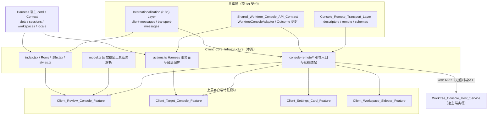
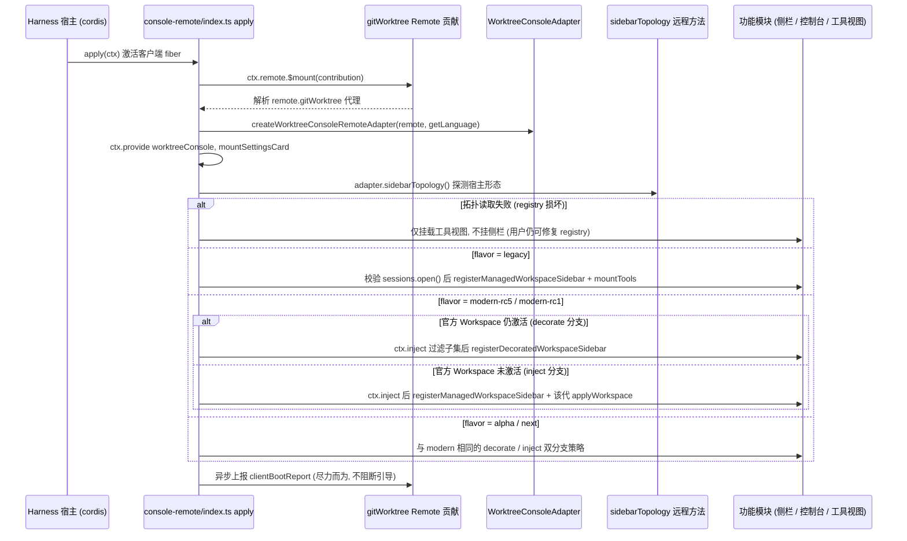
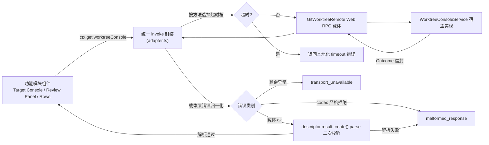
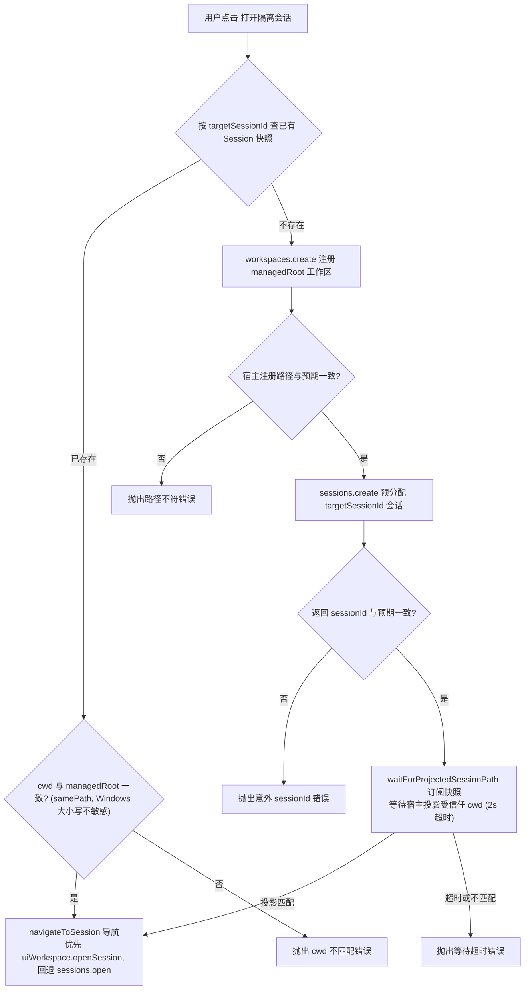

# Client_Core_Infrastructure（客户端核心基础设施层）

!!! info "Generated documentation"
    This page was written by CodeWiki from the source code at commit [`e6a84e5c`](https://github.com/wloops/dsh-git-worktree/commit/e6a84e5cb4639894e5ae8685a0816b00b22d9057) on 2026-11-06 with `doubao-seed-2.1-lite`. Check the code before relying on details.

## 简介

`Client_Core_Infrastructure` 是 `dsh-git-worktree` 插件**浏览器端（Web Client）的底座模块**。它负责：把宿主 Harness 的 cordis 服务面（sessions / workspaces / conversation / locale）收敛为插件自己的瘦接口；把 Web RPC 载体包装成类型严格的 `WorktreeConsoleAdapter`；以纯函数方式解析会话历史中的工具调用结果，让工具卡片在**回放（replay）时依然稳定可渲染**；并在插件引导时按宿主世代（legacy / modern-rc5 / modern-rc1 / alpha / next）选择正确的侧栏与工具视图装配策略。

上层四个客户端特性模块——[客户端评审控制台功能（Client Review Console Feature）](Client_Review_Console_Feature.md)、[客户端目标控制台特性（Client_Target_Console_Feature）](Client_Target_Console_Feature.md)、[Client_Settings_Card_Feature（设置卡片功能）](Client_Settings_Card_Feature.md)、[客户端工作区侧栏功能（Client_Workspace_Sidebar_Feature）](Client_Workspace_Sidebar_Feature.md)——都构建在本模块提供的 adapter、服务面、工具行、解析模型与 i18n 之上。父层概览见 [Client_UI_Application_Layer（客户端 UI 应用层）](../Client_UI_Application_Layer.md)。

## 在系统中的位置

## 核心组件清单

| 文件 | 核心导出 | 职责 |
| --- | --- | --- |
| `src/client/console-remote/index.ts` | `apply`、`inject`、`ConsoleClientContext` | 客户端 fiber 引导入口：挂载 Remote 贡献、创建并 `ctx.provide('worktreeConsole')` adapter、按宿主拓扑 flavor 分支装配侧栏/工具视图、异步上报启动诊断 |
| `src/client/console-remote/adapter.ts` | `createWorktreeConsoleRemoteAdapter` | 把 `GitWorktreeRemote` 代理包装为完整 `WorktreeConsoleAdapter`；统一两档超时、载体错误归一化、strict schema 校验 |
| `src/client/actions.ts` | `WorktreeClientServices`、`ClientSessions`、`ClientWorkspaces`、`ClientSessionBinding`、`ClientSessionSnapshot`、`SnapshotStore<T>`、`IsolatedTargetLocation`；函数 `navigateToSession`、`selectedSessionId`、`openExistingSession`、`openIsolatedTarget`、`openAuthorizedWorktreeTarget`、`prefillSessionDraft`、`finalizeCurrentSession` | Harness 运行时服务面的最小抽象，以及浏览器侧「幂等创建/打开隔离会话」的编排逻辑 |
| `src/client/model.ts` | `ToolCallBlockLike`、`ToolContentBlock`、`ToolCallViewPropsLike`、`WorktreeCreatePayload`、`WorktreeReviewPayload`、`ReviewArgs`、`ParsedTool<T>`；函数 `parseCreateTool`、`parseReviewTool` | 纯函数解析器：仅依赖已记录的 call/result 切片推导生命周期与结构化 payload，保证回放稳定 |
| `src/client/index.tsx` | `apply`、`inject`、`ClientContextLike`、`WORKTREE_CONSOLE_ADAPTER_SERVICE` | ToolView 注册入口：用 Proxy 给每个注册组件包一层 `ClientI18nProvider`、注入自标记样式表、注册 `worktree_create` 与 `worktree_ready_for_review` 两个 keyed 行，并在 adapter 可用时转调 `registerTargetConsole` |
| `src/client/WorktreeCreateRow.tsx` | `WorktreeCreateRow` | 会话内「隔离会话目标已创建」卡片：展示 checkout / base OID / managedRoot，提供「打开隔离会话」按钮（idle / opening / error 三态） |
| `src/client/WorktreeReviewRow.tsx` | `WorktreeReviewRow` | 「准备就绪待评审」卡片：组装 `WorktreeReviewEvidence` 交给 [客户端评审控制台功能（Client Review Console Feature）](Client_Review_Console_Feature.md) 的面板，并通过可选 adapter 按需轮询 `current` 取得实时目标身份、监听刷新事件 |
| `src/client/i18n.tsx` | `ClientI18nProvider`、`ClientLocaleSource`、`useClientTranslator`、`useClientLanguage`、`translatorForServices`、`readClientLanguage` | React 语言上下文（`useSyncExternalStore` 订阅宿主 locale 快照）与命令式翻译器 |
| `src/client/styles.ts` | `WORKTREE_STYLES` | 侧栏徽章与工具卡片的 scoped CSS（聚合 `REVIEW_CONSOLE_STYLES`） |
| `src/client/harness-platform.d.ts` | `MenuEntry` 等 | 构建期虚拟模块类型声明：`virtual:dsh-official-workspace-client[-rc5|-alpha|-next]` 与 `@deepseek-ai/dsh-client-ui-primitives` |

## 引导架构（宿主多代兼容）

客户端 bundle 的入口是 `src/client/console-remote/index.ts`（见 `tsdown.config.ts`：entry `client`，产物 `lib/client.js`，输出被包裹在 `window.__ModuleLoader__.load({ id: 'dsh-git-worktree', ... })` 中）。`apply(ctx)` 的引导流程如下：

关键设计约束（均以注释形式固化在 `console-remote/index.ts` 中）：

1. **避免 fiber 死锁**：`inject` 列表过滤掉 `remote.directoryPicker`、`remoteAccess`、`contextMenus`——它们要么在 0.2.x 才提供、要么会反向等待本插件将要提供的 `uiWorkspace`；`contextMenus` 仅由 0.2.2-rc.1 分支通过 `MODERN_RC1_INJECT` 追加。同时显式声明 `slots`、`configForms`，否则 Plugins 页设置卡片会因 cordis 按名解析服务而静默不挂载。
2. **拓扑失败降级**：`sidebarTopology` 读不出（最常见是 registry 损坏）时**不**让整条挂载失败——工具视图与控制台仍需可用以便用户修复 registry，此时只挂工具、不挂侧栏。
3. **decorate vs inject**：若宿主保留官方 Workspace Client（未启用接管），重新 `apply` 官方模块会重复提供 `uiWorkspace` 导致崩溃，因此改为 `registerDecoratedWorkspaceSidebar` 装饰既有注册；否则才在过滤后的 child fiber 中接管。
4. **构建期物化**：`tsdown.config.ts` 的自定义插件把 `virtual:dsh-official-workspace-client*` 四个虚拟 ID 解析为 `scripts/workspace-sidebar-upstream*.mjs` 物化的各代官方 Client 源码，使同一 bundle 能在构建期静态钉住对应官方版本（发布前由 `check:sidebar-version` 脚本校验，见 [Build, CI & Project Configuration](../Build,_CI___Project_Configuration.md)）。

## 远程适配器数据流

`createWorktreeConsoleRemoteAdapter` 是所有客户端功能模块访问宿主端 [Worktree 控制台宿主服务（Worktree_Console_Host_Service）](../Backend_Host_Core_Runtime/Worktree_Console_Host_Service.md) 的唯一通道（`WorktreeConsoleAdapter` 接口定义见 [Shared_Worktree_Console_API_Contract —— 共享 Worktree 控制台 API 契约](../Shared_Worktree_Console_API_Contract.md)）：

机制要点：

- **两档超时**：Web RPC 载体本身**没有超时**，服务端 handler 挂起（binding 锁排队、git 卡住）会让调用 UI 永远停在 pending。因此客户端侧强制超时——FAST 档 30s（白名单：`sidebarTopology`、`current`、`inspect`、`previewRecoveryPreflight`、`gitOverview`、`gitGraph`、`listAbandoned`）；其余方法（含 `list`/`preflight` 这类多记录时会 spawn 20+ 次 git 的慢路径）180s。超时仅使客户端失败，服务端工作继续进行，变更类调用可安全重试。
- **错误归一化三态**：`transport_unavailable`（载体异常）、`malformed_response`（codec 拒绝文案匹配 `rejected "` 或 strict contract 提示，或返回值非合法对象）、`timeout`（基于 `transportMessages` 的本地化文案）。
- **严格结果校验**：每个方法返回值都过 `WORKTREE_CONSOLE_DESCRIPTORS` 中 `mode: 'strict'` 的 schema（描述符定义见 [Console Remote 传输层（Console_Remote_Transport_Layer）](../Shared_Cross-Tier_Contracts___Utilities/Console_Remote_Transport_Layer.md)）。
- **方法族全覆盖**：查询类（`sidebarTopology`/`current`/`list`/`inspect`/`reviewDiff`/`preflight`）、checkout 生命周期类（`preview`/`checkpoint`/`rollbackPreview`/`discard`/`finalize`/`finalizePreview`/`setRetention`/`setPermanent`/`retryCleanup`/`beginNextIteration`/`returnToLocal`/`resumeRevision`/恢复延续类）、Git 操作类（`gitOverview`/`gitGraph`/分支与标签增删推/`gitPruneMergedBranches`）、废弃 worktree 恢复类（`listAbandoned`/`restoreAbandoned`）。

## 会话与工作区编排（actions.ts）

`WorktreeClientServices` 是对 Harness 运行时的最小依赖面：`sessions`（快照式列表、`create`、`using`、`binding`、旧式 `open`）、`workspaces`（`create`/`openPath`）、`uiWorkspace`（0.1.6+ 的导航拥有者）、`conversation`（草稿预填）、`locale`。`openIsolatedTarget` 是「把用户送进隔离 worktree 会话」的幂等编排：

配套能力：

- `selectedSessionId`：跨旧式选择与新 `retainedBy.mainView` 契约，解析「唯一可见主会话」；多候选时返回 `undefined`，拒绝盲猜。
- `openAuthorizedWorktreeTarget`：先用 `adapter.inspect` 验证 `checkoutId`/`ownerSessionId` 身份与 `capabilities.open` 能力，再复用上述 `openIsolatedTarget`——保证只打开**经宿主授权且身份精确匹配**的 worktree。
- `prefillSessionDraft`：仅通过 `conversation.input.for(ctx).setDraft` 预填草稿，绝不主动发送（image-only API 在新版 Harness 已改名为通用 attachments，`ComposerInput` 以联合类型兼容两代）。
- `finalizeCurrentSession`：把评审卡片的「确认交付」转成显式用户命令 `/worktree finalize <reviewId> <revision> <retention>`，经当前会话 binding 执行并校验 `matched`。

## 回放稳定的 ToolView 模型（model.ts）

`parseCreateTool` / `parseReviewTool` 是**纯函数**：只从已记录的 block（`content` 文本、`argsRaw`、`kind`、`isError`、`error.code`）推导状态，不触碰任何远程或会话运行时。这使得会话历史回放时，`WorktreeCreateRow` / `WorktreeReviewRow` 仍能渲染已发生的工具事件。

- `lifecycle(block)`：无 `kind` → `running`；`error.code === 'interrupted'` → `stopped`；`isError` → `error`；否则 `ok`。
- `parseCreateTool`：严格校验 `kind === 'worktree_target_created'` 及 `checkoutId`/`targetSessionId`/`managedRoot`/`phase`/`currentOid`/`sourceSessionId` 字符串字段，malformed 时返回本地化错误而非崩溃。
- `parseReviewTool`：同时校验 payload（`reviewId`/`revision`/`changedFiles`）与 args（`summary`/`validationStatus` 枚举/`tests` 结构/`suggestedCommitMessage`），并产出 `ParsedTool<WorktreeReviewPayload, ReviewArgs>` 供 `WorktreeReviewRow` 组装成 `WorktreeReviewEvidence`（见 [客户端评审控制台功能（Client Review Console Feature）](Client_Review_Console_Feature.md)）。
- `WorktreeReviewRow` 的两条容错约定：`target_unselected` 类错误（正则匹配 `isLocalTargetUnselected`）时整卡返回 `null`；payload 就绪后派发 `requestWorktreeReviewRefresh(sessionId)` 并监听 `WORKTREE_REVIEW_REFRESH_EVENT`，用 nonce 驱动对 `adapter.current(...)` 的按需轮询（实时 `liveTarget` 仅用于身份与过期 revision 判断，证据主体始终来自回放解析）。

## i18n 与样式注册

- **React 侧**：`ClientI18nProvider` 用 `useSyncExternalStore` 订阅宿主 `locale` 快照源（`ClientLocaleSource`）；`index.tsx` 的 slots 注册 Proxy 会给每个注册组件自动包一层 Provider，使插件的各 ToolView/面板在各自 DSH Client 实例内语言隔离。
- **命令式侧**：非 React 代码（如 `actions.ts`）通过 `translatorForServices(services)` 在**调用时刻**解析语言，而非模块加载时刻；消息文案本身维护在 [Internationalization (i18n) Layer](../Shared_Cross-Tier_Contracts___Utilities/Internationalization_(i18n)_Layer.md)（`client-messages.ts` / `transport-messages.ts`）。
- **样式所有权**：`index.tsx` 在 `ctx.effect` 中创建带 `data-dsh-git-worktree` 与 `data-plugin="dsh-git-worktree"` 标记的 `<style>`（内容为 `WORKTREE_STYLES + TARGET_CONSOLE_STYLES`），卸载时移除。这是为了对抗宿主模块系统对「无 data-plugin 样式」的认领（`claimStyles`）与回收（`removeOwnedStyles`）机制，保证样式表始终由本插件持有。

## 构建与打包要点

- 客户端 bundle 由 `tsdown.config.ts` 产出：entry 为 `src/client/console-remote/index.ts`，CJS 格式、`es2022` target，`react`/`@deepseek-ai/cordis`/宿主 UI 包列为 external，`zod`/`lucide-react` 打内嵌；输出 banner 为 `window.__ModuleLoader__.load({ id: 'dsh-git-worktree', factory: ... })`，供宿主 `ClientRemote` 模块系统加载。
- `package.json` 的 `dsh.client.inject` 声明了客户端 fiber 启动所等待的宿主服务（session-controller、workspace-controller、connection、locale、ui-conversation、ui-tool、api-gateway、remote-access）；peerDependencies 同时兼容 `0.1.2-rc.1` 至 `0.2.2-rc.1` 多个宿主世代，这正是引导层 flavor 分支存在的原因。详见 [Build, CI & Project Configuration](../Build,_CI___Project_Configuration.md)。

## 相关模块链接

- 父层：[Client_UI_Application_Layer（客户端 UI 应用层）](../Client_UI_Application_Layer.md)
- 上层特性：[客户端评审控制台功能（Client Review Console Feature）](Client_Review_Console_Feature.md) ｜ [客户端目标控制台特性（Client_Target_Console_Feature）](Client_Target_Console_Feature.md) ｜ [Client_Settings_Card_Feature（设置卡片功能）](Client_Settings_Card_Feature.md) ｜ [客户端工作区侧栏功能（Client_Workspace_Sidebar_Feature）](Client_Workspace_Sidebar_Feature.md)
- 共享契约：[Shared_Worktree_Console_API_Contract —— 共享 Worktree 控制台 API 契约](../Shared_Worktree_Console_API_Contract.md) ｜ [Console Remote 传输层（Console_Remote_Transport_Layer）](../Shared_Cross-Tier_Contracts___Utilities/Console_Remote_Transport_Layer.md) ｜ [Internationalization (i18n) Layer](../Shared_Cross-Tier_Contracts___Utilities/Internationalization_(i18n)_Layer.md)
- 宿主端实现：[Worktree 控制台宿主服务（Worktree_Console_Host_Service）](../Backend_Host_Core_Runtime/Worktree_Console_Host_Service.md) ｜ 宿主总览 [后端宿主核心运行时（Backend_Host_Core_Runtime）总览](../Backend_Host_Core_Runtime.md)

??? abstract "Documented components (23)"
    - [`__file__`](https://github.com/wloops/dsh-git-worktree/blob/e6a84e5cb4639894e5ae8685a0816b00b22d9057/src%5Cclient%5CWorktreeCreateRow.tsx) — `src\client\WorktreeCreateRow.tsx`
    - [`__file__`](https://github.com/wloops/dsh-git-worktree/blob/e6a84e5cb4639894e5ae8685a0816b00b22d9057/src%5Cclient%5CWorktreeReviewRow.tsx) — `src\client\WorktreeReviewRow.tsx`
    - [`ClientSessionBinding`](https://github.com/wloops/dsh-git-worktree/blob/e6a84e5cb4639894e5ae8685a0816b00b22d9057/src%5Cclient%5Cactions.ts) — `src\client\actions.ts`
    - [`ClientSessionSnapshot`](https://github.com/wloops/dsh-git-worktree/blob/e6a84e5cb4639894e5ae8685a0816b00b22d9057/src%5Cclient%5Cactions.ts) — `src\client\actions.ts`
    - [`ClientSessions`](https://github.com/wloops/dsh-git-worktree/blob/e6a84e5cb4639894e5ae8685a0816b00b22d9057/src%5Cclient%5Cactions.ts) — `src\client\actions.ts`
    - [`ClientWorkspaces`](https://github.com/wloops/dsh-git-worktree/blob/e6a84e5cb4639894e5ae8685a0816b00b22d9057/src%5Cclient%5Cactions.ts) — `src\client\actions.ts`
    - [`IsolatedTargetLocation`](https://github.com/wloops/dsh-git-worktree/blob/e6a84e5cb4639894e5ae8685a0816b00b22d9057/src%5Cclient%5Cactions.ts) — `src\client\actions.ts`
    - [`SnapshotStore`](https://github.com/wloops/dsh-git-worktree/blob/e6a84e5cb4639894e5ae8685a0816b00b22d9057/src%5Cclient%5Cactions.ts) — `src\client\actions.ts`
    - [`WorktreeClientServices`](https://github.com/wloops/dsh-git-worktree/blob/e6a84e5cb4639894e5ae8685a0816b00b22d9057/src%5Cclient%5Cactions.ts) — `src\client\actions.ts`
    - [`createWorktreeConsoleRemoteAdapter`](https://github.com/wloops/dsh-git-worktree/blob/e6a84e5cb4639894e5ae8685a0816b00b22d9057/src%5Cclient%5Cconsole-remote%5Cadapter.ts) — `src\client\console-remote\adapter.ts`
    - [`ConsoleClientContext`](https://github.com/wloops/dsh-git-worktree/blob/e6a84e5cb4639894e5ae8685a0816b00b22d9057/src%5Cclient%5Cconsole-remote%5Cindex.ts) — `src\client\console-remote\index.ts`
    - [`Context`](https://github.com/wloops/dsh-git-worktree/blob/e6a84e5cb4639894e5ae8685a0816b00b22d9057/src%5Cclient%5Cconsole-remote%5Cindex.ts) — `src\client\console-remote\index.ts`
    - [`MenuEntry`](https://github.com/wloops/dsh-git-worktree/blob/e6a84e5cb4639894e5ae8685a0816b00b22d9057/src%5Cclient%5Charness-platform.d.ts) — `src\client\harness-platform.d.ts`
    - [`ClientLocaleSource`](https://github.com/wloops/dsh-git-worktree/blob/e6a84e5cb4639894e5ae8685a0816b00b22d9057/src%5Cclient%5Ci18n.tsx) — `src\client\i18n.tsx`
    - [`ClientContextLike`](https://github.com/wloops/dsh-git-worktree/blob/e6a84e5cb4639894e5ae8685a0816b00b22d9057/src%5Cclient%5Cindex.tsx) — `src\client\index.tsx`
    - [`ParsedTool`](https://github.com/wloops/dsh-git-worktree/blob/e6a84e5cb4639894e5ae8685a0816b00b22d9057/src%5Cclient%5Cmodel.ts) — `src\client\model.ts`
    - [`ReviewArgs`](https://github.com/wloops/dsh-git-worktree/blob/e6a84e5cb4639894e5ae8685a0816b00b22d9057/src%5Cclient%5Cmodel.ts) — `src\client\model.ts`
    - [`ToolCallBlockLike`](https://github.com/wloops/dsh-git-worktree/blob/e6a84e5cb4639894e5ae8685a0816b00b22d9057/src%5Cclient%5Cmodel.ts) — `src\client\model.ts`
    - [`ToolCallViewPropsLike`](https://github.com/wloops/dsh-git-worktree/blob/e6a84e5cb4639894e5ae8685a0816b00b22d9057/src%5Cclient%5Cmodel.ts) — `src\client\model.ts`
    - [`ToolContentBlock`](https://github.com/wloops/dsh-git-worktree/blob/e6a84e5cb4639894e5ae8685a0816b00b22d9057/src%5Cclient%5Cmodel.ts) — `src\client\model.ts`
    - [`WorktreeCreatePayload`](https://github.com/wloops/dsh-git-worktree/blob/e6a84e5cb4639894e5ae8685a0816b00b22d9057/src%5Cclient%5Cmodel.ts) — `src\client\model.ts`
    - [`WorktreeReviewPayload`](https://github.com/wloops/dsh-git-worktree/blob/e6a84e5cb4639894e5ae8685a0816b00b22d9057/src%5Cclient%5Cmodel.ts) — `src\client\model.ts`
    - [`__file__`](https://github.com/wloops/dsh-git-worktree/blob/e6a84e5cb4639894e5ae8685a0816b00b22d9057/src%5Cclient%5Cstyles.ts) — `src\client\styles.ts`

