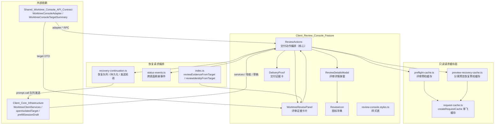
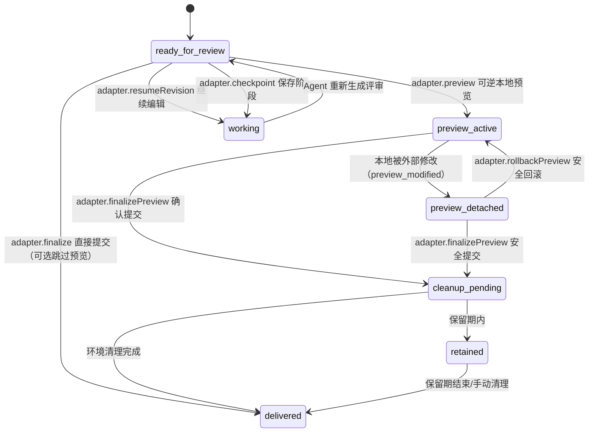
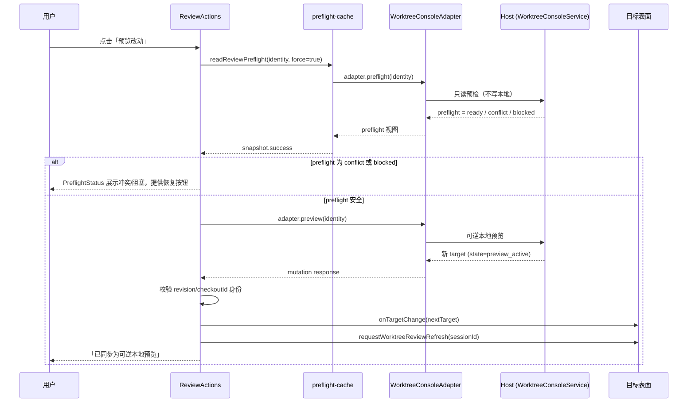

# 客户端评审控制台功能（Client Review Console Feature）

!!! info "Generated documentation"
    This page was written by CodeWiki from the source code at commit [`418761d3`](https://github.com/wloops/dsh-git-worktree/commit/418761d328549f22e4aed5d0dec38a04e134170a) on 2026-11-07 with `doubao-seed-2.1-lite`. Check the code before relying on details.

## 简介与目的

`Client_Review_Console_Feature` 是客户端 UI 应用层中负责「工作树评审（Worktree Review）」交互的核心功能模块。它面向已由 Agent 完成一次迭代工作、并进入 `ready_for_review` 状态的隔离工作树，向用户提供：

- 评审证据（评审摘要、改动文件、自动化校验结果）的展示；
- 交付生命周期管理：从「本地预览（Preview）→ 确认提交（Finalize）→ 环境清理/保留」的完整动作编排；
- 交付前的只读预检（Preflight）与冲突/阻塞状态的可视化；
- 异常恢复闭环：应用冲突（Apply Conflict）、陈旧评审（Stale Isolated）、分离式预览（Preview Detached）等场景的恢复请求排队、持久化与重发；
- 交付完成后的证据卡（Delivery Proof）与清理重试。

该模块只依赖 [Shared_Worktree_Console_API_Contract —— 共享 Worktree 控制台 API 契约](../Shared_Worktree_Console_API_Contract.md) 中定义的 JSON DTO 与 `WorktreeConsoleAdapter` 接口，以及 [Client_Core_Infrastructure（客户端核心基础设施层）](Client_Core_Infrastructure.md) 中的会话/工作区服务面（`WorktreeClientServices`、`openIsolatedTarget`、`prefillSessionDraft` 等），自身不直接接触 Remote 传输或 Git 实现。

## 架构总览

评审控制台在 UI 层中被装配进两类表面（surface）：主面板（`WorktreeReviewPanel` + `ReviewActions`）与停靠条/坞（dock 紧凑布局）。所有数据来自 Host 权威的 `WorktreeConsoleTargetSummary`，客户端只做只读投影与显式的 CAS（compare-and-swap）写操作。

### 关键设计原则

1. **Host 权威，客户端投影**：所有状态以 `WorktreeConsoleTargetSummary` 为准；客户端 UI 仅在收到 mutation 响应后通过 `onTargetChange` 回写新目标，并广播 `requestWorktreeReviewRefresh` 事件让其他挂载的评审表面重新读取。
2. **写前强制预检（force preflight）**：`previewLocal`、`submitCommit`、`rollbackPreview`、`finalizePreview` 等写操作在真正调用 adapter 前都会以 `force=true` 重新读取预检，避免使用过期缓存。
3. **身份校验（CAS）**：每个写请求携带 `expectedRevision` / `expectedReviewId`，响应回来后再次校验 `checkoutId`、`ownerSessionId`、`state`、`revision` 等身份字段，不匹配即报 `checkout_mismatch`。
4. **单飞缓存（single-flight）**：`createRequestCache` 用 per-adapter 的 `WeakMap` + 身份字符串键，并发请求共享同一 in-flight Promise，`invalidate` 通过 generation 号防止过期响应回写。
5. **恢复请求不丢**：`recovery-continuation` 将排队中的恢复请求持久化到 `localStorage`，渲染器重建后可 `restoreWorktreeRecovery` 恢复；每次发送前都重新向 Host `inspect` 校验目标身份与会话就绪状态，浏览器存储仅作上下文，不作权威。

## 核心组件详解

本功能模块的代码按职责分为三组。以下逐组说明其核心组件与职责。

### 一、评审证据展示层

负责把 Host 返回的评审摘要渲染成用户可读的卡片、详情弹窗与交付证据，是纯展示组件，不直接发起写请求。

#### `WorktreeReviewPanel.tsx` — 评审证据卡片

- **`WorktreeReviewEvidence`**：在 `WorktreeConsoleReviewSummary`（Host 契约）之上扩展可选 `detailsMarkdown`，用于把持久化评审投影成共享紧凑卡片/坞证据形状。
- **`WorktreeReviewIdentity`**：CAS 身份四元组 `sessionId / checkoutId / expectedRevision / expectedReviewId`，是所有写操作与高级评审读取必须携带的精确身份。
- **`WorktreeReviewPanelProps`**：`review / target / identity / unavailableMessage`。
- **`reviewIsStale(target, identity, review)`**：判断评审是否已过期——当 target 回到 `working`，或 target 中 `reviewId`/`revision` 与身份不一致时返回 true，UI 据此显示「评审已过期，请刷新」。
- **面板本体**：紧凑头部（状态图标 + 标题 + 摘要）、元信息行（校验状态、改动文件数、已保存阶段数、展开校验详情按钮）、可折叠的校验命令列表（命令 + 状态 + 摘要）。评审身份（`reviewId` 前 8 位 + `r{revision}`）仅作代码样式展示。

#### `ReviewDetailsModal.tsx` — 评审详情弹窗

- **`validationIcon(status)` / `validationText(status, t)`**：把校验状态映射为图标名（`check` / `warning` / `minus`）与本地化文案。
- **`ReviewDetailsModal`**：headless 模态框，含焦点陷阱（Tab 循环、Esc/关闭后还原焦点）。内容按 target 状态派生徽章（`ready / preview / recovery / blocked / saved`），展示迭代号、改动文件列表（>5 项可折叠）、校验命令列表、版本身份折叠区（`reviewId / revision / currentOid`）。冲突场景下额外列出 `preflight.conflictingFiles` 并在文件列表中标记冲突文件。

#### `DeliveryProof.tsx` — 交付证据卡

- 消费 `target.deliveryProof`（`WorktreeDeliveryProofView`）。`compact` 模式渲染一行紧凑文本（提交短 OID · 本地分支@{head} · 改动文件数 · 生命周期文案），用于坞布局；完整模式渲染 `<dl>` 列表：提交、本地 head 前后对比、文件数、校验状态与摘要、本地历史是否仍包含该提交。
- 生命周期文案随 `target.state`（`delivered / retained / cleanup_pending`）变化。

#### `ReviewIcon.tsx` — 图标字典

- 集中导出 `lucide-react` 图标映射表（`file / branch / check / warning / minus / close / list / more / preview / confirm / rollback / edit / save / discard / refresh / chevron / search / branch / external / pin / pinOff` 等），统一 18px、`strokeWidth=1.75`、`aria-hidden`。`ReviewIconName` 为键的联合类型，保证名称拼写在编译期检查。

#### `index.ts` — 出口与投影辅助

- 再导出 `WorktreeReviewPanel` 及三个类型。
- **`reviewEvidenceFromTarget(target, detailsMarkdown?)`**：`target.review` 为空时返回 `null`，否则展开为 `WorktreeReviewEvidence`。
- **`reviewIdentityFromTarget(sessionId, target)`**：由 Host 目标精确构造 `WorktreeReviewIdentity`，供 Finalize 等需要 CAS 身份的调用方使用。

### 二、交付动作编排层

这是本模块的心脏：`ReviewActions` 把「状态 → 可用动作 → 写前预检 → CAS 校验 → 回写目标」串成一条完整链路。

#### `ReviewActions.tsx` — 动作编排器

**输入**：`review`（证据）、`adapter`（`WorktreeConsoleAdapter`）、`services`（`WorktreeClientServices`）、`identity`、`target`、`disabled / unavailableMessage`、`renderStatus?`（坞布局自定义状态槽）、`proofVariant='compact'`（坞紧凑证据）、`focusReview? / isActive?`、`onStale / onTargetChange`。

**Mutation 类型**：`preview | checkpoint | resume_revision | recovery | recovery_analysis | recovery_handoff | open_holder | rollback | finish | finalize_preview | discard | retry_cleanup`。组件内部用 `submitting` 状态 + `mutationLock` ref 保证同一时刻只进行一个 mutation。

**主要动作实现**：

| 动作 | 触发 | 关键步骤 |
| --- | --- | --- |
| `previewLocal` | ready_for_review 主按钮 | force 预检 → 若 conflict/blocked 则仅展示预检结果 → `adapter.preview(identity)` → 校验返回 target 身份 → `applyTarget` 回写 |
| `checkpoint` | 更多菜单「保存阶段并继续」 | 校验 commitMessage + `expectedGeneration` → `adapter.checkpoint` → 校验 `sequence = expectedCount+1` 且回到 `working` |
| `resumeRevision` | 更多菜单「继续编辑」 | `adapter.resumeRevision(identity)` → 用 `prefillSessionDraft` 预填「请重新校验并生成新评审」草稿 |
| `startConflictRecovery` | PreflightStatus 冲突按钮 | force 预检复核冲突身份 → `adapter.resumeRevision({ conflictContinuation })` → 校验 Host 返回的冲突恢复证明 → `enqueueWorktreeRecovery` 排队发送给 Agent |
| `startReviewRegeneration` | blocked + `stale_isolated` 按钮 | force 预检复核 → `adapter.prepareReviewRegeneration` → 校验返回的 `worktree_review_regeneration` 证明 → 排队恢复 |
| `rollbackPreview` | preview_detached 回滚按钮 | 若 detached 则先 force 恢复预检，校验 `proof.rollback.status === 'safe'` → `adapter.rollbackPreview({ recoveryProof? })` |
| `submitCommit`（finish / finalize_preview） | 提交模态框 | finish 路径 force 预检；finalize_preview 路径 force 恢复预检并校验 `proof.finalize.status === 'safe'` → `adapter.finalize / finalizePreview` → 按所选 retention（`retain_24h / retain_3d / retain_manual / cleanup`）提交 |
| `discard` | 丢弃模态框 | `adapter.discard({ confirmDirty, rollbackPreview? })` |
| `analyzeRecovery` / `handoffRecovery` | preview_detached 恢复动作 | force 恢复预检 → `preparePreviewRecoveryAnalysis` / `createPreviewRecoveryHandoff` → `openAuthorizedWorktreeTarget` / `openIsolatedTarget` 导航 → 二次 `inspect` 复核 → 通过 `session.prompt` 队列发送只读分析或交接 prompt |
| `retryCleanup` | cleanup_pending 主按钮 | `adapter.retryCleanup` |
| `openHolder` | blocked `project_acceptance_busy` | 取 `reviewSlotHolder` → `openAuthorizedWorktreeTarget` 导航到占用评审槽的工作树 |

**模态框**：三个——`checkpointOpen`（保存阶段，含阶段说明与 commitMessage textarea）、`commitMode`（确认交付，含保留环境勾选与保留期下拉）、`discardOpen`（危险操作确认）。

**错误处理**：`finishError` 分类——`apply_conflict` 转为运行时冲突（`runtimeConflict`）并提示用户「让 Agent 解决冲突」；`stale_target` 调用 `onStale` 通知父级刷新；`stale_local / stale_isolated` 自动 `refreshPreflight`；其余错误通过 `worktreeConsoleErrorMeta(code)` 渲染分类与恢复建议。

**副作用同步**：`target.revision` 变化时清空 message/error/runtimeConflict；`reviewSlot` 从 `waiting` → `available` 时使预检缓存失效并主动重读。

#### `PreflightStatus.tsx` — 预检状态展示

消费 `PreflightSnapshot`（`idle / loading / error / success(preflight)`），并依据 `preflight.status`（`ready / local_advanced / already_in_local / conflict / blocked`）渲染：

- `conflict`：琥珀色块，标题「发现 N 个冲突文件」，提供「再次检查」与「让 Agent 解决冲突」主按钮（后者需 `target.capabilities.resumeRevision`）。
- `blocked`：通用阻塞块，展示 `preflight.message`，按 reason 提供动作——`stale_isolated` 显示「重新生成评审」；`project_acceptance_busy` 显示占用者摘要（checkoutId/session/state）与「打开占用任务」。
- `ready / local_advanced / already_in_local`：非 compact 模式下渲染四元事实表（local head、worktree head、effective base、改动文件数）。

#### `review-console.styles.ts` — 样式表

`REVIEW_CONSOLE_STYLES` 字符串包含全部评审表面样式：面板、详情模态框、坞布局（`dsh-wt-review-dock`）、预检块、冲突块、交付证据卡、更多菜单、模态框 footer、响应式断点（≤620px）。颜色 token（`--wt-green / --wt-amber / --wt-red`）以 `color-mix` 派生，适配明暗主题。

### 三、只读缓存与恢复层

#### `request-cache.ts` — 单飞请求缓存

- **`RequestSnapshot<T>`**：`idle | loading | success(preflight) | error(error)`。
- **`Entry<T>`**：snapshot + listeners + in-flight `promise` + `generation`。
- **`createRequestCache({ key, request })`**：按 `WeakMap<adapter, Map<key, Entry>>` 组织；`read(adapter, identity, force?)` 在有 in-flight promise 时直接复用，否则发布 `loading` 并发起请求；`invalidate` 通过 `generation++` 丢弃旧响应（防止过期回写）；`useSnapshot` 用 `useSyncExternalStore` 把 entry 订阅到 React，并在 `enabled` 时自动触发一次 read。

#### `preflight-cache.ts` — 评审预检缓存

- 键：`sessionId \u0000 checkoutId \u0000 expectedRevision \u0000 expectedReviewId`，请求体为 `adapter.preflight(identity)`。
- 导出 `readReviewPreflight`（force 绕过缓存，写前必调）、`invalidateReviewPreflight`、`useReviewPreflight`。

#### `preview-recovery-cache.ts` — 分离预览恢复预检缓存

- 键额外加入 `expectedPreviewId`，请求体为 `adapter.previewRecoveryPreflight(identity)`，导出 `readPreviewRecoveryPreflight / invalidatePreviewRecoveryPreflight / usePreviewRecoveryPreflight`。

#### `recovery-continuation.ts` — 恢复请求编排

- **请求类型**：`WorktreeApplyConflictRecoveryRequest`（冲突恢复：含 `localHeadOid / conflictingFiles`）与 `WorktreeReviewRegenerationRequest`（只读重生成评审）。
- **`RecoveryEntry`**：运行时单例，含 snapshot、adapter、services、isActive、`claimed`、退避轮询 `pollDelayMs`、abort、unsubscribers、listeners。
- **持久化**：`localStorage` 键 `dsh-git-worktree:recovery:v1:{sessionId}`，仅持久化 `queued / sending / failed`；`sent / cancelled` 时删除。恢复时严格校验 `version / status / 字段白名单 / 冲突文件路径安全（`safeConflictFile` 拒绝绝对路径、`..`、控制字符）`。
- **`attempt(entry)` 发送链**：
  1. `isActive` 与「当前条目」校验 → 2. 会话是否 active（否则 `cancel`）→ 3. `adapter.inspect` 复核目标身份（`targetMatchesRequest` 逐字段比对 checkoutId/state/review/revision/continuation）→ 4. 若会话未就绪（cwd 不匹配、未 open、running），进入 `waitForSession`（订阅 sessions list + session 快照，指数退避 250ms→5s 轮询 inspect）→ 5. 就绪后再次 inspect 复核 → 6. 通过 `session.prompt([text], 'queue', abort.signal)` 发送本地化恢复 prompt → 7. 成功则 `sent`，失败则 `failed`。
- **导出函数**：`enqueueWorktreeRecovery`（入队并立即尝试发送）、`restoreWorktreeRecovery`（渲染器重建后从 localStorage 恢复）、`retryWorktreeRecovery`（failed/cancelled 重发）、`useWorktreeRecoverySnapshot`（React Hook）、`cancelWorktreeRecovery / detachWorktreeRecoveryRuntime / clearWorktreeRecovery`（测试与清理用）。
- **安全声明**：浏览器存储仅作上下文，每次发送前都重新向 Host + Harness 双重校验身份；`buildWorktreeRecoveryPrompt` 按请求 kind 生成只读冲突解决或评审重生成 prompt。

#### `status-events.ts` — 跨表面刷新事件

- `WORKTREE_REVIEW_REFRESH_EVENT = 'dsh-git-worktree:review-refresh'`。
- `requestWorktreeReviewRefresh(sessionId)`：向 window 派发 CustomEvent，通知所有挂载的评审表面重新读取 Host 权威 target（通常在 mutation 回写后调用，避免各表面各自轮询）。

## 状态机概览

`ReviewActions` 的主按钮与菜单完全由目标状态（`target.state`）驱动：

> 状态的权威定义与投影规则（`consoleStateFromDomain`）位于 [Shared_Worktree_Console_API_Contract —— 共享 Worktree 控制台 API 契约](../Shared_Worktree_Console_API_Contract.md) 的 `console-contract.ts`；本模块只消费 `WorktreeConsoleTargetSummary.state` 与 `capabilities` 标志。

## 典型交互流程：用户确认交付

## 与其他模块的关系

- **[Client_UI_Application_Layer（客户端 UI 应用层）](../Client_UI_Application_Layer.md)**：本模块的父层，负责装配客户端 UI。
- **[Client_Core_Infrastructure（客户端核心基础设施层）](Client_Core_Infrastructure.md)**：提供 `WorktreeClientServices`（会话列表/绑定/工作区导航）、`openIsolatedTarget`、`openAuthorizedWorktreeTarget`、`prefillSessionDraft`、`selectedSessionId` 等基础服务面。
- **[客户端目标控制台特性（Client_Target_Console_Feature）](Client_Target_Console_Feature.md)**：消费本模块导出的 `WorktreeReviewPanel` / `ReviewActions` / `reviewEvidenceFromTarget`，在工作树控制台的英雄芯片（Hero Chip）与评审状态（Review Status）位置渲染评审表面。
- **[Shared_Worktree_Console_API_Contract —— 共享 Worktree 控制台 API 契约](../Shared_Worktree_Console_API_Contract.md)**：定义全部 DTO、错误码元数据（`worktreeConsoleErrorMeta`）与 `WorktreeConsoleAdapter`；本模块不重复定义契约，只引用。
- **[Worktree 控制台宿主服务（Worktree_Console_Host_Service）](../Backend_Host_Core_Runtime/Worktree_Console_Host_Service.md)**：Host 端 `WorktreeConsoleService`，是所有 adapter 调用的权威实现，负责 CAS 写、预检执行与恢复证明生成。

## 关键导出

- `WorktreeReviewPanel`、`WorktreeReviewEvidence`、`WorktreeReviewIdentity`、`WorktreeReviewPanelProps`（`index.ts` 再导出）
- `reviewEvidenceFromTarget(target, detailsMarkdown?)`：把 Host 目标投影为紧凑证据形状
- `reviewIdentityFromTarget(sessionId, target)`：构造 Finalize 等写操作所需的精确 CAS 身份
- `ReviewActions`、`PreflightStatus`、`DeliveryProof`、`ReviewDetailsModal`、`ReviewIcon`
- `useReviewPreflight` / `readReviewPreflight` / `invalidateReviewPreflight`（预检缓存 Hook）
- `usePreviewRecoveryPreflight` / `readPreviewRecoveryPreflight`（分离预览恢复预检）
- `useWorktreeRecoverySnapshot` / `enqueueWorktreeRecovery` / `restoreWorktreeRecovery` / `retryWorktreeRecovery`（恢复队列）
- `requestWorktreeReviewRefresh(sessionId)`（跨表面刷新事件）

??? abstract "Documented components (20)"
    - [`__file__`](https://github.com/wloops/dsh-git-worktree/blob/418761d328549f22e4aed5d0dec38a04e134170a/src%5Cclient%5Creview-console%5CDeliveryProof.tsx) — `src\client\review-console\DeliveryProof.tsx`
    - [`PreflightStatus`](https://github.com/wloops/dsh-git-worktree/blob/418761d328549f22e4aed5d0dec38a04e134170a/src%5Cclient%5Creview-console%5CPreflightStatus.tsx) — `src\client\review-console\PreflightStatus.tsx`
    - [`__file__`](https://github.com/wloops/dsh-git-worktree/blob/418761d328549f22e4aed5d0dec38a04e134170a/src%5Cclient%5Creview-console%5CReviewActions.tsx) — `src\client\review-console\ReviewActions.tsx`
    - [`validationIcon`](https://github.com/wloops/dsh-git-worktree/blob/418761d328549f22e4aed5d0dec38a04e134170a/src%5Cclient%5Creview-console%5CReviewDetailsModal.tsx) — `src\client\review-console\ReviewDetailsModal.tsx`
    - [`ReviewIcon`](https://github.com/wloops/dsh-git-worktree/blob/418761d328549f22e4aed5d0dec38a04e134170a/src%5Cclient%5Creview-console%5CReviewIcon.tsx) — `src\client\review-console\ReviewIcon.tsx`
    - [`WorktreeReviewEvidence`](https://github.com/wloops/dsh-git-worktree/blob/418761d328549f22e4aed5d0dec38a04e134170a/src%5Cclient%5Creview-console%5CWorktreeReviewPanel.tsx) — `src\client\review-console\WorktreeReviewPanel.tsx`
    - [`WorktreeReviewIdentity`](https://github.com/wloops/dsh-git-worktree/blob/418761d328549f22e4aed5d0dec38a04e134170a/src%5Cclient%5Creview-console%5CWorktreeReviewPanel.tsx) — `src\client\review-console\WorktreeReviewPanel.tsx`
    - [`WorktreeReviewPanelProps`](https://github.com/wloops/dsh-git-worktree/blob/418761d328549f22e4aed5d0dec38a04e134170a/src%5Cclient%5Creview-console%5CWorktreeReviewPanel.tsx) — `src\client\review-console\WorktreeReviewPanel.tsx`
    - [`reviewEvidenceFromTarget`](https://github.com/wloops/dsh-git-worktree/blob/418761d328549f22e4aed5d0dec38a04e134170a/src%5Cclient%5Creview-console%5Cindex.ts) — `src\client\review-console\index.ts`
    - [`PreflightSnapshot`](https://github.com/wloops/dsh-git-worktree/blob/418761d328549f22e4aed5d0dec38a04e134170a/src%5Cclient%5Creview-console%5Cpreflight-cache.ts) — `src\client\review-console\preflight-cache.ts`
    - [`PreviewRecoverySnapshot`](https://github.com/wloops/dsh-git-worktree/blob/418761d328549f22e4aed5d0dec38a04e134170a/src%5Cclient%5Creview-console%5Cpreview-recovery-cache.ts) — `src\client\review-console\preview-recovery-cache.ts`
    - [`PersistedRecovery`](https://github.com/wloops/dsh-git-worktree/blob/418761d328549f22e4aed5d0dec38a04e134170a/src%5Cclient%5Creview-console%5Crecovery-continuation.ts) — `src\client\review-console\recovery-continuation.ts`
    - [`RecoveryEntry`](https://github.com/wloops/dsh-git-worktree/blob/418761d328549f22e4aed5d0dec38a04e134170a/src%5Cclient%5Creview-console%5Crecovery-continuation.ts) — `src\client\review-console\recovery-continuation.ts`
    - [`WorktreeApplyConflictRecoveryRequest`](https://github.com/wloops/dsh-git-worktree/blob/418761d328549f22e4aed5d0dec38a04e134170a/src%5Cclient%5Creview-console%5Crecovery-continuation.ts) — `src\client\review-console\recovery-continuation.ts`
    - [`WorktreeRecoverySnapshot`](https://github.com/wloops/dsh-git-worktree/blob/418761d328549f22e4aed5d0dec38a04e134170a/src%5Cclient%5Creview-console%5Crecovery-continuation.ts) — `src\client\review-console\recovery-continuation.ts`
    - [`WorktreeReviewRegenerationRequest`](https://github.com/wloops/dsh-git-worktree/blob/418761d328549f22e4aed5d0dec38a04e134170a/src%5Cclient%5Creview-console%5Crecovery-continuation.ts) — `src\client\review-console\recovery-continuation.ts`
    - [`Entry`](https://github.com/wloops/dsh-git-worktree/blob/418761d328549f22e4aed5d0dec38a04e134170a/src%5Cclient%5Creview-console%5Crequest-cache.ts) — `src\client\review-console\request-cache.ts`
    - [`RequestCache`](https://github.com/wloops/dsh-git-worktree/blob/418761d328549f22e4aed5d0dec38a04e134170a/src%5Cclient%5Creview-console%5Crequest-cache.ts) — `src\client\review-console\request-cache.ts`
    - [`__file__`](https://github.com/wloops/dsh-git-worktree/blob/418761d328549f22e4aed5d0dec38a04e134170a/src%5Cclient%5Creview-console%5Creview-console.styles.ts) — `src\client\review-console\review-console.styles.ts`
    - [`requestWorktreeReviewRefresh`](https://github.com/wloops/dsh-git-worktree/blob/418761d328549f22e4aed5d0dec38a04e134170a/src%5Cclient%5Creview-console%5Cstatus-events.ts) — `src\client\review-console\status-events.ts`

