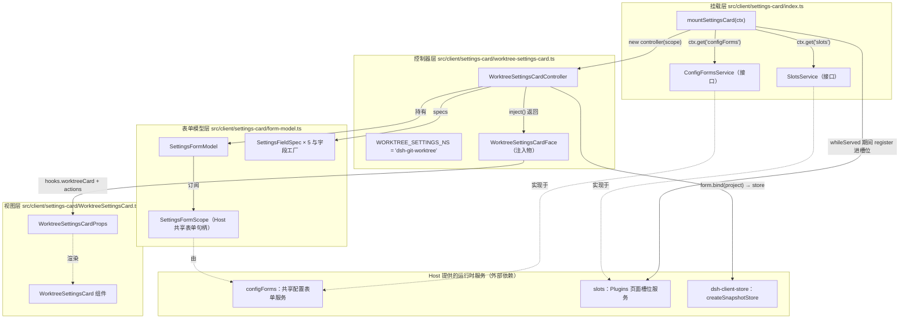
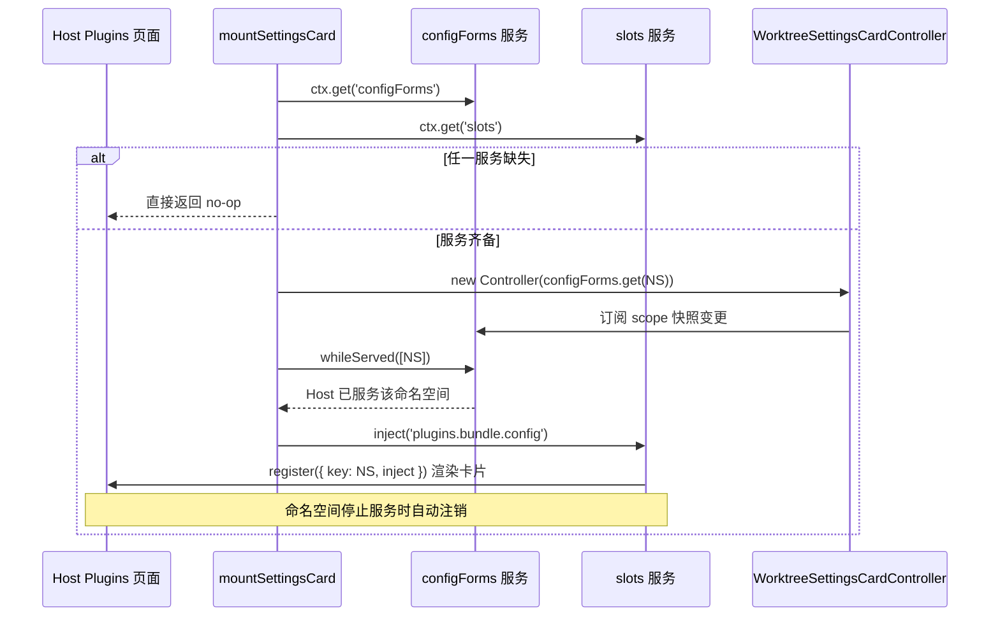
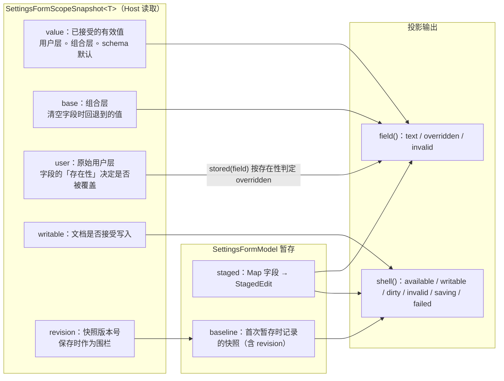
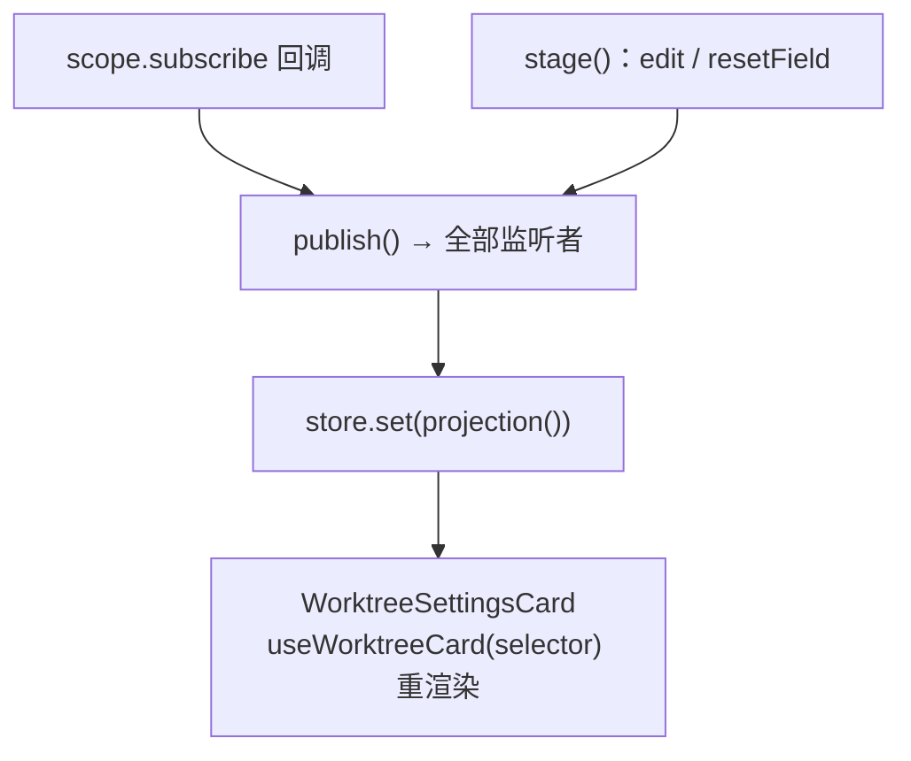
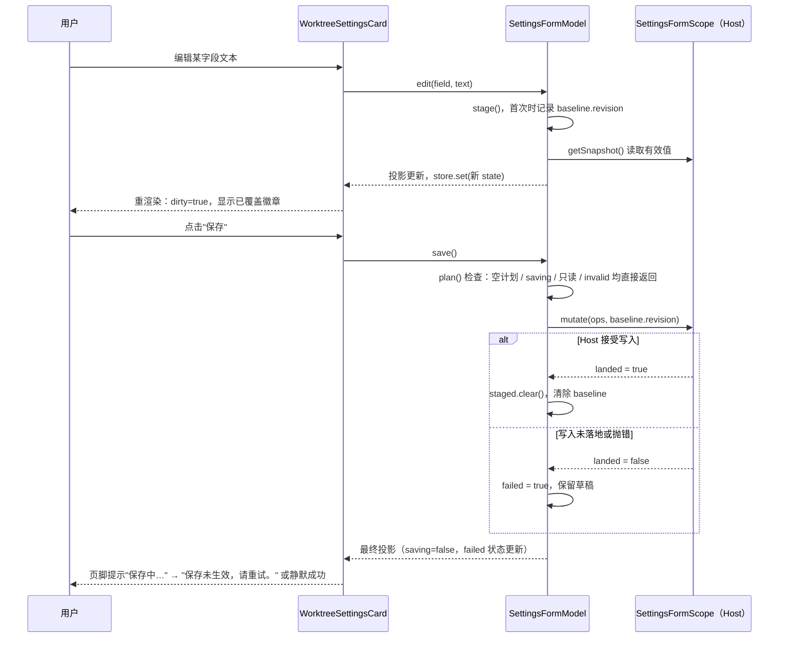
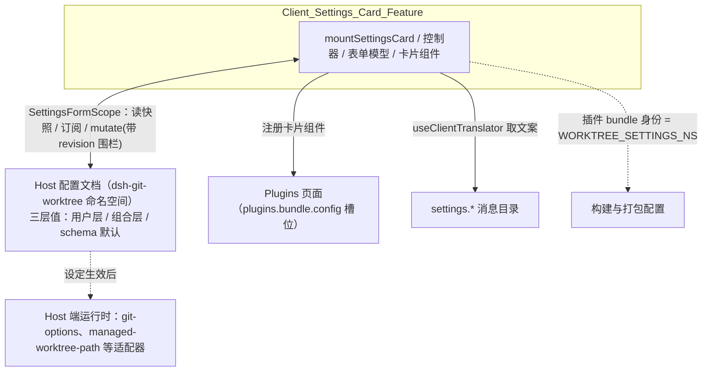

# Client_Settings_Card_Feature（设置卡片功能）

!!! info "Generated documentation"
    This page was written by CodeWiki from the source code at commit [`47ebbe95`](https://github.com/wloops/dsh-git-worktree/commit/47ebbe95f01b195727094f9030c58cb5b5145601) on 2026-11-06 with `doubao-seed-2.1-lite`. Check the code before relying on details.

## 简介

本模块是 `dsh-git-worktree` 插件的客户端设置页面：它在 Host 的 Plugins（插件）页面上挂载一张设置卡片，让用户编辑插件 Config 命名空间 `dsh-git-worktree` 下的五个运行期字段——自动交付开关、自动推送开关、Worktree 根目录、Git 命令超时与 `worktree add` 超时。

整个功能是一个**自包含（self-contained）的暂存表单（staged form）**：用户的输入先在客户端暂存，只有点击"保存"才会向 Host 发起一次带 revision 围栏的原子写入。这种设计是刻意为之——插件安装时自带的 `client-ui-primitives` 版本早于 Harness 共享的 `SettingsForm`，因此表单模型从 harness 的 settings-form 模型（`@deepseek-ai/dsh-client-ui-primitives` 0.1.7-rc.2）裁剪而来，删掉了 write-only 秘钥控件，卡片也全部用 inline style 绘制，不依赖任何外部样式表，以保证客户端 bundle 自包含。

本页隶属于 [Client_UI_Application_Layer（客户端 UI 应用层）](../Client_UI_Application_Layer.md)，与其并列的其他客户端功能模块包括 [Client_Core_Infrastructure（核心基础设施）](Client_Core_Infrastructure.md)、[Client_Review_Console_Feature（验收控制台）](Client_Review_Console_Feature.md)、[Client_Target_Console_Feature（目标控制台）](Client_Target_Console_Feature.md) 与 [Client_Workspace_Sidebar_Feature（工作区侧栏）](Client_Workspace_Sidebar_Feature.md)。

## 架构总览

模块内四个文件按"挂载 → 控制器 → 表单模型 → 视图"分层，每一层都只通过上一层暴露的接口通信：



**分层职责**：

| 层 | 文件 | 核心职责 |
| --- | --- | --- |
| 挂载层 | `src/client/settings-card/index.ts` | fail-soft 探测 `configForms` 与 `slots` 服务；创建并销毁控制器；命名空间被 Host 服务期间把卡片注册进 `plugins.bundle.config` 槽位 |
| 控制器层 | `src/client/settings-card/worktree-settings-card.ts` | 声明命名空间常量、`WorktreeSettings` 数据类型、五个字段规格；把表单投影为 `SnapshotStore<WorktreeSettingsCardState>`；向槽位注入 face |
| 表单模型层 | `src/client/settings-card/form-model.ts` | 通用暂存表单引擎：读取 Host 三层值（用户层 / 组合层 / schema 默认）、暂存编辑、规划写入、revision 围栏保存 |
| 视图层 | `src/client/settings-card/WorktreeSettingsCard.tsx` | 纯展示组件：按 `view` 返回一行摘要或完整表单，全部交互经由 props 传入的 actions 与 `useWorktreeCard` 选择器 |

## 挂载与生命周期

`mountSettingsCard(ctx)` 是模块的入口。它用 Cordis 的 `ctx.get()`（fail-soft 读取）而非属性 getter 读取可选服务——后者在服务缺失时会直接抛 "cannot get property without inject"。任一服务缺失时本函数直接 no-op：没有设置栈的 Host 就没有设置页面，插件其余功能不受影响。

挂载后有两个伴随生命周期的 `ctx.effect`：

1. **控制器 effect**：`new WorktreeSettingsCardController(configForms.get<WorktreeSettings>(WORKTREE_SETTINGS_NS))`；清理时 `controller.dispose()`，退订 Host 的值变更订阅。
2. **槽位 effect**：`configForms.whileServed([WORKTREE_SETTINGS_NS], …)`——只有当 Host 确实向本客户端服务该命名空间时，才把卡片注入 `plugins.bundle.config` 槽位；命名空间不再服务时回调返回的清理函数会注销卡片。

槽位选择是有意的：`plugins.bundle.config` 按 bundle 包名索引，渲染在该 bundle 自己的 Plugins 页面（描述与列表行之间）；`plugins.item` 是官方插件列表槽位，永远不会展示第三方 bundle 的卡片。



## 表单模型：三层值解析与暂存编辑

`SettingsFormModel<T>` 是本模块的引擎，也是从 harness settings-form 模型裁剪出的通用实现。它的核心概念是 Host 侧每个配置文档的**三层值结构**：



关键语义：

- **Override 按"存在性"判定，而非值比较**：`stored(field)` 只检查用户层对象上是否有该字段的自有属性。即使用户层的值与组合层默认完全相等，它依然是一次覆盖——这保证"还原"按钮（`resetField` → 暂存 `clear`）语义正确：保存后对该字段发出 `unset`，让字段重新继承组合层。
- **暂存而非即写**：每次 `edit()` / `resetField()` 只写入本地 `staged` Map，首次暂存时把当前 scope 快照存为 `baseline`（记住 revision），并清除上一次的 `failed` 标记。
- **保存前规划（`plan()`）**：逐条把暂存文本用 `SettingsFieldSpec.parse` 解析成 `set` / `unset` 路径操作；解析不出值的条目**没有 op**，但仍计入计划——表单保持 dirty 且 `invalid` 为真，保存被阻止而不是静默丢弃这次编辑。
- **Host 是唯一权威**：`save()` 调用 `scope.mutate(ops, baseline.revision)`，以草稿开始时的 revision 做乐观并发围栏。返回 `landed === false`（或抛错）时置 `failed = true` 并**保留全部草稿**，用户可以直接修正而不用重新输入；只有确认落地后才清空暂存。约束字段合法性的 Host 校验器是权威，客户端从不预测保存结果。

### 字段规格

控制器用三个工厂函数声明本卡片编辑的全部字段：

| 字段 | 工厂 | 类型语义 | 空文本的行为 |
| --- | --- | --- | --- |
| `autoDeliver` | `settingsBooleanField` | 草稿文本字面量为 `'true'` / `'false'` | 清空 → 暂存 `clear`，保存后回退组合层 |
| `autoPush` | `settingsBooleanField` | 同上 | 同上 |
| `worktreesRoot` | `settingsTextField` | 去空格后的字符串 | 清空 → `clear`（与点"还原"等价） |
| `gitTimeoutMs` | `settingsNumberField` | 必须为 safe integer | 清空 → `clear`；非法数字 → 条目无 op，阻止保存 |
| `worktreeAddTimeoutMs` | `settingsNumberField` | 同上 | 同上 |

`format` 方向负责把 Host 存储值渲染成草稿文本：该字段在 section 中无对应值时渲染**空字符串**，而不是一个没人选择过的默认数字。

## 状态投影与组件契约

控制器在构造时调用 `form.bind(project)`，把"scope 快照 + 本地暂存"的组合投影绑定到 `createSnapshotStore` 创建的 `SnapshotStore<WorktreeSettingsCardState>`。模型内部维护监听者集合：scope 订阅回调与本地 stage 都会触发 `publish()`，进而 `store.set(project())` 重建投影。



`WorktreeSettingsCardState` 就是共享表单外壳（`SettingsFormShell`）加上五个字段各自的 `SettingsFieldState`：

```typescript
export interface WorktreeSettingsCardState extends SettingsFormShell {
  autoDeliver: SettingsFieldState
  autoPush: SettingsFieldState
  worktreesRoot: SettingsFieldState
  gitTimeoutMs: SettingsFieldState
  worktreeAddTimeoutMs: SettingsFieldState
}
```

槽位注册时，渲染器会把 face 里预留的 `hooks.worktreeCard` 来源翻译成组件直接消费的 `useWorktreeCard` 选择器 hook，因此组件 props 里看不到 `hooks` 结构，只拿到：

```typescript
export interface WorktreeSettingsCardProps extends SettingsFormActions {
  view?: string  // 'summary' 时返回一行摘要，否则渲染完整表单
  useWorktreeCard: (selector) => WorktreeSettingsCardState
}
```

`WorktreeSettingsCard` 组件据此行为：

- `view === 'summary'` → 渲染一行摘要文案（`settings.description`：交付与推送开关、Worktree 根目录与 Git 超时），供 Plugins 列表展示；
- `state.available === false`（命名空间尚未 ready）→ 返回 `null`；
- 其余情况渲染完整表单：五个字段行（开关、文本、数字输入），每行附带"取值无效"提示、"已覆盖"徽章与"还原"按钮；页脚显示只读 / 保存中 / 保存失败状态，以及"放弃修改"与"保存"两个按钮，按钮禁用态由 `writable`、`dirty`、`invalid`、`saving` 精确驱动。

所有文案经 `useClientTranslator()` 取 `settings.*` 系列消息（如 `settings.autoDeliver`、`settings.failed`），消息目录见 [Internationalization (i18n) Layer（国际化层）](../Shared_Cross-Tier_Contracts___Utilities/Internationalization_(i18n)_Layer.md)。

## 保存流程时序



放弃修改（`discard`）只在确实有暂存编辑或上次保存失败时生效：清空 `staged`、重置 `baseline`、清除 `failed` 并重新发布。

## 与系统其他部分的关系



- **配置的去向**：五个字段最终被 Host 端消费——`gitTimeoutMs` / `worktreeAddTimeoutMs` 对应后端 `git-options` 适配器的超时配置，`worktreesRoot` 影响受管 Worktree 路径解析，`autoDeliver` / `autoPush` 改变交付动作的默认行为。Host 侧的实现细节不属本页，请参见 [Backend_Host_Core_Runtime（Host 核心运行时）](../Backend_Host_Core_Runtime.md) 及其 [Adapter_Infrastructure_Implementations（适配器基础设施）](../Backend_Host_Core_Runtime/Adapter_Infrastructure_Implementations.md) 子页。
- **值来源与写入通道**：`SettingsFormScope` 是 Host 共享配置表单服务按命名空间提供的句柄，属于本模块的外部依赖接口（`ConfigFormsService.get<T>(ns)`），本模块不实现其内部。
- **文案**：全部 `settings.*` 消息在共享国际化目录中定义（中英双语），见 [Internationalization (i18n) Layer](../Shared_Cross-Tier_Contracts___Utilities/Internationalization_(i18n)_Layer.md)。
- **构建身份**：命名空间常量 `WORKTREE_SETTINGS_NS = 'dsh-git-worktree'` 与 `package.json` 中的插件 bundle 名一致；客户端平台为 `web`，入口经 `tsdown` 打包为自包含 bundle（见 [Build, CI & Project Configuration](../Build,_CI___Project_Configuration.md)）。运行时依赖的 `createSnapshotStore` 来自 `@deepseek-ai/dsh-client-store`。
- **与其他客户端功能的关系**：本模块独立于会话/验收/侧栏等功能渲染，不读取实时 Console 状态；它只通过 Host 配置文档间接影响这些功能的默认行为。其余客户端功能见 [Client_UI_Application_Layer（客户端 UI 应用层）](../Client_UI_Application_Layer.md)。

## 设计要点小结

1. **自包含优先**：不依赖 Harness 共享 `SettingsForm`（插件所装版本早于它），表单引擎与样式全部内联，避免外部版本差异导致的渲染失败。
2. **暂存语义诚实**：屏幕上的内容精确等于"保存将写入的内容"；无效输入阻止保存而不是被丢弃；保存失败保留草稿。
3. **并发安全**：保存以草稿开始时的 revision 为围栏，Host 不接受旧 revision 时显式标记失败。
4. **优雅降级**：无 `configForms` / `slots` 服务、命名空间未服务、文档只读三种情况下，卡片分别表现为"不挂载 / 不渲染 / 只读禁用"，绝不报错。
5. **存在性覆盖模型**：override 由用户层字段存在性决定，还原即 unset，语义与组合层继承一致。

??? abstract "Documented components (16)"
    - [`WorktreeSettingsCardProps`](https://github.com/wloops/dsh-git-worktree/blob/47ebbe95f01b195727094f9030c58cb5b5145601/src%5Cclient%5Csettings-card%5CWorktreeSettingsCard.tsx) — `src\client\settings-card\WorktreeSettingsCard.tsx`
    - [`PlannedWrite`](https://github.com/wloops/dsh-git-worktree/blob/47ebbe95f01b195727094f9030c58cb5b5145601/src%5Cclient%5Csettings-card%5Cform-model.ts) — `src\client\settings-card\form-model.ts`
    - [`SettingsFieldSpec`](https://github.com/wloops/dsh-git-worktree/blob/47ebbe95f01b195727094f9030c58cb5b5145601/src%5Cclient%5Csettings-card%5Cform-model.ts) — `src\client\settings-card\form-model.ts`
    - [`SettingsFieldState`](https://github.com/wloops/dsh-git-worktree/blob/47ebbe95f01b195727094f9030c58cb5b5145601/src%5Cclient%5Csettings-card%5Cform-model.ts) — `src\client\settings-card\form-model.ts`
    - [`SettingsFormActions`](https://github.com/wloops/dsh-git-worktree/blob/47ebbe95f01b195727094f9030c58cb5b5145601/src%5Cclient%5Csettings-card%5Cform-model.ts) — `src\client\settings-card\form-model.ts`
    - [`SettingsFormModel`](https://github.com/wloops/dsh-git-worktree/blob/47ebbe95f01b195727094f9030c58cb5b5145601/src%5Cclient%5Csettings-card%5Cform-model.ts) — `src\client\settings-card\form-model.ts`
    - [`SettingsFormScope`](https://github.com/wloops/dsh-git-worktree/blob/47ebbe95f01b195727094f9030c58cb5b5145601/src%5Cclient%5Csettings-card%5Cform-model.ts) — `src\client\settings-card\form-model.ts`
    - [`SettingsFormScopeSnapshot`](https://github.com/wloops/dsh-git-worktree/blob/47ebbe95f01b195727094f9030c58cb5b5145601/src%5Cclient%5Csettings-card%5Cform-model.ts) — `src\client\settings-card\form-model.ts`
    - [`SettingsFormShell`](https://github.com/wloops/dsh-git-worktree/blob/47ebbe95f01b195727094f9030c58cb5b5145601/src%5Cclient%5Csettings-card%5Cform-model.ts) — `src\client\settings-card\form-model.ts`
    - [`StagedEdit`](https://github.com/wloops/dsh-git-worktree/blob/47ebbe95f01b195727094f9030c58cb5b5145601/src%5Cclient%5Csettings-card%5Cform-model.ts) — `src\client\settings-card\form-model.ts`
    - [`ConfigFormsService`](https://github.com/wloops/dsh-git-worktree/blob/47ebbe95f01b195727094f9030c58cb5b5145601/src%5Cclient%5Csettings-card%5Cindex.ts) — `src\client\settings-card\index.ts`
    - [`SlotsService`](https://github.com/wloops/dsh-git-worktree/blob/47ebbe95f01b195727094f9030c58cb5b5145601/src%5Cclient%5Csettings-card%5Cindex.ts) — `src\client\settings-card\index.ts`
    - [`WorktreeSettings`](https://github.com/wloops/dsh-git-worktree/blob/47ebbe95f01b195727094f9030c58cb5b5145601/src%5Cclient%5Csettings-card%5Cworktree-settings-card.ts) — `src\client\settings-card\worktree-settings-card.ts`
    - [`WorktreeSettingsCardController`](https://github.com/wloops/dsh-git-worktree/blob/47ebbe95f01b195727094f9030c58cb5b5145601/src%5Cclient%5Csettings-card%5Cworktree-settings-card.ts) — `src\client\settings-card\worktree-settings-card.ts`
    - [`WorktreeSettingsCardFace`](https://github.com/wloops/dsh-git-worktree/blob/47ebbe95f01b195727094f9030c58cb5b5145601/src%5Cclient%5Csettings-card%5Cworktree-settings-card.ts) — `src\client\settings-card\worktree-settings-card.ts`
    - [`WorktreeSettingsCardState`](https://github.com/wloops/dsh-git-worktree/blob/47ebbe95f01b195727094f9030c58cb5b5145601/src%5Cclient%5Csettings-card%5Cworktree-settings-card.ts) — `src\client\settings-card\worktree-settings-card.ts`

