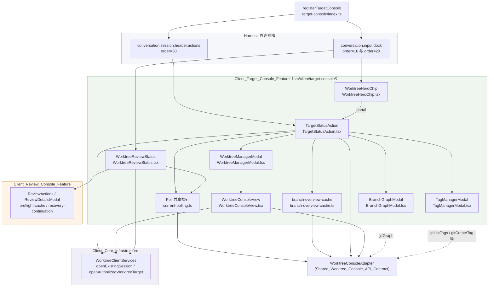
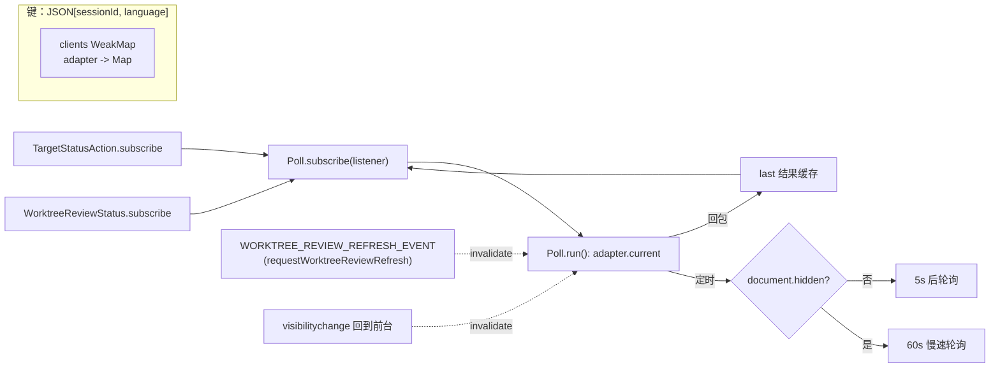
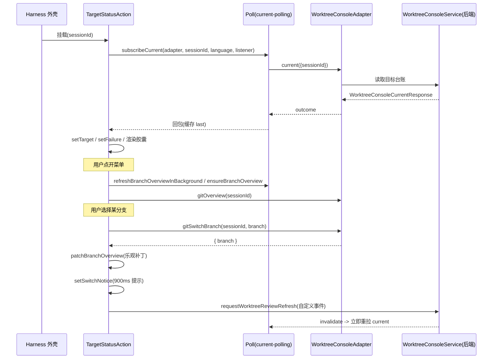
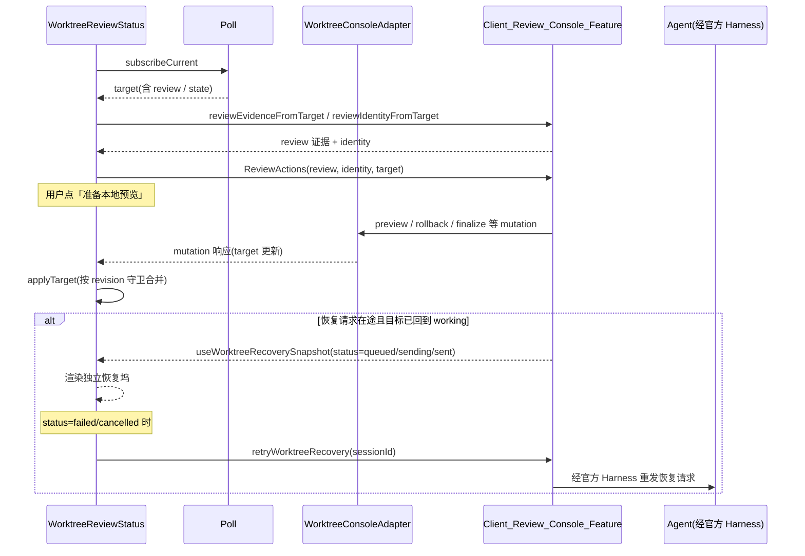
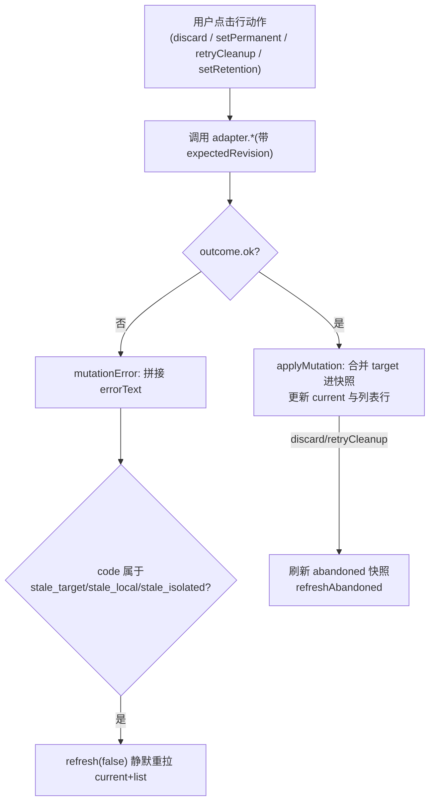

# 客户端目标控制台特性（Client_Target_Console_Feature）

!!! info "Generated documentation"
    This page was written by CodeWiki from the source code at commit [`b0979671`](https://github.com/wloops/dsh-git-worktree/commit/b0979671ecdb749b8ca1bf1b3c9f06182f618b95) on 2026-11-07 with `doubao-seed-2.1-lite`. Check the code before relying on details.

## 简介

本模块是 DeepSeek Harness 客户端 UI 应用层中面向用户的 **Session Target（会话目标）交互面**，源码位于 `src/client/target-console/`。它把后端 `WorktreeConsoleService`（通过 [Shared_Worktree_Console_API_Contract —— 共享 Worktree 控制台 API 契约](../Shared_Worktree_Console_API_Contract.md) 定义的 `WorktreeConsoleAdapter`）暴露成三类用户可见的 UI：

1. **目标胶囊（Target Status Action）**：嵌入会话头部操作位的分支/worktree 状态胶囊，点开后提供分支切换、建分支、清理已合并分支、标签管理、提交图、worktree 丢弃/重试清理/开启下一迭代等 Git 与 worktree 管理动作。
2. **评审状态坞（Worktree Review Status）**：悬浮在原生 Harness 输入框上方的紧凑交付状态条，把 `ready_for_review` / `preview_active` / `preview_detached` / `recovery_required` / `cleanup_pending` 等状态、评审动作（预览/回滚/定稿）与恢复续作入口集中展示。
3. **Hero 芯片（Worktree Hero Chip）**：在空白会话的 hero 工作区行中「移植（portal）」一枚目标胶囊，让新建会话时也能立即看到当前项目的 Git 状态。

此外还有两个模态工具（提交图 `BranchGraphModal`、标签管理器 `TagManagerModal`）、一个全量管理面板（`WorktreeConsoleView` / `WorktreeManagerModal`），以及两个支持性基础设施：`current-polling.ts`（共享的目标探针轮询）与 `branch-overview-cache.ts`（分支总览缓存）。

与同层其他特性的分工：评审面板、预检、恢复续作等更深的评审交互在 [客户端评审控制台功能（Client Review Console Feature）](Client_Review_Console_Feature.md)；会话绑定、服务句柄（`WorktreeClientServices`）、打开隔离目标等基础动作在 [Client_Core_Infrastructure（客户端核心基础设施层）](Client_Core_Infrastructure.md)；worktree 台账、目标状态机与能力（`capabilities`）语义由 [Worktree 控制台宿主服务（Worktree_Console_Host_Service）](../Backend_Host_Core_Runtime/Worktree_Console_Host_Service.md) 与 [会话检出核心引擎（Core_Session_Checkout_Engine）](../Backend_Host_Core_Runtime/Core_Session_Checkout_Engine.md) 在服务端实现。本模块只负责「展示 + 用户动作编排」，不实现任何 Git 或 worktree 业务规则。

## 架构总览

## 组件职责

### 入口与插槽注册 — `index.ts`

- `TargetConsoleContextLike`：描述外壳插槽能力（`slots.inject` / `slots.register`），与 [Client_Settings_Card_Feature（设置卡片功能）](Client_Settings_Card_Feature.md) 中 `SlotsService` 属同一类外壳注入协议。
- `registerTargetConsole(ctx, adapter, services)`：在三处注册组件：
  - `conversation.session.header.actions`（order=30）→ `TargetStatusAction`
  - `conversation.input.dock`（order=10）→ `WorktreeReviewStatus`
  - `conversation.input.dock`（order=20）→ `WorktreeHeroChip`（仅空白会话渲染）
- 同时再导出 `TargetStatusAction`、`WorktreeConsoleView`、`WorktreeHeroChip`、`WorktreeManagerModal`、`WorktreeReviewStatus`，供宿主或其他客户端模块复用。

### 目标胶囊 — `TargetStatusAction.tsx`

用户动作最密集的入口。要点：

- **探针来源**：通过 `subscribeCurrent`（见下文「共享探针」）订阅 `adapter.current`，拿到 `WorktreeConsoleTargetDetails`；探测失败时把 `code + message` 放进触发元素的 `title` 提示，而非显示一个含糊的「unavailable」。
- **特殊状态**：`not_git_repository`（项目目录不是 Git 仓库）被当作正常分支处理——显示中性灰胶囊并提供「初始化仓库」动作（`adapter.initializeProject`），而不是报错。
- **标签优先级**：胶囊主标签优先显示当前分支名（`currentBranch`），无分支时回退到 worktree 状态文案（`working` / `ready_for_review` / `preview_active` / `retained` 等）。
- **弹层动作集**（按 `target.capabilities` 条件渲染）：
  - 分支列表（从 `branch-overview-cache` 取，支持超过 12 条时的过滤输入框）、`gitSwitchBranch` 乐观补丁、`gitCreateBranch`、`gitPruneMergedBranches`（先预览后确认）。
  - 打开提交图（`BranchGraphModal`）、打开标签管理（`TagManagerModal`）。
  - `reveal`（打开 managedRoot）、`openSource`（跳回 source 会话）。
  - worktree 生命周期动作：`beginNextIteration`、`returnToLocal`、`retryCleanup`、`discard`（带确认对话框，preview 态自动附带 `rollbackPreview`）。
- **并发防护**：`actionScope` 自增世代 + `mounted` 标志，保证会话切换或组件卸载后迟到的 RPC 回包不会写状态；过时错误（`stale_target`）触发整体 `refresh()`（即 `requestWorktreeReviewRefresh` 事件）。

### 评审状态坞 — `WorktreeReviewStatus.tsx`

- 同样基于 `subscribeCurrent` 订阅目标；只在目标处于评审相关状态（`ready_for_review`、`preview_active`、`preview_detached`、`cleanup_pending`、`recovery_required`、`retained`）且存在 `review` 时渲染。
- 复合使用 [客户端评审控制台功能（Client Review Console Feature）](Client_Review_Console_Feature.md) 的构件：`reviewEvidenceFromTarget` / `reviewIdentityFromTarget`（评审证据投影）、`ReviewActions`（预览/回滚/定稿按钮组）、`ReviewDetailsModal` + `useReviewPreflight`（详情弹窗与预检结果）、`useWorktreeRecoverySnapshot` / `restoreWorktreeRecovery` / `retryWorktreeRecovery`（恢复续作）。
- **独立恢复坞**：当恢复请求（`worktree_apply_conflict` / `worktree_review_regeneration`）在目标已回到 `working` 态时仍处于 `queued/sending/sent` 阶段，单独渲染一条恢复状态条；`failed/cancelled` 时提供「重发」按钮。
- **终态可关闭**：`cleanup_pending` / `retained` 等终态坞可按 `checkoutId + reviewId` 维度 dismiss，新评审到来时自动重开。

### Hero 芯片 — `WorktreeHeroChip.tsx`

- 仅在 `session.blank !== false`（空白会话）时渲染。
- 通过「结构优先 + 兜底轮询 + MutationObserver」三级策略寻找外壳中的 `heroWorkspaceRow`，再用惰性解析到的 `react-dom.createPortal` 把 `TargetStatusAction` 移植进去；解析失败/未找到时优雅降级为「无芯片」，不影响插件加载。

### 全量管理面板 — `WorktreeConsoleView.tsx` / `WorktreeManagerModal.tsx`

- `WorktreeManagerModal` 只是一个薄 `Modal` 壳，内嵌 `WorktreeConsoleView`（`embedded=true`）。
- `WorktreeConsoleView` 是「当前目标 + 逻辑链接列表 + 已放弃快照」的完整管理面：
  - 一次并发拉取 `adapter.current` + `adapter.list`（可带 `needsAttention` / `includeDelivered` 过滤）+ `adapter.listAbandoned`。
  - 行排序：聚焦 checkoutId 优先 → 按 `ATTENTION_RANK`（`recovery_required` 最前）→ 迭代号倒序。
  - 行级动作按 `capabilities` 条件渲染：`open`（经 `openAuthorizedWorktreeTarget` 打开授权目标）、`discard`（dirty 时弹确认）、`setPermanent`（钉住/取消钉住）、`retryCleanup`（遇 `modified_after_finalize` 阻塞时弹「丢弃交付后改动再清理」确认）。
  - 生命周期：`applyMutation` 把 mutation 响应合并进本地快照（乐观更新列表）；`mutationError` 对 `stale_target/stale_local/stale_isolated` 自动静默重拉；`restoreAbandoned` 把已放弃快照恢复回分支。

### Git 可视化模态 — `BranchGraphModal.tsx` / `TagManagerModal.tsx`

- `BranchGraphModal`：调 `adapter.gitGraph(sessionId, limit)` 取拓扑序提交，用 `computeGraphLanes`（移植自 git-graph 的车道布局算法，输出 `GraphRowLanes`/`GraphEdge` 几何）绘制 GitHub 风格 SVG 车道图；`mergeRefs` 把 `foo` 与 `origin/foo` 折叠成一枚徽章，tag（`tag:` 前缀）永不与同名分支折叠。支持分页加载（初始 200，每次 100）、按提交打开标签创建。
- `TagManagerModal`：列表（`gitListTags`）+ 三类 mutation（`gitCreateTag` / `gitDeleteTag` / `gitPushTag`），每次 mutation 后重新拉列表；「本地创建成功但推送失败」被建模为可展示的非失败结果（`pushed === false` + `pushMessage`），且重载不清空该错误。关闭/繁忙时禁止重复提交。

## 支撑性基础设施

### 共享目标探针 — `current-polling.ts`

- 同一 `(adapter, sessionId, language)` 组合只存在一个 `Poll` 实例：多个组件订阅共享同一次 `adapter.current` 回包（`last` 直接分发给后到的订阅者）。
- **显示专用观察**：注释明确其「永不用于授权 mutation 或 Git 清理」——mutation 仍走各自带 `expectedRevision` 的 RPC。
- 文档隐藏时降速到 60s，避免对后台 GUI 空耗 `git status` / `git rev-parse` 派生进程；回到前台立即 `invalidate` 刷新。
- 最后一个订阅者退订即注销定时器与事件监听，通过 `release` 回调从 `clients` 表中删除该 `Poll`。

### 分支总览缓存 — `branch-overview-cache.ts`

- 模块级 `Map<sessionId, { value, fetchedAt }>`，TTL 60s；另维护 `flights`（去重飞行请求）与 `patchEpochs`（补丁纪元）。
- 三种读：`cachedBranchOverview`（同步读）、`ensureBranchOverview`（按需取，过期才请求）、`refreshBranchOverviewInBackground`（stale-while-revalidate：先返回旧值，后台刷新）。
- **纪元保护**：`invalidateBranchOverview` / `patchBranchOverview` 都会 `bumpEpoch`；起飞于补丁之前的飞行请求落地时只在「纪元未变」时回写缓存，避免陈旧回包覆盖 `switchBranch` 确认后的乐观补丁并意外延长 TTL。
- 失败的 fetch 会清槽，让下次调用可以重试。

## 关键数据流

### 目标状态订阅与动作编排

### 评审状态坞与恢复续作

### 全量管理面板的 mutation 合并

## 依赖关系

| 方向 | 依赖 | 用途 |
| --- | --- | --- |
| 上游契约 | [Shared_Worktree_Console_API_Contract —— 共享 Worktree 控制台 API 契约](../Shared_Worktree_Console_API_Contract.md) | `WorktreeConsoleAdapter` 全部方法（`current`/`list`/`discard`/`retryCleanup`/`gitOverview`/`gitGraph`/`gitListTags`/`initializeProject` 等）与响应类型 |
| 下游实现 | [Worktree 控制台宿主服务（Worktree_Console_Host_Service）](../Backend_Host_Core_Runtime/Worktree_Console_Host_Service.md) | `adapter.current` 背后的投影与能力计算（`capabilities` 决定动作可见性） |
| 同层复用 | [客户端评审控制台功能（Client Review Console Feature）](Client_Review_Console_Feature.md) | `ReviewIcon`、`ReviewActions`、`ReviewDetailsModal`、`reviewEvidenceFromTarget`、`preflight-cache`、`recovery-continuation`、`status-events` |
| 同层基础 | [Client_Core_Infrastructure（客户端核心基础设施层）](Client_Core_Infrastructure.md) | `WorktreeClientServices`（`openPath` 等）、`openExistingSession`、`openAuthorizedWorktreeTarget`、`ClientTranslator`（i18n） |
| 外壳原语 | `@deepseek-ai/dsh-client-ui-primitives` | `Modal`、`Menu`、`MenuEntry`（peerDependency，见 `package.json`） |
| 跨层事件 | `WORKTREE_REVIEW_REFRESH_EVENT`（定义于 review-console/status-events） | 所有 mutation 完成后广播，驱动 `Poll` 与侧边栏等订阅方刷新 |

## 状态机与能力矩阵

目标状态由后端投影给出，本模块负责配色与文案映射（见 `STATE_LABELS` 与 `target-console.styles.ts` 中的 `data-target-state` 选择器）：

| 状态 | 胶囊/坞语义 | 主要可用动作（由 `capabilities` 决定） |
| --- | --- | --- |
| `local` | 本地工作区，尚未创建隔离 worktree | 分支管理、打开位置、初始化仓库 |
| `creating` | 隔离 worktree 创建中 | 只读 |
| `working` | 编辑中 | `beginNextIteration`、`discard`、`retryCleanup` |
| `ready_for_review` | 等待预览 | 评审坞（预览） |
| `preview_active` | 本地预览中 | 评审坞（回滚/定稿）；discard 自动附带 `rollbackPreview` |
| `preview_detached` | 预览已脱离（冲突/head 漂移） | 恢复坞文案、安全回滚 |
| `retained` | 交付后临时保留（可显示过期日） | 终态坞，可 dismiss |
| `cleanup_pending` | 清理待重试 | `retryCleanup`（必要时确认丢弃交付后改动） |
| `recovery_required` | 需要恢复 | 恢复续作入口 |
| `delivered` / `discarded` | 终态，降低透明度 | 行级保留/清理记录 |

## 设计要点与防护

1. **世代 + 挂载守卫**：`actionScope` / `sessionGeneration` / `requestSeq` / `mounted` 贯穿所有异步回包，防止会话切换、组件卸载、弹窗关闭后的迟到回包写入已不属于当前上下文的状态。
2. **乐观补丁优于重取**：`switchBranch` 成功后直接 `patchBranchOverview` 并读回缓存，避免一次 `invalidate + ensure`（约 4 个 git 派生）带来的 UI 闪烁。
3. **stale 自愈**：mutation 收到 `stale_*` 错误码时静默全量刷新，把并发修改的目标台账重新对齐。
4. **失败可诊断**：探针失败时胶囊 tooltip 显示 `code: message`；`not_git_repository` 与真实故障区分对待。
5. **成本感知轮询**：共享 `Poll` + 隐藏标签降速 + 按需拉取分支总览（不在挂载时预取），最大限度减少对用户 checkout 的 git 派生开销。
6. **推送失败非失败**：标签的「本地成功、推送失败」保留已创建标签并展示推送原因，与真正的 RPC 失败区分。

## 样式

`target-console.styles.ts` 导出 `TARGET_CONSOLE_STYLES`（字符串模板），集中定义 `dsh-wtc-*` 系列类名：胶囊配色（按 `data-target-state` 切换 `--wtc-state`）、管理面板卡片/行布局、提交图 SVG、标签管理器、确认对话框等。样式通过 CSS 变量 `color-mix(in srgb, ...)` 适配明暗主题，无独立样式文件构建步骤。

??? abstract "Documented components (14)"
    - [`BranchGraphModalProps`](https://github.com/wloops/dsh-git-worktree/blob/b0979671ecdb749b8ca1bf1b3c9f06182f618b95/src%5Cclient%5Ctarget-console%5CBranchGraphModal.tsx) — `src\client\target-console\BranchGraphModal.tsx`
    - [`GraphEdge`](https://github.com/wloops/dsh-git-worktree/blob/b0979671ecdb749b8ca1bf1b3c9f06182f618b95/src%5Cclient%5Ctarget-console%5CBranchGraphModal.tsx) — `src\client\target-console\BranchGraphModal.tsx`
    - [`GraphRefBadge`](https://github.com/wloops/dsh-git-worktree/blob/b0979671ecdb749b8ca1bf1b3c9f06182f618b95/src%5Cclient%5Ctarget-console%5CBranchGraphModal.tsx) — `src\client\target-console\BranchGraphModal.tsx`
    - [`GraphRowLanes`](https://github.com/wloops/dsh-git-worktree/blob/b0979671ecdb749b8ca1bf1b3c9f06182f618b95/src%5Cclient%5Ctarget-console%5CBranchGraphModal.tsx) — `src\client\target-console\BranchGraphModal.tsx`
    - [`TagManagerModalProps`](https://github.com/wloops/dsh-git-worktree/blob/b0979671ecdb749b8ca1bf1b3c9f06182f618b95/src%5Cclient%5Ctarget-console%5CTagManagerModal.tsx) — `src\client\target-console\TagManagerModal.tsx`
    - [`TargetStatusActionProps`](https://github.com/wloops/dsh-git-worktree/blob/b0979671ecdb749b8ca1bf1b3c9f06182f618b95/src%5Cclient%5Ctarget-console%5CTargetStatusAction.tsx) — `src\client\target-console\TargetStatusAction.tsx`
    - [`WorktreeConsoleViewProps`](https://github.com/wloops/dsh-git-worktree/blob/b0979671ecdb749b8ca1bf1b3c9f06182f618b95/src%5Cclient%5Ctarget-console%5CWorktreeConsoleView.tsx) — `src\client\target-console\WorktreeConsoleView.tsx`
    - [`WorktreeHeroChipProps`](https://github.com/wloops/dsh-git-worktree/blob/b0979671ecdb749b8ca1bf1b3c9f06182f618b95/src%5Cclient%5Ctarget-console%5CWorktreeHeroChip.tsx) — `src\client\target-console\WorktreeHeroChip.tsx`
    - [`WorktreeManagerModalProps`](https://github.com/wloops/dsh-git-worktree/blob/b0979671ecdb749b8ca1bf1b3c9f06182f618b95/src%5Cclient%5Ctarget-console%5CWorktreeManagerModal.tsx) — `src\client\target-console\WorktreeManagerModal.tsx`
    - [`WorktreeReviewStatusProps`](https://github.com/wloops/dsh-git-worktree/blob/b0979671ecdb749b8ca1bf1b3c9f06182f618b95/src%5Cclient%5Ctarget-console%5CWorktreeReviewStatus.tsx) — `src\client\target-console\WorktreeReviewStatus.tsx`
    - [`bumpEpoch`](https://github.com/wloops/dsh-git-worktree/blob/b0979671ecdb749b8ca1bf1b3c9f06182f618b95/src%5Cclient%5Ctarget-console%5Cbranch-overview-cache.ts) — `src\client\target-console\branch-overview-cache.ts`
    - [`Poll`](https://github.com/wloops/dsh-git-worktree/blob/b0979671ecdb749b8ca1bf1b3c9f06182f618b95/src%5Cclient%5Ctarget-console%5Ccurrent-polling.ts) — `src\client\target-console\current-polling.ts`
    - [`TargetConsoleContextLike`](https://github.com/wloops/dsh-git-worktree/blob/b0979671ecdb749b8ca1bf1b3c9f06182f618b95/src%5Cclient%5Ctarget-console%5Cindex.ts) — `src\client\target-console\index.ts`
    - [`__file__`](https://github.com/wloops/dsh-git-worktree/blob/b0979671ecdb749b8ca1bf1b3c9f06182f618b95/src%5Cclient%5Ctarget-console%5Ctarget-console.styles.ts) — `src\client\target-console\target-console.styles.ts`

