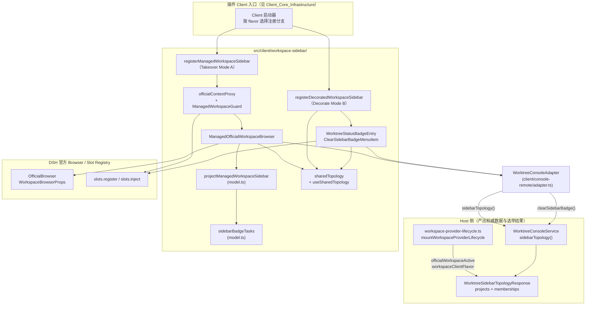
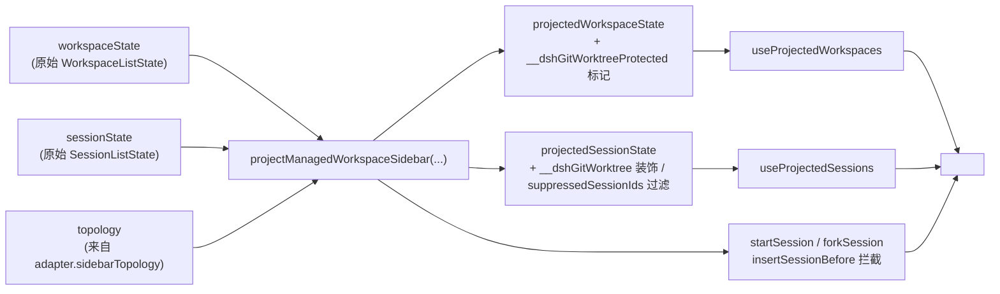
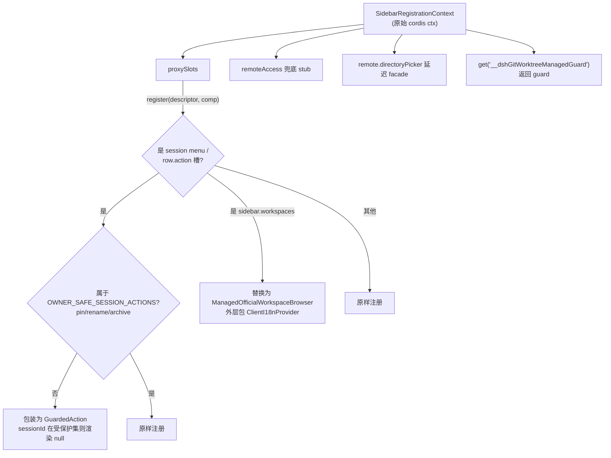
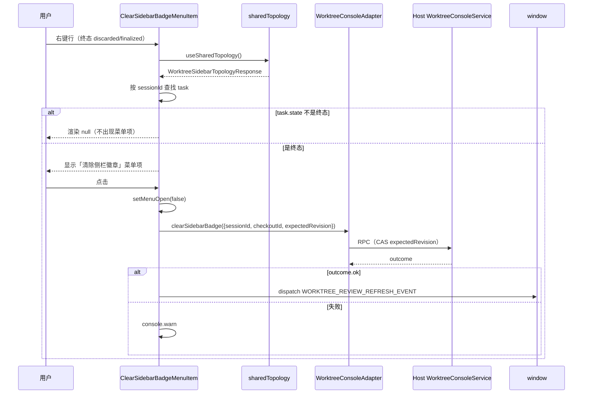
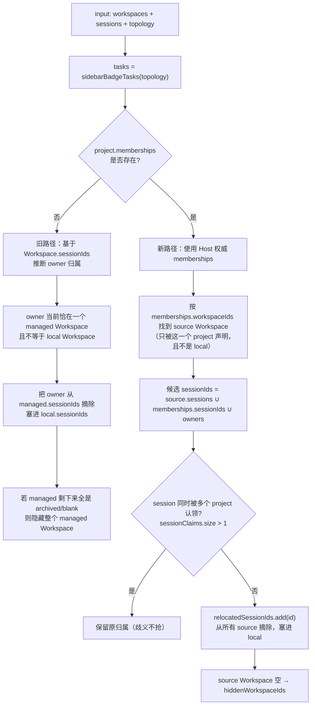
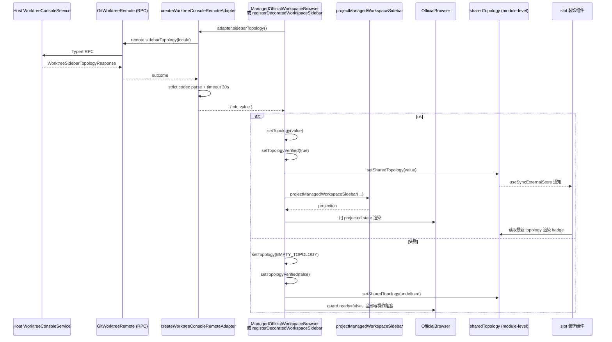

# 客户端工作区侧栏功能（Client_Workspace_Sidebar_Feature）

!!! info "Generated documentation"
    This page was written by CodeWiki from the source code at commit [`24cbc7d6`](https://github.com/wloops/dsh-git-worktree/commit/24cbc7d6f68d4b0b944e65ba326690018feeda7a) on 2026-11-06 with `doubao-seed-2.1-lite`. Check the code before relying on details.

## 简介

`Client_Workspace_Sidebar_Feature` 负责把 Managed Worktree 域的状态投影进 DSH Harness 的官方「工作区 / 会话侧栏」（Workspace Browser）。它本身不渲染一个独立的侧栏 UI，而是通过两条精心设计的运行路径，让 Harness 自带的工作区浏览器呈现出 Worktree 语义：

1. **接管路径（Takeover / Mode A）**：Host 侧生命周期已禁用官方 `ui-workspace` 条目后，本插件以带版本/哈希门禁的官方 Workspace Client 重新 apply，仅替换 `sidebar.workspaces` 槽位的 Browser 组件，其余声明树、语言、目录选择器、Session/Workspace 存储全部保留。
2. **装饰路径（Decorate / Mode B）**：官方 Workspace Client 仍处于激活状态（例如 Host 未执行接管、接管尚未落定，或官方条目被用户禁用），此时不能重放官方 apply（否则会与已注册的 `uiWorkspace` 服务碰撞崩溃），只能通过 Host 的 slot registry 扩展缝，向官方 Browser 已声明的子槽位注入行徽章、悬停卡片装饰与「清除徽章」菜单项。

该模块同时承担**所有权保护**：Managed owner Session 一旦与某个 Worktree Checkout 绑定，侧栏层必须阻止用户（或官方菜单/快捷操作）执行会破坏「一个 owner Session 对应一个 Worktree 目标」不变量的操作（新建会话、fork、跨工作区插入会话等）。

---

## 相关模块导航

| 相邻模块 | 关系 |
| --- | --- |
| [Client_UI_Application_Layer（客户端 UI 应用层）](../Client_UI_Application_Layer.md) | 本模块所属的客户端 UI 应用层总览 |
| [Client_UI_Application_Layer/Client_Core_Infrastructure.md](Client_Core_Infrastructure.md) | 共享的 i18n、Remote 适配器、`ClientSessions`/`ClientWorkspaces` 运行时面、样式表 |
| [Client_UI_Application_Layer/Client_Review_Console_Feature.md](Client_Review_Console_Feature.md) | 发布 `WORKTREE_REVIEW_REFRESH_EVENT` 以驱动侧栏拓扑刷新 |
| [Client_UI_Application_Layer/Client_Target_Console_Feature.md](Client_Target_Console_Feature.md) | 同层的目标控制台，会话头部胶囊展示同一批 topology 数据 |
| [Shared_Worktree_Console_API_Contract —— 共享 Worktree 控制台 API 契约](../Shared_Worktree_Console_API_Contract.md) | `WorktreeSidebarTopologyResponse` / `WorktreeSidebarTask` 等跨层 DTO |
| [后端宿主核心运行时（Backend_Host_Core_Runtime）总览](../Backend_Host_Core_Runtime.md) | Host 侧产出 topology、执行 `clearSidebarBadge`、决定接管/装饰选举 |

---

## 架构总览



### 两条注册入口

| 入口 | 触发条件 | 行为摘要 |
| --- | --- | --- |
| `registerManagedWorkspaceSidebar(ctx, adapter, applyWorkspace?)` | Host 已禁用官方 ui-workspace（takeover 落定），`WorkspaceClientFlavor` 指向已编译的官方 Workspace Client 变体 | 把 `ctx` 经 `officialContextProxy` 包裹后调用 `applyOfficialWorkspace(...)`；官方 apply 内部注册 `sidebar.workspaces` 时会被代理拦截，Browser 组件被换成 `ManagedOfficialWorkspaceBrowser` |
| `registerDecoratedWorkspaceSidebar(ctx, adapter)` | 官方 Workspace 仍是活的侧栏提供者（`officialWorkspaceActive === true`） | 从 `ctx.get('slots')` 取出 slot registry，向 `sidebar.session.row.hover`、`sidebar.workspaces.session.menu.item` 等已声明子槽位注入装饰组件 |

两个入口都读取同一个 `WorktreeConsoleAdapter`（来自 [Client_Core_Infrastructure（客户端核心基础设施层）](Client_Core_Infrastructure.md) 的 `createWorktreeConsoleRemoteAdapter`），把拓扑与徽章清除操作序列化到 Host 侧。

---

## 核心组件

### 1. `ManagedWorktreeSessionDecoration`（`src/client/workspace-sidebar/index.tsx`）

```ts
export interface ManagedWorktreeSessionDecoration {
  kind: 'managed-worktree'
  state: WorktreeSidebarTask['state']
  label: string
  originalTitle: string
}
```

这是**专给被门控的官方 Browser 派生组件消费**的临时展示元数据。它在 `ManagedOfficialWorkspaceBrowser` 里被注入到 Session 摘要的 `__dshGitWorktree` 字段：

```ts
byId[sessionId] = {
  ...summary,
  __dshGitWorktree: { kind: 'managed-worktree', state, label, originalTitle: summary.displayTitle },
}
```

设计意图：**保留官方 `displayTitle` 不动**，让官方派生组件把这段元数据渲染成标题前的固定图标/徽章，而不是替换 canonical 标题。

---

### 2. `ManagedOfficialWorkspaceBrowser`（接管路径核心组件）

这是 Mode A 的 React 容器。它接收官方 Browser 所需的全部 props（`useWorkspaces`、`useSessions`、`startSession`、`forkSession`、`insertSessionBefore`），但把状态读替换为「投影后的状态」，把写操作替换为「受 guard 保护的写操作」。



关键行为：

| 机制 | 作用 |
| --- | --- |
| `workspaceKey` / `sessionKey` 派生 | 仅当 Harness 侧工作区/会话列表真实变化时才重新拉取拓扑，避免每次渲染都 RPC |
| `useEffect` 拉取 `adapter.sidebarTopology()` | 首次挂载 + 监听 `WORKTREE_REVIEW_REFRESH_EVENT`（来自 [客户端评审控制台功能（Client Review Console Feature）](Client_Review_Console_Feature.md)）时刷新；拉取失败退回 `EMPTY_TOPOLOGY` 并把 `guard.ready = false`（此时所有写操作一律阻塞） |
| `setSharedTopology(...)` | 把 topology 同步给**在 Browser React 树之外**通过 slot 注册的菜单/行装饰组件（这些组件无法接收 props） |
| `useLayoutEffect` 写回 `guard` | 把 `protectedSessionIds` / `protectedWorkspaceIds` / `ready` 暴露给 `officialContextProxy` 中的菜单守卫，让非 Browser 树内的官方快捷菜单也能被拦截 |
| `projectedWorkspaceState` | 给受保护 Workspace 加 `__dshGitWorktreeProtected: true`，官方 Browser 派生可据此渲染保护视觉 |
| `projectedSessionState` | 删除 `suppressedSessionIds`（通常是被搬迁后空掉的源 Workspace 的普通 Session），并给 `managedBySessionId` 中的会话注入 `ManagedWorktreeSessionDecoration` |

写操作拦截策略：

- `startSession(workspaceId)`：若目标 Workspace 是受保护的（其下有 Managed owner），直接 `return`，不创建新会话。
- `forkSession(sessionId)`：owner Session 不允许 fork（fork 会创建第二个会话共享同一 cwd，破坏 owner 唯一性）。
- `insertSessionBefore(workspaceId, sessionId, beforeSessionId?)`：参与的 workspaceId、sessionId、beforeSessionId 任一属于受保护集或已搬迁集，都拒绝插入。

---

### 3. `officialContextProxy` 与 `ManagedWorkspaceGuard`（Mode A 的声明层保护）

`registerManagedWorkspaceSidebar` 不会直接把原始 `ctx` 交给官方 apply —— 那样官方的菜单/行操作会绕过上面 React 层的拦截。代理做了四件事：



要点：

- **`OWNER_SAFE_SESSION_ACTIONS = {'pin', 'rename', 'archive'}`**：这些官方动作不创建 Session、不改变 Workspace 归属，即便在 owner 行上也安全，因此不包装。
- **`GuardedAction`**：`props.sessionId` 命中 `guard.blockSession(id)` 时返回 `null`，从 DOM 上彻底隐藏 Fork/危险操作按钮。
- **`deferredRemoteDirectoryPicker(ctx)`**：官方 apply 在构造 `uiWorkspace` 时会立即读 `ctx.remote.directoryPicker`；但现代 Host 上 picker provider 要等 `uiWorkspace` 就绪后才激活。Proxy 用 `get('remote.directoryPicker')` 的惰性解析 + `bind(picker)` 让每次属性访问都即时重查，避免启动期崩溃。
- **`remoteAccess` 兜底**：0.2.2-rc.1 把 `ctx.remoteAccess.source(...)` 当属性读而非 `ctx.get`，缺省会让官方 row hook 崩溃；代理同时响应两种形式，旧 Host 没有该服务时返回 `{ source: () => ({}) }` 无害 stub。

---

### 4. Mode B 的装饰注册：`registerDecoratedWorkspaceSidebar`

当官方 Browser 已在运行，本插件不能再注册 `sidebar.workspaces`（一个槽位只能有一个声明者），只能向**官方已经声明的子槽位**注入条目：

| 注入槽位 | 注册的组件 | 说明 |
| --- | --- | --- |
| `sidebar.session.row.hover` | `WorktreeStatusBadgeEntry`（包 `ClientI18nProvider`） | 悬停卡片体内的分支 glyph + 状态 chip |
| `sidebar.workspaces.session.menu.item` | `ClearSidebarBadgeMenuItem` | 仅在 `discarded` / `finalized` 终态行出现，用于清除侧栏徽章 |

代码注释明确记录了一个陷阱：DSH 0.2.x 中**不存在** `sidebar.session.row.trailing` 槽位，inject 一个从未被声明的槽位会让回调永远不执行，徽章永远挂不上，因此必须枚举真实存在的 `ROW_SEATS`。

由于 Mode B 下 `ManagedOfficialWorkspaceBrowser` 不会挂载（它负责喂 `sharedTopology`），Mode B 自己持有一个 `refresh()`：直接调 `adapter.sidebarTopology()`，成功后 `setSharedTopology(...)`，并在 `ctx.effect` 里注册清理函数（移除 window 事件监听、清空 sharedTopology）。

---

### 5. `ClearSidebarBadgeMenuItem`（终态徽章清除）



设计细节：菜单项仅在 `task.state === 'discarded' || task.state === 'finalized'` 时渲染。Host 在 topology 中会把已清除的徽章抑制掉，所以下一次刷新后该行自然失去图标/徽章/菜单项，不需要前端自己做 reset。

---

### 6. `WorktreeStatusBadgeEntry` 与 `WorktreeIdentity`（Mode B 的行/悬停装饰）

```tsx
<WorktreeIdentity state={task.state} stateLabel={...} label={...} chip />
```

渲染一对元素：

- `.dsh-git-worktree-sidebar-icon`：16px 分支 glyph（`IconBranchOutlineRegular`），通过 `data-worktree-state` 选择颜色。
- `.dsh-git-worktree-sidebar-badge`：胶囊形状态 chip，内容为本地化状态词（如「待验收」「预览中」「已完成」），最大宽度 168px，超长省略。

颜色规则全部在 `src/client/styles.ts`（见 [Client_Core_Infrastructure（客户端核心基础设施层）](Client_Core_Infrastructure.md)）中按 `[data-worktree-state]` 映射到 upstream 调色板：

| state | 颜色语义 |
| --- | --- |
| `working` | 品牌蓝 |
| `ready_for_review` | 警告琥珀 |
| `preview_active` | 蓝/红混合 |
| `preview_detached` / `recovery_required` | 错误红 |
| `finalized` | 成功绿 |
| `discarded` | 次级灰 |

---

## 投影模型（`model.ts`）

### 类型一览

| 类型 | 职责 |
| --- | --- |
| `SidebarWorkspaceView` | 归一化的 Workspace 视图：`workspaceId / title / path / sessionIds` |
| `SidebarSessionSummary` | 归一化的 Session 摘要：`id / displayTitle / title? / cwd? / updatedAt? / blank?` |
| `ProjectedManagedTask` | 在 `WorktreeSidebarTask` 上扩展 `projectId / projectName / stateLabel / label`（chip 文本 + tooltip 文本） |
| `ManagedWorkspaceSidebarProjection` | 投影结果：`workspaces / managedBySessionId / protectedSessionIds / protectedWorkspaceIds / relocatedSessionIds / suppressedSessionIds` |

### `sidebarBadgeTasks(topology, t)`

把拓扑中的所有 project/task 展平成「按 ownerSessionId 去重」的列表。同一 owner 可能在多个迭代/版本中出现，取 **iteration 最大、迭代相同时 revision 最大** 的那条作为有效徽章任务。状态词通过 `STATE_LABELS(t)` 本地化：

```ts
working           → t('in.progress')
ready_for_review  → t('ready.for.review')
preview_active    → t('previewing')
preview_detached  → t('awaiting.recovery')
recovery_required → t('recovery.required')
finalized         → t('completed')
discarded         → t('discarded')
```

`label`（tooltip/aria 文本）= `stateLabel + ' · ' + sourceBranch`，但**永远不**把 sourceBranch 放进 chip。

### `projectManagedWorkspaceSidebar(input, t)` 的两段合并逻辑



设计原则（代码注释逐条记录）：

1. **歧义失败开放（fail-open）**：无法证明 owner 归属时，宁可让官方 Workspace 行保持可见，也不隐藏一个无法判定安全性的 Session。
2. **空 Workspace 不基于缺失 summary 推断**：只有当剩余 session 全是 archived 或 `blank === true` 且不是当前选中 session 时才隐藏源 Workspace；永远不隐藏「选中的启动器」。
3. **Archived 归属持久**：投影只影响侧栏显示，不改变 archived 关系。
4. **Host 权威 memberships 优先**：当拓扑携带 `memberships` 时，旧的「按 sessionIds 推断」路径整体跳过，避免与 Host 注册表冲突。
5. **受保护 Workspace 集合**：被搬迁走的源 Workspace（`protectedWorkspaceIds`）和 owner 当前所在的 managed Workspace 都会被标记，供 `ManagedOfficialWorkspaceBrowser` 拦截写操作。

---

## 数据流（从 Host 拓扑到侧栏徽章）



刷新触发源：

| 触发源 | 事件 |
| --- | --- |
| Browser 初始挂载 | 立即 `refresh()` 一次 |
| Harness workspace/session 列表变化（`workspaceKey`/`sessionKey` 变化） | 重新拉取 topology |
| [客户端评审控制台功能（Client Review Console Feature）](Client_Review_Console_Feature.md) 的 review 状态变化 | `window.dispatchEvent(WORKTREE_REVIEW_REFRESH_EVENT)` |
| 用户点击「清除侧栏徽章」成功 | 同上事件，触发自刷新 |

---

## 关键不变量与保护矩阵

| 用户动作 | 受保护对象 | 保护位置 | 行为 |
| --- | --- | --- | --- |
| 在 owner 所在 Workspace 点「新建会话」 | `protectedWorkspaceIds` | `ManagedOfficialWorkspaceBrowser.startSession` | 直接 return |
| 右键 owner Session → Fork | `protectedSessionIds` | `ManagedOfficialWorkspaceBrowser.forkSession` | 直接 return |
| 拖拽/插入会话到受保护 Workspace | `protectedWorkspaceIds` + `protectedSessionIds` + `relocatedSessionIds` | `ManagedOfficialWorkspaceBrowser.insertSessionBefore` | 全部命中检查 |
| 官方菜单中 Fork/未分类动作 | `guard.blockSession(sessionId)` | `officialContextProxy` 的 `GuardedAction` 包装 | 渲染 `null` |
| 安全动作（pin / rename / archive） | 无 | `OWNER_SAFE_SESSION_ACTIONS` | 不包装，始终可用 |
| topology 尚未加载 / 拉取失败 | 全部 | `guard.ready === false` | `blockSession`/`blockWorkspace` 一律返回 true（阻塞优先） |

---

## 与 Host 选举的衔接

Host 侧的 `mountWorkspaceProviderLifecycle`（见 [后端宿主核心运行时（Backend_Host_Core_Runtime）总览](../Backend_Host_Core_Runtime.md)）通过 Loader 操作禁用/恢复官方 `ui-workspace` 条目，并把结果写进 topology：

- `officialWorkspaceActive: false` + 确定的 `workspaceClientFlavor` → 客户端走 `registerManagedWorkspaceSidebar`（Mode A）。
- `officialWorkspaceActive: true`（接管未启用 / 未落定 / flavor unsupported / 用户已禁用官方条目）→ 客户端走 `registerDecoratedWorkspaceSidebar`（Mode B）。

`cordis.patch.yml`（仓库根目录）记录了 2026-10-17 的关键修复：旧版用 `disabled: !!get('worktreeWorkspaceProvider') && ...` 这种客户端表达式做选举，但同一表达式在 Host apply 阶段（插件 fiber 仍 LOADING）与 Web 渲染审计阶段（插件 ACTIVE）求值结果相反，导致 `uiWorkspace` 无人提供、17 个下游条目 pending、web boot 崩溃。修复后完全由 Host 侧生命周期写确定性布尔，本模块只消费选举结果，不再参与选举决策。

---

## 构建与版本门禁

`package.json` 中 `check:sidebar-version` 脚本（`node scripts/check-workspace-sidebar-version.mjs`）在 `prepublishOnly` 阶段运行，用来校验 Mode A 依赖的 `virtual:dsh-official-workspace-client*` 虚拟模块与当前 Host 世代锁定一致 —— 这与 `WorktreeSidebarTopologyResponse.workspaceClientFlavor` 的语义（`legacy / alpha / next / modern-rc5 / modern-rc1 / unsupported`）一一对应。未钉死 flavor 的 Host 被标记为 `unsupported`，客户端不会挂载猜测出来的 Browser 派生组件。

??? abstract "Documented components (5)"
    - [`ManagedWorktreeSessionDecoration`](https://github.com/wloops/dsh-git-worktree/blob/24cbc7d6f68d4b0b944e65ba326690018feeda7a/src%5Cclient%5Cworkspace-sidebar%5Cindex.tsx) — `src\client\workspace-sidebar\index.tsx`
    - [`ManagedWorkspaceSidebarProjection`](https://github.com/wloops/dsh-git-worktree/blob/24cbc7d6f68d4b0b944e65ba326690018feeda7a/src%5Cclient%5Cworkspace-sidebar%5Cmodel.ts) — `src\client\workspace-sidebar\model.ts`
    - [`ProjectedManagedTask`](https://github.com/wloops/dsh-git-worktree/blob/24cbc7d6f68d4b0b944e65ba326690018feeda7a/src%5Cclient%5Cworkspace-sidebar%5Cmodel.ts) — `src\client\workspace-sidebar\model.ts`
    - [`SidebarSessionSummary`](https://github.com/wloops/dsh-git-worktree/blob/24cbc7d6f68d4b0b944e65ba326690018feeda7a/src%5Cclient%5Cworkspace-sidebar%5Cmodel.ts) — `src\client\workspace-sidebar\model.ts`
    - [`SidebarWorkspaceView`](https://github.com/wloops/dsh-git-worktree/blob/24cbc7d6f68d4b0b944e65ba326690018feeda7a/src%5Cclient%5Cworkspace-sidebar%5Cmodel.ts) — `src\client\workspace-sidebar\model.ts`

