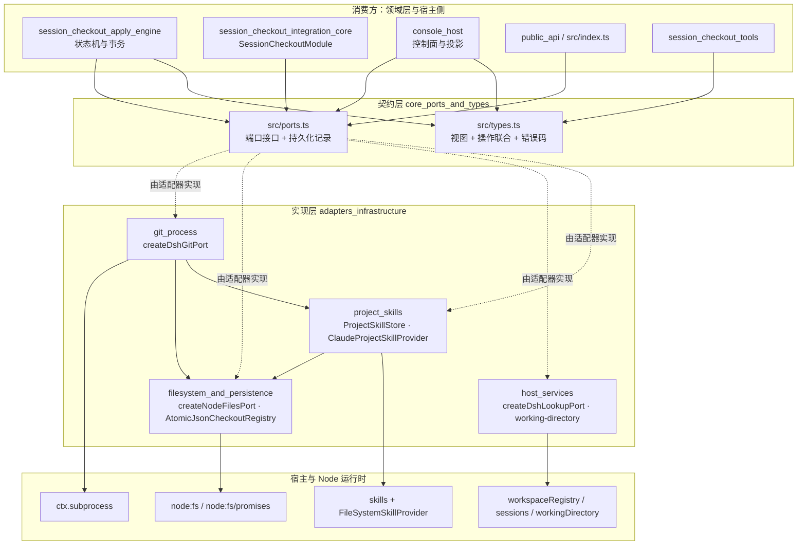

# 端口、适配器与基础设施（Ports, Adapters, and Infrastructure）

!!! info "Generated documentation"
    This page was written by CodeWiki from the source code at commit [`843f8bca`](https://github.com/wloops/dsh-git-worktree/commit/843f8bca9a8eed0ffa6582ed9c7867320f258f81) on 2026-11-12 with `mimo-v2.6-flash`. Check the code before relying on details.

本模块是 `dsh-git-worktree` 插件的**六边形架构边界层**：它把「会话检出（session-checkout）」状态机所需的一切外部能力抽象为端口，再把这些端口实现为运行在 DeepSeek Harness 宿主与 Node.js 之上的具体适配器。它由两个子模块构成：

- **契约层**——[核心端口与类型](core_ports_and_types.md)：`src/ports.ts` 与 `src/types.ts`，只含接口、持久化记录、只读视图、操作联合与稳定错误码，不含 Cordis、React、子进程或文件系统代码。
- **实现层**——[适配器与基础设施](adapters_infrastructure.md)：`src/adapters/`，把 Git、文件系统、注册表、宿主服务与 Project Skills 落地为可执行实现。

这样分层的目的很直接：状态机、apply 引擎与工具层只依赖端口，因此可以在 vitest 中用 fake 端口完整覆盖；而所有「危险动作」（spawn `git`、删除目录、跨进程写 JSON、读取宿主 Session）都收敛在适配器层，并在那里统一做身份校验、原子性与失败分级。

## 架构总览

依赖方向单向朝内：消费方只认识 `ports.ts` / `types.ts`；适配器是实现细节，可以被 fake 替换。契约层的可选方法（`?`）承担「宿主能力探测」职责——能力缺失时降级为 `undefined` / 空列表 / `pushed: null`，绝不臆造事实。

## 端口与适配器对应关系

| 端口（`src/ports.ts`） | 适配器实现 | 关键宿主依赖 |
| --- | --- | --- |
| `SessionCheckoutGitPort` | `createDshGitPort`（`adapters/git.ts`） | `ctx.subprocess`（argv 直连，永不经 shell） |
| `SessionCheckoutFilesPort` | `createNodeFilesPort`（`adapters/files.ts`） | `node:fs`、`node:fs/promises`（bigint stat） |
| `SessionCheckoutRegistryPort` | `AtomicJsonCheckoutRegistry`（`adapters/registry.ts`） | `safe-file.ts` 原子写 + 跨进程文件锁 |
| `SessionCheckoutLookupPort` | `createDshLookupPort`（`adapters/lookup.ts`） | `workspaceRegistry`、`sessions`、`workingDirectory` |
| `SessionWorkingDirectoryPort` | `createSessionWorkingDirectoryPort`（`adapters/working-directory.ts`） | `workingDirectory` |

所有宿主服务均通过 `ctx.get('serviceName')` **动态**解析，并配合结构化类型守卫，因此适配器初始化可以容忍宿主服务晚于插件挂载（Cordis patch 装载方式）。

## 核心组件文档

**子模块**

| 文档 | 内容 |
| --- | --- |
| [核心端口与类型](core_ports_and_types.md) | `SessionCheckoutGitPort` / `FilesPort` / `RegistryPort` / `LookupPort` / `OfficialWorktreesPort` 的契约；`ManagedCheckoutRecord`、`ManagedCheckoutDelivery` 状态机、journal 与恢复续跑、`SessionTargetView` 等路径无关视图、`SESSION_CHECKOUT_ERROR_CODES` 与 `LiveValue` 活配置 |
| [适配器与基础设施](adapters_infrastructure.md) | 端口到宿主能力的落地方式，以及只在该层成立的三块能力：受管 Worktree 创建协议、首次提交协议、Project Skills 携带机制 |

**适配器子模块**

| 文档 | 覆盖文件 | 核心组件 |
| --- | --- | --- |
| [Git 进程适配器与工作树创建编排](adapters_infrastructure_git_process.md) | `git.ts`、`git-options.ts`、`initial-commit.ts`、`worktree-creation.ts` | `createDshGitPort`、`GitPortOptions`、`GitTimeoutOptions`、`GitCommitProtocol`、`createWorktree` |
| [文件系统与持久化适配器（adapters_infrastructure_filesystem_and_persistence）](adapters_infrastructure_filesystem_and_persistence.md) | `files.ts`、`safe-file.ts`、`registry.ts` | `createNodeFilesPort`、`withFileLock`、`AtomicJsonCheckoutRegistry` |
| [Project Skills 适配器：跨 Worktree 携带与 Claude Skill 提供者](adapters_infrastructure_project_skills.md) | `project-skills.ts`、`project-skill-io.ts`、`project-skill-provider.ts` | `ProjectSkillStore`、`SkillSnapshot`、`Manifest`、`ClaudeProjectSkillProvider` |
| [主机服务适配器（Host Services Adapters）](adapters_infrastructure_host_services.md) | `lookup.ts`、`working-directory.ts` | `createDshLookupPort`、`createSessionWorkingDirectoryPort`、`WorkspaceRegistryLike` |

## 与相邻模块的关系

| 关系 | 页面 |
| --- | --- |
| 消费端口的检出事务引擎 | [session_checkout_apply_engine](session_checkout_apply_engine.md) |
| 创建协议的上层调用方 | [核心 Worktree 领域](core_worktree_domain.md) |
| 模块入口与错误类型装配 | [public_api 模块：插件公共入口与契约面](public_api.md) |
| 记录写入与投影 | [console_host：Worktree 控制平面与 Host RPC 服务](console_host.md) |
| 视图 DTO 与远程传输 | [console_contract 模块（Worktree Console 共享契约）](console_contract.md)、[console_remote：控制台远程契约层（Typert Remote）](console_remote.md) |
| 本地化消息来源（`hostMessage`） | [i18n：中英双语文案与语言解析基础设施](i18n.md) |

## 横切设计约束

1. **不信任自报路径**：删除与写入权限来自「目录身份（device/inode/birthtime）+ 指纹 + 宿主记录」，而非调用方传入的字符串。
2. **永不 shell 解释**：Git 调用走 argv 数组，patch 通过 stdin 传入。
3. **失败分级**：只有可证明无害的失败才自动回收；否则保留现场、记录证据并抛 `WorktreeCreationFailure`，交由恢复流程处理。
4. **journal 先于副作用**：所有可能中途崩溃的步骤在动手前落 journal，恢复路径只信 journal 与指纹。
5. **降级而非崩溃**：可选宿主服务缺失时返回 `undefined` / 空数组 / `null`，由领域层解释为「未知」。

??? abstract "Documented components (103)"
    - [`createNodeFilesPort`](https://github.com/wloops/dsh-git-worktree/blob/843f8bca9a8eed0ffa6582ed9c7867320f258f81/src%5Cadapters%5Cfiles.ts) — `src\adapters\files.ts`
    - [`GitTimeoutOptions`](https://github.com/wloops/dsh-git-worktree/blob/843f8bca9a8eed0ffa6582ed9c7867320f258f81/src%5Cadapters%5Cgit-options.ts) — `src\adapters\git-options.ts`
    - [`GitCommandResult`](https://github.com/wloops/dsh-git-worktree/blob/843f8bca9a8eed0ffa6582ed9c7867320f258f81/src%5Cadapters%5Cgit.ts) — `src\adapters\git.ts`
    - [`GitPortOptions`](https://github.com/wloops/dsh-git-worktree/blob/843f8bca9a8eed0ffa6582ed9c7867320f258f81/src%5Cadapters%5Cgit.ts) — `src\adapters\git.ts`
    - [`GitCommitProtocol`](https://github.com/wloops/dsh-git-worktree/blob/843f8bca9a8eed0ffa6582ed9c7867320f258f81/src%5Cadapters%5Cinitial-commit.ts) — `src\adapters\initial-commit.ts`
    - [`LiveSessionLike`](https://github.com/wloops/dsh-git-worktree/blob/843f8bca9a8eed0ffa6582ed9c7867320f258f81/src%5Cadapters%5Clookup.ts) — `src\adapters\lookup.ts`
    - [`SessionStoreLike`](https://github.com/wloops/dsh-git-worktree/blob/843f8bca9a8eed0ffa6582ed9c7867320f258f81/src%5Cadapters%5Clookup.ts) — `src\adapters\lookup.ts`
    - [`WorkingDirectoryLike`](https://github.com/wloops/dsh-git-worktree/blob/843f8bca9a8eed0ffa6582ed9c7867320f258f81/src%5Cadapters%5Clookup.ts) — `src\adapters\lookup.ts`
    - [`WorkspaceLike`](https://github.com/wloops/dsh-git-worktree/blob/843f8bca9a8eed0ffa6582ed9c7867320f258f81/src%5Cadapters%5Clookup.ts) — `src\adapters\lookup.ts`
    - [`WorkspaceRegistryLike`](https://github.com/wloops/dsh-git-worktree/blob/843f8bca9a8eed0ffa6582ed9c7867320f258f81/src%5Cadapters%5Clookup.ts) — `src\adapters\lookup.ts`
    - [`SkillBytes`](https://github.com/wloops/dsh-git-worktree/blob/843f8bca9a8eed0ffa6582ed9c7867320f258f81/src%5Cadapters%5Cproject-skill-io.ts) — `src\adapters\project-skill-io.ts`
    - [`SkillRead`](https://github.com/wloops/dsh-git-worktree/blob/843f8bca9a8eed0ffa6582ed9c7867320f258f81/src%5Cadapters%5Cproject-skill-io.ts) — `src\adapters\project-skill-io.ts`
    - [`ClaudeProjectSkillProvider`](https://github.com/wloops/dsh-git-worktree/blob/843f8bca9a8eed0ffa6582ed9c7867320f258f81/src%5Cadapters%5Cproject-skill-provider.ts) — `src\adapters\project-skill-provider.ts`
    - [`Locator`](https://github.com/wloops/dsh-git-worktree/blob/843f8bca9a8eed0ffa6582ed9c7867320f258f81/src%5Cadapters%5Cproject-skill-provider.ts) — `src\adapters\project-skill-provider.ts`
    - [`CarriedSkillState`](https://github.com/wloops/dsh-git-worktree/blob/843f8bca9a8eed0ffa6582ed9c7867320f258f81/src%5Cadapters%5Cproject-skills.ts) — `src\adapters\project-skills.ts`
    - [`Entry`](https://github.com/wloops/dsh-git-worktree/blob/843f8bca9a8eed0ffa6582ed9c7867320f258f81/src%5Cadapters%5Cproject-skills.ts) — `src\adapters\project-skills.ts`
    - [`Manifest`](https://github.com/wloops/dsh-git-worktree/blob/843f8bca9a8eed0ffa6582ed9c7867320f258f81/src%5Cadapters%5Cproject-skills.ts) — `src\adapters\project-skills.ts`
    - [`ProjectSkillStore`](https://github.com/wloops/dsh-git-worktree/blob/843f8bca9a8eed0ffa6582ed9c7867320f258f81/src%5Cadapters%5Cproject-skills.ts) — `src\adapters\project-skills.ts`
    - [`SkillSnapshot`](https://github.com/wloops/dsh-git-worktree/blob/843f8bca9a8eed0ffa6582ed9c7867320f258f81/src%5Cadapters%5Cproject-skills.ts) — `src\adapters\project-skills.ts`
    - [`AtomicJsonCheckoutRegistry`](https://github.com/wloops/dsh-git-worktree/blob/843f8bca9a8eed0ffa6582ed9c7867320f258f81/src%5Cadapters%5Cregistry.ts) — `src\adapters\registry.ts`
    - [`FileLockOptions`](https://github.com/wloops/dsh-git-worktree/blob/843f8bca9a8eed0ffa6582ed9c7867320f258f81/src%5Cadapters%5Csafe-file.ts) — `src\adapters\safe-file.ts`
    - [`FileLockPayload`](https://github.com/wloops/dsh-git-worktree/blob/843f8bca9a8eed0ffa6582ed9c7867320f258f81/src%5Cadapters%5Csafe-file.ts) — `src\adapters\safe-file.ts`
    - [`SessionWorkingDirectoryPort`](https://github.com/wloops/dsh-git-worktree/blob/843f8bca9a8eed0ffa6582ed9c7867320f258f81/src%5Cadapters%5Cworking-directory.ts) — `src\adapters\working-directory.ts`
    - [`WorkingDirectoryServiceLike`](https://github.com/wloops/dsh-git-worktree/blob/843f8bca9a8eed0ffa6582ed9c7867320f258f81/src%5Cadapters%5Cworking-directory.ts) — `src\adapters\working-directory.ts`
    - [`Result`](https://github.com/wloops/dsh-git-worktree/blob/843f8bca9a8eed0ffa6582ed9c7867320f258f81/src%5Cadapters%5Cworktree-creation.ts) — `src\adapters\worktree-creation.ts`
    - [`BranchOverviewEntry`](https://github.com/wloops/dsh-git-worktree/blob/843f8bca9a8eed0ffa6582ed9c7867320f258f81/src%5Cports.ts) — `src\ports.ts`
    - [`DirectoryIdentity`](https://github.com/wloops/dsh-git-worktree/blob/843f8bca9a8eed0ffa6582ed9c7867320f258f81/src%5Cports.ts) — `src\ports.ts`
    - [`GitCheckoutSnapshot`](https://github.com/wloops/dsh-git-worktree/blob/843f8bca9a8eed0ffa6582ed9c7867320f258f81/src%5Cports.ts) — `src\ports.ts`
    - [`GraphLogCommit`](https://github.com/wloops/dsh-git-worktree/blob/843f8bca9a8eed0ffa6582ed9c7867320f258f81/src%5Cports.ts) — `src\ports.ts`
    - [`InitialCommitPreflight`](https://github.com/wloops/dsh-git-worktree/blob/843f8bca9a8eed0ffa6582ed9c7867320f258f81/src%5Cports.ts) — `src\ports.ts`
    - [`LiveValue`](https://github.com/wloops/dsh-git-worktree/blob/843f8bca9a8eed0ffa6582ed9c7867320f258f81/src%5Cports.ts) — `src\ports.ts`
    - [`ManagedApplyConflictRecoveryContinuation`](https://github.com/wloops/dsh-git-worktree/blob/843f8bca9a8eed0ffa6582ed9c7867320f258f81/src%5Cports.ts) — `src\ports.ts`
    - [`ManagedCheckoutCreateJournal`](https://github.com/wloops/dsh-git-worktree/blob/843f8bca9a8eed0ffa6582ed9c7867320f258f81/src%5Cports.ts) — `src\ports.ts`
    - [`ManagedCheckoutJournalBase`](https://github.com/wloops/dsh-git-worktree/blob/843f8bca9a8eed0ffa6582ed9c7867320f258f81/src%5Cports.ts) — `src\ports.ts`
    - [`ManagedCheckoutMutationJournal`](https://github.com/wloops/dsh-git-worktree/blob/843f8bca9a8eed0ffa6582ed9c7867320f258f81/src%5Cports.ts) — `src\ports.ts`
    - [`ManagedCheckoutRecord`](https://github.com/wloops/dsh-git-worktree/blob/843f8bca9a8eed0ffa6582ed9c7867320f258f81/src%5Cports.ts) — `src\ports.ts`
    - [`ManagedCheckoutsRegistry`](https://github.com/wloops/dsh-git-worktree/blob/843f8bca9a8eed0ffa6582ed9c7867320f258f81/src%5Cports.ts) — `src\ports.ts`
    - [`ManagedDeliveryProof`](https://github.com/wloops/dsh-git-worktree/blob/843f8bca9a8eed0ffa6582ed9c7867320f258f81/src%5Cports.ts) — `src\ports.ts`
    - [`ManagedPreviewReceipt`](https://github.com/wloops/dsh-git-worktree/blob/843f8bca9a8eed0ffa6582ed9c7867320f258f81/src%5Cports.ts) — `src\ports.ts`
    - [`ManagedPreviewRecoveryAnalysisContinuation`](https://github.com/wloops/dsh-git-worktree/blob/843f8bca9a8eed0ffa6582ed9c7867320f258f81/src%5Cports.ts) — `src\ports.ts`
    - [`ManagedPreviewRecoveryHandoffContinuation`](https://github.com/wloops/dsh-git-worktree/blob/843f8bca9a8eed0ffa6582ed9c7867320f258f81/src%5Cports.ts) — `src\ports.ts`
    - [`ManagedReviewRegenerationContinuation`](https://github.com/wloops/dsh-git-worktree/blob/843f8bca9a8eed0ffa6582ed9c7867320f258f81/src%5Cports.ts) — `src\ports.ts`
    - [`ManagedWorktreeCheckpointRecord`](https://github.com/wloops/dsh-git-worktree/blob/843f8bca9a8eed0ffa6582ed9c7867320f258f81/src%5Cports.ts) — `src\ports.ts`
    - [`ManagedWorktreePreviousReviewRecord`](https://github.com/wloops/dsh-git-worktree/blob/843f8bca9a8eed0ffa6582ed9c7867320f258f81/src%5Cports.ts) — `src\ports.ts`
    - [`ManagedWorktreeReviewRecord`](https://github.com/wloops/dsh-git-worktree/blob/843f8bca9a8eed0ffa6582ed9c7867320f258f81/src%5Cports.ts) — `src\ports.ts`
    - [`OfficialWorktreesPort`](https://github.com/wloops/dsh-git-worktree/blob/843f8bca9a8eed0ffa6582ed9c7867320f258f81/src%5Cports.ts) — `src\ports.ts`
    - [`SessionBindingRecord`](https://github.com/wloops/dsh-git-worktree/blob/843f8bca9a8eed0ffa6582ed9c7867320f258f81/src%5Cports.ts) — `src\ports.ts`
    - [`SessionCheckoutDependencies`](https://github.com/wloops/dsh-git-worktree/blob/843f8bca9a8eed0ffa6582ed9c7867320f258f81/src%5Cports.ts) — `src\ports.ts`
    - [`SessionCheckoutFilesPort`](https://github.com/wloops/dsh-git-worktree/blob/843f8bca9a8eed0ffa6582ed9c7867320f258f81/src%5Cports.ts) — `src\ports.ts`
    - [`SessionCheckoutGitPort`](https://github.com/wloops/dsh-git-worktree/blob/843f8bca9a8eed0ffa6582ed9c7867320f258f81/src%5Cports.ts) — `src\ports.ts`
    - … and 53 more

