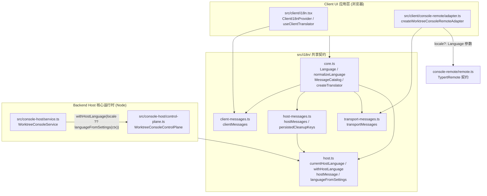
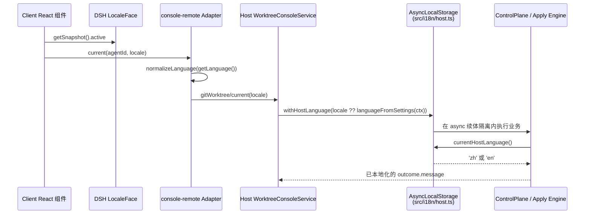

# 国际化（i18n）层

!!! info "Generated documentation"
    This page was written by CodeWiki from the source code at commit [`b0979671`](https://github.com/wloops/dsh-git-worktree/commit/b0979671ecdb749b8ca1bf1b3c9f06182f618b95) on 2026-11-07 with `doubao-seed-2.1-lite`. Check the code before relying on details.

## 概述

国际化（i18n）层是 `dsh-git-worktree` 插件在 **Client UI 应用层** 与 **Backend Host 核心运行时** 之间共享的纯 TypeScript 文案契约模块，位于 `src/i18n/`。它提供中英双语（`'zh' | 'en'`）的消息目录、类型安全的占位符插值翻译器，以及两套独立的语言解析通道（浏览器侧 React 通道与 Node Host 侧异步上下文通道），保证两端的用户可见文案语言一致。

该层只依赖 `node:async_hooks`（仅 Host 侧）和纯类型定义，不包含任何业务逻辑，所有用户数据均作为插值参数传入，文案本身是稳定的跨层契约。

### 核心设计约束

- **键名稳定**：消息 key 一旦持久化到磁盘（如清理恢复判别字段）或被跨进程引用，其存储值不得改变，仅对公开投影做本地化。
- **语言归一化**：`normalizeLanguage` 将任意输入（如 `en-US`、`en-GB`）统一归一为 `'en'`，其余一律回退为 `'zh'`（默认中文）。
- **占位符插值**：模板形如 `{project}`、`{p0}`、`{count}`，运行时按参数对象替换；缺失参数时保留原始占位符 `{name}` 而非抛错。
- **类型安全**：`createTranslator` 基于消息目录推导 `Translator<C>`，键名与占位符参数在编译期被 TypeScript 校验。

## 架构概览



## 分层职责

| 文件 | 职责 | 消费方 |
| --- | --- | --- |
| `src/i18n/core.ts` | 语言类型定义、归一化、目录类型与翻译器工厂 | 全部模块（浏览器与 Node 通用） |
| `src/i18n/client-messages.ts` | 插件拥有的 **Client 侧文案目录**（约 400 条，含 UI 标签、错误提示、Agent prompt 模板） | 浏览器 React 组件与 console-remote 适配器 |
| `src/i18n/host-messages.ts` | 插件拥有的 **Host 侧文案目录**（约 500 条，含状态机错误、Git 操作失败、工具描述）与持久化清理 key 管理 | Node Host 控制平面、Apply 引擎、工具描述 |
| `src/i18n/transport-messages.ts` | **跨网络传输层**的窄文案目录（malformed payload、挂载失败、调用超时） | Client console-remote 适配器 |
| `src/i18n/host.ts` | Host 侧语言快照（基于 `AsyncLocalStorage`）、设置读取、`hostMessage` 翻译器 | `WorktreeConsoleService` 每个 `@Remote` 方法 |

## 语言解析双通道



**关键语义**：

1. **Client 通道**：浏览器侧不直接调用 Node 语言服务，而是由 DSH 的 `LocaleFace` 将用户偏好解析为快照，经 `ClientI18nProvider` + `useSyncExternalStore` 注入 React 树；命令式服务在调用瞬间（而非模块加载时）解析语言。
2. **Host 通道**：每个 `@Remote` 方法都用 `withHostLanguage(locale ?? languageFromSettings(agent.ctx ?? hostContext), ...)` 包裹，`AsyncLocalStorage` 保证同一 RPC 调用内的所有异步续体（包括 Git spawn、注册表锁）共享同一个不可变语言快照，避免多用户之间设置泄漏。
3. **回退策略**：若 RPC 未显式传 `locale`，Host 从 Agent 上下文的 `settings.locale.preference` 读取；读取失败（服务在装配或拆卸期缺失）则回退 `'zh'`。

## 关键行为说明

### 1. 类型安全的翻译器工厂

`createTranslator` 在运行时返回一个函数，其类型由传入的目录推导：

```ts
// core.ts 签名
export function createTranslator<const C extends MessageCatalog>(catalog: C, language: Language): Translator<C>
```

`Translator<C>` 要求调用时必须传入目录中该 key 模板里出现的全部占位符参数（`MessageArgs` 用条件类型从模板字符串字面量中提取占位符名）。例如 `clientMessages["manager.task.label"]` 模板含 `{project}` 与 `{iteration}`，调用时必须提供这两个键；运行时若参数缺失则原样保留 `{name}`。

### 2. 持久化清理判别 key

`host-messages.ts` 中 `persistedCleanupKeys` 是一个有限白名单（10 个 `cleanup*` key），其**存储值被旧记录持久化**，因此不能修改文案字面量。`hostPersistedCleanupMessage(message, translate, key?)` 的逻辑：

```ts
const named = persistedCleanupKeys.find(c => c === key)        // 新记录：按 key 翻译
if (named) return translate(named)
const legacy = persistedCleanupKeys.find(c => hostMessages[c].zh === message)  // 旧记录：按中文字面串反查
return legacy ? translate(legacy) : message                    // 都找不到：原样返回（绝不解释第三方错误文本）
```

这保证历史记录在语言切换时仍能被正确投影，同时不会把不可信的第三方错误文本当作指令解释。

### 3. 注册元数据双语暴露

`hostRegistrationMessage(key)` 返回 `hostMessages[key].zh + ' / ' + hostMessages[key].en`，用于在跨 Session 共享的菜单/命令注册元数据中同时展示两种语言，避免单一语言对另一方用户不可见。

## 与其他模块的关系

- **[Console Remote 传输层（Console_Remote_Transport_Layer）](Console_Remote_Transport_Layer.md)**：RPC 契约在每个方法签名末尾追加 `locale?: Language` 参数；Client 适配器将当前语言随每次调用上送，Host 据此选择目录。
- **[Client_UI_Application_Layer（客户端 UI 应用层）](../Client_UI_Application_Layer.md)**：Client 侧通过 `src/client/i18n.tsx` 消费 `clientMessages`；React 组件调用 `useClientTranslator()` 获取翻译函数。
- **[后端宿主核心运行时（Backend_Host_Core_Runtime）总览](../Backend_Host_Core_Runtime.md)**：Host 侧的 `WorktreeConsoleService`（RPC 门面）、`WorktreeConsoleControlPlane`（控制平面）、Apply 引擎与工具描述均通过 `hostMessage(...)` 输出本地化文案。
- **[Shared_Worktree_Console_API_Contract —— 共享 Worktree 控制台 API 契约](../Shared_Worktree_Console_API_Contract.md)**：`WorktreeConsoleError.message` 字段承载本层生成的本地化字符串，错误 `code` 仍为稳定英文标识（如 `transport_unavailable`、`malformed_response`、`timeout`），文案不参与契约判别。

## 扩展指引

- **新增 Client 文案**：在 `client-messages.ts` 中追加 `"key": {"zh": "...", "en": "..."}`，key 用小写点分命名（如 `settings.autoDeliver.hint`）；含占位符时用 `{name}` 或 `{p0}` 风格。无需在调用方声明类型，`useClientTranslator()` 自动推导。
- **新增 Host 文案**：在 `host-messages.ts` 中追加；若该 key 会被持久化到磁盘作为判别依据，必须同时加入 `persistedCleanupKeys` 白名单并保持其 zh/en 字面量稳定。
- **新增传输层文案**：仅在 `transport-messages.ts` 中追加，保持窄粒度（该目录只描述网络/挂载异常，不承载业务状态）。

??? abstract "Documented components (5)"
    - [`__file__`](https://github.com/wloops/dsh-git-worktree/blob/b0979671ecdb749b8ca1bf1b3c9f06182f618b95/src%5Ci18n%5Cclient-messages.ts) — `src\i18n\client-messages.ts`
    - [`Language`](https://github.com/wloops/dsh-git-worktree/blob/b0979671ecdb749b8ca1bf1b3c9f06182f618b95/src%5Ci18n%5Ccore.ts) — `src\i18n\core.ts`
    - [`PersistedCleanupKey`](https://github.com/wloops/dsh-git-worktree/blob/b0979671ecdb749b8ca1bf1b3c9f06182f618b95/src%5Ci18n%5Chost-messages.ts) — `src\i18n\host-messages.ts`
    - [`currentHostLanguage`](https://github.com/wloops/dsh-git-worktree/blob/b0979671ecdb749b8ca1bf1b3c9f06182f618b95/src%5Ci18n%5Chost.ts) — `src\i18n\host.ts`
    - [`__file__`](https://github.com/wloops/dsh-git-worktree/blob/b0979671ecdb749b8ca1bf1b3c9f06182f618b95/src%5Ci18n%5Ctransport-messages.ts) — `src\i18n\transport-messages.ts`

